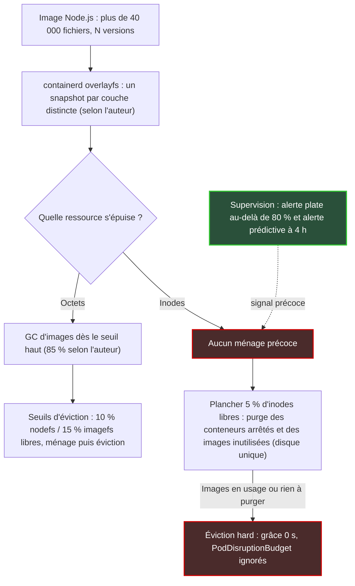

## Un disque à moitié vide peut refuser d'écrire

Il existe une façon très simple de mettre un serveur à genoux sans jamais remplir son disque : lui faire stocker des dizaines de milliers de fichiers minuscules. La jauge affiche une machine à moitié vide, l'astreinte dort tranquille, et pourtant plus rien ne peut être créé. Ni un log, ni une couche d'image, ni un fichier temporaire.

Le scénario n'a rien d'exotique. Il guette toute organisation qui fait tourner Kubernetes sur de petites machines : sondes de supervision, serveurs de collecte en périphérie, clusters installés dans des magasins ou des hôtels, plateformes internes d'une DSI. Sur ces nœuds aux disques modestes, la sanction n'est pas un ralentissement. C'est l'arrêt sans préavis de conteneurs en production, parfois ceux-là mêmes qui collectent la télémétrie dont on aurait besoin pour comprendre l'incident.

Pourquoi en parler maintenant ? Le 5 octobre, le blog de la CNCF (Cloud Native Computing Foundation, la fondation qui héberge Kubernetes) a republié le retour d'expérience d'un ingénieur, Onkar Raghunath Shelke, qui pointe une asymétrie méconnue. L'agent qui pilote chaque nœud protège l'espace disque avec deux lignes de défense. Le nombre de fichiers n'en a qu'une, placée au bord du précipice.

Ma position est tranchée : ce n'est pas un défaut à corriger dans Kubernetes. C'est un signal que votre plateforme de supervision doit produire elle-même, et bien plus tôt.

## Des fiches, des rayonnages, et un catalogue qu'on ne peut pas agrandir

Pour saisir le problème, imaginez une bibliothèque. Chaque livre occupe de la place sur les rayonnages, mais il possède aussi une fiche dans le meuble du catalogue. Le nombre de fiches vierges a été décidé le jour de la construction : une fiche pour tant de mètres d'étagère. Tant qu'arrivent des romans de taille normale, étagères et fiches s'épuisent à peu près au même rythme. Puis un donateur dépose quarante mille brochures de trois pages. Le catalogue est vide, les étagères à moitié libres, et plus aucun ouvrage ne peut entrer.

Sur un serveur Linux, les étagères sont les octets. Les fiches sont les inodes, ces petites structures qui décrivent chaque fichier : propriétaire, droits, emplacement des données. Un fichier de 200 octets consomme un inode, exactement comme un fichier de 2 Go.

Sur ext4, le système de fichiers historique de Linux, le nombre d'inodes est gravé au formatage. L'outil mke2fs en crée un tous les N octets de capacité, N étant le ratio `bytes-per-inode`. Sa page de manuel ne laisse aucune place au doute : il n'est pas possible de changer ce ratio après la création. L'option `-N` permet de forcer un nombre exact d'inodes, mais là encore au formatage, jamais après. [6]

Quel ratio par défaut ? Le fichier `mke2fs.conf` définit un `inode_ratio` ; sa page de manuel affiche 16 384 octets dans son exemple, et c'est la valeur que retient l'auteur du retour d'expérience. Mais le défaut réellement livré dépend de la distribution et de la version d'e2fsprogs, la suite d'outils qui gère ext4. Lisez `/etc/mke2fs.conf` sur vos propres images plutôt que de me croire sur parole. [7, 1]

L'auteur fournit une démonstration reproductible, menée avec e2fsprogs 1.47.2. Une image disque d'1 Go au ratio 16 384 contient 65 536 inodes pour 262 144 blocs de 4 Kio. Remplissez-la de fichiers d'un seul bloc : elle est saturée à 256 Mio, soit 25 % de sa capacité. Sur une image de 64 Mo, la création échoue vers le 4 085e fichier avec un laconique `Could not allocate inode`. À cet instant, 97,9 % des inodes sont consommés, contre 32,6 % des blocs. [1]

Une précision qui compte : cette rigidité est propre à ext4 et aux formats à inodes statiques. XFS, par exemple, alloue ses inodes dynamiquement, dans la limite d'un plafond de pourcentage d'espace (`imaxpct`). Tout ce qui suit vaut donc pour des nœuds formatés en ext4. Vérifiez ce que votre image de système installe réellement : ce n'est pas toujours ce que l'on croit.

## Deux lignes de défense pour les octets, une seule pour les inodes

Quand un nœud Kubernetes manque de place, la mécanique est en principe bien huilée. Le kubelet, l'agent installé sur chaque nœud qui lance les conteneurs et veille sur les ressources de la machine, fait d'abord le ménage dans les images inutilisées. Si cela ne suffit pas, il évince des pods (les unités de déploiement de Kubernetes) pour sauver le nœud. Encore faut-il qu'il regarde la bonne ressource.


*Deux jauges, deux régimes : les octets ont droit à un ménage précoce, les inodes à un simple plancher d'urgence.*

**Première ligne : le ramasse-miettes d'images.** Le GC (garbage collector) d'images du kubelet calcule un taux d'occupation à partir des octets disponibles et de la capacité du système de fichiers, puis se déclenche dès que ce taux atteint un seuil haut, `HighThresholdPercent`. Il supprime alors les images les plus anciennement utilisées jusqu'à repasser sous un seuil bas. [3, 4]

Le code source ne lit ni ne compare aucun champ inode. La documentation officielle ne parle que de « disk usage ». L'auteur annonce des seuils par défaut de 85 % et 80 % ; ces valeurs, également documentées dans les références GKE, sont configurables ; vérifiez celles de votre kubelet. [1, 3, 4]

**Deuxième ligne : l'éviction.** Sous Linux, les seuils d'éviction « hard » par défaut sont `nodefs.available<10%`, `imagefs.available<15%`, `nodefs.inodesFree<5%` et `imagefs.inodesFree<5%`. Le nodefs désigne le système de fichiers principal du nœud. L'imagefs, optionnel, est celui où le moteur de conteneurs range images et couches. [2]

Mettez les deux lignes côte à côte. Côté octets, deux mécanismes se relaient : un ménage périodique piloté par le seuil haut, puis des seuils d'éviction qui tentent eux aussi un nettoyage avant de toucher aux pods. Côté inodes, seul le second existe. Et il n'agit qu'à 95 % consommés.

Il faut ici corriger le récit initial. L'auteur écrit que la première réponse à l'épuisement des inodes est l'éviction de pods. C'est un raccourci. La documentation précise que le kubelet tente de récupérer des ressources au niveau du nœud avant d'évincer quoi que ce soit, et le code de la branche principale le confirme. Sur un nœud à disque unique, franchir le plancher inode déclenche d'abord la suppression des conteneurs arrêtés, puis, si la pression persiste, celle de toutes les images inutilisées éligibles, sans viser de seuil bas. [2, 5]

Le ménage existe donc. Il a cependant trois limites sérieuses :

1. **Il arrive tard.** À 5 % d'inodes libres, pas avant.
2. **Il ne touche que l'inutilisé.** Seules partent les images qu'aucun conteneur n'utilise, non épinglées et plus anciennes qu'un âge minimum. Si les copies qui saturent le disque appartiennent à des pods actifs, il n'y a rien à récupérer.
3. **Il dépend de la topologie des disques.** Avec un imagefs séparé, le plancher inode du nodefs n'a, dans le code lu, aucune fonction de ménage associée : c'est l'éviction directe.

Une réserve sur ce dernier point. Cette lecture porte sur la branche principale du dépôt Kubernetes, alors que l'auteur cite la version 1.37.0, et le comportement selon la topologie des disques a évolué récemment. Vérifiez-le sur la version que vous exploitez. [5]

Quand le ménage échoue, la sanction tombe sans appel. Une éviction « hard » s'applique avec un délai de grâce de zéro seconde. Elle ignore les PodDisruptionBudget, ces garde-fous qui limitent le nombre de pods d'une même application arrêtés en même temps. [2]

Dernier piège, documenté mais rarement lu. Si vous modifiez un seul seuil `evictionHard`, les autres ne gardent pas leur valeur par défaut : ils retombent à zéro, sauf activation de `MergeDefaultEvictionSettings`. Une équipe qui ajuste le seuil mémoire peut ainsi supprimer sans le savoir le plancher inode. [2]


*Les octets disposent d'un ménage précoce, les inodes d'un seul plancher d'urgence : le signal anticipé doit venir de la supervision.*

**À partir de quand l'inode passe-t-il devant ?** Voici un calcul de coin de table, le mien et non celui de l'auteur. Prenons un système de fichiers dédié, blocs réservés exclus. Le plancher inode (95 % consommés) est atteint avant le seuil de ménage (85 % des octets) dès que la taille moyenne occupée par fichier tombe sous 0,85/0,95 du ratio, soit environ 0,9 fois. Cela donne un peu plus de 14 Kio au ratio 16 384, et à peine plus de 7 Kio au ratio 8 192.

Or un répertoire `node_modules`, ce sont des milliers de fichiers de quelques Ko, chacun occupant au moins un bloc de 4 Kio. Il tombe en plein dans la zone.

## 21 553 icônes par couche : anatomie d'un nœud qui sature

Commençons par l'image applicative. Le service en cause est un front-end Node.js, construit avec un Dockerfile mono-étape : tout le répertoire `node_modules` part en production, dépendances de développement comprises. Le seul paquet `@mui/icons-material`, une bibliothèque d'icônes, pèse 21 553 fichiers par snapshot. L'image entière dépasse les 40 000 fichiers. [1]

Passons au nœud. containerd, le moteur d'exécution qui fait tourner les conteneurs, s'appuie par défaut sur le snapshotter `overlayfs`, c'est-à-dire le composant qui dépaquette les couches d'une image sur le disque. Sa documentation le rapproche du pilote `overlay2` de Docker, sans rien détailler de l'usage des inodes. [8]

Selon l'auteur, chaque couche distincte est extraite dans son propre snapshot, sans partage de fichiers avec les autres. La documentation de containerd ne décrit pas ce point. Je le présente donc comme son observation, reproductible avec le protocole qu'il publie. [1, 8]

Ajoutez la CI (intégration continue). Un cache de build froid, ou un `COPY . .` sans fichier `.dockerignore`, et les empreintes des couches changent d'un build à l'autre. Chaque déploiement dépose alors sur chaque nœud une nouvelle copie de dizaines de milliers de fichiers. Les anciennes ne partiront que lorsqu'aucun pod ne les utilisera plus. [1]

Venons-en aux chiffres de l'incident, avec une précaution importante. L'auteur n'a plus accès au cluster et n'a conservé aucune capture : les valeurs qui suivent sont **reconstituées par arithmétique, pas mesurées**. Le nœud aurait affiché environ 103 Go utilisés pour 22 Go disponibles, soit 83 % d'occupation. Côté inodes, environ 11 millions consommés pour 5,3 millions libres, soit 67 %. [1]

Ces valeurs reconstituées trahissent un détail. Le disque est estimé entre 124 et 133 Gio. Au ratio 16 384, il ne contiendrait que 8,1 à 8,7 millions d'inodes, moins que les 11 millions utilisés. Le nœud a donc vraisemblablement été formaté à 8 192 octets par inode, et le compte tombe juste : 16,3 millions d'inodes pour environ 125 Gio. [1] Avec des fichiers d'un seul bloc, ce disque saturerait vers 50 % d'occupation au lieu de 25 %. Le ratio plus généreux a retardé le problème. Il ne l'a pas supprimé.

Reste un point que la source n'aborde pas, et qui mérite d'être dit. Dans cet incident, les octets (83 %) étaient plus proches de leur seuil de ménage (85 %) que les inodes (67 %) de leur plancher (95 %). Pris isolément, l'incident ne démontre donc pas l'angle mort. Ce qui le démontre, c'est l'arithmétique du ratio et la dynamique. D'ailleurs, ce n'est pas un seuil franchi qui a donné l'alerte, mais une alerte prédictive, `NodeFilesystemFilesFillingUp`, qui extrapole la vitesse de consommation des inodes. [1, 9]

Conséquence pratique : la métrique que propose l'auteur, l'écart entre pourcentage d'inodes et pourcentage d'octets, aurait été négative ici. Elle n'aurait rien signalé. Je lui préfère le rapport des vitesses de croissance. Un nœud dont les inodes grimpent deux fois plus vite que les octets est en train de dériver, quel que soit son niveau du jour.


*Chaque version d'image dépaquetée sur le nœud peut ajouter des dizaines de milliers de fichiers, selon l'observation de l'auteur du retour d'expérience.*

## Sondes, collecteurs, edge : le terrain de jeu idéal

Transposons à une plateforme de supervision multi-sites, celle d'un opérateur réseau, d'une enseigne de distribution ou d'un groupe hôtelier. Ce qui suit relève de mon analyse : aucune donnée d'une infrastructure particulière n'est utilisée ici.

Les nœuds de collecte, les sondes et les serveurs installés en périphérie (edge) cumulent les facteurs de risque. Leurs disques sont souvent modestes, de quelques dizaines à une centaine de gigaoctets (ordre de grandeur d'expérience, non issu de la source) ; celui de l'incident décrit plus haut approchait 125 Gio. Ils sont formatés par défaut par l'image de système, sans que personne ne se pose la question du ratio. Et ils exécutent des images tierces (interfaces web, exporteurs de métriques, agents) dont l'équipe ne maîtrise pas le Dockerfile. C'est exactement la combinaison qui sature les inodes avant les octets.

Le scénario redouté s'écrit tout seul. Un vendredi soir, un incident dégrade le Wi-Fi d'une chaîne de quarante hôtels. Le nœud qui porte la collecte de télémétrie franchit son plancher inode, le ménage ne trouve rien à supprimer, l'éviction tombe sans délai de grâce. La supervision devient aveugle au moment précis où elle devait voir.

Voici ce que je mettrais en place. Ce sont mes recommandations ; les troisième et quatrième, en particulier, ne figurent pas dans la source et doivent être testées sur votre parc avant toute généralisation.

1. **Une alerte plate sur les inodes**, par exemple au-delà de 80 % consommés pendant 30 minutes, en complément de l'alerte prédictive standard, qui passe en critique quand l'épuisement est prévu sous 4 heures. La fiche d'intervention (runbook) de cette alerte le reconnaît elle-même : un système de fichiers peut manquer d'inodes avec de l'espace libre, souvent à cause d'une application qui crée beaucoup de petits fichiers. [9]
2. **Un tableau de bord de flotte** qui classe les nœuds selon le rapport entre vitesse de croissance des inodes et vitesse de croissance des octets. C'est là que les dérives se voient, bien avant l'incident.
3. **Un seuil d'éviction souple** (`evictionSoft`) sur `nodefs.inodesFree` et `imagefs.inodesFree`, vers 15 %, avec un délai de grâce. L'objectif : que le nœud signale une pression disque bien avant le plancher, et qu'une éventuelle éviction laisse aux pods le temps de s'arrêter proprement. Gare au piège de fusion des seuils évoqué plus haut.
4. **Un gabarit de nœud explicite** : formatage avec `-i` (ratio) ou `-N` (nombre d'inodes) adaptés à la charge, ou bascule vers un système de fichiers à inodes dynamiques comme XFS.
5. **Une revue d'images en CI** : compter les fichiers de chaque image et bloquer au-delà d'un seuil, imposer builds multi-étapes et `.dockerignore`. Pour un front-end statique, l'auteur préconise de ne livrer que les fichiers compilés dans une image `nginx:alpine`, sans avoir chiffré le gain. [1]
6. **Une remédiation graduée** : `crictl rmi --prune` pour purger les images inutilisées, et `crictl rm --all` seulement en dernier recours, car on y perd les logs des conteneurs.

Pour le point 3, voici un point de départ à adapter dans la KubeletConfiguration, à valider sur votre version, et non une valeur de référence :

```yaml
evictionSoft:
  nodefs.inodesFree: "15%"
  imagefs.inodesFree: "15%"
evictionSoftGracePeriod:
  nodefs.inodesFree: "10m"
  imagefs.inodesFree: "10m"
```


*Sur une flotte de petits nœuds, celui qui sature peut très bien afficher un disque à moitié vide.*

## Le kubelet tient le parachute, à vous de tenir l'altimètre

Il serait tentant de réclamer à Kubernetes un ramasse-miettes d'inodes précoce. Je ne m'engagerais pas dans ce combat. Le kubelet est un agent local, chargé de garder un nœud en vie quand tout va mal. Il n'a ni la vue de flotte, ni l'historique, ni le contexte métier pour savoir qu'une sonde porte la télémétrie de quarante hôtels. Son plancher à 5 % est un parachute. Ce n'est pas un altimètre.

Le signal précoce relève de la plateforme de supervision. Elle seule voit la tendance, compare les nœuds entre eux et peut corréler une dérive d'inodes avec le déploiement, la veille, d'une image gonflée. Si votre observabilité se contente de recopier les seuils du kubelet, elle ne vous apprend rien qu'il ne sache déjà. Et elle vous l'apprend trop tard.

Deuxième leçon, plus inconfortable. Le nombre d'inodes d'un nœud est une décision d'architecture, prise une fois pour toutes au formatage, souvent par quelqu'un qui n'est pas dans votre équipe : l'éditeur de l'image de système, un script d'installation hérité, un gabarit cloud jamais relu. Traitez-le comme une ligne de capacité, au même titre que la mémoire.

Dernière leçon : l'hygiène des images n'a rien de cosmétique. Un front-end qui embarque ses dépendances de développement en production n'est pas seulement lourd. Il consomme une ressource que personne ne regarde.

Les octets ont leur tableau de bord. Les inodes méritent le leur.

---

_Vues personnelles, pas position Wifirst._

## Sources

1. [CNCF Blog — « Kubelet watches inodes. Just not until it's an emergency. », Onkar Raghunath Shelke](https://www.cncf.io/blog/2026/10/05/kubelet-watches-inodes-just-not-until-its-an-emergency/) — 5 octobre 2026, republication sous licence CC-BY (original sur [Dev.to](https://dev.to/onkar_s/kubelet-watches-inodes-just-not-until-its-an-emergency-351c), 17 septembre 2026)
2. [Kubernetes — Node-pressure Eviction](https://kubernetes.io/docs/concepts/scheduling-eviction/node-pressure-eviction/) — documentation officielle, consultée le 11 octobre 2026
3. [Kubernetes — Garbage Collection](https://kubernetes.io/docs/concepts/architecture/garbage-collection/) — documentation officielle, cycle de vie des images, consultée le 11 octobre 2026
4. [kubernetes/kubernetes — pkg/kubelet/images/image_gc_manager.go](https://raw.githubusercontent.com/kubernetes/kubernetes/master/pkg/kubelet/images/image_gc_manager.go) — code source, branche master, consulté le 11 octobre 2026
5. [kubernetes/kubernetes — pkg/kubelet/eviction/helpers.go](https://raw.githubusercontent.com/kubernetes/kubernetes/master/pkg/kubelet/eviction/helpers.go) — code source, branche master, consulté le 11 octobre 2026
6. [mke2fs(8)](https://www.mankier.com/8/mke2fs) — page de manuel e2fsprogs
7. [mke2fs.conf(5)](https://man7.org/linux/man-pages/man5/mke2fs.conf.5.html) — page de manuel e2fsprogs
8. [containerd — Snapshotters README](https://github.com/containerd/containerd/blob/main/docs/snapshotters/README.md) — documentation du projet
9. [Runbook NodeFilesystemFilesFillingUp (prometheus-operator)](https://runbooks.prometheus-operator.dev/runbooks/node/nodefilesystemfilesfillingup/) — documentation de supervision communautaire, consultée le 11 octobre 2026
