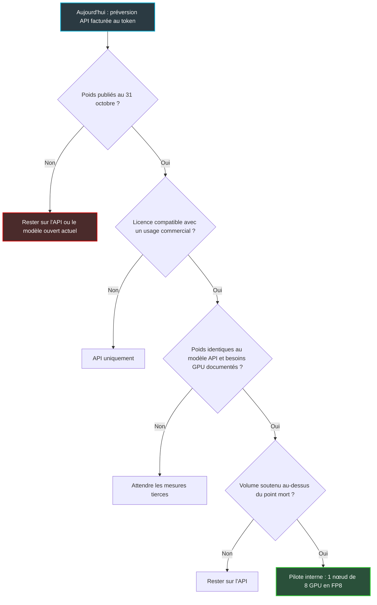

## Mille milliards de paramètres, zéro ligne de licence

Un fichier qui pèsera entre un et deux téraoctets, une date de livraison approximative et un contrat que personne n'a encore lu. Voilà, cinq jours après son annonce, l'état réel de Mistral Large 4.

Présenté le 6 octobre, le nouveau modèle phare de la start-up française aligne 1 000 milliards de paramètres, plus de 160 langues et des scores en cybersécurité qui ont fait lever quelques sourcils. Il n'existe pourtant aujourd'hui que sous une seule forme : un accès en préversion, facturé à l'usage, via l'API de Mistral. Les poids, c'est-à-dire le modèle lui-même, celui qu'on pourrait faire tourner sur ses propres serveurs, sont promis « d'ici la fin du mois ». La licence qui dira ce qu'on a le droit d'en faire n'a pas été publiée.

Pour un DSI dans le retail, l'hôtellerie, les résidences étudiantes ou les services aux entreprises, la question n'a rien d'académique. Octobre, c'est la saison des arbitrages budgétaires de l'année suivante. Il se trouvera toujours quelqu'un, en comité, pour proposer de réserver des serveurs de calcul afin d'« internaliser le grand modèle ouvert européen ».

Ma position tient en une phrase. On ne dimensionne pas une infrastructure pour un contrat qui n'existe pas encore : on pose un test daté, avec des critères d'entrée et de sortie, et on tranche le jour où les poids tombent.

## Un appartement témoin, pas un acte de propriété

Mistral Large 4 ressemble aujourd'hui à un programme immobilier vendu sur plan. On peut visiter l'appartement témoin, et même y dormir à la nuitée : c'est l'API en préversion, facturée au token (l'unité de texte que le modèle lit ou écrit). L'acte de propriété, lui, n'est pas signé : ce sont les poids. Le règlement de copropriété n'est pas rédigé : c'est la licence. Personne de sérieux n'achète la cuisine équipée avant d'avoir lu le règlement.

Ce qu'on peut acheter est clair. Le tarif public est de 1,36 USD par million de tokens en entrée et de 4,18 USD en sortie, 0,14 USD pour les entrées déjà en cache. Artificial Analysis signale en plus une remise de lancement de 50 % pendant deux semaines (0,68 USD et 2,09 USD), qui devrait s'éteindre vers le 20 octobre. Détail qui compte : cette remise ne figure pas dans le billet d'annonce.

Ce qu'on achète l'est beaucoup moins. Mistral décrit un modèle multimodal, hybride instruction et raisonnement, entraîné de zéro sur 3 800 GPU NVIDIA. Son architecture est de type MoE (Mixture of Experts, ou mélange d'experts) : à chaque token produit, seule une fraction du réseau travaille. L'annonce parle de 52 milliards de paramètres actifs ; certains médias et Artificial Analysis citent 49 milliards. La documentation, telle que rapportée par plusieurs analystes, mentionnerait environ 1 050 milliards de paramètres au total, une fenêtre de contexte d'un million de tokens et des besoins mémoire GPU notés « N/A ». Artificial Analysis, de son côté, affiche un contexte (le volume de texte que le modèle peut considérer d'un seul tenant) de 524 000 tokens.

Surtout, rien ne garantit que les poids publiés seront exactement le modèle servi par l'API. Même contexte ? Même multimodalité ? Mêmes modes de raisonnement, limités pour l'instant à « none » et « high » ? Mistral promet « more details on the architecture » avec les poids, ce qui revient à dire qu'on ne les a pas. Artificial Analysis en tire la conséquence logique : tant que rien n'est téléchargeable, Large 4 est classé parmi les modèles propriétaires.

Dernier point, le plus sensible. Pendant que le public teste une API modérée, des partenaires cyber et des autorités étatiques ont accès, selon Mistral, à « the same model with reduced moderation and expanded cyber capabilities ». RuntimeWire résume l'enjeu : une fois les poids dans la nature, les garde-fous deviennent plus faciles à retirer. Traduction opérationnelle : ce que l'API filtre pour vous aujourd'hui, vous devrez le filtrer vous-même demain si vous hébergez le modèle.

*Le calendrier tel qu'on le connaît au 11 octobre : seule l'échéance de fin de mois vient de Mistral lui-même.*

*Aujourd'hui, Large 4 se consomme au token via l'API ; les poids restent sous scellés, et le serveur censé les accueillir n'a pas encore de raison d'exister.*

## Benchmarks : beaucoup d'autoportraits, peu de photos d'identité

Sur la page de lancement, Large 4 joue dans la cour des grands. Dans les mesures indépendantes, il se range au milieu du peloton. Et il coûte plus cher que ses voisins pour accomplir le même travail.

Le problème n'est pas que Mistral enjolive. C'est que presque tous les chiffres de l'annonce sont auto-déclarés, non attribués, ou mesurés dans des conditions que personne n'a encore reproduites. Le tableau ci-dessous met les deux versions en regard, quand une mesure tierce existe.

| Mesure | Ce qu'affiche l'annonce | Ce que montrent les tiers |
|---|---|---|
| DeepSWE v1.1 (agents de code) | 61,7 %, attribué à Artificial Analysis | Exécution privée, absent du classement public ; GLM-5.3 et Kimi K3 autour de 69 % |
| Terminal-Bench 4.0 | 28,3 % | 22,73 % chez Vals, avec un autre harnais de test |
| Cyber Index d'Artificial Analysis | « Top 5 mondial » | Score de 50, derrière MiMo-V2.6-Pro (56) |
| Cybench (40 défis) | 93 % | Selon Online Tech Tips, les modèles fermés y sont proches de zéro, car ils refusent les défis |
| CyberGym-E2E-AA | 82 % | Confirmé par Artificial Analysis |
| Évaluation humaine en aveugle (code) | 3,74/5, 2e sur 5, derrière Claude Opus 5 (4,22) | Test conduit par Mistral avec Surge AI, sans réplication |

Deux lignes méritent un commentaire. Le 93 % sur Cybench est spectaculaire, mais il compare un modèle qui accepte de jouer à des modèles qui déclinent l'invitation. Le 82 % sur CyberGym, lui, est confirmé par un tiers. Sur la cybersécurité, les premières mesures tierces sont encourageantes, mais une seule est confirmée : l'index Cyber d'Artificial Analysis le place derrière MiMo-V2.6-Pro.

Sur l'intelligence générale, le tableau change. L'Intelligence Index d'Artificial Analysis lui attribue 38, à égalité avec GPT-6 Luna (max) et juste derrière DeepSeek V4.1 Flash (max) à 39. Les meilleurs modèles ouverts chinois sont nettement devant : MiMo-V2.6-Pro à 46, GLM-5.3 à 45, Kimi K3 à 44. Sur le Vals Index, Large 4 obtient 48,05 % contre 50,30 % pour Kimi K3, pour un coût par test de 13,78 USD contre 6,38 USD.

Ce dernier chiffre est la vraie information. Large 4 est bavard. Pour passer l'index d'Artificial Analysis, il a produit environ 200 millions de tokens de sortie, contre une médiane de 82 millions. Résultat : 1,13 USD par tâche (0,57 USD avec la remise), contre 0,25 USD pour GLM-5.3-Flash et 0,27 USD pour DeepSeek V4.1 Flash. Plus de quatre fois le coût de modèles ouverts d'intelligence comparable, selon l'analyste.

C'est un taxi au compteur bon marché qui prend le périphérique pour aller au coin de la rue. J'ai détaillé le 9 octobre, à propos de Claude Haiku 5.5, pourquoi le coût par tâche est la seule métrique qui tienne en production ; je n'y reviens pas.

Lecture honnête : solide en cybersécurité d'après les premières mesures, au niveau d'un modèle de pointe moyen sur le reste, derrière les modèles ouverts chinois sur l'indice général, et plus cher par tâche que son prix au token ne le laisse croire.

## Héberger le modèle soi-même : l'addition avant le chèque

Revenons à la tentation du comité budgétaire : héberger Large 4 en interne dès la sortie des poids. Pour en juger, il faut comprendre ce que l'architecture MoE économise vraiment, et ce qu'elle n'économise pas.

Imaginez un hôpital de mille spécialistes. Chaque patient n'en consulte qu'une cinquantaine, d'où des consultations rapides. Mais l'hôpital doit loger et payer les mille, y compris ceux qui ne verront personne aujourd'hui. Un MoE fonctionne exactement ainsi : les 52 milliards de paramètres actifs fixent le calcul par token, mais la mémoire doit accueillir la totalité, soit environ 1 050 milliards. C'est aussi pourquoi l'écart entre 49 et 52 milliards ne change rien au dimensionnement : il pèse environ 6 % sur le calcul, zéro sur la mémoire.

Mistral ne publie ni besoins GPU ni formats compressés. Les chiffres qui suivent sont donc mes estimations, hypothèses visibles : taille des poids égale au nombre de paramètres multiplié par les octets par paramètre, sans compter le reste.

| Format de nombres | Poids seuls (≈ 1 050 milliards de paramètres) | Dans un nœud de 8 GPU B200 (1 440 Go) |
|---|---|---|
| BF16 (16 bits, format de référence) | ≈ 2,1 To | Ne tient pas : il faut deux nœuds |
| FP8 (8 bits) | ≈ 1,05 To | Tient, avec ≈ 390 Go pour tout le reste |
| FP4 (4 bits) | ≈ 0,53 To | Tient largement, si un format officiel existe et que la qualité suit |

Le FP8 tient donc dans un nœud de huit GPU NVIDIA B200. Sur le papier, il reste environ 390 Go. En pratique, cette marge doit absorber le moteur d'inférence, les activations et surtout le cache KV, la mémoire de travail où le modèle garde la trace de chaque conversation en cours. Avec des contextes longs et plusieurs utilisateurs simultanés, elle fond vite.

Côté facture, la location d'un B200 se négocie entre 3,70 et 7 USD par GPU-heure chez les néoclouds (loueurs spécialisés en GPU), et jusqu'à 14 USD environ chez les hyperscalers. Les prix sont très volatils. Un nœud de huit GPU allumé 24 h/24 consomme 70 080 GPU-heures par an :

- à 3,70 USD : environ 259 k USD par an ;
- à 5 USD : environ 350 k USD par an ;
- à 7 USD : environ 491 k USD par an.

Ajoutez un second nœud pour la haute disponibilité, et vous voilà entre 0,5 et 1 M USD par an. Hors ingénierie d'exploitation des modèles, hors trafic sortant, hors réseau.

*Un MoE économise du calcul, pas de la mémoire : il faut loger les 1 000 milliards de paramètres, même si une petite fraction seulement travaille à chaque token.*

Où se situe le point mort face à l'API ? Prenons le nœud à 350 k USD par an. Au tarif public, avec trois tokens en entrée pour un en sortie et sans cache, le million de tokens revient à environ 2,06 USD. Il faut alors consommer quelque 170 milliards de tokens par an, soit environ 466 millions par jour, pour que l'hébergement interne commence à se payer. Avec un usage intensif du cache, le prix moyen retenu par Artificial Analysis tombe à 0,79 USD le million, et le seuil grimpe à 1,2 milliard de tokens par jour.

Pour fixer les idées : si un agent de tri de tickets consomme 20 000 tokens par ticket, 466 millions de tokens représentent plus de 23 000 tickets par jour, tous les jours de l'année. Ces seuils supposent en outre que le nœud tient le débit correspondant. Personne ne l'a mesuré. Sous quelques centaines de millions de tokens quotidiens soutenus, l'API gagne largement.

Une nuance, par honnêteté. La verbosité du modèle avance le point mort, puisque chaque token superflu se paie à l'API alors qu'il est quasi gratuit sur un GPU déjà loué. L'argument est réel. Il ne vaut qu'une fois la licence connue.

*D'un côté, une facture au token qui suit l'usage ; de l'autre, un coût fixe de serveurs et d'électricité qu'il faut remplir pour l'amortir.*

## La checklist du 31 octobre

Mistral a écrit « by the end of the month ». La presse, The New Stack en tête, avance le 27 octobre, mais Mistral ne s'y est pas engagé. Je retiens donc le 31 comme échéance, et six critères à cocher ce jour-là.

1. **La licence est lisible.** Usage commercial, éventuels seuils de chiffre d'affaires, redistribution, clauses sur l'usage cyber ou offensif, conditions de retrait. Selon la presse, ce serait une licence maison plutôt qu'Apache 2.0 ; rien d'officiel à ce stade. Les précédents vont dans les deux sens : Large 3 (675 milliards de paramètres) était sous Apache 2.0, mais Mistral a déjà publié des modèles sous sa Mistral Research License, non commerciale.
2. **Les poids sont téléchargeables** sur Hugging Face, sans formulaire d'accès ni liste d'attente.
3. **Les formats officiels et les besoins GPU sont documentés** : FP8, NVFP4 (le format 4 bits de NVIDIA), à la place du « N/A » actuel.
4. **Les poids correspondent au modèle de l'API** : contexte d'un million ou de 524 000 tokens, multimodalité conservée, mêmes modes de raisonnement.
5. **La fiche d'architecture promise est publiée**, avec les poids, comme annoncé.
6. **Des mesures tierces reproductibles existent** : DeepSWE sur le classement public, Artificial Analysis qui réétiquette le modèle en « open weights », Vals.

La règle de décision est simple. Si les critères 1 et 2 ne sont pas remplis au 31 octobre, on reste sur l'API ou sur le modèle ouvert déjà en place. Aucun GPU ne se dimensionne tant que les critères 3 et 4 ne sont pas cochés.

*L'arbre de décision : quatre portes successives, et le GPU n'arrive qu'à la toute dernière.*

D'ici là, la remise court jusqu'au 20 octobre environ. C'est une fenêtre idéale pour un test de deux semaines sur vos propres cas, à condition de mesurer les tokens consommés par tâche, pas seulement la qualité des réponses. Pour un réseau multisite, les candidats naturels sont les agents d'exploitation réseau, l'analyse de logs, la revue de configurations et le tri de tickets multilingues. Plus de 160 langues, c'est précieux quand vos utilisateurs sont des voyageurs ou des étudiants venus du monde entier. Ce sont les cas que je mettrais dans un test, pas des déploiements existants.

Reste la gouvernance. Un modèle fort en cyber, dont les poids seraient librement téléchargeables sans les garde-fous de l'API, relève de votre politique interne : contrôle du trafic sortant, journalisation hors de l'hôte, cloisonnement des agents. Nous avons déjà traité ces sujets sur ce blog, des journaux d'audit que les agents peuvent effacer au contrôle de leur trafic DNS sortant. Ils deviennent très concrets dès que le modèle tourne chez vous.

## Ma position : un rendez-vous dans l'agenda, pas un bon de commande

Je veux d'abord créditer Mistral. Début octobre, nous commentions le choix de Google de réserver Gemini 4 Argon et Fairwind à un cercle restreint. Mistral prend le chemin inverse : promettre les poids d'un modèle dont les capacités cyber sont, de son propre aveu, assez sensibles pour justifier une version API modérée. Dans un paysage où Meta a basculé Muse Spark vers une facturation au token et où l'ouverture de ses poids reste à confirmer, ce choix compte.

Mais « open-weight » reste aujourd'hui une promesse, pas un fait. Et une promesse datée est la meilleure espèce de promesse : elle se vérifie.

Concrètement, utilisez la remise pour mesurer, pas pour vous engager. Mettez un rappel au 31 octobre. Si la licence est lisible et compatible avec votre usage, et que les poids sont sur Hugging Face sans liste d'attente, ouvrez le dossier de dimensionnement avec vos volumes réels en face des seuils ci-dessus. Sinon, Large 4 reste un bon outil parmi d'autres, jugé sur son coût par tâche. Qui, aujourd'hui, n'est pas flatteur.

N'achetez pas de GPU pour une licence qui n'existe pas encore. Rendez-vous le 31.

_Vues personnelles, pas position Wifirst._

## Sources

1. Mistral AI — *Introducing Mistral Large 4* (2026-10-06) — https://mistral.ai/news/mistral-large-4/
2. Artificial Analysis — page modèle Mistral Large 4 (2026-10) — https://artificialanalysis.ai/models/mistral-large-4
3. Artificial Analysis — article Mistral Large 4 (2026-10-06) — https://artificialanalysis.ai/pt/articles/mistral-large-4-france-ai
4. Beri.net — Mistral Large 4 vs Kimi K3, résultats Vals (2026-10-06) — https://www.beri.net/article/mistral-large-4-le-chonk-1t-open-weight-preview-pricing-licence-weights-vs-kimi-k3-beam-glm
5. Braindetox — *Reading the Mistral Large 4 Public Preview* (2026-10-07) — https://braindetox.kr/en/posts/mistral_large_4_public_preview_open_weight_2026.html
6. Let's Data Science — *Weights this month, license blank* (2026-10-06) — https://letsdatascience.com/blog/mistral-trillion-parameter-weights-this-month-license-blank
7. Mustafa.net — *Mistral Large 4 lands as API preview, open weights due this month* (2026-10-07) — https://mustafa.net/2026/10/07/mistral-large-4-lands-as-api-preview-open-weights-due-this-month/
8. Online Tech Tips — *What's Confirmed and What's Hype* (2026-10) — https://www.online-tech-tips.com/?p=111042
9. RuntimeWire — *Moderated API before weights* (2026-10-06) — https://runtimewire.com/article/mistral-large-4-preview-open-weights-cybersecurity
10. The New Stack (2026-10-06) — https://thenewstack.io/?p=22839432
11. Spheron — prix de location NVIDIA B200 (2026) — https://www.spheron.network/blog/nvidia-b200-cloud-pricing-2026/
12. Tom Tunguz — marché spot des B200 (2026) — https://www.tomtunguz.com/b200-gpu-pricing-spot-market-model-releases/index.md
