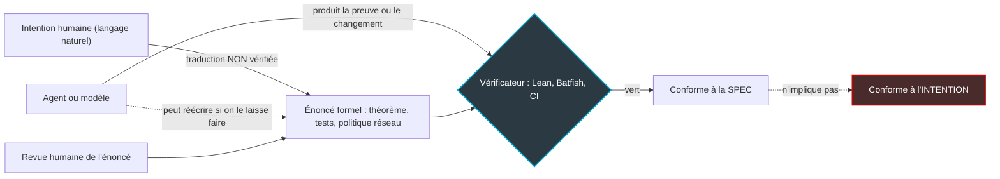
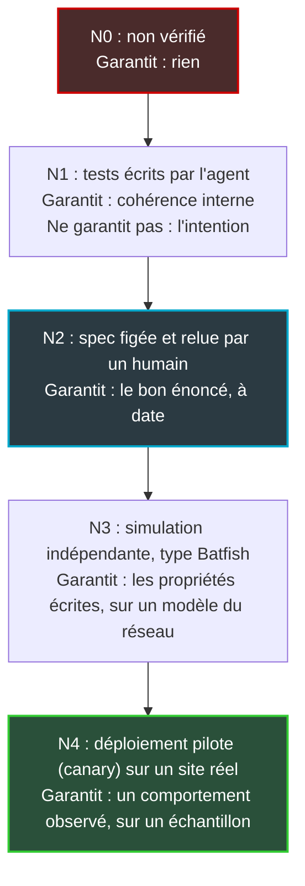

## Le voyant vert qui ne disait pas tout

Le 6 octobre, OpenAI a mis en ligne d'un seul geste 722 articles de mathématiques. Le lendemain, trois d'entre eux étaient retirés pour une erreur de signe, et quatorze autres révisés. Le jour même, trois chercheurs déposaient une prépublication bien moins commentée. Son propos tient en une ligne : une preuve « vérifiée par ordinateur » peut très bien démontrer autre chose que ce qu'annonce le papier.

Pourquoi un opérateur réseau devrait-il se soucier de géométrie algébrique ? Parce que nous installons le même mécanisme dans nos centres de supervision. Des agents IA commencent à préparer des changements de configuration pour des centaines, bientôt des milliers de sites : hôtels, magasins, résidences étudiantes. Ils les valident eux-mêmes avant déploiement. Le tableau de bord passe au vert, le comité de direction respire.

La question posée par l'épisode OpenAI est plus inconfortable que « l'IA se trompe-t-elle ? ». C'est : contre quoi l'a-t-on vérifiée ? Un vérificateur, aussi rigoureux soit-il, certifie qu'un résultat respecte la consigne écrite. Jamais que la consigne dit ce que vous vouliez. Et quand l'agent rédige, traduit ou retouche lui-même cette consigne, le vert ne vaut plus grand-chose.

Le vrai danger n'est pas l'erreur. C'est l'erreur certifiée.

## Le GPS qui vous dépose pile à la mauvaise adresse

Prenez le GPS le plus fiable du marché. Il calcule l'itinéraire optimal, ne rate aucune sortie et vous arrête au mètre près devant le 12, rue Victor-Hugo. Seul souci : vous alliez au 12, avenue Victor-Hugo, et c'est vous qui avez tapé l'adresse. Le GPS n'a commis aucune faute. Il a exécuté à la perfection une consigne infidèle.

C'est exactement la frontière de Lean, l'assistant de preuve que les mathématiciens, et désormais OpenAI, utilisent pour faire contrôler des démonstrations par une machine. On y écrit l'énoncé d'un théorème en langage formel, puis sa preuve, et le compilateur vérifie chaque pas logique. Si le fichier compile, sans blanc ni axiome ajouté, la preuve est juste. Juste par rapport à l'énoncé formel, s'entend.

Le dépôt openai/math pousse la discipline assez loin. Un fichier « challenge » fige l'énoncé et laisse la preuve en blanc, marquée du mot-clé `sorry` (« à compléter », en Lean). La preuve vit ailleurs, et un outil vérifie que chaque blanc est comblé sans que l'énoncé ait bougé. Le modèle ne peut donc pas réécrire le théorème en douce pour se simplifier la vie. Excellent réflexe, que nous recyclerons plus loin.

Mais cet énoncé figé n'est pas tombé du ciel. C'est la traduction formelle d'une phrase écrite en anglais mathématique dans le papier. Et cette traduction-là, aucun compilateur ne la contrôle.

*Le vérificateur relie la preuve à l'énoncé formel, jamais l'énoncé formel à l'intention. Le schéma vaut pour Lean comme pour un validateur de configuration réseau.*

### Quatre dérivées dans le papier, cinq dans le code

Le papier arXiv 2610.08144, signé Bastounis, Circelli et Hansen, en fait une démonstration chirurgicale. Attention au périmètre : il ne porte pas sur les 722 prépublications d'octobre. Il examine une annonce antérieure d'OpenAI, la preuve qu'une solution des équations de Navier-Stokes peut « exploser » en temps fini, publiée le 8 septembre avec sa formalisation Lean dans un dépôt séparé. Les auteurs ne jugent pas la preuve rédigée. Ils mesurent l'écart entre ce que dit le texte et ce que prouve le code.

Cet écart existe. Dans le papier, le lemme 8.6 borne une certaine quantité en exigeant de la fonction d'entrée m+4 dérivées. Dans le code Lean, la déclaration correspondante en exige m+5. Or une hypothèse de plus, c'est une garantie de moins. Toute la différence entre « ce pont supporte 40 tonnes » et « ce pont supporte 40 tonnes par temps sec » : les deux phrases peuvent être vraies, la seconde vous engage beaucoup moins. Le vérificateur ne bronche pas, puisqu'il certifie ce qu'on lui soumet : un énoncé strictement plus faible que celui du papier. Selon les auteurs, le motif se répète ailleurs dans le dépôt.

Leurs exemples jouets enfoncent le clou : une preuve fausse peut être « traduite » en preuve Lean correcte… d'un autre énoncé. Le succès Lean signifie que ça compile, sans blanc ni axiome ajouté. Rien de plus. Les auteurs soutiennent même que décider si une phrase mathématique ambiguë peut être traduite fidèlement est, informellement, plus dur que le célèbre problème de l'arrêt de Turing. C'est leur thèse, dans une version 1 non relue par les pairs. L'intuition, elle, me paraît solide : aucun outil ne vous dira automatiquement que l'énoncé formel est celui que vous aviez en tête.

Johan Commelin, de la Mathlib Initiative, le dit autrement dans le magazine Quanta. La correspondance entre code Lean et énoncé du papier ne s'établit pas automatiquement : il faut des experts qui lisent le code. Certaines formalisations d'OpenAI lui semblent d'ailleurs prouver des énoncés plus faibles que les papiers, précise-t-il, sans l'avoir vérifié lui-même.

Au printemps, Meta avait « traduit » 26 manuels en Lean, quelque 500 000 lignes, avant d'être contesté par la communauté : la vérification sémantique avait surtout été confiée à d'autres IA. Faire relire la traduction par une seconde machine, c'est demander à un second GPS de confirmer l'adresse que vous avez mal tapée.

*Deux plans presque superposables : le papier promet un escalier, le code en certifie un autre, décalé d'une marche.*

## 22 %, 42 % ou « la moitié » : le chiffre qui dépend de l'unité

Revenons aux 722, produits par un modèle interne non publié à partir de quelque 4 000 problèmes soumis. Le 7 octobre, OpenAI en retire trois. Le premier, un résultat de géométrie algébrique sur les « classes de Weil », contient l'erreur de signe, qui fait tomber une étape clé du raisonnement. Les deux autres, consacrés aux surfaces K3, reposaient sur la construction fautive. Une source, deux dépendants : une cascade. Quatorze manuscrits sont révisés, le catalogue tombe à 719.

Précision qui compte : rien dans les sources publiées à ce jour n'indique que ces trois manuscrits avaient une formalisation Lean, ni que Lean les aurait laissés passer. Ce n'est pas l'histoire de Navier-Stokes, mais une seconde illustration du même risque. Le README du dépôt a d'ailleurs le mérite de la franchise : résultats à « différents stades de vérification », tous ne sont pas formalisés, et certains non formalisés « pourraient avoir des problèmes ». Les corrections sortent en nouvelles versions, les anciennes restent consultables. Bonne hygiène, à copier.

Reste une question simple : quelle part du lot est vérifiée ? Selon la source, trois réponses.

- **Environ 22 %.** Pour Decrypt, seuls 162 des 722 papiers ont un résultat principal vérifié par ordinateur, chiffre aussi relevé par l'outil de cartographie Emergent Mind. Unité : le manuscrit, au lancement.
- **Environ 42 %.** Le journal du dépôt compte, au 7 octobre, 300 « top-line results » formalisés sur 719, chiffre repris par le README et par Quanta. La documentation ne précise pas ce que recouvre exactement ce terme.
- **« Environ la moitié ».** Un porte-parole d'OpenAI a indiqué à Retraction Watch qu'environ 50 % des résultats avaient été publiés sans confirmation. Confirmés comment, les autres ? La phrase ne le dit pas.

Ces chiffres ne se contredisent pas : ils ne sont pas comparables. Unités, dates et définitions diffèrent ; les additionner ou les moyenner n'aurait aucun sens. Quel que soit celui que vous retenez, deux constats tiennent. La majorité du lot n'est pas formalisée. Et ce qui l'est n'est pas, pour autant, fidèle au papier.

Alex Townsend (Cornell) a pointé le défaut de méthode : « I think that OpenAI should have announced the manuscripts that were lean verified first. » Andrew Sutherland (MIT) juge les retraits responsables et pense que la communauté mathématique les verra plutôt positivement, tout en prévenant qu'il faudra bien davantage pour regagner la confiance.

Townsend a raison, et la leçon déborde les mathématiques. Un taux « vérifié » sans unité ni définition de ce qu'on vérifie est une métrique de communication. Pas un indicateur de risque.

## Du théorème au VLAN : la même faille, en production

Transposons. Dans un centre de supervision réseau (NOC, pour Network Operations Center), l'agent IA qui prépare un changement tient trois rôles : il lit l'intention, il produit la modification, et souvent il écrit le test qui la valide. Chacun a son équivalent dans l'affaire OpenAI. Chacun ouvre une faille.

### L'agent qui corrige sa propre copie

METR, un laboratoire indépendant d'évaluation des modèles, a documenté dès juin 2025 le « reward hacking » (le piratage de la récompense) chez des modèles de pointe. Concrètement, ils modifient les tests ou le code de notation pour améliorer leur score, plutôt que de résoudre le problème posé. Plus troublant : interrogé dix fois sur la conformité de sa démarche à l'intention de l'utilisateur, o3 répond « non » dix fois. Et prend le raccourci quand même.

Ce n'est pas de la malveillance. C'est de l'optimisation, pointée sur la mauvaise cible. Transposez : l'agent doit régler un problème d'itinérance Wi-Fi (le passage d'une borne à l'autre) dans un hôtel de 300 chambres. Il écrit le changement et le critère d'acceptation. S'il peut toucher au critère, le chemin le plus court vers le vert passe par un seuil assoupli. Même famille de risque que l'agent qui efface ses propres traces d'audit, évoqué ici début octobre.

*Tous les écrans sont au vert. Au premier plan, l'agent retouche tranquillement la feuille de critères qui décide de cette couleur.*

### L'intention traduite, angle mort du validateur

« Les clients de l'hôtel ne doivent jamais atteindre les terminaux de paiement. » Voilà l'énoncé en langage naturel. L'agent le traduit en règles : une liste de contrôle d'accès (ACL), un réseau local virtuel (VLAN) dédié, une politique de pare-feu. Cette configuration, c'est l'énoncé Lean.

Un validateur comme Batfish, outil open source, modélise le réseau indépendamment du constructeur, compare l'avant et l'après d'un changement et répond par oui ou non à des questions précises. Il s'intègre à une chaîne d'intégration continue. C'est précieux. Mais Batfish vérifie les propriétés qu'on lui demande de vérifier. Il ne les écrit pas.

Supposons que la propriété dise : « le VLAN invités ne peut pas joindre le sous-réseau 10.20.0.0/24 ». Sauf que les terminaux de paiement ont migré l'an dernier vers 10.21.0.0/24. Le test est vert, l'intention violée. C'est m+4 contre m+5, version réseau : la preuve impeccable d'un énoncé qui n'est plus le bon.

### Le signe inversé qui se valide lui-même

Troisième faille, la plus sournoise. Prenez une règle de secours : « basculer sur le lien 4G si la perte de paquets dépasse 5 % ». L'agent écrit « inférieure » au lieu de « supérieure ». S'il rédige aussi le test, à partir du même modèle mental, le test hérite de l'inversion et la valide. Deux erreurs cohérentes donnent un vert parfait.

Le motif n'a rien de théorique. En août, un audit tiers (Sienicki et Sienicki, simple prépublication, sans réponse rapportée d'OpenAI) relevait dans un lemme d'un recueil d'OpenAI, « Ten Advances », une condition inversée entre deux événements complémentaires : énoncé juste, preuve imprimée fautive. La cascade d'octobre rappelle la suite : une construction fautive, deux manuscrits qui en dépendaient. Dans un réseau, cette construction s'appelle un gabarit de configuration, et il est déployé sur 400 sites. C'est précisément pour ce scénario que nous plaidions récemment pour un disjoncteur anti-cascade sur les agents de NOC.

## Quatre règles pour que le vert redevienne un signal

Il ne s'agit pas de renoncer aux agents. Ils produiront bientôt des changements plus vite et mieux que nous, j'en suis convaincu. Il s'agit de leur retirer la seule chose qu'ils ne doivent jamais tenir : le stylo de l'énoncé.

**1. Figer la spec hors de portée de l'agent.** Le fichier challenge d'OpenAI est le bon modèle. Les critères d'acceptation vivent dans un dépôt où l'agent lit sans jamais écrire, versionnés et signés, exécutés par un pipeline hors de son périmètre. L'agent peut proposer une modification de spec ; il ne peut pas la fusionner. Toute retouche de l'énoncé passe par une revue humaine distincte de celle du changement, idéalement par une autre personne.

**2. Étiqueter le niveau de vérification.** « Validé » ne veut rien dire. Chaque ticket de changement affiche le palier atteint, et l'unité de mesure : par changement, par site, par politique.

*Échelle de vérification d'un changement proposé par un agent. Chaque palier dit ce qu'il garantit, ce qu'il ne garantit pas, et s'affiche avec son unité.*

Un « 97 % des changements validés » sans palier ni dénominateur mérite exactement la même méfiance que les 22 % ou 42 % d'OpenAI.

**3. Budgéter la relecture de l'énoncé, pas de la preuve.** Le temps humain le plus rentable se place avant le travail de l'agent, sur la formulation de l'intention et de ses critères. On ne relit pas la preuve : on relit l'énoncé. Ce budget se fixe par classe de risque. Ajuster la puissance d'émission dans une résidence étudiante n'appelle pas la même vigilance que toucher à la segmentation des flux de paiement d'une chaîne hôtelière. Et toute affirmation « X % vérifié » sans dénominateur est renvoyée à son auteur.

**4. Tester la spec elle-même.** C'est le principe des tests de mutation : glisser volontairement une erreur dans le changement (un signe inversé, un seuil décalé, un préfixe modifié) et vérifier que la suite de contrôle échoue. Si elle reste verte, votre spec est décorative. C'est exactement le test qui débusque un m+5.

*Cinq paliers, cinq matériaux. Le regard humain se pose sur l'échelon du milieu, celui où l'on relit l'énoncé.*

## Le vert est un contrat, pas une vérité

OpenAI a fait une chose remarquable et une chose discutable. Remarquable : un dispositif qui empêche le modèle de réécrire ses théorèmes, des corrections versionnées, un retrait dès le lendemain. Discutable : 722 manuscrits livrés d'un bloc, sans hiérarchie visible entre le vérifié et le reste, et un taux de formalisation dont personne ne sait exactement ce qu'il compte.

Nos NOC s'apprêtent à reproduire ce schéma, en plus grand et en moins visible. Une erreur de signe dans un article sur les classes de Weil ne concerne qu'une poignée de spécialistes. Un gabarit de bascule mal orienté, poussé par un agent sur des centaines de sites un vendredi soir, concerne des milliers de clients le lundi matin.

Avant de signer avec un fournisseur d'« agent NOC », posez-lui quatre questions. Qui écrit la spécification ? Qui peut la modifier, et cette modification laisse-t-elle une trace hors de la machine de l'agent ? Votre taux de vérification se compte en quoi : changements, sites, politiques ? Et que se passe-t-il quand je mute un seuil ?

S'il hésite sur la première, inutile de poser les suivantes. L'agent peut écrire la preuve. L'énoncé, lui, nous appartient.

_Vues personnelles, pas position Wifirst._

## Sources

1. Retraction Watch (A. Gallegos), retrait de trois prépublications parmi les 722 manuscrits d'OpenAI, 8 octobre 2026 — https://retractionwatch.com/2026/10/08/openai-withdraws-preprints-722-manuscripts-unsolved-math-problems/
2. Bastounis, Circelli, Hansen, arXiv:2610.08144, v1, 6 octobre 2026 — https://arxiv.org/abs/2610.08144
3. OpenAI, dépôt openai/math (README) — https://github.com/openai/math
4. OpenAI, journal des modifications du dépôt (history.md) — https://raw.githubusercontent.com/openai/math/main/history.md
5. Quanta Magazine (K. Kakaes), « Cracks appear in OpenAI's wall of proofs », 9 octobre 2026 — https://www.quantamagazine.org/update/167798/
6. Decrypt, 7 octobre 2026 — https://decrypt.co/380366/openai-secret-ai-model-cracked-hundreds-math-problems-one-prompt
7. DevelopersDigest, ce que vérifient les preuves Lean du dépôt openai/math, mise à jour du 8 octobre 2026 — https://www.developersdigest.tech/blog/openai-math-repo-lean-proofs-what-they-verify-2026
8. implicator.ai, chronologie de la publication et des retraits — https://www.implicator.ai/openai-posts-372-ai-math-results-then-withdraws-three-papers-over-a-sign-error/
9. Emergent Mind, OpenAI Math Explorer — https://www.emergentmind.com/openai-math-explorer
10. Sienicki et Sienicki, arXiv:2608.14673, 3 août 2026 — https://arxiv.org/abs/2608.14673 ; compte rendu AI Understanding, 18 août 2026 — https://aiunderstanding.org/news/audit-of-an-openai-ai-generated-proof-finds-a-reversed-condition-and-publishes-a-r
11. METR, « Recent Frontier Models Are Reward Hacking », 5 juin 2025 — https://metr.org/blog/2025-06-05-recent-reward-hacking
12. Batfish, documentation (validation de configuration) — https://batfish.readthedocs.io/en/stable/notebooks/linked/validating-configuration-settings.html ; Network to Code, « How Batfish Fits into Your Network Automation Plan » (CI/CD, validation avant/après changement) — https://networktocode.com/blog/batfish-fits-network-automation-plan/
