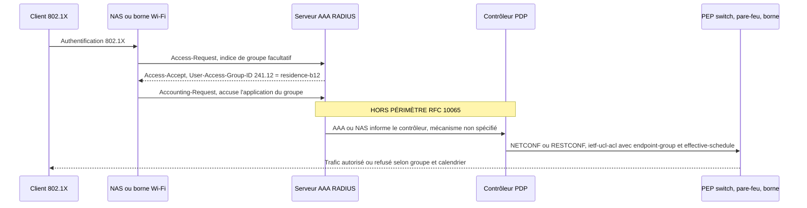

## Un client, trois adresses, une seule identité

Un client d'hôtel qui descend de sa chambre au salon de séminaire change de borne Wi-Fi, parfois de segment réseau, souvent d'adresse IP. Il reste pourtant la même personne. Un étudiant qui rentre dans sa résidence voit son smartphone changer régulièrement d'adresse IPv6, par conception, pour protéger sa vie privée. Lui aussi reste le même : un résident du bâtiment B, avec les droits d'un résident du bâtiment B.

Pour quiconque exploite le Wi-Fi de centaines de sites (hôtels, résidences étudiantes, campus), c'est cette appartenance à un groupe qui devrait porter les droits d'accès. Pas l'adresse, qui bouge sans arrêt. Or chaque constructeur transporte cette notion de groupe dans son propre dialecte. Changer de fournisseur sur un parc, c'est réécrire la tuyauterie d'autorisation, site par site.

Le 7 octobre 2026, l'organisme qui normalise les protocoles d'Internet a publié un texte qui vise exactement ce point : le RFC 10065. Il donne un emplacement standard au groupe d'accès dans RADIUS, le protocole qui, derrière l'authentification Wi-Fi en entreprise, décide qui entre et avec quels droits. Il y ajoute des règles de filtrage capables de lire un calendrier.

C'est une bonne nouvelle. Ce n'est pas encore une fonctionnalité. Le texte normalise le *quoi*, laisse le *comment* hors de son périmètre, et l'on ne compte aucune implémentation publique connue au 12 octobre 2026. Voici ce qui change réellement, et ce que j'en ferais.

## Le badge et le règlement intérieur

Pour saisir ce que normalise ce RFC, pensez au contrôle d'accès d'un immeuble de bureaux. Il repose sur trois pièces. Le badge dit qui vous êtes : prestataire de ménage. Le règlement intérieur dit où et quand ce profil passe : étages 1 à 3, de 6 h à 9 h, en semaine. Les lecteurs posés sur les portes, câblés au poste de sécurité, appliquent la règle.

Le RFC 10065 standardise l'inscription sur le badge et le format du règlement. Il ne touche ni aux lecteurs, ni au câble qui les relie au poste de sécurité. Tout le reste de cet article découle de cette asymétrie.

**Le badge, c'est un attribut RADIUS.** Il s'appelle `User-Access-Group-ID`. L'IANA, l'autorité qui tient les registres de numéros d'Internet, lui a attribué la valeur 241.12. Le détail compte plus qu'il n'y paraît : ce n'est pas un VSA (*Vendor-Specific Attribute*, un attribut rangé sous le numéro d'entreprise d'un fabricant), c'est un attribut standard, encodé dans le format étendu défini par le RFC 6929.

Sa valeur est une chaîne de 1 à 64 caractères, soit 4 à 67 octets au total avec les trois octets d'en-tête. La version du draft approuvée en avril (draft-15) portait encore un numéro provisoire dans la plage 241 à 245. La valeur définitive n'est apparue qu'à la publication, juste après 241.11 (Softwire46-Multicast, RFC 8658) dans le registre.

Le texte fixe aussi les messages RADIUS dans lesquels l'attribut peut apparaître, jusqu'au CoA-Request (*Change of Authorization*, le message qui modifie les droits d'une session déjà ouverte) :

| Message RADIUS | Présence de l'attribut | Ce que ça signifie |
|---|---|---|
| Access-Request | 0 ou plusieurs | Simple indice de préférence, que le serveur n'est pas tenu de suivre |
| Access-Accept | 0 ou plusieurs | Plusieurs occurrences : l'utilisateur appartient à plusieurs groupes |
| Accounting-Request | 0 ou plusieurs | L'équipement d'accès peut confirmer qu'il applique la politique |
| CoA-Request | 0 ou plusieurs | Autorisé, sans sémantique décrite |
| Access-Reject, Access-Challenge, CoA-ACK, CoA-NAK | Interdit | Sans objet |

Retenez la ligne Accounting. C'est la seule qui transforme l'attribut en preuve : l'équipement d'accès peut signaler au serveur qu'il applique bien la politique de tel groupe. J'y reviens plus bas.

**Le règlement, c'est un module YANG.** YANG est le langage qui décrit la configuration d'un équipement réseau sous une forme lisible par une machine. Cette configuration est ensuite poussée par des protocoles programmatiques comme NETCONF ou RESTCONF, plutôt que tapée à la main en ligne de commande.

Le nouveau module, `ietf-ucl-acl`, étend le modèle standard de listes de contrôle d'accès (ACL) du RFC 8519, publié en 2019. Ce modèle ne sait regarder que des adresses MAC, IPv4 ou IPv6, des ports TCP ou UDP, de l'ICMP et des interfaces. Ses actions se limitent à accepter, jeter, rejeter et journaliser. Pas de notion de groupe. Pas de notion d'heure.

`ietf-ucl-acl` comble les deux trous. Il ajoute une liste de groupes (`endpoint-groups`), chacun identifié par un `group-id` de 1 à 64 caractères et typé utilisateur, équipement ou application. Il ajoute un critère de correspondance sur le groupe source ou destination. Enfin, il accroche à chaque règle un `effective-schedule`, en important le modèle de calendrier du RFC 9922, publié en mars 2026 par les quatre mêmes auteurs.

Ce calendrier prend deux formes : une période (début, fin ou durée, avec fuseau horaire), ou une récurrence au format iCalendar du RFC 5545, celui de vos agendas. Sans calendrier configuré, la règle s'applique immédiatement et en permanence. Le module est découpé en *features* optionnelles (`group`, `match-on-group`, `schedule`, plus des combinaisons IPv4, IPv6 et Ethernet), si bien qu'un équipement peut n'en supporter qu'une partie. Ce point pèsera dans les appels d'offres.

Côté processus, c'est un Proposed Standard de l'IETF (l'organisme de normalisation d'Internet), issu du groupe de travail OPSAWG et approuvé le 3 avril 2026 par l'IESG, son comité de pilotage technique. Il ne met à jour ni ne rend obsolète aucun RFC existant.

## Le trou au milieu du schéma

Le RFC décrit une architecture de référence en cinq rôles :

- l'**orchestrateur**, où l'administrateur définit les ACL de groupe ;
- le **contrôleur**, qui décide de la politique (le PDP, *Policy Decision Point*) ;
- le **NAS** (*Network Access Server*), la borne Wi-Fi ou le switch sur lequel l'utilisateur se connecte ;
- le **serveur AAA** (authentification, autorisation, traçabilité), qui parle RADIUS ;
- les **PEP** (*Policy Enforcement Points*), qui appliquent la règle aux paquets.

La motivation affichée est limpide : l'adresse n'est plus une identité. Entre les adresses IPv6 temporaires du RFC 8981 et la traduction d'adresses (NAPT) qui cache plusieurs clients derrière une même IP, filtrer sur l'adresse revient à bâtir sur du sable. Et les politiques dépendent de plus en plus du contexte : le lieu, l'heure, le type d'appareil.

Sur le papier, le déroulé tient en quatre temps. L'utilisateur s'authentifie sur le NAS. Le serveur RADIUS renvoie le groupe. Quelqu'un prévient le contrôleur que telle session appartient à tel groupe. Le contrôleur pousse les règles vers les PEP. Ce *quelqu'un*, justement, n'est pas défini : le RFC indique que ce peut être le serveur AAA ou le NAS, et place le mécanisme hors de son périmètre.

*Le flux de référence du RFC 10065 : les deux extrémités sont normalisées, la notification entre serveur AAA et contrôleur ne l'est pas.*

Le deuxième trou est plus profond. Comment un pare-feu ou une borne reconnaît-il qu'un paquet appartient au groupe `residence-b12` ? Le texte dit explicitement qu'il ne spécifie pas comment faire correspondre un identifiant de groupe à des champs de paquet. Il cite à titre d'exemple le Group-Based Policy du RFC 9638 (§6.2.3) : une extension d'en-tête pour réseaux virtualisés, calquée sur l'option de groupe de VXLAN, qui embarque une étiquette de groupe dans le paquet. Sa §8.3 exige seulement qu'un dispositif adéquat existe, typiquement piloté par un contrôleur.

Formulation honnête : le RFC définit le modèle et l'attribut, pas le mécanisme.

La §8.2 ouvre deux voies de déploiement. Au niveau du domaine, le contrôleur traduit les groupes en règles classiques sur adresses et ports (le 5-tuple), et les PEP n'ont rien à changer. Au niveau de l'équipement, celui-ci sait matcher nativement sur le groupe, ce qui suppose une mise à jour matérielle ou logicielle.

*Lecture d'auteur* : la première voie paraît la plus accessible à court terme, mais elle concentre toute l'intelligence, et toute la dépendance fournisseur, dans le contrôleur. Le standard se retrouverait alors en façade, avec un cœur qui reste spécifique à chaque éditeur.

### Trois zones grises que je ne tranche pas

**Le CoA.** L'attribut est autorisé dans un CoA-Request, mais le RFC ne décrit ni cas d'usage ni sémantique. Le groupe reçu remplace-t-il les précédents ou s'y ajoute-t-il ? Le texte ne cite pas non plus le RFC 5176, qui encadre ce mécanisme. Or c'est exactement la question du départ d'un client d'hôtel. La réponse n'est pas dans le document.

**Le débit.** La §3 cite le lissage de trafic (*shaping*) et la limitation de débit (*policing*) aux heures de pointe parmi les cas d'usage. Les actions héritées du RFC 8519, elles, se limitent à accepter, jeter, rejeter et journaliser. Je n'ai pas identifié, dans les passages lus, comment exprimer un débit sur une règle. Je ne conclus ni que c'est couvert, ni que ça ne l'est pas. Je ne le promettrais simplement pas à un client.

**La gouvernance des identifiants.** Le RFC n'impose ni format, ni espace de noms, ni autorité d'attribution pour les `group-id`. Deux opérateurs peuvent utiliser `staff` pour désigner deux populations différentes. Sans conséquence dans un réseau fermé, le sujet devient réel dès qu'il y a fédération ou itinérance.

*Entre le serveur d'authentification et le contrôleur, un pointillé : le RFC 10065 laisse ce maillon hors de son périmètre.*

## Sur le terrain, le groupe parle encore le dialecte du constructeur

Aujourd'hui, comment un serveur RADIUS dit-il à une borne Wi-Fi qu'un utilisateur est un invité ? De deux façons, aucune satisfaisante.

La première détourne un attribut standard : `Filter-Id` (type 11, RFC 2865), conçu pour désigner un filtre, que l'on remplit avec un nom de groupe. Le VLAN, lui, passe par `Tunnel-Private-Group-ID` (type 81, RFC 2868).

La seconde passe par les VSA, un par constructeur. La documentation de Juniper Mist les aligne côte à côte, par exemple `Aruba-User-Role` (vendor 14823, type 1) ou `Airespace-ACL-name` (vendor 14179, type 6). Sur le forum communautaire d'Aruba (HPE), un fil de discussion confirme la préférence pour renvoyer directement `Aruba-User-Role` plutôt que `Filter-Id`.

Les VSA, c'est le sac d'adaptateurs secteur du voyageur. Chaque pays a sa prise, chaque constructeur a son attribut. Le serveur AAA d'un exploitant multi-marques finit par ressembler à ce sac : un enchevêtrement de règles du type *si l'équipement est de telle marque, renvoyer tel attribut*. Ça marche. Ça se maintient mal. Et ça verrouille.

En mars 2019, Alan DeKok, mainteneur de FreeRADIUS, répondait sur la liste des utilisateurs du projet qu'aucun attribut RADIUS standard ne portait l'identifiant de groupe. C'était exact. Ça ne l'est plus depuis le 7 octobre 2026.

Reste la question qui fâche : qui parle 241.12 ? Réponse de notre veille : aucune implémentation publique connue au 12 octobre 2026. Ni le RFC ni le draft-15 ne comportent de section sur l'état des implémentations. Une recherche dans le code de FreeRADIUS ne remonte aucun fichier mentionnant `User-Access-Group-ID` (recherche faite via GitHub, à prendre avec prudence). Le dépôt des auteurs contient la source du draft, le module YANG et des exemples, sans code d'implémentation. Aucune documentation ni note de version de Cisco ISE, Aruba ClearPass, FreeRADIUS ou Juniper Mist ne cite l'attribut ou le RFC. Absence de preuve n'est pas preuve d'absence. Mais on ne bâtit pas une offre sur un attribut que personne n'annonce.

Le RFC ne dit rien non plus de la transition. Il ne mentionne ni les VSA, ni `Filter-Id`, ni l'attribut `Class`, ni le RFC 5176. Aucun mécanisme de migration ou de coexistence n'est défini : la bascule repose entièrement sur les éditeurs de serveurs et les constructeurs d'équipements d'accès.

Le RFC 6929 fixe le comportement face à l'inconnu. Il recommande, sans l'imposer, que clients et serveurs supportent le format étendu. Les proxies devraient relayer tels quels les attributs qu'ils ne connaissent pas, et serveurs comme clients peuvent ignorer un type étendu inconnu.

*Lecture d'auteur* : en pratique, envoyer 241.12 à un parc qui ne le comprend pas ne cassera vraisemblablement rien, mais n'appliquera rien non plus. Le risque n'est pas la panne. C'est la fausse impression de contrôle.

## Hôtel, résidence, campus : quand la règle lit l'agenda

Tout ce qui suit est une *lecture d'auteur* : la façon dont ces briques se traduiraient dans le Wi-Fi hôtelier, étudiant ou universitaire, une fois implémentées de bout en bout. Rien de cela n'est déployable aujourd'hui avec 241.12.

**Hôtellerie.** Les groupes naturels sont le personnel, les clients, les participants de séminaire et les objets connectés (téléviseurs, serrures). Une récurrence ouvre la salle de séminaire aux heures ouvrées ; une période borne la fenêtre de séjour. La valeur, c'est une identité de groupe stable alors que l'IP et le VLAN changent d'une chambre à l'autre. La limite est connue : le départ du client passe par un CoA ou un Disconnect, précisément la zone grise relevée plus haut.

**Résidences étudiantes.** On pense groupes par résidence ou par bâtiment, groupe d'équipements pour les consoles et objets connectés, plages horaires récurrentes pour des restrictions nocturnes, période calée sur le semestre. Le risque, ici, c'est l'explosion du nombre de groupes. Sans convention de nommage stricte, on reconstruit en YANG le désordre qu'on avait en VSA.

**Campus et enseignement.** Les rôles étudiant, personnel et invité sont classiques. La fédération change la donne. Dans un réseau de type eduroam, un attribut inconnu traverse des proxies qui peuvent le relayer, l'ignorer, voire le rejeter selon leur implémentation. Et comme aucun espace de noms n'est imposé, un `User-Access-Group-ID` venu d'un royaume tiers ne veut rien dire chez vous. Règle simple : ne jamais l'accepter depuis l'extérieur, et filtrer en bordure l'indice transmis dans l'Access-Request.

*Avec effective-schedule, la fenêtre d'accès d'un groupe devient un objet de configuration standard plutôt qu'une ligne de commande propriétaire.*

## Un groupe d'autorisation ne voyage pas sur une carte postale

Côté RADIUS, le RFC suppose une relation de confiance entre NAS et serveur, protégée par IPsec ou par TLS (RadSec, RFC 6614). Il cite aussi le draft qui déprécie le RADIUS historique : `draft-ietf-radext-deprecating-radius-10`, daté du 3 juillet 2026, porté par Alan DeKok. Ce n'est pas encore un RFC, et il expire le 4 janvier 2027. Il déprécie RADIUS sur UDP et sur TCP hors réseaux sécurisés, ainsi que le recours à MD5.

Pourquoi c'est important ici ? Parce qu'un groupe d'autorisation est un privilège. Dans le RADIUS classique sur UDP, seuls quelques attributs comme le mot de passe sont masqués ; le reste circule en clair, avec une authentification et une intégrité qui reposent sur MD5 (RFC 2865). Y faire transiter `staff` ou `admin-reseau`, c'est écrire un niveau d'accès sur une carte postale. Nous avons déjà consacré [un article à RadSec et au contrôle d'accès réseau dans le cloud](/post?slug=radsec-cloud-nac-securite-8021x-zero-trust-2026) : le RFC 10065 ajoute un argument au dossier.

Côté YANG, le RFC exige un transport sécurisé (SSH, TLS ou QUIC) et le modèle NACM (RFC 8341), qui restreint qui peut lire ou modifier quoi. Il désigne comme sensibles en écriture la liste des groupes, le critère de correspondance sur le groupe et le calendrier. Le calendrier est aussi sensible en lecture. *Lecture d'auteur* : c'est cohérent, puisqu'il révèle les heures où un accès s'ouvre.

Les revues internes de l'IETF ont fait leur travail. Le relecteur sécurité (SecDir), Valery Smyslov, a rendu sur la révision 11 un avis *Has nits*, soit quelques remarques mineures. Il demandait notamment de citer le draft de dépréciation RADIUS et radiusdtls-bis, et suggérait de faire relire le nouvel attribut par des experts du groupe RADEXT. La revue des YANG Doctors, signée Acee Lindem, a conclu *Ready*. La version publiée cite bien le draft de dépréciation.

## Ma position : une ligne dans l'appel d'offres, pas une promesse au client

Ce qui suit est une position éditoriale, la mienne.

Le RFC 10065 apporte trois gains réels. La portabilité multi-constructeur d'abord : un seul attribut et un seul modèle YANG au lieu d'un VSA par marque. L'auditabilité ensuite : l'accusé d'application dans l'Accounting-Request donne une trace de qui avait quels droits, à quelle heure. *Lecture d'auteur* : c'est le type de preuve utile face à un audit NIS 2 (la directive européenne sur la cybersécurité) ou au ReCyF (Référentiel Cyber France), la déclinaison des mesures NIS 2 publiée par l'ANSSI, qui n'est pas encore finalisée. Enfin, l'ACL horaire sort de l'interface propriétaire et devient un objet standard, versionnable dans Git et poussé par NETCONF ou RESTCONF.

Sa limite est tout aussi réelle. *Lecture d'auteur, non sourcée* : sur les bornes et contrôleurs Wi-Fi, l'application des politiques repose généralement sur des rôles et des policies propriétaires, pas sur des ACL YANG, et le support de NETCONF et YANG y reste partiel. Tant que le monde Wi-Fi n'adopte pas ce modèle, le RFC parlera surtout aux routeurs et aux pare-feu.

Concrètement, voici ce que je ferais dès maintenant.

1. **Inscrire `User-Access-Group-ID` (241.12, RFC 10065) et `ietf-ucl-acl` dans les appels d'offres** et les revues de feuille de route fournisseurs, comme critère différenciant, avec une date d'engagement. En précisant les features attendues (`group`, `match-on-group`, `schedule`), puisque le module autorise un support partiel.
2. **Garder `Filter-Id` et les VSA en production**, et construire côté AAA une couche de traduction : un groupe logique unique, nommé selon une convention interne stricte, et plusieurs encodages selon l'équipement. Le jour où une borne parle 241.12, on ajoute un encodage sans toucher au modèle de groupes.
3. **Rendre RadSec obligatoire** dès qu'un groupe d'autorisation transite, en cohérence avec le draft de dépréciation de RADIUS.
4. **Ne rien annoncer aux clients** tant qu'aucun serveur ni aucun équipement d'accès n'implémente l'attribut. Un standard publié n'est pas une fonctionnalité livrée.

*Un identifiant de groupe unique, plusieurs encodages constructeur derrière : la couche de traduction côté AAA est la façon la plus sûre d'anticiper le RFC 10065.*

Les VSA ont été pendant des années le sac d'adaptateurs de l'industrie. Le RFC 10065 a dessiné la prise standard. Il ne l'a pas posée dans les murs, et personne n'a encore fabriqué l'appareil qui s'y branche. C'est maintenant aux constructeurs de suivre. Et à nous, acheteurs, de leur faire comprendre que cette prise n'est plus une option.

## Sources

1. [RFC 10065](https://www.rfc-editor.org/rfc/rfc10065.html) — texte du standard, publié le 7 octobre 2026
2. [Datatracker RFC 10065](https://datatracker.ietf.org/doc/rfc10065/) et [historique du draft](https://datatracker.ietf.org/doc/draft-ietf-opsawg-ucl-acl/history/) — processus IETF
3. [Registre IANA RADIUS Attribute Types](https://www.iana.org/assignments/radius-types/radius-types.xhtml) — allocation 241.12, consulté le 12 octobre 2026
4. [Flux RSS du RFC Editor](https://www.rfc-editor.org/rfcrss.xml) — date de publication
5. [draft-ietf-opsawg-ucl-acl-15](https://www.ietf.org/archive/id/draft-ietf-opsawg-ucl-acl-15.html) — version approuvée par l'IESG, numéro provisoire de l'attribut
6. [RFC 9922, modèle YANG commun de planification](https://www.rfc-editor.org/rfc/rfc9922.html) — mars 2026
7. [RFC 8519, modèle YANG des ACL](https://www.rfc-editor.org/rfc/rfc8519.html) — mars 2019
8. [RFC 6929, attributs RADIUS étendus](https://www.rfc-editor.org/rfc/rfc6929.html)
9. [RFC 9638, considérations d'encapsulation NVO3](https://www.rfc-editor.org/rfc/rfc9638.html) — Group-Based Policy, §6.2.3
10. [draft-ietf-radext-deprecating-radius-10](https://datatracker.ietf.org/doc/draft-ietf-radext-deprecating-radius/) — 3 juillet 2026
11. [Revue SecDir de draft-ietf-opsawg-ucl-acl-11](https://datatracker.ietf.org/doc/review-ietf-opsawg-ucl-acl-11-secdir-lc-smyslov-2026-01-19/) — 19 janvier 2026
12. [Juniper Mist, RADIUS attributes](https://juniper.net/documentation/us/en/software/mist/mist-wireless/topics/topic-map/radius-attributes.html) — Filter-Id et VSA en usage
13. [Aruba Airheads (HPE), Filter-Id vs Aruba-User-Role](https://airheads.hpe.com/discussion/server-derived-rule-using-filter-id-from-freeradius-not-working)
14. [FreeRADIUS-users, Group ID of user](https://lists.freeradius.org/pipermail/freeradius-users/2019-March/094691.html) — 5 mars 2019
15. [Dépôt GitHub des auteurs](https://github.com/boucadair/policy-based-network-acl) — source du draft, YANG et exemples, sans code d'implémentation

_Vues personnelles, pas position Wifirst._
