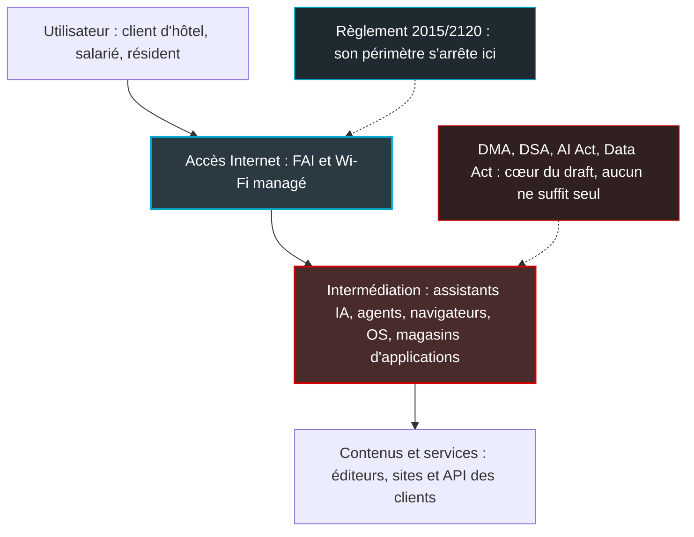

## Internet ouvert : la bataille a changé d'étage

Un soir, dans le lobby d'un hôtel, une cliente demande à son assistant IA de lui trouver une table pour le dîner. Elle ne visite aucun site. Elle ne compare aucune carte. L'agent choisit, réserve, confirme. Le Wi-Fi de l'hôtel a transporté chaque octet de l'échange sans rien voir, et surtout sans rien décider.

Cette scène résume assez bien le document que le BEREC, l'organe qui réunit les régulateurs télécoms européens, a mis en consultation publique début octobre : un projet de rapport de 45 pages sur l'impact de l'IA générative sur l'ouverture d'Internet. Pour un fournisseur d'accès, la phrase qui compte se trouve page 33. Le règlement européen de 2015 sur l'Internet ouvert, celui qui encadre la façon dont les opérateurs gèrent le trafic, n'est pas l'outil adapté pour traiter le sujet.

Pour quiconque opère de l'accès Internet dans des hôtels, des magasins, des campus ou des résidences, c'est une bonne nouvelle doublée d'un avertissement. La bonne nouvelle : aucune règle nouvelle ne tombe sur le réseau. L'avertissement : le régulateur regarde désormais au-dessus du tuyau, là où se décide qui trouve quoi.

Les contributions sont ouvertes jusqu'au 11 novembre. Il reste 29 jours pour dire au régulateur ce que son texte ne dit pas.

## Le couloir et le concierge

Restons à l'hôtel, l'image est utile. Le règlement (UE) 2015/2120, que le milieu appelle l'OIR (Open Internet Regulation), garantit que les couloirs ne bloquent aucune porte : le fournisseur d'accès à Internet (FAI) doit traiter tout le trafic de manière égale. Ce règlement ne dit rien du concierge. Or c'est le concierge, désormais, qui choisit dans quel restaurant vous dînerez.

Le projet de rapport du BEREC (référence BoR (26) 141, daté du 1er octobre 2026) en tire la conséquence sans détour. Les obligations du règlement « fall only on providers of Internet access services ». Elles ne touchent pas la fourniture de contenus et d'applications, précisément là où s'exerce le pouvoir d'intermédiation des services d'IA générative. D'où la phrase qui clôt le débat pour les opérateurs : « Consequently, the OIR does not constitute an operative tool for addressing the concerns analysed in this report. »

Le texte ménage une nuance. Les objectifs du règlement (le choix de l'utilisateur, l'accès aux contenus et la liberté d'en fournir, l'innovation) restent une « useful analytical reference ». On garde la boussole, on change de carte. Le draft note au passage que la proposition de Digital Networks Act (DNA), présentée par la Commission en janvier 2026, « largely preserves this architecture » : l'Internet ouvert y reste une affaire de couche réseau.

Deuxième mouvement, plus structurant : la définition s'élargit. L'« internet openness » du draft est « understood more broadly than 'open internet' in the context of OIR ». Systèmes d'exploitation, navigateurs et magasins d'applications y sont traités comme autant de passerelles. Des acteurs qui ne sont pas des FAI « can challenge the openness of the internet ». Le changement est discret, mais il est réel. L'ouverture d'Internet n'est plus seulement une question de tuyaux.

Troisième point, qui se lit en creux. Une recherche dans les 45 pages ne renvoie aucune occurrence des mots qu'un ingénieur réseau chercherait en premier : *peering*, *traffic management* ou *zero-rating*. Le seul *interconnect* du texte vise l'interconnexion entre services d'IA et services tiers, pas l'interconnexion IP. Et quand le draft parle de transparence, il vise les fournisseurs d'IA et leurs critères de sélection des sources, pas les obligations contractuelles que l'article 4 du règlement impose aux FAI.

Dernier rappel de statut : c'est un document de consultation, pas une position arrêtée. Le conditionnel domine, les pistes sont présentées comme « worth exploring », et la date de publication du rapport définitif n'est pas connue.

*Où s'arrête le règlement de 2015 : le draft du BEREC déplace la question de l'ouverture vers la couche d'intermédiation.*

## Une porte d'entrée tenue par peu de mains

Trois entreprises. C'est, selon un chiffre repris dans le draft, le nombre d'acteurs qui se partagent l'essentiel des agents IA dans le monde. La source d'origine est française. Dans son avis 26-A-05 du 17 juillet 2026, l'Autorité de la concurrence écrit, sur la foi de l'institut Sensor Tower, qu'OpenAI, Google et Anthropic « représentaient à eux trois plus de 84 % du secteur mondial des agents d'IA au mois de mai 2026 ».

Nuance qui compte : il s'agit de la part d'un secteur mesurée par Sensor Tower, pas d'une part de marché au sens du droit de la concurrence. Le draft lui-même parle tantôt de *market*, tantôt de *AI agents sector*. Sur un sujet aussi contentieux, cette précision n'est pas un luxe.

Le cadre est posé dès le résumé : l'IA générative devient « a new gateway through which users access information, products and services », et les infrastructures comme les canaux de distribution restent concentrés chez « a small number of Big Tech companies ». Le draft s'appuie aussi sur des tests de l'Arcep et du PEReN (Pôle d'expertise de la régulation numérique) : sur 200 000 citations relevées, 2 % des sites référencés captent 49 % des citations (le rapport de l'Arcep précise : 185 noms de domaine, plus de 49 %). Nous avons déjà abordé l'angle Arcep de cette concentration sur ce blog, je n'y reviens pas.

*La frontière du règlement de 2015 passe sous la couche où se décide désormais l'accès à l'information.*

### Les protocoles agentiques, angle mort de la neutralité

La partie la plus utile pour un ingénieur est ailleurs. Le draft consacre une section entière aux protocoles qui permettent aux agents d'agir. Au centre, MCP (Model Context Protocol), le standard qui permet à un agent IA d'appeler des outils et des données externes. Créé par Anthropic en novembre 2024, il a été confié en décembre 2025 à l'Agentic AI Foundation (AAIF), hébergée par la Linux Foundation.

Le diagnostic du BEREC est sévère, sur deux plans. Côté sécurité, MCP « lacks built-in security features like authorisation, which is optional, or encryption, which is delegated to the underlying transport layers ». Côté gouvernance, huit membres « Platinum » (AWS, Anthropic, Block, Bloomberg, Cloudflare, Google, Microsoft, OpenAI) détiennent les droits de vote. Parmi eux, toujours selon le draft, Anthropic, Block et OpenAI « holding most of the authority ». Un protocole ouvert, donc, dont les clés tiennent dans peu de mains.

Le texte relève aussi un effet de bord. L'échange MCP se fait de machine à machine : « the end-user never directly interacts with the service provider ». Le draft note que cela peut dissuader certains fournisseurs d'implémenter le protocole. On comprend pourquoi : un hôtel qui vit de la relation directe avec ses clients n'a aucune envie de devenir une simple fonction appelée par un agent.

Même logique, à plus grande échelle, avec WebMCP. Imaginez que la visite humaine d'un moteur de réservation devienne un appel de fonction passé par un agent. C'est le scénario que le draft envisage : WebMCP « has the potential to substitute to some degree traffic to websites manually requested by end-user with automated access to functionalities of websites ». Annoncé par Google en février 2026 et co-développé avec Microsoft, le protocole a rejoint un Community Group du W3C (l'organisme de standardisation du Web), au statut de « community draft ». Sur son adoption, le BEREC reste prudent : il « remains to be seen to what extent the protocol will gain traction ».

> **Ce que j'en déduis.** Un protocole ouvert, gouverné par une poignée d'acteurs et sans sécurité native, ce n'est pas un problème de neutralité du Net. C'est un problème de gouvernance fournisseur. Pour qui fait tourner des agents dans son exploitation réseau, en supervision ou en diagnostic, la conclusion est simple : l'authentification, le chiffrement et la journalisation se placent dans une passerelle d'agents que vous contrôlez, pas dans la promesse du protocole. Une ouverture de façade ne remplace pas un contrôle d'accès.

## Le verdict : appliquer avant de légiférer

Le draft ne réclame aucune loi nouvelle. Pour un document européen consacré à l'IA, c'est presque un acte de courage.

Il passe en revue les textes existants, et sa conclusion est constante : chacun apporte une prise, aucun ne suffit seul. Le tableau ci-dessous résume sa lecture. Une date à prendre telle que le draft la donne : les obligations de transparence de l'article 50 de l'AI Act seraient applicables depuis le 2 août 2026.

| Instrument | Prise identifiée par le draft | Lecture du draft |
|---|---|---|
| Règlement 2015/2120 (OIR) | Obligations limitées aux fournisseurs d'accès | Pas un outil opérationnel |
| DMA (Digital Markets Act) | Auto-préférence (art. 6(5)), entre autres | Utile, insuffisant seul |
| DSA (Digital Services Act) | Risques systémiques (art. 34-35), application aux services d'IA | Utile, insuffisant seul |
| AI Act | Transparence (art. 50), droit d'auteur et modèles à usage général (art. 53) | Utile, insuffisant seul |
| Data Act | Changement de fournisseur cloud | Utile, insuffisant seul |
| Digital Fairness Act | Protection des consommateurs | Partiel, limité aux consommateurs |

La recommandation tient en une phrase : « Priority should therefore be given to the effective implementation and enforcement of the existing framework and to monitoring its practical effects, also in order to establish a sound evidence base for assessing whether material regulatory gaps remain. » Viennent ensuite les pistes jugées « worth exploring ». Registres centraux de droits, rémunération à l'usage, financement public, transparence sur les critères de sélection des sources et sur les partenariats commerciaux des fournisseurs d'IA, indicateurs de confiance : la liste est longue, aucune n'est tranchée.

Le cadre existant mord d'ailleurs déjà. Le draft rappelle que la Commission a désigné ChatGPT comme très grand moteur de recherche en ligne (VLOSE, au sens du DSA) le 31 août 2026, ce que la presse spécialisée a confirmé.

C'est la bonne séquence. Un régulateur qui veut des preuves avant d'écrire une règle écrira, le moment venu, une meilleure règle. Et un texte qui assume de ne pas tout savoir est plus crédible qu'un texte qui légifère sur une technologie qui change plus vite que le calendrier législatif.

## Côté accès : une enveloppe scellée reste une enveloppe

Imaginez un facteur à qui la loi interdit d'ouvrir les lettres et impose de les acheminer toutes au même rythme. Un jour, une part croissante du courrier est rédigée par des robots. Le facteur ne le sait pas. Et la loi ne lui demande pas de le savoir.

C'est, à peu de choses près, la situation d'un réseau d'accès face au trafic des agents IA. L'article 3(3) du règlement de 2015 pose le principe du traitement égal du trafic. Les exceptions sont connues : une gestion raisonnable, à condition qu'elle soit transparente, non discriminatoire, proportionnée et fondée sur des différences objectives de qualité de service technique ; la congestion exceptionnelle et temporaire ; l'intégrité et la sécurité du réseau ; le respect d'une injonction. L'article 3(5), lui, encadre les services spécialisés.

La page du BEREC consacrée à la gestion de trafic ajoute trois garde-fous. Les catégories de trafic ne doivent pas reposer sur des considérations commerciales. La gestion de trafic ne doit pas surveiller de contenu spécifique. Et le trafic chiffré doit être traité à égalité avec le trafic non chiffré.

Le draft ne touche à rien de tout cela. Pas d'obligation nouvelle. Pas de dérogation nouvelle pour *gérer* le trafic d'IA.

> **Ce que j'en déduis, et c'est une inférence, pas une phrase du draft.** Un agent, qu'il s'agisse d'un navigateur IA, d'un client MCP ou d'une page WebMCP, produit le plus souvent du HTTPS ordinaire. Vu du réseau d'accès, c'est une enveloppe scellée parmi d'autres. Rien dans ces règles ne permet d'en faire une classe à part, ni de la ralentir ou de la bloquer au niveau de l'accès, hors exception documentée comme la sécurité ou une congestion exceptionnelle.
>
> La question à poser à vos équipes est donc simple : notre politique de qualité de service ou de filtrage pourrait-elle être lue comme une discrimination par application ? Si quelqu'un propose de déprioriser *le trafic IA* pour soulager un lien chargé, la réponse par défaut devrait être non.

*Vu du réseau d'accès, une requête d'agent IA ressemble à n'importe quel autre flux chiffré.*

C'est là que le draft devient une opportunité. Si l'ouverture d'Internet se mesure désormais aux couches du système d'exploitation, du navigateur et de l'agent, l'opérateur d'accès devient le témoin neutre de la scène, pas sa cible. À une condition : ne pas se mettre à classer le trafic d'IA.

Ceux qui cherchent le débat sur l'interconnexion IP le trouveront ailleurs, dans le DNA. Selon la page de la Commission, la proposition adoptée le 21 janvier 2026 intègre « the core parts of the Open Internet Regulation » dans un règlement unique. Elle prévoit « a mechanism to clarify Open Internet rules for innovative services », ainsi qu'un mécanisme volontaire de coopération de l'écosystème sur l'interconnexion IP et l'efficacité du trafic. L'analyse de Cullen International y lit aussi un allègement des obligations de reporting des FAI sur la gestion de leur réseau, sur la base d'un modèle BEREC. Dossier adjacent, à suivre de près, mais ce n'est pas le contenu du draft.

## Scraping : la facture tombe chez vos clients

Pour un hôtel qui expose un moteur de réservation, ou pour une enseigne qui publie son catalogue en ligne, les robots des IA ne relèvent pas du débat de doctrine. Ce sont des requêtes en plus, servies par une infrastructure qu'il faut payer.

Le draft le documente. Les robots d'indexation des IA, les *crawlers*, « are scraping the web at an increasing rate, which sometimes is difficult to bear for these commons' infrastructure, thus disrupting access to end-users ». Le passage vise d'abord les communs numériques, mais je ne vois pas pourquoi le diagnostic s'arrêterait à eux. Quant aux remèdes, le texte en identifie deux : « either by investing in infrastructure or by paying third-parties that offer DDOS (Distributed Denial of Service) protections ». Dans les deux cas, c'est le site qui paie.

Le garde-fou historique montre ses limites. Le fichier robots.txt, par lequel un site indique aux robots ce qu'ils peuvent parcourir, a été standardisé par l'IETF (l'organisme qui normalise les protocoles d'Internet) dans la RFC 9309, en 2022. Le draft lui reconnaît trois défauts : des noms de robots qui changent, aucune granularité entre entraînement, indexation et assistant, et surtout « No assurance of consideration of preferences ». Un robot peut techniquement l'ignorer. C'est une politesse, pas une serrure.

Une étude du régulateur autrichien RTR, citée par le draft, montre qu'au moins deux tiers des sites utilisent robots.txt, et qu'environ 75 % d'entre eux ne font aucune différence entre les robots. Autrement dit, la plupart des sites n'expriment même pas de préférence fine.

Des alternatives sont en chantier : TDMRep (réservation des droits de fouille de textes et de données) au W3C, les travaux AI Preferences à l'IETF, l'initiative Really Simple Licensing. Aucune ne s'est encore imposée.

L'autre moitié du paradoxe concerne l'audience. Selon des chiffres Similarweb cités par le draft, et que je n'ai pas recoupés, la part des recherches d'actualité qui se terminent sans aucun clic vers un site est passée de 56 % à près de 69 % aux États-Unis, entre mai 2024 et mai 2025. Double peine pour les éditeurs : les robots prélèvent davantage, les moteurs de réponse renvoient moins de visiteurs.

*Les robots d'indexation des IA frappent les sites et les API là où ils sont hébergés : c'est là, et non sur le Wi-Fi, que se joue la défense.*

> **Ce que j'en déduis.** Pour les clients d'un opérateur Wi-Fi, l'exposition se situe côté hébergement, pas côté accès. Ces robots n'arrivent pas par le réseau de l'hôtel : ils frappent le site public, là où il est hébergé. Si un client expose un portail, une API de réservation ou un site marchand, c'est là que se joue la défense. Pare-feu applicatif (WAF, Web Application Firewall), protection anti-DDoS, règles robots.txt différenciées par usage : la boîte à outils est connue. Le réseau d'accès n'est pas le bon endroit pour filtrer des crawlers. Et avant d'acheter quoi que ce soit, mesurez : vos propres journaux, Cloudflare Radar ou les publications de l'Arcep valent mieux que les chiffres qui circulent sur les blogs.

## Le tuyau doit rester bête

Ne cherchez pas dans ce rapport une règle de trafic. Cherchez-y l'agenda du régulateur, et il est limpide. La bataille de l'ouverture d'Internet se joue désormais dans la couche qui choisit à la place de l'utilisateur : l'assistant, l'agent, le navigateur, le système d'exploitation. Les outils pour la mener s'appellent DMA, DSA et AI Act, pas règlement 2015/2120.

Pendant des années, les opérateurs ont redouté de devenir des *tuyaux bêtes*. Sur ce sujet précis, c'est exactement ce qu'il faut être. Un réseau d'accès qui transporte une requête d'agent comme n'importe quelle autre est le seul maillon de la chaîne dont personne ne peut contester la neutralité. C'est un actif. L'opérateur qui se met à trier le trafic d'IA quitte le rôle de témoin pour celui de suspect.

### Quatre décisions d'ici le 11 novembre

1. **Relire sa politique de gestion de trafic** au regard de l'article 3(3), avant toute règle de filtrage ou de priorisation qui viserait l'IA. Si la règle ne repose pas sur une différence objective de qualité de service technique, elle n'a pas sa place.
2. **Tracer la frontière des responsabilités** entre ce qui relève de l'hébergement des clients (WAF, anti-DDoS, robots.txt) et ce qui relève de l'accès. Et le dire explicitement aux DSI clientes.
3. **Auditer tout agent ou serveur MCP utilisé en exploitation.** L'autorisation y est optionnelle, le chiffrement délégué au transport : vérifiez que les deux sont actifs, et que votre passerelle journalise.
4. **Décider d'une contribution.** Elle se rédige en anglais, via EU Survey, avant la date limite du 11 novembre 2026. Le BEREC publie toutes les contributions et une synthèse ; une demande de confidentialité impose de fournir une version non confidentielle. Les contributions tardives ne seront pas prises en compte.

Sur le fond, deux silences du draft mériteraient d'être signalés par les fournisseurs d'accès : le trafic des agents vu depuis le réseau d'accès, et la qualification du trafic chiffré qu'ils génèrent. Directement ou via une fédération professionnelle, la fenêtre est ouverte. Elle est courte.

Restent les inconnues. La date du rapport final et celle de la synthèse des contributions ne sont pas publiées. Le calendrier du DNA reste ouvert. Et rien, dans ce draft, ne propose de rouvrir le règlement de 2015.

Le concierge a pris le pouvoir dans le hall. Le couloir, lui, doit rester un couloir.

_Vues personnelles, pas position Wifirst._

## Sources

1. [BEREC — Consultation publique sur le projet de rapport relatif à l'impact de l'IA générative sur l'ouverture d'Internet (adoption 1-2 octobre 2026, échéance 11 novembre 2026)](https://www.berec.europa.eu/en/public-consultations-calls-for-inputs/public-consultation-on-the-draft-berec-report-on-the-impact-of-generative-ai-on-internet-openness)
2. [BEREC — Page du document BoR (26) 141, Draft BEREC report on the impact of generative AI on internet openness (1er octobre 2026)](https://www.berec.europa.eu/en/all-documents/berec/reports/draft-berec-report-on-the-impact-of-generative-ai-on-internet-openness)
3. [BEREC — PDF du projet de rapport BoR (26) 141, 45 pages](https://www.berec.europa.eu/system/files/2026-10/BoR%20%2826%29%20141_Draft%20BEREC%20report%20on%20the%20impact%20of%20generative%20AI%20on%20internet%20openness.pdf)
4. [BEREC — Traffic management (Open Internet)](https://www.berec.europa.eu/en/all-topics/traffic-management)
5. [Arcep — Generative AI: challenges for the future of the open internet (janvier 2026)](https://www.arcep.fr/uploads/tx_gspublication/report-generative-AI-challenges-open-internet-january2026.pdf)
6. [Autorité de la concurrence — Avis 26-A-05 sur les agents d'IA (17 juillet 2026)](https://www.autoritedelaconcurrence.fr/sites/default/files/integral_texts/2026-07/Avis_26a05_ADLC_compressed.pdf)
7. [Commission européenne — Digital Networks Act (proposition du 21 janvier 2026)](https://digital-strategy.ec.europa.eu/en/policies/digital-networks-act)
8. [Cullen International — The DNA explained: towards guidance on specialised services and reduced reporting obligations under the EU net neutrality rules (février 2026)](https://www.cullen-international.com/news/2026/02/The-DNA-explained--towards-guidance-on-specialised-services-and-reduced-reporting-obligations-under-the-EU-net-neutrality-rules.html)
9. Presse sur la désignation de ChatGPT comme VLOSE : [Creatives Unite](https://creativesunite.eu/article/commission-chatgpt-reddit-and-roblox-are-very-large-online-services) et [Relevant Audience](https://www.relevantaudience.com/ai/chatgpt-designated-very-large-online-search-engine-eu-dsa/)
