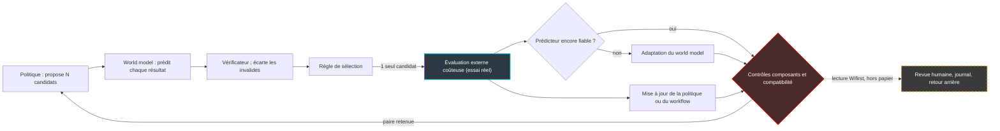

## Quatre correctifs, un seul créneau d'essai

Il est deux heures du matin, la fenêtre de maintenance vient de s'ouvrir, et l'ingénieur d'astreinte a quatre correctifs possibles pour un seul créneau d'essai. Il ne pourra pas tous les tester. Alors il choisit : à l'expérience, à l'instinct, parfois à pile ou face. S'il se trompe, c'est le client qui le découvrira à l'ouverture des bureaux.

Ce dilemme n'appartient pas aux seules équipes réseau. Les agents d'IA qui écrivent du code, pilotent des interfaces ou planifient des expériences de laboratoire le vivent en permanence. Produire des candidats ne leur coûte presque rien. Ce qui coûte, c'est l'essai réel : exécuter les tests, lancer la réaction chimique, toucher à la production.

Le 9 octobre, onze chercheurs ont déposé sur arXiv un preprint au titre ambitieux : [*RSI-Anything*](https://arxiv.org/abs/2610.13912). RSI pour *recursive self-improvement*, l'auto-amélioration récursive, un thème assez chaud pour que la conférence ICLR lui consacre un atelier entier en avril. Derrière l'étiquette, l'idée utile est plus modeste, et plus intéressante. Avant de payer un essai réel, on demande à un modèle prédictif d'en deviner l'issue. Puis on ne teste que ce qui en vaut la peine.

Pour les DSI qui voient arriver des outils d'exploitation « qui s'améliorent tout seuls », ce papier mérite une lecture attentive. Pas pour ses promesses. Pour ce qu'il mesure vraiment, et pour la question qu'il laisse ouverte : qui décide qu'une nouvelle version est meilleure que l'ancienne ?

## Le joueur d'échecs et l'échiquier

Un bon joueur d'échecs ne pousse pas une pièce pour voir ce qui se passe. Il déroule plusieurs variantes dans sa tête, écarte celles qui perdent la dame, et ne pose la main que sur un seul coup. Ce calcul mental est un modèle du monde : une simulation interne, rapide et gratuite, de ce que l'échiquier va répondre. Mais ce n'est pas l'échiquier. Le joueur peut rater une combinaison, et l'adversaire se chargera de le lui rappeler.

C'est exactement le rôle que RSI-Anything confie à son *world model*. Le concept n'a rien de neuf : David Ha et Jürgen Schmidhuber l'ont popularisé en 2018 en entraînant un agent dans des déroulés simulés, avant de le transférer dans l'environnement réel. Meta l'a poussé vers la robotique en 2025 avec V-JEPA 2, qui planifie les mouvements d'un bras robotisé à partir de moins de 62 heures de vidéos de robot. RSI-Anything s'appuie, lui, sur JEPA-Anything, publié en septembre par le même groupe, qui revendique un modèle prédictif unique pour sept domaines.

Le marché suit. En août, Sakana AI a fait des world models employés comme « simulateurs vérifiables » l'un des quatre axes du laboratoire d'auto-amélioration qu'elle ouvrait à Tokyo. C'est une annonce de recrutement, pas un résultat. Mais le prédicteur est en train de devenir une brique d'architecture, plus seulement un objet de recherche.

### Une boucle à deux portes

L'apport de RSI-Anything tient à la tuyauterie autour du prédicteur. La *politique*, c'est-à-dire le modèle qui agit (le codeur, l'agent qui clique, le planificateur), propose plusieurs candidats. Le world model prédit le résultat de chacun. Un vérificateur écarte les invalides. Puis une règle de sélection désigne le seul candidat qui aura droit à l'évaluation externe, celle qui coûte.

Le retour observé sert ensuite deux fois. Il met à jour la politique ou le workflow. Et si les prédictions décrochent de la réalité, il déclenche, sous contrôle de fiabilité, une adaptation du world model. Enfin, des contrôles de composants et de compatibilité décident quelle paire politique–modèle est conservée pour le tour suivant.

*La boucle de RSI-Anything. En pointillés, notre lecture : le papier ne décrit aucune porte de gouvernance humaine.*

Deux portes structurent donc le dispositif. La sélection décide quoi tester : c'est une affaire d'efficacité. La rétention décide quoi garder : c'est une affaire de gouvernance. Le papier soigne la première. C'est la seconde qui devrait occuper les DSI.

*Le world model comme entonnoir : beaucoup de candidats proposés, un seul envoyé au banc d'essai réel.*

## Les chiffres, sans le vernis

### Le code : un gain réel, mais étroit

Commençons par le terrain le plus parlant pour un CTO : la réparation de code. À chaque tour, le codeur propose quatre révisions d'un programme bogué. Une seule passe au banc des tests cachés. Laquelle choisir ?

Avec un simple vérificateur statique pour trancher, 26,3 % des tâches finissent résolues. Avec la sélection prédictive d'un world model fixe (CURE-WM-Lite), on monte à 29,2 %. Une fois ce prédicteur adapté en cours de route, 31,2 %. Le tirage au hasard (Random-K) plafonne à 26,0 %. Et le budget de tests ne bouge pas : entre 3,71 et 3,72 appels par tâche, quelle que soit la configuration.

C'est le résultat le plus instructif du papier. Le gain ne vient pas de tester moins, mais de mieux choisir ce que l'on teste.

Le protocole est sérieux mais restreint : 200 tâches tirées du jeu CodeContests, trois graines aléatoires, trois tours au maximum, quatre candidats par tour. Le codeur, ReasonFlux-Coder-7B, reste figé dans ce volet : seul le mécanisme de sélection change. Le world model W1, lui, est un modèle de 3 milliards de paramètres obtenu par LoRA (une technique d'ajustement léger qui n'entraîne que de petites matrices ajoutées au modèle) à partir de Qwen2.5-Coder-3B-Instruct.

Reste la rigueur statistique. Le gain apparié du world model fixe sur le vérificateur statique est de +2,83 points, avec un intervalle de confiance à 95 % de [+0,17 ; +5,50]. Traduction : le gain est probablement réel, mais sa borne basse frôle zéro. Les métriques du prédicteur bougent davantage. Sa précision de classement passe de 66,5 % à 72,8 %, son score de Brier à cinq classes (qui mesure la justesse des probabilités annoncées : plus bas, c'est mieux) de 0,488 à 0,358. Le trieur progresse franchement. Le résultat final, modestement.

### Les interfaces : spectaculaire, sur une case à cocher

Sur une petite interface web, l'agent passe d'une réussite sur deux à la quasi-perfection, en faisant moins de gestes. Le terrain : la tâche « click-checkboxes » du banc MiniWoB++, qui consiste à cocher les bonnes cases puis à valider. Le succès grimpe de 51 % à 79 % (configuration adaptée), puis à 99 % (configuration finale). Les actions par épisode tombent en moyenne de 5,30 à 3,21, soit −39,4 %. Les clics répétés passent de 237 à zéro, les épisodes avec soumission erronée de 9 à 1. Ici, contrairement au code, politique et world model sont tous deux mis à jour.

Ce −39,4 % porte sur une seule tâche, et une tâche très simple. Le détail le plus instructif est ailleurs. La configuration adaptée, l'étape intermédiaire, faisait encore mieux sur les gestes, avec 2,93 actions en moyenne, mais elle comptait 21 épisodes avec soumission erronée. Moins de gestes, plus d'erreurs. Une porte de rétention qui n'aurait regardé que l'efficacité aurait retenu la mauvaise version.

Sur OSWorld, un banc où l'agent manipule de vraies applications de bureau, le papier annonce +18,4 % relatif face à l'agent initial, et +5,5 % relatif face à [RLAnything](https://arxiv.org/abs/2602.02488), méthode antérieure du même groupe (+12,3 % relatif de son côté). Le texte ne donne aucun taux absolu. Impossible, donc, de savoir si l'agent approche d'un usage réel ou passe simplement de faible à un peu moins faible.

### Laboratoire et chimie : du protocole, pas de la paillasse

En planification d'expériences (benchmark LabHorizon F200, niveau 2), cinq versions successives d'une politique de 4 milliards de paramètres font passer le score final de 21,80 % à 46,01 %, via 38,03 %, 41,99 % et 44,56 %. Plus du double : +24,21 points. Mais la méthode de référence Actor–Simulator–Selector atteint 45,32 %, soit un écart final de +0,69 point. Quasi-parité, donc. Et il s'agit de planification alignée sur un protocole, pas d'exécution physique.

En chimie, les rendements mesurés guident le choix des conditions de réaction suivantes. Sur un premier criblage de 20 expériences, l'approche atteint 93,0 % contre 87,5 % pour l'optimisation bayésienne (la méthode statistique de référence pour choisir la prochaine expérience). Sur un second criblage de 40 expériences, avec analyse LC–MS en flux (chromatographie couplée à la spectrométrie de masse), le rendement moyen du meilleur essai observé atteint 96,15 % contre 82,16 %. C'est le chiffre le plus frappant du papier. Il repose sur deux criblages de couplage Suzuki–Miyaura, une réaction classique de chimie organique. Deux.

Enfin, le volet immunologie reste qualitatif. Un workflow d'agents évolué, « Agent Genesis », construit un world model du système immunitaire, dont les paramètres sont gelés pendant l'analyse aval. Il en sort une hypothèse thérapeutique (inhiber SIRPα et moduler l'axe IL-36γ) qui attend encore un test expérimental.

| Domaine | Ce qui est mis à jour | Résultat clé | Portée réelle |
|---|---|---|---|
| Réparation de code | Codeur figé ; world model fixe ou adapté | 26,3 % → 31,2 % à budget de tests constant | +2,83 pts, IC 95 % [+0,17 ; +5,50] |
| Interfaces graphiques | Politique et world model | 51 % → 99 % (MiniWoB++) ; +18,4 % relatif (OSWorld) | Une tâche simple ; aucun taux absolu |
| Planification labo | Cinq versions de politique | 21,80 % → 46,01 % | +0,69 pt sur la référence ; pas d'exécution physique |
| Optimisation de réaction | Les rendements mesurés guident la suite | 96,15 % contre 82,16 % | Deux criblages |
| Immunologie | Prédicteur gelé en aval | Une hypothèse thérapeutique | Non testée |

*Périmètres de mise à jour d'après la Table 4 du papier : ils varient d'un domaine à l'autre.*

## Récursif, vraiment ?

Soyons nets : RSI-Anything ne démontre pas une auto-amélioration récursive. Il démontre un bon tri.

Ce n'est pas un procès d'intention, les auteurs le reconnaissent dans leur discussion. Établir une amélioration mutuelle et durable entre politique et world model, au sein d'une même tâche, exigerait selon eux une évaluation conjointe sur plusieurs tours. Le laboratoire relève de la planification, la chimie tient en deux criblages, l'hypothèse immunologique n'est pas testée. Aucune section n'est consacrée à la sécurité : les contraintes « opérationnelles et de sécurité » n'apparaissent que dans la spécification des tâches.

Le contexte appelle aussi la prudence. C'est un preprint d'une semaine, sans relecture par les pairs ni réplication, et nous n'avons trouvé aucune couverture indépendante. Le groupe qui le signe a aussi produit JEPA-Anything, sa fondation, et RLAnything, sa baseline sur OSWorld : benchmarks et points de comparaison sont choisis en famille. Le [dépôt GitHub](https://github.com/Gen-Verse/RSI-Anything) (477 étoiles, 40 forks) publie le code sous licence Apache-2.0 et les benchmarks sur Hugging Face. Mais aucun poids de modèle n'y était listé lors de notre vérification, et le papier ne rapporte ni coût d'entraînement du world model, ni latence.

La comparaison avec la [Darwin Gödel Machine](https://arxiv.org/abs/2505.22954), référence du domaine depuis 2025, éclaire la nature du travail. La DGM réécrit le code de son propre agent. Elle fait passer SWE-bench de 20,0 % à 50,0 % et Polyglot de 14,2 % à 30,7 %, en déclarant des précautions explicites (bac à sable, supervision humaine). RSI-Anything joue sur un autre levier : il apprend surtout à l'agent à mieux choisir ses essais.

La grille de maturité proposée par Analytics Vidhya, de B0 à L5, pose le seul critère qui compte : les gains persistent-ils ? Elle conclut que le RSI complet n'est démontré nulle part. L'atelier d'ICLR faisait d'ailleurs de la « preuve d'amélioration » l'une de ses cinq lentilles d'analyse. À cette aune, l'expression juste pour RSI-Anything est « boucle d'amélioration avec rétention de versions ». Moins vendeur. Plus exact. Et bien loin du débat sur l'explosion d'intelligence que nous évoquions le 4 octobre.

Le papier pointe en revanche un risque très concret : quand la politique évolue, les prédictions du world model peuvent perdre leur fiabilité. Notre joueur d'échecs, habitué à un adversaire prudent, se fait surprendre par un attaquant. D'où le contrôle de fiabilité qui déclenche l'adaptation du prédicteur. Un trieur qui ne se recalibre pas finit par trier de travers.

*Politique et prédicteur s'entraînent l'un l'autre : sans verrou de fiabilité, l'engrenage finit par tourner à vide.*

## Lecture Wifirst, hors périmètre du papier : prédire avant de pousser

**Avertissement de méthode** : tout ce qui suit est notre analyse d'auteur. RSI-Anything ne teste rien sur un réseau, un centre de supervision ou un parc Wi-Fi.

Chez un opérateur, l'« évaluation externe coûteuse » porte des noms très concrets. Un incident client. Une fenêtre de maintenance consommée. Un technicien envoyé sur site. Le budget d'essais réels est un budget de risque.

Le parallèle avec le volet code est tentant. Classer quatre révisions avant d'en exécuter une, c'est comme classer quatre variantes d'un changement avant d'en pousser une sur le premier anneau de déploiement. Ce changement peut toucher la configuration RADIUS (le protocole qui authentifie les accès au réseau), le plan de canaux radio ou le firmware des points d'accès. Un prédicteur qui estimerait l'effet de chaque variante améliorerait la qualité du choix, à risque constant.

Insistons sur ce « à risque constant ». En code, le nombre d'appels de test n'a pas bougé : le gain vient d'un meilleur choix, pas de la suppression des essais. Un éditeur qui promet de se passer de tests grâce à un world model vend le calcul mental pour l'échiquier.

L'hypothèse la plus fragile, ce sont les données. Le papier travaille sur des environnements à retour net : un test passe ou échoue, un rendement se mesure, une case est cochée ou non. Un réseau répond de façon bruitée, retardée et multicausale. Une dégradation de l'itinérance peut venir d'un firmware, de la densité de clients ou d'un voisin radio. Un prédicteur crédible exigerait un corpus propre et abondant de couples « changement → résultat ». La plupart des parcs n'ont pas ce corpus. Ils ont des tickets.

Et le parc bouge : nouveaux firmwares, nouveaux modèles de bornes, nouveaux usages. Un prédicteur figé s'y dégraderait, exactement comme le papier le redoute quand la politique évolue. Un prédicteur adaptatif exigerait des contrôles de fiabilité explicites pour savoir quand se recalibrer.

Ce prédicteur n'occuperait pas la place des outils évoqués récemment sur ce blog. La vérification formelle (*Lean vérifie la preuve, pas l'énoncé*) certifie un livrable après coup. Le goulot de relecture face aux essaims d'agents concerne l'humain en bout de chaîne. Le world model intervient avant : il ne prouve rien, il réduit le nombre de candidats qui arrivent jusqu'au relecteur.

## La vraie décision : qui signe la version retenue ?

Revenons à la seconde porte. Dans RSI-Anything, des contrôles de composants et de compatibilité décident quelle paire politique–modèle passe au tour suivant. Transposée dans une DSI (c'est toujours notre lecture, pas celle du papier), cette porte a un nom : la mise en production.

L'épisode de la case à cocher l'illustre. Une version plus économe en gestes peut être plus fautive. Un système qui choisit seul ce qu'il garde le choisira selon la métrique qu'on lui a donnée, et une métrique isolée peut désigner la mauvaise version. Le papier ne traite pas cette question de gouvernance, ce n'est pas son objet. Les auteurs de la Darwin Gödel Machine, eux, mentionnent explicitement une supervision humaine.

La position que je défends est simple. Pour tout outil d'exploitation qui « s'auto-améliore », la porte de rétention doit rester humaine, ou fondée sur des critères signés à l'avance. Elle doit être journalisée. Chaque version retenue doit pouvoir être annulée. La performance du prédicteur est une question d'ingénierie ; la rétention est une question de responsabilité.

Concrètement, quatre questions à poser à tout éditeur d'AIOps (l'IA appliquée à l'exploitation informatique) qui promet un produit capable d'apprendre seul :

1. **Qu'est-ce qui est mis à jour ?** La politique, le prédicteur, le workflow ? Dans RSI-Anything, la réponse change d'un domaine à l'autre : elle doit être écrite noir sur blanc.
2. **Qui valide la rétention ?** Un humain, une règle signée, ou le système lui-même ?
3. **Sur quel périmètre le gain est-il mesuré ?** Deux cents tâches, deux criblages, une case à cocher : le périmètre fait le chiffre.
4. **Où est le journal des versions ?** Et combien de temps faut-il pour revenir à la précédente ?

*Retenir une version, c'est mettre en production : la décision se signe, se journalise et doit rester réversible.*

## Le world model trie, l'humain retient

Ce que RSI-Anything apporte vraiment tient en une bascule : passer de « vérifier après » à « prédire avant, puis ne tester que le douteux ». C'est utile, mesurable et, à mon sens, transposable en principe à bien des métiers où l'essai réel coûte cher. Mais le chiffre honnête sur une tâche complexe reste +2,8 points en code, avec une borne basse qui frôle zéro. Les chiffres spectaculaires vivent sur des terrains étroits.

Pour un DSI, deux décisions en découlent dès aujourd'hui. D'abord, constituer un historique « changement → résultat » proprement étiqueté : c'est lui, plus que le modèle, qui fera la valeur d'un futur prédicteur. Ensuite, refuser tout produit « auto-améliorant » dont la porte de rétention n'est ni contrôlée, ni journalisée, ni réversible.

Un joueur d'échecs qui calcule mieux gagne plus de parties. Il ne fixe pas pour autant, seul, les règles du tournoi.

---

_Vues personnelles, pas position Wifirst._

## Sources

1. [RSI-Anything, arXiv 2610.13912 (Cui, Zeng, Xu, Xiao, Xue, Gao, Ouyang, Heng, Yin, Wu, Yang), v1 du 9 octobre 2026](https://arxiv.org/abs/2610.13912) — PDF : https://arxiv.org/pdf/2610.13912 — HTML : https://arxiv.org/html/2610.13912v1
2. [Dépôt GitHub Gen-Verse/RSI-Anything](https://github.com/Gen-Verse/RSI-Anything)
3. [JEPA-Anything: Learning Predictive Models across Different Worlds (arXiv 2609.20800)](https://arxiv.org/abs/2609.20800)
4. [RLAnything: Forge Environment, Policy, and Reward Model in Completely Dynamic RL System (arXiv 2602.02488)](https://arxiv.org/abs/2602.02488)
5. [Darwin Gödel Machine: Open-Ended Evolution of Self-Improving Agents (arXiv 2505.22954)](https://arxiv.org/abs/2505.22954)
6. [World Models, Ha et Schmidhuber, 2018 (arXiv 1803.10122)](https://arxiv.org/abs/1803.10122)
7. [V-JEPA 2, Meta, 2025 (arXiv 2506.09985)](https://arxiv.org/abs/2506.09985)
8. [ICLR 2026 Workshop on AI with Recursive Self-Improvement](https://iclr.cc/virtual/2026/workshop/10000796)
9. [Recursive Self-Improvement: The Last AI Built by Humans, Analytics Vidhya](https://www.analyticsvidhya.com/blog/2026/09/recursive-self-improvement/)
10. [Sakana AI opens Tokyo RSI Lab, AI Weekly](https://aiweekly.co/alerts/sakana-ai-opens-tokyo-rsi-lab-hiring-frontier-researchers)
11. [JEPA-Anything learns one world model across 7 domains, AI Weekly](https://aiweekly.co/editors-blog/found-first-jepa-anything-learns-one-world-model-across-7-domains-ai-nominated)
12. Wifirst Tech Blog : *Lean vérifie la preuve, pas l'énoncé* (12 octobre 2026) ; *Plus vite qu'on ne relit : la vérification devient le goulot des essaims d'agents* (5 octobre 2026) ; *Explosion d'intelligence : l'hypothèse est incertaine, la cadence ne l'est pas* (4 octobre 2026)
