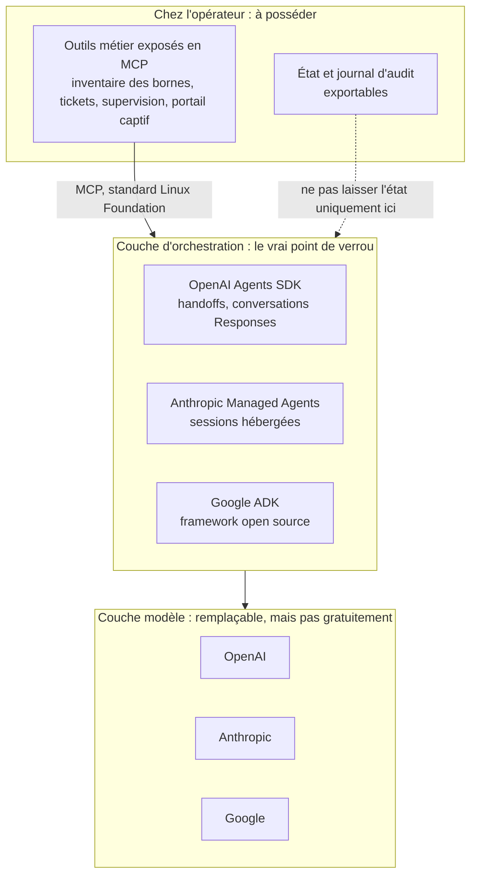

## Le chiffre du titre n'est pas le bon

Deux fois plus d'entreprises utilisent la plateforme d'agents d'OpenAI que celle d'Anthropic. C'est le titre retenu par VentureBeat pour l'[enquête publiée le 13 octobre](https://venturebeat.com/ai/openais-ai-agent-platform-is-used-by-twice-as-many-companies-as-anthropics-new-venturebeat-survey-finds/), et c'est lui qui va remonter dans les comités de direction cette semaine, accompagné de la question rituelle : avons-nous misé sur le bon cheval ?

Mauvaise question.

Le sondage repose sur 109 répondants volontaires, et son enseignement le plus utile se cache plus bas, dans les questions sur le changement de modèle. Sur l'année écoulée, 62 % des entreprises interrogées ont remplacé un modèle d'IA dans une application en production. Parmi elles, 59 % ont vu la performance baisser et ont dû retravailler l'application, voire faire marche arrière.

Changer de modèle coûte donc cher. Mais la facture n'arrive pas là où on l'attend.

Prenez un opérateur qui gère le Wi-Fi d'hôtels, de magasins et de résidences étudiantes, et qui confie à des agents d'IA une partie de son support et de sa supervision. La tentation est forte de laisser l'éditeur héberger toute la tuyauterie : la mémoire des conversations, la façon dont un agent passe la main à un autre, l'historique des incidents résolus. C'est là, à mon sens, que se joue la vraie dépendance. Pas dans le choix du modèle. Dans la couche qui l'orchestre.

## Le modèle se remplace, son entourage beaucoup moins

Commençons par les chiffres qui comptent vraiment. Ils viennent de la même enquête Agentic Orchestration de VB Pulse (109 répondants qualifiés). Parmi ceux qui ont changé de modèle, seuls 19 % disent que l'opération n'a demandé presque aucun effort d'ingénierie. Les trois quarts évoquent au moins quelques jours de travail, quand ils n'ont pas purement abandonné.

Avec les mêmes réserves d'échantillon que le reste de l'enquête, le signal est net. Les consultants rapportent davantage de changements de modèle : 81 % disent que leur client principal a remplacé un modèle dans l'année, contre 51 % des répondants internes parlant de leur propre entreprise. Même côté interne, plus d'une entreprise sur deux a changé de modèle : le phénomène n'a rien de marginal.

Angie Brown, vice-présidente exécutive et DSI de Home Depot, met le doigt sur la cause : « One of the things is the context training that has to be done anytime there's a switch. » Tout le travail de mise en contexte est à refaire à chaque bascule. Le modèle, lui, n'est que la partie émergée.

Les opérateurs télécoms connaissent ce film par cœur. Tant que le numéro de téléphone appartenait à l'opérateur, changer de réseau coûtait plus cher que l'économie espérée : il fallait prévenir tous ses contacts, réimprimer ses cartes de visite, espérer que personne n'oublie. Le réseau radio était interchangeable, le numéro ne l'était pas. Il a fallu imposer la portabilité pour que la concurrence joue vraiment.

Les agents d'IA rejouent la même pièce. Le modèle, c'est le réseau radio : on peut en changer, moyennant une sérieuse recette de non-régression. Le numéro, c'est tout ce qui l'entoure. L'historique des conversations, la logique qui décide quel agent prend la main, la boucle qui appelle les outils et relance en cas d'erreur, les consignes patiemment ajustées. Voilà les actifs qu'il faut pouvoir emporter.

Une précision d'honnêteté s'impose. VentureBeat mesure l'usage des plateformes d'orchestration ; l'enquête ne conclut nulle part que le verrou s'y trouve. Elle ne mentionne ni les mécanismes de passage de main entre agents, ni MCP (Model Context Protocol, le standard ouvert qui décrit comment un agent appelle des outils externes). Le lien entre les chiffres de migration et la couche d'orchestration est ma lecture, étayée par la documentation des éditeurs. Voici comment je découpe la pile.

*Lecture personnelle de la pile agentique : le modèle se remplace, l'état et la boucle d'orchestration sont ce qu'il faut garder chez soi.*

## Ce qu'un passage de main emporte avec lui

Dans un système multi-agents, le geste central s'appelle le handoff : un agent de tri reconnaît une demande, puis la transmet à un agent spécialisé. C'est un passage de témoin dans un relais. Le geste est universel. La piste, elle, appartient toujours à quelqu'un.

Chez OpenAI, la [documentation de l'Agents SDK](https://openai.github.io/openai-agents-python/handoffs/) (le kit de développement d'agents de l'éditeur) décrit le mécanisme sans détour. Un handoff est présenté au modèle comme un simple outil, du type `transfer_to_refund_agent`. Par défaut, l'agent qui reçoit la main voit tout l'historique ; un filtre, l'`input_filter`, permet de le restreindre. Conceptuellement, c'est donc portable : un appel d'outil, tous les grands modèles savent le faire.

Les ennuis commencent dans les détails. L'historique « imbriqué » (nested) est une bêta optionnelle, dont la documentation précise qu'elle ne masque pas les données sensibles. Et si vous laissez OpenAI gérer la conversation côté serveur, les filtres d'entrée ne sont tout simplement pas pris en charge. Traduction : plus vous déléguez l'état à l'éditeur, moins vous contrôlez ce que chaque agent voit.

Second test, le changement de modèle. Le SDK sait parler à des modèles concurrents, via un fournisseur personnalisé ou des adaptateurs encore en bêta. Branchez-en un : le code tourne, aucune erreur ne remonte. Et pourtant, une partie de vos réglages vient de disparaître.

Concrètement, des champs propres à l'API Responses d'OpenAI, comme `previous_response_id`, sont [ignorés en silence](https://openai.github.io/openai-agents-python/models/) quand l'appel passe par l'interface plus ancienne Chat Completions, à moins d'activer une option de validation stricte. La documentation l'admet elle-même : « many LLM providers still do not support the Responses API ».

Les outils hébergés, recherche de fichiers ou recherche web, restent propres à OpenAI. Les sorties structurées en JSON reviennent parfois invalides. Rien de scandaleux : l'outil est conçu d'abord pour son écosystème, et il le dit. Mais un portage qui compile n'est pas un portage qui marche. Tant qu'aucun test de bout en bout n'a été mené, la portabilité reste une hypothèse.

*Le passage de témoin entre agents est un geste standard. La chaîne, elle, relie souvent l'un d'eux aux serveurs de l'éditeur.*

Le précédent qui devrait faire réfléchir date de cet été. L'Assistants API d'OpenAI, qui gérait pour le développeur les fils de conversation et la boucle d'outils, a été [arrêtée le 26 août 2026](https://developers.openai.com/api/docs/assistants/migration). La dépréciation avait été annoncée en 2025, avec une date d'arrêt fixée un an plus tard : un préavis d'environ un an, pas plus. Ceux qui avaient bâti dessus ont migré vers Responses et Conversations, et rapatrié côté application la boucle d'appel d'outils, l'élagage de l'historique et les reprises sur erreur. La page de migration prévient au passage que les objets « Prompts » réutilisables sont eux-mêmes en cours de dépréciation.

Anthropic pousse la logique hébergée plus loin avec [Managed Agents](https://platform.claude.com/docs/en/managed-agents/overview), en bêta. Au menu : un harnais d'agent hébergé (la boucle qui fait tourner l'agent), des sessions persistantes côté serveur, la prise en charge de MCP, et un bac à sable d'exécution dans le cloud ou chez vous. Le produit est « stateful by design ». Conséquence directe, à ce jour : il n'est éligible ni au Zero Data Retention (l'engagement de non-conservation des données), ni aux accords de conformité santé américains (HIPAA).

Le [billet d'ingénierie du 8 avril](https://www.anthropic.com/engineering/managed-agents) décrit une architecture soignée. La session (un journal d'événements), le harnais et le bac à sable y sont découplés, derrière des interfaces pensées pour rester stables quand les harnais évoluent. Les identifiants restent hors du bac à sable grâce à un proxy MCP et un coffre-fort. C'est un vrai argument de portabilité. Mais relisez le schéma : le journal de session vit chez Anthropic. Héberger soi-même le bac à sable déplace l'exécution des outils, pas la mémoire.

Google joue une autre partition avec [ADK](https://adk.dev/) (Agent Development Kit), un framework open source qui revendique de fonctionner avec « almost any generative AI model », en Python, TypeScript, Go, Java ou Kotlin. Il se déploie en conteneur où l'on veut, ou sur la plateforme Google. Ici, la question de l'état se tranche au moment du déploiement, pas dans le contrat.

Trois éditeurs, trois postures. Un point commun : plus la plateforme gère l'état pour vous, plus le démarrage est confortable, et plus la sortie coûtera cher.

## Et le classement, dans tout ça ?

Revenons au titre, puisqu'il va circuler. L'enquête a été menée en septembre auprès de 109 répondants qualifiés, dont 107 entreprises utilisant une plateforme d'orchestration. Il fallait travailler dans une organisation d'au moins 100 salariés, ou être consultant dont le client principal est une telle organisation. L'échantillon est opt-in : des lecteurs de VentureBeat et un panel de recherche, qui ont choisi de répondre.

Côté usage, OpenAI est cité par 43 % des entreprises, Anthropic par 22 %, Google par 21 %. Comme plateforme principale, l'ordre bouge : OpenAI 25 %, Google 18 %, Anthropic 16 %. VentureBeat présente l'avance d'OpenAI en usage comme significative à 95 %, y compris parmi les seuls répondants internes. C'est le seul écart solide du lot. Anthropic et Google, à un point d'écart, sont indiscernables.

L'intention à douze mois appelle encore plus de prudence. Sur 61 entreprises citant au moins une plateforme, avec réponses multiples, Anthropic recueille 33 %, OpenAI 30 %, Google 25 %. La tentation d'écrire « Anthropic rattrape OpenAI » est grande. Rien ne permet de l'écrire.

Un calcul d'intervalle de confiance rapide, le mien et non celui de VentureBeat, donne une marge de l'ordre de ±11 à 12 points pour une proportion d'environ 30 % sur 61 répondants. Et cela avant même de compter le biais d'auto-sélection. Les trois chiffres se chevauchent largement. Seules 20 entreprises envisagent Anthropic, dont 60 % ne l'utilisent pas aujourd'hui : un signal à suivre, pas une tendance.

VentureBeat ne cache d'ailleurs aucune de ces limites : résultats non généralisables, photographie mensuelle, questions de filtrage modifiées entre août et septembre, ce qui interdit toute lecture de tendance. Le média rappelle aussi que Ramp, qui analyse les dépenses des entreprises, mesure des paiements, quand lui mesure l'usage par les salariés. Une entreprise peut très bien payer Claude et faire tourner ses agents sur OpenAI.

*Sur de petits sous-groupes, la marge d'erreur avale les écarts entre fournisseurs : vingt entreprises ne font pas un marché.*

[Ramp](https://ramp.com/data/businesses-are-changing-ai-model-providers-more-often) apporte justement un éclairage complémentaire. Sa note du 6 octobre suit la part mensuelle d'entreprises qui changent de fournisseur de modèle, en moyenne glissante sur trois mois : record de 8 % en septembre. L'auteur avance que ce pourrait être un signe précoce de banalisation des modèles. C'est une hypothèse, sur une méthodologie peu détaillée. Elle va pourtant dans le sens de tout le reste : on change de fournisseur plus souvent, et la multi-plateforme est déjà la norme. Angie Brown le résume pour Home Depot : « it's not that we are a Google-only shop ».

## Posséder la plomberie : cinq chantiers

Si l'on accepte cette lecture, le plan d'action est moins spectaculaire qu'un appel d'offres « quel fournisseur d'IA choisir ? ». Il est aussi plus durable. Voici ce que j'appliquerais à un opérateur qui sert l'hôtellerie, le retail, l'entreprise et les résidences étudiantes.

### 1. Cartographier où vit l'état

Conversations, sessions, historique des passages de main : chez l'éditeur ou chez vous ? Exigez l'export, dans un format que vous savez relire sans lui. Imaginez un agent de NOC (le centre de supervision réseau) qui accumule, mois après mois, le contexte de résolution des incidents de tout un parc de sites. Si ce savoir vit dans un objet propriétaire, c'est un actif capturé.

### 2. Exposer ses outils métier en MCP, sur ses propres serveurs

Inventaire des bornes Wi-Fi, ticketing, supervision, portail captif : c'est la partie réellement portable. MCP a été [confié à la Linux Foundation](https://www.linuxfoundation.org/press/linux-foundation-announces-the-formation-of-the-agentic-ai-foundation) le 9 décembre 2025, comme projet fondateur de l'Agentic AI Foundation, aux côtés de goose (Block) et d'AGENTS.md (OpenAI). Ses membres platinum incluent AWS, Anthropic, Block, Bloomberg, Cloudflare, Google, Microsoft et OpenAI. Les trois éditeurs de l'enquête sont donc à la même table. Bémol : le communiqué ne détaille pas la gouvernance, qu'il s'agisse des votes ou des mainteneurs.

Pour le dialogue entre agents, [A2A](https://a2a-protocol.org/latest/) (Agent-to-Agent), créé par Google puis confié lui aussi à la Linux Foundation, se positionne en complément : MCP relie un agent à ses outils, A2A relie des agents entre eux. Son comité technique réunit AWS, Cisco, Google, IBM Research, Microsoft, Salesforce, SAP et ServiceNow. À mon sens, inutile de l'adopter avant d'avoir un vrai besoin d'interopérabilité entre plateformes. MCP, lui, sert dès le premier agent.

*Un connecteur standard entre les outils métier des sites (hôtels, magasins, résidences) et la console de supervision : c'est la pièce qui doit survivre à tout changement d'éditeur.*

### 3. Garder la boucle chez soi quand la conformité l'exige

Managed Agents conserve l'état par construction et reste, à ce jour, hors Zero Data Retention. Le [connecteur MCP de l'API Claude](https://platform.claude.com/docs/en/agents-and-tools/mcp-connector), lui aussi en bêta, n'y est pas éligible non plus, même s'il apporte l'authentification OAuth et des listes d'outils autorisés ou interdits. Pour des données qui touchent aux clients finaux d'un réseau Wi-Fi, c'est une question à poser au délégué à la protection des données avant la mise en production, pas après. Rappel : le bac à sable auto-hébergé déplace l'exécution des outils, pas le journal de session. Ces offres étant en bêta, leurs contraintes peuvent évoluer ; revérifiez-les à chaque revue d'architecture.

### 4. Dater ses dépendances

Prompts réutilisables, Conversations, historique imbriqué en bêta : traitez ces abstractions comme des composants à date de péremption. L'Assistants API a eu environ un an de préavis. Prévoyez un budget de migration récurrent et une couche d'adaptation fine entre votre code et le SDK de l'éditeur. Fine, pas tentaculaire : l'objectif est de pouvoir changer de fournisseur, pas de réécrire un framework maison.

### 5. Répéter le changement de modèle comme un exercice d'incendie

Constituez un jeu d'évaluation figé, avec vos vrais cas d'usage et vos vrais tickets, et rejouez-le à chaque nouvelle version ou nouveau fournisseur. Quand 59 % des entreprises qui ont changé de modèle ont constaté une baisse de performance, le coût caché n'est pas l'API. C'est la réévaluation. Un plan de reprise jamais testé n'est pas un plan. Un changement de modèle jamais répété non plus.

## Choisir une architecture, pas un camp

Je ne tire de cette enquête aucune recommandation de fournisseur. Elle n'en autorise pas. Sur 109 répondants volontaires, un seul écart tient statistiquement, et il dit qu'OpenAI est aujourd'hui plus utilisé. Pas qu'il le restera, ni qu'il est le bon choix pour vous.

Ce que l'enquête documente, en revanche, c'est la friction. Changer de modèle est devenu courant, et c'est rarement indolore. Ma lecture, qui est la mienne et pas celle de VentureBeat, est que cette friction va se déplacer. Si les modèles se banalisent, comme Ramp en fait l'hypothèse, la valeur captive glissera vers ce qui retient : la mémoire des conversations, la logique de passage de main, la boucle d'orchestration.

Les éditeurs l'ont compris. Leurs offres hébergées sont confortables, souvent bien conçues, et c'est précisément pour cela qu'il faut les adopter les yeux ouverts.

La règle que je défends tient en une phrase : le modèle peut se louer, l'état doit se posséder. Comme pour le numéro de téléphone, la portabilité ne se décrète pas après coup. Elle se construit dès le premier agent mis en production.

---

_Vues personnelles, pas position Wifirst._

## Sources

1. [VentureBeat — enquête VB Pulse sur les plateformes d'orchestration d'agents (13 octobre 2026)](https://venturebeat.com/ai/openais-ai-agent-platform-is-used-by-twice-as-many-companies-as-anthropics-new-venturebeat-survey-finds/)
2. [OpenAI Agents SDK — Handoffs (documentation)](https://openai.github.io/openai-agents-python/handoffs/)
3. [OpenAI Agents SDK — Models, usage de modèles non-OpenAI (documentation)](https://openai.github.io/openai-agents-python/models/)
4. [OpenAI — Migration de l'Assistants API vers Responses (documentation)](https://developers.openai.com/api/docs/assistants/migration)
5. [Linux Foundation — Création de l'Agentic AI Foundation (9 décembre 2025)](https://www.linuxfoundation.org/press/linux-foundation-announces-the-formation-of-the-agentic-ai-foundation)
6. [A2A Protocol — site officiel](https://a2a-protocol.org/latest/)
7. [Google ADK — documentation](https://adk.dev/)
8. [Anthropic — Claude Managed Agents, vue d'ensemble (documentation, bêta)](https://platform.claude.com/docs/en/managed-agents/overview)
9. [Anthropic Engineering — Scaling Managed Agents (8 avril 2026)](https://www.anthropic.com/engineering/managed-agents)
10. [Anthropic — MCP connector de l'API Claude (documentation, bêta)](https://platform.claude.com/docs/en/agents-and-tools/mcp-connector)
11. [Ramp — Businesses are changing AI model providers more often (6 octobre 2026)](https://ramp.com/data/businesses-are-changing-ai-model-providers-more-often)
