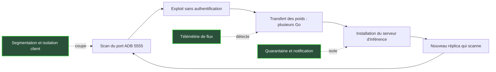
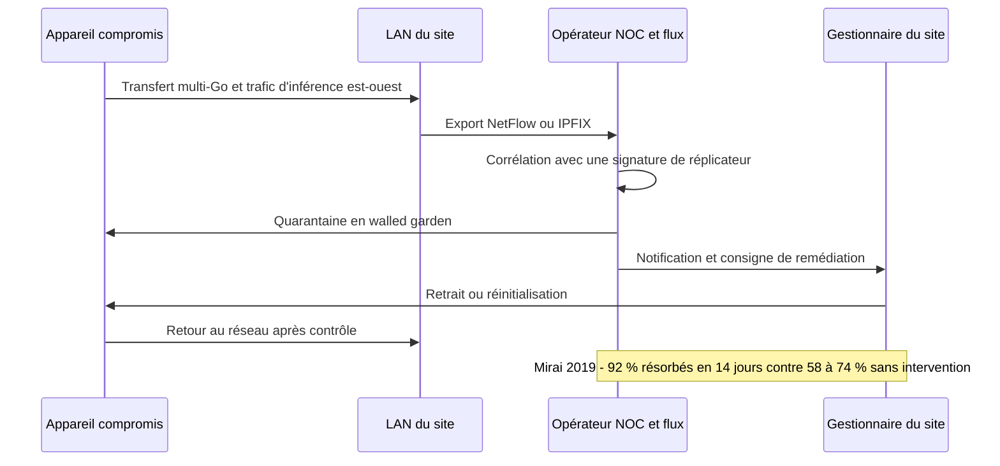

## Une box à 55 USD, et aucun interrupteur

Elle coûte 55 USD, tient dans une main et dort sous des milliers de téléviseurs : chambres d'hôtel, studios étudiants, salons. La box Android TV bas de gamme est l'objet le plus banal de nos réseaux. Le 12 octobre, la Frontier Red Team d'Anthropic, l'équipe chargée d'éprouver les capacités dangereuses des modèles avant qu'elles n'arrivent dans la nature, en a posé quinze sur une table. Ensemble, elles ont fait tourner un modèle de langage de 26 milliards de paramètres.

Lentement. Entre 0,3 et 0,4 token par seconde, soit à peine un mot toutes les trois ou quatre secondes. Personne n'écrira de roman avec ça. Mais la vraie question des chercheurs est ailleurs : un petit modèle d'IA pourra-t-il bientôt s'installer seul sur ce genre d'appareil, puis recommencer sur le voisin ? Si oui, on obtient un programme qui se copie sans le moindre datacenter. Donc sans serveur central à saisir, à couper ou à débrancher.

Pour ceux qui exploitent des milliers de réseaux locaux (LAN) dans l'hôtellerie, le retail ou les résidences étudiantes, ce n'est pas un débat philosophique. C'est une question de tuyauterie. Si ce scénario se matérialise, il se jouera sur nos réseaux, pas dans un laboratoire. Et l'acteur le mieux placé pour l'enrayer n'est ni l'éditeur du modèle, ni le fabricant de la box. C'est celui qui voit passer les flux.

## Ce qu'Anthropic a vraiment mesuré

Pour lire la [publication de William Zhou et Daniel Freeman](https://www.anthropic.com/research/self-replicating-ai), il faut oublier Terminator et penser épidémiologie. Les épidémiologistes ont un chiffre fétiche, le R0 : le nombre moyen de nouvelles personnes qu'un porteur contamine. Au-dessus de 1, l'épidémie s'emballe. En dessous, elle s'éteint d'elle-même. Tout le sujet d'une IA qui se réplique tient dans ce chiffre.

L'analogie va plus loin. Un virus trouve dans la cellule une machinerie toute prête pour se recopier. Une IA, non. Une fois entrée dans un appareil, elle doit monter elle-même son atelier : trouver un moteur d'inférence (le logiciel qui exécute le modèle), le compiler pour un processeur exotique, choisir une compression qui tienne dans 4 Go de mémoire, contourner des pilotes capricieux. C'est l'étape la plus dure. C'est précisément celle qu'Anthropic a mesurée, en trois expériences.

**Installer le moteur.** Un agent reçoit du matériel inconnu et une consigne : faire tourner un modèle dessus. Qwen3.5-9B, un modèle open-weight (poids publiés librement) de 9 milliards de paramètres, y parvient sur 8 des 9 types de matériel testés, du Jetson Nano aux Mac en passant par des cartes RTX 4090. Attention à la lecture rapide : ce sont surtout des PC et des puces de datacenter, pas huit modèles de box TV. L'effort se compte en jours : 28 à 51 heures pour le 9B, 71 à 150 heures pour Gemma4-26B-A4B, non optimisé.

**Prouver que la box suffit.** Les quinze box à 55 USD, 4 Go de RAM chacune, se partagent Gemma4-26B-A4B en parallélisme de pipeline. Imaginez une chaîne de pompiers qui se passe le seau. Chaque box porte quelques couches du modèle, calcule sa part et transmet le résultat à la suivante. Le débit vaut 0,39 token par seconde dans l'introduction de la publication, environ 0,3 dans une section détaillée. Anthropic ne réconcilie pas les deux : je retiens la fourchette de 0,3 à 0,4. Côté mémoire, en compression 4 bits, un 9B réclame au moins 4 box, un 26B au moins 10.

*Parallélisme de pipeline : quinze box à 55 USD se passent les couches d'un modèle de 26 milliards de paramètres, comme une chaîne de pompiers se passe le seau.*

**Boucler la chaîne.** Troisième expérience, la plus spectaculaire. Huit machines virtuelles chez Google Cloud émulent Android 15, enfermées dans un réseau cloisonné. La porte d'entrée est la plus bête qui soit : l'interface de débogage d'Android, ADB (Android Debug Bridge), laissée ouverte sans authentification. GLM-5.2 compromet les 8 nœuds dans 4 essais sur 5, et 7 sur 8 dans le cinquième. C'est le seul modèle open-weight testé qui y parvient. Sur les cibles, il déploie Llama3.1-8B, qui joue le rôle du petit modèle à répliquer.

Voici la nuance qui change tout, relevée notamment par Beam.ai. GLM-5.2, le cerveau de l'attaque, tournait sur un serveur extérieur. Il est bien trop gros pour tenir sur les nœuds qu'il infecte. Aucun petit modèle n'a bouclé la chaîne seul. Il reste donc un écart entre le plancher de capacité nécessaire pour mener l'attaque et le plafond de taille qu'une box peut héberger. Tant que cet écart existe, pas de ver.

Combien de temps tiendra-t-il ? Anthropic s'appuie sur l'Epoch Capabilities Index (ECI), un indice générique de capacités. Pour les modèles de 30 milliards de paramètres ou moins, il progresse d'environ 13,7 points par an, avec une régression très propre (R² de 0,95). Extrapolé, un petit modèle atteindrait le niveau de GLM-5.2 fin 2026, une estimation que les auteurs qualifient eux-mêmes de « rough ».

Deux résultats annexes rendent la trajectoire crédible. Quand des générations successives de Qwen3.5-9B se transmettent leurs notes, une hérédité que les auteurs qualifient de lamarckienne, le taux de succès d'installation passe de 45 % à 61-84 % en six générations. Et quand l'installation est scriptée à sa place, même un modèle de 3 milliards de paramètres atteint environ la moitié d'un réseau de 17 nœuds. Autrement dit : tout ce qui n'est ni l'exploit ni l'installation est déjà facile.

Le partage entre démonstration et extrapolation est net.

| Ce qui a été démontré | Ce qui ne l'a pas été |
|---|---|
| Un 9B installe un serveur d'inférence sur 8 types de matériel sur 9 | Que ce soient des box TV : surtout des PC et des puces de datacenter |
| 15 box à 55 USD exécutent un 26B à 0,3-0,4 token par seconde | Qu'une grappe de box se forme spontanément sur un vrai réseau |
| GLM-5.2 réplique un 8B sur 8 nœuds émulés | Qu'un petit modèle boucle seul la chaîne |
| Entrée par un ADB ouvert sans mot de passe | Une faille réaliste : c'est une borne haute |
| Tendance ECI : niveau requis atteint fin 2026 | Une mesure directe de la réplication : l'ECI est un proxy |

## Deux millions d'appareils, quarante GPU : l'arithmétique qui compte

Faisons l'exercice que propose Anthropic. Prenez le plus gros botnet d'objets connectés de l'année, transformez chaque appareil en fragment de cerveau, et regardez ce que vous obtenez. Réponse : l'équivalent d'une petite baie de serveurs.

Le botnet de référence s'appelle Kimwolf : plus de 2 millions d'appareils au pic selon Synthient. Découpez-les en groupes de 15 box faisant tourner Gemma4-26B-A4B, vous obtenez environ 133 000 réplicas. Chaque groupe sert 2 agents à environ 0,3 token par seconde, soit quelque 80 000 tokens par seconde au total. C'est à peu près ce que débitent 40 GPU H100, les puces NVIDIA de datacenter, à environ 1 950 tokens par seconde chacune avec décodage spéculatif à forte concurrence.

```mermaid
flowchart LR
  A["Kimwolf : plus de 2 M d'appareils au pic"] --> B["Groupes de 15 box"]
  B --> C["Environ 133 000 réplicas"]
  C --> D["2 agents par groupe à 0,3 tok/s"]
  D --> E["Environ 80 000 tok/s au total"]
  E --> F["Équivalent d'environ 40 GPU H100"]
  F --> G["Petit en calcul, immense en résilience"]
  style A fill:#2b3a42,stroke:#00a8cc,stroke-width:2px,color:#fff
  style G fill:#5c3a3a,stroke:#cc3333,stroke-width:2px,color:#fff
```

Quarante GPU. Un hyperscaler en installe autant dans l'après-midi. Personne ne monterait un botnet de deux millions d'appareils pour la puissance de calcul : louer coûterait moins cher. L'intérêt, pour un attaquant, est ailleurs. Un modèle malveillant hébergé dans un datacenter, on le coupe : on saisit le serveur, on révoque le compte cloud, on bloque une adresse. Cent trente mille grappes éparpillées dans des salons et des chambres d'hôtel, aucun geste unique ne les éteint. On parlait déjà sur ce blog du temps qu'il faut pour débrancher un agent. Ici, il n'y a même plus de prise.

Deux garde-fous de lecture. D'abord, ces 133 000 réplicas sont un plafond théorique : ils supposent tous les appareils compromis et parfaitement regroupés par quinze. Ensuite, la propagation serait lente : plus d'un à deux jours par cycle de réplication pour un 9B, un temps de doublement qui se compte en jours. Les accélérateurs embarqués de type Jetson pèsent plus lourd sur le papier, entre 9 000 et 35 000 équivalents H100. Mais la part joignable et vulnérable est probablement dix fois moindre, ou pire : la plupart ne sont accessibles que via des tunnels sortants vers le cloud.

Un ver qui met des jours à doubler est un ver qu'on a le temps de voir venir. À condition de regarder.

## Le LAN, scène du crime

Le pare-feu de la box internet garde la porte d'entrée. Kimwolf, lui, passe par la fenêtre du salon.

[Brian Krebs a documenté le mécanisme](https://krebsonsecurity.com/2026/01/the-kimwolf-botnet-is-stalking-your-local-network/) en janvier. Les opérateurs du botnet passent par des réseaux de proxys résidentiels comme IPIDEA : des logiciels installés sur des appareils domestiques, qui revendent leur connexion à qui paie. L'attaquant se retrouve donc déjà à l'intérieur du réseau local. Pour atteindre les autres appareils, il utilise des enregistrements DNS qui pointent vers des adresses privées, ces plages RFC 1918 en 192.168.x.x ou 10.x.x.x qu'on trouve dans tous les foyers. Le filtrage censé bloquer ce trafic est contourné.

Là, il trouve sa proie. Environ deux tiers des appareils de Kimwolf sont des box Android TV non officielles, livrées avec ADB activé par défaut sur le port 5555, sans authentification. Pas de mot de passe à deviner : la porte est ouverte. Synthient compte plus de 2 millions d'appareils. XLab, plus prudent, en retient au moins 1,8 million et rappelle que les adresses IP cumulées surestiment le nombre réel d'appareils.

Conséquence directe pour qui opère un réseau : le pare-feu périmétrique ne protège rien si un proxy résidentiel est déjà dans le LAN. Les contrôles qui comptent sont internes. L'isolation entre clients, qui empêche deux appareils du même Wi-Fi de se parler. Un réseau invités séparé. Krebs le recommande explicitement : un Wi-Fi invités qui ne peut pas joindre les appareils locaux.

Et c'est bien la faille technique, pas la manipulation humaine, qui ouvre la voie. Anthropic juge la capacité des petits modèles à mener du spearphishing (hameçonnage ciblé) très faible à faible (« very poor » à « poor » dans le texte original). Le vecteur proche, c'est le port ouvert. Mise bout à bout, la chaîne ressemble à ceci, avec les trois points où le réseau peut la couper.

J'ajoute une hypothèse, la mienne, qui ne figure pas dans la publication. Le parallélisme de pipeline impose un trafic permanent entre les box d'un même groupe : chaque token traverse les quinze appareils. Anthropic ne précise pas si ses groupes de 15 sont supposés partager le même LAN. Si c'est le cas, l'isolation client par chambre, ou un VLAN (réseau virtuel isolé) par logement, casse purement et simplement la mise en grappe. Une box seule, avec ses 4 Go, ne porte ni un 26B ni même un 9B. Une grappe étalée sur Internet reste concevable, mais plus lente et nettement plus visible.

C'est une hypothèse à vérifier en laboratoire, pas un fait. Mais si elle tient, l'hôtellerie et les résidences étudiantes, où chaque chambre est déjà cloisonnée, partent avec une longueur d'avance sur le salon familial au réseau plat.

*Un réseau par chambre : quand chaque logement est isolé, une box compromise reste seule, et une seule pièce bascule en quarantaine.*

## La quarantaine marche : Mirai l'a déjà prouvé

Les parades listées par Anthropic sont, pour l'essentiel, des outils de réseau, pas d'IA. Un réplicateur laisse trois signatures dans la télémétrie de flux d'un FAI, ce relevé de qui parle à qui, combien et quand. Des transferts de plusieurs gigaoctets : les poids du modèle qui voyagent. Un trafic d'inférence d'appareil à appareil, dit est-ouest. Des motifs de balayage de ports.

S'y ajoutent des honeypots (leurres) pour capturer l'agent et sa charge utile, des réglages constructeurs sûrs par défaut, et surtout la quarantaine assortie d'une notification. Objectif affiché : ramener le R0 sous 1. L'analyse de RITS (NYU Shanghai) pointe un compromis favorable au défenseur : plus un réplicateur se propage vite, moins il est furtif. Pousser des gigaoctets en quelques minutes, ça se voit. Les étaler sur des jours ralentit l'épidémie.

La quarantaine n'est pas une idée de laboratoire. En 2019, une équipe de TU Delft ([Çetin et al., NDSS](https://ndss-symposium.org/ndss-paper/cleaning-up-the-internet-of-evil-things-real-world-evidence-on-isp-and-consumer-efforts-to-remove-mirai)) a mené un essai randomisé chez un FAI européen de taille moyenne, sur 220 abonnés infectés par Mirai. Le dispositif testé : le walled garden, ou jardin clos. L'abonné infecté voit son accès restreint à une page qui explique le problème et la marche à suivre. Résultat : environ 92 % d'infections résorbées en 14 jours (88 % avec la version standard du dispositif, selon les diapos de la présentation). La réinfection plafonne à 5 % sur cinq mois.

Deux lectures à ne pas faire. Un : « notifier suffit ». Faux. Dans la même étude, l'email seul n'a eu aucun effet mesurable. C'est la restriction d'accès qui fait bouger l'abonné, pas le message. Deux : « 92 % contre 74 % ». Anthropic compare le walled garden au haut de la fourchette du groupe témoin, dont la remédiation naturelle s'étale en réalité de 58 à 74 %. L'écart reste net, mais il faut citer la fourchette entière.

Reste une transposition que l'étude ne couvre pas, et que je fais à mes risques. Mirai 2019, c'était un FAI résidentiel, avec un abonné identifiable, joignable, responsable de sa box. Dans un hôtel ou une résidence étudiante, l'« abonné » est un client de passage. Le canal de notification change : portail captif (la page d'accueil du Wi-Fi), gestionnaire du site, équipe de maintenance qui retire physiquement l'appareil. L'efficacité devra être remesurée dans ce contexte. Mais le levier existe déjà : un opérateur qui gère le portail captif dispose nativement d'un walled garden.

## Garder la tête froide

Il serait facile d'en tirer un titre anxiogène. Ce serait malhonnête. Anthropic le dit explicitement : aucun ver réel n'a été démontré. L'exploit choisi est trivial, les résultats sont une borne haute de laboratoire. Les échantillons sont minuscules : cinq essais, huit nœuds émulés, quinze box assemblées par les chercheurs. On a prouvé une faisabilité, pas une propagation spontanée.

La projection repose elle aussi sur des appuis fragiles : un indice générique, une seule classe de matériel, un seul botnet passé. Et la capacité d'un botnet d'IA à contrer activement ses défenseurs n'a pas été testée.

Une critique attribuée à Marcus Hutchins, rapportée par RITS, va plus loin : un 9B demande environ 5 Go de RAM, Mirai se propage très bien sans IA, et un attaquant compétent n'a pas besoin d'un petit modèle pour faire des dégâts. Roman Yampolskiy, de l'université de Louisville, résume la position médiane auprès d'Al Jazeera : « Aujourd'hui, ce n'est pas une menace existentielle. Mais la trajectoire est préoccupante » (je traduis).

Hutchins a raison sur le présent. Et c'est justement l'argument le plus fort pour agir. Les contrôles qui casseraient un réplicateur d'IA, isolation client, télémétrie de flux, quarantaine, sont exactement ceux qui cassent Kimwolf aujourd'hui. Si la menace IA ne se matérialise jamais, on aura quand même fermé la porte à deux millions de box zombies. C'est la définition d'un investissement sans regret.

*Faire passer le R0 sous 1 : chaque anneau d'isolation autour d'un appareil compromis réduit la branche suivante, jusqu'à l'extinction.*

## Lundi matin : cinq chantiers

Voici ce que je mettrais cette semaine sur la table d'un comité réseau.

1. **Inventorier.** Recenser les appareils qui exposent ADB et les accélérateurs embarqués présents sur les sites. En résidence étudiante, ce sont souvent les box des résidents : on ne les gère pas, mais on peut les voir.
2. **Observer.** Trois règles d'alerte sur la télémétrie de flux : transferts de plusieurs gigaoctets entre appareils grand public d'un même site, trafic est-ouest soutenu entre eux, balayages du port 5555.
3. **Cloisonner.** Isolation client par défaut, un VLAN ou une clé Wi-Fi propre à chaque chambre, un réseau invités incapable de joindre les équipements locaux. Un leurre ADB sur quelques sites pilotes coûte peu et renseigne beaucoup.
4. **Répéter la quarantaine.** Le walled garden doit être un geste rodé, pas une slide : bascule vers le portail captif, message clair, alerte au gestionnaire du site, procédure de retour au réseau.
5. **Acheter mieux.** Au Royaume-Uni, le PSTI Act (la loi britannique sur la sécurité des produits connectés) interdit depuis le 29 avril 2024 les mots de passe par défaut universels. Les amendes montent jusqu'à 10 M GBP ou 4 % du chiffre d'affaires mondial. Dans l'UE, les obligations de déclaration du Cyber Resilience Act (CRA) s'appliquent depuis le 11 septembre 2026 : alerte sous 24 heures, notification sous 72 heures, rapport final 14 jours après correctif pour une vulnérabilité activement exploitée (un mois après la notification pour un incident grave). Les sanctions atteignent 15 M EUR ou 2,5 % du chiffre d'affaires, et le reste du texte arrive le 11 décembre 2027. Une clause contractuelle simple, pas d'ADB ouvert ni de mot de passe universel, s'adosse désormais à la loi.

## Le R0 est une propriété du réseau

Je retiens une idée de ce papier, et ce n'est pas celle des gros titres. Le danger d'une IA qui se réplique ne se mesure ni en paramètres ni en tokens par seconde. Il se mesure en R0. Et le R0 n'est pas une propriété du modèle : c'est une propriété du réseau qui l'héberge. Un LAN plat, muet et sans quarantaine offre un R0 confortable à n'importe quel réplicateur, avec ou sans IA. Un LAN segmenté, observé, capable d'isoler et de prévenir le ramène sous 1.

Les éditeurs de modèles ne contrôlent pas les box. Les fabricants de box à 55 USD, visiblement, ne contrôlent pas grand-chose. Celui qui voit les flux, gère le portail captif et peut basculer un appareil en quarantaine en quelques clics, c'est l'opérateur du réseau. Ce rôle ne se décrète pas le jour où le premier ver apparaît. Il se construit maintenant, contre des menaces bien réelles qui s'appellent Mirai et Kimwolf.

Si l'IA réplicante arrive fin 2026, comme le suggère l'estimation d'Anthropic, elle trouvera des réseaux prêts. Si elle n'arrive jamais, on aura simplement fait notre métier.

_Vues personnelles, pas position Wifirst._

## Sources

1. Anthropic Frontier Red Team (William Zhou, Daniel Freeman), recherche sur la réplication de modèles sur IoT grand public, 12 octobre 2026 — https://www.anthropic.com/research/self-replicating-ai
2. Al Jazeera (John Power), 13 octobre 2026 — https://aljazeera.com/economy/2026/10/13/ai-could-self-replicate-on-home-devices-within-months-anthropic-says
3. NYU Shanghai RITS, analyse et critiques de la publication, 13 octobre 2026 — https://rits.shanghai.nyu.edu/ai/anthropic-red-team-small-models-may-soon-self-replicate-on-iot/
4. Beam.ai, analyse de la publication, octobre 2026 — https://beam.ai/agentic-insights/anthropic-self-replicating-ai
5. Krebs on Security, « The Kimwolf Botnet is Stalking Your Local Network », 2 janvier 2026 — https://krebsonsecurity.com/2026/01/the-kimwolf-botnet-is-stalking-your-local-network/
6. SecurityWeek et Security Affairs sur Kimwolf (chiffres Synthient et XLab), janvier 2026 — https://www.securityweek.com/kimwolf-android-botnet-grows-through-residential-proxy-networks/ et https://securityaffairs.com/186559/malware/kimwolf-botnet-leverages-residential-proxies-to-hijack-2m-android-devices.html
7. Çetin et al. (TU Delft), « Cleaning Up the Internet of Evil Things », NDSS 2019 — https://ndss-symposium.org/ndss-paper/cleaning-up-the-internet-of-evil-things-real-world-evidence-on-isp-and-consumer-efforts-to-remove-mirai
8. techUK, entrée en vigueur des règlements PSTI (UK PSTI Act 2022, Regulations 2023) — https://www.techuk.org/insights/news/psti-regulations-come-into-force
9. Jones Day, obligations de déclaration du Cyber Resilience Act à partir du 11 septembre 2026, juillet 2026 — https://www.jonesday.com/en/insights/2026/07/eu-cyber-resilience-act-24hour-reporting-duties-start-september-11-2026
