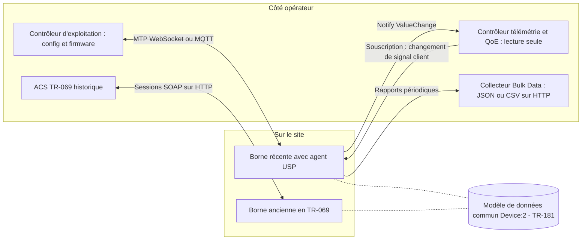

## Chambre 312, 22 h 40 : le Wi-Fi rame et personne ne le voit

Vendredi soir, 22 h 40. Un client appelle la réception d'un hôtel de 300 chambres : la visio de sa fille ne passe pas, chambre 312. Le technicien d'astreinte ouvre sa console. La borne du couloir est au vert, ses compteurs datent du dernier relevé, et rien ne ressemble au problème vécu. Le client, lui, a déjà raccroché.

La scène est inventée. Elle est surtout banale pour qui exploite du Wi-Fi à grande échelle : chaînes hôtelières, enseignes de retail, résidences étudiantes, DSI qui pilotent des centaines de sites. Le problème n'est presque jamais l'absence de données. C'est qu'elles arrivent tard, agrégées, vers un serveur unique qui interroge les équipements à son propre rythme.

Depuis 2004, la gestion à distance des box et des bornes repose largement sur TR-069, un protocole publié par le Broadband Forum, l'organisme qui normalise l'accès haut débit. En mai 2024, le Forum a annoncé qu'il ne le mettrait plus à jour. Son successeur, TR-369, dit USP (User Services Platform), a publié sa Release 1.5 en janvier 2026. Et cette semaine, le Forum tient stand au salon Network X, à Vienne, avec la qualité d'expérience dans son discours.

La question qu'un CTO doit se poser est donc simple : peut-on bâtir sa supervision Wi-Fi sur USP dès maintenant ? Ma réponse tient en deux temps. La norme, oui. La preuve que les grands opérateurs européens ont basculé en production, non : elle n'existe pas dans les sources publiques.

## Du releveur de compteur au compteur communicant

Pour saisir ce qui change, pensez à votre compteur électrique. TR-069, c'est l'époque du releveur. Un seul agent passe à intervalles réguliers, note les index et repart. Si la consommation s'emballe entre deux passages, personne ne le saura avant la visite suivante.

USP, c'est le compteur communicant. Il signale lui-même ce qui bouge. Et plusieurs acteurs peuvent lire ses données, chacun avec des droits différents.

L'image force un peu le trait, je l'admets. TR-069 sait aussi remonter certaines alertes. Mais son architecture reste celle d'un serveur central unique, l'ACS (Auto-Configuration Server), qui dialogue avec chaque équipement par sessions SOAP sur HTTP. Quand la télémétrie remonte par sessions périodiques, c'est précisément ce rythme qui laisse filer l'incident de la chambre 312.

*À gauche, un serveur unique qui interroge le parc à son rythme. À droite, des équipements qui poussent l'événement vers plusieurs contrôleurs.*

Dans USP, l'équipement embarque un agent logiciel. En face, un ou plusieurs contrôleurs. Entre les deux, une couche de transport que la [spécification](https://usp.technology/specification/index.html) appelle MTP (Message Transfer Protocol), avec quatre options : WebSocket, MQTT, STOMP, et les UNIX Domain Sockets pour les échanges entre processus d'une même machine.

Un détail permet de trier les fiches produits en dix secondes. CoAP, un protocole léger longtemps listé parmi les transports possibles, est marqué obsolète depuis USP 1.3, après avoir été déprécié en 1.2. Une documentation vendor qui l'affiche encore en 2026 n'a pas été relue depuis longtemps.

Le vrai changement de nature, ce sont les souscriptions. Un contrôleur crée une entrée dans `Device.LocalAgent.Subscription.{i}.` et dit à l'agent, en substance : préviens-moi quand ce paramètre change, quand cet événement survient, quand cette opération se termine, quand un objet apparaît ou disparaît.

Dans la spécification, ces cas s'appellent ValueChange, Event, OperationComplete, ObjectCreation et ObjectDeletion.

Deux raffinements comptent pour l'exploitation. Une souscription peut, via son paramètre `TriggerAction`, modifier la configuration de l'agent lui-même, par exemple démarrer un profil de collecte périodique (on y revient plus bas). Et chaque contrôleur n'agit que dans le périmètre de ses permissions : une opération en cours ne peut être annulée que par un contrôleur habilité (exigence R-OPR.3).

Méfiance, en revanche, envers l'étiquette temps réel. La spécification indique que l'agent DEVRAIT émettre la notification en moins de 10 secondes (exigence R-NOT.0a, rédigée en SHOULD au sens normatif). C'est une recommandation, pas une garantie. Je n'ai trouvé aucune mesure indépendante comparant réactivité ou charge réseau entre souscriptions USP et sessions TR-069. Les gains mis en avant par des intégrateurs comme Axiros relèvent du positionnement commercial.

L'écart entre les deux générations, en résumé (TR-069 porte aussi le nom de CWMP, pour CPE WAN Management Protocol) :

| | TR-069 (CWMP) | TR-369 (USP) |
|---|---|---|
| Statut | Né en 2004, plus de mise à jour depuis 2024 | Release 1.5, janvier 2026 |
| Côté serveur | Un ACS unique | Un ou plusieurs contrôleurs aux droits distincts |
| Transport | SOAP sur HTTP | WebSocket, MQTT, STOMP, UNIX Domain Sockets |
| Remontée d'information | Sessions ouvertes par l'équipement, souvent périodiques | Souscriptions et notifications poussées par l'agent |
| Collecte de masse | Bulk Data vers un collecteur HTTP | Bulk Data via HTTP, MQTT ou notifications USP |
| Modèle de données | Device:2 (TR-181) | Device:2 (TR-181), même socle |

C'est la pluralité des contrôleurs qui m'intéresse le plus pour un exploitant multi-sites. On peut séparer un contrôleur d'exploitation, qui pousse configurations et firmwares, d'un contrôleur de télémétrie en lecture seule, qui alimente l'analytique de qualité d'expérience (QoE, pour Quality of Experience). Sur le papier, la norme le permet. En pratique, je n'ai trouvé aucune preuve publique d'interopérabilité multi-vendeurs sur ce schéma : c'est à éprouver en lab.

*Architecture cible d'un parc mixte : deux contrôleurs USP aux rôles séparés, un collecteur de données, et l'ACS historique qui continue de gérer l'ancien parc sur le même modèle de données.*

## Release 1.5 : une norme qui se durcit plutôt qu'elle ne se réinvente

Si vous attendiez de la Release 1.5 un bond fonctionnel sur la QoE, passez votre chemin. Elle apporte surtout de la sécurité et de la traçabilité. C'est plutôt bon signe.

Officiellement TR-369 Issue 1 Amendment 5, elle a été approuvée par les membres du Forum et [taguée v1.5.0 sur GitHub](https://github.com/BroadbandForum/usp/releases) le 9 janvier 2026. Elle prolonge une cadence régulière : 1.2 en janvier 2022, 1.3 en juin 2023, 1.4 en juillet 2024, puis deux correctifs en juin et juillet 2025. Une norme qui livre tous les douze à dix-huit mois depuis quatre ans n'est plus une maquette.

Son changelog, ligne par ligne :

- **ALPN pour MQTT** (exigence R-MQTT.48a) : ALPN (Application-Layer Protocol Negotiation) fixe le protocole applicatif dès la poignée de main TLS ;
- **mot de passe** sur le transport par UNIX Domain Socket ;
- **traçabilité** : `originator_id` devient obligatoire sur les messages relayés, `destination_id` sur certains Notify ;
- **cohérence** : les chemins de recherche (Search Paths) sont unifiés pour les opérations Add, Set et Delete ;
- **contrôle d'accès** : une table `USPServices.Trust` décide quels services logiciels peuvent s'enregistrer auprès de l'agent.

Le changelog ne prononce pas le mot QoE. Mon interprétation : une norme qui consacre une release entière à la traçabilité et au contrôle d'accès sort de la phase d'invention pour entrer dans celle de l'exploitation. Cela ne prouve pas qu'elle est massivement déployée. Cela dit qu'elle est pensée pour l'être.

## Ce que la borne sait dire, et ce qu'elle ne conclut pas

USP est un tuyau et une grammaire. Pour la qualité d'expérience, ce qui compte, c'est le vocabulaire : le modèle de données TR-181, dans sa version USP baptisée [Device:2.20](https://usp-data-models.broadband-forum.org/tr-181-2-20-0-usp.html). Il embarque les Wi-Fi Data Elements, une spécification de la Wi-Fi Alliance qui standardise les indicateurs de performance Wi-Fi, référencée dans son édition 2024.

Concrètement, sous l'arborescence `Device.WiFi.DataElements.Network.Device.Radio.BSS.STA.`, on trouve ce que le technicien de la chambre 312 aurait voulu voir. Dans le jargon Wi-Fi, une STA (station) est un terminal client, et un BSS est le réseau émis par une radio.

| Niveau | Paramètre | Ce qu'il raconte |
|---|---|---|
| Terminal | `SignalStrength` | La force du signal du client, telle que la borne la reçoit |
| Terminal | `EstMACDataRateDownlink` / `Uplink` | Le débit que la borne estime atteignable avec ce client |
| Terminal | `LastDataDownlinkRate` | Le débit du dernier échange descendant réel |
| Radio | `Noise`, `Utilization` | Le bruit ambiant et l'occupation du canal |
| Radio | `ChannelUtilizationThreshold` | Le seuil d'occupation qui déclenche un signalement |
| Radio | `UnassociatedSTA` | Les terminaux entendus mais non connectés |
| Maillage | `Backhaul.Stats.LinkUtilization` | La charge du lien entre bornes d'un réseau mesh |
| Wi-Fi 7 | `APMLD`, `STAMLD`, `AffiliatedSTA` | Les liens multiples d'un même terminal |

La dernière ligne mérite qu'on s'y arrête. Un terminal Wi-Fi 7 peut tenir plusieurs liens radio simultanés avec la même borne, sur plusieurs bandes : on parle de MLD (Multi-Link Device). Sans structures dédiées, impossible de savoir lequel des liens d'un même client se dégrade. Device:2.20 les prévoit.

Ce socle n'est pas tombé du ciel. En mai 2025, Device:2.19 intégrait déjà la Release 4 des Data Elements, que le Forum présente comme un jeu d'indicateurs standardisés pour superviser et dépanner le Wi-Fi. La même version ajoutait Wi-Fi HaLow (le Wi-Fi longue portée et basse consommation), Thread (le protocole maillé de la domotique) et un modèle revu pour les interfaces cellulaires et le FWA (Fixed Wireless Access, l'accès fixe par réseau mobile). J'en parlais cet été à propos de [la serrure de la chambre 214](https://wifirst-tech-blog.web.app/post?slug=thread-usp-convergence-iot-box-managee) : le modèle de données devient le point de convergence de tout ce qui vit derrière la box.

Deuxième brique : la collecte de masse. `Device.BulkData` permet à l'équipement d'envoyer périodiquement une liste de paramètres vers un collecteur distinct du contrôleur. Formats JSON ou CSV ; transports HTTP, MQTT, fichier, streaming ou notification USP. L'éditeur d'outils de test QA Cafe illustre le mécanisme avec un compteur de changements de canal radio, `Device.WiFi.Radio.1.Stats.TotalChannelChangeCount`. Une borne dont ce compteur s'affole est une borne qui fuit quelque chose.

QA Cafe pose aussi la nuance qui compte. Le mécanisme transporte n'importe quel paramètre Device:2 supporté par l'agent, mais il faut vérifier lesquels l'équipement implémente vraiment. Une case cochée dans la norme n'est pas un compteur peuplé dans le firmware. Ce qui remonte dépend de la pile radio et du driver, là où, comme je l'écrivais en août, [se joue le vrai lock-in du Wi-Fi](https://wifirst-tech-blog.web.app/post?slug=lock-in-wifi-sous-le-driver-prpl-wifi-alliance).

Reste le malentendu le plus répandu : USP ne fournit pas de score de QoE. Il fournit le thermomètre, le tensiomètre et le carnet de relevés. Le diagnostic, lui, consiste à corréler un signal faible, un canal saturé, un lien de backhaul chargé et un client qui se plaint. Il se fait dans le contrôleur et l'analytique, donc dans un produit. Quand une plaquette commerciale vend de la QoE USP, elle mélange la norme et ce qu'un éditeur construit dessus.

*Wi-Fi 7 : plusieurs liens radio pour un même terminal, et des indicateurs normalisés pour les suivre un par un.*

## 88 %, 61 %, 85 % : beaucoup d'intentions, peu de preuves

À lire les communiqués, l'affaire est pliée : presque tout le monde déploie USP. À lire les sources, le tableau est nettement plus flou.

Le chiffre le plus cité vient d'un sondage du cabinet Omdia réalisé en 2025 avec le Broadband Forum, auprès de 116 fournisseurs d'accès dans 32 pays. Ses sponsors : Aprecomm, Calix, Friendly Technologies, Incognito, Motive et Nokia. Autrement dit, des vendeurs de solutions USP et de gestion de terminaux.

Deux articles de presse en tirent des lectures différentes. [Advanced Television](https://www.advanced-television.com/2025/10/09/report-usp-critical-to-broadband-service-provider-ai-plans/) retient 88 % d'opérateurs qui ont déployé ou prévoient de déployer USP sous 18 mois, un chiffre porté par Jason Walls, du Broadband Forum. [Lightwave](https://lightwaveonline.com/home/article/55323855/broadband-forum-survey-says-97-of-participants-cite-that-ai-powered-features-enhance-the-connected-home-experience) retient 32 % qui ont commencé à investir et 29 % qui prévoient de le faire sous six mois, soit 61 %. Les résultats y sont jugés proches de ceux de 2023, avec une légère hausse des déployés. Je n'ai pas pu lire le rapport complet pour réconcilier les deux.

Ces chiffres ont trois limites. Ils sont déclaratifs. Ils sont financés par des vendeurs. Et investir ou prévoir ne veut pas dire produire.

Le sondage précédent, en 2023, donnait déjà 85 % de 111 fournisseurs qui déployaient ou prévoyaient de déployer USP sous 6 à 18 mois. Ce même 85 % réapparaît en février 2025 dans un communiqué d'Incognito, présenté comme issu de l'enquête la plus récente. C'est la donnée de 2023, recyclée.

Le seul déploiement chiffré public est, justement, une revendication de vendeur. En février 2025, [Incognito annonce](https://www.incognito.com/company/press-room/largest-tr369-usp-deployment) plus de 5 millions d'appareils gérés en TR-369 par son contrôleur USP, chez un grand opérateur nord-américain non nommé, sur de l'accès fixe 5G. Opérateur anonyme, agents côté équipement non précisés, aucune vérification indépendante. Et un périmètre FWA, pas du Wi-Fi managé d'établissement.

Côté européen, le [communiqué du Forum de janvier 2024](https://cioinfluence.com/internet-of-things/usp-speeds-up-service-provider-deployments-ahead-of-industry-summit/) cite Deutsche Telekom, Liberty Global et Vodafone, ainsi que le canadien Telus. Tous auraient publiquement fait valoir l'intérêt d'USP en évoquant déploiements, succès et retours d'expérience. Seul Deutsche Telekom y prend la parole : Volker Effelsberg met en avant la gestion sécurisée des terminaux, la collecte de données, l'orchestration de services et l'intégration aux applications mobiles. Le texte ne précise ni le périmètre, ni le statut : production, pilote ou autre. Sur cette base, personne ne peut écrire que ces opérateurs ont basculé.

Et Network X ? Le salon réunit cette semaine à Vienne plus de 5 500 participants, dont plus de 1 500 opérateurs. Le Broadband Forum y [anime quatre sessions](https://networkxevent.com/sponsors/broadband-forum) : services à valeur ajoutée, edge autonome et réseau piloté par l'IA, accès multi-gigabit, vision des opérateurs pour 2027. Aucune ne porte explicitement sur USP. Les vraies actualités datées de la norme restent la Release 1.5 de janvier et le guide de migration relayé en juillet. Le contexte est là ; l'annonce, non.

Ma lecture : l'intention est massive et probablement sincère, la bascule est lente, et c'est normal pour un protocole qui doit remplacer vingt ans de parc installé. Mais un CTO ne signe pas un contrat sur une intention.

## Faire d'USP une clause d'appel d'offres, pas un acte de foi

Premier principe : figé ne veut pas dire arrêté. TR-069 ne recevra plus de mises à jour, mais le parc installé continue de tourner, et il tournera encore des années. À la différence de [la MIB obligatoire de 1998 que l'IETF enterre sans héritier](https://wifirst-tech-blog.web.app/post?slug=ietf-enterre-mib-obligatoire-1998-sans-heritier), TR-069 a un successeur désigné. Et ce successeur partage avec lui le modèle de données Device:2, ce qui rend la cohabitation praticable.

La stratégie dominante décrite par le secteur est donc la coexistence : USP pour les nouveaux équipements, TR-069 pour l'existant. Un [guide signé Axiros et QA Cafe](https://axiros.com/2024/guide-for-isps-transitioning-from-tr-069-to-tr-369-usp) sous l'égide du Broadband Forum, relayé en juillet 2026 par l'éditeur Anlix, compare quatre approches. Des systèmes séparés par protocole ; USP réservé à des cas particuliers ; un hybride où les deux mondes partagent l'information ; une plateforme nativement multi-protocole. Le guide est derrière un formulaire : je n'en connais que la présentation publique.

Deuxième principe : la certification existe, il faut l'exiger et la lire. Selon [QA Cafe](https://qacafe.com/resources/how-do-i-get-tr-369-usp-certified), qui vend lui-même un outil de test, le programme BBF.369 repose sur un auto-test suivant le plan TP-469, avec un outil approuvé comme CDRouter ou un outil tiers. Les résultats signés partent vers un laboratoire agréé. La certification vaut pour une marque, un modèle et une version majeure de firmware. Chaque fonction USP déclarée rend les tests correspondants obligatoires, et la fiche certifiée indique la version d'USP. Je n'ai trouvé aucun décompte public des produits certifiés.

Une certification valide le protocole. Elle ne garantit pas que chaque indicateur de QoE soit implémenté. D'où la grille que j'appliquerais à tout nouvel équipement Wi-Fi :

1. **Certificat BBF.369 nominatif** : version d'USP, liste des fonctions testées selon TP-469, version majeure de firmware couverte. Une nouvelle version majeure non certifiée, c'est un équipement non certifié.
2. **Couverture prouvée du modèle** : le sous-arbre `Device.WiFi.DataElements`, structures MLD comprises pour le Wi-Fi 7, et `Device.BulkData`. Prouvée signifie démontrée en lab, pas déclarée sur une fiche.
3. **Contrôleur bilingue** : il doit parler CWMP et USP sur le même modèle Device:2. Sinon, la coexistence devient deux systèmes d'information parallèles.
4. **Multi-contrôleurs testé** : droits séparés via les rôles et listes de contrôle d'accès de chaque contrôleur (la table Trust, elle, encadre l'enregistrement des services), éprouvés avec deux vendeurs différents, faute de preuve publique d'interopérabilité.
5. **Sécurité** : les apports de la 1.5 (ALPN pour MQTT, `originator_id`, authentification sur socket local) sont à rapprocher des exigences de NIS 2 et du CRA (Cyber Resilience Act, le règlement européen sur la sécurité des produits connectés). C'est mon rapprochement, pas une analyse juridique sourcée.

Troisième principe : mesurer soi-même. Un POC de quelques semaines vaut mieux que tous les sondages, à condition de suivre trois chiffres. La latence réelle d'une notification ValueChange sur `STA.SignalStrength`, à comparer aux 10 secondes recommandées. Le volume de Bulk Data par borne et par jour, qui dimensionne votre collecteur. Et le taux de paramètres Data Elements réellement peuplés, vendeur de borne par vendeur de borne. Ce troisième chiffre, aucune plaquette ne vous le donnera.

Dernier rappel : le Forum a publié dès mai 2019 un [agent USP open source](https://www.telecomtv.com/content/broadband/broadband-forum-publishes-open-source-usp-agent-35327/), OB-USP-Agent. Sept ans plus tard, l'absence d'implémentation de référence ne peut plus servir d'excuse à un constructeur.

*Coexistence plutôt que grand soir : le parc TR-069 vit sa vie, les nouveaux équipements arrivent certifiés et vérifiés.*

## Mon avis : exiger la norme, refuser le récit

Ce qui suit relève de mon analyse, pas d'un constat sourcé.

Sur le fond technique, USP est le bon pari. Souscriptions, contrôleurs multiples aux droits séparés, indicateurs Wi-Fi 7 normalisés, modèle de données partagé avec l'existant : l'architecture colle mieux à la réalité d'un réseau multi-sites qu'un ACS unique. Dans une organisation où l'exploitation, la sécurité et l'analytique n'ont ni les mêmes besoins ni les mêmes droits, c'est un progrès réel. Et TR-069 n'évoluera plus : les nouveautés du protocole iront dans USP, et nulle part ailleurs.

Mais le marché, en 2026, déclare plus qu'il ne déploie. Des sondages financés par des vendeurs, une revendication de 5 millions d'appareils FWA chez un opérateur anonyme, des noms d'opérateurs européens sans statut de déploiement. Rien de tout cela ne permet d'affirmer que les grands opérateurs ont basculé. Ceux qui l'affirment ont, le plus souvent, quelque chose à vendre.

Ma ligne est donc double. Si je rédige aujourd'hui un cahier des charges d'équipement Wi-Fi, la certification USP et la couverture démontrée des Data Elements y figurent comme critères éliminatoires. Pas parce que tout le monde a basculé. Parce que c'est la seule façon de ne pas acheter un équipement déjà lié à un protocole figé. En parallèle, le parc TR-069 reste en place jusqu'à sa fin de vie naturelle, sans migration en bloc.

La norme a rendu sa copie. Aux vendeurs, maintenant, de rendre la leur. Et aux acheteurs de la corriger, paramètre par paramètre.

## Sources

1. Broadband Forum — Spécification TR-369, Release 1.5 (janvier 2026) — https://usp.technology/specification/index.html
2. Broadband Forum — USP, page d'accueil — https://usp.technology/
3. BroadbandForum/usp — Releases GitHub (v1.5.0 du 2026-01-09) — https://github.com/BroadbandForum/usp/releases
4. Broadband Forum — TR-181 Device:2.20, modèle de données USP — https://usp-data-models.broadband-forum.org/tr-181-2-20-0-usp.html
5. Network X — Broadband Forum, sponsor et sessions 2026 — https://networkxevent.com/sponsors/broadband-forum
6. SubOptic — Network X 2026 opens new chapter in Vienna — https://suboptic.org/news/network-x-2026-opens-new-chapter-in-vienna-with-expanded-european-focus-and-telecom-industry-leaders
7. Silicon UK / Business Wire — Communiqué Broadband Forum sur Device:2.19, Thread et Wi-Fi Data Elements R4 (2025-05-29) — https://www.silicon.co.uk/press-release/broadband-forums-new-spec-cracks-the-code-for-greater-control-of-thread-connected-devices
8. TelcoNews — Broadband Forum celebrates 20 years of TR-069 (2024-05-24) — https://telconews.com.au/story/broadband-forum-celebrates-20-years-of-tr-069-standard-s-impact
9. Advanced Television — Report: USP critical to broadband service provider AI plans (2025-10-09) — https://www.advanced-television.com/2025/10/09/report-usp-critical-to-broadband-service-provider-ai-plans/
10. Lightwave — Broadband Forum survey (2025-10-16) — https://lightwaveonline.com/home/article/55323855/broadband-forum-survey-says-97-of-participants-cite-that-ai-powered-features-enhance-the-connected-home-experience
11. Incognito — Largest TR-369 USP deployment, communiqué vendor (2025-02-12) — https://www.incognito.com/company/press-room/largest-tr369-usp-deployment
12. CIO Influence / Business Wire — USP speeds up service provider deployments, communiqué Broadband Forum (2024-01-25) — https://cioinfluence.com/internet-of-things/usp-speeds-up-service-provider-deployments-ahead-of-industry-summit/
13. Axiros — Guide for ISPs transitioning from TR-069 to TR-369 USP — https://axiros.com/2024/guide-for-isps-transitioning-from-tr-069-to-tr-369-usp ; relais Anlix (2026-07-15) — https://anlix.io/en/tr-069-para-tr-369-como-planejar-uma-migracao-segura-para-a-proxima-geracao-do-gerenciamento-remoto/
14. QA Cafe — How do I get TR-369 USP certified — https://qacafe.com/resources/how-do-i-get-tr-369-usp-certified
15. QA Cafe — Data collection and analytics with TR-069 and TR-369 USP — https://www.qacafe.com/articles/data-collection-analytics-with-tr069-tr369-usp
16. Axiros — TR-069 lessons learned: unlock benefits with USP — https://www.axiros.com/blog/2025/tr-069-lessons-learned-unlock-benefits-with-usp
17. TelecomTV — Broadband Forum publishes open source USP agent (2019-05-30) — https://www.telecomtv.com/content/broadband/broadband-forum-publishes-open-source-usp-agent-35327/

_Vues personnelles, pas position Wifirst._
