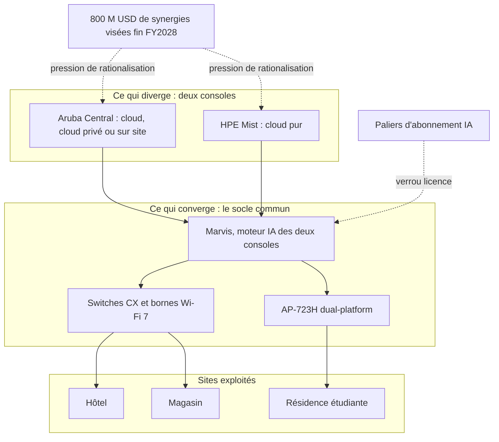

## La question à quatorze milliards

Le 30 septembre, à 11 h 30 heure de New York, un analyste de la banque Evercore a posé à Rami Rahim la question que se posent depuis quinze mois des milliers de responsables réseau. Allez-vous, oui ou non, fusionner vos deux plateformes Wi-Fi ? Rahim dirige HPE Networking, la division qui réunit Aruba et Juniper depuis le rachat de ce dernier pour 14 milliards de dollars. Sa réponse a tenu en une ligne : non, jamais, et ce n'est pas nécessaire.

Derrière cette ligne, il y a des hôtels, des enseignes de distribution, des résidences étudiantes, des sièges sociaux. Des parcs de centaines, parfois de milliers de bornes, pilotés soit depuis Aruba Central, la console historique de HPE, soit depuis Mist, celle apportée par Juniper. Et il y a un calendrier qui interdit d'attendre. La vague de renouvellement vers le Wi-Fi 7 est lancée, le matériel posé cet hiver restera au plafond pendant des années, et HPE bascule le 1er novembre tous ses partenaires sur un programme commercial unique.

Je dois ici une correction à mes lecteurs. En juin, au sortir du salon HPE Discover, [j'écrivais sur ce blog](https://wifirst-tech-blog.web.app/post?slug=hpe-discover-2026-marvis-operateur-wifi-manage) que Marvis, le moteur d'intelligence artificielle de Mist, « absorbait » Aruba Central. Le verbe était trop fort. Ce que HPE fusionne, c'est le moteur, pas le tableau de bord. La nuance a l'air d'un détail de vocabulaire. Elle déplace pourtant l'endroit exact où se loge le risque pour quiconque exploite des réseaux sur des dizaines de sites.

## Convergence par le bas, divergence par le haut

Commençons par le texte, puisque c'est lui qui fait foi. Interrogé par Victor Santiago, d'Evercore, Rahim répond mot pour mot : « the short answer is, no, they never converge into one platform, and they don't need to ». Il énumère ensuite ce qui converge déjà : « the applications, the AI operations, the hardware, the access points, the switching ». Puis il résume la doctrine en sept mots : « Marvis is the AI engine for both ». Le passage figure aux pages 31 et 32 de la transcription officielle publiée par HPE [1].

Pour saisir la logique, il faut regarder du côté de l'automobile. Le groupe Volkswagen fabrique la Golf, l'Audi A3, la Seat Leon et la Skoda Octavia sur une même plateforme technique : même châssis, mêmes moteurs, même électronique embarquée. Personne chez Volkswagen n'envisage de fusionner Audi et Skoda. Les marques, les tableaux de bord et les clientèles restent séparés, parce que chacun rapporte. Mais l'ingénierie se décide à un seul endroit, et c'est là que se font les économies. HPE applique ce modèle au Wi-Fi d'entreprise : deux carrosseries, un seul moteur.

Le moteur commun, c'est donc Marvis. Il s'agit de la couche d'AIOps de Mist, c'est-à-dire l'intelligence artificielle appliquée à l'exploitation réseau. Elle corrèle ce que remontent bornes et switches, pose un diagnostic et, de plus en plus souvent, corrige seule. En décembre 2025, Rahim annonçait chez Next Platform le portage vers Aruba Central de plusieurs briques d'AIOps de Mist, dont Marvis Actions, annoncé pour le premier trimestre 2026, avec un retour de certaines fonctions de Central vers Mist [6].

À Discover, en juin, l'arrivée de Marvis dans Central occupait le centre de la keynote, et ChannelBuzz rapportait qu'aucune des deux plateformes n'était promise à l'extinction [7]. Une réserve, tout de même : l'étendue exacte de ce qui tourne aujourd'hui en production chez les clients Central reste à vérifier fonction par fonction. Côté matériel, les switches CX d'Aruba sont désormais pilotables depuis Mist, alors qu'ils l'étaient déjà depuis Central [1].

Ce qui ne converge pas tient aussi en une phrase vérifiée : « Mist is purely cloud and Aruba has more deployment options, including on-prem » (p. 32). Mist est un service exclusivement cloud, opéré par HPE. Central peut aussi tourner dans un cloud privé ou dans les murs du client. Rahim l'avait déjà formulé chez Next Platform : à terme, le modèle de déploiement sera la seule différence entre les deux consoles [6].

Relue à cette lumière, mon analyse de juin se trompait de verbe, pas de direction. Il n'y a pas d'absorption. Il y a une greffe : on installe le moteur de Mist sous le capot d'Aruba, sans toucher à la carrosserie. Le signal était déjà là en juin. Je l'ai sous-pondéré.

*Deux consoles, un socle : HPE fait converger le moteur d'IA et le matériel, et laisse diverger ce que voit l'exploitant. En pointillés, ce qu'aucun contrat n'écrit noir sur blanc.*

## Le matériel se libère, sur un seul modèle

Prenez un hôtel de deux cents chambres qui renouvelle ses bornes cet hiver. Jusqu'ici, acheter une borne Aruba revenait à choisir Central, et acheter une borne Mist revenait à choisir Mist. Changer d'avis trois ans plus tard voulait dire remonter sur l'échelle, couloir par couloir, et payer deux fois le même plafond.

HPE vend désormais une borne qui casse ce lien. L'AP-723H est un point d'accès Wi-Fi 7 à trois radios, doté de deux protocoles radio de courte portée, Bluetooth Low Energy et Zigbee, ceux qu'utilisent serrures et capteurs connectés. Sa fiche produit la présente comme une borne « dual-platform » taillée pour l'hôtellerie, exploitable sous Aruba Central ou sous HPE Mist [9]. HPE l'a montrée en mai au Mobility Field Day 14, une série de présentations techniques face à des experts indépendants.

C'est un vrai progrès pour qui signe sur la durée. Il a trois limites, et elles comptent.

La première : d'après les informations publiques que j'ai pu recouper, c'est à ce jour le seul modèle dans ce cas. Les autres gammes restent liées à une console. La liste et le calendrier des suivants restent à obtenir de HPE.

La deuxième : la promesse vaut pour l'avenir, pas pour l'installé. Une borne sous AOS 10 ou InstantOS 8, les systèmes d'exploitation des bornes Aruba, ou une borne Mist déjà vissée au plafond ne devient pas « dual-platform » par décret. Pour les parcs en service, changer de console reste synonyme de changer de matériel.

La troisième est la plus sous-estimée. Faire passer une borne d'une console à l'autre ne fait pas passer ce qui la rend utile. Les politiques d'accès, les SSID (les noms de réseau diffusés), le raccordement au serveur RADIUS qui authentifie les utilisateurs, les modèles de configuration : tout cela vit dans la console, pas dans la borne. Je n'ai pas vu de documentation publique HPE décrivant une telle bascule de bout en bout. Jusqu'à preuve du contraire, je pars du principe qu'on déménage les meubles, pas les clés.

*Deux tableaux de bord, un socle partagé : chez HPE, la convergence se joue sous la console, dans le moteur d'IA et le matériel.*

## Le verrou change d'étage

Voici le paradoxe de la décision du 30 septembre. Plus le matériel devient interchangeable entre les deux consoles, moins le choix de la console pèse. Ce qui pèse, c'est ce qui leur est commun : Marvis, ses paliers d'abonnement, sa mémoire. Choisir entre Central et Mist revient à choisir entre deux portes d'entrée du même immeuble. On peut préférer l'une ou l'autre. Le bail, lui, se signe avec un seul propriétaire.

Premier étage du verrou, la licence. Marvis est commun, mais ses fonctions les plus avancées ne sont pas offertes à tous. Selon Nomios, intégrateur partenaire de HPE, le Networking Copilot, l'assistant d'IA agentique de Central (capable d'enchaîner lui-même des actions), est réservé au palier d'abonnement Advanced [10]. Le détail des paliers mérite une lecture ligne à ligne de la documentation HPE avant toute signature. Le principe, lui, est limpide : l'intelligence s'achète à l'étage.

Deuxième étage, la mémoire. Lors de l'Investor Day, Hajela, qui dirige l'activité campus et sites distants, a revendiqué « thousands of trusted self-driving actions » exécutées en 90 jours sur le cloud Mist, sans intervention humaine. Il a décrit un harnais d'IA doté d'une « memory of episodes », d'un périmètre défini et de garde-fous [1]. À Discover, Rahim avançait que plus de 80 % des incidents réseau étaient soit corrigés automatiquement, soit identifiés avec une solution prête [7]. Ce sont des chiffres HPE, sans audit tiers ni définition publiée de ce qu'est un incident.

Relisez pourtant « memory of episodes » avec des yeux d'exploitant. Chaque incident résolu enrichit une mémoire qui vit chez HPE, pas dans votre centre de supervision. C'est ce qui rend Marvis utile. C'est aussi ce qui rend la sortie coûteuse, car rien, à ma connaissance, ne permet d'emporter cette mémoire chez un autre constructeur.

Le régulateur américain avait d'ailleurs repéré cet actif avant tout le monde. Pour valider le rachat de Juniper, le DOJ (Department of Justice, l'autorité antitrust américaine) a exigé la cession de la gamme Instant On et une licence du code source « AI Ops for Mist », jusqu'à deux licences attribuées aux enchères. Le jugement final a été approuvé en août [12], et [j'ai détaillé cet épisode ici](https://wifirst-tech-blog.web.app/post?slug=un-dollar-instant-on-14-milliards-juniper). Une seule précision suffit : cette licence vise à recréer de la concurrence entre constructeurs, pas à libérer les exploitants. L'exécution des enchères n'est d'ailleurs pas confirmée à ce jour.

Reste le point que les démonstrations d'AIOps escamotent toujours : la multi-tenance, c'est-à-dire la capacité d'une console à cloisonner des dizaines de clients. Pour un MSP (Managed Service Provider, fournisseur de services managés) qui exploite à la fois une chaîne d'hôtels, une enseigne et un réseau de résidences, c'est le critère qui passe avant tous les autres. Central dispose d'un mode MSP documenté : chaque client y est une instance indépendante de Central, et l'administrateur du fournisseur provisionne les clients, leur alloue équipements et abonnements [11].

Côté Mist, je n'ai pas trouvé de documentation publique décrivant un modèle équivalent avec le même niveau de détail. Je n'en conclus pas qu'il n'existe pas. J'en conclus qu'il faut poser la question par écrit, avant de se laisser séduire par une démonstration.

## Huit cents millions de raisons de lire entre les lignes

Revenons à la réponse de Rahim, car elle ne s'arrête pas à « never converge ». Quelques phrases plus loin, il ajoute : « The experience to the end user is going to be the same, and it only becomes more and more the same in time. The experience to the operator [...] is going to become more and more unified. And there will be less and less duplicative investment » [1].

Deux consoles pour toujours, et de moins en moins d'investissement en double. Les deux propositions peuvent coexister. Elles ne coexistent pas gratuitement.

Les chiffres présentés le même jour éclairent cette tension. HPE vise désormais 800 M USD de synergies de coûts annuelles d'ici la fin de son exercice fiscal 2028, bien au-delà des 450 M USD initialement annoncés [4]. La chaîne d'approvisionnement doit être unifiée « by the end of 2027 », et la première phase d'un circuit commercial commun, du devis à la commande, démarre en novembre [1]. Le campus et les sites distants pèsent environ la moitié du chiffre d'affaires réseau, avec une croissance attendue *high-single digits*, tirée par le renouvellement Wi-Fi 7 [4].

Faites maintenant le calcul à la place d'un directeur financier. Une activité qui représente la moitié d'une division. Deux équipes produit, deux feuilles de route, deux cycles de validation. Un objectif d'économies qui a presque doublé. La formule « less and less duplicative investment » n'a pas besoin de supprimer une console pour produire ses effets : il suffit que l'une des deux reçoive ses nouveautés un trimestre après l'autre.

En face, qu'y a-t-il d'écrit ? À la clôture du rachat, en juillet 2025, Antonio Neri déclarait : « We will support both product lines going forward » et « Contracts will be honored for the life of the contract » [8]. C'est l'engagement le plus explicite disponible. Il a quinze mois et s'arrête à la durée des contrats en cours. Le 30 septembre, Hajela a ajouté que « the self-driving vision is assuring our customers on the longevity of the portfolio » [1]. Une vision rassure. Elle ne fixe pas de date de fin de vie.

Selon SDxCentral, la direction de HPE Networking aurait également évoqué un possible changement de marque à terme, les deux plateformes étant conservées parce que chacune s'appuie sur une base clients de plusieurs milliards de dollars [3]. Une marque unique posée sur deux consoles : premier pas vers une seule, ou simple ravalement de façade ? Rien ne permet de trancher aujourd'hui.

Andre Kindness, analyste chez Forrester, avait parié l'inverse en janvier 2024, avant même la clôture du rachat : « My bet? I believe that Aruba Central will be phased out for Mist » [5]. Ce pari est aujourd'hui contredit par la position publique de HPE. Il n'est pas réfuté pour autant, puisque Kindness parlait d'un horizon de quelques années et que HPE ne donne aucune date. Surtout, il proposait un indicateur plus utile que sa prédiction : « If HPE stops adding features to Aruba Central, then take that as a sign that Mist is taking over here ».

En juillet 2025, Drew Conry-Murray écrivait chez Packet Pushers : « Allowing the uncertainty to continue is a strategic error » [8]. HPE a levé une partie de cette incertitude le 30 septembre. Il en a laissé une autre, plus subtile. La question n'est plus de savoir quelle console survivra, mais laquelle sera la mieux servie. Selon Fierce Network, très peu de clients exploitent les deux plateformes en parallèle et HPE priorise ses développements base installée par base installée [2]. C'est sain aujourd'hui. Demain, cela dépendra du poids relatif de chaque base dans les comptes.

*Deux trajectoires de fonctionnalités qui s'écartent : l'indicateur à suivre n'est pas le discours, c'est la cadence des nouveautés de chaque console.*

## Ma position : choisir sa porte, renégocier le bail

Je tranche en trois points.

**Un : la console se choisit sur le modèle de déploiement, pas sur une convergence promise.** Si vos clients, vos contrats ou vos analyses de risque, NIS 2 en tête (la directive européenne qui durcit les obligations de cybersécurité), vous imposent de garder la console dans vos murs, la question est réglée : chez HPE, seule Central offre l'option sur site. Si le tout-cloud vous convient, Mist est un choix cohérent. SiliconANGLE recommande la même ligne et ajoute un conseil que je partage : ne pas retarder un renouvellement en attendant une plateforme unique qui, de l'aveu même de HPE, ne viendra pas [4].

**Deux : la fenêtre de novembre est le moment de réécrire le contrat.** Le 1er novembre, le « Partner Day One » regroupe les réseaux de partenaires dans un programme unique, HPE Partner Ready Vantage. HPE revendique environ 60 000 partenaires, et les réseaux Aruba et Juniper ne se recouvrent qu'à 10 % environ [1, 4]. Pour beaucoup de clients, l'interlocuteur et la grille contractuelle vont bouger en même temps. Profitez-en pour obtenir par écrit :

- une date minimale avant toute fin de vie (EoL, End of Life) de la console retenue ;
- un droit de migration d'une console à l'autre sans repayer les licences ;
- la portabilité des abonnements Marvis et Copilot entre Central et Mist ;
- la liste et le calendrier des bornes dual-platform, et la politique de migration du parc installé ;
- pour Mist, la description précise de son mode multi-clients et de ses limites.

**Trois : mesurer plutôt que croire.** Reprenez l'indicateur de Kindness et industrialisez-le. Chaque trimestre, comparez la cadence des notes de version de Central et de Mist, la parité des fonctions Marvis entre les deux consoles, les sorties de bornes réservées à l'une ou à l'autre, et les avis de fin de vie ou de fin de commercialisation. Le jour où les courbes divergent, vous le verrez bien avant qu'un communiqué ne l'annonce.

*Cloud pur ou option sur site : la console se choisit sur le modèle de déploiement, la borne au bout du chemin restant la même.*

HPE a dit la vérité le 30 septembre : ses deux consoles ne fusionneront pas. Il n'a pas dit pendant combien de temps elles seraient traitées à égalité. Entre ces deux phrases tient tout l'espace d'un contrat bien négocié.

Pour un exploitant multi-sites, la bonne nouvelle est réelle : le matériel commence à se libérer. La mauvaise est plus discrète. Le verrou n'a pas disparu, il est monté d'un étage, dans un moteur d'IA et une grille d'abonnements qu'un seul acteur contrôle. On n'y échappe pas en attendant. On y échappe en signant mieux.

_Vues personnelles, pas position Wifirst._

## Sources

1. [HPE — Transcription officielle du Networking Investor Day, 30 septembre 2026](https://investors.hpe.com/~/media/Files/H/HP-Enterprise-IR/documents/hpe-networking-investor-day-transcript-09-30-2026.pdf)
2. [Fierce Network — HPE won't merge Aruba Central and Mist, but the platforms will share AI, applications and hardware](https://www.fierce-network.com/wireless/hpe-wont-merge-aruba-central-and-mist-platforms-will-share-ai-applications-and-hardware)
3. [SDxCentral — HPE networking chief hints at potential rebrand of multibillion-dollar Aruba, Mist WLAN platforms](https://www.sdxcentral.com/analysis/hpe-networking-chief-hints-at-potential-rebrand-of-multibillion-dollar-aruba-mist-wlan-platforms/)
4. [SiliconANGLE — Five takeaways from HPE's Networking Investor Day, 30 septembre 2026](https://siliconangle.com/2026/09/30/five-takeaways-from-hpes-networking-investor-day/)
5. [Forrester (Andre Kindness) — HPE + Juniper Networks Creates A Cisco Doppelganger, 11 janvier 2024](https://www.forrester.com/blogs/hpe-juniper-networks-creates-a-cisco-doppelganger)
6. [Next Platform — HPE gets the lead out on Juniper-Aruba networking integration, 3 décembre 2025](https://www.nextplatform.com/connect/2025/12/03/hpe-gets-the-lead-out-on-juniper-aruba-networking-integration/1691283)
7. [ChannelBuzz — The Buzz: HPE Discover keynote day, 17 juin 2026](https://channelbuzz.ca/2026/06/the-buzz-hpe-discover-keynote-day-self-driving-networks-take-centre-stage-as-hpe-makes-its-ai-era-argument-46876/)
8. [Packet Pushers (Drew Conry-Murray) — HPE and Juniper Miss an Opportunity, 2 juillet 2025](https://packetpushers.net/blog/hpe-and-juniper-miss-an-opportunity/)
9. [HPE — Fiche produit AP-723H dual-platform hospitality](https://buy.hpe.com/be/en/networking/wireless-devices/wlan-access-points/hpe-networking-ap%E2%80%91723h-rw1-3%E2%80%91radio-2x2-802-11be-wi%E2%80%91fi-7-12-eth-dual-platform-hospitality-ap/p/s6q78a) ; [Mobility Field Day 14, présentation HPE (Vimeo)](https://vimeo.com/1191160359)
10. [Nomios — Aruba Central à l'ère HPE-Juniper, 18 novembre 2025](https://www.nomios.nl/en/news-blog/aruba-central-next-gen-hpe-juniper-era/)
11. [HPE Aruba Networking TechDocs — Managed Service Provider (Central)](https://arubanetworking.hpe.com/techdocs/new-central/content/msp/msp-orvw.htm)
12. [Gibson Dunn — Approbation du règlement HPE / DOJ](https://www.gibsondunn.com/gibson-dunn-wins-approval-of-hpes-settlement-of-doj-challenge-to-14-billion-juniper-merger/) ; [SDxCentral — Judge rubber-stamps HPE-Juniper deal](https://www.sdxcentral.com/news/judge-rubber-stamps-hpe-juniper-deal-as-vendor-survives-despite-compliance-failure-findings/)
