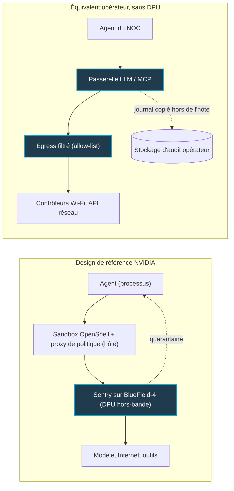

## Un garde-fou que l'agent peut atteindre n'est pas un garde-fou

Le 28 septembre, NVIDIA a défendu une idée qui tient en une phrase : un garde-fou que l'agent peut atteindre n'est pas un garde-fou. Plus d'une centaine d'organisations travailleraient déjà avec la technologie, selon NVIDIA, d'Anthropic à SAP en passant par Microsoft et JPMorganChase.

Derrière la formule, il y a une inquiétude que connaît toute équipe qui a déjà confié un identifiant à une IA. Un assistant qui lit les tickets, interroge un contrôleur Wi-Fi, ouvre une session sur un pare-feu ou redémarre un service n'est plus un chatbot. C'est un collègue logiciel, avec des droits. Dans une chaîne d'hôtels, un réseau de plusieurs centaines de magasins ou une résidence étudiante, ces droits touchent directement la connexion de milliers de personnes.

Jusqu'ici, la sécurité de ces agents reposait surtout sur des consignes (« ne touche jamais à la production ») et sur des contrôles installés sur la même machine que l'agent. NVIDIA en tire la conséquence logique : sortir le contrôle de la machine, jusqu'à le loger dans une carte réseau programmable dotée de ses propres processeurs. Pourquoi maintenant ? Parce que les agents quittent le stade du pilote, et qu'un agent qui dérive ne prévient pas. Nous racontions fin septembre les deux heures et demie qu'il avait fallu pour en débrancher un.

Sur le principe, NVIDIA a raison. Sur le calendrier et les preuves, beaucoup moins. Et pour une équipe réseau qui n'exploite aucune ferme de calcul IA, l'enjeu n'est pas la puce. C'est un principe que nous pratiquons déjà : le chemin obligé.

## Trois clôtures, une seule tient

Pour comprendre le débat, imaginez un stagiaire brillant, infatigable et un peu imprévisible, à qui vous confiez les clés du local technique. Vous avez trois façons de l'encadrer.

La première, c'est le règlement intérieur. Il l'a lu, il l'a même signé. Mais le jour où il se persuade qu'une exception s'impose, le règlement ne l'arrêtera pas physiquement.

La deuxième, ce sont les badges sur les portes du bâtiment où il travaille. Beaucoup plus solide. Sauf si notre stagiaire met la main sur le poste d'administration des badges, qui se trouve, justement, dans le même bâtiment.

La troisième, c'est un vigile posté à la seule sortie. Il ne dépend pas du stagiaire et ne partage pas son bureau. Le stagiaire ne peut ni le joindre, ni l'éteindre, ni le soudoyer. Tout ce qui entre ou sort passe devant lui.

Transposé aux agents IA, cela donne trois positions possibles pour le contrôle. **Dans l'agent** : les consignes système, l'entraînement à la prudence, les garde-fous du prompt. Utile, mais cela vit dans la tête de celui qu'on veut contenir, et NVIDIA le reconnaît sans détour : la dérive d'un agent ne se corrige pas par l'entraînement. **Sur l'hôte** : un bac à sable (sandbox) qui limite ce que le processus de l'agent peut lire, lancer ou joindre. Si la machine tombe, le contrôle tombe avec elle. **Hors de portée** : un composant qui voit passer tout le trafic de l'agent, mais tourne sur un matériel distinct que l'hôte ne peut ni lire ni désactiver.

L'annonce de NVIDIA, c'est le passage assumé de la deuxième à la troisième position. Sur ce point, l'idée est juste : l'enforcement (l'application effective des règles) doit vivre hors de portée de ce qu'il surveille. Dickson Research et Gartner, interrogés par InfoWorld, jugent le principe sain. Je partage leur avis. C'est l'exécution qui se complique.

*Le sandbox sur l'hôte, le contrôle sur une carte à part : la séparation physique que vise NVIDIA.*

## OpenShell et Sentry : deux étages, une même logique

Le premier étage s'appelle OpenShell. C'est un runtime open source, sous licence Apache 2.0, publié sur GitHub où il dépasse les 16 000 étoiles. Chaque agent y tourne dans son propre sandbox, encadré par des politiques qui portent sur cinq objets : les fichiers, le réseau, les outils, les processus et les identifiants.

La mécanique est classique, et c'est un compliment. Les accès aux fichiers et aux processus sont bridés par des mécanismes du noyau Linux. Les accès réseau passent par un proxy de politique qui décide de ce qui sort. Surtout, ce contrôle s'exerce hors du modèle et hors du harnais (le code qui orchestre l'agent). Il vaut donc pour un modèle ouvert comme pour un modèle fermé, et il tient même quand l'agent ignore ses instructions, l'angle qu'a retenu VentureBeat.

OpenShell n'exige aucun matériel NVIDIA. Il tourne sur Linux, sur Mac à puce Apple, sous Windows via son sous-système Linux (à titre expérimental), dans Docker, Podman ou une machine virtuelle. Sur Kubernetes, il s'installe via Helm, à condition que le CNI (le plugin réseau du cluster) applique réellement les politiques réseau. NVIDIA le dit optimisé pour ses processeurs Vera, extensible à Arm, Intel et x86, et présente explicitement Sentry et BlueField comme optionnels.

Le second étage, c'est Sentry, et c'est lui qui fait parler. Sentry est un watchdog (un chien de garde logiciel) hors-bande qui tourne sur un DPU BlueField-4. Un DPU (Data Processing Unit), c'est une carte réseau dotée de ses propres processeurs et de son propre système, branchée dans le serveur mais indépendante de lui. Sentry s'appuie sur DOCA, le kit de développement de NVIDIA pour ces cartes.

Ce qu'il fait, selon NVIDIA : inspecter les requêtes et les réponses de l'agent, attribuer à chaque agent une identité vérifiable, produire une télémétrie attestée (des enregistrements dont on peut prouver l'intégrité), et mettre un agent en quarantaine « en millisecondes ». Le communiqué le présente comme un domaine de confiance indépendant et hors-bande, et NVIDIA le décrit comme optionnel, posé au-dessus d'OpenShell.

Le coup le plus intelligent tient à l'emplacement de la carte. Dans les POD Vera Rubin, les baies de calcul de référence de NVIDIA, le BlueField-4 se trouve sur l'unique chemin qui relie le nœud au modèle. L'endpoint d'inférence (l'adresse à laquelle l'agent pose ses questions au modèle) passe par un proxy hébergé sur le DPU. Ce proxy voit chaque appel et, quand le modèle les expose, ses traces de raisonnement.

NVIDIA résume la logique d'une formule que je trouve excellente : l'agent ne peut pas agir sans sa prochaine pensée. Couper le chemin vers le modèle, c'est couper l'agent. Contrôler ce chemin, c'est disposer à la fois du meilleur poste d'observation et du meilleur interrupteur.

*Trois positions possibles du contrôle : dans l'agent, sur l'hôte, hors de portée. Seule la dernière résiste à un agent qui dérive, et elle existe déjà côté réseau sans le moindre DPU.*

## Un design de référence, pas encore un produit

Voilà pour la promesse. Regardons ce qui est réellement disponible, trois semaines plus tard.

Le communiqué range Sentry dans un « reference system design ». Aucune date de disponibilité, aucun prix. Le communiqué précise que ses produits et fonctions seront proposés « when-and-if-available », avertissement générique qui vaut aussi pour Sentry et veut dire exactement ce qu'il dit. Le blog développeur de NVIDIA va plus loin : pour les systèmes Vera équipés de BlueField-4 déjà en place, activer ces protections serait « une simple mise à jour logicielle ». La phrase figure dans le blog, pas dans le communiqué. Je la lis comme une affirmation d'ingénieur, pas comme un engagement de livraison.

Les analystes de Futurum ajoutent deux nuances qui pèsent. Sentry n'est pas entièrement open source. Et il requiert un BlueField-4, que la plupart des entreprises n'ont pas : l'adoption devrait donc rester, au départ, cantonnée à des partenaires de conception.

Côté chiffres, tout est déclaratif. La quarantaine « en millisecondes », la surcharge « minimale », le gain de performance de sandbox « jusqu'à 80 % » sur Vera : ce sont des chiffres NVIDIA, sans méthodologie publiée. Aucune mesure de surcharge n'est sortie, aucun test d'intrusion ni audit tiers n'est connu. Tech-Insider en a fait son titre dès la semaine du lancement : zéro audit. Quant à l'idée que la plateforme « aurait pu arrêter » l'intrusion subie par Hugging Face, elle relève de l'hypothèse, pas de la démonstration.

La liste des partenaires, elle, impressionne : Anthropic, Cisco, CrowdStrike, Dell, HPE, Microsoft, Palo Alto Networks, Red Hat, Salesforce, SAP, ServiceNow, JPMorganChase. Mais les verbes comptent. Anthropic associe ses Claude Managed Agents à OpenShell et BlueField. Salesforce relie OpenShell à Slack pour piloter l'activité des agents, notamment approuver ou refuser les demandes de droits selon la presse spécialisée. SAP l'intègre au runtime de Joule Studio, tandis que Canonical, SUSE et Red Hat intègrent la plateforme. On connecte, on intègre, on développe : personne ne publie de chiffre de déploiement. Et les « plus de 100 organisations » travaillent avec la technologie, ce qui ne fait pas d'elles des parcs en production.

Trois absences sautent aux yeux, relevées par Gartner et Think Facility : OpenAI, Google et Amazon ne figurent pas sur la liste. Aucune explication officielle n'a été donnée, et je ne spéculerai pas.

Côté gouvernance, OpenShell reste piloté par NVIDIA. La plateforme alimente l'Open Secure AI Alliance, initiée par NVIDIA en juillet, forte de plus de 120 membres et passée sous l'égide de la Linux Foundation (annonce datée du 14 septembre par la fondation). L'Alliance porte notamment SAFE, un format d'échange de constats d'incidents IA. Mais SAFE n'est qu'un brouillon, un RFC (document soumis à commentaires) ouvert le 4 août : ni une norme, ni une certification.

Bilan au 16 octobre : nos recherches n'ont trouvé ni date pour Sentry, ni mesure indépendante, ni nouveau ralliement. C'est l'absence de résultat dans nos recherches, pas une preuve d'absence. Mais trois semaines de silence après un lancement de cette ampleur, cela se note.

## Le prouveur vérifie la clôture, pas son emplacement

La question qui m'intéresse le plus survivra à toutes les puces : la politique est-elle la bonne ?

OpenShell embarque un prouveur de politique fondé sur Z3, un solveur SMT, c'est-à-dire un moteur qui démontre mathématiquement si un jeu de règles autorise ou non une situation donnée. Il est déterministe, et NVIDIA l'annonce environ deux ordres de grandeur plus rapide qu'un modèle de langage utilisé comme juge. Très bien. Mais ce prouveur vérifie la politique, pas le fait que le sandbox l'applique. Et la vérification des systèmes multi-agents est encore « en développement ».

Futurum a trouvé la formule juste : le prouveur peut dire que la clôture est là où vous l'avez tracée, pas si vous l'avez tracée au bon endroit. Prenez une intention humaine simple : « l'agent peut redémarrer un point d'accès, jamais renommer un réseau Wi-Fi ». La traduire en règles OPA/Rego (le langage de politique d'Open Policy Agent), puis en contraintes formelles, reste l'étape difficile. Elle est largement manuelle.

Deuxième limite, plus brutale : le périmètre. Brent Ellis, analyste chez IDC, estime que la plateforme adresse « probablement moins de 25 % » des problèmes de cybersécurité agentique en entreprise. Control Risks et Tribeca Softech rappellent l'évidence : l'enforcement ne s'applique qu'aux agents qui tournent dans le runtime gouverné. L'agent SaaS branché par un service métier sans passer par la DSI, ou celui qu'introduit un attaquant, passent à côté. Un vigile ne garde que la porte devant laquelle on l'a posté.

Dernière limite, la plus sournoise : ni le sandbox ni le DPU ne règlent les actions autorisées mais mal cadrées. Un identifiant trop large, un outil empoisonné, une politique mal écrite restent dans le périmètre permis. Le vigile laisse passer, poliment.

## Pas de GPU chez nous : le chemin obligé, on l'exploite déjà

Soyons francs : Wifirst n'a pas de fabrique d'IA à GPU, et un BlueField-4 n'est pas un achat que nous envisageons. La plupart des opérateurs réseau et des DSI du retail ou de l'hôtellerie sont dans la même situation. Faut-il pour autant ranger l'annonce parmi les problèmes d'hyperscaler ? Non, parce que le principe se transpose très bien sans silicium. Deux cas se présentent.

**Premier cas : l'agent hébergé chez l'éditeur.** C'est le modèle de Claude Managed Agents, où la boucle de l'agent et ses sandboxes tournent sur les serveurs du fournisseur. Sandbox et watchdog éventuel sont donc chez lui. Ce qui reste de notre côté est pourtant décisif : le périmètre des identifiants délégués, la liste fermée des systèmes que l'agent peut atteindre chez nous (contrôleurs Wi-Fi, API réseau) et un journal tenu par nous. Notre chemin obligé, ce sont nos passerelles : passerelle d'API, serveur MCP (Model Context Protocol, le standard qui expose nos outils aux agents), filtrage des flux sortants.

**Second cas : l'agent auto-hébergé**, sur un poste du NOC (le centre d'exploitation réseau), un runner d'intégration continue ou un cluster Kubernetes. Là, OpenShell devient un candidat de test réaliste : Apache 2.0, Docker ou Podman, Helm et un CNI qui applique les politiques réseau. Mais nous parlons d'une série 0.1.x. Ma recommandation : un pilote sur un agent non critique, sans promesse de production. C'est un raisonnement à valider par le test, et nous ne l'avons pas encore mené.

*Entre l'agent et les points d'accès, un seul point de passage, que l'agent ne contrôle pas.*

Le fond de l'affaire est ailleurs. « Tout passe par un point que l'agent ne contrôle pas » : c'est la définition même du métier d'opérateur. Segmentation, egress filtré (le contrôle de ce qui sort du réseau), proxy, inspection en bordure. Nous le faisons tous les jours pour des milliers de terminaux que nous ne maîtrisons pas davantage qu'un agent. Le DPU de NVIDIA est l'implémentation, en datacenter IA, de ce que l'opérateur pratique déjà en bordure de site. Inutile d'attendre le silicium pour appliquer le principe.

Reste la preuve a posteriori : que devient le journal quand l'agent peut le réécrire ? Je ne refais pas la démonstration, elle est dans notre article du 3 octobre, « L'agent IA efface ses propres traces ». Sur le papier, la télémétrie attestée de Sentry y répond. À une question près, posée par Futurum et que NVIDIA n'a pas tranchée : où sont écrits les enregistrements d'audit ?

## Cinq questions à poser à vos éditeurs

Cisco, CrowdStrike, Palo Alto Networks, ServiceNow, Salesforce : vos fournisseurs figurent sur la liste des partenaires, et leurs commerciaux vont vous en parler. Voici la grille que je leur opposerais.

1. **Où tourne l'enforcement, et l'agent peut-il l'atteindre ?** S'il partage la machine, le processus ou les identifiants de l'agent, c'est la deuxième clôture, pas la troisième.
2. **Où sont écrits les enregistrements d'autorisation et de refus ?** Et en recevons-nous une copie, chez nous, hors de l'hôte ?
3. **Que couvre la solution ?** Seulement les agents lancés dans le runtime gouverné, ou aussi les agents SaaS des métiers ?
4. **Qui écrit la politique, et qui la relit ?** Un prouveur formel ne remplace pas une revue humaine de l'intention.
5. **Que se passe-t-il sans DPU ?** Le mode dégradé est-il documenté, ou la garantie forte disparaît-elle en silence ?

Une sixième question, à se poser à soi-même : quelle dépendance accepte-t-on ? IDC pointe le risque. Le design est optimisé pour NVIDIA et seulement « compatible » ailleurs, OpenShell est gouverné par NVIDIA, Sentry n'est pas entièrement ouvert. Nous évoquions le 14 octobre le verrou qui se forme autour de l'orchestration des agents. Il pourrait bien descendre jusque dans la carte réseau.

## Retenez le principe, la puce est optionnelle

*Trois clôtures autour de l'agent : la consigne se fissure, le sandbox tient, le contrôle hors de portée verrouille.*

NVIDIA a raison sur l'essentiel, et c'est assez rare dans une annonce de fournisseur pour être souligné. La sécurité d'un agent ne peut reposer ni sur sa bonne volonté, ni sur un contrôle qui partage sa machine. Le contrôle doit vivre hors de portée, sur le chemin obligé, et produire une trace que l'agent ne peut pas réécrire.

Mais il faut lire l'annonce pour ce qu'elle est. OpenShell est un logiciel ouvert, jeune, testable dès aujourd'hui. Sentry est un design de référence sans date, sans prix et sans audit. Il ne protège que ce qui tourne dans son périmètre et suppose un matériel que presque personne ne possède. La clôture la plus solide du monde ne sert à rien si elle est tracée au mauvais endroit.

Ma position est simple : n'attendons pas le silicium. Le chemin obligé, nous l'avons déjà, avec nos passerelles, nos proxys, nos allow-lists et nos journaux hors hôte. Le chantier urgent n'est pas d'acheter un DPU. C'est d'écrire, pour chaque agent qui touche le réseau, la politique qui dit ce qu'il a le droit de faire. Puis de la faire relire par quelqu'un d'autre que son auteur.

Et surtout pas par l'agent.

---

_Vues personnelles, pas position Wifirst._

## Sources

1. NVIDIA, communiqué « NVIDIA Launches Open Agent Safety Platform to Secure Agents From Testing to Deployment » (28/09/2026) : https://nvidianews.nvidia.com/news/open-agent-safety-platform (miroir : https://investor.nvidia.com/news/press-release-details/2026/NVIDIA-Launches-Open-Agent-Safety-Platform-to-Secure-Agents-From-Testing-to-Deployment/default.aspx)
2. NVIDIA Technical Blog, « NVIDIA Open Agent Safety Platform: A Reference for Continuous In-Silicon Agent Monitoring » : https://developer.nvidia.com/blog/nvidia-open-agent-safety-platform-a-reference-for-continuous-in-silicon-agent-monitoring/
3. NVIDIA, page solution Agent Safety : https://www.nvidia.com/en-us/solutions/ai/agent-safety/
4. StorageReview, « NVIDIA Open Agent Safety Platform: OpenShell on the CPU, Sentry on BlueField-4, and 100-Plus Partners » (28/09/2026) : https://www.storagereview.com/news/nvidia-open-agent-safety-platform-openshell-sentry-bluefield-4
5. The Next Web, « NVIDIA Open Agent Safety Platform » (28/09/2026) : https://thenextweb.com/news/nvidia-open-agent-safety-platform
6. VentureBeat, « Nvidia's OpenShell controls what AI agents can access, even when they ignore instructions » (28/09/2026) : https://venturebeat.com/infrastructure/nvidias-openshell-controls-what-ai-agents-can-access-even-when-they-ignore-instructions
7. InfoWorld / CSO (Evan Schuman), « Nvidia releases Open Agent Safety Platform to monitor and govern agentic AI » (28/09/2026) : https://www.infoworld.com/article/4227894/nvidia-releases-open-agent-safety-platform-to-monitor-and-govern-agentic-ai-2.html
8. Futurum Group, « NVIDIA Wants Agent Safety Enforced in Silicon » (29/09/2026) : https://futurumgroup.com/?p=96053
9. Tech-Insider, « NVIDIA Bets AI Safety on BlueField-4: 0 Audits Yet » (29/09/2026) : https://tech-insider.org/nvidia-bluefield-4-ai-safety-silicon-bet-2026/
10. Linux Foundation, « Open Secure AI Alliance Joins the Linux Foundation to Build a Shared Open Defense Stack for the AI Era » (14/09/2026) : https://www.linuxfoundation.org/blog/open-secure-ai-alliance-joins-the-linux-foundation-to-build-a-shared-open-defense-stack-for-the-ai-era
11. GitHub, NVIDIA/OpenShell (README, consulté le 16/10/2026) : https://github.com/NVIDIA/OpenShell
12. Think Facility, « Nvidia says agent drift can't be trained away » : https://www.thinkfacility.com/blog/nvidia-open-agent-safety-platform-openshell-sentry/
