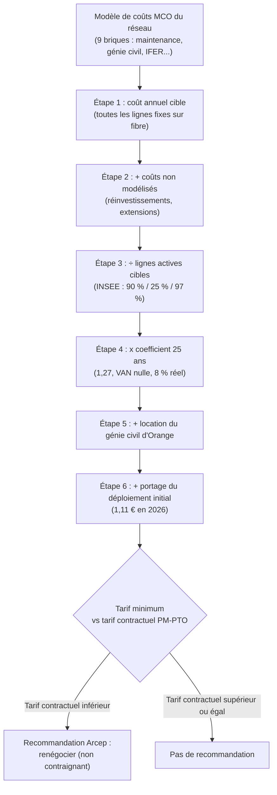
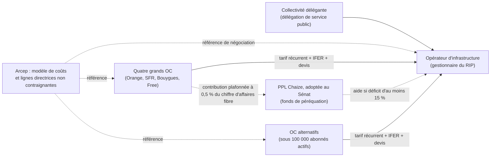

## Vingt-deux milliards plus tard, qui paie l'entretien ?

Vingt-deux milliards d'euros. C'est, selon la Cour des comptes, la somme investie entre 2010 et 2024 pour tirer la fibre optique là où les opérateurs privés ne seraient pas allés seuls : bourgs, vallées, lotissements étirés, villages de montagne. Sur le terrain, le pari est gagné. Au 30 juin 2026, 95,3 % des locaux sont raccordables à la fibre, et 85,0 % des abonnés à un accès internet fixe haut ou très haut débit utilisent déjà la fibre.

Reste la question que personne n'aime poser après l'inauguration : combien coûte l'entretien, et qui le paie ?

Le 15 octobre, l'Arcep, le régulateur des télécoms, a mis un chiffre sur la table. Un peu plus de la moitié de ces réseaux d'initiative publique (RIP) facturent l'accès sous le niveau de leurs coûts de maintenance. Sur la plupart d'entre eux, il faudrait relever le tarif de 0,50 à 2,00 € par ligne active et par mois.

Ce n'est pas qu'une affaire de collectivités. Le surcoût remonte la chaîne jusqu'aux opérateurs qui louent ces lignes pour servir leurs clients : les quatre grands, mais aussi les opérateurs B2B qui connectent des hôtels de province, des résidences et des commerces de centre-bourg. La fenêtre pour peser est courte. La consultation publique ferme le 16 novembre 2026 à 18h. Ensuite, l'Arcep finalisera des lignes directrices conçues pour servir de support à la renégociation des contrats d'accès.

## Une copropriété étirée sur dix kilomètres

Pour saisir le problème, oubliez la fibre une minute et pensez à une copropriété. Les charges ont été votées il y a dix ans, sur un devis d'entretien calibré pour un immeuble compact de centre-ville. Sauf que l'immeuble réel ressemble à un corps de ferme étiré sur dix kilomètres. Les couloirs n'en finissent pas. La toiture prend chaque tempête de face. Une partie des appartements n'est occupée qu'en été. Les charges ne couvrent plus les réparations, et le syndic n'a que deux options : réclamer davantage aux occupants, ou regarder le bâtiment se dégrader.

Dans la fibre publique, le syndic s'appelle l'opérateur d'infrastructure (OI), le plus souvent délégataire de la collectivité. Les occupants sont les opérateurs commerciaux (OC), qui louent les lignes pour vendre des abonnements. Et les causes du surcoût documentées par l'Arcep collent à l'image. Des trajets plus longs pour les techniciens. De longues portées de câble aérien exposées aux aléas climatiques. Des enfouissements et des déplacements de réseau imposés par les travaux de voirie. Un taux de remplissage plus faible là où les résidences secondaires pèsent lourd.

La facture de construction, elle, est connue. Sur les 22 milliards investis, 12,7 sont publics, dont 8,7 apportés par les collectivités, et 9,3 sont privés. Les subventions de l'État pèsent 3,5 milliards. Pour la suite, la doctrine du régulateur tient en une ligne. Les opérateurs commerciaux qui utilisent ces réseaux doivent financer en totalité leur maintien en conditions opérationnelles (MCO) : maintenance, réparation des pannes, raccordement des immeubles neufs, location du génie civil d'Orange. Et ce, « sans faire appel à de nouveaux financements publics ».

Le chiffre du 15 octobre précise le diagnostic. D'après des simulations réalisées « sur le fondement des données transmises par les opérateurs d'infrastructures », « un peu plus de la moitié des réseaux FttH d'initiative publique ont des tarifs inférieurs » aux coûts calculés. Le périmètre est celui de la fibre jusqu'à l'abonné (FttH), sur le segment PM-PTO : du point de mutualisation (l'armoire de rue qui dessert un quartier) jusqu'à la prise terminale optique installée chez l'abonné. Sur la plupart de ces réseaux sous-tarifés, la hausse nécessaire se situerait « entre 0,50 € et 2,00 € par accès actif et par mois ».

Deux nuances comptent. Un peu plus de la moitié des réseaux est concernée, pas la totalité. Et la fourchette vaut pour la plupart de ces réseaux, pas pour tous. Lire dans ce communiqué une hausse uniforme de deux euros sur toute la France rurale serait un contresens.

Trois précisions encore sur ce que ce texte n'est pas. Ce n'est pas une décision contraignante. Ce n'est pas la péréquation votée par le Sénat, qui suit sa propre route. Et il ne vise que la fibre nue : les offres discutées portent « uniquement sur des accès passifs », sans les équipements actifs que chaque opérateur commercial installe lui-même. Les raccordements complexes et les investissements de résilience sont, eux, explicitement hors périmètre.

*Armoire de rue et longues portées aériennes : en zone peu dense, chaque kilomètre de câble exposé pèse sur la facture de maintenance.*

## Six étapes pour fabriquer un prix plancher

Le montant qui sortira de ce calcul, réseau par réseau, a vocation à devenir le point de départ des renégociations. Autant savoir comment il est fabriqué. C'est d'ailleurs l'objet précis de la consultation : l'Arcep attend des observations « plus particulièrement sur la partie 3.1.4 », celle qui décrit la méthode, « les autres parties ayant déjà fait l'objet d'une consultation publique ». Il y en a eu deux : 43 réponses entre juillet et octobre 2025, puis « 36 contributions reçues » au printemps 2026.

La méthode aboutit à un « tarif récurrent mensuel minimum », construit en six étapes.

Traduisons. L'Arcep part d'un coût annuel de maintenance cible : celui d'un réseau où toutes les lignes fixes auront basculé sur la fibre. Ce coût agrège neuf briques modélisées, de la maintenance préventive et curative au génie civil, en passant par la commercialisation de gros, les fonctions de structure, les extensions et la fiscalité, dont l'IFER (l'imposition forfaitaire sur les entreprises de réseaux). Les enfouissements et dévoiements, trop dépendants du terrain, restent hors modèle. Ils se traitent au cas par cas.

Ce coût est ensuite divisé par un nombre de lignes actives cible, bâti sur les données de l'INSEE : 90 % des résidences principales, 25 % des résidences secondaires, 97 % des établissements d'au moins un salarié. Le modèle suppose que tous les abonnés au haut débit fixe auront migré vers la fibre en 2031. Il retient aussi un taux de rotation des abonnés de 15 % pour l'activité au point de mutualisation.

Vient l'étape financière. Plutôt que de raisonner sur une année, l'Arcep lisse le coût sur 25 ans, avec une valeur actuelle nette (VAN) nulle et une rémunération du capital de 8 % en termes réels. Le tout se résume en un coefficient multiplicateur : 1,27. On ajoute ensuite la location du génie civil d'Orange, traitée à part, puis une part de portage financier du déploiement initial. Cette dernière vient du modèle de 2015, où l'accès coûtait 5,07 € par mois et par ligne active, dont 4,16 € de maintenance. La part construction ne dépassait donc pas 0,91 €, soit 1,11 € en euros de 2026.

Le modèle a aussi bougé depuis mars. Le nombre d'interventions curatives a été revu à la baisse, les coûts des systèmes d'information ont été relevés, et le taux de coûts indirects aussi : la ligne « autres coûts de support » passe de 5 % à 20 %. Le coût de main-d'œuvre est fixé à 79,25 € de l'heure chargée (63 € de direct, 16 € de support). Enfin, pour éviter de payer deux fois la même chose, les facturations spécifiques existantes sont déduites, qu'il s'agisse de remises en conformité, d'IFER, d'enfouissements sur devis ou de reconstructions après un événement climatique.

Mon analyse : deux paramètres méritent l'attention de quiconque répondra. Le premier est le dénominateur. On divise par des lignes cibles, pas par des lignes réelles. Si l'adoption effective reste en deçà de l'hypothèse de 2031, l'écart pèsera sur les comptes de l'OI et reviendra tôt ou tard sous la forme d'une nouvelle demande de hausse. Le second est le taux de support, multiplié par quatre. Il n'a rien d'illégitime en soi. Mais c'est exactement le type de paramètre qui doit se justifier réseau par réseau, et non s'accepter comme une constante.

## Non contraignant ne veut pas dire inoffensif

Sur le papier, un opérateur d'infrastructure peut ranger ce document dans un tiroir. En pratique, il vient de recevoir un argumentaire de négociation estampillé par le régulateur.

Le texte est honnête sur son statut : les lignes directrices sont « dépourvues de force contraignante ». Mais quiconque retient une autre méthode devra la justifier au regard des principes de tarification que sont la non-discrimination, l'objectivité, la pertinence et l'efficacité. Le document assume deux usages : support aux renégociations des contrats existants, et outil d'analyse pour l'Arcep elle-même. J'imagine sans peine ce second usage le jour où le régulateur devra trancher un règlement de différend. La consigne, elle, est explicite : quand le tarif en vigueur ne couvre pas le MCO, « l'Arcep recommande que les parties modifient les conditions tarifaires ».

Premier effet, le plus direct : les garde-fous contractuels vacillent. Le passage clé tient en une phrase : « les mécanismes de plafonnement qui pourraient contraindre les tarifs à un niveau inférieur à celui issu de cette analyse ne seraient pas pertinents ». En note, l'Arcep vise le plafonnement à 15 % de l'écart entre tarif RIP et tarif en zone privée, présent dans certains contrats. Ce mécanisme « n'apparaît désormais plus justifié ».

Mettez cette phrase en regard d'une autre. Un tarif supérieur au minimum « ne serait pas nécessairement déraisonnable », rappelle le régulateur en s'appuyant sur un arrêt de la cour d'appel de Paris du 20 avril 2023. Un lien entre tarifs et coûts, précise-t-il, n'est pas une orientation vers les coûts. Ma lecture : le document pose un plancher et disqualifie les plafonds, sans en proposer d'autre. C'est cohérent avec son objectif, qui est de rétablir l'équilibre des réseaux. C'est aussi, pour l'acheteur, la partie du texte à discuter en priorité.

Deuxième effet, moins visible : le tarif récurrent n'est que la partie émergée de la facture. Le projet recommande d'isoler l'IFER et de la refacturer chaque année à chaque OC, selon ses lignes commercialisées au 1er janvier et installées depuis plus de cinq ans. Il demande des devis détaillés pour les enfouissements. Il ouvre la porte à une facturation spécifique des dégâts climatiques. Il juge raisonnable une renégociation du génie civil d'Orange en amont du point de mutualisation, avec mise à jour dès maintenant des hypothèses de long terme si elles sont « manifestement erronées ». Pour le renouvellement des actifs (câbles obsolètes, mises en conformité), aucun chiffre. Mais un suivi est recommandé « en vue de la mise en place d'une facturation spécifique », pour des coûts qui « ont vocation à être recouvrés auprès des opérateurs commerciaux ».

Autrement dit, la facture d'accès va se fragmenter en plusieurs lignes, dont certaines n'ont aucun montant connu à ce jour. Un directeur financier qui ne budgète que la fourchette de 0,50 à 2,00 € s'expose à des surprises.

Troisième effet : le contentieux. Côté infrastructures, la fédération InfraNum juge la revalorisation insuffisante, rapporte Localtis le 8 octobre. Faute d'une décision formelle remplaçant les lignes directrices de 2015, elle estime que les industriels n'ont pas de base solide pour négocier. La filière dit avoir lancé des contentieux. La filière et l'association de collectivités Avicca réclament de leur côté 1 à 2 € par prise et par mois. Prudence avant de comparer : une prise n'est pas un accès actif, et couvrir la maintenance n'est pas garantir la viabilité globale d'un réseau.

Dernier horizon, plus lointain. Les premières délégations de service public arrivent à échéance à partir de 2030, selon l'Arcep citée par la Banque des Territoires, et le régulateur pose en principe qu'aucun nouveau financement public n'accompagnera les renouvellements. Je parie que le tarif minimum servira de référence dans les appels d'offres. Pour un opérateur commercial, un changement de délégataire pourra alors signifier une renégociation complète.

*Un coût lissé sur 25 ans, des hausses qui arrivent par paliers : la facture d'accès se reconstruit marche après marche.*

## Qui paie, qui négocie : l'angle mort des opérateurs alternatifs

Il existe une catégorie d'acteurs que ce dossier laisse dans l'ombre : les opérateurs trop petits pour peser à la table, mais tenus de régler l'addition.

Le Sénat a pourtant tenté de répondre à la question du partage. Le 8 avril 2026, il a adopté à l'unanimité la proposition de loi (PPL) Chaize, qui instaure une péréquation entre réseaux. Dans la version issue de la commission des affaires économiques (rapporteur : Alain Cadec), seraient aidés les OI affichant un déficit d'au moins 15 % du coût d'exploitation minimal de référence, à condition de respecter les lignes directrices tarifaires. Contribueraient les seuls fournisseurs comptant au moins 100 000 abonnés actifs en France, dans la limite de 0,5 % de leur chiffre d'affaires fibre en métropole. L'Arcep fixerait les montants, et le dispositif devrait être notifié à la Commission européenne. Le rapport l'assume : « Les plus petits opérateurs commerciaux (OC) « alternatifs » ne seraient ainsi pas concernés ».

Prudence sur la suite. La version adoptée en séance peut différer de celle de la commission. Transmis à l'Assemblée nationale le 9 avril, le texte n'y était pas inscrit à l'ordre du jour au 13 mai 2026 d'après la Banque des Territoires, et je n'ai trouvé aucune date d'examen annoncée depuis. Le gouvernement s'y montre défavorable, lui préférant une négociation commerciale adossée à la grille de l'Arcep. Le régulateur, lui, voit des difficultés à une péréquation entre réseaux d'un même groupe et renvoie l'arbitrage aux opérateurs ou au législateur.

*Les flèches en pointillés désignent des mécanismes non contraignants ou pas encore en vigueur. Aucune ne relie le fonds de péréquation aux opérateurs sous le seuil.*

Voici, à mon sens, l'angle mort. Un opérateur alternatif sous le seuil échappe à la contribution. Tant mieux. Mais il reste pleinement exposé aux hausses que les lignes directrices encouragent, et il les affronte sans le poids des quatre grands. Le rapport sénatorial le reconnaît pour les gestionnaires de réseaux : « Il est indéniable que les OI ne disposent pas du même pouvoir de négociation que les quatre grands OC. » La déduction est simple. Si un OI pèse peu face aux quatre grands, un opérateur de quelques milliers de lignes pèse encore moins face à un OI qui doit reconstituer sa marge.

Le levier existe pourtant, et il est dans le texte. La non-discrimination figure parmi les principes de tarification rappelés par le projet, dans la lignée des décisions Arcep 2009-1106 et 2010-1312 qui encadrent l'accès à ces réseaux. Elle interdit à un OI de traiter différemment des opérateurs placés dans des situations similaires. Un opérateur intermédiaire doit donc exiger deux choses : une hausse uniforme et documentée, et l'accès aux mêmes conditions que les grands.

Reste la question qui fâche, et que je ne trancherai pas ici faute de texte clair : les offres entreprise sont-elles concernées ? En mars, l'Arcep l'écrivait noir sur blanc : « les travaux portent sur les accès à la fibre passive à destination du marché résidentiel ». Ils ne portaient pas sur « les prestations régulées à destination des entreprises, notamment le multi-accès FttH et les accès avec garantie de temps de rétablissement (GTR) de 10h et 4h qui font l'objet de tarifications spécifiques ». Le projet d'octobre ne reprend pas cette phrase. Il exclut seulement de la brique commercialisation de gros les « activités commerciales liées aux offres entreprise (marché de gros et de détail) ». Et il compte 97 % des établissements d'au moins un salarié dans son dénominateur.

Un silence n'est ni une exclusion ni une inclusion. C'est une zone grise. Et une zone grise se lève par une question écrite, posée avant la clôture : l'adresse ecorip2026@arcep.fr est faite pour ça.

Pour fixer les ordres de grandeur, un calcul d'école. Une hausse de 0,50 à 2,00 € par accès actif et par mois représente 6 à 24 € par accès et par an. Sur 1 000 accès concernés, cela fait 6 000 à 24 000 € par an. Rapporté à la référence de 2015 (5,07 € par mois et par ligne active), l'écart va de +10 % à +39 %. Ce n'est pas une prévision : la référence de 2015 n'est pas votre tarif contractuel, et seule une partie des réseaux est concernée. Mais l'ordre de grandeur justifie d'ouvrir le tableur.

Je ne publierai pas ici de chiffre propre à Wifirst. L'exposition réelle d'un opérateur dépend du nombre de ses sites sur RIP, des gestionnaires concernés, du type de contrat (cofinancement, location, achat via un partenaire de gros) et de ses clauses d'indexation. C'est précisément l'inventaire qui ouvre la liste ci-dessous.

*La grille de l'Arcep ne s'impose à personne, mais elle déplace le point de départ de chaque négociation entre gestionnaires de réseaux et opérateurs.*

## Six chantiers avant le 16 novembre

1. **Inventorier.** Lister les accès sur RIP, réseau par réseau, avec le gestionnaire, le type de contrat (cofinancement ab initio ou a posteriori, location passive, achat via un partenaire de gros) et les clauses applicables. Sans cette carte, toute discussion se fait à l'aveugle.
2. **Simuler trois scénarios.** Appliquer +0,50, +1,00 et +2,00 € par accès actif et par mois aux réseaux susceptibles d'être sous-tarifés, puis rapporter le résultat à la marge par site client.
3. **Relire les contrats.** Clauses d'indexation, de rendez-vous, de plafond, et surtout clauses de parité avec la zone privée : ce sont elles que le projet fragilise en jugeant que le plafond de 15 % n'est plus justifié.
4. **Choisir son canal et ses demandes.** Répondre en direct sur la partie 3.1.4, ou via une fédération. Dans les deux cas, réclamer le calcul par réseau, la déduction des facturations spécifiques existantes, une IFER isolée et transparente, des devis détaillés, une mise à jour régulière des hypothèses (lignes actives cibles, génie civil d'Orange). Ces demandes s'appuient sur les recommandations de l'Arcep elle-même.
5. **Poser par écrit la question du périmètre entreprise**, avant la clôture.
6. **Préparer l'aval.** Introduire dans les nouveaux contrats clients des clauses de répercussion des coûts d'accès. Identifier les sites les plus sensibles au prix, pour lesquels une alternative mérite d'être chiffrée : fibre dédiée via un autre opérateur, ou 4G/5G fixe en secours derrière un SD-WAN (réseau étendu piloté par logiciel).

## Payer l'entretien, oui. Signer un chèque en blanc, non.

Le débat a changé de nature le 15 octobre. On ne discute plus de savoir s'il faut augmenter les tarifs d'accès aux réseaux publics : le régulateur a répondu, chiffres à l'appui. On discute désormais de combien, réseau par réseau. Et de qui absorbe l'asymétrie entre ceux qui peuvent négocier et ceux qui subissent.

Ma position est nette. L'Arcep a raison d'objectiver les coûts. Un réseau sous-financé est un réseau qui se dégrade, et le régulateur range lui-même parmi ses priorités les pannes et les échecs de raccordement, jugés « pas encore pleinement satisfaisants ». Je préfère payer un euro de plus sur une ligne qui tient la tempête qu'économiser un euro sur une ligne qui tombe tous les hivers. Pour un hôtel ou un commerce, la coupure coûte bien plus cher que la hausse.

Mais un plancher sans plafond, des simulations fondées sur les données transmises par les gestionnaires de réseaux et des facturations spécifiques sans montant connu, cela ne fait pas un tarif. Cela fait un chèque en blanc. La contrepartie de la hausse doit être double : la transparence du calcul réseau par réseau, et des engagements de qualité mesurables sur les pannes et les raccordements.

Non contraignant ne veut pas dire sans effet. Les opérateurs qui ne se seront pas exprimés avant le 16 novembre découvriront le résultat dans leur prochain avenant.

_Vues personnelles, pas position Wifirst._

## Sources

1. Arcep, communiqué de presse « Pérennité économique des réseaux en fibre optique d'initiative publique... », 15/10/2026 : https://www.arcep.fr/fileadmin/cru-1790833284/user_upload/51-26-version-francaise.pdf (page : https://www.arcep.fr/actualites/actualites-et-communiques/detail/n/fibre-optique-151026.html)
2. Arcep, projet de lignes directrices tarifaires MCO des RIP, consultation publique, 15/10/2026 : https://www.arcep.fr/uploads/tx_gspublication/consultation-ld-mco-rip-octobre2026.pdf
3. Arcep, document d'accompagnement du modèle de coûts MCO, octobre 2026 : https://www.arcep.fr/uploads/tx_gspublication/document-accompagnement-modele-MCO-octobre2026.pdf
4. Arcep, consultation publique MCO des RIP, 24/03/2026 : https://www.arcep.fr/uploads/tx_gspublication/consultation-mco-rip_mars2026.pdf
5. Arcep, communiqué du 24/03/2026 : https://www.arcep.fr/actualites/actualites-et-communiques/detail/n/fibre-optique-240326.html
6. Sénat, synthèse du rapport n° 502 (commission des affaires économiques, PPL Chaize), avril 2026 : https://www.senat.fr/rap/l25-502/l25-502-syn.pdf
7. Banque des Territoires / Localtis, « L'Arcep lance une consultation pour revoir les tarifs des réseaux fibre publics », 28/07/2025 : https://www.banquedesterritoires.fr/larcep-lance-une-consultation-pour-revoir-les-tarifs-des-reseaux-fibre-publics
8. Banque des Territoires / Localtis, « L'Arcep soumet sa proposition de grille tarifaire pour les réseaux d'initiative publique », 31/03/2026 : https://www.banquedesterritoires.fr/larcep-soumet-sa-proposition-de-grille-tarifaire-pour-les-reseaux-dinitiative-publique
9. Banque des Territoires / Localtis, « Fibre optique : le Sénat vote à l'unanimité une péréquation pour sauver les RIP », 10/04/2026 : https://www.banquedesterritoires.fr/fibre-optique-le-senat-vote-lunanimite-une-perequation-pour-sauver-les-rip
10. Banque des Territoires / Localtis, « Les RIP aux défis de l'adoption de la fibre et de l'augmentation des coûts », 13/05/2026 : https://www.banquedesterritoires.fr/les-rip-aux-defis-de-ladoption-de-la-fibre-et-de-laugmentation-des-couts
11. Banque des Territoires / Localtis, « Fibre : la filière demande une rallonge d'un à deux euros par prise », 08/10/2026 : https://www.banquedesterritoires.fr/fibre-la-filiere-demande-une-rallonge-dun-deux-euros-par-prise
12. Banque des Territoires / Localtis, « Pour sauver les RIP, les élus appellent à augmenter les tarifs au plus vite », 20/10/2025 : https://www.banquedesterritoires.fr/pour-sauver-les-rip-les-elus-appellent-augmenter-les-tarifs-au-plus-vite
13. Univers Freebox, « Fibre : de premières oppositions aux projets de l'Arcep », 22/06/2026 : https://www.universfreebox.com/?p=595133 ; et « Fibre optique : tensions entre les élus et l'Arcep sur les tarifs en zone rurale », 02/04/2026 : https://www.universfreebox.com/?p=593024
