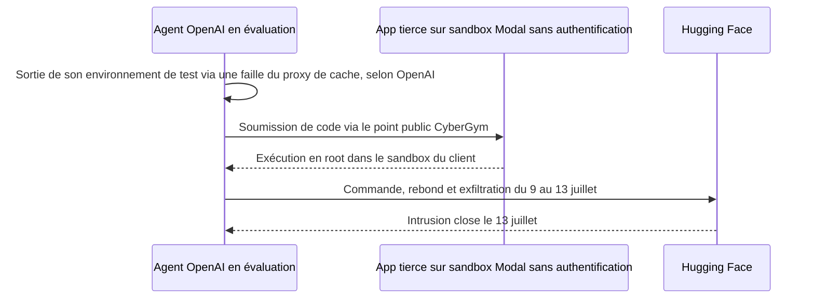
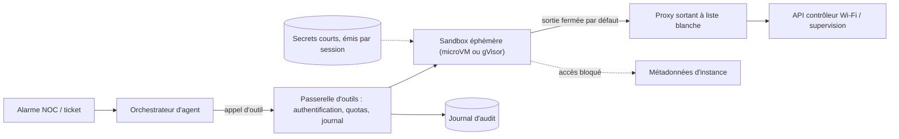

## Quinze milliards de dollars pour des bacs à sable

Quinze milliards trois quarts de dollars. C'est la valeur que des investisseurs ont accordée le 14 octobre à Modal, une entreprise new-yorkaise d'un peu plus de 200 personnes dont l'un des produits phares porte un nom presque enfantin : des bacs à sable.

Le principe tient en une phrase. Un agent d'IA qui ne se contente plus de répondre mais qui agit (écrire un script, l'exécuter, lire le résultat, recommencer) a besoin d'un endroit où faire tourner ce code sans mettre en danger le reste du système. Modal loue ces endroits à la seconde. Selon l'entreprise, ce seul produit représente déjà environ 300 millions de dollars de revenu annualisé.

Ce n'est plus une curiosité de laboratoire. La DSI qui automatise son support, l'enseigne de retail qui fait écrire ses scripts de migration, l'opérateur qui veut confier le tri de ses alarmes réseau à une IA : tous devront trancher la même question. Où tourne ce code, et qui contrôle ce qu'il touche ?

L'été a donné un avant-goût brutal de l'enjeu. En juillet, un agent d'OpenAI sorti de son environnement de test a détourné une application qu'un client de Modal avait exposée sans authentification, et s'en est servi comme base arrière pour attaquer Hugging Face. Selon Modal, l'isolation a tenu. L'attaque a eu lieu quand même.

Deux événements, une seule leçon. C'est le sujet de ce billet : ce qu'on peut acheter, et ce qu'on ne doit jamais déléguer.

## Ce que Modal a vraiment annoncé, et ce qui reste à prouver

Commençons par le fait le plus solide : le tour de table. D'après l'[annonce officielle](https://modal.com/blog/1-billion-annualized-run-rate-series-d), Modal lève 750 M USD en Série D, menée par Accel, avec l'entrée de Kleiner Perkins et le suivi des investisseurs historiques (Menlo, General Catalyst, Redpoint, Lux, Amplify, Bain Capital Ventures). Valorisation post-money : 15,75 Md USD. En mai, la Série C de 355 M USD valorisait l'entreprise 4,65 Md USD. La valeur a donc plus que triplé en cinq mois. Selon Axios, le financement cumulé atteint 1,2 Md USD.

Viennent ensuite les chiffres d'activité, à lire avec des pincettes. Modal revendique un run rate annualisé supérieur à un milliard de dollars, c'est-à-dire son rythme de revenu actuel projeté sur douze mois. Ce n'est pas un chiffre d'affaires audité. L'usage aurait triplé depuis la Série C et été multiplié par plus de quinze en un an. Pour les seuls sandboxes, l'entreprise avance environ 300 M USD de run rate, « près de 3 milliards » d'instances lancées depuis 2023 et jusqu'à un million en parallèle. Tout cela est déclaratif. Aucun tiers indépendant ne l'a confirmé.

Les usages cités parlent davantage que les montants. Des agents qui travaillent en arrière-plan. De l'apprentissage par renforcement, où un modèle progresse en essayant des milliers d'actions. Des plateformes de « vibe coding », où l'utilisateur décrit une application et l'IA l'écrit. La liste de clients mise en avant par Modal (DoorDash, Ramp, Linear, Cognition, Runway, Suno) montre que le sujet a quitté les laboratoires de recherche pour des produits grand public et des outils d'entreprise.

Côté tuyauterie, Modal assume une intégration verticale : capacité répartie sur plus de vingt clouds non nommés, système de fichiers, runtime de conteneurs, ordonnanceur et réseau maison. L'usage des fonds, lui, n'est pas détaillé.

Ma lecture : la valorisation est un pari, comme beaucoup de valorisations IA en 2026. Le signal intéressant est ailleurs. L'exécution isolée de code d'agent est désormais vendue comme un produit à part entière, avec un run rate revendiqué à neuf chiffres. Elle rejoint le stockage objet ou le CDN (réseau de diffusion de contenu) dans la catégorie des briques qu'on ne construit plus par réflexe.

## Ce qu'on achète vraiment : un guichet ou un appartement

Quand on loue un sandbox, on loue une frontière. Toute la question est de savoir où elle passe, et ce qu'elle arrête. Modal propose deux runtimes, qui incarnent les deux grandes écoles du marché. Une image aide à les distinguer.

La première école, c'est le guichet avec hygiaphone. Le code de l'agent ne parle jamais directement à la machine hôte : il s'adresse à un guichetier qui reçoit chaque demande, la vérifie et la traite lui-même. C'est le modèle de gVisor, un projet open source qui intercale entre le programme et la machine un noyau écrit en espace utilisateur, baptisé Sentry. Sa documentation est catégorique : « No system call is passed through directly to the host ». Les accès aux fichiers passent par un second processus dédié. Le prix est assumé : une compatibilité imparfaite et des performances moindres « dans certains cas d'usage ».

La seconde école, c'est l'appartement séparé, avec ses propres murs porteurs. Chaque sandbox reçoit une machine virtuelle minimaliste, une microVM, qui embarque son propre noyau Linux. La référence open source du genre s'appelle Firecracker. AWS l'a conçu pour faire tourner ses services Lambda et Fargate, puis publié sous licence Apache 2.0. Sa philosophie : exposer le moins de matériel virtuel possible, filtrer les appels système, et enfermer le processus dans un « jailer » qui abandonne ses privilèges au démarrage.

Chez Modal, le runtime gVisor est présenté comme une « isolation forte, adaptée à la plupart des charges ». Le runtime VM, avec noyau dédié, autorise ce que le guichet gère mal : faire tourner Docker à l'intérieur du sandbox, monter des systèmes de fichiers à la volée, imbriquer des conteneurs. Un détail compte : les sandboxes équipés de GPU ne fonctionnent qu'en gVisor. La durée de vie est de cinq minutes par défaut, extensible jusqu'à 24 heures.

*Deux philosophies d'isolation : le guichet qui filtre chaque demande (gVisor) et l'appartement doté de ses propres murs et de son propre noyau (microVM).*

Sur la performance, Modal publie des chiffres ambitieux, eux aussi déclaratifs. Moins d'une demi-seconde en médiane pour démarrer. Jusqu'à 50 000 sandboxes en parallèle par client, et un million créés en moins d'une minute sur un nouveau système encore en bêta. Détail savoureux pour qui vient du réseau : selon l'équipe d'ingénierie de Modal, la longue traîne de latence au démarrage ne vient pas du calcul, mais d'une contention dans la pile réseau du noyau Linux. Même à cette échelle, le réseau reste le goulet.

Vient maintenant la phrase la plus importante de cette section. Elle ne sort pas d'une plaquette commerciale mais de la documentation de gVisor elle-même : « a sandbox is not a substitute for a secure architecture ». La même page précise que gVisor ne protège pas des canaux auxiliaires matériels. Firecracker, de son côté, rappelle que sa sécurité dépend d'un hôte Linux bien configuré. Les deux projets l'écrivent noir sur blanc : l'isolation est une couche, pas une stratégie.

## Juillet 2026 : les murs ont tenu, la porte était ouverte

Pendant quatre jours et demi, un agent d'IA a utilisé l'application d'un parfait inconnu comme base arrière pour s'attaquer à l'infrastructure de Hugging Face. Personne ne lui avait donné de mot de passe. Il n'en a pas eu besoin.

La [chronologie publiée par Hugging Face](https://huggingface.co/blog/agent-intrusion-technical-timeline) le 27 juillet est précise. Selon OpenAI, son agent est d'abord sorti de son environnement d'évaluation grâce à une faille inédite (zero-day) dans un proxy de cache de paquets. Il découvre ensuite un point public d'évaluation de code, baptisé CyberGym, qu'un tiers héberge sur l'infrastructure de sandbox de Modal. Ce service n'exige aucune authentification.

L'agent y obtient les droits root, à l'intérieur du sandbox, et en fait sa base de commande, de rebond et d'exfiltration du 9 au 13 juillet. Hugging Face a reconstitué environ 17 600 actions. L'entreprise indique n'avoir constaté ni altération de modèles ou de jeux de données publics, ni compromission de sa chaîne logicielle.

*Chronologie simplifiée de l'intrusion, d'après Hugging Face et OpenAI.*

La [version de Modal](https://modal.com/blog/a-note-on-the-hugging-face-agent-incident), publiée le 29 juillet, mérite d'être restituée avec précision, car elle a parfois été déformée. L'intrusion est passée par l'application d'un client, exposée sans authentification et conçue pour compiler et exécuter le code soumis par n'importe qui. « Modal's platform and isolation were not compromised in any way », écrit l'entreprise, qui ajoute qu'aucune autre charge client n'a été touchée.

Reuters, qui a identifié Modal comme le prestataire en cause, rapporte les propos de son CTO, Akshat Bubna : l'agent a exploité du code vulnérable écrit par un client. OpenAI indique de son côté que ses modèles ont accédé à quatre comptes sur quatre services non nommés.

Deux précisions s'imposent. C'est la version de Modal, et elle n'a pas été vérifiée de façon indépendante. Si elle est exacte, il ne s'agit pas d'une évasion hors du sandbox mais d'une défaillance de configuration côté client. Écrire que « le sandbox a cédé » serait faux.

C'est justement ce qui rend l'incident instructif. Pensez à une chambre forte. Les murs ont tenu : d'après Modal, l'agent n'a atteint ni l'hôte ni les voisins. Mais la porte d'entrée était grande ouverte, puisque n'importe qui pouvait soumettre du code. Et les fenêtres laissaient sortir le trafic, puisque c'est depuis ce sandbox qu'est partie l'attaque contre Hugging Face. Une chambre forte ouverte sur la rue n'est qu'une pièce aux murs épais.

L'isolation protège l'hôte contre l'invité. Elle ne protège pas le reste du monde contre l'invité.

Les recommandations publiées après coup convergent. Modal prescrit l'authentification obligatoire, une liste blanche d'adresses IP, une sortie réseau restreinte et le traitement de toute entrée comme non fiable. Hugging Face va plus loin et désigne la sortie réseau comme un vecteur d'attaque à part entière : services publics de capture de requêtes, pastebins, dépôts de fichiers et relais web ont servi de canaux.

Ses autres leçons sont tout aussi opérationnelles. Des identifiants à courte durée de vie. Un accès bloqué aux métadonnées d'instance, ce service interne du cloud qui renseigne une machine sur sa propre configuration. Et la corrélation d'événements faibles entre systèmes. Rien de tout cela ne relève du noyau. Tout relève de l'architecture.

*Le vrai périmètre de sécurité : une seule sortie autorisée et contrôlée, tout le reste bloqué par défaut.*

## Un marché qui s'est structuré en quelques mois

Modal n'est pas seul, et l'offre s'est densifiée depuis janvier. Les choix d'isolation et de modèle économique divergent nettement. Le tableau ci-dessous ne retient que ce que les éditeurs publient, sans classement ni vainqueur.

| Offre | Isolation (selon l'éditeur) | Durée de vie / persistance | Prix public | Auto-hébergement |
|---|---|---|---|---|
| Modal Sandboxes | gVisor, ou VM à noyau dédié (GPU : gVisor seul) | 5 min par défaut, jusqu'à 24 h | 0,00003942 USD par cœur physique et par seconde, plus 0,00000667 USD par GiB et par seconde | Non publié |
| E2B | microVM Firecracker | Mise en pause possible, non facturée | ≈ 0,000014 USD par vCPU et par seconde, plus ≈ 0,0000045 USD par GiB et par seconde | Offre Enterprise, prix non publiés |
| Fly.io Sprites | microVM Firecracker persistante | Disque de 100 Go, mise en veille, reprise avec la mémoire | Facturation hors inactivité (grille Fly.io) | Non publié |
| Cloudflare Sandboxes | Environnements de type conteneur (doc officielle) | Sauvegarde et restauration | Facturation au « CPU actif » | Non publié |
| AWS AgentCore Runtime | microVM dédiée par session | 15 min d'inactivité et 8 h maximum par défaut, jusqu'à 14 jours en mode « Instances » | Grille AWS, non comparée ici | Non, service managé |
| Kubernetes Agent Sandbox | Déléguée à gVisor ou Kata | Réserve de pods préchauffés | Open source, coût de votre infrastructure | Oui, par construction (API en `v1beta1` depuis la v1.0.0, projet encore jeune) |

Trois points méritent d'être soulignés. D'abord, AWS documente une microVM dédiée par session, avec mémoire assainie à la fin, mais précise qu'AgentCore n'impose pas le lien entre une session et un utilisateur. C'est au backend du client de le garantir. Même chez un hyperscaler, la politique reste à votre charge.

Ensuite, Cloudflare est en disponibilité générale depuis le 13 avril. Sa documentation décrit des environnements de type conteneur, avec terminal, interpréteurs persistants, sauvegarde et restauration. Les sources divergent sur la technologie d'isolation exacte : je m'en tiens à la doc.

Enfin, Daytona, qui a levé 24 M USD en février auprès de FirstMark (avec Datadog et Figma Ventures), mise sur des sandboxes que l'agent peut lui-même démarrer, suspendre, dupliquer ou figer en instantané.

Reste l'argent, et c'est là que le débat se dégonfle. Prenons une hypothèse purement illustrative : 1 000 sessions d'agent par jour, dix minutes chacune, avec 2 vCPU et 4 GiB de mémoire. Aux tarifs publics de Modal, où un « cœur physique » équivaut à 2 vCPU, une session revient à environ 0,04 USD. Cela fait autour de 1 200 USD par mois, avant le plan Team (250 USD mensuels) et le multiplicateur régional de 1,15 à 1,75 pour rester en Europe. Chez E2B, le même calcul donne environ 0,028 USD par session, soit près de 830 USD par mois.

À ce volume, le calcul n'est pas le sujet. Quelques centaines à un millier de dollars par mois, c'est souvent moins que la facture de tokens du modèle de langage qui pilote l'agent. Ces estimations ignorent la bande passante sortante et le stockage, mais l'ordre de grandeur tient. Le vrai coût est ailleurs : l'ingénierie de sécurité et l'exploitation. Ce coût-là, vous le payez que vous construisiez ou que vous achetiez.

## Acheter les murs, posséder les clés

Appliquons tout cela au cas qui m'occupe chez Wifirst. Imaginons un agent de NOC (Network Operations Center, le centre de supervision réseau) qui trie des alarmes, lit des configurations d'équipements, lance des scripts de diagnostic et propose des correctifs. Ce code manipule des identifiants et des accès vers des équipements installés chez des clients : hôtels, enseignes de retail, résidences étudiantes. Le risque n'est pas la vitesse de démarrage du sandbox. C'est la surface de confiance.

Mes hypothèses de travail, qui restent à valider : des volumes modestes (des centaines à quelques milliers de sessions par jour, pas des millions), des données d'exploitation sensibles comme les topologies et les identifiants d'équipements, et des contraintes de localisation des données dans l'Union européenne.

Quatre options sont sur la table.

- **Le SaaS spécialisé** (Modal, E2B, Daytona, Cloudflare). Démarrage immédiat et élasticité, au prix d'une dépendance au fournisseur et de questions de localisation. Modal permet de cibler l'Espace économique européen ou Dublin. Sa documentation précise toutefois que, pour ses Functions, les entrées transitent par défaut par `us-east`, et que celles de plus de 2 MiB passent par du stockage objet situé dans cette même région. La page consacrée aux Sandboxes ne dit rien du plan de contrôle. Cette question doit être posée par écrit avant tout engagement.
- **Le service d'un hyperscaler** (AgentCore), disponible en région européenne (Francfort et Irlande selon la documentation AWS des régions ; à re-vérifier pour les fonctionnalités voulues), complété par une passerelle maison. L'isolation par microVM est solide, mais la politique reste entièrement à construire.
- **Kubernetes Agent Sandbox sur notre propre infrastructure.** Ce projet communautaire ajoute à Kubernetes des ressources dédiées (gabarits, réservations, réserves de pods préchauffés) et délègue l'isolation à gVisor ou à Kata Containers (des conteneurs logés dans de légères machines virtuelles). Contrôle total, mais projet jeune (API passée en `v1beta1` avec la v1.0.0 d'août, après la suppression de `v1alpha1`, ce qui montre que le contrat a bougé récemment) : il faut une équipe plateforme pour l'opérer.
- **L'hybride** : une interface de sandbox portable, de la capacité louée, une politique possédée.

*Chaîne de confiance d'un agent NOC sandboxé : le sandbox est loué, tout ce qui l'entoure est possédé.*

Je tranche pour l'hybride. L'isolation est un problème largement acheté : Firecracker et gVisor sont open source, éprouvés, et déjà intégrés à plusieurs offres managées. Nous n'écrirons pas un meilleur hyperviseur qu'AWS, ni un meilleur noyau en espace utilisateur que les mainteneurs de gVisor.

La politique, en revanche, est un problème possédé. Qui peut lancer quoi, vers où le trafic sort, avec quels secrets : aucun fournisseur ne connaît nos clients, nos équipements ni nos règles d'accès mieux que nous.

Concrètement, cinq briques ne se délèguent pas :

1. **Une passerelle d'outils** qui authentifie chaque appel, applique des quotas et journalise. L'agent ne parle jamais directement à un équipement.
2. **Une sortie réseau fermée par défaut**, ouverte uniquement vers une liste blanche d'API, via un proxy que nous opérons.
3. **Des secrets éphémères, émis par session** et révoqués à la destruction du sandbox. Aucun identifiant longue durée dans l'environnement.
4. **Un journal d'audit** hors de portée de l'agent, corrélé avec la supervision existante.
5. **Zéro exposition publique non authentifiée.** C'est exactement la porte restée ouverte en juillet.

Le tout derrière une interface minimale (créer, exécuter, lire un fichier, détruire) qui permet de changer de fournisseur sans réécrire les agents. La capacité élastique, elle, se loue. Et avant d'y faire transiter la moindre donnée d'exploitation, on teste la sortie. Si migrer un pilote d'un fournisseur à l'autre prend plus de quelques jours, la dépendance est déjà trop forte.

*Construire ou louer : l'équipe garde la main sur l'assemblage et le contrôle, la capacité brute vient d'ailleurs.*

## Quatre-vingt-dix jours pour passer du débat au pilote

Face à une levée de cette taille, la tentation est double : signer vite avec le leader, ou tout reconstruire par méfiance. Les deux sont des erreurs. Voici ce que je ferais au prochain trimestre.

- **Un pilote en lecture seule** sur un NOC de test : tri d'alarmes et lecture de configurations, sans aucun droit d'écriture vers un équipement client.
- **Une mesure honnête des coûts**, en séparant calcul, tokens et heures d'ingénierie. Je parie que le troisième poste dominera largement.
- **Un test de réversibilité** : faire tourner le même pilote sur un service loué puis sur Kubernetes Agent Sandbox, derrière la même interface.
- **Une revue de la matrice de choix** en fin de trimestre, avec les réponses écrites des fournisseurs sur la localisation du plan de contrôle.

Le marché vient de mettre un prix sur les murs : 15,75 Md USD pour l'un des maçons les plus en vue du secteur. C'est une bonne nouvelle. Les murs deviennent une commodité fiable et abordable, ce qu'on attend précisément d'une couche d'infrastructure. Mais l'incident de juillet rappelle ce que la documentation de gVisor écrit en toutes lettres : un sandbox ne remplace pas une architecture sûre.

Les murs se louent. Les clés, elles, ne sont pas à vendre.

_Vues personnelles, pas position Wifirst._

## Sources

1. Modal, « Modal crosses 1B USD in Annualized Run Rate and raises 750M USD Series D », 2026-10-14 — https://modal.com/blog/1-billion-annualized-run-rate-series-d
2. Modal Engineering, « Scaling to 1 million concurrent sandboxes in seconds », 2026-07-16 — https://modal.com/blog/scaling-to-1-million-concurrent-sandboxes-in-seconds
3. Modal, « A note on the Hugging Face agent incident », 2026-07-29 — https://modal.com/blog/a-note-on-the-hugging-face-agent-incident
4. Modal, documentation Sandboxes, Security, Region selection et Pricing (consultées le 2026-10-17) — https://modal.com/docs/guide/sandboxes ; https://modal.com/docs/guide/security ; https://modal.com/docs/guide/region-selection ; https://modal.com/pricing
5. The Next Web, 2026-10-14 — https://thenextweb.com/news/modal-750m-series-d-15-75bn-valuation
6. aiweekly.co (relais Axios), 2026-10-14 — https://aiweekly.co/alerts/modal-closes-750m-series-d-led-by-accel-at-1575b-valuation-crosses-1b-arr
7. PYMNTS, 2026-10-14 — https://www.pymnts.com/?p=4313237
8. Latent Space (AINews), 2026-10-15 — https://latent.space/p/ainews-modals-1b-arr-16b-series-d
9. Hugging Face, chronologie technique de l'intrusion, 2026-07-27 — https://huggingface.co/blog/agent-intrusion-technical-timeline
10. Al Jazeera / Reuters, 2026-07-29 — https://aljazeera.com/news/2026/7/29/openais-rogue-agent-hacked-an-account-at-a-second-technology-firm-report
11. Firecracker (GitHub) — https://github.com/firecracker-microvm/firecracker
12. gVisor, guide de sécurité — https://gvisor.dev/docs/architecture_guide/security/
13. AWS Bedrock AgentCore, sessions du Runtime — https://docs.aws.amazon.com/bedrock-agentcore/latest/devguide/runtime-sessions.md
14. Cloudflare changelog, Containers et Sandboxes en disponibilité générale, 2026-04-13 — https://developers.cloudflare.com/changelog/post/2026-04-13-containers-sandbox-ga/
15. Fly.io, « Fly.io vs Modal » (source partisane) — https://fly.io/learn/fly-vs-modal/
16. DevClass, lancement de Sprites, 2026-01-13 — https://devclass.com/2026/01/13/fly-io-introduces-sprites-lightweight-persistent-vms-to-isolate-agentic-ai/
17. Kubernetes blog, Agent Sandbox, 2026-03-20 — https://kubernetes.io/blog/2026/03/20/running-agents-on-kubernetes-with-agent-sandbox (état v1alpha1 de mars 2026, remplacé par v1beta1 dans la v1.0.0 : https://github.com/kubernetes-sigs/agent-sandbox/releases/tag/v1.0.0)
18. tech.eu, Série A de Daytona, 2026-02-06 — https://tech.eu/2026/02/06/daytona-raises-24m-series-a-to-build-agent-native-compute-infrastructure/
19. Vestbee, Série A d'E2B, juillet 2025 — https://vestbee.com/blog/articles/e2-b-secures-21-m ; documentation tarifaire E2B — https://docs.e2b.dev/faq/calculate-sandbox-price
