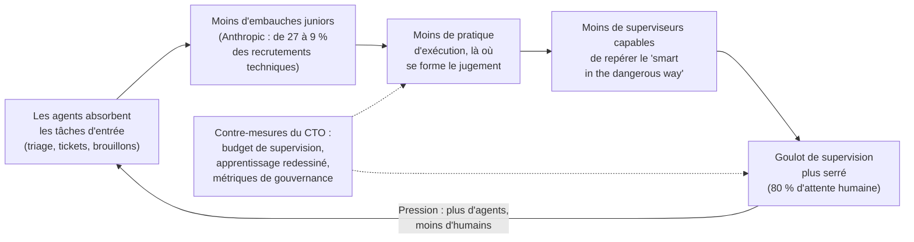
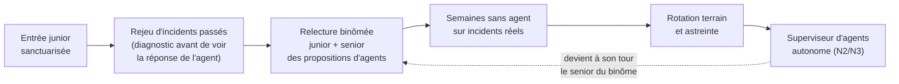

## La porte d'entrée rétrécit

Début 2025, chez Anthropic, plus d'un recrutement technique sur quatre concernait un profil junior. Dans le dernier relevé publié par l'entreprise, c'est moins d'un sur dix. Le rapport ne décrit aucun plan de départs : l'effectif a triplé en un an. Ce n'est pas la maison qui se vide, c'est la porte d'entrée qui rétrécit.

Le chiffre sort d'un document peu banal. Le 16 octobre, l'Anthropic Institute a publié « How employment is changing at Anthropic », une étude où le fabricant de Claude mesure ce que ses propres agents font à ses propres équipes. Une phrase mérite d'être épinglée au-dessus de chaque bureau de DSI : l'accélération fait de l'attention humaine le goulot d'étranglement de la production des agents.

Posez les deux constats côte à côte. La ressource rare devient la capacité à superviser. Et l'échelon où l'on apprenait à superviser, en faisant soi-même, se réduit. Pour un opérateur qui fait tourner un centre de supervision réseau et un support client pour des milliers de sites en hôtellerie, en retail ou en résidences étudiantes, la tentation est évidente : les agents avalent le premier niveau, on recrute moins de débutants, on « libère » du budget.

Je pense que ce calcul est faux. Pas moralement : comptablement. Il scie la branche sur laquelle devaient pousser les superviseurs de 2030. Le 5 octobre, dans « Plus vite qu'on ne relit », je parlais ici de la vérification des sorties d'agents. Cette fois, je parle des humains qui vérifient : d'où ils viennent, et qui les forme.

## Ce que disent vraiment les chiffres sur les juniors

Les nombres d'abord, avec leur périmètre exact. Dans les départements techniques d'Anthropic, la part des juniors passe de 21 % à 14 % depuis début 2025. Dans les recrutements techniques, elle tombe de 27 % à 9 %. Les offres d'emploi junior chutent nettement à partir de décembre 2025 [1].

Premier contresens à éviter : une part qui baisse n'est pas un effectif qui fond. L'entreprise a triplé de taille en un an. Les départements techniques passent de 61 % à 56 % de l'effectif total, et l'embauche technique continue de croître en valeur absolue, simplement moins vite que celle des ventes, de la finance ou du recrutement. Le nombre de juniors n'apparaît pas dans les passages que j'ai lus. La définition précise de « junior » (les bandes de niveau internes) n'y est pas détaillée non plus.

Ce qui est explicite, en revanche, c'est la décision. La discussion sur une moindre demande en juniors techniques démarre en janvier 2026. En avril, les équipes d'ingénierie et de recherche dé-priorisent les postes des bandes d'entrée (« lower band »). Une majorité de managers disent chercher un autre profil de compétences à cause de l'IA. Environ un tiers des managers en apprentissage automatique (ML, machine learning) et un cinquième des managers en ingénierie logicielle déclarent embaucher moins [1].

Le profil recherché, lui aussi, bouge. Dans les fiches d'entretien, la mention d'un usage créatif des outils d'IA est multipliée par trois environ côté technique et par quatre côté non technique entre 2024 et 2026. Les plus fortes hausses concernent « autonomie et jugement ». La place de l'expertise métier recule dans l'évaluation. Gardez ce détail en tête. Il contient tout le problème.

Anthropic n'est pas un cas isolé, et deux travaux académiques donnent la toile de fond. Hosseini et Lichtinger, à Harvard (version du 6 mai 2026), s'appuient sur les données d'environ 65 millions de salariés dans plus de 280 000 entreprises entre 2015 et 2025 [5]. Après adoption de l'IA générative, l'emploi junior baisse nettement chez les adoptants par rapport aux autres, tandis que l'emploi senior reste globalement stable. Surtout, la baisse vient d'un ralentissement des embauches, pas de départs. On n'embauche plus ; on ne licencie pas. C'est exactement la signature d'Anthropic, où la part des juniors chute bien plus vite dans les recrutements (de 27 à 9 %) que dans l'effectif (de 21 à 14 %).

Côté marché du travail américain, l'équipe d'Erik Brynjolfsson à Stanford (révision du 12 août 2026, sur les données de paie du prestataire ADP jusqu'en juin 2026) observe que l'emploi des 22-25 ans dans les métiers les plus exposés à l'IA se situe 19 % sous la tendance de pairs moins exposés [4]. Aucun écart comparable chez les plus expérimentés. Les auteurs restent prudents, et ils ont raison. Ils parlent d'indicateurs « early, descriptive ». L'effet s'atténue quand on contrôle le niveau d'études, certaines tendances précèdent l'IA générative, et rien n'indique un déplacement généralisé de l'emploi. Le déclin se concentre là où l'IA se substitue au travail plutôt qu'elle ne le complète.

Donc, pas de « fin des juniors ». Plutôt une entrée qui se resserre exactement là où la tâche d'entrée est substituable. Dans un centre de supervision réseau, cela décrit assez fidèlement le premier niveau de support.

*Avant, après : une pyramide large de profils débutants d'un côté, une fine couche humaine posée sur un maillage dense d'agents de l'autre.*

## Six fois plus d'heures d'agents, un seul guichet de péage

Imaginez six voies d'autoroute qui convergent vers un unique guichet de péage. Les voitures roulent vite, et c'est précisément pour cela que tout le monde finit par attendre au même endroit. Ajouter des voies n'y change rien. Seul le guichet compte.

C'est, en substance, le second constat du rapport. Il repose sur deux mesures distinctes qu'il ne faut surtout pas fusionner. La première : en mars 2026, en additionnant agents autonomes et agents interactifs, les heures de travail d'agents dépassent pour la première fois les heures humaines de l'entreprise. La seconde, plus étroite : en août, dans les seules sessions interactives pilotées par un employé, les agents cumulent six fois plus d'heures que leurs « handlers » humains [1].

La méthode compte autant que le chiffre. Les heures d'agents correspondent au temps d'exécution (inférence et appels d'outils), hors périodes d'attente de plus de 30 minutes, avec les sous-agents agrégés. Les heures humaines, elles, sont une hypothèse : l'effectif multiplié par 40 heures par semaine. Le ratio de 6 pour 1 mesure donc du parallélisme autant que de la charge. Ce n'est ni un taux d'automatisation, ni un gain de productivité. C'est encore moins « six agents par employé », comme l'a lu de travers au moins un agrégateur de presse [9].

Le chiffre qui m'intéresse le plus est ailleurs. Environ 80 % du temps des sessions interactives est passé à attendre une intervention humaine. Ce n'est pas contradictoire avec le 6x, c'est son revers : les agents accumulent des heures en parallèle, puis font la queue au guichet. Les auteurs l'écrivent sans détour : « This acceleration makes human attention the bottleneck for agent output ». Pour les équipes non techniques, lire l'intégralité de ce que produisent leurs sessions interactives prendrait plus de la moitié de la semaine de travail (sur la base de 0,75 mot par token et de 250 mots lus par minute).

Le travail humain change de nature en conséquence. Le « méta-travail » passe de 10 % des sessions interactives de l'employé moyen à l'automne 2025 à 22 % au printemps 2026. Derrière ce mot : rédiger des spécifications pour des exécutions multi-agents, faire relire un agent par un autre, surveiller des chaînes de traitement, construire des tableaux de bord. Les instructions permanentes recensées passent de quelques centaines en juillet 2025 à 8 500 un an plus tard. Le temps de réunion augmente de 20 % pour l'employé médian (16 % pour les contributeurs techniques). Et 20 % des répondants à l'enquête interne d'avril 2026 décrivent un rôle qui bascule du « faire » vers le « manager des Claudes ».

Côté qualité, le rapport est plutôt rassurant, avec une réserve de taille. Les commits par ingénieur sont multipliés par cinq environ en six mois. Une comparaison entre 192 ingénieurs adoptants et 74 non-adoptants, à même auteur, même mois et même dépôt de code, ne montre pas de différence de taux de lignes supprimées ou annulées entre code d'agent et code humain. Mais les auteurs ajoutent eux-mêmes que « AI errors may be harder to identify than human ones ». Autrement dit, l'erreur d'agent n'est pas forcément plus fréquente. Elle est peut-être plus difficile à voir. Et un commit mesure du volume, pas de l'impact.

Il faut enfin lire ce rapport pour ce qu'il est : une auto-étude. Anthropic mesure l'effet de son produit sur ses salariés, confie à un modèle le codage du méta-travail (un échantillon de 2 000 résumés d'une ligne) et des fiches d'entretien, et s'appuie sur 17 entretiens seulement [8]. La causalité n'est pas établie : les adoptants d'agents autonomes étaient déjà sur une trajectoire ascendante, et l'entreprise est en hypercroissance. Les commentaires sérieux, comme celui de FourWeekMBA [7], rappellent d'ailleurs ces réserves de portée.

Sur le fond, pourtant, l'ordre de grandeur suffit. L'économie d'exécution se paie en heures de supervision.

*Quand l'agent attend l'humain 80 % du temps, la ressource rare n'est plus le calcul : c'est l'attention de celui qui relit.*

## Le paradoxe du superviseur : on ne juge bien que ce qu'on a su faire

Pensez à une brigade de cuisine. Le commis épluche, taille, monte des fonds pendant des années. Ce n'est pas de la main-d'œuvre bon marché qu'on tolère faute de mieux : c'est l'école où se forme le palais du futur chef. Le jour où une machine épluche plus vite que lui, la tentation est de ne plus embaucher de commis. Dans dix ans, la cuisine tournera toujours. Mais plus personne ne saura goûter une sauce et dire pourquoi elle est ratée.

Anthropic avait documenté ce mécanisme bien avant le rapport d'octobre. Dans une étude interne publiée le 2 décembre 2025 (enquête auprès de 132 ingénieurs et chercheurs en août 2025, complétée par 53 entretiens), l'entreprise décrit un paradoxe de la supervision : superviser Claude exige précisément les compétences de code que son usage intensif peut éroder [2]. La plupart des répondants disent ne pouvoir déléguer entièrement que 0 à 20 % de leur travail. Un ingénieur estime qu'environ 70 % de son activité est devenue de la relecture et de la révision du code produit par Claude. Un ingénieur sécurité évoque une solution « really smart in the dangerous way », brillante et dangereuse à la fois, que seul quelqu'un d'expérimenté repère.

Une seconde étude, publiée le 16 juin 2026, enfonce le clou [3]. Elle porte sur environ 400 000 sessions Claude Code interactives, menées par quelque 235 000 personnes entre octobre 2025 et avril 2026. Les humains y prennent environ 70 % des décisions de planification, Claude environ 80 % des décisions d'exécution. Les sessions d'experts produisent environ 12 actions et 3 200 mots par requête, contre 5 actions et 600 mots pour les novices.

Relisez cette dernière phrase. L'expertise ne réduit pas le volume à superviser : elle l'augmente. Les novices abandonnent plus souvent (19 % contre 5 à 7 %), et le taux de succès vérifié passe de 15 % chez eux à 28-33 % dès le niveau intermédiaire. Nuance importante : l'étude mesure l'expertise sur la tâche, pas l'ancienneté.

Mettez maintenant les trois documents bout à bout. Les recruteurs d'Anthropic valorisent davantage « autonomie et jugement » que l'expertise métier [1]. Ses ingénieurs expliquent que superviser exige des compétences techniques qui s'érodent [2]. Ses chercheurs observent que la compréhension du domaine pèse lourd et que les experts génèrent plus de matière à relire [3]. Aucun de ces textes ne dit comment se fabrique le jugement quand on ne passe plus par l'exécution. C'est une question ouverte, pas un résultat. Mais c'est la question.

Les auteurs du rapport le reconnaissent d'ailleurs à leur manière. Leurs mesures d'atténuation (alerte précoce, réaffectation interne), écrivent-ils, « none directly address the slowdown in junior hires » : protéger les salariés en place ne profite pas à ceux qui n'ont jamais été embauchés. Ils ajoutent que beaucoup de pratiques d'Anthropic, à commencer par un actionnariat salarié large, « cannot be replicated across the economy ».

Voici la boucle telle que je la lis. C'est une hypothèse d'auteur, pas un mécanisme démontré par le rapport.

*Lecture de l'auteur : une boucle plausible entre automatisation de l'entrée et pénurie de superviseurs, non démontrée par le rapport.*

## Ma lecture côté réseau : trois chantiers pour le CTO

Une précaution avant d'aller plus loin. Anthropic n'est pas un opérateur réseau. Le code y domine le mix de tâches, l'actionnariat salarié y est large, et aucune donnée du rapport ne porte sur un centre de supervision réseau ou un support client. Ce qui suit est ma lecture d'opérateur B2B, pas un résultat du rapport.

Dans un NOC (Network Operations Center, le centre de supervision réseau), le support s'organise souvent en trois niveaux. Le premier, le N1, trie les alertes, ouvre les tickets, rédige les premiers diagnostics. Le N2 creuse, le N3 conçoit et arbitre. Les agents avalent d'abord le N1 : c'est la partie la plus répétitive, la plus documentée, la plus facile à évaluer.

La question devient alors très concrète. D'où viendront les N3 capables de sentir qu'une modification RADIUS (le protocole qui authentifie les utilisateurs sur le réseau) ou un réglage radio poussé sur tout un parc hôtelier est « malin mais dangereux » ? Ce flair ne s'apprend pas dans un manuel. Il s'acquiert en ayant cassé, puis réparé, des configurations à 3 heures du matin.

### Budgéter la supervision comme une ligne de charge

Le rapport fournit des ordres de grandeur, pas des benchmarks : 22 % des sessions en méta-travail, une lecture exhaustive qui dépasserait le mi-temps pour les équipes non techniques, 20 % de réunions en plus. Le message, lui, se transpose. Une économie d'exécution se paie en heures de supervision, et ces heures ont un coût salarial.

Concrètement, j'exigerais de tout fournisseur d'« agent NOC » ou d'« agent support » un coût de supervision par tâche, pas seulement un coût d'inférence. Combien de minutes humaines pour valider une recommandation de changement ? Qui les passe, et à quel niveau d'expérience ? C'est la suite logique de nos articles sur le FinOps de l'IA (la discipline de pilotage des coûts) : la facture de tokens n'est que la partie émergée.

### Redessiner l'échelon d'apprentissage, pas le supprimer

Moins de juniors, peut-être. Zéro junior, non. L'enjeu n'est pas de préserver le N1 tel qu'il existait, mais de garder une porte d'entrée dont la fonction première devient la formation du jugement. Plusieurs leviers, à combiner :

- **Une entrée junior garantie**, moins nombreuse mais sanctuarisée dans le plan de recrutement, indépendamment des gains attendus des agents.
- **Des juniors relecteurs, binômés avec un senior** : ils valident à deux les propositions d'agents, et le senior explique à voix haute pourquoi il en refuse certaines.
- **Des « semaines sans agent »** sur de vrais incidents, pour que la main reste capable de faire ce que l'œil doit juger.
- **Une rotation terrain et astreinte**, parce qu'une borne Wi-Fi qui tombe dans un hall d'hôtel s'apprend aussi au pied de la baie de brassage.
- **Un onboarding par rejeu d'incidents passés**, où le nouvel arrivant pose son diagnostic avant de voir ce qu'ont proposé l'agent et l'équipe.

*Un parcours d'apprentissage redessiné : l'exécution manuelle ne disparaît pas, elle devient l'outil de formation du jugement.*

*Le binôme senior-junior devant un diff de configuration : c'est là, et pas dans un tableau de bord, que se transmet le flair du « malin mais dangereux ».*

### Piloter avec des métriques de gouvernance humaine

Le débit (tickets clos, temps de résolution) ne dit rien de la santé du vivier. Le rapport d'Anthropic suggère, en creux, d'autres compteurs. Voici ceux que je mettrais sur un tableau de bord de direction :

- le ratio heures d'agents / heures humaines, par équipe, en gardant en tête qu'il mesure du parallélisme ;
- la part du temps humain consacrée au méta-travail (spécifier, relire, surveiller) ;
- le temps pendant lequel les agents attendent un humain ;
- le volume de sortie à lire par personne et par semaine ;
- la part des juniors, à la fois dans l'effectif et dans les recrutements ;
- le délai pour qu'un nouvel arrivant devienne autonome sur un incident ;
- la part des changements relus par quelqu'un capable de faire la même opération à la main.

Le rapport décrit aussi un dispositif d'alerte précoce par rôle, directement réutilisable : suivre, métier par métier, la demande, la productivité et l'usage des agents, pour réaffecter avant de subir. Je n'ai pas de chiffres Wifirst à publier ici et je n'en inventerai pas. Mais c'est le tableau que je veux voir avant de valider un plan d'effectifs.

Reste la gouvernance au sens réglementaire. L'article 14 de l'AI Act, le règlement européen sur l'IA, impose aux systèmes à haut risque une conception permettant une surveillance humaine effective [6]. Son paragraphe 4 fournit une bonne grille : rester conscient du biais d'automatisation (point b), pouvoir ne pas utiliser, écarter ou inverser une sortie (point d), pouvoir arrêter le système (point e). Depuis l'omnibus numérique, entré en vigueur fin juillet 2026, les obligations des systèmes à haut risque s'appliquent au 2 décembre 2027 pour l'annexe III et au 2 août 2028 pour l'annexe I.

Un agent de NOC n'est probablement pas « à haut risque » au sens du règlement. Je prends donc l'article 14 comme une grille de bonnes pratiques, pas comme une obligation. Elle pointe exactement notre sujet : le biais d'automatisation frappe d'abord ceux qui n'ont jamais fait la tâche eux-mêmes. Pour le reste (garde-fou placé hors de l'agent, coupe-circuit, journal d'audit hors de l'hôte), je renvoie à nos articles précédents sur les agents.

## Ce que je tranche

Commençons par ce qu'il ne faut pas conclure. Les juniors ne sont pas finis : Stanford ne voit pas de déplacement généralisé de l'emploi, et Anthropic a triplé d'effectif. Les ratios d'un éditeur de modèles ne s'extrapolent pas à un opérateur réseau. Et le 6x n'est pas un chiffre de productivité.

Une chose, en revanche, me paraît solide. Le coût réel d'un agent n'est pas sa facture d'inférence. C'est l'attention qualifiée qu'il consomme. Cette attention ne s'achète pas sur étagère : elle se produit, lentement, dans l'échelon d'entrée.

Un opérateur qui supprime cet échelon pour financer ses agents ne fait pas une économie. Il contracte une dette de compétences à taux variable, remboursable au pire moment. Ce sera la nuit de l'incident que l'agent n'a jamais vu, face à une équipe dont plus personne n'a appris à le diagnostiquer à la main.

Ma position est donc simple. Budgétez la supervision comme une ligne à part entière. Redessinez l'apprentissage au lieu de le rayer du plan. Pilotez vos équipes avec des métriques qui mesurent le vivier, pas seulement le débit.

Anthropic a eu le mérite de mesurer et de publier, y compris ce qui ne l'arrange pas. Il revient aux autres de faire ce que le rapport ne peut pas faire pour eux : continuer à former les commis qui deviendront les chefs.

_Vues personnelles, pas position Wifirst._

## Sources

1. Anthropic Institute (Wilmers, Catipon, Massenkoff, McCrory), « How employment is changing at Anthropic », 16 octobre 2026 — https://www.anthropic.com/research/employment-at-anthropic (PDF : https://www-cdn.anthropic.com/72628f1863c53432195db83279252dfd2cb53158/Employment%20at%20Anthropic.pdf)
2. Anthropic (Huang et al.), « How AI is transforming work at Anthropic », 2 décembre 2025 — https://www.anthropic.com/research/how-ai-is-transforming-work-at-anthropic
3. Anthropic (Hitzig, Massenkoff et al.), « Agentic coding and persistent returns to expertise », 16 juin 2026 — https://www.anthropic.com/research/claude-code-expertise
4. Stanford Digital Economy Lab (Brynjolfsson, Chandar, Chen), « Canaries in the Coal Mine? », révision du 12 août 2026 — https://digitaleconomy.stanford.edu/publication/canaries-in-the-coal-mine/
5. Hosseini et Lichtinger (Harvard), « Generative AI as Seniority-Biased Technological Change », version du 6 mai 2026 — https://papers.ssrn.com/sol3/papers.cfm?abstract_id=5425555 (PDF : https://raw.githack.com/s-mahdihosseini/Website/b99fa2962dcc4c165bbc3c41dd283afa99c5ccfb/GenAI_SenBTC_May_2026.pdf)
6. AI Act, article 14 « Human oversight » — https://artificialintelligenceact.eu/article/14/ (texte officiel consolidé, règlement 2024/1689 : https://eur-lex.europa.eu/legal-content/EN/TXT/?uri=CELEX%3A02024R1689-20260727)
7. FourWeekMBA (G. Cuofano), « Anthropic's Junior Tech Hires Fell to 9% as Agents Hit 6x », 17 octobre 2026 — https://fourweekmba.com/ai-anthropics-junior-tech-hires-fell-to-9-as-agents-hit-6x/
8. ai-tldr.dev, « How employment is changing at Anthropic », 16 octobre 2026 — https://ai-tldr.dev/releases/anthropic-employment-at-anthropic/
9. Blockchain.News (T. Dicki), 16 octobre 2026, cité comme exemple de lecture erronée du ratio 6x — https://blockchain.news/news/anthropic-ai-agents-outwork-employees-hiring-shifts
