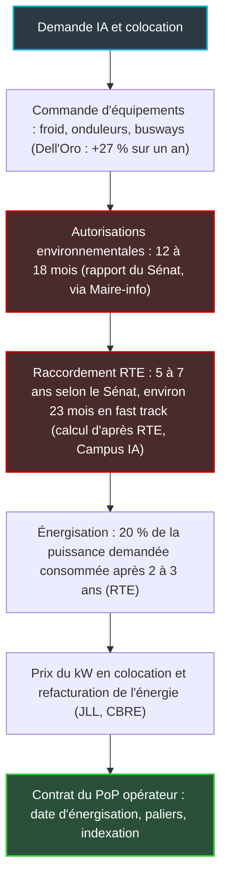

## Quatorze milliards de dollars, et un guichet qui ne suit pas

Quatorze milliards de dollars en trois mois. C'est ce que les fabricants de climatisation industrielle, d'onduleurs et de distribution électrique ont facturé aux data centers du monde entier entre avril et juin 2026, en hausse de 27 % sur un an, selon le cabinet d'analyse Dell'Oro Group [1]. Un chiffre fait pour rassurer. Il ne rassure pas celui qui le publie.

Dans le même communiqué, daté du 14 octobre, le directeur de recherche de Dell'Oro écrit que le frein le plus sérieux du marché à court terme n'est pas la demande. C'est l'autorisation : le droit de construire, et le droit de se brancher au réseau électrique.

L'affaire ne concerne pas que les géants du cloud. Tous ceux qui louent des mètres carrés et des kilowatts en data center paient au bout de la chaîne le prix et la date de livraison de cette électricité : opérateurs réseau, DSI qui pilotent des centaines de sites, intégrateurs qui hébergent le cœur de réseau d'une chaîne d'hôtels ou d'une enseigne. En France, les projets de data centers ont déjà réservé environ 18 gigawatts auprès de RTE, le gestionnaire du réseau de transport d'électricité [6].

Ma thèse tient en deux phrases. L'équipement n'est plus le problème. Le kilowatt raccordé, si, et cela change la façon dont un opérateur doit négocier ses points de présence.

## Ce que mesure vraiment le chiffre de Dell'Oro

Dell'Oro appelle ce marché le DCPI, pour *data center physical infrastructure*. Comprenez : tout ce qui n'est ni un serveur ni un switch, mais sans quoi aucun serveur ne tourne. Le froid, l'alimentation secourue, la distribution électrique jusqu'à la baie.

Le poste qui tire tout, c'est le thermique. La gestion thermique croît de plus de 40 % sur un an et atteint sa part la plus élevée du DCPI [1]. À l'intérieur, deux sous-segments vont encore plus vite. D'abord le refroidissement liquide, emmené par le DLC (*direct liquid cooling*, l'eau amenée jusqu'à une plaque froide posée sur la puce). Ensuite le rejet de chaleur, c'est-à-dire les groupes froids qui évacuent les calories vers l'extérieur. Difficile de ne pas y lire la signature des salles dédiées à l'IA.

L'alimentation suit. Les onduleurs, ces batteries tampons qui tiennent la charge pendant une coupure, progressent d'environ 20 %, surtout sur les gros systèmes triphasés. Les salles IA se standardisent sur des blocs de puissance de classe mégawatt, et les constructeurs basculent vers la moyenne tension tout en préparant la distribution en 800 volts continu [1][4].

Nouveauté du trimestre : Dell'Oro découpe pour la première fois ses clients en cinq familles. Les « autres clouds » (neoclouds loueurs de capacité GPU, développeurs de modèles d'IA) croissent le plus vite. La colocation reste le premier client. L'entreprise perd des parts.

Côté géographie, l'EMEA (Europe, Moyen-Orient, Afrique) signe sa plus forte croissance depuis 2021, portée par la colocation européenne et les projets d'IA souveraine. L'Amérique du Nord reste la première région [1][4].

### Le piège de la comparaison

Un avertissement, avant que ce chiffre ne finisse dans un support de comité de direction. En septembre 2025, le communiqué équivalent annonçait 8,9 Md USD pour le deuxième trimestre 2025 [5]. Or 14 divisé par 1,27 donne une base d'environ 11 Md USD pour ce même trimestre. Deux milliards d'écart.

Ce n'est pas une erreur. Ma lecture : Dell'Oro a retraité sa base en élargissant son périmètre. Au premier trimestre 2026, l'élargissement de la catégorie « rejet de chaleur » ajoutait à lui seul environ 1 Md USD au marché mesuré [2]. La seule croissance défendable est donc +27 %, à périmètre retraité par Dell'Oro. Toute autre arithmétique fabrique une hausse qui n'existe pas.

Dernier détail. Le premier trimestre affichait +28 % à 12 Md USD [2]. Le léger tassement du deuxième tient, selon Dell'Oro, à une base de comparaison plus exigeante, pas à une demande plus molle [1].

*Transformateur, cellules moyenne tension, onduleurs, jeux de barres, boucles d'eau : c'est cette chaîne d'alimentation et de froid que mesure le DCPI, pas les serveurs.*

## Le goulot a changé de place

Pensez à un aéroport saturé. Les compagnies peuvent commander autant d'avions qu'elles le souhaitent : les avionneurs livreront, parfois en retard, mais ils livreront. Ce qui ne s'achète pas chez le constructeur, c'est le créneau de décollage. Il est attribué par une autorité, selon une file d'attente, et il se réserve des années à l'avance.

Le data center de 2026 en est exactement là. Les avions, ce sont les équipements que compte Dell'Oro. Le créneau, c'est le permis et le raccordement électrique.

Alex Cordovil, directeur de recherche chez Dell'Oro, ne dit pas autre chose. Parmi les questions qui entourent le marché, écrit-il, « the quieter and more consequential one is whether it will be permitted » : la plus discrète et la plus lourde de conséquences est de savoir s'il sera autorisé. Puis il tranche : « We now regard siting and permitting as the most serious near-term brake on the market » [1]. Le choix des sites et les autorisations sont désormais, pour le cabinet, le premier frein à court terme. Les plans de dépenses des hyperscalers, ajoute-t-il en substance, ne laissent guère de doute sur la demande ; c'est le calendrier des permis et des raccordements qui devient difficile à prévoir.

Même côté matériel, un poste échappe à la logique de la demande. Sur les busways, ces gaines électriques préfabriquées qui distribuent le courant au-dessus des rangées de baies, Dell'Oro écrit que c'est l'offre, et non la demande, qui constitue la contrainte : « supply, not demand, the binding constraint » [1].

Les exemples cités dans le communiqué sont américains, et parlants. En juillet, New York a adopté le premier moratoire sur les data centers à l'échelle d'un État. En août, la Pennsylvanie les a retirés de sa procédure accélérée. Le Texas a ordonné un audit des projets en attente chez l'ERCOT, le gestionnaire du réseau électrique texan, ce qui retarde le premier lot d'études de grandes charges [1][4]. Le sous-titre choisi par Dell'Oro résume l'état d'esprit : « Delays, Not Cancellations ». Des retards, pas des annulations.

### L'Europe accélère, et se fait raboter

Le communiqué d'octobre montre une EMEA en pleine accélération. Il faut pourtant le lire avec celui d'août. Dell'Oro y projetait un DCPI mondial à 120 Md USD en 2030, soit une croissance annuelle moyenne de 22 % entre 2025 et 2030 [3]. Et glissait une phrase qui aurait mérité plus d'écho : l'EMEA est la seule région revue à la baisse par rapport à la prévision de janvier. En cause : une disponibilité électrique plus lente, des autorisations plus dures à obtenir, et une opposition locale qui bloque ou retarde une part significative des projets annoncés.

Les deux constats ne se contredisent pas. Le chiffre d'affaires constaté accélère ; la trajectoire future est rabotée. Ma lecture : en Europe, le plafond n'est pas fixé par les carnets de commandes. Il est fixé par le réseau.

## En France, le permis s'appelle raccordement

Plaquer le cas américain sur la France serait un contresens. Pas de moratoire d'État ici. La contrainte équivalente se loge dans deux endroits moins spectaculaires : la file d'attente de RTE et les délais d'autorisation.

*De la commande d'équipement au kW livré : les deux maillons en rouge sont ceux qu'aucun fournisseur ne peut vendre.*

Les chiffres de RTE donnent le vertige. En mai 2026, environ 80 projets de data centers avaient réservé quelque 18 GW de capacité sur le réseau de transport, contre environ 5 GW pour une quarantaine de projets fin 2024 [6]. Environ 7 GW en Île-de-France, environ 6 GW dans les Hauts-de-France. La plupart des projets demandent entre 100 et 200 MW ; une dizaine dépassent 400 MW.

Mettez cela en regard de la consommation réelle. Les quelque 300 data centers français consomment environ 10 TWh par an, soit environ 2 % de l'électricité du pays. RTE projette 15 à 20 TWh en 2030, puis 23 à 28 TWh en 2035 [6]. Faites la division : 10 TWh sur une année, c'est une puissance moyenne d'à peine plus de 1 GW. Face à 18 GW réservés.

RTE fournit lui-même une partie de l'explication. Les data centers raccordés depuis deux à trois ans ne consomment en moyenne que 20 % de la puissance demandée, et leurs exploitants comptent dix à quinze ans pour atteindre environ 80 % [6]. Des professionnels contestent ce ratio pour les sites d'entraînement d'IA [12]. Mais l'enseignement général tient, et c'est mon interprétation : tout le monde sur-réserve, parce qu'un kW rendu ne se récupère pas.

Le mouvement ne faiblit pas. Au premier semestre 2026, les data centers ont contractualisé 3,8 GW d'accès au réseau de transport, plus de 85 % de la puissance demandée sur la période [7]. Leur consommation effective progresse de plus de 30 % sur un an, soit 0,1 TWh de plus, un volume que RTE qualifie de modéré en valeur absolue. Les contrats se signent bien plus vite que les compteurs ne tournent.

### Les règles de la file changent

Dans sa délibération du 4 février 2026 sur la procédure de raccordement de RTE, la CRE (Commission de régulation de l'énergie) rappelle qu'une demande n'entre en file, et ne réserve de capacité, qu'à l'acceptation de la proposition technique et financière de RTE [9]. Il faut alors un justificatif d'avancement du projet ou 1 000 EUR par MW demandé, une preuve de maîtrise foncière et un premier acompte. Pour rester dans la file : nouveau justificatif ou 1 000 EUR/MW chaque année, au plus deux fois.

Le principe reste « premier arrivé, premier servi ». Mais la CRE soutient la bascule vers « premier prêt, premier servi », mise en consultation par RTE entre janvier et mars 2026. Elle a demandé à RTE de la saisir, au plus tard le 1er octobre 2026, d'une première évolution intégrant la maturité des projets. Dans notre aéroport, le créneau n'irait plus à celui qui a appelé le premier, mais à celui dont l'avion est déjà sur le tarmac. Reste à vérifier que l'échéance a été tenue, et à lire la copie.

Le calendrier administratif n'aide pas. Selon le compte rendu de Maire-info, le rapport des sénateurs Chevrollier, Michallet et Uzenat chiffre à 12 à 18 mois les autorisations environnementales et à 5 à 7 ans le raccordement électrique [10]. D'autres comptes rendus avancent des délais d'autorisation plus longs [11]. Le rapport recommande lui aussi le « premier prêt, premier servi » et un audit de la procédure d'implantation.

À l'autre extrémité, la voie rapide. Le premier contrat « fast track » de RTE, signé le 26 janvier 2026 avec Campus IA à Fouju (Seine-et-Marne), prévoit 240 MW d'ici fin 2027, puis 700 MW avant fin 2029, extensibles à 1 400 MW [8]. Cinq sites relèvent de ce dispositif, deux en Île-de-France et trois dans les Hauts-de-France ; quatre ont été attribués lors de Choose France 2026 [6]. Mon calcul : environ 23 mois pour 240 MW, contre 5 à 7 ans selon le Sénat. RTE précise que ces contrats reposent sur un engagement financier amont plus fort, donc une meilleure probabilité de concrétisation [7].

L'argent, lui, est sur la table : selon Trendeo, 88,3 Md EUR d'investissements dans les data centers ont été annoncés en France au premier semestre 2026 [11]. Mais Iliad, toujours selon Trendeo, compte deux ans à deux ans et demi avant même de lancer la construction de ses sites.

> **Transport ou distribution : ne pas confondre.** RTE gère le réseau de transport, la haute tension qui alimente les très gros consommateurs. Un hôtel, un magasin ou une résidence étudiante se raccorde au réseau de distribution, géré par Enedis sur la majeure partie du territoire. La file RTE concerne des data centers de dizaines ou de centaines de mégawatts. Ce n'est pas elle qui conditionne le raccordement de vos sites clients.

*Île-de-France et Hauts-de-France concentrent à elles deux environ 13 des 18 GW réservés chez RTE par des projets de data centers.*

## Pour un opérateur réseau, le risque se paie au kW

Changement de registre : ce qui suit est mon analyse d'opérateur, pas un constat d'analyste.

Un point de présence (PoP), le local où un opérateur concentre ses équipements d'agrégation et ses interconnexions, consomme quelques kilowatts. Face aux 18 GW de la file RTE, c'est invisible. Personne ne nous fera attendre cinq ans pour alimenter deux baies. L'exposition existe pourtant. Elle est indirecte, et elle passe par trois canaux.

**Premier canal : le prix du kW.** JLL publie des loyers moyens de colocation sur les marchés FLAP-D (Francfort, Londres, Amsterdam, Paris, Dublin) : 177 EUR par kW et par mois pour 500 kW, 147 EUR entre 1 et 5 MW, 123 EUR au-delà de 5 MW [14]. Surtout, le cabinet note que les loyers wholesale ont reculé de 2 à 3 % depuis leurs pics de 2025, alors que, selon lui, les loyers sub-MW « continuent de progresser ». Le sub-MW, c'est précisément la taille d'un opérateur comme le nôtre. Le gros client négocie ; le petit absorbe.

Ajoutez l'énergie. Selon Datacentres.com, elle pèserait 55 à 65 % des coûts opérationnels des grands acteurs de la colocation des FLAP-D, dont plusieurs basculent vers une refacturation directe de l'électricité à leurs locataires [15]. Source agrégatrice, donc simple ordre de grandeur. Mais la direction est claire : le risque de prix de l'énergie glisse de l'hébergeur vers le client.

**Deuxième canal : la date de disponibilité.** Une nouvelle région cloud, un point d'échange internet qui s'étend, un site edge qui ouvre : tout dépend de kW livrés à temps. Or les hubs saturent. Selon CBRE, relayé par W.Media, la vacance des FLAP-D était de 7,3 % au premier trimestre 2026 et de 6,7 % à Paris ; à Francfort, les renforcements du réseau en zone centrale ne sont pas attendus avant les années 2030 ; Amsterdam applique un moratoire au-delà de 70 MW [13].

JLL, de son côté, mesure une vacance FLAP-D de 5,4 % et des délais de raccordement supérieurs à 24 mois dans les grands hubs [14]. Les deux cabinets ne comptent pas de la même façon. Retenez la tendance, pas la décimale.

La géographie suit. Toujours selon JLL, les campus hyperscale s'installent désormais à environ 175 km des villes, contre 46 km auparavant [14]. DC Byte, cité par Datacentres.com, voit les capacités planifiées sur les FLAP-D reculer de 18 % sur un an au premier semestre [15]. Pour un opérateur, cela pousse vers un arbitrage précis : un PoP local léger et bien interconnecté, plutôt qu'un gros PoP en zone tendue.

**Troisième canal : les délais d'équipement.** Les petits onduleurs d'un PoP ne sortent pas des mêmes lignes que les blocs mégawatt d'une salle IA. Mais quand votre hébergeur équipe une nouvelle salle, il achète busways, tableaux et systèmes de froid sur un marché où, pour les busways au moins, Dell'Oro voit l'offre comme le facteur limitant. Son calendrier, donc le vôtre, en dépend.

*À l'échelle d'un opérateur, l'enjeu n'est pas le mégawatt : c'est le kW réellement livré, sur deux chemins d'alimentation distincts, à une date tenue.*

## Six clauses à poser sur la table

Si je devais renégocier demain l'hébergement d'un PoP dans un hub tendu, voici les six clauses que je poserais sur la table. Aucune n'est exotique. Toutes étaient, il y a quelques années, reléguées dans les conditions générales.

1. **kW engagés contre kW consommés.** RTE observe que les data centers n'appellent que 20 % de la puissance demandée après deux à trois ans. Votre hébergeur connaît ce phénomène mieux que vous. Négociez une part fixe sur l'engagé et une part variable sur le consommé mesuré.
2. **Une montée en charge par paliers datés.** Réserver d'emblée la puissance de la cinquième année, c'est financer la file d'attente des autres. Des paliers avec option d'extension valent mieux qu'un gros engagement initial.
3. **Une date d'énergisation contractuelle, assortie de pénalités.** Sur une salle neuve, la date de livraison des kW est la vraie date de mise en service. Elle doit peser au contrat autant qu'une date de livraison de fibre.
4. **Une indexation de l'énergie bornée et lisible.** Si l'hébergeur refacture l'électricité, exigez la formule, l'indice de référence, le PUE appliqué (le coefficient qui rapporte la consommation totale du site à celle des équipements informatiques) et, idéalement, un tunnel de prix.
5. **Le droit de relâcher des kW.** Un réseau évolue ; un PoP se consolide ou se déplace. Sans clause de réduction, vous payez pour toujours la puissance d'un plan d'affaires obsolète.
6. **Une redondance A/B réellement alimentée par deux chemins.** Deux arrivées de couleurs différentes qui remontent au même tableau ne font pas une redondance. Demandez le schéma électrique de bout en bout.

Un principe de planification, ensuite. Si les plus gros projets du pays, avec un engagement financier lourd, comptent leurs délais de raccordement en années, un opérateur qui veut ouvrir un PoP dans douze mois dans un hub tendu doit viser de la capacité déjà énergisée. Pas une salle en projet.

Et un principe de conception : des PoP sobres. Faible densité, refroidissement par air, alimentation redondante simple, consommation supervisée en continu. Un PoP sobre se déplace ; un PoP gourmand s'installe pour dix ans.

## Le kilowatt est devenu un contrat de transit

Pendant vingt ans, un opérateur réseau a négocié son transit IP, ses ports d'interconnexion et ses fibres avec un soin d'orfèvre. L'électricité, elle, était un dû, noyée dans le prix de la baie. Cette époque est terminée. Le kW se réserve, se date, s'indexe et se pénalise, exactement comme une capacité de transit.

Je prends donc position. Suivre le capex du secteur ne sert pas à grand-chose à un opérateur de notre taille. Les 14 milliards de Dell'Oro ne disent pas quand votre prochain PoP sera alimenté, ni à quel prix. Ce qui compte, c'est votre date d'énergisation, et les clauses qui la protègent.

Quatre indicateurs à suivre dans les prochains mois :

- la copie de RTE sur le « premier prêt, premier servi », que la CRE attendait au plus tard le 1er octobre 2026 ;
- la première application aux data centers du statut de projet d'intérêt national majeur (PINM), ouvert par la loi de simplification de la vie économique promulguée en mai 2026 selon Maire-info [10] : il s'obtient par décret, avec l'accord du maire ou du président de l'intercommunalité, et ses critères doivent encore être précisés par décret en Conseil d'État ;
- le prochain point trimestriel de Dell'Oro, pour voir si la révision à la baisse de l'EMEA finit par se lire dans les chiffres constatés ;
- les loyers sub-MW à Paris, chez JLL comme chez CBRE.

Les avions se vendent tout seuls. Les créneaux, eux, se réservent. Réservez les vôtres.

_Vues personnelles, pas position Wifirst._

## Sources

1. Dell'Oro Group, Data Center Physical Infrastructure, 2T 2026 (communiqué du 14 octobre 2026) — https://www.delloro.com/news/data-center-physical-infrastructure-market-grows-27-percent-y-y-to-14-billion-in-2q-2026/
2. Dell'Oro Group, Data Center Physical Infrastructure, 1T 2026 (communiqué du 7 juillet 2026) — https://www.delloro.com/news/data-center-physical-infrastructure-market-expands-28-percent-y-y-in-1q-2026/
3. Dell'Oro Group, prévision DCPI à 120 Md USD en 2030 (19 août 2026) — https://www.delloro.com/news/data-center-physical-infrastructure-market-forecast-to-reach-120-billion-by-2030/
4. Light Reading, reprise du communiqué Dell'Oro 2T 2026 (14 octobre 2026) — https://www.lightreading.com/data-centers/data-center-physical-infrastructure-market-grows-27-yoy-to-14b-in-2q-2026-dell-oro
5. ConvergeDigest, Dell'Oro DCPI 2T 2025 (10 septembre 2025) — https://convergedigest.com/delloro-strong-growth-for-data-center-physical-infrastructure/
6. RTE, Les data centers en chiffres clés (chiffres de mai 2026) — https://www.rte-france.com/bases-electricite/consommation-electricite/essor-data-centers-france
7. RTE, Bilan du premier semestre 2026 (juillet 2026) — https://assets.rte-france.com/prod/public/2026-07/2026-07-16-bilan-semestre1.pdf
8. RTE, communiqué raccordement fast track Campus IA (26 janvier 2026) — https://assets.rte-france.com/prod/public/2026-01/20260126_CP_RACCORDEMENT_FASTTRACK_CAMPUSIA_VDEF.pdf
9. CRE, délibération n° 2026-32 sur la procédure de raccordement de RTE (4 février 2026) — https://www.cre.fr/fileadmin/Documents/Deliberations/2026/260204_2026-32_Procedure_raccordement_RTE.pdf
10. Maire-info, compte rendu du rapport sénatorial sur l'implantation des centres de données (23 septembre 2026) — https://www.maire-info.com/intelligence-artificielle/intelligence-artificielle-senat-plaide-pour-une-politique-dimplantation-centres-donnees-dynamique-mais-raisonnee--article-31101
11. France Épargne, d'après Trendeo (1er septembre 2026) — https://www.france-epargne.fr/news/data-centers-883-milliards-annonces-en-france-18-gw-en-attente-de-raccordement
12. JeChange, data centers et facture d'électricité (11 septembre 2026) — https://www.jechange.fr/energie/electricite/news/facture-electricite-ia-data-centers-cout-cache
13. W.Media, CBRE sur les marchés FLAP-D (17 juillet 2026) — https://w.media/special-feature-flap-d-markets-plagued-by-grid-constraints-and-moratoriums-cbre/
14. JLL, étude de marché data centers EMEA, S1 2026 (10 août 2026) — https://www.jll.com/fr-fr/insights/etude-marche-data-center
15. Datacentres.com, coûts de l'énergie et data centers européens (15 avril 2026) — https://www.datacentres.com/news/european-energy-costs-data-centre-impact
