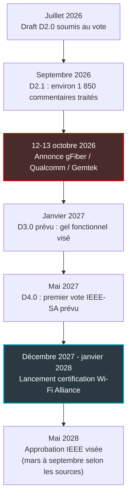
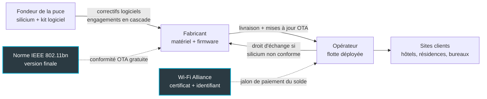

## Quinze mots pour engager toute une base d'abonnés

Les paris industriels les plus lourds tiennent parfois dans une subordonnée. Mi-octobre, l'opérateur fibre américain gFiber (l'ex-Google Fiber) a dévoilé avec Qualcomm et Gemtek Technology sa future passerelle « Wi-Fi 8 Premium », destinée à ses abonnés fibre à 20 Gbit/s symétriques. Toute la promesse tient en une phrase, rapportée par Light Reading : « Once fully certified, gFiber will be upgrading all 20 gig customers to the new gateway. »

Quinze mots. Pas de date, pas de prix. Et un « une fois pleinement certifiée » que personne ne définit.

En mars, l'analyste Adlane Fellah écrivait pourtant dans RCR Wireless que, pour un opérateur qui déploie des boîtiers à grande échelle chez ses clients, le risque d'un matériel pré-norme était « essentially untenable ». Un analyste dit intenable, un opérateur y va quand même. C'est un signal pour tous ceux qui achètent des bornes et des passerelles, hôteliers, gestionnaires de résidences ou DSI multi-sites : les offres « Wi-Fi 8 » arrivent, bâties sur une norme dont l'approbation est visée pour 2028.

Ma position est simple. Acheter du silicium avant la norme n'est pas une faute. La faute, c'est de laisser « once fully certified » à l'état de formule de communiqué au lieu d'en faire des clauses mesurables.

Une nuance d'emblée : gFiber vend de la fibre résidentielle aux États-Unis, Wifirst équipe des hôtels, des résidences et des entreprises en Europe. L'annonce ne se transpose pas ; le raisonnement contractuel, si. Le calendrier, nous l'avons disséqué le 2 septembre. Ici, on parle contrat.

## « Certifiée » : par qui, et à quelle date ?

Acheter du Wi-Fi 8 aujourd'hui, c'est acheter un appartement sur plan. Personne de sensé ne règle la totalité du prix à la signature, sur la foi d'une maquette et d'une plaquette. Les appels de fonds suivent l'avancement du chantier, et une garantie couvre le risque que l'immeuble ne soit jamais achevé. Le marché du Wi-Fi 8, lui, vend des appartements sur plan sans échéancier ni garantie d'achèvement. Tout l'enjeu est de réintroduire les deux.

Encore faut-il savoir où en est le chantier. Deux organismes interviennent, avec deux horloges différentes. L'IEEE (Institute of Electrical and Electronics Engineers) rédige la norme technique, ici 802.11bn, par brouillons successifs (les « drafts ») soumis au vote de ses membres. La Wi-Fi Alliance, consortium d'industriels, certifie ensuite que les produits interopèrent et délivre le logo.

Côté IEEE, d'après la page officielle du groupe de travail, le draft D2.0 a été soumis au vote en juillet 2026, avec deux mois de retard sur le plan, exactement comme le D1.0 un an plus tôt. En septembre, la réunion intermédiaire de Kona, à Hawaï, a traité environ 1 850 commentaires pour produire un D2.1. Le jour de l'annonce gFiber, la norme en est donc au stade D2.x.

La suite du planning est connue. D3.0 en janvier 2027, point à partir duquel les fonctions sont censées se figer. D4.0, premier vote élargi à l'IEEE-SA (la branche normalisation de l'IEEE), en mai 2027. Approbation finale en mai 2028.

Côté Wi-Fi Alliance, les sources disponibles sont secondaires, et elles divergent. En juin, Wi-Fi NOW écrivait que la Wi-Fi Alliance devrait lancer son programme de certification au CES 2028, en janvier, « several months before final approval of IEEE 802.11bn ». Rolf de Vegt, vice-président des standards techniques chez Qualcomm, y situait l'approbation finale en mai 2028 : « Right now, we expect final approvals of IEEE 802.11bn to happen in May of 2028. » Samsung Research, seule source à l'avancer, évoque un plan de test finalisé en juin 2027 et un lancement en décembre 2027. RCR Wireless ne voit pas la norme finalisée avant le troisième trimestre 2028.

La fourchette honnête : certification entre décembre 2027 et janvier 2028, norme finale entre mars et septembre 2028, avec mai 2028 comme point central. Faites le calcul depuis le 12 octobre 2026. Il reste 14 à 15 mois avant le lancement de la certification, et environ 19 mois avant l'approbation IEEE visée. Ce sont nos calculs, pas ceux des industriels.

*Dates IEEE : planning de la page officielle du groupe TGbn. Certification Wi-Fi Alliance : sources secondaires divergentes. Les écarts de 14-15 mois et de 19 mois sont nos calculs depuis le 12 octobre 2026.*

Reste le mot clé. Que veut dire « fully certified » ? Trois lectures sont possibles. La première, la certification Wi-Fi Alliance : d'après les calendriers publics, elle ne peut pas intervenir avant décembre 2027 ou janvier 2028. La deuxième, une homologation radio réglementaire, comme celle de la FCC (Federal Communications Commission, le régulateur américain) : elle dit qu'un appareil a le droit d'émettre, pas qu'il respecte la norme. La troisième, une qualification interne à gFiber.

Light Reading ne donne aucune date de déploiement. Le terme n'est défini nulle part publiquement. C'est précisément le premier point qu'un acheteur doit faire définir par écrit.

## Wi-Fi 6, Wi-Fi 7 : la certification a toujours devancé la norme

On a déjà vu ce film. Deux fois.

Wi-Fi 6 d'abord. Le programme Wi-Fi CERTIFIED 6 démarre en septembre 2019. La norme IEEE 802.11ax, elle, n'est approuvée qu'en février 2021 : pendant environ 17 mois, des produits certifiés vivent en avance sur le texte définitif. Puis, le 5 janvier 2022, la Wi-Fi Alliance annonce une « Release 2 ». Elle ajoute notamment le MU-MIMO montant (plusieurs terminaux qui émettent simultanément vers la borne) et des mécanismes d'économie d'énergie (Broadcast TWT, Extended Sleep Time, SMPS dynamique). Moins d'un an après la norme, le périmètre certifié a donc bougé.

Wi-Fi 7 ensuite. Des produits fondés sur des drafts sont annoncés dès 2022 et arrivent en rayon début 2023. Le programme Wi-Fi CERTIFIED 7 n'est lancé que le 8 janvier 2024, avec au menu les canaux de 320 MHz et le MLO (Multi-Link Operation, l'usage simultané de plusieurs bandes). Le communiqué de la Wi-Fi Alliance ne dit pas un mot du statut de 802.11be. La norme est approuvée en 2024, puis publiée en juillet 2025.

Et le programme continue d'évoluer après coup. En janvier 2026, deux ans après le lancement, la Wi-Fi Alliance ouvre une piste de certification pour les terminaux limités à des canaux de 20 MHz. Quant au mot « Wi-Fi 7 » imprimé sur la boîte, il ne garantit en rien le logo de certification : ce sont deux choses distinctes.

Le Wi-Fi 8 change toutefois le profil du risque. L'écart entre certification et norme finale devrait tomber à 4 ou 5 mois, contre 8 à 11 pour le Wi-Fi 7. En revanche, les produits circuleront 14 à 15 mois sans certification possible, contre une douzaine de mois pour le Wi-Fi 7.

La leçon tient en une ligne. Deux fois sur deux, la certification a précédé la norme, puis une nouvelle « release » a élargi le périmètre. « Wi-Fi CERTIFIED 8 » au jour du lancement ne sera donc pas le périmètre final. Un contrat qui promet une mise à niveau « vers la certification » sans dire laquelle ne promet rien.

*Entre le brouillon de norme et le premier certificat, une fenêtre de 14 à 15 mois pendant laquelle « Wi-Fi 8 » n'est qu'une étiquette.*

## Huit clauses pour transformer une promesse en obligation

Passons au cahier des charges. Chaque clause ci-dessous couvre un risque identifié et repose sur un critère vérifiable par un tiers : un document, un numéro de certificat, un test. Une précision d'honnêteté : les durées et pourcentages que j'avance sont des positions de négociation personnelles, pas une pratique de marché mesurée.

**1. Définir « Wi-Fi 8 » par une matrice, pas par un label.** Le communiqué de Qualcomm relayé par TelecomTV ne mentionne ni certification, ni calendrier, ni statut de la norme : « Wi-Fi 8 » y est un nom de produit. Même la composition exacte du « quad-band » de la plateforme Dragonwing NPro A8 Elite n'est pas publiée. Exigez en annexe une matrice des fonctions, référencée à une révision de draft nommée (D2.1, par exemple). Chaque ligne porte trois statuts : capable matériellement, activée dans le firmware livré, certifiée Wi-Fi Alliance. Chaque mise à jour fait évoluer la matrice, version contre version.

**2. Une obligation de conformité à la cible finale, gratuite et à distance.** Le fournisseur s'engage à mettre le produit livré en conformité avec la norme 802.11bn finale et avec la première version du programme Wi-Fi CERTIFIED 8. Le vecteur : une mise à jour OTA (over-the-air, poussée à distance) sans frais, dans un délai fixé après le lancement du programme. Ma position d'ouverture serait de six mois.

Point souvent oublié : la re-certification. D'après la documentation de certification diffusée par des fabricants de modules, un changement de firmware sur un produit certifié impose une re-certification, ou au minimum l'évaluation d'un laboratoire agréé. Et seuls les membres de la Wi-Fi Alliance peuvent la demander. Votre fournisseur l'est probablement ; vous, peut-être pas. Les frais de laboratoire sont donc pour lui.

**3. Des jalons de paiement indexés sur le certificat.** C'est l'échéancier de l'appartement sur plan. La commande ferme se limite à un lot pilote. Le solde et le déploiement de flotte sont conditionnés à l'obtention du certificat Wi-Fi Alliance, identifiant à l'appui, sur la référence exacte et sur la version de firmware effectivement déployée. Pas sur « un produit de la même famille ». Entre-temps, une retenue de garantie : je partirais sur 15 à 20 % du montant, à ajuster selon le rapport de force.

*Qui garantit quoi : les flèches pleines sont les engagements à écrire dans la chaîne contractuelle, les flèches pointillées les jalons externes qui les déclenchent.*

**4. Un droit d'échange matériel.** Si l'analyse d'écart entre le draft embarqué et la norme finale montre que le silicium ne peut pas atteindre la conformité (bloc matériel absent, mémoire ou flash insuffisantes), le fournisseur remplace sans frais. À défaut, il accepte la résiliation avec reprise du parc. C'est la clause qui protège réellement la base installée, et j'y reviens plus bas.

**5. Non-régression et retour arrière.** Toute mise à jour passe une suite de tests sur les terminaux Wi-Fi 6 et 7 réellement présents sur le parc, pas sur un banc idéal. Le firmware tourne en image A/B : deux partitions, avec retour automatique à la version précédente en cas d'échec. Tout mécanisme de coordination entre bornes se met à jour de façon atomique, site par site.

Pourquoi cette dernière exigence ? Par précaution : deux bornes embarquant des versions de draft différentes pourraient ne pas s'entendre sur le format de leurs échanges. C'est une hypothèse technique, pas un constat. Elle se lève en laboratoire, pas dans le hall d'un hôtel un samedi soir.

**6. Un cycle de vie écrit en date, pas en durée.** « Cinq ans de support » ne veut rien dire si l'on ne sait pas d'où l'on compte. Exigez une date calendaire de fin de support, que je placerais au moins cinq ans après la dernière vente. Ce plancher est plus exigeant que celui de l'article 13(8) du Cyber Resilience Act (CRA, le règlement européen sur la cybersécurité des produits) : au moins cinq ans, ou la durée d'usage attendue si elle est plus courte.

Ajoutez un SLA de correctifs et un SBOM (Software Bill of Materials, l'inventaire des composants logiciels). Le processus de gestion des vulnérabilités doit tenir les délais de signalement du CRA (article 14), applicables depuis le 11 septembre 2026 pour les vulnérabilités activement exploitées : alerte sous 24 heures, notification sous 72 heures, rapport final au plus tard 14 jours après la mise à disposition d'un correctif ou d'une mesure d'atténuation. Enfin, des engagements en cascade du fondeur au fabricant puis à l'opérateur, avec séquestre du code source si le fabricant disparaît.

**7. Le périmètre des releases futures.** Une « Release 2 » est-elle incluse dans la mise à niveau gratuite ? Pendant combien de temps ? Wi-Fi 6 a eu la sienne en janvier 2022, Wi-Fi 7 sa piste 20 MHz en janvier 2026. Ma suggestion : toute release publiée dans les 24 mois qui suivent le lancement du programme est couverte. Au-delà, on renégocie, mais on le sait d'avance.

**8. Découpler l'IA de la radio.** Les fonctions d'intelligence artificielle de la passerelle ont leur propre SLA, leur propre journal de versions de modèle, leurs propres règles de localisation des données. La conformité radio ne doit être ni retardée par la feuille de route IA, ni conditionnée à elle.

## Ce qu'aucune mise à jour ne rachète : le silicium

Un firmware active, corrige, reconfigure. Il ne grave pas de transistors.

Si la version finale de 802.11bn exige un mécanisme que la puce dessinée sur un draft de 2026 ne sait pas exécuter, aucune mise à jour à distance n'y changera rien. Or nous n'avons trouvé aucune analyse publique des fonctions du draft actuel susceptibles de bouger d'ici mai 2028. Ni Qualcomm ni gFiber ne s'engagent publiquement sur un périmètre de mise à jour post-norme pour ce produit.

La presse spécialisée le dit avec une prudence qui devrait alarmer. ChannelNews, au CES de janvier : « Early hardware will be based on draft specifications and may need firmware updates down the track to fully comply. » CEPro, une semaine plus tard : « Early hardware will likely rely on firmware updates once the standard is finalized. » *May need*, *likely rely* : c'est la version polie de « personne ne sait ».

Côté grand public, TP-Link indique qu'il livrera des mises à jour au fil de l'évolution de la norme. C'est une intention, sans aucune obligation chiffrée. Un particulier peut vivre avec. Une flotte de bornes répartie sur des centaines de sites, non.

D'où le droit d'échange de la clause 4, complété par une obligation de transparence. À D3.0, puis à la publication de la norme finale, le fournisseur remet une analyse d'écart fonction par fonction : « capable » ou « non capable » sur le silicium livré. Ce document n'est pas une formalité. C'est lui qui déclenche, ou non, l'échange.

*Le firmware peut activer et corriger, il ne peut pas ajouter un bloc matériel absent. La seule vraie protection d'une base installée reste le droit d'échange.*

Le second piège est plus subtil. Les démonstrations présentées au salon Network X mettaient en avant un contrôle parental en langage naturel, un accès invité par QR code sur l'écran tactile de la passerelle, des diagnostics automatiques. Tout cela s'appuie sur le NPU Hexagon (Neural Processing Unit, le processeur dédié à l'IA) de la plateforme. Rien de tout cela ne relève de 802.11bn.

Gautam Sheoran, vice-président senior en charge de la connectivité, du broadband et du networking chez Qualcomm, résume la vision : « Broadband networks are evolving from connectivity platforms into intelligent service platforms ». Soit. Mais un acheteur ne doit pas laisser la plateforme de services prendre en otage la plateforme de connectivité.

Il y a aussi la question du tuyau. Qualcomm présente un cadre de gestion et de sécurité, Dragonwing Security and Management (SAM), comme un « streamlined deployment path » pour ses plateformes Wi-Fi 8. Cette couche est une candidate naturelle pour porter la mise en conformité post-norme, mais aucune source publique ne le confirme. Si elle reste propriétaire, le fournisseur détient la clé de votre conformité. Exigez une gestion de flotte compatible avec un cadre standard comme TR-369, le protocole de gestion à distance dont nous avons déjà détaillé les promesses et les limites.

## Hôtels, résidences, bureaux : pilote oui, flotte non

Revenons de ce côté de l'Atlantique. Les terminaux qui se connectent dans un hôtel, une résidence étudiante ou un siège social sont des smartphones, des ordinateurs portables, des téléviseurs, au mieux compatibles Wi-Fi 6 ou 7. CEPro le rappelait sans détour : « nearly every device that uses Wi-Fi today won't be able to access the features ».

La valeur d'une borne Wi-Fi 8 en 2027 ne sera donc pas le débit perçu par le client final. Elle sera dans la fiabilité de l'infrastructure et dans la qualité de la gestion. Quand le bénéfice visible est faible à court terme, rien ne justifie de porter seul le risque de conformité.

Concrètement, cela donne un pilote par cohorte. Un hôtel, une résidence, un plateau de bureaux, avec des terminaux réels et des usages réels. On mesure la non-régression, on éprouve le retour arrière, on attend le certificat avant toute bascule de flotte. Le lot pilote sert à apprendre ; le certificat sert à payer.

Puis vient le CRA. Au-delà du signalement déjà en vigueur, l'essentiel de ses obligations s'applique à partir du 11 décembre 2027. Un boîtier Wi-Fi 8 mis sur le marché européen avant cette date pourrait échapper au gros du texte, sous réserve d'analyse juridique. Rien n'empêche l'acheteur d'en exiger les garanties par contrat dès maintenant : c'est l'objet de la clause 6.

Reste une question que je ne trancherai pas ici. Une mise à jour qui fait passer un produit d'un draft à la norme finale constitue-t-elle une « modification substantielle » au sens du CRA, susceptible de réenclencher des obligations ? C'est une question ouverte, à faire valider par votre direction juridique avant signature. Le calendrier la rend très concrète. Si la mise en conformité suit le lancement de la certification, elle tombera au plus tôt autour du 11 décembre 2027, c'est-à-dire au moment précis où l'essentiel du CRA entre en application.

*Fondeur, fabricant, opérateur : chaque maillon doit porter par écrit sa part de la promesse, jusqu'au dernier site client.*

## Trois questions à poser avant de signer

Je ne sais pas ce que gFiber a négocié avec ses fournisseurs. Ses contrats ne sont pas publics, et des clauses de ce type y figurent peut-être déjà. Mais la phrase publique n'en dit rien. Face à une offre Wi-Fi 8, trois questions suffisent à mesurer le sérieux d'un fournisseur.

1. **« Certifié » par qui, selon quel programme, quelle release, et à quelle date au plus tard ?**
2. **Si le silicium ne peut pas atteindre la norme finale, qui paie l'échange ?**
3. **Quelle date, une date et pas une durée, marque la fin du support, et qui la tient si le fabricant disparaît ?**

Ensuite, gardez quatre jalons à l'œil. Le D3.0 de janvier 2027 dira si les fonctions se figent comme prévu. Le plan de test de la Wi-Fi Alliance est attendu vers juin 2027, selon une source unique. Le lancement de la certification se situe entre décembre 2027 et janvier 2028. L'approbation IEEE, enfin, est visée pour mai 2028.

Le Wi-Fi 8 arrivera, et il arrivera avant sa norme. Ce n'est plus un débat. La seule vraie question est de savoir qui porte le risque des quelque 19 mois qui séparent l'annonce de gFiber de l'approbation finale visée (calcul depuis le 12 octobre 2026). Si la réponse n'est pas écrite dans le contrat, c'est vous.

_Vues personnelles, pas position Wifirst._

## Sources

1. Light Reading, « gFiber teams with Gemtek and Qualcomm on Wi-Fi 8 router » (12 octobre 2026) : https://lightreading.com/broadband/gfiber-teams-with-gemtek-and-qualcomm-on-wi-fi-8-router
2. Qualcomm, communiqué relayé par TelecomTV (13 octobre 2026) : https://www.telecomtv.com/content/access-evolution/qualcomm-unveils-ai-native-broadband-innovations-56450/amp/
3. Telesemana, plateformes Dragonwing Wi-Fi 8 (13 octobre 2026) : https://www.telesemana.com/blog/2026/10/13/qualcomm-presenta-plataformas-dragonwing-para-wi-fi-8-acceso-fijo-5g-advanced-y-enlaces-mmwave/
4. IEEE 802.11 TGbn Update (page non datée, dernière entrée septembre 2026) : https://grouper.ieee.org/groups/802/11/Reports/tgbn_update.htm
5. Wi-Fi NOW, Claus Hetting, propos de Rolf de Vegt (16 juin 2026) : https://wifinowglobal.com/news-blog/wi-fi-8-standard-on-track-for-completion-in-1h2028-with-certification-scheduled-for-january-2028/
6. Wi-Fi Alliance, « Wi-Fi Alliance introduces Wi-Fi CERTIFIED 7 » (8 janvier 2024) : https://www.wi-fi.org/news-events/newsroom/wi-fi-alliance-introduces-wi-fi-certified-7
7. Wikipedia, IEEE 802.11be, Wi-Fi 7 et Wi-Fi 6 (consultées le 19 octobre 2026) : https://en.wikipedia.org/wiki/IEEE_802.11be ; https://en.wikipedia.org/wiki/Wi-Fi_7 ; https://en.wikipedia.org/wiki/Wi-Fi_6
8. RCR Wireless, Adlane Fellah (23 mars 2026) : https://www.rcrwireless.com/?p=429619
9. ChannelNews, CES 2026 (7 janvier 2026) : https://www.channelnews.com.au/ces-2026-wi-fi-8-arrives-early-as-chipmakers-race-ahead-of-the-standard/
10. CEPro, Nick Boever (13 janvier 2026) : https://www.cepro.com/news/wi-fi-8-is-here-wait-what-happened-to-wi-fi-7/624549
11. RCR Wireless, piste de certification 20 MHz pour Wi-Fi 7 (7 janvier 2026) : https://www.rcrwireless.com/20260107/network-infrastructure/wi-fi-7-20-mhz-devices
12. Allion Labs, Wi-Fi CERTIFIED 6 Release 2 (janvier 2022) : https://www.allion.com/news-center/wifi6_release2
13. Samsung Research, IEEE 802.11bn Ultra High Reliability : https://research.samsung.com/blog/IEEE-802-11bn-Ultra-High-Reliability-UHR-Wi-Fi-8
14. Jones Day et McCann FitzGerald, obligations de signalement du CRA (2026) : https://www.jonesday.com/en/insights/2026/07/eu-cyber-resilience-act-24hour-reporting-duties-start-september-11-2026 ; https://www.mccannfitzgerald.com/knowledge/data-privacy-and-cyber-risk/cyber-resilience-act-reporting-obligations-apply-from-11-september-2026
15. eucybersecurity.org, CRA article 13(8) (consulté le 19 octobre 2026) : https://www.eucybersecurity.org/obligations/obl-art13-08
16. WFA Certification and Test Guide, document hébergé par Espressif : https://www.espressif.com/sites/default/files/tools/WFA_Certification_and_Test_Guide_EN.pdf
17. TP-Link Wi-Fi 8, eftm et WhistleOut (septembre-octobre 2026) : https://eftm.com/2026/09/tp-link-unveils-their-wi-fi-8-portfolio-headlined-by-archer-8-ultra-and-deco-8-mesh-routers-280314 ; https://www.whistleout.com.au/MobilePhones/News/TP-Link-Archer-8-Ultra-Australia
