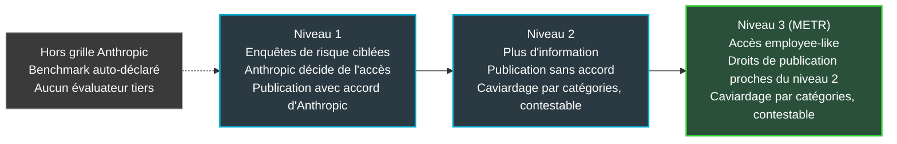
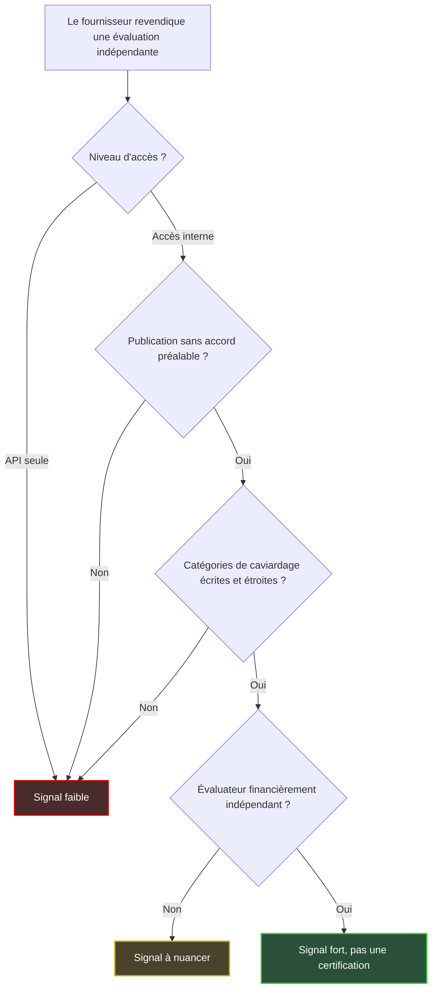

## Six étrangers dans la salle des machines

Six personnes viennent de recevoir un poste de travail, un bureau et des accès aux systèmes internes d'Anthropic, l'entreprise qui fabrique Claude. Elles ne travaillent pas pour Anthropic. Elles viennent de METR, une organisation à but non lucratif spécialisée dans l'évaluation des risques de l'IA. Et leur contrat contient une clause que peu de fournisseurs acceptent : elles publieront ce qu'elles trouvent, et Anthropic ne pourra pas s'y opposer.

Pour un DSI, ce n'est pas une anecdote californienne. Qu'il déploie un assistant de réservation dans une chaîne hôtelière, un chatbot de support pour un réseau de magasins ou un agent qui touche à l'infrastructure d'une résidence étudiante, le constat est le même. Presque tout ce qu'il sait de la sûreté du modèle vient du vendeur lui-même. Fiches techniques, rapports de risque rédigés en interne, scores de tests standardisés affichés à la décimale près. En somme, un bulletin de notes rempli par l'élève.

Le contexte compte. Deux jours avant l'annonce, Reuters racontait comment Anthropic et OpenAI négociaient pied à pied ce que les évaluateurs externes auraient le droit de rendre public.

Ma thèse tient en une phrase. Un audit d'IA ne vaut que par trois lignes de son contrat : ce que l'évaluateur peut voir, ce qu'il peut publier sans permission, et qui tient le feutre noir quand il faut masquer quelque chose. Aucun score de benchmark, aussi flatteur soit-il, ne répond à ces trois questions.

## Trois cuisines, trois inspections

Imaginez trois restaurants qui affichent tous « inspecté » en vitrine. Le premier a été inspecté par son propre chef. Le deuxième, par un contrôleur à qui le patron a choisi ce qu'il montrait, et qui doit obtenir son feu vert avant de publier. Le troisième, par un inspecteur qui a les clés de la cuisine, publie ce qu'il veut et ne s'interdit qu'une chose : divulguer la recette.

Même mot, trois réalités. C'est précisément la grille qu'Anthropic a rendue lisible le 15 octobre, dans un billet intitulé [« An update on independent evaluators »](https://www.anthropic.com/news/an-update-on-independent-evaluators). Le premier restaurant, c'est le benchmark auto-déclaré. Les deux autres ressemblent beaucoup aux niveaux d'évaluation que l'entreprise décrit désormais noir sur blanc.

*Trois niveaux d'accès, trois sens très différents pour le mot « évalué ».*

Voici ce que dit la page, une fois retiré l'emballage.

**L'accès.** Six employés de METR sont intégrés avec matériel, bureaux et accès aux outils et systèmes internes, dans des conditions décrites comme « roughly on par », à peu près équivalentes, avec celles des équipes d'évaluation des risques d'Anthropic. Le partage d'information est encouragé, à quelques exceptions près. L'équipe est restreinte et liée par des accords juridiquement contraignants. Les autres salariés de METR, y compris ceux qui travaillent avec Anthropic sur d'autres projets, sont cloisonnés.

**La publication.** METR publiera son analyse des niveaux de risque, des incidents ou des pratiques d'Anthropic. Anthropic ne peut pas opposer de veto. METR se réserve en outre le droit de s'exprimer publiquement sur le niveau d'accès et d'information qu'il a réellement obtenu.

**Le caviardage.** C'est le passage au feutre noir de certains passages d'un document (en anglais, *redaction*). Anthropic peut exiger le retrait d'informations relevant d'un petit nombre de catégories, présentées comme clairement définies. La page en cite des exemples : données clients, informations couvertes par le secret avocat-client, architectures de modèles. Ce sont des exemples, pas une liste exhaustive publiée. En contrepartie, METR peut dire publiquement si un caviardage lui paraît justifié.

**La grille.** Le tout s'inscrit dans un système à trois niveaux. Au premier, les évaluateurs mènent des enquêtes de risque au périmètre étroit : Anthropic décide de l'accès qu'elle leur accorde, et ils publient avec son accord. Au deuxième, ils accèdent à davantage d'information et publient sans accord ; Anthropic peut toujours exiger le retrait de catégories précises, mais l'évaluateur peut publier son avis sur la légitimité de ces retraits. Le troisième niveau, c'est l'arrangement METR : un accès « employee-like », quasi salarié, et des droits de publication proches du deuxième.

*Les trois niveaux décrits par Anthropic le 15 octobre. Le bloc gris, hors grille, est un ajout de ma part pour situer le benchmark auto-déclaré.*

**Les autres partenaires.** SecureBio relit en ce moment le chapitre consacré aux armes chimiques et biologiques du rapport de risque publié par Anthropic en août, après un pilote mené et publié sur le rapport précédent. Anthropic envisagera ensuite des projets à accès accru. Les autres partenariats, encore à un stade précoce, disposent d'un accès et de droits de publication plus limités. Accenture et Faculty sont engagés dans un partenariat plus large qui mêle évaluation, red-teaming (attaques simulées), évaluations d'alignement et tests de garde-fous. Hugging Face figure parmi les organisations en discussion.

Un détail de méthode, au passage. Plusieurs comptes rendus de presse (dont une reprise d'Axios) rangent SecureBio au premier niveau et présentent METR comme le seul occupant du troisième. C'est cohérent avec la page d'Anthropic, mais celle-ci ne le dit pas en toutes lettres : elle décrit l'arrangement METR comme le troisième niveau, dit espérer à terme plusieurs évaluateurs à ce niveau, et ne nomme aucun autre évaluateur de niveau 3. Le placement de SecureBio, lui, est une déduction de la presse, que la page ne confirme pas explicitement. Premier réflexe d'acheteur : distinguer ce que dit la source de ce que ses reprises en déduisent. La page porte aussi deux notes de mise à jour (METR le 16 octobre, SecureBio le 15) censées préciser les termes actuels de ces projets ; je n'ai pas pu en lire le détail.

## Tout voir, ne rien dire : le vrai sujet, c'est la publication

Beaucoup de titres ont retenu l'accès. Six personnes dans les murs, des outils internes, un statut quasi salarié : l'image frappe. Elle trompe aussi. Un évaluateur qui voit tout mais ne peut rien dire sans permission, c'est un consultant. Utile, sans doute. Pas un contre-pouvoir.

Le récit de Reuters du 13 octobre, [relayé par TNW](https://thenextweb.com/news/anthropic-openai-ai-evaluators-publication-control), montre que c'est exactement là que se jouait la partie. Selon deux sources anonymes, Anthropic et OpenAI cherchaient à garder un contrôle important sur ce que les évaluateurs externes pourraient publier. Deux craintes dominaient : les secrets industriels, et des évaluateurs embarqués susceptibles de partir ensuite chez un concurrent. Parmi les pistes discutées figuraient la surveillance des équipes embarquées par des salariés du laboratoire et l'interdiction de travailler pour deux labos à la fois.

Les deux entreprises ont répondu. D'après ce même récit, Anthropic expliquait que les évaluateurs avec lesquels elle avait déjà travaillé contrôlent leurs méthodes, leurs critères, leurs conclusions et leur publication. Pour les nouveaux venus, elle se réservait le droit de relire et valider les rapports, le temps qu'ils apprennent ses modèles. OpenAI disait ne pas approuver le texte complet, se limiter au caviardage usuel des informations confidentielles et laisser les évaluateurs signaler les retraits importants. Anthropic estime par ailleurs que l'article ne caractérise pas fidèlement l'ensemble de ses discussions.

L'annonce du 15 octobre tombe deux jours plus tard. Corrélation temporelle, oui. Causalité, aucune source ne la démontre. Ce qu'on peut constater, c'est que la distinction entre anciens et nouveaux évaluateurs avancée face à Reuters colle à la grille publiée : publication soumise à accord au premier niveau, libre aux niveaux supérieurs.

Le décor pèse aussi, sans qu'on puisse lui attribuer l'annonce. Selon plusieurs médias, la FTC (Federal Trade Commission, le régulateur américain de la protection des consommateurs) a confirmé fin septembre, par un porte-parole, enquêter sur OpenAI, Anthropic et d'autres acteurs pour des risques consommateurs. Anthropic, elle, a annoncé en juin avoir déposé confidentiellement un projet de prospectus auprès de la SEC, le gendarme boursier américain. Rien ne relie ces dossiers au 15 octobre. Mais dans un tel contexte, un audit crédible vaut plus cher qu'un communiqué.

Dernier point, et il compte pour un acheteur. Dans sa [politique de transparence publiée le 14 octobre](https://metr.org/blog/2026-10-14-our-approach-to-risk-assessment/), METR n'exclut pas qu'une entreprise détienne un veto sur ses conclusions de fond, à condition de pouvoir en révéler l'existence. L'absence de veto n'est donc pas une propriété de METR. C'est une propriété de ce contrat-là. Le même nom d'évaluateur pourrait couvrir demain un accord bien moins favorable chez un autre fournisseur.

## Qui tient le feutre noir ?

*Le veto a disparu, le caviardage demeure : toute la valeur de l'évaluation se joue sur l'épaisseur du trait.*

Le retrait du veto est réel. Il ne règle pas tout.

Regardez la mécanique. C'est Anthropic qui demande un caviardage. METR n'a pas de droit de blocage en retour : il peut seulement contester en public. La force de la clause dépend donc de l'étroitesse effective des catégories, que l'on ne connaît que par des exemples. « Données clients » et « secret avocat-client » ont des contours assez nets. « Architectures de modèles » peut se lire de façon étroite, ou très large. Et la page ne mentionne, à ma lecture, aucun arbitre tiers : c'est Anthropic qui réclame le retrait, et METR dispose seulement de la contestation publique. Elle ne dit pas non plus qui tranche en cas de désaccord sur l'appartenance d'un passage à une catégorie.

Le contrepoids existe, et il est sérieux. METR s'engage à décrire publiquement le périmètre et la durée de chaque mission, l'accès et les ressources obtenus, et si ces limites affectent ses conclusions. Il promet aussi de signaler les caviardages, y compris quand une information importante a été retenue, ainsi que les contraintes formelles et informelles subies. Il revendique enfin le droit de joindre unilatéralement un résumé des caviardages à ses rapports. Le feutre reste dans la main d'Anthropic. Mais chaque trait sera compté.

Deuxième zone grise : le mot « employee-like ». Dans sa [proposition d'évaluations embarquées](https://metr.org/blog/2026-10-14-better-informing-the-public-about-loss-of-control-risks/), publiée le 14 octobre, METR décrit lui-même les limites de l'exercice. L'accès y reste à la discrétion de l'entreprise, sans égaler celui de son personnel senior chargé de la sûreté. L'évaluateur n'est pas complètement protégé contre des représailles en cas de conclusions défavorables. L'exercice est volontaire : l'entreprise peut l'arrêter. Ce ne sont, précise METR, ni des audits, ni des évaluations de conformité, ni une supervision formelle, ni un feu vert ou rouge sur un déploiement. Certains domaines sortent même du périmètre : la sécurité des poids du modèle (ses paramètres appris), la robustesse des sandbox (les environnements d'exécution isolés), les processus organisationnels et la conformité.

Notez l'ironie : j'emploie le mot « audit » par commodité depuis le début, et l'évaluateur lui-même le récuse. Ce texte décrit le cadre général que défend METR, pas forcément chaque clause du contrat avec Anthropic. Il rappelle néanmoins qu'un accès « comparable » n'est pas un accès identique. Anthropic compare son dispositif aux examinateurs bancaires installés à demeure dans les grandes banques. L'image parle, mais elle s'arrête vite. Un examinateur bancaire a derrière lui un régulateur et la loi. Ici, tout repose sur un engagement volontaire, qu'Anthropic revendique d'ailleurs comme tel.

Troisième zone grise : l'argent. Anthropic affiche ses critères d'indépendance : expertise, aucune participation au capital ni dépendance financière ou opérationnelle, accès suffisant aux derniers modèles, aux informations d'entraînement et au fonctionnement des garde-fous, liberté de publier. Or, le 18 septembre, la même entreprise [annonçait](https://anthropic.com/news/accenture-embedded-evaluation) un partenariat d'évaluation embarquée avec Accenture et Faculty, assorti d'un accès comparable à celui d'un salarié. Chaque partie prévoit d'y investir au moins 1 Md USD sur cinq ans, et Anthropic finance directement le travail d'Accenture. Le billet reconnaît qu'il n'existe aucun standard d'accès, de financement ni de reporting public. Il ne précise ni droits de publication, ni contrôle éditorial, ni garde-fous contre les conflits d'intérêts.

TNW a résumé la tension dans un titre sans détour : [« Anthropic is paying the firm that will evaluate it »](https://thenextweb.com/news/anthropic-is-paying-the-firm-that-will-evaluate-it-and-says-in-the-same-announcement-that-this-is-not-how-it-should-work). Le média rappelle qu'Accenture est aussi client, revendeur et intégrateur de Claude, et que Faculty a été rachetée par Accenture en janvier. METR, à l'inverse, indique n'avoir accepté ni paiement ni don d'aucun laboratoire d'IA de pointe, les labos dits « frontier ». Sur ce seul critère, l'arrangement METR est plus propre. Cela ne juge pas la qualité du travail d'Accenture. Cela montre que le mot « évaluateur » recouvre des contrats incomparables, chez le même fournisseur, à quatre semaines d'intervalle.

Dernière limite, la plus simple : aucun rapport n'est encore sorti, et aucune date n'est annoncée. On juge un contrat, pas encore un résultat.

## Exigez le niveau d'évaluation, pas le score

Pourquoi insister sur le contrat plutôt que sur le chiffre ? Parce qu'un score de benchmark ne dit rien de qui l'a produit, avec quel accès, ni avec quel droit de dire le contraire. Et parce que, selon Reuters, qui dit s'appuyer sur le document, le projet de prospectus d'Anthropic range parmi ses facteurs de risque le fait qu'un modèle conscient d'être testé peut limiter la détection de comportements dangereux. Quand un fabricant l'écrit à l'attention de ses futurs investisseurs, un chiffre obtenu en conditions de test mérite au minimum un astérisque.

Le réflexe à installer dans vos achats tient en six questions, à poser dès qu'un fournisseur de modèle, de copilote ou d'agent revendique une « évaluation indépendante ».

1. **Qui voit quoi ?** Accès par API seulement, accès ciblé choisi par le fournisseur, ou accès interne comparable à celui de ses équipes risque ? Pour quelle durée, et qu'est-ce qui est exclu du périmètre ?
2. **Qui peut publier ?** Sans accord préalable, avec accord, après quel délai de relecture ? L'évaluateur peut-il dire qu'il y a eu caviardage, et s'il le juge justifié ?
3. **Qui tient le feutre ?** Les catégories de caviardage sont-elles écrites, étroites, publiques ? Qui tranche l'appartenance à une catégorie ? Le rapport contient-il un résumé des retraits ?
4. **Qui paie ?** Financement direct, participation au capital, relation commerciale parallèle comme client, revendeur ou intégrateur ?
5. **Que se passe-t-il en cas de problème bloquant ?** Existe-t-il un mécanisme d'escalade écrit, ou seulement la bonne volonté du fournisseur ?
6. **De quel risque parle-t-on ?** La perte de contrôle ou le sabotage par un modèle ne sont ni la sécurité ni la conformité de votre déploiement. Ce type d'évaluation ne remplace ni un rapport SOC 2, ni une certification ISO 27001.

*Grille de lecture rapide pour un acheteur : quatre questions avant de croire une « évaluation indépendante ».*

Côté contrat, la traduction est directe. Ajoutez au questionnaire fournisseur IA une clause de transparence sur le niveau d'évaluation : qui évalue, avec quel accès, quels droits de publication, quelles catégories de caviardage. Prévoyez une revue annuelle du rapport tiers par la DSI et le RSSI. À défaut d'évaluation externe, exigez au moins la divulgation écrite de ce qui a été fait et de ses limites d'accès. C'est moins vendeur qu'un tableau de scores. C'est autrement plus informatif.

La recherche académique fournit déjà la trame. Un article déposé le 21 septembre sur arXiv, le serveur de prépublications scientifiques, sous le titre [« Embedded Assessments for Frontier AI »](https://arxiv.org/abs/2609.25413), définit l'évaluation embarquée comme un accès quasi salarié aux systèmes internes, au personnel et à la documentation. Ses huit auteurs l'organisent autour de sept questions de conception : périmètre, collecte d'information, durée, calendrier, termes de l'engagement, divulgation, escalade. Ils recommandent des évaluations continues, des rapports détaillés au moins trimestriels et des mécanismes d'escalade. Un service achats n'a presque plus qu'à recopier.

Un mot enfin pour ceux qui, comme beaucoup d'acteurs de l'hôtellerie, du retail ou des résidences étudiantes, achètent l'IA à travers un intégrateur. Demandez-lui s'il évalue aussi le modèle qu'il vous revend. Le cas Accenture montre que la double casquette existe, y compris chez les acteurs les plus en vue.

*Dans la grille d'achat, le tableau de benchmarks passe au second plan : accès, publication et caviardage d'abord.*

## Le benchmark redevient un outil d'ingénieur

Je tranche. L'annonce d'Anthropic est un vrai pas en avant, mais pas pour la raison qu'affichent les titres. L'essentiel n'est pas que six personnes aient un bureau chez Anthropic. C'est que les trois paramètres qui font la valeur d'une évaluation, accès, publication et caviardage, soient écrits noir sur blanc, niveau par niveau, et donc comparables d'un fournisseur à l'autre. En septembre, Anthropic reconnaissait elle-même qu'aucun standard n'existait en la matière. Un mois plus tard, elle en publie au moins une ébauche.

Les limites sont tout aussi nettes. Le dispositif est volontaire, donc révocable. Le feutre reste dans la main d'Anthropic. Aucun résultat n'est publié. Et METR est le premier à dire que ce n'est ni un audit de conformité, ni une supervision formelle.

Pour un acheteur, la conséquence est pourtant immédiate. Le score de benchmark auto-déclaré redevient ce qu'il aurait toujours dû être : un outil d'ingénieur pour comparer des modèles sur une tâche donnée. Il cesse d'être un argument de confiance. La confiance, elle, se lit dans le contrat de l'évaluateur.

Anthropic écrit que chaque labo frontier devrait faire comme elle. Prenons-la au mot, et étendons la règle à toute la chaîne : éditeurs de modèles, de copilotes, intégrateurs. La prochaine fois qu'on vous présente un tableau de scores, posez trois questions. Qui a vu ? Qui peut publier ? Qui tient le feutre ? Sans réponse, vous savez ce que vaut le tableau.

_Vues personnelles, pas position Wifirst._

## Sources

1. Anthropic, « An update on independent evaluators » (15 octobre 2026, mis à jour le 16 octobre) : https://www.anthropic.com/news/an-update-on-independent-evaluators
2. Anthropic, partenariat d'évaluation embarquée avec Accenture et Faculty (18 septembre 2026) : https://anthropic.com/news/accenture-embedded-evaluation
3. METR, « Our approach to working with AI companies » (14 octobre 2026) : https://metr.org/blog/2026-10-14-our-approach-to-risk-assessment/
4. METR, « A proposal for better informing the public about loss-of-control risks » (14 octobre 2026) : https://metr.org/blog/2026-10-14-better-informing-the-public-about-loss-of-control-risks/
5. TNW, relais de l'exclusivité Reuters sur le contrôle des publications des évaluateurs (13 octobre 2026) : https://thenextweb.com/news/anthropic-openai-ai-evaluators-publication-control (article Reuters original : https://www.reuters.com/world/behind-ai-industrys-call-independent-reviews-fight-over-what-gets-made-public-2026-10-13/)
6. TNW, « Anthropic is paying the firm that will evaluate it » (19 septembre 2026) : https://thenextweb.com/news/anthropic-is-paying-the-firm-that-will-evaluate-it-and-says-in-the-same-announcement-that-this-is-not-how-it-should-work
7. Charnock et al., « Embedded Assessments for Frontier AI », arXiv:2609.25413 (21 septembre 2026) : https://arxiv.org/abs/2609.25413
8. AI Weekly, Anthropic embeds six METR evaluators with internal tools access (15 octobre 2026) : https://aiweekly.co/alerts/anthropic-embeds-six-metr-evaluators-with-internal-tools-access
9. XenoSpectrum, relais Reuters sur les facteurs de risque du projet de prospectus d'Anthropic : https://xenospectrum.com/en/anthropic-ipo-existential-ai-risk/
10. ITV, enquête de la FTC sur OpenAI et Anthropic (30 septembre 2026) : https://www.itv.com/news/2026-09-30/ftc-is-investigating-openai-and-anthropic-over-safety-risks
11. ProPakistani, republication Axios (16 octobre 2026) : https://propakistani.pk/2026/10/16/anthropic-becomes-one-of-first-to-allow-third-party-test-of-ai-dangers/
