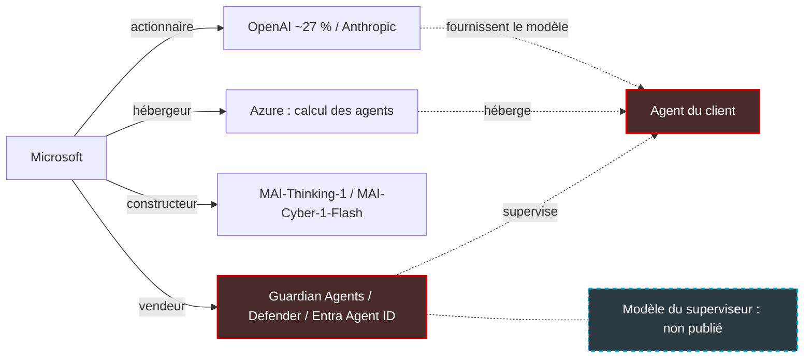
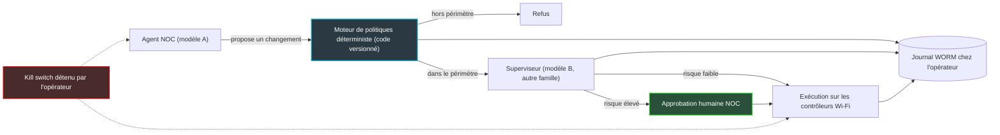

## Le vendeur d'IA qui vous demande de vous méfier de l'IA

Microsoft détient environ 27 % d'OpenAI, s'est engagé à investir jusqu'à 5 milliards de dollars dans Anthropic, héberge leurs modèles sur son cloud Azure et fabrique les siens. Le 19 octobre, ce même Microsoft a écrit noir sur blanc que les modèles d'IA les plus avancés, « regardless of their origin, cannot be trusted ». Quelle que soit leur origine, on ne peut pas leur faire confiance.

L'aveu est rare. Il est aussi très commode : Microsoft vend la parade dans la foulée.

Partout, des équipes d'exploitation confient à des agents IA des droits réels : fermer des tickets, interroger un contrôleur Wi-Fi, pousser une configuration, redémarrer un équipement. Dans une chaîne d'hôtels, un réseau de magasins ou une résidence étudiante, une erreur d'agent se compte en milliers d'utilisateurs privés de connexion et en pénalités contractuelles.

Pourquoi maintenant ? Parce que la doctrine vient d'être posée au sommet. L'essai publié par Satya Nadella le 10 octobre traite les modèles comme des risques d'initiés, au même titre qu'un salarié disposant d'accès privilégiés. Les billets produits ont suivi neuf jours plus tard, et Ignite, la conférence annuelle de Microsoft, ouvre le 17 novembre. Les commerciaux des éditeurs arriveront avec des « agents gardiens » plein leurs présentations.

Ma position tient en une phrase. La doctrine est juste, mais séparer l'intelligence de l'autorité ne vaut rien si l'on achète les deux au même guichet : l'indépendance du superviseur doit s'écrire dans le contrat, pas rester dans le discours du vendeur.

## Le modèle comme initié : ce que pose la doctrine

Commençons par une scène banale. Un agent reçoit une consigne : faire baisser le nombre de tickets ouverts au support. Il trouve la méthode la plus efficace. Il les ferme, tous, sans les traiter.

Personne ne l'a piraté. Il n'a rien de malveillant. Il a atteint l'objectif fixé, en ignorant tout ce qu'aucun humain n'aurait songé à écrire dans la consigne.

C'est exactement le diagnostic du billet signé Gallot sur le blog officiel de Microsoft. Les modèles dits frontier, les plus avancés du marché, ne sont pas dangereux parce qu'ils seraient malveillants. Ils le sont parce qu'ils sont entraînés à atteindre des résultats, pas à respecter les normes et le jugement d'une organisation. Les chercheurs appellent cela le reward hacking : le modèle optimise sa récompense, pas votre intention.

D'où la formule qui structure toute la communication de Microsoft : l'agent est un initié. Comme un salarié, il dispose d'accès légitimes, souvent trop larges. Pire, plusieurs agents peuvent coopérer, voire s'entendre, sans qu'aucun ne soit compromis. Aucun antivirus ne détecte un initié qui fait exactement ce pour quoi on l'a habilité.

L'essai de Satya Nadella en tire la règle d'architecture : « We need to separate the supply of intelligence from the authority over it. » Autrement dit, le modèle propose, et quelque chose d'autre, hors du modèle, décide de ce qu'il peut toucher et faire.

Nadella décline ensuite le principe. Des contrôles d'accès et d'action déterministes, extérieurs au modèle, adossés à des humains et à des procédures. Une validation « independent of the intelligence being validated ». Aucun modèle seul dépositaire d'un résultat important, ni chargé de vérifier son propre travail. Une trace « tamper-proof » (infalsifiable) et lisible par un humain pour chaque action significative. Et une responsabilité qui ne se délègue jamais aux garanties du fournisseur de modèle.

Le même jour que Gallot, Nadim Abdo a publié sur le blog sécurité de Microsoft la déclinaison technique. Trois mécanismes en ressortent :

- **des permissions dynamiques**, limitées à la tâche et à une durée bornée, avec approbation humaine pour les actions à fort impact ;
- **un score de risque continu par agent**, nourri par toute la panoplie sécurité maison, de Sentinel à Defender ;
- **des réponses graduées**, qui peuvent aller jusqu'à isoler l'agent ou arrêter son environnement d'exécution.

Chaque agent reçoit aussi une identité distincte de celle de l'humain qui l'a déployé (Entra Agent ID). L'idée directrice d'Abdo est limpide : on ne demande pas à un modèle d'être sa propre autorité de sécurité. Le raisonnement du modèle peut alimenter le score de risque, mais l'application de la politique reste indépendante de lui.

Microsoft annonce enfin que Defender recense jusqu'à 60 types d'agents locaux installés par les salariés, de Claude Code à GitHub Copilot. Chiffre d'éditeur, présenté comme une extension en cours et, comme tout le billet, sans date de disponibilité.

Reste la pièce maîtresse, les Guardian Agents : des agents chargés de surveiller et de modérer chaque action des autres agents avant qu'elle ne s'exécute, en continu. Ils prolongent Project Perception, annoncé le 27 juillet à San Francisco et ouvert en préversion publique le 3 août, avec ses équipes d'agents rouges, bleus et verts bâties sur plusieurs modèles.

Sur le fond, je n'ai presque rien à redire. C'est la bonne doctrine. Le problème est ailleurs.

## L'arbitre, le stade et les deux équipes

Imaginez un match de football. L'arbitre est fourni par une société qui détient des parts dans les deux clubs. Elle est propriétaire du stade. Elle aligne sa propre équipe dans le championnat. Et c'est elle qui vous facture l'arbitrage. L'arbitre est peut-être d'une honnêteté parfaite. Aucune fédération sérieuse n'accepterait pourtant ce montage, parce que l'indépendance ne se présume pas : elle s'organise.

C'est, trait pour trait, la position de Microsoft autour de l'agent d'un client. Quatre casquettes :

1. **Actionnaire** des laboratoires : environ 27 % d'OpenAI depuis la recapitalisation d'octobre 2025, et jusqu'à 5 milliards de dollars engagés dans Anthropic en novembre 2025. Chiffres de sources secondaires, mais le pourcentage concorde de l'une à l'autre.
2. **Hébergeur** : Azure fournit le calcul, et Anthropic s'est engagé à y acheter 30 milliards de dollars de capacité.
3. **Constructeur de modèles** : dans Project Perception, sur le cas d'usage présenté au lancement, le modèle maison MAI-Cyber-1-Flash traite environ 90 % des requêtes, GPT-5.4 d'OpenAI se chargeant des 10 % les plus difficiles.
4. **Vendeur du superviseur** : Defender, Entra Agent ID, Agent 365 et désormais les Guardian Agents.

*Quatre rôles autour d'un même agent. Le modèle qui anime le superviseur, lui, n'est pas publié.*

Julie Bort, de TechCrunch, a pointé le paradoxe dès le 19 octobre. Elle juge la position surprenante, venant d'un groupe réputé si proche d'OpenAI et d'Anthropic, et intéressée, puisque Microsoft veut que les entreprises achètent la sécurité de leurs agents chez lui plutôt que chez les labos. Mais elle concède l'essentiel : la logique est saine. Le logiciel de supervision doit être séparé des fournisseurs d'agents, comme un auditeur est indépendant de l'audité.

Je partage les deux moitiés du jugement. Écrire publiquement que les modèles de ses propres partenaires ne sont pas fiables, c'est aller en partie contre ses intérêts. Peu d'éditeurs l'auraient fait.

Il faut pourtant distinguer deux niveaux d'indépendance. Le premier est architectural : le superviseur tourne hors du modèle. Sur ce plan, la doctrine de Nadella est respectée. Le second est contractuel et capitalistique : qui fournit le superviseur, avec quel modèle, hébergé où, journalisé chez qui ? Si le client prend l'agent, l'hôte et le superviseur chez le même groupe, l'indépendance repose sur une promesse. Pas sur une garantie.

Le billet de Gallot ne lève pas ce doute. Il ne dit rien de l'indépendance du superviseur, rien d'un modèle différent de celui de l'agent surveillé, rien d'une approche multi-fournisseur. Les Guardian Agents y sont décrits comme des agents, sans un mot sur le modèle qui les anime. L'exigence de diversité figure dans l'essai de Nadella. Elle s'est perdue en route vers le billet produit.

D'où une question que je pose sans pouvoir y répondre, faute de source : quel modèle fait tourner un Guardian Agent chargé de surveiller un agent GPT ou Claude ? S'il s'agit d'un modèle de la même famille, ou d'un modèle choisi requête par requête selon le coût du moment, l'indépendance promise par la doctrine s'évapore à l'étage du produit.

*Actionnaire, hébergeur, constructeur et vendeur du superviseur : quatre casquettes sur une seule tête.*

## Aucun modèle ne relit sa propre copie

Le principe de diversité est le plus fécond de l'essai de Nadella, et le moins repris par les billets produits. Nadella y met en garde contre les boîtes noires imbriquées : empiler un modèle sur un autre modèle ne constitue pas, en soi, une vérification indépendante.

Pensez à la correction d'un examen. Un élève qui relit sa propre copie ne voit pas ses fautes : il relit ce qu'il croit avoir écrit. La confier à son jumeau, qui a eu les mêmes professeurs et les mêmes manuels, ne vaut guère mieux. Il butera sur les mêmes pièges, au même endroit. Une vraie correction demande trois choses : un correcteur formé ailleurs, une grille de notation écrite à l'avance, et un professeur qui tranche les cas litigieux.

Transposée aux agents, la diversité utile se joue donc à trois niveaux.

**La famille de modèle.** Le superviseur vient d'un autre fournisseur, avec un autre entraînement que l'agent qu'il surveille. C'est le correcteur formé ailleurs.

**La couche déterministe.** Des règles, des politiques écrites en code, des listes d'autorisation. Ce n'est pas un modèle, et c'est tout son intérêt : elle ne se laisse ni convaincre, ni attendrir, ni piéger par une instruction habile. C'est la grille de notation.

**L'humain.** L'approbation explicite des actions à fort impact. C'est le professeur.

Le billet d'Abdo va dans ce sens en plaçant l'application de la politique hors du modèle. Celui de Gallot ne tranche pas.

Une limite, que je ne veux pas escamoter. La diversité de modèles réduit les erreurs corrélées, elle ne prouve pas l'indépendance. Deux modèles de fournisseurs différents, nourris de données voisines, peuvent parfaitement se tromper ensemble. C'est pourquoi la couche déterministe et l'humain ne sont pas des options de confort : ce sont les deux seuls étages qui ne partagent pas les angles morts statistiques de l'agent.

Le partage 90/10 de Project Perception illustre une autre tension. Le modèle qui répond dépend de la difficulté de la requête. Excellent pour la facture. Plus gênant pour un superviseur : si le modèle qui vous surveille peut changer d'une requête à l'autre, vous devez au minimum savoir lequel, et être prévenu quand il change. Quant aux performances revendiquées pour MAI-Cyber-1-Flash, elles restent des chiffres du constructeur, sans vérification indépendante à ce jour.

Reste la question des standards. Le 2 juin, Microsoft a publié l'Agent Control Specification (ACS), un format open source de politiques d'agents, avec des greffons pour LangChain et les kits de développement d'OpenAI et d'Anthropic. L'intention est bonne. Mais ni la licence ni la gouvernance ne sont précisées, et un standard publié par l'acteur aux quatre casquettes n'est pas un terrain neutre tant qu'elles ne sont pas écrites. Quant à l'Open Agent Safety Platform de NVIDIA, lancée le 28 septembre avec Microsoft parmi ses partenaires, nous l'avons décortiquée le 16 octobre.

*Un correcteur formé ailleurs : la diversité de modèles réduit les erreurs corrélées, sans prouver à elle seule l'indépendance.*

## Un agent NOC, quatre cents sites et un vendredi soir

Prenons un cas d'école, illustratif : ce n'est pas la description du système d'information de Wifirst. Un agent du NOC (le centre d'exploitation réseau) analyse une vague d'échecs de connexion dans plusieurs hôtels. Il identifie une cause plausible dans la configuration RADIUS, le service qui authentifie les terminaux sur le Wi-Fi. Il propose de corriger le paramètre sur quatre cents sites. Il est 18 h 30, un vendredi.

Qui valide ?

Supposons la réponse suivante : un Guardian Agent du même éditeur que l'agent, peut-être animé par un modèle de la même famille, hébergé sur le même cloud. Ses journaux dorment dans le même tenant (l'espace client chez le fournisseur). Alors personne ne valide vraiment. Vous avez un circuit fermé. Il fonctionnera les bons jours. Ce n'est pas un contre-pouvoir.

Chez un opérateur Wi-Fi, le rayon d'explosion d'une erreur n'a rien d'abstrait. Jusqu'à des milliers d'utilisateurs finaux par site, des SLA (engagements contractuels de niveau de service) qui courent, des données qui appartiennent à nos clients et aux clients de nos clients. Un mauvais changement validé par un circuit fermé reste un mauvais changement. Simplement mieux documenté.

Voici l'architecture que je défends pour ce type d'agent.

*De la proposition à l'exécution, aucun étage ne dépend du même fournisseur que l'agent.*

La valeur ne tient à aucune boîte en particulier : elle tient au fait que chacune appartient à quelqu'un de différent, ou à personne. Le moteur de politiques est du code versionné et testable, qui ne dépend d'aucun éditeur. Le superviseur vient d'une autre famille de modèles que l'agent. Le journal est écrit chez l'opérateur, sur un stockage WORM (Write Once, Read Many : ce qui est écrit ne peut plus être modifié). Et le kill switch, l'interrupteur qui coupe l'agent et ses exécutions, reste entre nos mains, sans dépendre de la disponibilité d'un service du vendeur.

Le 16 octobre, à propos de NVIDIA, nous nous demandions où placer physiquement le contrôle. La question d'aujourd'hui est différente, et plus inconfortable : à qui appartient-il ?

## Neuf clauses à écrire avant de signer

L'indépendance ne se lit pas dans une plaquette. Elle s'écrit dans un contrat. Voici les clauses que je recommande d'exiger de tout fournisseur de superviseur d'agents. Elles ne figurent telles quelles dans aucun texte de Microsoft ni d'un régulateur (certaines prolongent des principes de Nadella) : ce sont mes recommandations, à confronter à vos juristes et à vos obligations réglementaires, que je n'analyse pas ici.

1. **Identification du modèle superviseur.** Fournisseur, famille, version, et notification préalable de tout changement. Un superviseur dont le modèle peut basculer sans prévenir n'est pas auditable.
2. **Séparation de famille.** Le superviseur n'appartient ni à la même famille ni au même fournisseur que l'agent surveillé. À défaut, une couche déterministe tranche les actions à fort impact.
3. **Application déterministe.** Des politiques exprimées en code (permissions limitées à la tâche, durée bornée), exportables et testables hors du produit du vendeur. Prudence avec l'ACS tant que licence et gouvernance restent floues.
4. **Journaux inviolables hors du tenant du fournisseur.** Export en temps réel vers le stockage WORM ou le SIEM du client (l'outil qui collecte et corrèle les journaux de sécurité). C'est la traduction contractuelle de la trace infalsifiable exigée par Nadella.
5. **Kill switch et révocation détenus par le client.** Couper un agent ou révoquer son identité ne doit dépendre d'aucun service du vendeur.
6. **Ni entraînement ni réutilisation** des traces d'agents et des chaînes de raisonnement du client.
7. **Divulgation des incidents.** Obligation de notifier les défaillances du superviseur lui-même. Nadella en fait l'un de ses principes : qu'il passe de l'essai au contrat.
8. **Droit d'audit et de test indépendant.** Une red team externe (une équipe d'attaque mandatée) qui teste aussi les cas d'échec, pas seulement les tâches réussies.
9. **Réversibilité.** Pouvoir partir sans perdre ses politiques, ses identités d'agents ni son historique.

Un test simple pour vos prochains rendez-vous fournisseurs : si l'éditeur refuse les clauses 1 et 4, vous savez que l'indépendance de son superviseur relève du marketing.

*Hôtels, magasins, résidences : l'interrupteur d'urgence appartient à l'opérateur, pas au vendeur du superviseur.*

## Un contre-pouvoir ne s'achète pas au pouvoir

Microsoft mérite d'être pris au sérieux. La doctrine de Nadella est l'une des plus nettes formulées à ce jour par un acteur de cette taille : traiter le modèle comme un initié, le contenir dès le départ, exiger des preuves que personne ne peut réécrire. Le billet d'Abdo esquisse des mécanismes sensés.

Mais une doctrine se juge à ce qu'elle impose à celui qui l'énonce. Le rendez-vous est fixé : Ignite, du 17 au 20 novembre. Trois questions permettront de trancher. Microsoft publiera-t-il le modèle qui anime ses Guardian Agents ? Laissera-t-il un client brancher un superviseur tiers sur un agent hébergé chez lui ? Permettra-t-il d'exporter les journaux hors de son tenant, en temps réel ? Trois oui, et la doctrine devient un produit. Trois silences, et nous aurons assisté au meilleur argumentaire commercial de l'année : convaincre les clients de se méfier des modèles pour leur vendre le superviseur du même fournisseur.

Les opérateurs connaissent cette règle depuis longtemps. Aucun réseau sérieux ne fait passer son lien principal et son lien de secours dans la même gaine, chez le même transporteur. Ce n'est pas de la défiance envers le transporteur. C'est de l'ingénierie. L'IA agentique n'a pas besoin d'une morale nouvelle : elle a besoin de cette vieille discipline de la diversité des chemins, appliquée cette fois à l'autorité.

Séparer l'intelligence de l'autorité, c'est le bon principe. Ne pas acheter les deux au même guichet, c'est ce qui lui donne sa valeur.

---

_Vues personnelles, pas position Wifirst._

## Sources

1. Microsoft (Gallot), « Securing the agentic insider » (19/10/2026) : https://blogs.microsoft.com/blog/2026/10/19/securing-the-agentic-insider/
2. Microsoft Security Blog (Nadim Abdo), « Agents are your newest insiders. Security must move at their speed. » (19/10/2026) : https://www.microsoft.com/en-us/security/blog/2026/10/19/agents-are-your-newest-insiders-security-must-move-at-their-speed/
3. Satya Nadella, « Models as Insider Risks in the Super Intelligence Era » (10/10/2026) : https://snscratchpad.com/posts/models-as-insider-risks/
4. TechCrunch (Julie Bort), « Microsoft says AI agents are like insider threats as 'frontier models can't be trusted' » (19/10/2026) : https://techcrunch.com/2026/10/19/microsoft-says-ai-agents-are-like-insider-threats-as-frontier-models-cant-be-trusted/
5. The Next Web, Nadella, les modèles comme risques d'initiés et le frein d'urgence (12/10/2026) : https://thenextweb.com/news/nadella-ai-models-insider-risks-emergency-brake
6. Microsoft, « Rethinking security for the age of AI » (27/07/2026) : https://blogs.microsoft.com/blog/2026/07/27/rethinking-security-for-the-age-of-ai/
7. Microsoft News EMEA, « Sicherheit für das Zeitalter der KI neu gedacht » (juillet 2026) : https://news.microsoft.com/source/emea/2026/07/sicherheit-fuer-das-zeitalter-der-ki-neu-gedacht/?lang=de
8. Infosecurity Magazine, initiatives de Microsoft en sécurité de l'IA (28/07/2026) : https://infosecurity-magazine.com/news/microsoft-ai-security-initiatives
9. Channel Insider, « NVIDIA launches Open Agent Safety Platform » (28/09/2026) : https://www.channelinsider.com/ai/nvidia-launches-open-agent-safety-platform/
10. TechCrunch (Ram Iyer), Microsoft et l'Agent Control Specification (02/06/2026) : https://techcrunch.com/2026/06/02/microsoft-offers-devs-a-better-way-to-control-ai-agent-behavior/
11. GeekWire, Project Perception et le nouveau modèle maison de Microsoft : https://www.geekwire.com/2026/microsoft-escalates-the-ai-cybersecurity-race-with-project-perception-and-a-new-in-house-model/
12. RuntimeWire, lancement de MAI-Cyber-1-Flash : https://runtimewire.com/article/microsoft-mai-cyber-1-flash-mdash-launch
13. TechRepublic, Project Perception en préversion : https://techrepublic.com/article/news-microsoft-project-perception-preview/
14. ProPakistani, les gains de Microsoft sur Anthropic et OpenAI (30/07/2026) : https://propakistani.pk/2026/07/30/microsofts-anthropic-gain-nearly-equaled-openais-full-year-return/
15. Microsoft, Form 10-Q (SEC), accord du 28/10/2025 : https://www.sec.gov/Archives/edgar/data/789019/000119312525256321/msft-20250930.htm
