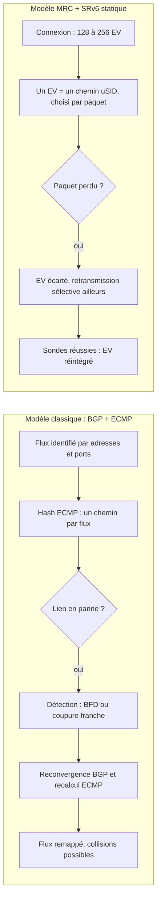
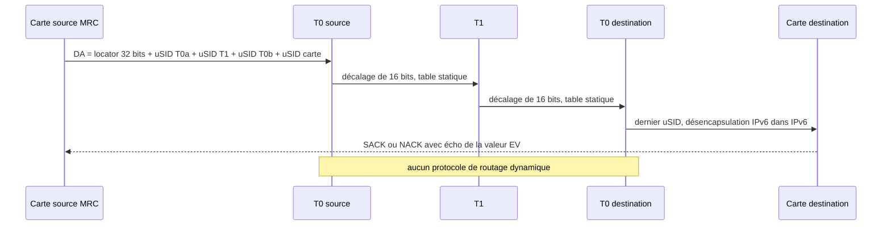

## Un switch muet, et un calcul qui continue

Un jour, un commutateur d'un supercalculateur d'OpenAI a cessé de transmettre le moindre paquet. Vu de l'extérieur, il était pourtant toujours « up » : un bug logiciel l'avait rendu muet sans l'éteindre. C'est le genre de panne grise que tout ingénieur réseau redoute. Il a fallu le redémarrer, puis attendre deux minutes que le trafic repasse. Bilan : environ 580 000 paquets perdus, environ un quart des connexions du calcul touchées. Et pourtant, le débit du job, un pré-entraînement sur 75K GPU, est resté « largely unaffected », selon les ingénieurs qui l'ont documenté. Quatre incidents de ce type ont émaillé ce même job [3].

Ce qui a sauvé le calcul n'est pas un protocole de routage plus rapide. C'est l'absence de protocole de routage. Dans ce réseau, les commutateurs n'apprennent plus rien : ils appliquent une table figée, écrite le jour de leur installation. C'est la carte réseau de chaque serveur qui choisit le chemin, paquet par paquet, et qui contourne seule ce qui casse.

Le dispositif a été décrit en mai 2026 par OpenAI, Microsoft, AMD, NVIDIA et Broadcom, puis porté à l'IETF (l'organisme qui normalise les protocoles d'Internet) par Cisco, Microsoft, Oracle et quelques autres. Il concerne d'abord les bâtisseurs de clusters IA. Mais il soulève une question qui touche tout DSI et tout opérateur de réseau : qui doit garantir la disponibilité, le réseau ou la machine qui s'y branche ? Ma réponse tient en deux phrases. Ici, l'hôte a pris le volant. Et ça ne marche que parce que la route est privée.

## Le modèle classique : des carrefours qui doivent se mettre d'accord

Pour mesurer le renversement, il faut repartir de la norme. Depuis une décennie, les grands datacenters sont câblés en Clos : une architecture en étages où chaque commutateur d'accès (appelé T0) est relié à tous les commutateurs de l'étage supérieur (T1). La RFC 7938, publiée en 2016, a fixé la recette dominante [11]. On fait parler BGP, le protocole de routage d'Internet, entre les étages.

La charge, elle, est répartie par ECMP (Equal-Cost Multi-Path), qui procède par hachage. On calcule une empreinte à partir des adresses et des ports d'un flux, et cette empreinte désigne un chemin. Un flux, un chemin, pour toute sa durée. Quand un lien tombe, il faut d'abord le détecter : par une coupure physique franche, ou grâce à BFD (Bidirectional Forwarding Detection), un battement de cœur rapide échangé entre équipements. Ensuite BGP reconverge, les tables sont recalculées, les flux redistribués. La RFC 7938 rappelle qu'une convergence sous la seconde est atteignable avec ces mécanismes, et qu'il faut sinon compter en secondes.

Prenez une ville dont les feux tricolores se reprogramment après chaque accident. Les carrefours se consultent, recalculent leurs priorités, puis redirigent la circulation. Pendant ce temps, des voitures patientent, d'autres s'entassent sur la même déviation. Pour du trafic web, c'est indolore. Pour un entraînement de modèle, où des dizaines de milliers de GPU attendent le paquet le plus lent avant de passer à l'étape suivante, chaque seconde de flottement coûte cher.

L'approche décrite par OpenAI et ses partenaires prend le contre-pied. Les feux sont figés une fois pour toutes. En échange, chaque chauffeur garde dans sa boîte à gants plus d'une centaine d'itinéraires distincts. Une rue bloquée ? Il ne demande rien à personne et prend un autre itinéraire au paquet suivant.

### MRC : accepter le désordre pour gagner la redondance

Ce chauffeur s'appelle MRC (Multipath Reliable Connection). Il étend RoCEv2, le transport qui permet à une carte réseau d'écrire directement dans la mémoire d'une machine distante, sans solliciter son processeur. Sa première rupture est d'accepter le désordre. Chaque paquet est écrit directement à sa place en mémoire, quel que soit son ordre d'arrivée. Libéré de l'obligation d'ordre, l'émetteur peut disperser un même échange sur des centaines de chemins [3].

Le chemin est désigné par une « valeur d'entropie », l'EV (entropy value) : un nombre de 32 bits glissé dans le port source UDP et dans le champ flow label de l'en-tête IPv6. Chaque connexion dispose typiquement d'un jeu de 128 à 256 EV, un peu plus de 100 sur la carte ConnectX-8 de NVIDIA. Ce sont les itinéraires de la boîte à gants.

Le reste de la mécanique découle de ce choix. Les pertes sont signalées par des acquittements sélectifs (SACK), qui ne font retransmettre que ce qui manque. Le « packet trimming », qui tronque un paquet au lieu de le perdre en silence, encaisse l'incast, ces instants où une foule d'émetteurs vise le même destinataire. Et l'Ethernet redevient « best-effort » : plus de PFC (Priority Flow Control), ce mécanisme de pause qui rendait les fabrics RoCE sans perte, au prix d'une complexité que beaucoup d'exploitants ont appris à craindre.

Reste la décision la plus audacieuse. Les auteurs l'écrivent sans détour : « We took the unusual position of disabling dynamic routing in the switches. » Le motif est un conflit de cohabitation. Avec deux mécanismes adaptatifs empilés, MRC contourne la panne en premier ; puis le routage dynamique modifie les ensembles ECMP dans son dos et perturbe l'équilibrage que MRC venait de rétablir. Deux pilotes sur un même volant. Il fallait en débrancher un, et c'est le réseau qui a perdu.

*Deux façons de survivre à une panne : le réseau recalcule (à gauche), ou l'émetteur change d'itinéraire (à droite).*

## Huit plans, deux étages : la topologie qui rend tout ça possible

Le contournement par l'hôte ne fonctionne que si l'hôte dispose de beaucoup d'itinéraires. C'est le rôle de la topologie, et c'est là que les chiffres deviennent frappants.

Le principe tient dans une règle de plombier : mieux vaut beaucoup de petits tuyaux que quelques gros. Quand l'un se bouche, la perte est proportionnelle à sa taille. La carte réseau de 800 Gb/s de chaque serveur est donc découpée en huit ports de 100 Gb/s, chacun raccordé à un plan de commutation distinct.

L'arithmétique est implacable. Un commutateur de 51,2 Tb/s offre 64 ports à 800 Gb/s, ou 512 ports à 100 Gb/s. Avec 512 ports, deux étages suffisent : 512 commutateurs T0 de 256 cartes réseau chacun, soit 131 072 GPU. À 800 Gb/s, trois étages ne donnent que 64K cartes. Selon les auteurs, ce design n'exige que les deux tiers des optiques et les trois cinquièmes des commutateurs d'un réseau à trois étages à bissection complète [3].

Le gain en résilience suit la même logique. La perte d'un lien T0-T1 coûte 3 % de capacité par nœud dans un plan à 800 Gb/s, contre 0,4 % dans un plan à 100 Gb/s. La perte d'un lien entre une carte et son T0 retire 12 % de sa bande passante : un plan sur huit. Douloureux, pas fatal.

Oracle affirme, dans un billet de mai 2026, que son datacenter d'Abilene (l'un des sites du projet Stargate) repose sur un Clos multiplan à deux niveaux sans sur-souscription. Ses clusters pourraient atteindre 131 072 GPU et plus [13]. L'éditeur y défend surtout un principe que je trouve plus universel que le protocole : des plans indépendants, chacun avec son propre plan de contrôle, pour qu'une panne reste confinée à un plan.

Un mot de prudence sur les ordres de grandeur. Cisco parle de fabrics de « plus de 100 000 GPU » [7]. Le papier de production décrit une topologie capable d'aller bien au-delà, mais les mesures publiées portent sur des jobs de 50K à 75K GPU. Une capacité théorique n'est pas un job en production.

*Un serveur disperse ses paquets sur des centaines de chemins : quand quelques liens s'éteignent, le trafic se reporte sur les autres sans attendre le réseau.*

## Une adresse IPv6 qui sert de feuille de route

Reste à traduire un EV en chemin précis. MRC laisse trois options : le hachage ECMP classique, un « Structured EV », ou le routage par la source (SRv6 uSID, détaillé ci-dessous). Dans la spécification publiée en juin 2026, le routage par la source est d'ailleurs marqué optionnel, alors que la dispersion par EV est obligatoire [4]. MRC n'a donc pas besoin de SRv6. Ce sont OpenAI, Microsoft et Oracle qui en ont fait leur choix.

Pour comprendre ce choix, imaginez une enveloppe sur laquelle on a collé, à la suite, l'étiquette de tri de chaque centre postal qu'elle doit traverser. Chaque centre lit la première étiquette, l'arrache, et transmet au suivant. Aucun centre ne connaît la destination finale. Aucun n'a besoin de savoir si un autre centre est en grève. Il lui suffit de savoir quoi faire d'une enveloppe dont la prochaine étiquette porte son code.

C'est exactement SRv6 (Segment Routing over IPv6) dans sa version compressée, dite uSID (micro-identifiant de segment). L'adresse de destination IPv6, longue de 128 bits, est découpée en un préfixe « locator » de 32 bits suivi de blocs de 16 bits, un par commutateur à traverser. Chaque switch décale l'adresse de 16 bits vers la gauche, puis consulte une table statique, « configured when the switch was installed, and is generally never changed » [3]. Le paquet d'origine voyage encapsulé dans un second en-tête IPv6, et son adresse interne reste celle de la carte destinataire.

Le compte est vite fait : 32 + 6 × 16 = 128. L'adresse externe peut donc porter jusqu'à six uSID. Au-delà, il faut ajouter un en-tête de routage dédié (SRH, Segment Routing Header). Le surcoût se limite aux 40 octets de l'en-tête IPv6 externe. Et les uSID sont provisionnés à la mise en service, indépendamment de l'état de tout protocole de routage [1].

Point important pour qui achète : le format est normalisé. La RFC 9800, publiée en juin 2025 sur la voie des standards, définit ce conteneur de 128 bits et impose aux implémentations de supporter un bloc locator de 32 bits et des identifiants de 16 bits [10]. La brique n'est pas propriétaire. Son usage dans les fabrics IA, en revanche, n'est pas encore standardisé. J'y reviens plus bas.

*Le trajet d'un paquet : chaque commutateur consomme son bloc de 16 bits et passe la main, sans rien recalculer.*

*Une adresse de 128 bits découpée en blocs : à chaque saut, le commutateur consomme le sien et décale le reste vers la gauche.*

## Microsecondes pour un chemin, secondes pour un port

Le marketing a déjà choisi son chiffre. Le blog de Cisco parle de contournement « within microseconds », sans mesure à l'appui [7]. Les slides présentés à l'IETF évoquent une bascule « within one RTT », soit un aller-retour réseau [5]. Ce n'est pas faux. C'est le meilleur cas, présenté comme la règle. Le papier de production est plus honnête, et c'est lui qu'il faut lire.

Il distingue trois niveaux de gravité. Premier niveau, la perte d'un chemin parmi plusieurs centaines : MRC la détecte et la contourne « in a few tens of microseconds », en remplaçant l'EV fautif et en retransmettant ce qui manque. Deuxième niveau, la chute d'un lien entre une carte et son T0. Il faut alors remapper tous les EV, côté local puis côté distant, l'état des ports circulant dans les acquittements. Comptez « typically a few seconds » en production, moins d'une seconde en banc d'essai [3].

Troisième niveau, le plus parlant : le transceiver optique d'un T0 qui hoquette et entraîne quatre liens dans sa chute, pendant un job de 50K GPU. Coût : environ 25 % de débit perdu pendant une minute. Aucune connexion n'est tombée. Le papier ne chiffre pas la comparaison. Dans un fabric RoCE classique, où une connexion tolère mal la perte, un incident comparable risquerait, selon moi, d'être plus coûteux : un job interrompu, puis relancé depuis sa dernière sauvegarde.

La phrase à retenir est donc : **microsecondes pour un chemin, secondes pour un port**. Quiconque vous vend « la microseconde » sans préciser le niveau de panne vous vend le meilleur cas.

### Des sondes qui empruntent le vrai chemin

Le deuxième ingrédient est moins spectaculaire et, à mes yeux, plus important. Sur chaque nœud tourne un agent, Clustermapper, qui sonde chaque lien toutes les millisecondes. Ses sondes sont routées par la source jusqu'à un T0 ou un T1 précis, puis reviennent à l'agent lui-même. Le chemin parcouru est connu sans ambiguïté. Surtout, elles sont traitées dans le plan de données, par les puces qui commutent le trafic réel. Un ping ICMP, lui, est traité par le plan de contrôle, c'est-à-dire par le processeur de gestion du switch [3].

La nuance paraît académique. Elle ne l'est pas. Un équipement peut sembler parfaitement sain vu de son processeur de gestion alors que ses puces de commutation sont muettes. C'est le profil du T1 gelé de l'introduction : déclaré « up », mais inutile. Une sonde qui traverse le plan de données ne se laisse pas tromper par les apparences.

### Laisser vivre les liens instables

Troisième ingrédient, le plus contre-intuitif : on ne retire plus les liens qui flappent, c'est-à-dire qui tombent et remontent en boucle. Les liens T0-T1 instables restent en service en attendant leur réparation. MRC les écarte quand ils tombent et ne les réintègre qu'après des sondes réussies. Leur réparation devient une priorité « very low ». Les auteurs citent à l'appui une étude tierce portant sur 180 000 commutateurs pendant trois mois, qui attribue 17 % des pannes de commutateurs à des bugs logiciels [3].

Le papier a aussi l'honnêteté de lister ce qui résiste mal. Un transceiver qui flappe côté carte réseau emporte tous les ports de la carte, et les connexions échouent. Un lien carte-T0 qui perd beaucoup de paquets sans tomber franchement ne se rééquilibre pas tout seul. Côté performance, les chiffres de banc d'essai restent solides : environ 770 Gb/s sur ConnectX-8, soit 96 % du pic théorique, et une latence de 5,09 µs sous un même T0, 6,54 µs en traversant un T1.

## Ce qu'un réseau d'opérateur peut emprunter

Soyons clairs : un opérateur d'accès Wi-Fi pour l'hôtellerie, le retail ou les résidences étudiantes n'a aucune raison de déployer MRC. Le protocole résout un problème de fabric GPU, avec des cartes à plusieurs centaines de gigabits et un trafic dont on maîtrise les deux extrémités. Copier le protocole serait absurde. Copier trois de ses principes ne l'est pas.

**Premier emprunt : des sondes qui suivent le chemin réel.** C'est l'idée la plus directement réutilisable. La disponibilité et la qualité des liens se surveillent souvent avec BFD ou TWAMP (un protocole de mesure active aller-retour), entre deux extrémités dont le chemin est laissé au hasard du hachage ECMP. On mesure alors un chemin, pas forcément celui de vos clients. Pour superviser les points de présence et les liaisons montantes des sites, forcer la sonde sur un chemin explicite change la nature de l'alerte. On localise un lien ou un équipement fautif, au lieu de constater une dégradation moyenne.

**Deuxième emprunt : tolérer plutôt que retirer.** Dans beaucoup de réseaux, un lien qui flappe finit par déclencher à la fois une alerte et un retrait administratif. Le modèle MRC découple les deux : le lien reste disponible, l'évitement est automatique, la réparation est planifiée. Le tri entre « incident à traiter cette nuit » et « ticket à traiter cette semaine » devient explicite. Une condition est non négociable : l'évitement doit être automatique, rapide et fiable. Sans lui, tolérer un lien instable revient à tolérer des pertes.

**Troisième emprunt : moins d'états dans le cœur.** Le draft IETF oppose explicitement son modèle à l'ingénierie de trafic MPLS classique (RSVP-TE), où chaque chemin impose un état à maintenir dans chaque routeur traversé [1]. Avec le routage par segments, la liste des étapes voyage dans le paquet, et le cœur se contente d'exécuter. Pour un backbone, le gain n'est pas le débit. C'est le nombre d'états à maintenir, donc à superviser et à déboguer à trois heures du matin.

La brique n'a rien d'exotique. Selon des slides présentés par Cisco et Alibaba à l'IETF 126, SRv6 uSID serait « Mature, Deployed » dans SONiC, le système d'exploitation réseau open source [6]. Alibaba l'exploiterait depuis 2023 sur eCore, son réseau d'interconnexion de datacenters et de WAN à l'échelle de la Chine. Le fabric Fairwater de Microsoft, présenté par Guohan Lu à l'OCP Global Summit 2025 (OCP pour Open Compute Project), figure aussi dans la liste [6, 12]. Source vendeur, à lire comme telle.

Le multi-plan, enfin, se transpose comme règle de conception plutôt que comme topologie. Des plans de redondance réellement indépendants, pour que chaque panne ait un rayon d'impact connu à l'avance.

*À gauche, un réseau qui reconverge après chaque panne ; à droite, une grille figée où l'hôte choisit lui-même son chemin.*

## Ce qu'il faut refuser

Trois refus, aussi nets que les emprunts.

**Premier refus : faire confiance à l'hôte.** Le routage par la source donne à l'émetteur le contrôle du chemin. Le draft le reconnaît noir sur blanc : « a compromised or misconfigured host could steer traffic along unintended paths ». Il suppose d'ailleurs « a dedicated AI backend fabric in a single administrative domain » [1]. Dans un réseau où se connectent des clients Wi-Fi, des invités et des terminaux que personne ne maîtrise, cette hypothèse tombe. Le domaine SRv6 doit s'arrêter au bord, avec un filtrage strict des adresses SRv6 à la frontière. C'est ma lecture, et je ne vois pas d'alternative sérieuse.

**Deuxième refus : imposer le désordre aux applications.** La dispersion paquet par paquet n'est viable que parce que le récepteur écrit chaque paquet directement à sa place en mémoire. Les flux TCP et UDP ordinaires d'un site client, une visioconférence, un terminal de caisse, le logiciel de gestion d'un hôtel, ne le tolèrent pas sans dégradation. Le principe ne se transpose qu'au trafic dont on contrôle les deux extrémités.

**Troisième refus : plaquer un Clos sur une topologie irrégulière.** L'EV se projette algorithmiquement sur un Clos symétrique qui offre des centaines de chemins. Un backbone d'opérateur est irrégulier, avec peu de chemins vraiment disjoints et des latences hétérogènes. Pas de dispersion large, donc pas la même tolérance aux flaps. La limite de six uSID par adresse pèse aussi : un chemin WAN long exigera un SRH ou plusieurs conteneurs.

Reste le matériel. MRC tourne sur des cartes NVIDIA ConnectX-8, AMD Pollara et Vulcano ou Broadcom Thor Ultra, et sur des switches NVIDIA Spectrum-4 et Spectrum-5 (sous Cumulus ou SONiC) ou Arista EOS sur Broadcom Tomahawk 5 [3]. Ce n'est ni un boîtier client, ni un point d'accès Wi-Fi.

## Mon verdict : une doctrine à importer, pas un produit à acheter

Avant de s'enthousiasmer, un point de gouvernance. Le draft « SRv6 for Deterministic Path Placement in AI Backends » est un document individuel, de statut informatif. Sa version -05 date du 21 septembre 2026 [2]. Sa version -04 liste des co-auteurs de Cisco, Microsoft, Oracle, IBM, NVIDIA et Arrcus. À l'IETF 126, à Vienne le 21 juillet, Ahmed Abdelsalam (Cisco) l'a présenté en cinq minutes au groupe de travail SRv6OPS, avec une conclusion claire : « Requesting WG adoption » [5]. C'est une demande. L'historique du draft ne montre aucune adoption à ce jour.

Les déploiements, eux, sont tous auto-déclarés. Le draft décrit ceux d'OpenAI, de Microsoft et d'Oracle sur la base de leurs propres publications, sans les vérifier [1]. L'analyste Futurum estime que MRC « fundamentally changes the operational model », sans avancer le moindre chiffre de coût ou de consommation, et en s'appuyant sur une seule source : l'annonce d'OpenAI [8]. SDxCentral relève que Cisco ne figurait pas parmi les développeurs de MRC, et qu'un de ses ingénieurs, Bruce McDougall, a publié un émulateur sous licence Apache-2.0 (Containerlab, SONiC-VS, hôtes Alpine) [9]. Bonne nouvelle pour les équipes réseau : on peut tester la dispersion et le contournement sans posséder un seul GPU.

Pour un acheteur, la règle est simple. Exigez des preuves en pire cas, pas en meilleur cas : le taux de flaps observé, la durée de remappage quand un port tombe, le comportement face à un lien qui perd des paquets sans tomber. Et gardez en tête que l'écosystème repose sur trois piliers distincts : Cisco pour le draft, OpenAI et ses partenaires pour MRC, l'OCP pour la spécification. Un standard en trois morceaux, ce sont aussi trois calendriers.

Reste la thèse. Ce travail ne démontre pas qu'il faut supprimer le routage dynamique. Il démontre que la gestion de panne peut changer de propriétaire. Depuis des décennies, le réseau est le gardien de la disponibilité ; dans ces fabrics, c'est l'hôte. Ce déplacement n'est sûr que parce que la route est privée, régulière et peuplée de machines de confiance. Hors de ce périmètre, le modèle devient une faille.

La leçon qui voyage tient en une phrase : arrêtez de demander au plan de contrôle de détecter ce que seul le plan de données peut voir. Des sondes sur le chemin réel, un minimum d'états dans le cœur, des liens instables gérés par l'évitement plutôt que par la panique. Ces trois réflexes valent pour un fabric GPU comme pour un réseau de milliers de sites. Le protocole restera dans les datacenters IA. La doctrine, elle, mérite d'en sortir.

_Vues personnelles, pas position Wifirst._

## Sources

1. Draft IETF -04, « SRv6 for Deterministic Path Placement in AI Backends » (juin 2026) — https://datatracker.ietf.org/doc/html/draft-filsfils-srv6ops-srv6-ai-backend-04
2. Datatracker IETF, page et historique du draft (version -05 du 21 septembre 2026, draft individuel) — https://datatracker.ietf.org/doc/draft-filsfils-srv6ops-srv6-ai-backend/ et https://datatracker.ietf.org/doc/draft-filsfils-srv6ops-srv6-ai-backend/history/
3. OpenAI, Microsoft, AMD, NVIDIA, Broadcom, « Resilient AI Supercomputer Networking using MRC and SRv6 » (5 mai 2026) — https://arxiv.org/abs/2605.04333 ; PDF : https://cdn.openai.com/pdf/resilient-ai-supercomputer-networking-using-mrc-and-srv6.pdf
4. « The Multipath Reliable Connection (MRC) Transport » (16 juin 2026) — https://arxiv.org/abs/2606.18170
5. IETF 126, SRv6OPS, slides « SRv6 in AI Backend » et agenda (21 juillet 2026) — https://datatracker.ietf.org/meeting/126/materials/slides-126-srv6ops-34-srv6-in-ai-backend-01 ; https://datatracker.ietf.org/meeting/126/materials/agenda-126-srv6ops
6. IETF 126, slides « SRv6 uSID in SONiC » (juillet 2026) — https://datatracker.ietf.org/meeting/126/materials/slides-126-srv6ops-23-srv6-sonic-01
7. Cisco Blogs, C. Filsfils, « MRC and SRv6: How foundational networking innovations are enabling the next generation of AI supercomputers » (14 mai 2026) — https://blogs.cisco.com/datacenter/mrc-and-srv6-how-foundational-networking-innovations-are-enabling-the-next-generation-of-ai-supercomputers
8. Futurum, B. Burke, « Can OpenAI's MRC Networking Protocol Redefine the Economics of AI Training? » (11 mai 2026) — https://futurumgroup.com/insights/can-openais-mrc-networking-protocol-redefine-the-economics-of-ai-training/
9. SDxCentral, B. Wodecki, « Cisco missed the MRC memo, so an engineer built his own multiplane party » (11 septembre 2026) — https://www.sdxcentral.com/news/cisco-missed-the-mrc-memo-so-an-engineer-built-his-own-multiplane-party/
10. RFC 9800, « Compressed SRv6 Segment List Encoding » (juin 2025) — https://www.rfc-editor.org/rfc/rfc9800.html
11. RFC 7938, « Use of BGP for Routing in Large-Scale Data Centers » (août 2016) — https://www.rfc-editor.org/rfc/rfc7938.html
12. segment-routing.net, « Microsoft: SRv6 powers the largest AI DC in the world (Fairwater DC) » (13 octobre 2025) — https://www.segment-routing.net/news/2025-10-13-Microsoft-SRv6-powers-the-largest-AI-DC-in-the-world/
13. Oracle Cloud Infrastructure blog, « first principles multipath reliable connection » (mai 2026) — https://blogs.oracle.com/cloud-infrastructure/first-principles-multipath-reliable-connection
