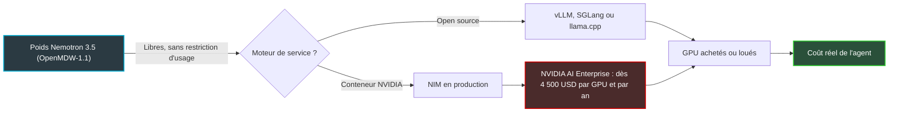
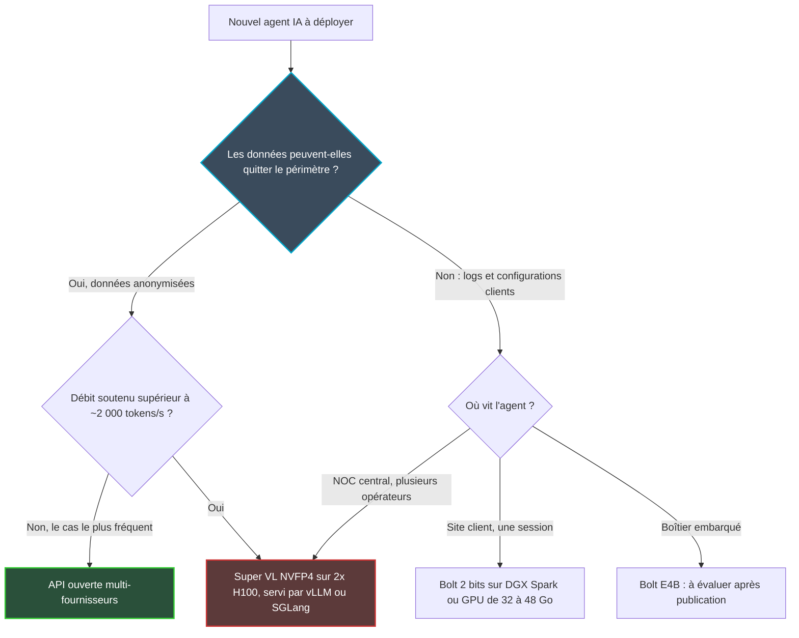

## Trois heures du matin, et des journaux qu'on ne veut pas voir partir

Il est trois heures du matin dans un hôtel de 300 chambres, et le Wi-Fi du troisième étage vient de tomber. Avant que le technicien d'astreinte ait ouvert son ordinateur, un agent logiciel pourrait déjà avoir corrélé les alarmes, relu la procédure d'intervention et proposé un correctif. Ce scénario n'a plus rien de futuriste. La vraie question est ailleurs : où tourne cet agent, et qui voit passer les journaux techniques de vos clients ?

Le 15 octobre, NVIDIA a mis sur la table une réponse crédible avec deux modèles, Nemotron 3.5 Super VL et Nemotron 3.5 Bolt. Leurs poids, c'est-à-dire les paramètres que l'on télécharge pour faire tourner le modèle sur ses propres machines, sont publiés sous une licence qui ne restreint ni l'usage ni les sorties. Pour un opérateur qui supervise des milliers de sites en hôtellerie, retail, entreprise ou résidences étudiantes, la promesse est nette. Des agents de supervision hébergés chez soi, sans dépendre d'une API fermée.

Reste que « ouvert » ne veut pas dire « bon marché ». Le chiffre-vitrine de 24 Go affiché pour Bolt ne résiste pas à la mesure. Le grand modèle réclame deux cartes graphiques de datacenter pour servir une équipe. Et l'API publique facture le million de tokens 0,14 USD.

Ma thèse tient en une phrase : on auto-héberge ces modèles pour garder la main sur ses données, pas pour faire des économies.

## Deux modèles, une même astuce : ne réveiller que les experts utiles

Imaginez une clinique qui emploie 120 spécialistes. À chaque patient, l'accueil n'en convoque qu'une douzaine : inutile de déranger le cardiologue pour une entorse. La clinique dispose d'un savoir immense, mais chaque consultation ne mobilise qu'une fraction de ses effectifs. C'est le principe du « mélange d'experts » (MoE, *Mixture of Experts*) sur lequel reposent les deux modèles.

**Super VL** compte 120 milliards de paramètres, dont 12 milliards actifs pour chaque token produit [2]. Il lit du texte et des images, de la vidéo selon la recette de déploiement, et répond en texte. Sa fenêtre de contexte, soit la quantité d'information qu'il garde en tête d'un seul tenant, atteint un million de tokens selon ses fiches techniques (*model cards*) [2][3].

Nuance importante : cette fenêtre se rétrécit avec la mémoire disponible. Sur un DGX Spark, la station de travail IA compacte de NVIDIA, la recette basée sur TensorRT-LLM (le moteur d'inférence maison) la ramène à 131 072 tokens. La recette sur deux GPU H100 annonce bien le million [3]. Le billet officiel de NVIDIA, lui, ne parle pas du contexte [1].

Les poids sont publiés en deux formats. BF16, la précision de référence sur 16 bits. Et NVFP4, un format 4 bits propre aux GPU NVIDIA récents, bien plus compact.

**Bolt 74B-A9B** joue une autre partition. Il compte 74 milliards de paramètres dont 9 milliards actifs, un contexte officiel de 262 144 tokens et une entrée texte, image et vidéo MP4 de deux minutes maximum [4][8]. Sa signature, c'est la compression extrême : les experts sont stockés à environ 2 bits par paramètre (format IQ2_XXS, 2,0625 bits exactement), contre 16 en précision de référence.

Pour encaisser ce régime, le modèle a été entraîné à être compressé. NVIDIA parle de distillation consciente de la quantification (QAD) : la version compressée apprend à imiter la version pleine précision. Le reste du réseau est moins comprimé, en NVFP4 pour les couches Mamba (une alternative aux transformers, économe sur les longues séquences) et en 8 bits pour la table de vocabulaire [4].

Un troisième modèle, **Bolt E4B** (4 Go), est annoncé pour le 23 octobre [1]. À l'heure où j'écris, il n'est pas disponible, et ni son contexte, ni sa licence, ni ses benchmarks n'ont été publiés. Je n'en dirai donc rien de plus.

*Super VL se répartit sur deux GPU de datacenter, Bolt compressé à 2 bits vise une seule carte : deux philosophies de déploiement dans la même famille.*

## Mesures indépendantes contre vitrine marketing

Commençons par le seul arbitre qui n'a pas d'intérêt dans l'affaire. Artificial Analysis (AA), qui évalue les modèles avec ses propres protocoles, attribue environ 26 points à Super VL sur son Intelligence Index [8]. AA le présente comme son modèle à poids ouverts américain le mieux noté, de justesse devant Inkling Small (25,7) et nettement devant Nemotron 3 Ultra (23). La prudence s'impose : dans un autre article, AA place Beam, de Reflection, à 30. Bolt se situe autour de 21. Mais Super VL n'est pas le meilleur modèle ouvert tout court : K2 Horizon 375B (31) et MiMo-V2.6-Pro (46) le devancent largement.

Le chiffre AA le plus utile pour un exploitant est ailleurs. Super VL produit en moyenne 46 000 tokens de sortie par tâche, 60 % de moins que son prédécesseur Nemotron 3 Super (114 000). Bolt en dépense 82 000, soit 1,8 fois plus [8]. Un modèle qui parle moins coûte moins cher et répond plus vite, où qu'il soit hébergé.

Côté vitrine, un peu de ménage s'impose. NVIDIA promet un modèle « jusqu'à 5 fois plus rapide » que ceux de sa classe. Le calcul existe : 630 tokens/s mesurés par AA sur un point d'accès DeepInfra de pré-lancement, contre 124 pour Inkling Small, soit 5,1 fois. Face à Nemotron 3 Ultra (235 tokens/s), l'écart tombe pourtant à 2,7 fois, et à 4,5 fois face à Nemotron 3 Super. La page modèle d'AA affiche ensuite 430 tokens/s en médiane, avec 0,81 seconde avant le premier token [9]. Le « 5x » est un meilleur cas, pas une moyenne.

Les scores de la model card appellent la même prudence, puisqu'ils sortent tous des bancs de test internes de NVIDIA. On y lit 71,10 sur SWE-bench Verified (correction de code), 60,67 sur Terminal-Bench 2.1 (tâches en ligne de commande) et 73,19 sur tau2-bench telecom [2]. Ce dernier est le plus proche de nos métiers : un dialogue de support télécom avec appels d'outils. Mais il simule un service client, pas une supervision réseau.

Deux affirmations méritent un astérisque. La victoire sur Claude Opus 5 et GPT-6.1 Sol « sur cinq tâches métier » concerne des variantes post-entraînées par des partenaires. Selon les relais de presse, le modèle de base reste derrière ces deux modèles fermés, et ni protocole ni taille d'échantillon n'ont été publiés [12][13]. Quant à la première place sur PinchBench revendiquée pour Bolt, le tableau de sa propre model card le place à 87,82, derrière Qwen3.6-35B-A3B à 88,07 [4].

Dernier angle mort : l'index AA n'évalue pas les images. La lecture de documents, que NVIDIA met en avant, n'y est donc pas mesurée de manière indépendante.

## OpenMDW-1.1 : vraiment ouverte, avec une clause à lire deux fois

Vous pouvez télécharger ces poids, les affiner sur vos tickets d'incident, les intégrer dans un service facturé à vos clients, et ne rien republier en retour. C'est rare. C'est aussi le vrai point fort de cette sortie.

Les trois model cards indiquent que les modèles sont régis par l'OpenMDW License Agreement, version 1.1, et « prêts pour un usage commercial ou non commercial » [2][3][4]. Le billet de NVIDIA ne nomme pas la licence : ce sont les fiches techniques qui font foi. J'ai lu le texte [5]. Il autorise à exploiter les matériaux du modèle « sans restriction », au titre du droit d'auteur, des brevets, des bases de données et du secret commercial. Seule condition pour redistribuer : joindre la licence et les mentions applicables.

Surtout, il n'y a ni politique d'usage acceptable (AUP, la liste d'usages interdits qu'imposent d'autres éditeurs), ni restriction de domaine, ni restriction sur les sorties. Aucune obligation non plus de publier vos poids affinés [6][7].

Trois réserves, pourtant.

D'abord, la clause de résiliation. Si vous engagez, maintenez ou rejoignez une action alléguant que ces matériaux enfreignent un brevet ou un droit d'auteur, tous vos droits tombent. Seule exception : la riposte à une action lancée d'abord contre vous. La version 1.0 ne visait que les brevets ; la 1.1 étend le mécanisme au droit d'auteur [6].

Ensuite, la garantie. Tout est fourni « AS IS », et vous êtes seul responsable de vérifier qu'aucun droit de tiers n'est enfreint [5]. La mention « prêt pour un usage commercial » vient de NVIDIA, pas d'un avis juridique. Je ne mettrais rien en production sans une relecture du texte par un juriste.

Enfin, le statut. OpenMDW-1.1 a été soumise à l'OSI (Open Source Initiative) en août 2026 mais n'est pas encore approuvée [6][7]. Ouverte, oui. « Open source » au sens officiel, pas encore.

Le piège le plus coûteux n'est d'ailleurs pas juridique. Les poids sont libres, mais NIM, le conteneur d'inférence de NVIDIA, exige en production une licence NVIDIA AI Enterprise. Comptez à partir de 4 500 USD par GPU et par an, soit environ 1 USD par GPU et par heure en cloud [15][16]. Sur deux H100, cela fait 9 000 USD de plus chaque année, et une dépendance au rythme de mises à jour de NVIDIA.

La parade est simple : servir le modèle avec un moteur open source, vLLM, SGLang ou llama.cpp, dont les recettes figurent directement sur les model cards.

*Les poids ne coûtent rien : la facture se loge dans le moteur de service et dans le matériel.*

## Le mirage des 24 Go

Le nom du dépôt le promet : Bolt 74B-A9B « 24GB ». Sur une station DGX Spark, un testeur indépendant a pourtant mesuré 31,4 GiB occupés en mémoire avec le décodage spéculatif activé, et 27,9 GiB sans [10]. Pas 24.

Le décalage n'a rien d'une tromperie, il est écrit en petits caractères. La model card parle d'un modèle conçu pour rester « sous 24 Go en batch 1 avec 128K de contexte » : une cible de conception [4]. Ses propres recettes demandent 32 Go (Spark 128 Go ou GPU de 48 Go et plus) ou 28 Go (Spark 64 Go ou GPU de 32 Go et plus). Et seulement sur les architectures Ada Lovelace et Blackwell.

Unsloth, qui distribue des versions optimisées, conseille de « budgéter environ 32 Go » pour un fichier 2 bits de 22 Go, et 48 à 64 Go pour garder de la marge [11]. Chaque token de contexte supplémentaire consomme aussi de la mémoire. Unsloth documente d'ailleurs 128K de contexte, là où la fiche officielle en annonce 256K.

Les débits racontent la même histoire. Sur ce même Spark, avec llama.cpp : 39,5 tokens/s pour une requête seule, 61,6 avec spéculation. À huit requêtes simultanées, le débit total grimpe à 102 tokens/s, mais chaque requête n'en reçoit plus que 13 [10]. Croisons avec les 82 000 tokens de sortie qu'AA mesure en moyenne par tâche pour Bolt. À 13 tokens/s, une tâche de ce calibre dépasse l'heure et demie. C'est un ordre de grandeur, pas une mesure, mais il suffit à enterrer l'idée d'un Spark partagé par toute une équipe.

Pour Super VL, même constat. En BF16, NVIDIA recommande quatre H100 ou deux GB200 [2]. En NVFP4, la model card liste quatre configurations [3] :

- **1 DGX Spark** : texte et image, une seule séquence à la fois (`--max-num-seqs 1`), un petit modèle d'appoint pour accélérer la génération, contexte réduit ;
- **1 H200** ;
- **2 H100** : contexte d'un million de tokens, jusqu'à 128 séquences simultanées ;
- **1 GB200** : jusqu'à 512 séquences.

Lecture d'exploitant : un Spark sert une conversation, pas un centre de supervision. C'est un guichet unique devant une file d'attente.

Le passage en 4 bits a-t-il un prix ? Sur la plupart des tests publiés par NVIDIA, presque aucun : 71,07 contre 71,10 sur SWE-bench Verified, égalité à 73,19 sur tau2-bench telecom. AA ne mesure que 0,1 point d'écart sur son index.

Les agents au long cours décrochent en revanche [3]. WebVoyager, qui teste la navigation web autonome, chute de 77,72 à 66,31. DeepSWE passe de 24,65 à 18,20, MMLU-ProX de 76,91 à 73,76. Un agent qui enchaîne des dizaines d'actions dans la console d'un contrôleur Wi-Fi ressemble davantage à WebVoyager qu'à un QCM. À tester avant de choisir le format.

Bolt à 2 bits, enfin. Le seul test indépendant disponible, mené par un auteur sur un petit échantillon, est encourageant : 49 tests de code sur 49, 12 réparations sur 12 en cinq tours, 5 appels d'outils basiques sur 5, 3 images décrites sans hallucination [10]. Mais deux sélections d'outils sur six ont échoué quel que soit le réglage, et plusieurs harnais d'agents (opencode, Hermes Agent, OpenClaw) ont été jugés « difficiles ». Aucune mesure indépendante de la dérive face à la version pleine précision n'existe encore : Unsloth marque ses évaluations comme « en cours » [11].

## 0,14 USD le million de tokens : le calcul qui fâche

*D'un côté le contrôle des données, de l'autre le prix au token : le point d'équilibre est bien plus haut qu'on ne l'imagine.*

Acheter un camion pour livrer trois colis par semaine n'a jamais été une bonne affaire, même avec un excellent camion. Un GPU obéit à la même logique : il coûte autant quand il attend que quand il travaille.

En face, la référence est brutale. AA relève pour Super VL un prix API de 0,225 USD par million de tokens en entrée et 0,575 USD en sortie [9]. En moyenne pondérée, cela donne 0,14 USD, sur un mélange 7:2:1 entre tokens en cache, en entrée et en sortie, avec 78 % de remise sur le cache. Huit fournisseurs servent déjà le modèle.

J'ai fait le calcul, hypothèses sur la table. Deux H100 loués 24 heures sur 24 à 2 USD par GPU et par heure (le bas du marché) coûtent 35 040 USD par an, 44 040 avec NIM. Pour que l'API coûte autant au tarif moyen, il faudrait consommer environ 250 milliards de tokens par an (315 milliards avec NIM). Soit près de 7 900 tokens par seconde, en continu, jour et nuit.

Même au seul tarif de sortie, le plus cher, le seuil reste à 61 milliards de tokens par an, environ 1 900 tokens par seconde soutenus. Il bouge avec le prix de location : 188 milliards à 1,5 USD de l'heure, 500 milliards à 4 USD. Une limite honnête à ce calcul : aucune donnée publique ne dit quel débit agrégé Super VL atteint réellement sur deux H100. J'ai le seuil de rentabilité, pas la preuve que le matériel l'atteint.

Prenons maintenant un agent NOC (centre d'opérations réseau) qui consomme 300 000 tokens par jour. Cela fait environ 110 millions de tokens par an, soit entre 15 et 63 USD via l'API selon qu'on applique le tarif moyen ou le tarif de sortie. En face, 35 000 USD de GPU. Plus de cinq cents fois plus.

Les prix du matériel sont des instantanés, à revérifier avant tout achat. Le DGX Spark Founders Edition est passé de 3 999 à 4 699 USD le 23 février 2026 [17]. Un H100 se loue autour de 2 à 4,50 USD de l'heure chez les spécialistes (jusqu'à 7 à 12 USD chez les hyperscalers), avec des hausses relevées en octobre 2026 [19]. Une RTX PRO 6000 Blackwell complète se loue environ 2,2 à 2,9 USD de l'heure (des tranches de 24 Go démarrent à 0,69 USD), et s'achète autour de 13 800 à 20 000 USD en septembre 2026, contre 8 565 USD au lancement en avril 2025 [18].

Conclusion : le prix du token ne justifie pas l'auto-hébergement. Trois raisons le justifient. La confidentialité des données, la latence locale et l'indépendance. Si aucune ne pèse dans votre cas, prenez l'API.

*Arbre de décision : la sensibilité des données tranche avant le volume de tokens.*

## Du NOC au site client : là où l'auto-hébergement gagne vraiment

Les journaux d'un contrôleur Wi-Fi d'hôtel contiennent des adresses matérielles de terminaux, des noms de réseaux, des topologies de sites. Les envoyer chez un tiers pour qu'un modèle les résume, c'est ouvrir une discussion contractuelle avec chaque client. Les garder chez soi, c'est la clore.

Pour un agent NOC (corrélation d'alarmes, triage, exécution de procédures), Super VL sur deux H100, achetés ou loués à la demande, garde logs et configurations dans le périmètre. Pour un agent posé sur site, dans une résidence ou un magasin, l'équation se complique. Bolt réclame 32 à 48 Go de mémoire : c'est une station type DGX Spark ou une carte de la classe RTX PRO, pas une box edge classique. À 4 699 USD le Spark, on n'en installe pas un dans chaque magasin. La variante E4B, annoncée pour le 23 octobre, changera peut-être la donne. On en reparlera après test.

Le vrai atout de cette sortie se nomme réversibilité. Huit fournisseurs servent les mêmes poids via API. On peut piloter chez l'un sur des données anonymisées, basculer chez un autre, puis rapatrier en interne sans changer de modèle, de prompts ni de jeu d'évaluation. Avec un modèle fermé, rapatrier signifie changer de modèle. Et tout réévaluer.

Reste l'angle mort majeur. Personne n'a publié d'évaluation de ces modèles sur de la supervision réseau, de l'hôtellerie ou du retail. Tau2-bench telecom et Terminal-Bench sont des indices, pas des preuves. Le seul benchmark qui compte est le vôtre : quelques centaines de tickets réels, anonymisés, avec la résolution attendue.

*L'agent de supervision lit alarmes, tableaux de bord et plans Wi-Fi : la question n'est pas seulement ce qu'il comprend, mais où ces données transitent.*

## Ma position : ouvrir les poids, fermer le périmètre

Nemotron 3.5 n'est pas le meilleur modèle ouvert du marché, et ce n'est pas le sujet. Il est assez bon, sa licence figure parmi les plus permissives du moment, et il arrive avec des recettes de déploiement exploitables. Pour un exploitant de réseau, c'est la combinaison qui compte.

Ma feuille de route tient en quatre points :

1. **Piloter par l'API**, sur des données anonymisées, pour mesurer la consommation réelle de tokens avant d'acheter le moindre GPU.
2. **Construire son propre jeu d'évaluation** à partir de tickets et de procédures internes, et comparer BF16 et NVFP4 sur les tâches longues.
3. **Auto-héberger quand la donnée l'exige**, avec vLLM ou SGLang, et ne payer NIM que si le support NVIDIA a une valeur chiffrée.
4. **Faire valider OpenMDW-1.1 par le juridique**, clause de résiliation en tête.

Et ne dimensionner aucun matériel sur la foi d'un « 24 Go » inscrit dans un nom de dépôt. Les poids ouverts ne rendent pas l'IA moins chère. Ils rendent le choix réversible. C'est beaucoup plus précieux.

---

_Vues personnelles, pas position Wifirst._

## Sources

1. NVIDIA, billet d'annonce de Nemotron 3.5 Super VL (15 octobre 2026) — https://blogs.nvidia.com/blog/nemotron-3-5-super-vl/
2. Hugging Face, model card NVIDIA-Nemotron-3.5-Super-VL-120B-A12B-BF16 (15 octobre 2026) — https://huggingface.co/nvidia/NVIDIA-Nemotron-3.5-Super-VL-120B-A12B-BF16
3. Hugging Face, model card NVIDIA-Nemotron-3.5-Super-VL-120B-A12B-NVFP4 (15 octobre 2026) — https://huggingface.co/nvidia/NVIDIA-Nemotron-3.5-Super-VL-120B-A12B-NVFP4
4. Hugging Face, model card NVIDIA-Nemotron-3.5-Bolt-74B-A9B-24GB-GGUF (15 octobre 2026) — https://huggingface.co/nvidia/NVIDIA-Nemotron-3.5-Bolt-74B-A9B-24GB-GGUF
5. Texte de la licence OpenMDW-1.1 — https://raw.githubusercontent.com/OpenMDW/OpenMDW/refs/heads/main/1.1/LICENSE.OpenMDW-1.1
6. OSI, liste license-review, soumission d'OpenMDW-1.1 (août 2026) — https://lists.opensource.org/pipermail/license-review_lists.opensource.org/2026-August/006150.html
7. Techstrong.ai, soumission de la licence OpenMDW à l'Open Source Initiative (août 2026) — https://techstrong.ai/articles/linux-foundation-submits-openmdw-ai-license-to-open-source-initiative/
8. Artificial Analysis, « Nemotron 3.5 Super and Bolt » (15 octobre 2026) — https://artificialanalysis.ai/articles/nemotron-3-5-super-and-bolt
9. Artificial Analysis, page modèle Nemotron 3.5 Super VL (consultée le 21 octobre 2026) — https://artificialanalysis.ai/models/nemotron-3-5-super-vl
10. Classmethod, premiers tests de Nemotron 3.5 Bolt 74B-A9B sur DGX Spark (octobre 2026) — https://dev.classmethod.jp/en/articles/dgx-spark-nemotron-3-5-bolt-74b-a9b-first-touch/
11. Unsloth, documentation Nemotron 3.5 Bolt (octobre 2026) — https://unsloth.ai/docs/models/nemotron-3.5-bolt
12. Metirai, analyse de Nemotron 3.5 Super VL et d'OpenMDW (octobre 2026) — https://www.metirai.com/blog/nvidia-nemotron-3-5-super-vl-open-model-openmdw-2026
13. AI Weekly, relais VentureBeat sur les revendications de Nemotron 3.5 Super VL (16 octobre 2026) — https://aiweekly.co/alerts/nvidia-opens-120b-nemotron-35-super-vl-claims-task-wins
14. IT Brief Australia, lancement des modèles Nemotron 3.5 pour agents (octobre 2026) — https://itbrief.com.au/story/nvidia-launches-nemotron-3-5-open-models-for-agents
15. NVIDIA NIM, FAQ produit — https://docs.api.nvidia.com/nim/docs/product
16. The Register, l'empire logiciel de NVIDIA (6 août 2024) — https://www.theregister.com/2024/08/06/nvidia_software_empire/
17. Forum développeurs NVIDIA, changement de prix du DGX Spark (23 février 2026) — https://forums.developer.nvidia.com/t/2-23-2026-price-change-announcement/361713
18. GPU per Hour, prix de location et d'achat de la RTX PRO 6000 — https://gpuperhour.com/blog/nvidia-rtx-pro-6000
19. IntuitionLabs, comparatif des prix de location H100 (relevé du 10 octobre 2026) — https://intuitionlabs.ai/articles/h100-rental-prices-cloud-comparison
