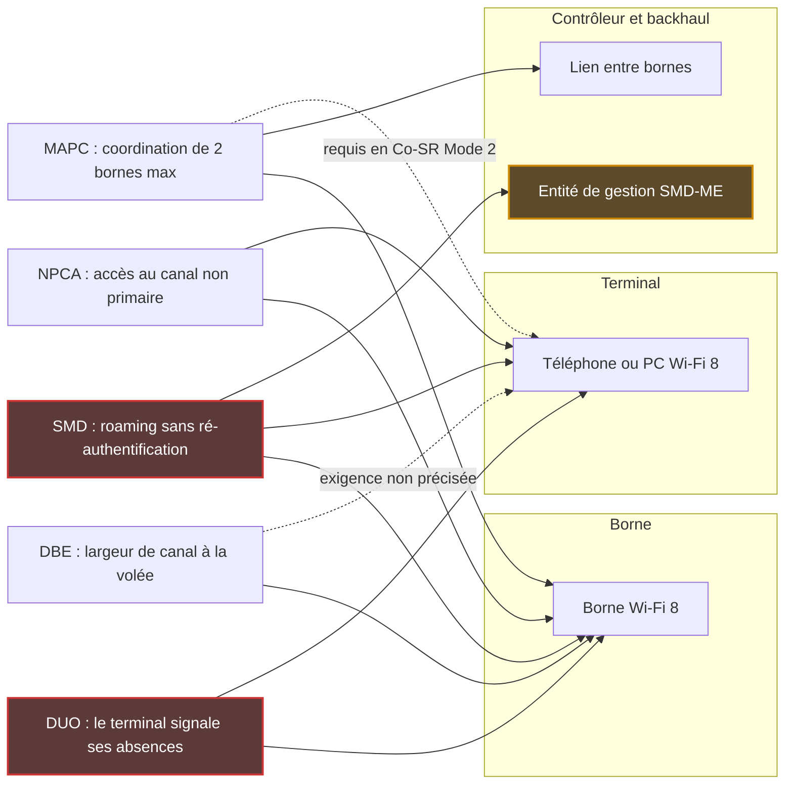
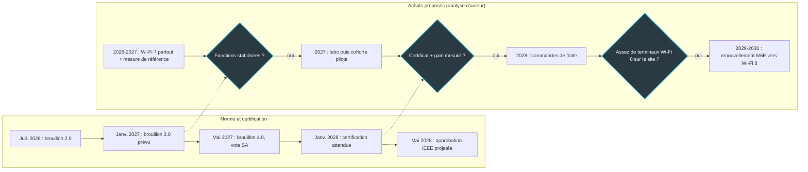

## Quarante mètres de couloir

Un client d'hôtel sort de l'ascenseur en pleine visioconférence et marche jusqu'à sa chambre, téléphone à la main. Sur ces quarante mètres de couloir, son appareil change plusieurs fois de borne Wi-Fi sans qu'il s'en aperçoive. Quand le passage se passe mal, l'image se fige, le son coupe, et l'appel tombe. Le débit n'y est pour rien. C'est la continuité qui manque.

C'est précisément ce que la prochaine génération, le Wi-Fi 8, promet de corriger. Elle ne cherche pas à aller plus vite que le Wi-Fi 7 : elle cherche à être plus fiable. Le 20 octobre, Cisco a publié un billet de fond sur le sujet. Sa conclusion a de quoi surprendre, venant d'un fabricant de bornes : pour l'instant, restez en Wi-Fi 7.

Pour qui équipe des hôtels, des résidences étudiantes ou des plateaux de bureaux par centaines de sites, la question n'a rien de théorique. Les budgets de renouvellement 2027 se bouclent en ce moment. Les premiers produits Wi-Fi 8 arriveront avant la norme définitive, et les argumentaires commerciaux avec eux.

Je ne vais pas discuter la date de ratification. Je vais regarder la chaîne. Chaque gain de fiabilité annoncé repose sur un maillon différent : la borne, le téléphone du client, ou le contrôleur qui orchestre le parc de bornes. Et aucun de ces gains n'a encore été mesuré ailleurs que dans un simulateur.

## Ce que Cisco écrit, et ce qu'il ne chiffre pas

Le billet s'intitule *Wi-Fi 8: The next evolution in enterprise connectivity* et il est signé Anand Gurumurthy, Brian Hart et Binita Gupta. Il rappelle que le Wi-Fi 8 correspond à la future norme IEEE 802.11bn, surnommée *Ultra-High Reliability* (UHR, ultra-haute fiabilité). Puis il déroule une demi-douzaine de fonctions, chacune avec son acronyme, que je détaille plus bas : roaming sans coupure, coordination entre bornes voisines, signalement des moments où le terminal ne peut pas écouter, entre autres.

Ce qui frappe, c'est ce qui manque. Pas un seul chiffre de performance. Ni gain de latence, ni baisse des pertes, ni comparaison chiffrée avec le Wi-Fi 7. Ce n'est pas un reproche : la norme est encore un brouillon, et un éditeur prudent évite de chiffrer ce qui peut bouger. Mais toute promesse de couloir d'hôtel sans coupure reste, à ce stade, une projection.

Côté calendrier, Cisco situe la ratification vers 2028 et note que des produits certifiés pourraient sortir quelques mois avant l'approbation formelle. Il assume surtout un horizon long : « Realistically, enterprise-ready Wi-Fi 8 products are 3-5 years away from mainstream deployment. » D'où la phrase qui va circuler dans les comités d'achat : « Wi-Fi 7 remains the right choice for enterprise deployments today and for the foreseeable future. »

Pour mémoire, les objectifs chiffrés que s'est fixés l'IEEE par rapport au Wi-Fi 7, dont un quart de latence en moins au 95e percentile, ont été détaillés ici en août. Ce sont des cibles de norme, pas des mesures.

Un détail de contexte, enfin, qui n'a rien d'un scandale mais qui éclaire la lecture. Brian Hart et Binita Gupta figurent parmi les inventeurs d'une demande de brevet internationale de Cisco, WO2026102392A1, publiée le 15 mai 2026. Elle décrit une architecture pour ce fameux roaming sans coupure. C'est une demande, pas un brevet délivré, et je l'ai consultée via le résumé de la base Patsnap, pas sur le dépôt officiel. Les auteurs connaissent ce mécanisme de l'intérieur, et leur employeur a déjà réfléchi à l'endroit où il pourrait être hébergé. J'y reviens plus bas.

## Trois maillons, trois calendriers

Installer une borne Wi-Fi 8, c'est poser une voie ferrée à grande vitesse. La voie neuve ne fait pas rouler plus vite les vieux trains. La vitesse arrive avec le matériel roulant, ici les téléphones et ordinateurs des utilisateurs, et avec le poste d'aiguillage, c'est-à-dire le contrôleur qui pilote les bornes. Tant que les trois ne sont pas au même niveau, la ligne neuve transporte des trains ordinaires à vitesse ordinaire.

Le schéma ci-dessous classe les principales fonctions selon le maillon à mettre à jour pour qu'elles servent. C'est ma lecture du billet Cisco, de deux articles de recherche et de la demande de brevet.

*Qui doit être mis à jour pour que chaque fonction serve (lecture de l'auteur). En rouge, DUO et SMD, les plus dépendantes du terminal ; en orange, l'entité de gestion du roaming, hébergeable sur un contrôleur selon la demande de brevet Cisco.*

**Le terminal qui prévient de ses absences (DUO).** Votre téléphone envoie de la musique vers des écouteurs Bluetooth tout en restant connecté au Wi-Fi. Il partage ses ressources radio internes entre les deux. Pendant quelques millisecondes, parfois quelques dizaines, il devient sourd au Wi-Fi, et la borne, mal prévenue, peut émettre dans le vide. DUO est, selon Cisco, la fonction « which lets a device tell the access point when and for how long it cannot receive Wi-Fi transmissions ». Une variante, PUO, couvre les absences périodiques comme le streaming audio.

Le point clé : c'est le terminal qui parle. DUO exige donc un terminal Wi-Fi 8. Un téléphone Wi-Fi 7 récent pourra-t-il en profiter par simple mise à jour logicielle ? Je n'ai trouvé aucune source qui tranche, dans un sens ou dans l'autre.

**Le roaming sans repasser la sécurité (SMD).** Changer de borne aujourd'hui ressemble à une correspondance d'aéroport où l'on repasserait le contrôle de sûreté à chaque terminal. Le *Seamless Mobility Domain* (SMD) veut créer une zone de correspondance unique. Le terminal s'attache à la nouvelle borne avant de quitter l'ancienne, sans se ré-authentifier.

Une zone de correspondance suppose une autorité de sûreté commune. Dans les documents que j'ai lus, elle s'appelle SMD-ME : c'est l'entité qui porte l'authentification réseau (802.1X) et la gestion des clés. Le SMD exige donc trois mises à jour simultanées : des bornes multi-liens (AP MLD), des terminaux Wi-Fi 8 multi-liens, et cette entité.

La demande de brevet de Cisco décrit deux modes, distribué et centralisé. Elle précise que le SMD-ME peut être hébergé sur un contrôleur de réseau sans fil (WLC) ou sur un contrôleur de réseau programmable (SDN), avec l'exemple de DNAC, la plateforme d'administration de Cisco.

**Analyse d'auteur, à prendre comme telle.** Si l'autorité de sûreté du roaming vit dans le contrôleur, le contrôleur devient le point de verrouillage. Un opérateur qui fait cohabiter plusieurs marques de bornes, ou qui veut garder la main sur son orchestration, doit savoir très tôt où cette entité peut résider. Rien ne dit que la norme finale imposera ce choix. Mais quand deux co-auteurs du billet figurent comme inventeurs d'une architecture sur le sujet, la question mérite d'être posée.

**La largeur de canal à la volée (DBE).** La borne adapte la largeur de son canal en temps réel. Le maillon principal est la borne, avec un effet direct sur la planification des fréquences. L'exigence côté terminal n'est pas précisée dans les sources que j'ai lues.

**Deux bornes qui se coordonnent (MAPC).** La coordination multi-bornes (*Multi-AP Coordination*) permet à des bornes voisines de se répartir le temps et l'espace radio au lieu de se marcher dessus. Limite rarement mise en avant : le cadre est restreint à deux bornes. Pas trois, pas un étage entier.

Cinq schémas sont en cours d'écriture. Les trois qui parlent le plus à l'exploitation sont la réutilisation spatiale coordonnée (Co-SR), la formation de faisceaux coordonnée (Co-BF) et le partage du temps d'antenne (Co-TDMA). Deux autres schémas complètent la liste.

Côté terminal, l'exigence varie. Co-SR existe en deux modes : le Mode 1 accepte un mélange de terminaux Wi-Fi 8 et Wi-Fi 7, le Mode 2 exige un environnement 100 % Wi-Fi 8. Co-BF plafonne à deux bornes simultanées, quatre flux spatiaux au total et quatre terminaux destinataires. Côté infrastructure, il faut un lien entre les bornes. Or ce lien n'était pas encore défini début 2026. La proposition de conception publiée par Qualcomm en janvier pour hostapd, le logiciel libre de point d'accès utilisé sous Linux, diffère explicitement la coordination par lien filaire et la sécurité des échanges entre bornes. Son auteur prévient que tout peut encore changer.

**Le canal de secours (NPCA).** Quand le canal principal d'une borne est occupé par un voisin, l'accès au canal non primaire (*Non-Primary Channel Access*) lui permet de travailler sur une autre portion du canal. Il faut une borne et un terminal Wi-Fi 8.

*Borne, terminal, contrôleur : la plupart des fonctions du Wi-Fi 8 supposent qu'au moins deux de ces maillons soient à jour en même temps.*

## Simulé, pas mesuré

J'ai cherché des mesures terrain publiques de ces fonctions. Je n'en ai trouvé aucune. Ce n'est pas anormal à ce stade du brouillon. Mais tous les chiffres qui circulent sortent de simulateurs, et il faut savoir lesquels.

Le premier article, signé Liu et al. et publié sur arXiv le 22 juillet 2026, compte un co-auteur chez Huawei. Il compare plusieurs fonctions à une référence Wi-Fi 7 (EHT dans le jargon de l'IEEE). En simulation, DUO réduit les pertes de paquets de plus de 35 % pour des absences de 10 à 30 ms, et de plus de 30 % avec un trafic variable. Un mécanisme d'accès prioritaire au canal, P-EDCA, réduit la latence au 95e percentile de plus de 30 %, toujours en simulation.

NPCA montre la limite de l'exercice. Quand deux cellules se recouvrent partiellement, le gain de débit simulé dépasse 40 %. Mais au-delà de 500 Mbit/s de trafic dans la cellule voisine, le gain devient négatif. Une fonction qui aide dans un bureau calme peut desservir dans un immeuble dense. C'est exactement le genre de nuance qu'une fiche produit oubliera.

Et le roaming ? L'article décrit le SMD mais ne le simule pas. Ses auteurs reconnaissent qu'il est difficile d'observer directement, par simulation, les pertes de paquets lors des changements de borne. DBE n'est pas simulé non plus : son gain de débit est jugé évident. Autrement dit, la fonction qui parle le plus directement au client du couloir d'hôtel est celle pour laquelle je n'ai lu aucun chiffre.

Le second article est un tutoriel académique de Wilhelmi, Bellalta, Geraci, Galati-Giordano et leurs co-auteurs, publié sur arXiv le 11 juin 2026 sur la base du brouillon 1.4. Il s'attaque à la coordination entre bornes. Son résultat le plus instructif tient en deux chiffres simulés. En Co-TDMA, le délai d'accès au canal baisse de 55 % pour les deux cellules coordonnées. Celui de la cellule voisine non coordonnée se dégrade de plus de 130 %.

Pensez à la buanderie d'un immeuble. Deux voisins qui s'entendent sur les créneaux de la machine à laver gagnent du temps. Le troisième, absent de la réunion, attend plus de deux fois plus longtemps qu'avant. Pire : dans le scénario où toutes les cellules se recouvrent, le mode d'accès historique du Wi-Fi (DCF, où chacun écoute et parle quand le canal est libre) reste meilleur en débit total comme en équité. Co-TDMA pénalise en outre les terminaux anciens.

Pour un opérateur, la cellule non coordonnée n'a rien d'abstrait (analyse d'auteur). C'est la borne du locataire voisin dans un centre d'affaires, le point d'accès personnel d'un étudiant dans sa chambre, ou le réseau d'un autre prestataire à l'étage du dessous. Accélérer deux bornes aux dépens d'une troisième, c'est déplacer le ticket de support, pas le supprimer. Quant à l'interopérabilité de ces schémas entre marques de bornes, je n'ai trouvé aucune source.

*Deux bornes coordonnées gagnent en délai d'accès ; la cellule voisine, restée hors de la boucle, paie la facture.*

Le tableau suivant résume l'état des preuves, fonction par fonction.

| Fonction | Maillons qui doivent suivre | Preuve publique lue |
|---|---|---|
| DUO | Borne + terminal Wi-Fi 8 | Simulation : plus de 35 % de pertes en moins |
| SMD | Borne + terminal Wi-Fi 8 + entité de gestion, hébergeable sur un contrôleur selon le brevet Cisco | Aucune simulation |
| DBE | Borne ; exigence terminal non précisée | Non simulé, gain jugé évident |
| Co-SR | Deux bornes et un lien entre elles ; Mode 2 réservé au 100 % Wi-Fi 8 | Simulation, résultats selon la topologie |
| Co-TDMA | Deux bornes ; lien filaire non défini début 2026 | Simulation : délai -55 % pour les coordonnés, plus de +130 % pour le voisin |
| NPCA | Borne + terminal Wi-Fi 8 | Simulation : plus de +40 %, ou négatif si le voisin est chargé |

## 2028 est une cible, pas une date de livraison

Le calendrier du groupe de travail IEEE 802.11bn (TGbn) est public. Projet approuvé en juillet 2023, premier brouillon en janvier 2025. Le brouillon 1.0 était prévu en mai 2025 : il est sorti en juillet. Le 2.0 était prévu en mai 2026 : il est sorti en juillet. Deux brouillons, deux glissements de deux mois.

La suite est projetée. Brouillon 3.0 en janvier 2027, premier vote de la Standards Association (SA) sur le 4.0 en mai 2027, approbations finales du groupe de travail et du comité exécutif 802 en mars 2028. Viendront enfin les dernières validations de l'IEEE (RevCom et SASB) en mai 2028. Le rythme est soutenu : environ 670 commentaires résolus à Anvers en mai 2026, environ 900 à Montréal en juillet, où le groupe a approuvé un scrutin de 30 jours sur le brouillon 2.0.

Le débat de fond n'est pas clos pour autant. Les 10 et 11 août, sur la liste de diffusion du groupe 802.11, Carlos A. Rios a estimé que le brouillon 2.0 ne respectait pas le cahier des charges du projet, faute de gain en débit crête, et appelé à voter non au scrutin LB296. Vinko Erceg, Thomas Pare et Laurent Cariou, l'auteur de ce cahier des charges, ont répondu que le critère porte sur le débit à portée, pas en crête. Ce sont des avis individuels. Le résultat du scrutin, je ne l'ai pas trouvé.

Côté certification, deux sources secondaires, Wi-Fi NOW en juin et ABI Research en octobre, attendent le lancement du programme de la Wi-Fi Alliance en janvier 2028 (au CES 2028, précise Wi-Fi NOW). Ce serait donc avant l'approbation IEEE. Je n'ai pas pu consulter la page officielle de la Wi-Fi Alliance pour le confirmer. Rolf de Vegt, chez Qualcomm, situe pour sa part l'approbation IEEE finale en mai 2028 et les premiers produits Wi-Fi 8 dès 2027.

Le marché, lui, n'attend pas la norme. Selon Dell'Oro, le Wi-Fi 7 a dépassé la moitié des ventes au deuxième trimestre 2026, un trimestre à plus de 10 millions de points d'accès expédiés. Il continuera de croître jusqu'en 2028. Le même cabinet voit du chiffre d'affaires Wi-Fi 8 dès 2027, et estime que la pénurie de composants mémoire pourrait avancer le Wi-Fi 8 entreprise à cette même année.

ABI projette 0,3 million de bornes Wi-Fi 8 livrées en 2027, 1 million en 2028 et 10,9 millions en 2030, sans préciser si le résidentiel est inclus. Une prévision rappelée par SDxCentral place plus de la moitié du marché entreprise en Wi-Fi 8 d'ici 2032. Les 3 à 5 ans de Cisco, soit 2029 à 2031, restent son estimation propre : ces projections vont dans le même sens sans la confirmer.

*En haut, le calendrier projeté de la norme et de la certification ; en bas, ma proposition d'achat par déclencheurs, qui n'engage que moi.*

## Acheter sur preuves, pas sur une date

Ce qui suit est ma proposition, pas une pratique de marché documentée. Elle tient en une règle. Wi-Fi 7 pour tout site neuf et tout renouvellement jusqu'en 2027. Ensuite, un passage au Wi-Fi 8 déclenché par trois preuves, pas par un calendrier. Un certificat Wi-Fi Alliance sur la référence exacte achetée. Un gain mesuré sur une cohorte pilote, comparé à la situation de départ du même site. Un parc de terminaux compatible, site par site.

Pourquoi le parc client pèse-t-il autant ? Parce qu'en hôtellerie et en résidence étudiante, les terminaux appartiennent aux occupants. L'opérateur ne les choisit pas et ne les met pas à jour. ABI projette que 47 % des puces de smartphones seront compatibles Wi-Fi 8 en 2030. Mon interprétation : le parc réellement présent dans les chambres suivra avec retard, au rythme du renouvellement des téléphones. Les fonctions qui exigent un terminal Wi-Fi 8, DUO et SMD en tête, arriveront avec les clients, pas avec la borne.

Ce qui reste indépendant du terminal est maigre. Co-SR en Mode 1 accepte des terminaux Wi-Fi 7, mais la coordination reste plafonnée à deux bornes. ABI note d'ailleurs que les fonctions de coordination serviront peu à un foyer équipé d'une seule borne. Le cabinet ajoute que la coordination automatique des fréquences (AFC), qui conditionne le 6 GHz en puissance standard, progresse lentement.

En entreprise, le raisonnement s'inverse en partie (analyse d'auteur). La DSI renouvelle ses ordinateurs portables par vagues et peut aligner une vague sur le Wi-Fi 8. Le maillon terminal devient pilotable. Le maillon contrôleur, lui, devient le sujet.

| Fenêtre | Faits datés | Décision proposée | Déclencheur de l'étape suivante |
|---|---|---|---|
| T4 2026 à T1 2027 | Brouillon 3.0 prévu en janvier 2027 ; Wi-Fi 7 au-delà de 50 % des ventes (Dell'Oro) | Wi-Fi 7 pour tout site neuf et tout renouvellement ; mesure de référence par site | Brouillon 3.0 publié, fonctions stabilisées |
| 2027 | Premiers produits Wi-Fi 8 attendus (Qualcomm, Dell'Oro ; ABI : 0,3 M de bornes) ; vote SA en mai | Banc de laboratoire, puis une cohorte pilote : un hôtel, une résidence, un plateau. Aucun achat de flotte | Plan de test Wi-Fi Alliance publié (date non confirmée) |
| 2028 | Certification attendue en janvier ; approbations IEEE projetées de mars à mai | Commandes de flotte conditionnées au certificat et à la mesure sur la cohorte | Certificat sur la référence exacte + gain mesuré |
| 2029 à 2030 | Fenêtre de 3 à 5 ans de Cisco ; 10,9 M de bornes en 2030 selon ABI | Renouvellement des parcs Wi-Fi 6/6E vers le Wi-Fi 8 ; le Wi-Fi 7 acheté en 2027 est conservé | Part de terminaux Wi-Fi 8 mesurée au contrôleur, site par site |

*Un calendrier d'achat à déclencheurs : la cohorte pilote part tôt, la commande de flotte attend le certificat et la mesure.*

### Trois chantiers à ouvrir ce trimestre

Rien de tout cela ne tient sans données. Trois chantiers peuvent démarrer maintenant, sans attendre une seule borne Wi-Fi 8.

1. **Une mesure de référence par site.** Taux de roaming échoué, latence au 95e percentile, taux de retransmission : à relever dès aujourd'hui sur les sites candidats à la cohorte pilote. En 2028, c'est la seule chose qui permettra de distinguer un gain réel d'une slide commerciale. Sans point de départ, on ne mesure pas un progrès, on raconte une histoire.
2. **Un inventaire des terminaux.** La part de terminaux Wi-Fi 7 aujourd'hui, Wi-Fi 8 demain, site par site, remontée par le contrôleur. C'est le troisième déclencheur, et il se construit sur la durée.
3. **Une clause d'architecture.** Le volet certification des contrats a été traité ici le 19 octobre. J'ajoute une question à poser dans chaque appel d'offres : où sera hébergée l'entité qui gère le roaming sans coupure, peut-elle vivre hors du contrôleur de l'éditeur, et quels schémas de coordination fonctionneront entre deux marques de bornes ? Personne ne sait encore répondre. Raison de plus pour exiger la réponse par écrit dès qu'elle existera.

## Cisco a raison, mais pas à cause de la date

Je partage la conclusion de Cisco : en octobre 2026, le Wi-Fi 7 est le bon achat. Mais la raison solide n'est pas la date de ratification. C'est un objectif de l'IEEE, dont les deux derniers brouillons ont chacun pris deux mois de retard, et que la certification pourrait précéder. La raison solide, c'est la chaîne.

Les trois maillons avancent à des vitesses différentes. Les premières bornes sont attendues dès 2027. Le contrôleur suivra au rythme de chaque éditeur, avec un risque de dépendance qui ne me plaît pas. Le terminal, quand il appartient au client, arrivera en dernier, et c'est lui qui conditionne DUO et le SMD. Le gain le plus visible pour l'utilisateur, le couloir sans coupure, n'a aucune mesure publique. Et la coordination entre bornes a un coût pour le voisin.

Ce que je ne sais pas, je le dis. J'ignore si un terminal Wi-Fi 7 pourra profiter de DUO après une mise à jour, si les schémas de coordination fonctionneront entre marques, et quel a été le résultat du scrutin LB296. Les sources disponibles se résument à un éditeur intéressé qui ne chiffre rien, deux séries de simulations dont l'une a un co-auteur chez Huawei, et des analystes de marché. C'est une base pour se préparer, pas pour signer.

Achetez du Wi-Fi 7 sans état d'âme. Mais commencez dès maintenant à mesurer ce que le Wi-Fi 8 devra battre. Le jour où les trois preuves seront réunies, la décision prendra une semaine. Sans mesure de référence, elle prendra un an.

_Vues personnelles, pas position Wifirst._

## Sources

1. [Cisco Blogs — Wi-Fi 8: The next evolution in enterprise connectivity, A. Gurumurthy, B. Hart, B. Gupta (2026-10-20)](https://blogs.cisco.com/networking/wi-fi-8-the-next-evolution-in-enterprise-connectivity)
2. [IEEE 802.11 TGbn Update, page officielle du groupe de travail (dernière entrée : septembre 2026)](https://grouper.ieee.org/groups/802/11/Reports/tgbn_update.htm)
3. [Réflecteur IEEE 802.11, fil sur le scrutin LB296 (10-11 août 2026)](https://grouper.ieee.org/groups/802/11/email/stds-802-11/msg09546.html)
4. [Liu, Gan, Dai, Dong, Chan, Song — Towards Ultra-High Reliability in Wi-Fi 8, arXiv 2607.19931 (2026-07-22)](https://arxiv.org/abs/2607.19931)
5. [Wilhelmi, Bellalta, Geraci, Galati-Giordano et al. — A Tutorial on IEEE 802.11bn Multi-AP Coordination for Wi-Fi 8, arXiv 2606.13759 (2026-06-11)](https://arxiv.org/abs/2606.13759)
6. [Liste hostap — RFC de conception MAPC v3, Qualcomm (2026-01-12)](https://lists.infradead.org/pipermail/hostap/2026-January/044351.html)
7. [Demande de brevet Cisco WO2026102392A1, publiée le 2026-05-15, résumé Patsnap](https://eureka.patsnap.com/patent/WO2026102392A1)
8. [Wi-Fi NOW — Wi-Fi 8 standard on track for completion in 1H2028 with certification scheduled for January 2028 (2026-06-16)](https://wifinowglobal.com/news-blog/wi-fi-8-standard-on-track-for-completion-in-1h2028-with-certification-scheduled-for-january-2028/)
9. [ABI Research — analyse Wi-Fi 8, A. Spivey (2026-10-13)](https://www.abiresearch.com/market-research/insight/7788568-wi-fi-8-presents-both-lucrative-opportunit)
10. [Dell'Oro — Wi-Fi 7 surpasses 50 percent of the market with Wi-Fi 8 on the horizon (2026-09-10)](https://www.delloro.com/news/wi-fi-7-surpasses-50-percent-of-the-market-with-wi-fi-8-on-the-horizon/)
11. [Dell'Oro — Memory component shortages point to early Wi-Fi 8 introduction (2026-08-04)](https://www.delloro.com/news/memory-component-shortages-point-to-early-wi-fi-8-introduction/)
12. [SDxCentral — Wi-Fi 7 takes center stage as global access point shipments soar, B. Wodecki (2026-09-16)](https://www.sdxcentral.com/news/wi-fi-7-takes-center-stage-as-global-access-point-shipments-soar/)
