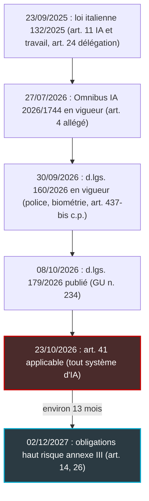
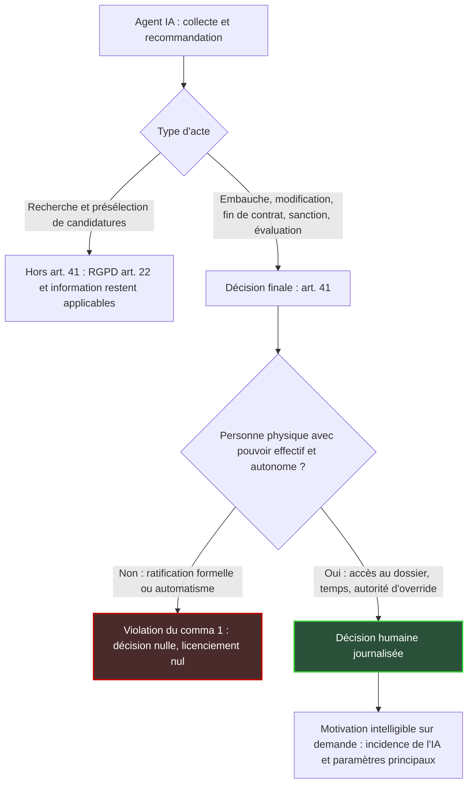

## Le clic qui ne protège plus personne

Imaginez un lundi matin dans un centre de supervision réseau. Le responsable d'équipe ouvre son tableau de bord, découvre la note que l'outil d'évaluation a attribuée à chacun de ses quinze ingénieurs d'astreinte, et clique quinze fois sur « Valider » en moins d'une minute. Le processus est propre. La case « humain dans la boucle » est cochée. L'audit interne est satisfait.

En Italie, à partir du 23 octobre 2026, ce geste ne suffit plus. Le décret législatif n° 179 du 7 octobre 2026, qui adapte le droit italien au règlement européen sur l'intelligence artificielle, contient un article 41 consacré à la protection du salarié face aux décisions assistées par l'IA. Embauche, modification du contrat, licenciement, sanction disciplinaire, évaluation de performance : la décision finale doit revenir à une personne qui exerce un pouvoir « effettivo e autonomo ». Le consentement du salarié n'y change rien. Si la règle est violée, la décision est nulle.

Ce n'est pas une amende de plus dans la pile réglementaire. C'est une exigence de conception, qui vise tout employeur en Italie s'appuyant sur l'IA pour ces décisions, et qui tombe treize mois avant les obligations européennes de surveillance humaine des systèmes à haut risque. Pour un CTO qui installe des agents IA au cœur de ses équipes d'exploitation, la question change de nature. Elle n'est plus « avons-nous un humain dans la boucle ? ». Elle devient : « pouvons-nous prouver qu'il décide vraiment ? »

## Ce que dit l'article 41, mot à mot

Partons du texte, lu dans la Gazzetta Ufficiale (le journal officiel italien) du 8 octobre 2026 [1]. Le décret compte 54 articles et entre en vigueur le 23 octobre [2]. Son article 41 s'intitule « Tutela del lavoratore nei processi decisionali assistiti da sistemi di intelligenza artificiale ». Quatre alinéas. Chacun pèse.

**Le champ.** L'employeur « che si avvale di sistemi di intelligenza artificiale » doit garantir (le texte dit « assicura che ») que les décisions finales relatives « alla costituzione, alla modificazione o alla risoluzione del rapporto, ivi compresi i provvedimenti disciplinari e le valutazioni delle prestazioni » ne soient pas adoptées « unicamente sulla base di un trattamento automatizzato ». Le renvoi vise la définition générale du système d'IA, celle de l'article 3, point 1, du règlement européen. Pas la catégorie « haut risque ». Pas l'annexe III. N'importe quel système d'IA au sens européen suffit à déclencher la règle.

**Le décideur.** La phrase centrale mérite d'être citée en entier : « La decisione definitiva è in ogni caso riservata a una persona fisica, che eserciti un potere effettivo e autonomo. » Traduction libre : la décision définitive est, en tout état de cause, réservée à une personne physique qui exerce un pouvoir effectif et autonome. Deux adjectifs, et toute la difficulté tient dedans. Le texte ne dit pas comment prouver cette effectivité [5]. Il ne liste aucune mesure concrète pour y parvenir.

**Le verrou du consentement.** « Il consenso del lavoratore non costituisce un'eccezione al divieto di cui al presente comma. » L'article 41 s'applique « fermo restando » l'article 22 du RGPD (règlement général sur la protection des données) : les deux régimes cohabitent. Mais dans le champ du travail, il ferme une porte que le RGPD laisse ouverte ailleurs, celle du consentement explicite [5, 6]. Inutile, donc, de faire signer au salarié une clause par laquelle il accepterait d'être jugé par un algorithme.

**L'exclusion.** « Non rientrano tra le decisioni finali relative alla costituzione del rapporto di lavoro le attività di ricerca e selezione delle candidature, anche quando comportino la mancata ammissione alle successive fasi della selezione. » La nuance compte : ce n'est pas une dérogation à l'interdiction, c'est une exclusion du champ de la « décision finale ». Le tri automatisé de candidatures sort de l'article 41, mais reste soumis à l'article 22 du RGPD et aux obligations d'information du droit italien [6].

**L'explication.** Sur demande, et « mediante l'intervento di una persona fisica », le salarié a droit à « una motivazione intelligibile della decisione che lo riguarda, comprensiva dell'indicazione dell'eventuale incidenza dei sistemi di intelligenza artificiale sul processo decisionale e dei principali parametri considerati ». En clair : un humain doit pouvoir expliquer la décision, dire quel rôle l'IA y a joué et quels paramètres ont principalement pesé. En amont, l'employeur doit avoir informé le salarié selon l'article 1-bis du décret législatif 152/1997 : finalités, logique de fonctionnement, données utilisées, mesures de contrôle et de correction, niveau d'exactitude et de robustesse. Toute modification s'annonce par écrit 24 heures à l'avance, représentants syndicaux compris.

**La sanction.** « Il licenziamento intimato in violazione del comma 1 è nullo. Le decisioni assunte dal datore di lavoro in violazione del comma 1 sono nulle. » Le licenciement est nul. Les autres décisions aussi [8].

Attention au voisin. L'article 42, que certaines synthèses confondent avec le 41, impose d'intégrer au document d'évaluation des risques les systèmes d'IA qui agissent sur l'organisation et les rythmes du travail. Autre sujet.

*Ratifier n'est pas décider : l'article 41 exige une personne capable de rayer une ligne, pas un tampon qui suit le tapis roulant.*

## Pas 35 millions d'euros : la vraie arme, c'est la nullité

Quand on lit « décret IA » et « sanctions » dans la même phrase, le réflexe est d'associer l'article 41 au plafond le plus spectaculaire : 35 M EUR ou 7 % du chiffre d'affaires mondial. Ce serait une erreur de lecture.

Les amendes administratives figurent à l'article 23 du décret, applicable « salvo che il fatto costituisca reato » (sauf si le fait constitue une infraction pénale). Elles reprennent les trois paliers de l'article 99 du règlement européen et en ajoutent un quatrième propre au décret [1, 4, 16] :

- **35 M EUR ou 7 %** du chiffre d'affaires mondial annuel : non-respect de l'interdiction des pratiques visées à l'article 5 du règlement IA ;
- **15 M EUR ou 3 %** : manquements à une liste d'obligations qui inclut celles des déployeurs (article 26) ;
- **7,5 M EUR ou 1 %** : informations inexactes, incomplètes ou trompeuses fournies aux autorités ou aux organismes notifiés ;
- **1 M EUR ou 0,5 %** (palier propre au décret italien, article 23, alinéa 4) : analyse d'impact sur les droits fondamentaux (article 27) et droit à l'explication (article 86).

Aucun de ces paliers ne vise l'article 41. Une recherche textuelle dans le numéro de la Gazzetta ne fait apparaître aucun renvoi croisé entre les dispositions de sanction et l'article 41 [1]. Sa sanction propre est la nullité, prévue à son quatrième alinéa. Point.

Côté autorités, l'AgID (Agenzia per l'Italia Digitale) devient autorité de notification, et l'ACN (Agenzia per la Cybersicurezza Nazionale) autorité de surveillance du marché et point de contact unique [1, 3]. Les régulateurs bancaire, boursier et assurantiel gardent la main sur les systèmes à haut risque de leurs secteurs ; le Garante, l'autorité de protection des données, conserve un rôle étroit. Aucun n'est désigné gardien de l'article 41.

**Mon inférence** : le risque principal n'est donc pas un contrôle administratif. C'est un salarié, son avocat et un juge du travail. Et c'est plus coupant qu'une amende. Une amende se provisionne ; une nullité défait la décision elle-même. Un analyste italien qui écrit pour les DPO (délégués à la protection des données) va plus loin : l'action en nullité pourrait selon lui être imprescriptible et conduire à une réintégration pleine en cas de licenciement [6]. C'est son opinion, pas une jurisprudence établie.

## Treize mois d'avance sur Bruxelles

Pendant que Rome accélère, Bruxelles a ralenti. Le Digital Omnibus IA, règlement (UE) 2026/1744, a été publié au Journal officiel de l'UE le 24 juillet 2026 et est entré en vigueur le 27 juillet, selon deux analyses concordantes [18, 19]. Il repousse au 2 décembre 2027 les obligations des systèmes à haut risque de l'annexe III, et au 2 août 2028 celles de l'annexe I. Au passage, il assouplit l'article 4 sur la maîtrise de l'IA : il s'agit désormais de la soutenir plutôt que de l'assurer [19].

Faites le calcul. L'article 41 s'applique environ treize mois avant les exigences européennes de surveillance humaine (article 14) et les obligations des déployeurs (article 26) pour l'emploi. Et sur un périmètre plus large, puisqu'il vise tout système d'IA, classé à haut risque ou non.

*Le calendrier qui surprend : l'Italie impose la supervision humaine « avec pouvoir » plus d'un an avant l'échéance européenne de l'annexe III.*

Le paradoxe mérite d'être souligné. L'annexe III, point 4, du règlement classe déjà à haut risque les systèmes destinés au recrutement, aux décisions qui touchent les conditions de travail, la promotion ou la fin du contrat, à l'allocation de tâches fondée sur le comportement ou les traits individuels, et au suivi de la performance [15]. L'Europe a identifié le risque, puis décalé la règle. L'Italie applique la sienne maintenant. Ma lecture : pour quiconque déploie des agents IA au contact de ses équipes, l'Italie devient de fait le premier banc d'essai opérationnel d'une supervision humaine « avec pouvoir ».

Un autre texte italien va dans le même sens. Le décret législatif 160/2026, en vigueur depuis le 30 septembre [12], crée un article 437-bis du code pénal : de un à cinq ans de réclusion pour l'omission de mesures de sécurité et de « sorveglianza umana » sur un système d'IA à haut risque, quand il en résulte un danger pour la vie ou l'intégrité physique (« incolumità »), publique ou individuelle [11]. Ce texte ne vise pas les décisions RH, et je ne le présente pas comme un risque lié à l'article 41. C'est un indice : en Italie, la surveillance humaine peut désormais avoir un effet pénal.

## Du texte à l'architecture : le fusible soudé

> **Lecture de l'auteur.** Cette section est une interprétation d'ingénieur. Les propriétés et les tests proposés ne figurent pas dans le décret : ce sont des pistes pour rendre l'exigence démontrable.

Un humain dans la boucle qui ne peut que dire oui, c'est un fusible soudé au fil de cuivre. Sur le schéma électrique, il est là, dessiné et étiqueté. Le jour de la surtension, il ne coupe rien. L'article 41 exige, en substance, que le fusible puisse sauter.

« Pouvoir effectif et autonome » n'est pas une qualité de la personne. C'est une propriété du système sociotechnique qui l'entoure. Le décideur doit disposer de l'information, du temps, de la compétence et de l'autorité hiérarchique nécessaires pour passer outre la recommandation (l'override, dans le jargon des outils) sans demander la permission à quiconque.

On retrouve là le registre du règlement européen. Son article 14 veut que les superviseurs comprennent les capacités et les limites du système, restent conscients du biais d'automatisation, puissent ignorer, corriger ou renverser sa sortie, et l'interrompre via un mécanisme d'arrêt [13]. Son article 26 demande aux déployeurs de confier la supervision à des personnes dotées de la compétence, de la formation et de l'autorité nécessaires [14]. L'article 41 transpose ce registre dans un contentieux de nullité. C'est ce qui le rend redoutable.

*Lecture de l'auteur : la frontière de la « décision finale », et ce qui fait basculer une décision dans la nullité.*

Pourquoi « testable » ? Parce que la nullité se plaide sur pièces. Une architecture défendable doit donc produire des preuves : qui a décidé, ce qu'il a vu, ce qu'il a changé, combien de temps il y a passé, combien de fois il s'est écarté de la recommandation. Voici la grille que je propose.

| Exigence du texte | Propriété système | Test candidat |
|---|---|---|
| Décision pas « unicamente » automatisée | Aucune action RH exécutable sans identifiant d'une personne physique | **Décision orpheline** : toute sanction ou évaluation sans décideur rattaché est bloquée |
| Pouvoir « effettivo » | Accès sans escalade au dossier brut, pas seulement au score | **Contrefactuel** : le décideur peut-il trancher à l'inverse, seul, avec les mêmes données ? |
| Pouvoir « autonomo » | Aucun quota d'acceptation, aucun objectif sur le taux d'approbation | **Taux d'écart** non nul et temps médian de décision plausible sur un échantillon |
| « Motivazione intelligibile » | Incidence de l'IA et paramètres principaux exportables | **Explication** : un humain produit la motivation dans un délai raisonnable |
| Preuve en cas de litige | Journal immuable : décideur, entrées vues, écart, durée | **Rétention** d'au moins six mois, par prudence calée sur l'article 26 du règlement IA |
| Capacité d'arrêt | Mécanisme d'interruption de l'agent | **Stop** : l'arrêt est exercé et tracé en conditions réelles |

Le test le plus parlant est aussi le plus simple. Sortez le taux d'approbation des recommandations et le temps médian passé par dossier. Un taux proche de 100 % avec quelques secondes par décision, c'est le portrait-robot de la ratification formelle. Vous n'avez pas un décideur, vous avez un tampon. À l'inverse, un taux d'écart non nul, documenté et motivé, est sans doute la meilleure pièce qu'un employeur puisse verser au dossier.

Reste le piège managérial. Si le responsable est évalué sur sa vitesse de traitement des recommandations, son autonomie est une fiction, quel que soit l'outil. La conformité à l'article 41 se joue autant dans les objectifs annuels des managers que dans le code.

## Dans le NOC : dedans, dehors, et la zone grise

> **Lecture de l'auteur, à confirmer avec un juriste du travail italien.** Le décret ne cite aucun de ces cas d'usage.

Prenez un opérateur réseau qui confie à des agents IA une partie de son centre de supervision (NOC, pour Network Operations Center) : tri des alertes, escalade, planification des astreintes, tableaux de bord de performance. Où passe la frontière ?

**Clairement dedans : l'évaluation et la sanction.** Les statistiques par ingénieur, comme le délai moyen d'acquittement d'une alerte (MTTA) ou de résolution d'un incident (MTTR), et tout scoring d'astreinte relèvent des « valutazioni delle prestazioni ». Un agent peut calculer, classer, recommander. Il ne peut pas être la décision finale. Sanctions et fins de contrat sont le cas d'école.

**Clairement dehors : la présélection de candidatures.** Exclue de l'article 41, elle reste couverte par l'article 22 du RGPD et par l'obligation d'information [6].

**La zone grise : le routage et l'allocation de charge.** Router une alerte, escalader un incident, générer un planning d'astreinte : tant que cela ne modifie pas le rapport de travail, on est probablement hors du champ des décisions finales. Probablement. Car un agent qui attribue systématiquement les nuits les plus chargées à l'ingénieur le moins bien noté ne fait plus du planning. Il fait de la sanction, sans le dire. À traiter comme une zone grise, jamais comme une exemption, d'autant que l'annexe III classera à haut risque, dès décembre 2027, l'allocation de tâches fondée sur le comportement individuel. Et un planning piloté par IA touche, à mon sens, aux rythmes de travail visés par l'article 42.

**Les prestataires.** L'article 41 parle de « datore di lavoro » et de « rapporto di lavoro ». Son extension aux travailleurs indépendants n'est pas acquise, et je ne l'affirmerai pas. Mais l'article 1-bis du décret 152/1997 et l'article 11 de la loi 132/2025 visent aussi le « committente », le donneur d'ordre. L'obligation d'information suit donc la sous-traitance, et le risque de requalification demeure.

*Dans un centre de supervision, l'agent recommande ; la personne qui tient l'interrupteur doit pouvoir dire non, et le journal doit s'en souvenir.*

## Ce que le texte laisse ouvert

Trois questions resteront ouvertes tant que les juges italiens n'auront pas tranché.

**La frontière de l'effectivité.** Où s'arrête la validation substantielle, où commence la ratification formelle ? Le texte ne le dit pas, et les commentateurs renvoient à la jurisprudence [5, 6]. L'un d'eux estime qu'en contentieux, l'employeur supportera probablement la charge de prouver l'effectivité de l'intervention humaine [6]. Ce n'est écrit nulle part dans l'article 41. C'est pourtant l'hypothèse sur laquelle je construirais, parce que c'est la plus coûteuse à ignorer.

**Le secret des affaires contre l'explication.** L'article 52 du même décret complète l'article 98 du code italien de la propriété industrielle : données d'entraînement et algorithmes peuvent y trouver une protection [3]. Or le salarié a droit aux « principali parametri ». L'analyste de 01magazine propose une divulgation graduée, la logique et les paramètres mais pas le code [6]. C'est sa proposition, pas une règle. Elle me paraît raisonnable.

**L'ombre de SCHUFA.** En décembre 2023, la Cour de justice de l'UE (arrêt SCHUFA, C-634/21) a jugé que la génération automatisée d'un score peut constituer une décision automatisée au sens du RGPD, lorsque le destinataire s'appuie fortement sur ce score pour conclure, exécuter ou résilier un contrat [21]. La portée exacte de ce critère reste débattue. Transposée au travail (c'est ma lecture, pas celle de la Cour), cette logique suggère qu'un score suivi à la lettre peut être la vraie décision, quel que soit le nom inscrit au bas du formulaire.

Reste la question du lecteur français. Hors d'Italie, l'article 22 du RGPD admet toujours le consentement explicite comme exception [17]. Je n'ai pas de texte français équivalent vérifié à citer, et je n'en inventerai pas. Mais la direction est lisible : SCHUFA, l'article 14 du règlement IA et l'article 41 italien convergent vers la même idée. La ratification symbolique ne compte pas.

*En contentieux, seule tient la décision qui laisse une trace humaine vérifiable ; celle qui n'en laisse pas se dissout.*

## Construire une fois, à la norme la plus exigeante

Ma position est simple. L'article 41 est la spécification la plus claire qu'on ait reçue sur la supervision humaine des agents IA. Il faut la traiter comme une spec produit, pas comme un risque juridique local.

Maintenir un outillage RH et d'exploitation à deux vitesses, un mode « Italie » et un mode « reste du monde », coûte plus cher et vieillit plus mal qu'une seule architecture calée sur le texte le plus exigeant. Pour une entreprise sans salarié en Italie, ce n'est pas une obligation. C'est un banc d'essai gratuit : quelqu'un a rédigé le cahier des charges, à nous de vérifier si nos systèmes le passent.

Trois chantiers, dans cet ordre :

1. **Cartographier les décisions agent → RH.** Pour chaque agent en production, lister les sorties qui alimentent une évaluation, une sanction ou une modification du contrat, y compris par ricochet. Les zones grises, planning et allocation de charge en tête, vont dans la liste, pas sous le tapis.
2. **Instrumenter l'override.** Bloquer les décisions orphelines. Journaliser décideur, entrées vues, écart et durée, et conserver le tout au moins six mois. Publier en interne le taux d'écart et le temps médian de décision : un tableau de bord que personne n'ose regarder est déjà une réponse.
3. **Préparer la motivation intelligible.** Un modèle de réponse, un humain nommé capable de la produire, la liste des paramètres principaux de chaque système, et une politique de divulgation graduée qui protège le secret des affaires sans vider l'explication de son sens.

L'humain dans la boucle n'est plus une case à cocher. C'est une propriété du système. Et une propriété, ça se teste.

---

_Vues personnelles, pas position Wifirst._

## Sources

1. Gazzetta Ufficiale, Serie Generale n. 234 du 08/10/2026, D.lgs. 179/2026 (texte officiel) — https://www.gazzettaufficiale.it/eli/gu/2026/10/08/234/sg/pdf
2. Gazzetta Ufficiale, fiche de l'acte 26G00200 (métadonnées, entrée en vigueur) — https://www.gazzettaufficiale.it/eli/id/2026/10/08/26G00200/sg
3. Noze, « Decreto 179/2026: autorità AI, sanzioni, lavoro e formazione » — https://www.noze.it/insights/decreto-ai-179-2026-gazzetta/
4. Agenda Digitale, « AI Act, l'Italia avvia i controlli: cosa rischiano le imprese » (15/10/2026) — https://www.agendadigitale.eu/sicurezza/ai-act-litalia-avvia-i-controlli-cosa-rischiano-le-imprese/
5. diritto.it, « Licenziamento con AI nullo: le regole del D.lgs. 179/2026 » (13/10/2026) — https://www.diritto.it/licenziamento-con-ai-nullo-regole-d-lgs-179-2026/
6. 01magazine (Davide De Luca), « L'adeguamento nazionale all'AI Act… decreto legislativo 179/2026 — una lettura per DPO e giuristi d'impresa » (20/10/2026) — https://www.01magazine.it/decreto-179-2026-decisioni-automatizzate-lavoro/
7. Lavorosì, « D.Lgs. 7 ottobre 2026 n. 179: IA, in Gazzetta nuove regole per lavoro, professionisti e formazione » (09/10/2026) — https://www.lavorosi.it/d-lgs-7-ottobre-2026-n-179-ia-in-gazzetta-nuove-regole-per-lavoro-professionisti-e-formazione/
8. ECNews, « Utilizzo di sistemi di AI in azienda: il D.Lgs. n. 179/2026 introduce nuovi obblighi » (13/10/2026) — https://www.ecnews.it/lavoro/rapporto-di-lavoro/gestione-del-rapporto/utilizzo-di-sistemi-di-ai-in-azienda-il-d-lgs-n-179-2026-introduce-nuovi-obblighi/
9. Dottrina Lavoro, « Governo: AI – sistemi di intelligenza artificiale sul lavoro » (12/10/2026) — https://www.dottrinalavoro.it/notizie-c/governo-ai-sistemi-di-intelligenza-artificiale-sul-lavoro
10. Puntosicuro, « AI Act, D.lgs. 179/2026: impatti e obblighi per la sicurezza sul lavoro » (14/10/2026) — https://www.puntosicuro.it/nuove-tecnologie-ia-C-148/ai-act-d.lgs.-179/2026-impatti-obblighi-per-la-sicurezza-sul-lavoro-AR-26827/
11. Gazzetta Ufficiale, Serie Generale n. 214 du 15/09/2026, D.lgs. 160/2026 (art. 12, art. 437-bis c.p.) — https://www.gazzettaufficiale.it/eli/gu/2026/09/15/214/sg/pdf
12. Noze, « AI Act: in Gazzetta il decreto su polizia e biometria » (15/09/2026) — https://www.noze.it/insights/ai-act-gazzetta-decreto-polizia-biometria/
13. AI Act, article 14 (miroir non officiel artificialintelligenceact.eu) — https://artificialintelligenceact.eu/article/14/
14. AI Act, article 26 (miroir non officiel) — https://artificialintelligenceact.eu/article/26/
15. AI Act, annexe III (miroir non officiel) — https://artificialintelligenceact.eu/annex/3/
16. AI Act, article 99 (miroir non officiel) — https://artificialintelligenceact.eu/article/99/
17. RGPD, article 22 (miroir non officiel gdpr-info.eu) — https://gdpr-info.eu/art-22-gdpr/
18. Law & Technology, « Digital Omnibus on AI in the Official Journal: Regulation (EU) 2026/1744 » — https://lawandtechnology.eu/en/digital-omnibus-on-ai-official-journal-regulation-2026-1744/
19. NicFab, « Digital Omnibus AI: Regulation (EU) 2026/1744 is published in the Official Journal » — https://www.nicfab.eu/en/posts/digital-omnibus-ai-official-journal/
20. Cuatrecasas, « Council of the EU approves Digital Omnibus on AI » (30/06/2026) — https://www.cuatrecasas.com/en/latam/intellectual-property/art/council-eu-approves-digital-omnibus-ai
21. IAPP, « Key takeaways from the CJEU's recent automated decision-making rulings » (19/12/2023) — https://iapp.org/news/a/key-takeaways-from-the-cjeus-recent-automated-decision-making-rulings
