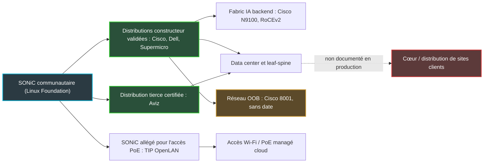
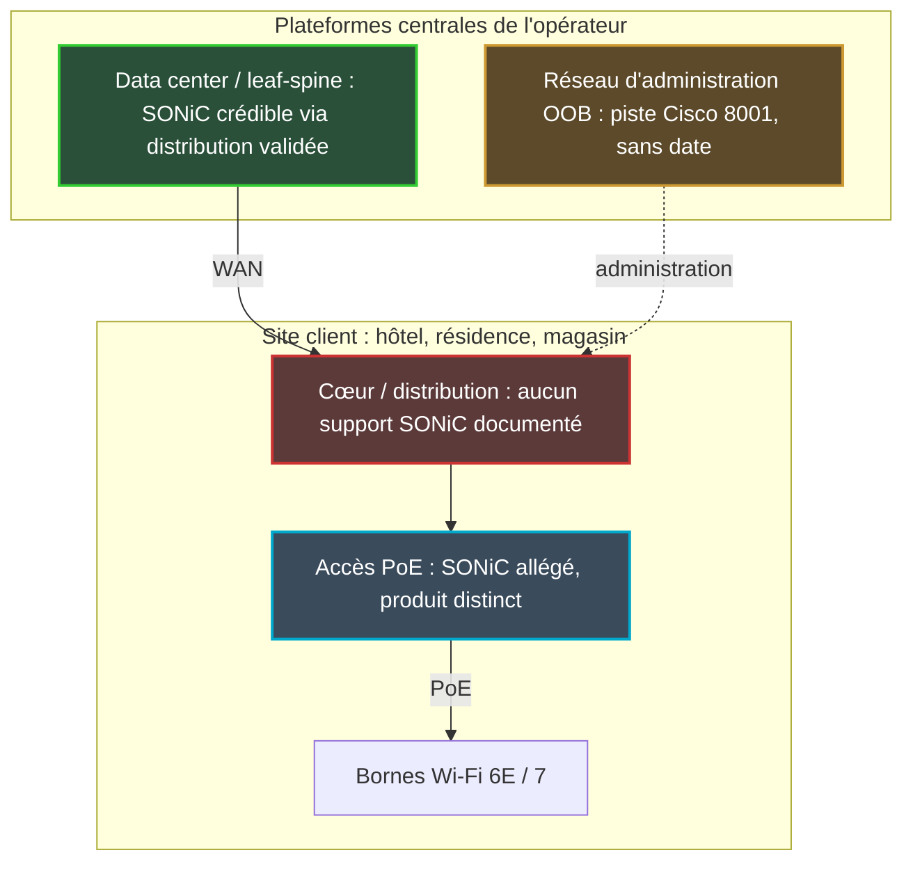

## Le switch, dernier bastion du logiciel propriétaire

Pendant vingt ans, acheter un switch a voulu dire épouser un constructeur. Le boîtier, le logiciel qui tourne dessus, la ligne de commande que vos ingénieurs connaissent par cœur, le contrat de support, le rythme des correctifs de sécurité : tout venait du même fournisseur. En changer revenait à re-former une équipe et à réécrire des années d'automatisation.

Pour une DSI qui gère deux salles serveurs, c'est un coût. Pour un opérateur qui exploite des centaines de sites (hôtels, résidences étudiantes, magasins), c'est une dépendance structurelle. Elle pèse sur chaque renouvellement de parc et sur chaque négociation tarifaire.

La promesse inverse porte un nom : SONiC, un système d'exploitation réseau open source né chez Microsoft pour faire tourner Azure, aujourd'hui hébergé par la Linux Foundation. Un logiciel commun, le matériel au choix. Les hyperscalers vivent avec depuis des années. Ce qui change, c'est qu'à la mi-octobre, à l'OCP Global Summit de San Jose (le grand rendez-vous annuel du matériel ouvert pour data centers), Cisco, Supermicro et Lenovo se sont alignés derrière lui avec des offres qui visent explicitement l'entreprise.

Fin de la dépendance ? Ma lecture est moins confortable. SONiC a bien quitté le périmètre hyperscaler. Mais ce qui s'achète aujourd'hui avec un vrai support, c'est une distribution de constructeur, pas un logiciel libre interchangeable. Le lock-in n'a pas disparu. Il a changé d'adresse.

## SONiC, l'Android du switch

Pour comprendre ce qui se joue, une analogie suffit : SONiC est au switch ce qu'Android est au smartphone.

Android est open source. N'importe qui peut en télécharger le code. Pourtant, personne n'achète « Android » : on achète un Samsung, un Pixel ou un Xiaomi, avec la surcouche du constructeur, ses applications maison et surtout son calendrier de mises à jour. Quand une faille critique est corrigée en amont, votre téléphone n'est protégé que le jour où *votre* constructeur pousse le correctif. La liberté est réelle au niveau du code. Elle est beaucoup plus théorique au niveau de l'exploitation.

SONiC obéit à la même logique. Techniquement, c'est un NOS (Network Operating System, le système d'exploitation du switch) bâti sur Linux et découpé en conteneurs : un pour le routage, un pour la télémétrie, un pour la gestion des ports, chacun redémarrable sans faire tomber les autres. Ces briques partagent leur état via une base de données centrale. Résultat : le switch devient programmable comme n'importe quel serveur Linux.

La pièce maîtresse s'appelle SAI (Switch Abstraction Interface). C'est une interface normalisée entre le logiciel et l'ASIC, la puce qui commute réellement les paquets. Broadcom, Nvidia, Marvell ou Cisco avec Silicon One fournissent chacun leur implémentation, et le même SONiC peut en théorie tourner sur toutes. C'est l'équivalent des pilotes matériels d'Android. La condition de la portabilité, et le point exact où elle peut se fissurer.

La séduction est évidente. Un même système sur tout le parc, des API identiques quel que soit le fournisseur de silicium, une automatisation écrite une fois. Pour un hyperscaler qui achète des switches par dizaines de milliers, c'est un levier de négociation considérable. La Foundation revendique par exemple plus de 100 000 équipements white box (matériel générique, sans marque) sous SONiC chez Alibaba Cloud.

Reste la question que tout DSI devrait poser avant de signer. Qui pousse le correctif le jour où ça casse ?

## OCP 2026 : trier le livré, l'annoncé et l'intentionnel

Le salon de San Jose, du 12 au 15 octobre, a produit beaucoup d'annonces. Il faut les trier, parce que le vocabulaire marketing mélange allègrement ce qui est disponible, ce qui est annoncé et ce qui relève de la simple intention.

**Côté Foundation**, trois nouveaux membres généraux ont été annoncés le 5 octobre : Lenovo, NADDOD et Zhanwang (NEXAI). Lenovo travaille sur l'automatisation et les opérations, NADDOD utilise SONiC sur sa gamme de switches pour data centers IA, NEXAI le porte sur ses produits. Les contributions amont promises portent sur RoCE (le transport mémoire à mémoire des clusters GPU), le contrôle de flux, SRv6 (le routage par segments sur IPv6) et la télémétrie. Ce sont des intentions. Le communiqué ne donne aucun chiffre de déploiement ni de performance.

La Foundation compte désormais plus de 43 membres, selon Network World. Ils étaient 36 en août 2025, quand Juniper (aujourd'hui chez HPE) l'a rejointe, sans produit ni calendrier annoncé. Je n'ai trouvé depuis aucun produit Juniper sous SONiC confirmé par une source solide.

**Côté Cisco**, l'annonce la plus structurante. Le constructeur ouvre deux voies. La première est la distribution communautaire : le client gère toute la pile, seul. La seconde est une distribution durcie et validée par Cisco, avec releases qualifiées, gestion du cycle de vie et accès au TAC, le support technique maison. Cette version validée s'exécute dans Nexus One, sur les plateformes Cisco 8000 et Nexus 9000.

Selon Network World, elle est proposée sur la série N9000 pour le leaf-spine d'entreprise (l'architecture à deux étages des data centers modernes). Elle l'est aussi sur la série N9100, à base de silicium Nvidia Spectrum-X, pour les fabrics backend IA, ces réseaux dédiés qui relient les GPU entre eux.

Cisco affirme régler finement dans SONiC les mécanismes anti-congestion de RoCEv2 (PFC et ECN), indispensables pour que des GPU échangent sans perdre de paquets. Network World précise qu'il s'agit de déclarations constructeur, sans benchmark. Network World le présente comme disponible, sans date de disponibilité commerciale précise ni benchmark.

*Une fabric leaf-spine pour clusters GPU : le terrain où SONiC est aujourd'hui le plus solide, et celui où les constructeurs concentrent leurs annonces.*

Deux annonces Cisco méritent un astérisque. Live Protect, qui neutralise une vulnérabilité sans redémarrer le switch en attendant le correctif, existe aujourd'hui sur NX-OS, le système maison. Son extension au SONiC validé est annoncée pour le deuxième trimestre 2027 (mi-2027 selon StorageNewsletter). Elle n'est donc pas livrée.

Le Cisco 8001, lui, est un switch de management hors bande (OOB, le réseau d'administration séparé du trafic de production), basé sur Silicon One A100 et décliné en 1G et 10G. L'idée est de faire tourner SONiC sur ce réseau avec les mêmes API et la même automatisation que la fabric principale. Aucune date de disponibilité n'a été communiquée.

**Côté Supermicro**, un Enterprise Advanced SONiC Networking OS apparaît sur la fiche d'un switch 2U à optique co-packagée (les modules optiques intégrés au plus près de la puce), de 102,4 Tbps et 128 ports 800G. Aucune condition de support, aucune date.

**Côté indépendants**, Aviz n'était pas une nouveauté du salon mais complète le tableau. Depuis décembre 2025, l'éditeur propose une distribution communautaire certifiée sur silicium Broadcom, Nvidia, Cisco et Marvell, gratuite, avec support payant 24/7 et son outillage ONES. Ni client nommé, ni benchmark, ni comparaison de TCO (coût total de possession) publiés.

Remis à plat, le bilan du salon tient en un tableau.

| Élément | Statut fin octobre 2026 |
|---|---|
| SONiC validé Cisco sur N9000 (leaf-spine) | Proposé, selon Cisco et Network World |
| Même distribution sur N9100 (fabric IA, Spectrum-X) | Présenté comme disponible par Network World (déclaration constructeur), aucun benchmark |
| Live Protect sur SONiC validé | Feuille de route T2 2027 (disponible sur NX-OS uniquement) |
| Cisco 8001 (réseau OOB, Silicon One A100) | Annoncé, sans date |
| Supermicro Enterprise Advanced SONiC (switch CPO 102,4 Tbps) | Annoncé, ni support ni date publiés |
| Aviz, distribution certifiée et support 24/7 | Disponible depuis décembre 2025, aucun client nommé |
| Contributions Lenovo, NADDOD, NEXAI | Intentions, pas de livrable |

Et la cartographie qui en découle montre une chose simple : le code est commun, les chemins pour l'exploiter ne le sont pas.

*L'écosystème SONiC après l'OCP 2026 : un tronc open source, plusieurs distributions, et un segment, celui des sites clients, que personne ne documente.*

## Le lock-in déménage dans la distribution

Revenons à notre smartphone. Android a libéré le code, pas l'utilisateur : la valeur (qualification, mises à jour, support) s'est logée dans la couche du constructeur. SONiC suit exactement la même trajectoire, et l'OCP 2026 l'a rendu visible.

Cisco dit remonter en amont les fonctions demandées par ses clients pour limiter les forks privés, ces versions divergentes qui finissent par ne plus pouvoir suivre le projet principal. Le constructeur siège au Governing Board et au comité technique de la Foundation. C'est un engagement déclaré, invérifiable à ce stade. Et il coexiste avec une distribution durcie payante qui concentre le support et le cycle de vie chez le constructeur.

Je ne le reproche pas à Cisco. C'est un modèle économique rationnel, celui-là même qui a fait la fortune de Red Hat sur Linux. Mais il faut nommer le mécanisme, parce que la dépendance se reconstitue à quatre étages.

- **La distribution validée.** Une release qualifiée par un constructeur l'est sur son matériel. Passer de la distribution Cisco à celle de Dell ou d'Aviz, c'est une nouvelle campagne de qualification, pas une simple mise à jour.
- **L'outillage.** Nexus One, Nexus Dashboard, ONES : l'automatisation et la télémétrie s'écrivent contre ces outils. Elles ne voyagent pas avec le NOS.
- **Le cycle de sécurité.** Avec Live Protect attendu au mieux au deuxième trimestre 2027 sur SONiC, le client SONiC de Cisco reste privé pendant encore plusieurs mois d'un outil de mitigation sans reboot dont dispose déjà le client NX-OS du même constructeur. C'est le paradoxe le plus concret du salon.
- **Les compétences.** NAND Research juge le déficit de compétences SONiC bien réel. Le cabinet prévient qu'il faudra rééquiper l'automatisation, la télémétrie et la gestion du changement. Une équipe qui maîtrise NX-OS ne bascule pas en un trimestre.

Channel Insider, côté intégrateurs, dresse la liste des risques que tout le monde connaît sans l'écrire : validation matérielle charge de travail par charge de travail, surcoût d'intégration et de maintenance, compétences spécialisées, et une responsabilité floue sur les mises à jour et le dépannage.

Ce dernier point est le plus grave. À trois heures du matin, quand une release fait tomber un lien, qui est responsable ? L'implémentation SAI du fondeur, la distribution, ou l'intégrateur ? Un contrat qui ne répond pas à cette question n'est pas un contrat de support.

*Le verrou ne disparaît pas avec le logiciel libre : il glisse du châssis de marque vers la couche logicielle validée qui rend le switch exploitable.*

Le plus révélateur reste le positionnement de Cisco lui-même. Selon Network World, qui rapporte un billet de blog Cisco, le constructeur propose NX-OS ou ACI au cœur, et SONiC sur des Nexus identiques dans des pods de data center spécialisés. Autrement dit, l'acteur qui fait le plus de bruit autour de SONiC en entreprise ne le met pas en avant au cœur du réseau.

NAND Research livre une lecture cohérente avec ce positionnement. La demande des entreprises généralistes reste non démontrée, beaucoup de clients Nexus resteront sur NX-OS, et le volet logiciel est moins mûr que le volet silicium.

## Des prévisions de 2022 recyclées en 2026

Les chiffres de marché méritent la même prudence. Network World reprend en octobre 2026 une projection du cabinet 650 Group : les revenus du switching data center sous SONiC dépasseraient 5 Md USD en 2026. Le même chiffre figure, tel quel, dans un article du même média daté de décembre 2022. C'est une prévision à quatre ans, sans méthode publiée, et je n'ai trouvé aucune mesure 2026 qui la confirme.

Même chose pour Dell'Oro, qui anticipait en 2022 qu'environ 10 % des switches d'entreprise tourneraient sous SONiC en 2026. Aucune donnée récente ne vient valider ce taux.

Le plus intéressant dans cet article de 2022, c'est son diagnostic. Le chemin d'adoption le plus probable pour l'entreprise y était hybride, avec SONiC à côté de switches de marque. Le frein principal, selon Dell'Oro, était le déficit de support. Aviz et Hedgehog étaient déjà présentés comme ceux qui allaient combler ce manque.

Quatre ans plus tard, NAND Research pointe encore un déficit de compétences, et la demande reste non démontrée. Soit le trou est plus difficile à combler qu'on ne le pensait, soit la demande n'est pas là. Probablement un peu des deux.

Côté Foundation, les chiffres d'adoption impressionnent : plus de 4 300 contributeurs et plus de 520 organisations, selon un document diffusé via ONUG en février. Les cas clients aussi. Le document cite Orange, avec 90 switches en production et plus de 150 prévus. Il évoque un réseau de paiement indien de plus de 300 switches au TCO inférieur de 30 à 40 %, et Rakuten Mobile, qui aurait économisé plus de 50 % de CapEx lors d'une preuve de valeur.

Tous ces chiffres sont déclarés par la Foundation elle-même, source évidemment partisane, sans vérification indépendante. Ils méritent d'être lus pour ce qu'ils sont. Quatre-vingt-dix switches à l'échelle d'un groupe comme Orange, c'est un déploiement ciblé, pas une bascule. Une preuve de valeur n'est pas une production.

## Lecture d'auteur : où SONiC a sa place dans un réseau de sites

Ce qui suit est mon analyse, pas une description de ce que déploie Wifirst. Je raisonne sur un opérateur Wi-Fi managé générique, et aucune des sources citées ne documente ce segment précis.

Un tel réseau se découpe grossièrement en quatre couches. Les plateformes centrales (contrôleurs, authentification, supervision, collecte de télémétrie) vivent en data center. Un réseau d'administration hors bande permet d'y accéder quand la production est en panne. Sur chaque site, qu'il s'agisse d'un hôtel, d'une résidence ou d'un magasin, une couche cœur/distribution agrège les switches d'accès. Ces derniers alimentent enfin les bornes Wi-Fi via PoE (l'alimentation électrique par le câble réseau).

*Lecture d'auteur sur un réseau multi-sites générique : vert, supporté aujourd'hui ; orange, annoncé sans date ; rouge, pari non documenté ; bleu, un autre produit.*

**Le data center et le leaf-spine** sont le terrain où SONiC est crédible aujourd'hui. À condition de passer par une distribution validée (Cisco, Dell, Supermicro) ou par un tiers comme Aviz. Le gain est réel : une automatisation homogène entre fournisseurs de silicium, et un levier de négociation au moment du renouvellement.

**Le réseau hors bande** est la cible la plus élégante. L'idée du Cisco 8001, des API identiques entre réseau d'administration et production, est exactement ce qu'on veut quand on gère un parc à distance. Encore faut-il une date.

**Le cœur et la distribution des sites clients** sont un pari. Aucune source ne documente SONiC en production sur ce segment, et aucun support contractuel n'y est décrit. Un parc multi-sites amplifie en plus le coût d'une erreur. Un bug dans une release déployée sur cette couche n'est pas un incident isolé dans un data center : c'est potentiellement le même incident sur des centaines de sites, souvent sans technicien sur place pour un retour arrière manuel.

**L'accès PoE** raconte une autre histoire. La seule trace d'un SONiC campus que j'ai trouvée est le programme Cloud Managed Enterprise de TIP OpenLAN (TIP pour Telecom Infra Project), présenté en octobre 2024 sur un blog de Marvell, donc par un vendeur. Il décrit des switches PoE de 8 à 48 ports, y compris en 2,5G et 10G pour les bornes Wi-Fi 6E et 7, avec des processeurs ARM modestes.

Le logiciel y est un SONiC allégé : gestion PoE contribuée à SAI, authentification des équipements au port (802.1X), agent de gestion cloud uCentral, provisioning zero-trust. Le blog ne nomme aucun constructeur ni aucun modèle. Et l'OCP 2026 n'a produit, à ma connaissance, aucune annonce SONiC sur le campus.

J'y lis un signal. L'accès PoE managé dans le cloud est un autre produit que le SONiC des data centers : même nom, autre empreinte matérielle, autre chaîne de support. L'opérateur qui rêve d'un seul NOS du data center à la borne Wi-Fi rêve, pour l'instant, d'un produit qui n'existe pas.

*Le local technique d'un hôtel, switches d'accès PoE et bornes Wi-Fi au plafond : un segment où SONiC reste, à ce jour, un produit différent de celui des data centers.*

## Acheter un contrat, pas une licence

Ma position est nette. SONiC est aujourd'hui une brique d'infrastructure sérieuse pour le data center et le leaf-spine, et probablement demain pour le réseau hors bande. Sur le cœur et la distribution des sites clients, j'attendrais. Pas que le logiciel devienne plus libre : qu'on contractualise le support et le cycle de vie, avec des dates de correctifs écrites noir sur blanc.

Avant tout pilote, six questions doivent recevoir une réponse écrite.

1. **Qui détient le SLA de correctif**, et sous quel délai ? Sur SONiC, la mitigation sans reboot de Cisco n'arrive pas avant 2027.
2. **Quelle équivalence fonctionnelle** avec le NOS actuel, fonction par fonction, et pas sur une slide ?
3. **Quelle portabilité réelle entre silicium** : la même release tourne-t-elle sur deux puces différentes avec le même niveau de support ?
4. **L'outillage est-il multi-constructeur**, ou attaché à la distribution ?
5. **Combien coûte la montée en compétences**, et qui forme les équipes ?
6. **Quelle réversibilité** : en combien de temps et pour quel coût revient-on en arrière ?

Un fournisseur qui répond clairement aux six mérite qu'on l'écoute. Celui qui se contente d'invoquer l'open source à la troisième question vient de vous indiquer où se trouve le lock-in.

L'ouverture d'un réseau ne se mesure pas à la licence de son code. Elle se mesure au coût de la sortie. Le code de SONiC est libre. Votre réseau ne le sera que le jour où vous pourrez changer de distribution aussi facilement que de switch. On n'y est pas encore. Ce n'est pas une raison pour ne pas commencer. C'est une raison pour commencer au bon endroit.

---

_Vues personnelles, pas position Wifirst._

## Sources

1. SONiC Foundation / Linux Foundation, communiqué, 5 octobre 2026 — https://www.linuxfoundation.org/press/sonic-foundation-welcomes-new-members-to-its-growing-ai-networking-ecosystem-expands-presence-at-ocp-global-summit-2026
2. Cisco, blog de W. Eatherton, 12 octobre 2026 — https://blogs.cisco.com/?p=498423
3. NAND Research, S. McDowell, 14 octobre 2026 — https://nand-research.com/?p=6038
4. Network World, M. Cooney, SONiC momentum continues at OCP Global Summit, 20 octobre 2026 — https://www.networkworld.com/article/4236689/sonic-momentum-continues-at-ocp-global-summit.html
5. Channel Insider, Lenovo et la SONiC Foundation, 6 octobre 2026 — https://www.channelinsider.com/channel-partners/news-lenovo-sonic-foundation-ai-networking/
6. StorageNewsletter, Cisco à l'OCP Global Summit 2026, 16 octobre 2026 — https://www.storagenewsletter.com/2026/10/16/ocp-global-summit-2026-cisco-advances-scalability-and-openness/
7. StorageNewsletter, Supermicro à l'OCP Global Summit 2026, 14 octobre 2026 — https://www.storagenewsletter.com/2026/10/14/ocp-global-summit-2026-supermicro-expands-integrated-open-compute-project-portfolio-to-accelerate-rack-scale-ai-data-center-deployments/
8. ONUG / SONiC Foundation, données d'adoption et cas clients déclarés, 5 février 2026 — https://onug.net/?p=115331
9. Network World, M. Cooney, SONiC builds muscle for enterprise network service in 2023, 8 décembre 2022 — https://www.networkworld.com/article/3682768/sonic-builds-muscle-for-enterprise-network-service-in-2023.html
10. Network World, S. M. Kerner, lancement de la distribution communautaire Aviz, 9 décembre 2025 — https://networkworld.com/article/4103440/aviz-networks-launches-enterprise-grade-community-sonic-distribution.html
11. Marvell, blog de G. Navon, Cloud Managed Enterprise switches powered by SONiC, 24 octobre 2024 — https://www.marvell.com/blogs/cloud-managed-enterprise-cme-switches-powered-by-sonic.html
12. SDxCentral, Juniper (HPE) rejoint la SONiC Foundation, 26 août 2025 — https://www.sdxcentral.com/news/hpes-juniper-joins-sonic-foundation-to-boost-open-networking/
