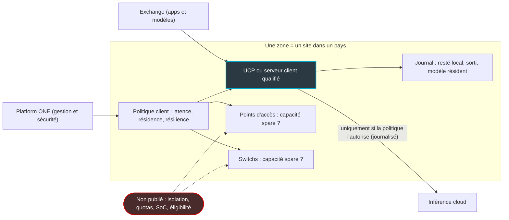
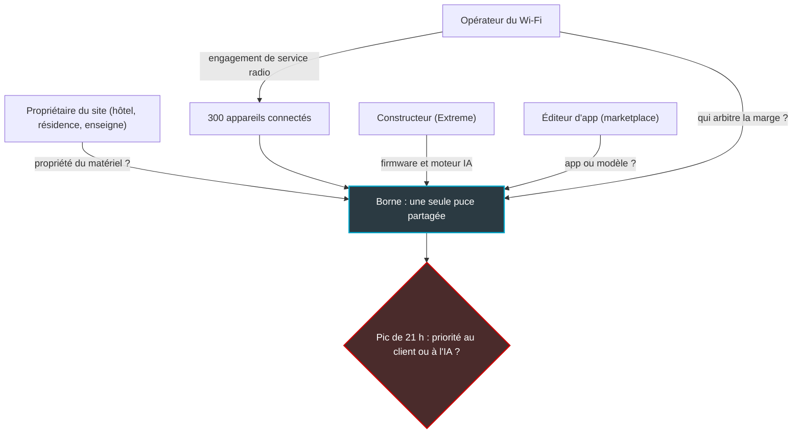

## Samedi, 21 heures, dans le hall

Samedi soir, 21 heures, dans le hall d'un hôtel de bord de mer. Au plafond, une borne Wi-Fi de la taille d'une assiette sert près de 300 appareils : des familles qui lancent leurs séries, un groupe de séminaire qui synchronise ses présentations, le terminal de paiement du bar qui attend son autorisation. Personne ne regarde cette borne. C'est la preuve qu'elle fait son travail.

Pour celui qui exploite ce réseau, elle n'est jamais « au repos ». Elle vit avec une marge, ce surplus de puissance dimensionné pour encaisser le pic de 21 heures sans que le client du bar s'en aperçoive.

Le 21 octobre, Extreme Networks a proposé de regarder cette marge autrement. Le constructeur a présenté en avant-première ses « Exchange zones » : faire tourner de l'intelligence artificielle sur le site du client, en combinant un serveur local avec la capacité de calcul jugée inutilisée des bornes et des switchs déjà installés. Pour les hôtels, les enseignes, les résidences et les DSI multi-sites, l'argument porte : une IA qui reste dans le bâtiment, sans facture cloud indexée sur chaque requête. Disponibilité visée : premier semestre 2027.

Ma lecture est plus froide. Sur un équipement qui sert du public, la capacité « inutilisée » n'existe pas. Il existe une marge de qualité de service, et elle est déjà engagée dans un contrat. Tant que personne ne dit qui la possède, comment elle est cloisonnée et qui la maintient, on parle d'une feuille de route. Pas d'un produit qu'on signe.

## Ce qu'il y a vraiment dans l'avant-première

Lisons le communiqué pour ce qu'il dit. La nuance tient dans un adverbe.

Une Exchange zone assemble deux briques. La première est classique : soit une Universal Compute Platform (UCP), gamme d'appliances x86 qu'Extreme utilise déjà pour ses outils de gestion, soit un serveur du client « qualifié » par le constructeur. La seconde est opportuniste : la capacité disponible des points d'accès et des switchs du site. Le texte l'introduit ainsi : « Organizations will also be able to pool compute resources, including spare capacity on Extreme access points and switches ». *Also*, « aussi ». Les bornes sont un complément, pas le moteur. J'en tire une lecture personnelle, que le communiqué ne confirme pas : le gros de l'inférence tournera sur le serveur, et rien n'indique qu'une zone composée uniquement de bornes existera.

Autour de ces briques, trois mécanismes. Un moteur de placement répartit les traitements selon des exigences fixées par le client : latence, résidence des données, résilience. Les modèles tournent en local par défaut ; l'inférence cloud n'intervient que si la politique du client l'autorise, et chaque occurrence est journalisée. Enfin, chaque zone est rattachée à un seul site, dans un seul pays, avec une observabilité censée montrer ce qui est resté local, ce qui a franchi la frontière et pourquoi, et quel modèle était résident.

*La zone telle que décrite le 21 octobre : le serveur est identifié, la contribution des bornes reste un point d'interrogation.*

Nabil Bukhari, CTO et président des plateformes IA d'Extreme, assume l'intuition de départ : « those networks hold a lot of idle compute ». Puis il vend la gouvernance : « Customers control their data, inference, and cost inside a boundary they define, with a record of every exception ». Le communiqué promet aussi une meilleure économie que le cloud. Sans un seul chiffre.

Ce qui manque pèse plus lourd que ce qui est dit. Network World note qu'Extreme n'a détaillé ni le matériel concerné, ni la façon de mesurer la capacité disponible. Converge Digest ajoute les mécanismes d'isolation, les tailles de modèles et les benchmarks d'inférence, IT Brief le prix, le format des journaux d'audit et les clients pilotes. Le communiqué ne dit pas davantage quelle UCP, ni quel accélérateur éventuel, ferait tourner les modèles, et ne donne pas de date plus précise que le premier semestre 2027. Aucun pilote n'est nommé. Même la marketplace Extreme Exchange, présentée en novembre 2025, n'était alors pas lancée (« Stay tuned for the official launch »).

Seule voix extérieure, Brandon Butler (IDC) salue une « innovative approach that brings a marketplace of AI applications to customer premises, using spare capacity in existing network infrastructure ». La citation figure toutefois dans le communiqué lui-même et porte sur le concept, pas sur la faisabilité. Quant au « Industry's First » du titre, il ne vaut que pour l'association de l'IA et de la mise en commun de capacité : Cisco permet d'héberger des conteneurs sur ses points d'accès depuis IOS XE 17.3.1.

## Une marge n'est pas un temps mort

Voici l'image qui résume mon malaise. Sur une autoroute, la bande d'arrêt d'urgence est vide presque tout le temps. Un gestionnaire pressé pourrait mesurer son taux d'occupation, le trouver proche de zéro et décider d'y faire rouler des camions de livraison. Il aurait raison sur le chiffre. Jusqu'au premier accident, quand l'ambulance ne passe plus.

La marge d'une borne Wi-Fi fonctionne de la même façon. Elle paraît inutilisée parce qu'elle est dimensionnée pour le pic : un car de touristes qui débarque, cent téléphones qui lancent leur mise à jour en même temps, le hall à 21 heures. Parler de « calcul inutilisé », c'est mesurer la bande d'arrêt d'urgence à trois heures du matin. Or Extreme ne publie aucune donnée sur l'utilisation réelle des processeurs de ses bornes. L'hypothèse fondatrice n'est pas étayée.

*Dans la boutique, la borne et le switch ne sont pas des serveurs en veille : ce sont des équipements qui servent déjà quelqu'un.*

Combien une borne peut-elle réellement prêter ? Extreme ne le dit pas. La référence publique la plus précise que je connaisse vient d'un concurrent. Chez Cisco, l'hébergement d'applications sur les points d'accès Catalyst 9100, Wi-Fi 6E et Wi-Fi 7 est plafonné à 100 Mo de mémoire vive, une vingtaine de mégaoctets de stockage, deux conteneurs et deux cœurs ARM. Cisco affirme que ces ressources sont dédiées et n'entrent pas en conflit avec le service aux clients, sans publier de mesure pour le démontrer.

100 Mo ne portent pas un grand modèle de langage. Au mieux, de l'apprentissage automatique léger : une prévision de charge, une classification de trafic. C'est ma déduction, et elle rejoint ma lecture du communiqué : sur une borne, « l'IA » restera modeste, et le gros du calcul vivra sur le serveur.

Reste la question qui fâche : que devient le Wi-Fi quand ce calcul léger tourne pendant le pic ? Un article de recherche déposé sur arXiv début septembre donne un premier ordre de grandeur. Sur un point d'accès d'entreprise, un petit modèle de prévision sollicité en plein engorgement du réseau a suffi à rallonger de trois quarts le temps de réponse des paquets les plus lents. Ce sont précisément ces paquets-là qui font hacher un appel vidéo.

Le détail de l'expérience menée par Bahadori, Pradhan et Amini : 13 flux d'inférence en parallèle, un réseau saturé, une exécution en configuration par défaut. Résultat, un RTT (temps d'aller-retour) au 99e centile en hausse de 76 %, et un débit en baisse de 7,06 %. Les auteurs ont aussi constaté que cinq implémentations de modèles tournaient 6,1 à 19,1 fois plus lentement sur la borne que sur un Raspberry Pi 5. Deux modèles de taille comparable y affichaient un écart de latence de 19 fois.

Autrement dit, la taille d'un modèle ne prédit rien sur une borne. Il faut mesurer sur l'équipement, sous charge, et les chercheurs proposent pour cela un test en deux étapes baptisé « network-aware deployability ». Précaution indispensable : la borne testée n'est pas nommée, rien ne dit que ce soit une Extreme, et le scénario ne se généralise pas. C'est pourtant exactement la mesure qu'un exploitant doit exiger avant de prêter sa marge à quiconque.

## Qui arbitre à 21 heures ?

Le 16 septembre, dans [« Quand la baie technique se met à calculer, à qui appartient le modèle ? »](https://wifirst-tech-blog.web.app/post?slug=baie-technique-noeud-inference-npu-wifi8), j'expliquais pourquoi l'arrivée d'unités d'inférence dans le silicium réseau fait de la propriété du modèle une affaire de contrat. Je n'y reviens pas. Extreme pousse la question d'un cran : à qui appartient la capacité ?

Dans un Wi-Fi managé, au moins quatre acteurs peuvent la revendiquer. Le propriétaire du site, qui a parfois acheté le matériel. L'opérateur, qui garantit au site un niveau de service radio pendant le pic. Le constructeur, qui fournit le firmware et, demain, le moteur d'exécution de l'IA. Et l'éditeur d'application de la marketplace, qui aimerait y loger son modèle.

Mon analyse, et je la signale comme telle : la marge appartient de fait à celui qui a signé l'engagement de service. Un contrat de Wi-Fi managé ne vend ni des mégahertz ni des cœurs de processeur. Il vend une expérience au moment où tout le monde se connecte. La marge est la condition de cette promesse. La prêter sans renégocier, c'est réécrire l'engagement en silence.

*Quatre acteurs, une seule puce. Le communiqué ne dit pas qui tranche quand le trafic client et l'IA réclament la même ressource au même moment.*

Prêter cette marge n'a rien d'absurde, à une condition : prouver la cloison. Sur une borne, trois mondes cohabitent dans le même SoC (system-on-chip, le composant unique qui réunit processeur, mémoire et traitement réseau). Il y a le plan de données, qui achemine les paquets des clients. Il y a le plan de gestion, qui permet à l'exploitant de piloter l'équipement. Et il y a désormais la charge de travail IA. Qui les sépare ? Le communiqué n'en dit pas un mot. Trois preuves manquent :

- **Le mécanisme d'isolation** : conteneur, machine virtuelle, enclave matérielle, quotas du noyau Linux (cgroups) ? Les garanties ne sont pas du tout les mêmes.
- **La règle d'arbitrage** : quand le trafic monte, l'IA est-elle ralentie, suspendue ou évincée, et en combien de temps ? Peut-on couper toutes les charges IA d'un parc en une commande, sans toucher au Wi-Fi ?
- **La chaîne de responsabilité** : qui a le droit de déployer sur la borne, avec quelle signature, et qui paie la pénalité si une application tierce dégrade la radio ?

Converge Digest, la revue la plus critique du lot, juge que l'économie du calcul inutilisé des équipements réseau reste à prouver tant qu'aucun déploiement en production n'existe. J'ajoute un angle que ni le communiqué ni le billet de 2025 n'abordent : le multi-locataire. Une zone, c'est un site dans un pays. Parfait pour une enseigne qui gère ses propres magasins. Pour un exploitant qui opère des centaines de sites pour des dizaines de clients depuis un même outil, rien n'est dit.

*Deux voies sur la même puce, celle du Wi-Fi et celle de l'IA. Tout se joue dans la cloison, que personne n'a encore montrée.*

## Une borne qui héberge des applications change de statut

Une borne qui fait tourner des applications tierces n'est plus seulement un équipement réseau. C'est une petite plateforme logicielle, avec ses dépendances, ses failles et ses mises à jour. Or l'Europe vient de durcir les règles pour exactement ce type d'objet.

Le Cyber Resilience Act, ou CRA, est le règlement européen 2024/2847 sur la cyber-résilience des produits numériques. Les obligations de notification de son article 14 s'appliquent depuis le 11 septembre 2026, avec des délais de 24 heures (alerte précoce), 72 heures (notification) et 14 jours après la mise à disposition d'une mesure corrective (rapport final, un mois pour un incident grave) ; ce blog y a consacré [un article le 1er septembre](https://wifirst-tech-blog.web.app/post?slug=cra-article-14-notification-24h-11-septembre-2026). L'application complète arrive le 11 décembre 2027. Selon l'analyse d'Endor Labs, elle recouvre notamment une nomenclature logicielle (SBOM) lisible par machine et la correction des vulnérabilités sans délai. S'y ajoutent des mises à jour de sécurité signées et gratuites, et une période de support d'au moins cinq ans, dont la date de fin doit être visible à l'achat.

Faites le calcul. La disponibilité générale des Exchange zones est visée au premier semestre 2027. L'application complète du CRA tombe cinq à onze mois plus tard. Les bornes vendues « pour l'IA » arriveront donc juste avant que le CRA ne s'applique en entier, et seront encore en service quand il s'appliquera. Avec tout ce qu'elles exécutent.

Questions sans réponse publique : le moteur d'inférence figure-t-il dans la SBOM du firmware ? Est-il corrigé avec le firmware, dans la même fenêtre de maintenance, ou à part ? Que deviennent les applications de la marketplace, dont le cycle de vie risque d'être plus court que les cinq ans de support de la borne ? Enfin, la plus délicate : quand un exploitant intègre une application tierce à son service, qui endosse le rôle de fabricant au sens du règlement ? Je ne prétends pas trancher ce point sans avis juridique. Je constate qu'aucune des sources disponibles ne l'aborde.

Reste la porte de sortie. Extreme décrit une pile intégrée en cinq couches : l'infrastructure, Platform ONE, Extreme AI, Agent ONE et Exchange. Chacune se défend seule. Ensemble, elles dessinent un couloir. Mon analyse : la valeur la plus collante n'est pas le calcul, c'est le journal. Le jour où votre conformité repose sur le registre d'Extreme (ce qui est resté sur site, ce qui est sorti, pourquoi), changer de fournisseur revient à reconstruire votre piste d'audit. Avant d'y entrer, je veux savoir ce qui reste portable : les modèles, les applications, et la politique de placement elle-même.

## Suivre de près, ne rien signer

Je ne veux pas être injuste avec cette annonce. Son meilleur morceau n'est pas celui qu'Extreme met en avant. Une zone liée à un site et à un pays, des modèles locaux par défaut, un journal de chaque exception vers le cloud : c'est exactement la grammaire qu'attend un client européen soumis à des contraintes de résidence des données. Si Extreme livrait seulement le serveur dans la baie, la politique de placement et ce journal, j'y verrais déjà un produit sérieux. La capacité des bornes, elle, ressemble à un argument de brochure greffé sur une bonne idée.

Ma position est donc simple : suivre, tester dès qu'un pilote est accessible, et ne rien inscrire dans un contrat avant la disponibilité générale. Avant tout engagement, voici les sept questions que je poserais à Extreme :

1. Quelles bornes et quels switchs sont éligibles, avec quel SoC, et combien de mémoire et de calcul sont réservables ?
2. Comment la capacité « disponible » est-elle mesurée, et comment l'IA est-elle isolée du trafic client puis évincée au pic, avec quelle mesure de latence ?
3. Qui peut déployer sur une borne, avec quelle signature, et qui répond si une application dégrade la radio ?
4. Comment fonctionne une exploitation multi-clients et multi-sites depuis un seul outil ?
5. Où est la SBOM du moteur d'inférence, quelle cadence de correctifs, quelle durée de support ?
6. Quel format d'audit, quel export vers un SIEM (l'outil de corrélation des journaux de sécurité), et qui valide les exceptions cloud ?
7. Quel prix, quelle licence, quelle base chiffrée pour la « meilleure économie » promise, et quelle réversibilité ?

*Le contrat est signé, la fiche technique est lue. Reste la clause blanche : qui a le droit de puiser dans la marge.*

Ce qui me ferait changer d'avis tient en quatre pièces. Un client pilote nommé, en production. Une spécification d'isolation publiée. Un benchmark indépendant qui mesure l'effet sur le Wi-Fi en heure de pointe. Une SBOM du moteur d'inférence. Avec ces quatre pièces, la discussion devient contractuelle, et je serai le premier à l'ouvrir.

D'ici là, je garde l'image de l'autoroute. Une borne Wi-Fi n'a pas de temps mort. Elle a une bande d'arrêt d'urgence, et celle-ci sert le samedi à 21 heures. Avant d'y laisser rouler l'IA de quelqu'un d'autre, je veux lire le code de la route. Pour l'instant, il n'est pas publié.

_Vues personnelles, pas position Wifirst._

## Sources

1. Extreme Networks (Business Wire) — communiqué de presse Exchange zones, 21 octobre 2026 — https://s205.q4cdn.com/756692490/files/doc_news/Extreme-Previews-Industrys-First-On-Prem-Enterprise-AI-Infrastructure-for-Networking-2026.pdf
2. Network World (Michael Cooney) — Extreme et la capacité de calcul inutilisée du réseau pour l'IA locale, 22 octobre 2026 — https://www.networkworld.com/article/4238660/extreme-wants-to-use-idle-network-compute-capacity-for-local-ai.html
3. IT Brief UK — Extreme présente ses zones d'IA sur site pour les réseaux d'entreprise, 21 octobre 2026 — https://itbrief.co.uk/story/extreme-previews-on-prem-ai-zones-for-enterprise-networks
4. Converge Digest — Extreme Networks, on-prem AI, Exchange zones et Agent ONE, 21 octobre 2026 — https://convergedigest.com/extreme-networks-on-prem-ai-exchange-zones-agent-one/
5. Extreme Networks, blog (Nabil Bukhari) — « Introducing Extreme Exchange », 13 novembre 2025 — https://www.extremenetworks.com/resources/blogs/introducing-extreme-exchange
6. Extreme Networks — documentation Universal Compute Platform — https://documentation.extremenetworks.com/Universal_Compute_Platform/standalone_DG/GUID-341765DB-1BB0-4A9F-8720-734B567C202C.shtml
7. Cisco DevNet — Application Hosting on Catalyst APs, FAQ — https://developer.cisco.com/docs/app-hosting-ap/faqs
8. Cisco DevNet — Application Hosting on Catalyst APs, Device Prerequisites — https://developer.cisco.com/docs/app-hosting-ap/device-prerequisites
9. Bahadori, Pradhan, Amini — « Network-Aware Forecasting on Wireless Access Points », arXiv 2609.01957, 2 septembre 2026 — https://arxiv.org/abs/2609.01957
10. Endor Labs — analyse de l'application complète du Cyber Resilience Act au 11 décembre 2027, 14 octobre 2026 — https://www.endorlabs.com/learn/the-rest-of-the-eu-cyber-resiliency-act-lands-on-december-11th-2027
