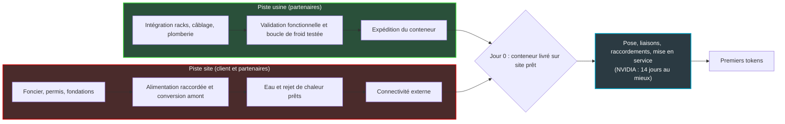
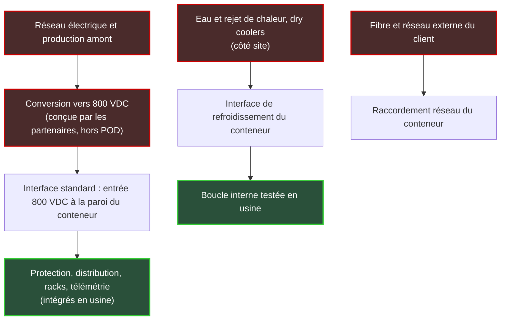

## Quatorze jours, à condition que le terrain soit prêt

Un camion se gare, une grue soulève un conteneur gris et le pose sur une dalle de béton. Deux semaines plus tard, ce conteneur produit de l'intelligence artificielle. C'est l'image que NVIDIA a installée le 21 octobre, lors de son événement GTC Berlin, en présentant DSX POD. Le principe : des usines d'IA livrées en conteneurs, assemblées et testées avant de quitter l'atelier. Le déploiement passerait, selon le constructeur, de six mois à quatorze jours.

Hébergeurs, neoclouds (ces fournisseurs de cloud spécialisés dans la location de puissance de calcul), États en quête de capacité souveraine : tout le monde court après du calcul disponible vite. Six mois ramenés à deux semaines, c'est le genre de chiffre qui atterrit dans un comité d'investissement avant la fin du trimestre.

Sauf que la condition figure dans la même phrase du communiqué. Les conteneurs arrivent prêts à être branchés sur un site *préparé*, avec son alimentation, son refroidissement et son réseau. Ce site, NVIDIA ne le livre pas.

Ma lecture tient en trois phrases. DSX POD raccourcit vraiment la dernière étape d'un projet : poser et raccorder un conteneur. Il laisse intact le chemin critique, c'est-à-dire le terrain, le kilowatt raccordé, l'eau et le rejet de chaleur. Les quatorze jours sont donc une ligne d'arrivée, pas un délai de projet, et la seule question qui compte pour qui achète de la capacité devient : qui livre le « site prêt », à quelle date, et sous quelle clause ?

## Un plan de référence, dix-sept fabricants, aucun client nommé

Premier malentendu à dissiper : NVIDIA ne vend pas d'usine. Le communiqué décrit DSX POD comme « a reference design for complete NVIDIA Vera Rubin AI factories built by partners inside modular containers, integrated and validated before delivery ». Un design de référence, donc. Vera Rubin est la plateforme de calcul qui succède à Blackwell chez NVIDIA. Les partenaires fabriquent, intègrent et livrent les conteneurs qui l'hébergent, sur un plan commun.

Ils sont dix-sept à être nommés : Anduril, Armada, Bull, Crusoe, DayOne, Dell Technologies, Delta, Eaton, Foxconn (via Ingrasys), GIGABYTE, HPE, Lenovo, Pegatron, QCT, Schneider Electric, Vertiv et Wistron. On y trouve des constructeurs de serveurs, des spécialistes de l'énergie et du refroidissement, des développeurs de capacité, et même un industriel de la défense. Livraison « worldwide in early 2027 ». Pas de mois précis, pas de prix, pas de client, pas de site.

Le titre du communiqué promet d'accélérer le déploiement des infrastructures européennes. Le texte, lui, ne nomme aucun site ni aucun client en Europe. Data Center Knowledge précise que la cible est mondiale et que Berlin a été choisie pour souligner l'expansion européenne du groupe. Effet de scène, pas engagement.

Autre absence notable : le communiqué ne mentionne ni tension électrique, ni puissance en mégawatts, ni nombre de racks ou de processeurs graphiques (GPU), ni consommation d'eau. Ces éléments viennent du blog technique de NVIDIA, de la keynote et de la presse. Data Center Knowledge décrit par exemple un POD de sept racks Vera Rubin NVL72, et le cabinet Futurum en tire le chiffre de 504 GPU. L'arithmétique tient, mais NVIDIA ne l'écrit ni dans son communiqué ni dans son blog. Je le traite donc comme une information de presse, pas comme une spécification.

L'intention, elle, ne fait pas de doute. Selon Data Center Knowledge, Ian Buck, vice-président de NVIDIA chargé de l'hyperscale et du calcul haute performance, a décrit l'objet comme un « fully assembled, fully tested, fully pre-plumbed, prebuilt, pre-validated container ». La cible déclarée : les organisations qui veulent mettre en ligne des centaines de mégawatts plus vite.

*Ce que l'usine absorbe : racks refroidis par liquide, câblage, distribution électrique et tests, le tout avant expédition. Vue d'artiste.*

## La maison préfabriquée ne coule pas sa dalle

Quiconque a fait construire une maison à ossature bois préfabriquée connaît la scène. Les murs arrivent par camion, l'équipe les dresse en quelques jours, et les voisins n'en reviennent pas. Ce qu'ils n'ont pas vu, ce sont les mois d'avant : le permis de construire, le terrassement, la dalle, le raccordement à l'eau et au réseau électrique. La préfabrication n'a rien supprimé de tout cela. Elle a simplement déplacé le montage des murs du terrain vers l'atelier.

DSX POD, c'est exactement cette maison. Et NVIDIA a l'honnêteté de l'écrire noir sur blanc dans son blog technique : « NVIDIA DSX POD changes where integration occurs. It does not eliminate the supporting facility infrastructure. » Ce qui change, c'est le lieu de l'intégration. L'infrastructure d'appui, elle, reste à bâtir.

Concrètement, le communiqué explique que l'intégration du calcul, du réseau, du câblage, de l'alimentation des racks et du refroidissement liquide migre vers l'usine. « Partners complete rack-to-rack cabling, wiring, piping and functional validation before shipment. » Et ce travail se déroule séparément de la préparation du site.

C'est là que se loge le vrai gain, et il ne faut pas le minimiser. Dans un chantier classique, on prépare la salle, puis on y installe et on câble le matériel : deux phases en série. Avec DSX POD, elles tournent en parallèle. Pendant que les partenaires fabriquent et testent les conteneurs, les équipes du site préparent le foncier, les fondations, l'alimentation et la connectivité externe, détaille le blog. Après la livraison restent la pose, les liaisons entre conteneurs, le raccordement à l'électricité, au froid et au réseau, puis la mise en service. Le blog le résume d'une phrase : « This model does not remove onsite work. »

*Deux pistes en parallèle. Les quatorze jours annoncés par NVIDIA ne couvrent que le cadre bleu ; la piste rouge, celle du site, n'est chiffrée nulle part.*

Jensen Huang, dans le communiqué, a une formule que je reprends volontiers : « An AI factory creates value when it starts producing tokens — not when construction is complete ». Il a raison. C'est même pour cela que la piste rouge commande tout. Sans kilowatt raccordé ni boucle d'eau en service, le conteneur le mieux testé du monde ne produit pas un seul token, l'unité de texte que génère un modèle d'IA.

## Le kilowatt s'arrête à la paroi du conteneur

Un DSX POD ressemble à un appareil livré avec une prise normalisée. La prise est irréprochable. Le courant qui doit arriver dedans, lui, n'est pas fourni avec.

Ce point, le plus structurant de l'annonce, ne figure pas dans le communiqué mais dans le blog technique. Le POD y est décrit autour d'une entrée électrique standard en 800 VDC (800 volts en courant continu), placée à la frontière des conteneurs principaux. À partir de cette entrée, tout est intégré : protection, distribution, mise à la terre, connexions aux racks, contrôle et télémétrie. En amont, NVIDIA passe la main : « Partners then engineer the upstream generation, conversion, and regional electrical solution for the customer site. »

Autrement dit, la production d'énergie, la conversion depuis le réseau en courant alternatif et l'adaptation aux règles électriques locales sont conçues par les partenaires, site par site. Deux précisions de périmètre s'imposent. Le blog parle de l'entrée des conteneurs du POD, pas de toute la gamme Vera Rubin : rien ne permet d'écrire que l'ensemble de l'offre bascule en 800 volts continu. Et ces 800 volts n'arrivent pas tout faits du réseau. Quelqu'un doit les produire sur le site, avec des équipements que le conteneur ne contient pas.

La conséquence est subtile. Standardiser l'interface à la paroi rend les conteneurs reproductibles d'un projet à l'autre, et c'est l'objectif affiché. Mais cela repousse de l'autre côté de la paroi tout ce qui est local, régional, spécifique. Donc lent. J'ai détaillé dans [notre analyse des chiffres Dell'Oro du 18 octobre](https://wifirst-tech-blog.web.app/post?slug=dell-oro-dcpi-2t-2026-permis-raccordement-goulot-pop) pourquoi le permis et le raccordement sont devenus le goulot d'étranglement, et comment les constructeurs préparent déjà la distribution en 800 volts continu. Je n'y reviens pas. DSX POD ne change rien à ce diagnostic ; il le rend simplement plus visible.

Nick Patience, analyste chez Futurum, le dit sans détour : « However, the binding constraint on AI factories in Europe is access to grid power, and DSX POD doesn’t address that. » Il cite les files d'attente de raccordement de Francfort, Londres, Dublin et Amsterdam, et rappelle que les quatorze jours valent « once site utilities are ready ». Larry Dignan, de Constellation Research, arrive au même constat : le client a toujours besoin d'un site préparé, et ce site a besoin d'électricité.

Même l'argument d'efficacité ne touche pas le fond. Selon NVIDIA, DSX MaxLPS, un logiciel de pilotage dynamique de la puissance, permettrait d'obtenir la même production avec 30 % de puissance en moins dans un budget électrique fixé. Chiffre constructeur, non audité. Surtout, il ne dit pas combien de kilowatts le site doit fournir le jour de la mise en service.

*Qui fournit quoi, d'après le blog technique de NVIDIA. En rouge, ce qui reste au site ou aux partenaires ; en vert, ce que l'usine intègre. L'étape « réseau électrique » est une illustration générique.*

## L'eau, l'autre raccordement que personne ne chiffre

Le refroidissement obéit à la même logique que l'électricité. À l'intérieur, la plomberie est montée et testée en usine jusqu'à l'interface de refroidissement du conteneur. À l'extérieur, le site doit fournir, selon le blog, une infrastructure d'eau et de rejet de chaleur déjà opérationnelle, puis mettre en service la boucle complète.

Les aéroréfrigérants secs (dry coolers), ces grands échangeurs qui évacuent la chaleur dans l'air extérieur, ne sont donc pas dans le conteneur. Ils prennent du foncier, se raccordent à leur tour et appartiennent à la même piste rouge que le poste électrique.

Les chiffres les plus frappants viennent de la keynote et de la presse, pas du blog. NVIDIA annonce un refroidissement intégralement liquide, avec un fluide qui peut monter jusqu'à 45 °C. StorageReview nuance : selon le climat, un appoint mécanique peut rester nécessaire. Le constructeur avance aussi une économie de 54 millions de litres d'eau par jour à l'échelle de 2 gigawatts, par rapport à des tours aéroréfrigérantes classiques, dans les climats qui s'y prêtent.

Lisons ce chiffre pour ce qu'il est. Il porte sur 2 gigawatts de capacité, pas sur un POD. Il suppose un climat favorable. Et personne ne l'a audité. C'est un argument d'orientation, utile face à une collectivité inquiète pour sa ressource en eau ; ce n'est pas une donnée de planning. Techzine relevait d'ailleurs que la keynote laissait sans réponse concrète les questions de puissance, d'eau et d'acceptabilité sociale. Ce sont précisément celles qui fixent le calendrier d'un site.

*La piste que les quatorze jours ne comptent pas : dalles, tranchées de câbles de puissance, tuyauterie de refroidissement et fourreaux fibre. Vue d'artiste.*

## Six mois, un mois, quatorze jours : la cible n'est pas une mesure

En quarante-huit heures, le même produit a été décrit avec cinq horloges différentes.

| Qui le dit | Formulation | Statut |
|---|---|---|
| Communiqué NVIDIA | De six mois à « as little as 14 days » | Écrit, borne basse |
| Jensen Huang, dans le même communiqué | « reducing deployment time from months to weeks » | Écrit, qualitatif |
| Jensen Huang, interrogé par Yahoo Finance | Des mois à des semaines, voire un mois | Oral |
| Keynote GTC Berlin, transcription Investing.com | De quatre ou cinq mois à environ un mois, entre l'arrivée du calcul et les premiers tokens | Oral, transcription imparfaite |
| Narration vidéo de la keynote | De plusieurs mois à quelques jours | Promotionnel |

Le chiffre de quatorze jours est le plus précis, donc le plus repris. Six mois représentent environ 182 jours, soit un facteur treize environ ; c'est mon calcul, pas celui de NVIDIA. Mais « as little as » signifie « en aussi peu que ». C'est une borne basse, le meilleur cas, pas une moyenne.

Surtout, rien ne sera livré avant début 2027, et aucune installation indépendante n'a été publiée. StorageReview note que le chiffre laisse de côté le temps de construction de l'installation d'appui. L'extrait de DatacenterDynamics relayé par AI Weekly le présente, lui, comme une cible. Sur un site déjà alimenté et déjà équipé en eau, quatorze jours sont plausibles. Partout ailleurs, c'est la ligne d'arrivée d'une course dont le départ n'a pas encore été donné.

## Le modulaire existait déjà, et racontait la même histoire

L'objection est légitime : les centres de données en conteneurs ne datent pas d'hier. NVIDIA le reconnaît dans son propre blog (« Modular and prefabricated data centers already exist. ») et ajoute que son design ne rend pas la conteneurisation obligatoire pour toutes les usines d'IA. Le POD ne prétend pas remplacer le data center conventionnel.

HPE commercialise déjà AI Mod Pod, en modules de 0,8 MW ou 1,6 MW, avec jusqu'à quatre conteneurs combinés pour 5 MW, selon ITDaily. Le même média rapporte le cas d'Isambard-AI, le supercalculateur britannique de 5 MW. Il aurait été installé sur une dalle neuve en huit mois, avec une enceinte assemblée en quarante-huit heures. Quarante-huit heures contre huit mois : toute l'asymétrie du sujet tient dans ces deux chiffres.

L'apport de NVIDIA est donc ailleurs, et il tient en trois points. D'abord, des interfaces standardisées : l'entrée électrique, l'interface de refroidissement, la validation en usine. Ensuite, la crédibilité d'un design de référence signé par le fournisseur des puces. Enfin, un écosystème qui construit sur le même plan, à condition qu'il livre. Selon Channel Insider, Dell développe un centre de données modulaire autour de DSX POD et HPE prévoit de le supporter en s'appuyant sur AI Mod Pod. Schneider Electric, de son côté, présente son RapidScale Reference Design 115 comme une première étape, pas comme une offre commerciale aboutie.

Reste la question du verrouillage. Un conteneur Vera Rubin engage le site sur l'architecture NVIDIA, quel que soit le partenaire qui l'a assemblé. C'est ma lecture, pas un argument de NVIDIA. Nick Patience note de son côté que le POD ne constitue pas, à lui seul, une stratégie de souveraineté. On retrouve un schéma déjà observé côté réseau, où [le verrouillage change d'adresse plus qu'il ne disparaît](https://wifirst-tech-blog.web.app/post?slug=sonic-ocp-2026-lock-in-change-d-adresse) : ici, il quitte le chantier pour se loger dans le conteneur.

Dernier contrepoint, celui du cabinet IDC. Ashish Nadkarni y voit les cas d'usage les plus solides dans le souverain (pour l'isolation physique), les sites plus modestes et l'IA en périphérie de réseau. Curieux décalage avec un Ian Buck qui parle de centaines de mégawatts. Les deux ont peut-être raison à leur manière. Le conteneur convainc surtout là où le site est petit et déjà alimenté, c'est-à-dire là où le chemin critique est court.

## Pourquoi lire une annonce qu'on n'achètera jamais

Soyons clairs : Wifirst n'achètera pas de DSX POD. Un point de présence (PoP) d'opérateur consomme quelques kilowatts, comme le rappelait l'article Dell'Oro ; NVIDIA vise des centaines de mégawatts. L'entrée 800 volts continu mérite d'être suivie, mais elle est hors de portée d'un PoP, et je me garderai de toute extrapolation vers les équipements télécom. Quant à l'hôtellerie, au retail ou aux résidences étudiantes, ils n'ont aucun lien direct avec le produit.

*Du local technique d'opérateur au campus de calcul, la même leçon : c'est le site prêt qui fixe la date de mise en service. Vue d'artiste.*

Ce qui se transpose, c'est le mécanisme de gestion de projet. J'en tire trois leçons.

**Un : quand l'intégration part en usine, le site prêt devient le chemin critique.** C'est vrai pour un campus de calcul. C'est tout aussi vrai pour un PoP, un local technique d'hôtel, une résidence étudiante ou un magasin. Le matériel préconfiguré arrive en quelques jours ; l'énergisation, la fibre, le local et la climatisation arrivent en semaines ou en mois. Piloter un planning sur la date de livraison du matériel, c'est regarder le mauvais indicateur.

**Deux : la clause qui manque, c'est la définition de « prêt ».** Le blog NVIDIA découpe proprement les responsabilités entre le site, les partenaires, l'usine et la mise en service. Channel Insider recommande aux partenaires de fixer noir sur blanc qui répond de la capacité électrique, des raccordements de froid, du réseau externe et de la recette. Transposé à un contrat d'hébergement ou de PoP, cela donne une checklist courte :

- une date d'énergisation contractuelle, avec une puissance réellement disponible au tableau, pas seulement réservée sur le papier ;
- une capacité de froid confirmée et testée en charge avant l'arrivée du matériel ;
- des chemins de fibre livrés, redondance comprise ;
- des critères d'acceptation mesurables, signés avant le démarrage des travaux ;
- un responsable unique de l'escalade, pour le jour où trois fournisseurs se renverront la balle.

Cette liste complète les [six clauses proposées dans l'article Dell'Oro](https://wifirst-tech-blog.web.app/post?slug=dell-oro-dcpi-2t-2026-permis-raccordement-goulot-pop), en se concentrant sur un point précis : ce que « prêt » veut dire le jour de la recette.

**Trois : la capacité de 2027 se jouera au raccordement, pas à la livraison.** Les conteneurs sortiront des usines, mais les files d'attente de Francfort, Londres, Dublin et Amsterdam ne raccourciront pas pour autant. Pour un opérateur qui loue des mètres carrés et des kilowatts chez un hébergeur, l'effet est indirect mais réel. Son hébergeur se bat pour les mêmes raccordements que les usines d'IA. La date d'ouverture d'un nouveau PoP dépend alors d'une file que le conteneur ne raccourcit pas.

## Ce que je guette d'ici début 2027

Le POD sera jugé sur des faits que l'annonce ne contient pas encore. Je surveille six signaux :

- un premier client nommé, avec son site ;
- une puissance par POD publiée par NVIDIA, et non estimée par des tiers ;
- un prix, même indicatif ;
- une première mise en service indépendante, avec un calendrier daté du terrain nu au premier token ;
- l'offre de Dell finalisée ;
- la version commerciale du design de Schneider Electric.

Sur le fond, DSX POD est une bonne idée industrielle. Sortir l'intégration du chantier devrait réduire le besoin de main-d'œuvre spécialisée sur site, comme le souligne Constellation Research. Faire tourner en parallèle deux pistes qui étaient en série est un vrai gain. Mais lire « 14 jours » comme un délai de projet serait une erreur, et une erreur coûteuse dans un business plan. C'est la ligne d'arrivée d'un chantier que NVIDIA ne vend pas.

NVIDIA a industrialisé tout ce qui se passe à l'intérieur du conteneur. Ce qui se passe à l'extérieur s'appelle toujours un chantier, et son calendrier s'écrit toujours chez le gestionnaire du réseau électrique.

_Vues personnelles, pas position Wifirst._

## Sources

1. NVIDIA, communiqué « NVIDIA Introduces DSX POD AI Factories to Accelerate Europe's Infrastructure Deployment », 21 octobre 2026 : https://nvidianews.nvidia.com/news/nvidia-introduces-dsx-pod-ai-factories-to-accelerate-europes-infrastructure-deployment (miroir investisseurs : https://investor.nvidia.com/news/press-release-details/2026/NVIDIA-Introduces-DSX-POD-AI-Factories-to-Accelerate-Europes-Infrastructure-Deployment/default.aspx)
2. NVIDIA Technical Blog (Premal Savla), « Achieve Productive AI Capacity Faster and More Predictably with NVIDIA DSX POD », 21 octobre 2026 : https://developer.nvidia.com/blog/achieve-productive-ai-capacity-faster-and-more-predictably-with-nvidia-dsx-pod/
3. StorageReview, compte rendu de GTC Berlin 2026 (DSX POD), 21 octobre 2026 : https://www.storagereview.com/news/nvidia-gtc-berlin-2026-dsx-pod-14-day-ai-factory-substrate-openshell-ai-ran
4. Channel Insider (Liz Ticong), « Nvidia DSX POD Targets 14-Day AI Data Center Deployments », 22 octobre 2026 : https://www.channelinsider.com/infrastructure/news-nvidia-dsx-pod/
5. Futurum (Nick Patience), « At GTC Berlin, NVIDIA Puts the AI Factory in an Actual Container », 22 octobre 2026 : https://futurumgroup.com/insights/at-gtc-berlin-nvidia-puts-the-ai-factory-in-an-actual-container/
6. Data Center Knowledge (Wylie Wong), « Nvidia Unveils DSX Pod for Faster AI Data Center Builds », 21 octobre 2026 : https://datacenterknowledge.com/ai-data-centers/nvidia-unveils-dsx-pod-for-faster-ai-data-center-builds
7. Yahoo Finance (Daniel Howley), « Nvidia reveals plans for 'an AI factory in a shipping container' », 21 octobre 2026 : https://finance.yahoo.com/technology/article/nvidia-reveals-plans-for-an-ai-factory-in-a-shipping-container-to-build-data-centers-in-weeks-not-months-125029004.html
8. Investing.com, transcription de la keynote GTC Berlin 2026, 21 octobre 2026 : https://www.investing.com/news/transcripts/nvidia-at-gtc-berlin-2026-keynote-europes-ai-buildout-93CH-4962500
9. Techzine (Erik van Klinken), « Nvidia GTC Berlin: on the hunt for European AI factories », 21 octobre 2026 : https://www.techzine.eu/blogs/infrastructure/145161/nvidia-gtc-berlin-on-the-hunt-for-european-ai-factories/
10. Constellation Research (Larry Dignan), « Nvidia launches DSX POD, aims for modular, preintegrated AI factories », 21 octobre 2026 : https://constellationr.com/insights/news/nvidia-launches-dsx-pod-aims-modular-preintegrated-ai-factories
11. AI Weekly (extrait d'un article DatacenterDynamics), 21 octobre 2026 : https://aiweekly.co/alerts/nvidia-launches-dsx-pod-containerized-vera-rubin-ai-factory-that-cuts
12. ITDaily, « HPE AI Mod Pod container data center », 23 juin 2026 : https://itdaily.com/blogs/datacenter/hpe-ai-mod-pod-container-data-center/
13. Wifirst Tech Blog, analyse Dell'Oro sur le permis et le raccordement, 18 octobre 2026 : https://wifirst-tech-blog.web.app/post?slug=dell-oro-dcpi-2t-2026-permis-raccordement-goulot-pop
