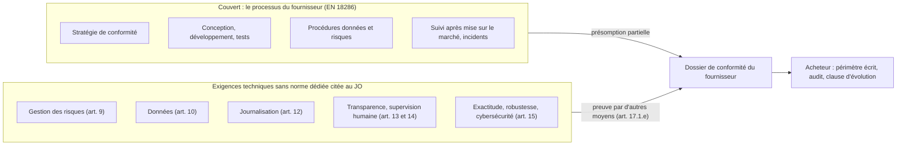
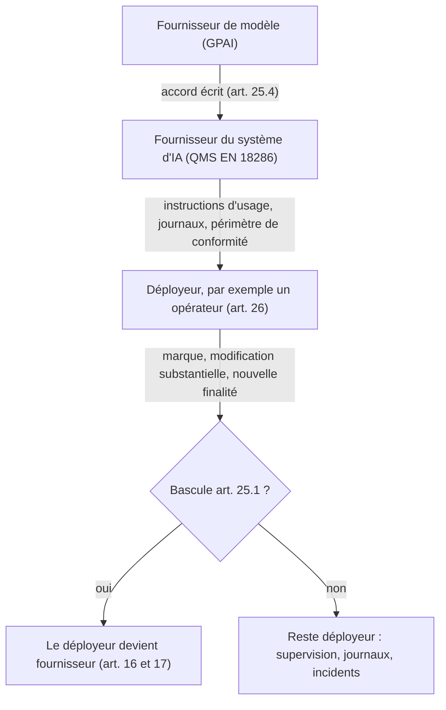

## Un tampon d'une ligne, et beaucoup de malentendus en vue

Le 14 octobre 2026, le Journal officiel de l'Union européenne a publié un texte de deux articles, suivi d'une annexe qui ne cite qu'une seule norme. Cette norme, EN 18286, est la première qui permet à un fournisseur d'intelligence artificielle de se dire « présumé conforme » à l'AI Act, le règlement européen sur l'IA. Vous allez la voir fleurir dans les argumentaires commerciaux bien avant d'avoir eu le temps de la lire.

Le problème tient à ce qu'elle couvre. Elle ne dit pas si un modèle est exact, robuste ou bien protégé contre les attaques. Elle valide une méthode : la façon dont le fournisseur conçoit, teste, surveille et corrige son système. C'est précieux. Ce n'est pas ce que la plupart des acheteurs croiront avoir acheté.

Pour une DSI de la grande distribution, un groupe hôtelier, un gestionnaire de résidences étudiantes ou un opérateur réseau comme Wifirst, l'enjeu est très concret. Beaucoup de contrats d'IA signés cet hiver courront encore le 2 décembre 2027. C'est la date à laquelle les obligations dites « haut risque » s'appliqueront aux usages que le règlement juge sensibles, du recrutement aux infrastructures critiques. Ce qui n'est pas écrit dans le contrat aujourd'hui se négociera demain en position de faiblesse.

Ma position : ce premier tampon est une bonne nouvelle, à condition de le lire pour ce qu'il est. Une preuve de méthode, pas une preuve de produit. Et tant que les autres normes manquent, c'est à l'acheteur de transformer ce tampon partiel en périmètre écrit et auditable.

## Le carnet d'entretien n'est pas le contrôle technique

Prenez une voiture d'occasion. Le vendeur vous tend un carnet d'entretien impeccable : chaque vidange datée, chaque intervention tamponnée par le garage, chaque rappel constructeur traité et documenté. C'est un excellent signal, car le garage a une méthode. Mais le carnet ne vous dit pas si les freins tiennent à 130 km/h. Pour ça, il y a le contrôle technique.

EN 18286 est le carnet d'entretien de l'AI Act. Le contrôle technique, lui, n'est pas encore écrit.

Les faits d'abord. La décision d'exécution (UE) 2026/2274 de la Commission, adoptée le 12 octobre, a été publiée au Journal officiel (JO) le 14 et est entrée en vigueur le jour même [1]. Son annexe cite une seule référence : EN 18286:2026, « Artificial intelligence – Quality management system for EU AI Act regulatory purposes ». Le CEN et le CENELEC, les organismes européens de normalisation qui l'ont rédigée, l'avaient publiée fin juillet [6]. Si la date du 19 octobre vous est passée sous les yeux, c'est celle d'une annonce reprise par la presse spécialisée [15]. Juridiquement, c'est le 14 qui compte [1][7].

Ce que vise la décision est écrit dans son considérant 3 : le volet de la demande de normalisation consacré aux « quality management systems for providers of AI systems, including post-market monitoring processes ». Autrement dit, le système de gestion de la qualité (QMS, pour Quality Management System) que l'article 17 de l'AI Act impose au fournisseur d'un système à haut risque. Stratégie de conformité, conception, tests, procédures de gestion des données et des risques, surveillance après mise sur le marché, signalement des incidents graves, tenue des registres. C'est la mécanique interne d'un éditeur sérieux.

*Un module scellé, les autres en pointillés : EN 18286 valide le processus du fournisseur, pas encore le modèle ni les données.*

La Commission a jugé que la norme « satisfies the requirements which it aims to cover » (considérant 5). Relisez la formule : elle évalue la norme sur ce qu'elle vise, pas sur ce que l'acheteur aimerait qu'elle vise. Selon le considérant 6, la présomption joue « from the date of publication of the reference of such standard in the Official Journal of the European Union ». Un fournisseur qui applique EN 18286 dispose donc d'environ treize mois et demi d'avance sur l'échéance du 2 décembre 2027. L'usage de la norme reste volontaire : on peut démontrer sa conformité autrement, mais sans ce filet.

Reste le mot qui compte. L'article 40 de l'AI Act, qui organise ces présomptions, ne les accorde que « to the extent that those standards cover those requirements or obligations » [3]. Dans la mesure de ce qu'elles couvrent, pas un millimètre au-delà. L'articulation juridique fine mérite l'œil d'un juriste : l'article 40 vise d'abord les exigences techniques des articles 8 à 15, alors que le QMS relève de l'article 17. La Commission, telle que la presse spécialisée la relaie, présente la norme comme ouvrant une présomption sur les exigences de l'article 17 qu'elle couvre [15]. Pour l'acheteur, la conséquence pratique est identique. Le tampon s'arrête là où s'arrête la norme.

*Ce que la présomption couvre, et ce qu'elle laisse au contrat. Le partage exact dépend de l'annexe ZA de la norme.*

## Le trou entre le tampon et le modèle

Pourquoi un seul tampon ? Parce que les autres ne sont pas prêts. Les normes harmonisées de l'AI Act sont rédigées par un comité technique commun au CEN et au CENELEC, le JTC 21. Au 9 juillet 2026, ses projets sur la gestion des risques, la cybersécurité et la journalisation étaient encore en enquête publique [9]. D'autres textes, sur l'exactitude, la robustesse ou la qualité des jeux de données, seraient toujours en préparation selon le suivi publié par l'éditeur Modulos [13]. Aucun n'est cité au JO à ce jour.

| Exigence visée | Projet de norme | Statut connu |
|---|---|---|
| Système qualité (art. 17) | EN 18286 | Citée au JO le 14/10/2026 [1] |
| Gestion des risques (art. 9) | prEN 18228 | Enquête publique jusqu'au 30/07/2026 [9] |
| Cybersécurité (art. 15) | prEN 18282 | Enquête publique jusqu'au 30/07/2026 [9] |
| Journalisation (art. 12) | prEN 18229-1 | Enquête publique jusqu'au 20/08/2026 [9] |
| Exactitude, robustesse (art. 15) | EN 18229-2 | En préparation, selon Modulos [13] |
| Données (art. 10) | EN 18284 | En préparation, selon Modulos [13] |

En octobre 2025, les bureaux techniques du CEN et du CENELEC ont adopté un paquet de mesures d'accélération. La cible affichée : rendre ces livrables disponibles « by Q4 2026 » [5]. C'était un objectif de l'époque, pas un engagement de citation au JO. Et la demande de normalisation de la Commission, la décision C(2025) 3871 du 23 juin 2025, expire le 28 février 2027 [4].

L'ironie est documentée. Le règlement (UE) 2026/1744, dit Omnibus numérique sur l'IA, publié au JO le 24 juillet et en vigueur depuis le 27, a repoussé les obligations haut risque [2]. Elles s'appliqueront le 2 décembre 2027 pour les usages listés à l'annexe III, et le 2 août 2028 pour l'IA intégrée aux produits déjà réglementés de l'annexe I [3]. Son considérant 2 cite, parmi les raisons du report, « the delayed preparation of standards ». Le calendrier a glissé parce que les normes manquaient. Elles manquent encore.

Le plus subtil se cache dans l'annexe ZA, la table qui relie chaque clause d'une norme harmonisée aux articles du règlement. La norme est payante et je ne l'ai pas lue. Je m'appuie ici sur l'analyse publiée par Modulos, source unique et commerciale, donc à prendre avec prudence [10][11]. Selon cet éditeur, l'annexe ZA laisserait hors champ les paragraphes 2 à 4 de l'article 17 et poserait des conditions à plusieurs lignes. La plus parlante : la couverture du volet risques du QMS supposerait un système de gestion des risques conforme à l'article 9. Or aucune norme sur l'article 9 n'est citée au JO.

Si cette lecture se confirme, le tampon contient une dépendance circulaire. Il présume conforme un processus qui s'appuie sur une brique que personne ne sait encore présumer conforme. Ce n'est pas un défaut de la norme. C'est le prix d'une norme publiée seule.

Dernière conséquence, la plus opérationnelle. L'article 43 de l'AI Act règle l'évaluation de conformité. Pour la biométrie (point 1 de l'annexe III), le fournisseur qui « has not applied, or has applied only part of, the harmonised standard » doit passer par un organisme notifié, c'est-à-dire un tiers habilité par un État membre [3]. Pour les points 2 à 8 de l'annexe III, qui incluent les infrastructures critiques et les ressources humaines, la voie prévue est le contrôle interne. Le fournisseur s'évalue lui-même.

Traduction pour l'acheteur : sur la plupart des usages B2B sensibles, aucun tiers obligatoire ne vérifiera le dossier du fournisseur avant la mise sur le marché. Le premier regard extérieur sera souvent le vôtre.

*Un court segment scellé, puis une longue plage vide : le chantier normatif de l'AI Act avance moins vite que son calendrier.*

## ISO/IEC 42001 n'est pas un passe-droit

Beaucoup de fournisseurs vous répondront qu'ils sont déjà certifiés ISO/IEC 42001, la norme internationale de système de management de l'IA. C'est un bon signe de maturité. Ce n'est pas une présomption de conformité. ISO/IEC 42001 ne figure pas à l'annexe de la décision 2026/2274, où seule EN 18286 est citée [1]. À elle seule, elle ne confère donc aucune présomption au titre de l'AI Act.

La Commission avait posé le principe dès sa demande de normalisation. Les normes harmonisées peuvent s'appuyer sur des normes ISO/IEC, mais elles « should not be based on such international standards unless compatibility with the purpose and approach of that Regulation can be ensured » (considérant 16 de C(2025) 3871) [4]. Une norme internationale de management pense organisation et amélioration continue. Le règlement européen pense produit, cycle de vie et protection des personnes.

D'après la Commission, telle que relayée par AI Weekly et ActuIA, EN 18286 a été conçue pour se superposer à un système existant sans le remplacer : ISO/IEC 42001, ISO 9001, ou un QMS sectoriel comme ISO 13485 dans le dispositif médical [15][17]. Modulos ajoute que l'annexe C de la norme proposerait une correspondance clause à clause avec 42001, sans équivalence [12]. Concrètement, un fournisseur certifié 42001 a fait une partie du chemin. Il doit vous montrer laquelle.

Deuxième piège : le mot « certificat ». Je n'ai trouvé trace d'aucun schéma de certification accrédité propre à EN 18286. Selon Modulos, la conformité à la norme apparaîtrait dans l'évaluation de conformité prévue par l'AI Act, et non sous forme de certificat autonome [11]. Si un commercial vous tend un « certificat EN 18286 », demandez qui l'a émis, sur quel référentiel et sur quel périmètre. Ce que vous voulez vraiment, c'est un rapport d'audit indépendant, exigence par exigence.

Dernier point, souvent mal lu. L'Omnibus a assoupli l'article 17 pour les PME, les start-up et les petites entreprises de taille intermédiaire, qui peuvent proportionner leur QMS à leur taille. Le texte ajoute aussitôt : « Providers shall, in any event, respect the degree of rigour and the level of protection required » [3]. Un fournisseur de vingt personnes peut avoir un QMS plus léger. Il ne peut pas offrir moins de protection. La proportionnalité joue sur la forme, pas sur le niveau d'exigence.

## La checklist de l'acheteur, noir sur blanc

Commençons par les rôles, parce que tout en découle. L'obligation de QMS pèse sur le fournisseur du système (article 16, point c). L'entreprise qui utilise ce système sous sa propre autorité est un déployeur, avec ses propres obligations à l'article 26 [3]. Tant qu'il reste déployeur, un opérateur comme Wifirst n'a donc pas à implémenter EN 18286 lui-même. Il doit l'exiger de son fournisseur.

Deux questions préalables. D'abord, le cas d'usage est-il à haut risque ? L'annexe III vise notamment la biométrie (point 1), les composants de sécurité dans la gestion et l'exploitation des infrastructures numériques critiques (point 2), le recrutement et la gestion des travailleurs (point 4). Une IA d'exploitation réseau, ce qu'on appelle l'AIOps, n'entre pas automatiquement dans le point 2 : tout dépend de son rôle éventuel de composant de sécurité. Cette qualification se fait cas par cas, avec le juridique, et je ne la trancherai pas ici pour nos propres usages.

Ensuite, risquez-vous de devenir fournisseur sans le savoir ? L'article 25(1) fait basculer un déployeur dans ce rôle s'il appose son nom ou sa marque sur un système à haut risque, s'il le modifie substantiellement, ou s'il en change la finalité au point de le rendre à haut risque. Pour une entreprise qui intègre une brique d'IA dans une offre vendue sous sa propre marque, ce n'est pas une hypothèse d'école. Après la bascule, les articles 16 et 17 s'appliquent, QMS compris.

*La chaîne contractuelle type : chaque flèche doit correspondre à un engagement écrit.*

Une fois les rôles posés, voici les sept lignes que je ferais figurer dans tout contrat d'IA dont l'usage est, ou pourrait devenir, à haut risque.

1. **Un périmètre de conformité écrit.** Exigence par exigence : ce qui relève de la présomption EN 18286, avec renvoi à l'annexe ZA ; ce qui est démontré par d'autres moyens ; et qui en répond. L'article 17(1)(e) oblige déjà le fournisseur à documenter ces moyens lorsque les normes harmonisées « are not applied in full or do not cover all of the relevant requirements set out in Section 2 ». Demandez ce document. S'il n'existe pas, c'est déjà une réponse.

2. **La chaîne amont, par écrit.** L'article 25(4) impose au fournisseur d'un système à haut risque de préciser avec ses propres fournisseurs (modèle, outils, composants), « by written agreement », l'information, les capacités, l'accès technique et l'assistance nécessaires. Demandez la preuve que cet accord existe avec le fournisseur du modèle. Les outils et composants mis à disposition du public sous licence libre en sont exemptés, mais pas les modèles d'IA à usage général.

3. **Une preuve du QMS qui ne soit pas un logo.** Un rapport d'audit indépendant sur le périmètre EN 18286. Une matrice de correspondance si le fournisseur est déjà certifié ISO/IEC 42001. Et la date d'effet de la présomption revendiquée, qui ne peut pas précéder le 14 octobre 2026.

4. **Une clause d'évolution normative.** Un engagement daté de migrer vers chaque norme du JTC 21 à mesure de sa citation au JO. Et une obligation d'information si une référence venait à être retirée : la présomption étant adossée à la publication au JO, elle tomberait avec elle.

5. **Le modèle, traité à part.** EN 18286 ne porte pas sur le modèle de fondation. Les obligations des fournisseurs de modèles d'IA à usage général (GPAI, pour General-Purpose AI) relèvent du chapitre V du règlement, applicable depuis le 2 août 2025 [3]. Exigez cette documentation séparément, et ne la laissez pas se diluer dans le dossier QMS.

6. **De quoi tenir vos propres obligations.** Comme déployeur, l'article 26 vous impose de suivre les instructions d'utilisation et de confier la supervision humaine à des personnes compétentes. Il vous impose aussi de conserver au moins six mois les journaux sous votre contrôle, d'informer les représentants du personnel en cas d'usage au travail, et de remonter tout incident grave au fournisseur puis aux autorités. Sans export des journaux, accès technique et délais de notification contractuels, rien de cela n'est tenable.

7. **Un droit de suspension et de réversibilité.** Si une référence de norme est retirée ou qu'un incident grave est déclaré, vous devez pouvoir couper, basculer vers une alternative et récupérer vos données sans rouvrir la négociation.

*Une case validée, les autres en attente : la conformité se prouve exigence par exigence, pas d'un seul tampon.*

## Qui porte le trou ?

Revenons au carnet d'entretien. Un carnet bien tenu vaut mieux qu'aucun carnet, et EN 18286 vaut mieux que le flou qui précédait. Le 14 octobre, l'Europe a donné aux fournisseurs sérieux un moyen de prouver qu'ils ont une méthode. Je préfère un marché où les éditeurs documentent leurs incidents à un marché où leurs clients les découvrent sur les réseaux sociaux.

Mais pour l'acheteur, l'AI Act vient de changer de nature. Ce n'est plus un sujet que l'on confie au juridique en fin de cycle d'achat. C'est un sujet d'architecture contractuelle : qui fournit quoi, qui prouve quoi, qui journalise quoi, qui notifie qui, et dans quel délai. Exactement le type de chaîne de responsabilités qu'un opérateur gère déjà pour la disponibilité et la sécurité de ses réseaux, avec ses SLA (engagements de niveau de service) et ses matrices de responsabilité.

La question utile n'est donc pas « êtes-vous conforme ? ». Elle est : qui porte le trou entre le tampon et le modèle ? Tant que les normes sur les risques, les données, la robustesse et la cybersécurité ne sont pas citées au JO, ce trou existe. S'il n'est attribué à personne par écrit, il vous appartient.

Entre un fournisseur qui me montre un logo et un fournisseur qui me dit précisément ce que son tampon ne couvre pas, je choisirai toujours le second.

_Vues personnelles, pas position Wifirst._

## Sources

1. [Décision d'exécution (UE) 2026/2274 de la Commission du 12 octobre 2026, JO L du 14 octobre 2026](https://eur-lex.europa.eu/eli/dec_impl/2026/2274/oj) (texte consulté via [Publications Office, CELEX 32026D2274](https://publications.europa.eu/resource/celex/32026D2274))
2. [Règlement (UE) 2026/1744, Digital Omnibus on AI, JO du 24 juillet 2026](https://publications.europa.eu/resource/celex/32026R1744)
3. [AI Act, règlement (UE) 2024/1689, version consolidée au 27 juillet 2026](https://publications.europa.eu/resource/celex/02024R1689-20260727)
4. [Décision d'exécution C(2025) 3871 du 23 juin 2025, demande de normalisation](https://ec.europa.eu/transparency/documents-register/api/files/C%282025%293871_0/de00000001072818)
5. [CEN-CENELEC, mesures d'accélération M/593 et M/613, 23 octobre 2025](https://www.cencenelec.eu/news-events/news/2025/brief-news/2025-10-23/)
6. [CEN-CENELEC, EN 18286 in the Spotlight, juillet 2026](https://www.cencenelec.eu/news-events/news/2026/en-in-the-spotlight/2026-07-30-ai-quality-management/)
7. [CEN-CENELEC, EN 18286:2026 publiée au JOUE, 15 octobre 2026](https://www.cencenelec.eu/news-events/news/2026/en-in-the-spotlight/2026-10-15-en-18286-2026-published-in-ojeu/)
8. [CEN-CENELEC, newsletter « First Standard Approved under the AI Act »](https://www.cencenelec.eu/news-events/news/2026/newsletter/ots-75-anec/)
9. [JTC 21, « Significant milestone for European AI standardization », 9 juillet 2026](https://jtc21.eu/significant-milestone-for-european-ai-standardization/)
10. [Modulos, EN 18286](https://docs.modulos.ai/frameworks/eu-ai-act/harmonized-standards/en-18286)
11. [Modulos, FAQ EN 18286](https://docs.modulos.ai/frameworks/eu-ai-act/harmonized-standards/en-18286/faq)
12. [Modulos, EN 18286 vs ISO 42001](https://docs.modulos.ai/frameworks/comparison/en-18286-vs-iso-42001)
13. [Modulos, normes harmonisées de l'AI Act (pipeline JTC 21)](https://docs.modulos.ai/frameworks/eu-ai-act/harmonized-standards)
14. [Nemko Digital, EN 18286 citée au JO, 16 octobre 2026](https://digital.nemko.com/news/en-18286-eu-ai-act-cites-new-harmonized-qms-standard)
15. [AI Weekly, EU publishes EN 18286, octobre 2026](https://aiweekly.co/alerts/eu-publishes-en-18286-first-ai-act-harmonised-standard)
16. [tomato.blue, EN 18286, prima norma armonizzata AI Act](https://www.tomato.blue/en/blog/en-18286-prima-norma-armonizzata-ai-act)
17. [ActuIA, la première norme harmonisée de l'AI Act ne couvre que le système qualité, 20 octobre 2026](https://www.actuia.com/en/news/eu-ai-act-first-harmonised-standard-covers-only-quality-system/)
18. [LNE-GMED, AI Act : une première norme harmonisée publiée au JOUE, 16 octobre 2026](https://lne-gmed.com/news/ai-act-a-first-harmonized-standard-published-in-the-ojeu)
19. [JTC 21, EN 18286 becomes the first harmonised standard under the EU AI Act, 14 octobre 2026](https://jtc21.eu/en-18286-becomes-the-first-harmonised-standard-under-the-eu-ai-act/)
20. [Cuatrecasas, Digital Omnibus on AI has been published, juillet 2026](https://www.cuatrecasas.com/en/spain/intellectual-property/art/digital-omnibus-ai-has-been-published)
21. [Hunton, EU Digital Omnibus on AI enters into force, juillet 2026](https://www.hunton.com/privacy-and-cybersecurity-law-blog/eu-digital-omnibus-on-ai-enters-into-force)
