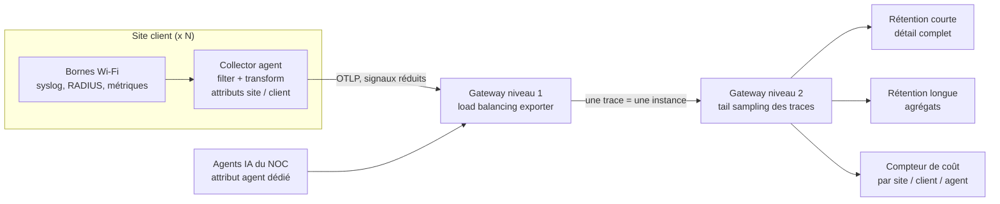
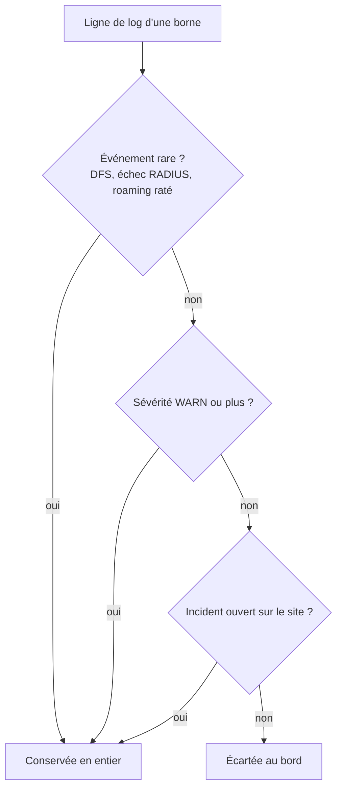

## Le thermomètre plus cher que la chaudière

Plus d'un professionnel de l'exploitation IT sur deux a désormais le sentiment de payer davantage pour surveiller son infrastructure que pour la faire tourner. Le chiffre exact est de 57 %, tiré de l'édition 2026 du rapport *State of Observability* de Splunk, publiée par Cisco le 20 octobre [1]. Le thermomètre coûte plus cher que la chaudière.

Ce constat ne concerne pas que les hyperscalers. Il touche de plein fouet tous ceux qui supervisent beaucoup de petits sites : chaînes hôtelières, réseaux de magasins, résidences étudiantes, et les opérateurs qui leur fournissent la connectivité. Pour un centre de supervision réseau (NOC, *Network Operations Center*) qui suit des centaines d'établissements, chaque ligne de journal superflue est multipliée par le nombre de bornes, puis par le nombre de jours de conservation.

Pourquoi en parler maintenant ? Parce que le rapport s'intitule *Avoiding the Hidden Costs of AI Agents*. Parce qu'il tombe au moment où les budgets 2027 se bouclent. Et parce que beaucoup d'équipes vont être tentées d'en tirer une conclusion expéditive : les agents IA font exploser la facture, rationnons-les.

Ce serait une erreur de lecture. Le titre accuse les agents. Les chiffres, eux, pointent nos vieilles habitudes de collecte. Et le levier pour les corriger existe déjà, dans un composant logiciel que peu de directions regardent : le collecteur qui se trouve entre vos équipements et votre outil d'observabilité.

## Ce que l'étude mesure, et ce qu'elle ne mesure pas

Commençons par le périmètre, parce qu'il conditionne tout le reste. L'enquête a été conduite par Oxford Economics pour Cisco et Splunk, en février et mars 2026. Elle interroge 2 050 professionnels de l'exploitation et de l'ingénierie, dans dix pays dont la France, sur seize secteurs dont les télécoms [1]. C'est la sixième édition annuelle.

Deux limites s'imposent d'emblée. Tout est déclaratif : comme le rappelle TechInformed, personne n'a audité de factures [3]. Et aucune ventilation française n'est publiée.

Le 57 % lui-même demande une lecture attentive. Le communiqué de Cisco parle de coûts de *télémétrie* qui éclipsent le coût de l'infrastructure surveillée. Network World, pour le même chiffre, écrit coûts d'*observabilité* [2]. La nuance n'est pas anodine : le premier terme désigne le flux de données, le second peut englober toute la chaîne d'outillage. Dans les deux cas, il s'agit d'une perception, pas d'un relevé comptable.

### Les moteurs de coût déclarés

Le chiffre le plus utile n'est pas dans le communiqué. Il apparaît dans l'article de Denise Dubie pour Network World, qui rapporte les données du rapport sur le premier moteur de coût cité par les répondants [2] :

| Premier moteur de coût cité | Part des répondants (selon Network World) |
|---|---|
| Logs bruités | 31 % |
| Métriques à forte cardinalité | 27 % |
| Volume de traces | 21 % |
| Infrastructure IA | 6 % |

Ces pourcentages ne figurent ni dans le communiqué de Cisco ni sur sa page investisseur, et leur base de calcul n'est pas explicitée. Prenons-les comme un ordre de grandeur. Il reste parlant : près de huit répondants sur dix désignent un problème de logs, de métriques ou de traces.

Lisez la dernière ligne avec précaution. Les 6 % désignent l'infrastructure IA comme premier moteur de coût d'observabilité [2][3]. Ce n'est pas la télémétrie émise par les agents. Celle-ci atterrit dans les logs, les métriques et les traces, donc quelque part dans les trois premières lignes du tableau, sans qu'on puisse dire dans quelle proportion.

### La part des agents : une affirmation, pas une mesure

Kamal Hathi, vice-président senior et directeur général de Splunk chez Cisco, avance dans Network World qu'un agent en production émet quatre à cinq fois plus de données de télémétrie. Il ajoute que la télémétrie des architectures multi-agents peut croître de façon exponentielle [2]. C'est une déclaration de dirigeant, pas un résultat d'enquête.

Network World précise que l'étude ne quantifie pas la part de la facture due aux agents [2]. TechInformed fait le même constat : ni l'annonce de Cisco ni le billet de blog de Hathi ne chiffrent cette part [3]. Selon TechInformed, Hathi désigne d'ailleurs les logs excessivement détaillés comme premier moteur de coût.

Même prudence sur un autre chiffre qui circule : 55 % des répondants disent ne pas parvenir à maîtriser leurs coûts d'IA [1]. Il s'agit des coûts de l'IA en général, pas de la télémétrie. Les deux sujets se mélangent vite dans les comités budgétaires.

La formulation honnête est donc la suivante : l'étude ne permet pas d'imputer la facture aux agents, et les moteurs déclarés relèvent de l'hygiène de collecte. Cela ne veut pas dire que les agents sont innocents. Cela veut dire qu'on ne peut pas les accuser avec ces données.

Un dernier point, que tout CTO doit poser sur la table. Splunk vend de l'observabilité, historiquement facturée au volume de données ingérées. Un rapport qui explique que vos données coûtent trop cher, publié par l'acteur qui les facture, se lit les deux yeux ouverts. Le communiqué met aussi en avant que 67 % des répondants utilisent une plateforme d'observabilité unique [1], un chiffre qui sert d'abord un discours de consolidation.

Un recoupement indépendant existe toutefois. L'enquête annuelle de Grafana Labs [4] (1 363 réponses dans 76 pays, collectées d'octobre 2025 à janvier 2026) fait du coût le premier critère de choix d'un outil pour 65 % des répondants. Elle range aussi le rapport signal/bruit parmi les préoccupations majeures, à 34 %. Deux éditeurs concurrents, deux méthodologies, un diagnostic commun : on paie cher pour beaucoup de bruit.

## Le Wi-Fi multi-sites, champion involontaire du bruit

Le rapport ne dit pas un mot du Wi-Fi. Ce qui suit est ma lecture d'architecte, appliquée à un NOC qui supervise des réseaux sans fil sur des centaines de sites. Ce n'est pas une donnée de l'étude.

Commençons par une image. Tout collecter au niveau de détail maximal, sur tous les sites, c'est filmer chaque couloir d'un hôtel en haute définition, jour et nuit, et archiver les bandes pendant un an. Le jour où une porte est forcée, vous cherchez trente secondes d'images. Le reste du temps, personne ne regarde. Mais vous payez tout.

Un réseau Wi-Fi bavarde en permanence. Les bornes envoient un message syslog (le format standard de journalisation des équipements réseau) à chaque association d'un terminal. Elles en envoient un autre à chaque bascule d'une borne à l'autre quand un client se déplace, le *roaming*, et à chaque changement de canal imposé par la détection de radars, le mécanisme DFS (*Dynamic Frequency Selection*).

Derrière les bornes, la chaîne d'accès ajoute sa propre couche. Le serveur RADIUS, qui vérifie qui a le droit de se connecter, journalise chaque tentative. Le serveur DHCP trace chaque attribution d'adresse. Et les métriques par client (qualité de signal, débit, taux d'erreurs) remontent en continu.

Sur un site calme, un mardi après-midi dans un magasin ou une nuit dans une résidence étudiante, l'immense majorité de ces lignes est de simple information. Elle raconte, en boucle, que tout va bien. Multipliez par quelques centaines de sites. Vous payez pour stocker de la répétition.

*Sur un site calme, l'essentiel du journal des bornes répète que tout va bien : c'est là que commence le tri.*

Deuxième particularité : le multi-client. Un même NOC supervise des clients différents, par exemple un groupe hôtelier, une enseigne de distribution et un gestionnaire de résidences. Si la facture de télémétrie arrive en un seul bloc, impossible de savoir quel client, quel site ou quel type d'équipement la fait gonfler. Or 60 % des répondants de Splunk disent souffrir davantage des pics de facturation inattendus que d'un coût de base élevé [1]. C'est exactement le symptôme d'une facture qu'on ne sait pas attribuer.

Troisième particularité, plus récente : les agents IA s'installent dans les NOC. Ils corrèlent des alarmes, lancent des diagnostics, interrogent les API des contrôleurs. Network World relève un piège peu discuté : un agent qui appelle une API en boucle peut ressembler à une attaque [2]. Un agent mal borné ne coûte donc pas seulement en calcul. Il fabrique du bruit, et parfois de fausses alertes de sécurité. C'est l'une des raisons d'entourer ces agents d'un [disjoncteur anti-cascade](/post?slug=ia-agentique-noc-disjoncteur-anti-cascade).

## Cardinalité : la métrique qui se multiplie en silence

Prenez une métrique banale : la puissance du signal reçu par chaque terminal. Pour qu'elle serve à quelque chose, on l'étiquette. Adresse MAC du terminal, identifiant radio de la borne (le BSSID), nom du réseau (le SSID), radio, bande de fréquence.

Chaque combinaison distincte de ces étiquettes devient une série temporelle à part entière, stockée et facturée comme telle. La documentation de Prometheus, la base de métriques open source de référence, le dit sans détour : chaque combinaison unique de paires clé-valeur crée une nouvelle série [11]. Elle déconseille donc les labels à forte cardinalité, comme les identifiants d'utilisateur, les adresses e-mail ou tout ensemble de valeurs non borné.

L'adresse MAC d'un client Wi-Fi est l'archétype de l'ensemble non borné. Un hôtel voit passer chaque semaine des terminaux qu'il ne reverra jamais. Chacun crée ses séries, sur chaque borne où il s'accroche en se déplaçant. Les adresses MAC aléatoires des smartphones récents n'arrangent rien : l'adresse est propre à chaque réseau, et elle peut changer au fil du temps selon l'OS, sa version et la sécurité du réseau.

Le résultat est contre-intuitif. Le volume de métriques ne suit pas le parc installé, qui est stable. Il suit la fréquentation, qui ne l'est pas. C'est le deuxième moteur de coût déclaré dans l'enquête (27 %, selon Network World). Pour un réseau Wi-Fi ouvert au public, c'est à mon sens le plus sournois : il ne se voit pas dans la configuration, il se voit dans la facture.

Ma règle est simple. L'identité d'un client n'a rien à faire dans une métrique. Elle a sa place dans un log, consultable le jour où l'on enquête sur un terminal précis. Les métriques, elles, s'agrègent par borne, par SSID et par site.

*Chaque étiquette ajoutée multiplie les séries temporelles : avec l'adresse MAC client, la métrique suit la fréquentation, pas le parc.*

## Trier au bord, échantillonner au centre, étiqueter partout

L'outil pour appliquer ces règles existe, il est ouvert, et beaucoup d'équipes l'ont déjà sous la main. OpenTelemetry est le standard ouvert de collecte de télémétrie : logs, métriques et traces. Son Collector est le logiciel qui reçoit ces signaux, les transforme et les réexpédie vers le stockage. Selon Grafana Labs, 76 % des répondants de son enquête investissent déjà dans OpenTelemetry [4]. Dans Network World, Greg Leffler recommande le Collector, dont les processeurs permettent de maîtriser les coûts et d'étiqueter l'origine du trafic [2].

Pensez au tri postal. Le bureau de quartier jette les prospectus sans destinataire avant même de charger le camion. Le centre de tri régional, qui voit passer tous les colis, décide lesquels méritent un suivi recommandé. La télémétrie se trie de la même façon, en deux niveaux.

### Au bord : le Collector en mode agent

La documentation OpenTelemetry décrit un mode de déploiement dit *agent*, sans rapport avec les agents IA malgré le nom, où le Collector tourne au plus près de la source, accolé à l'application (en *sidecar*) ou sur chaque nœud [10]. Pour un réseau multi-sites, j'en tire une conséquence que la documentation ne formule pas explicitement. C'est là qu'il faut filtrer, avant que la donnée ne quitte le site et ne commence à coûter en transport et en ingestion.

Deux processeurs font l'essentiel du travail. Le processeur *filter* écarte des spans (les étapes élémentaires d'une trace), des métriques, des points de données ou des logs selon des conditions écrites en OTTL, le langage de transformation d'OpenTelemetry [6]. Sa documentation donne l'exemple type : `log.severity_number < SEVERITY_NUMBER_WARN`, qui élimine tout ce qui est moins grave qu'un avertissement. Sur un site calme, c'est l'essentiel du bavardage décrit plus haut.

Le processeur *transform* modifie les attributs [7]. Ses fonctions `delete_key`, `keep_keys` et `limit` permettent de retirer l'adresse MAC client des métriques, de ne garder qu'une liste blanche d'étiquettes, ou d'en plafonner le nombre. La MAC disparaît des métriques mais reste dans les logs, conformément à la règle posée plus haut.

C'est aussi au bord qu'on pose les attributs d'attribution : identifiant du site, du client, de l'équipe responsable. Une donnée étiquetée à la source se ventile ensuite sans effort.

### Au centre : la passerelle et l'échantillonnage des traces

Les traces suivent le parcours d'une requête de bout en bout. Dans un NOC Wi-Fi, elles viennent surtout des applicatifs : portail d'authentification, API de provisionnement et, désormais, agents IA dont chaque appel d'outil devient une étape tracée.

Pour réduire leur volume, OpenTelemetry distingue deux stratégies [5]. L'échantillonnage en tête (*head sampling*) décide dès le début de la trace : c'est simple, mais rien ne garantit de conserver toutes les traces en erreur. L'échantillonnage en queue (*tail sampling*) attend la fin de la trace pour trancher, ce qui permet de garder les erreurs et les lenteurs. La documentation le juge presque toujours nécessaire pour les grands systèmes contraints d'échantillonner, tout en reconnaissant qu'il est difficile à opérer.

La contrainte est mécanique. Le processeur de tail sampling, en statut bêta, garde les traces en mémoire avant de décider : par défaut, il attend 30 secondes et peut en retenir jusqu'à 50 000 [8]. Surtout, il exige que toutes les spans d'une même trace arrivent sur la même instance du Collector.

D'où l'architecture en deux couches décrite dans sa documentation. Un premier niveau, équipé d'un exportateur de répartition de charge (*load balancing exporter*), envoie chaque trace vers une instance unique du second niveau, qui applique l'échantillonnage. C'est le mode *gateway* [9] : une politique centralisée, au prix d'un composant de plus, d'une latence supplémentaire et de ressources à payer.

*Pipeline en deux niveaux : tri et étiquetage sur site, échantillonnage des traces et comptage des coûts au centre. OTLP désigne le protocole de transport natif d'OpenTelemetry.*

Dernière brique : le compteur de coût. Les attributs posés au bord permettent de mesurer le volume par site, par client et par agent IA. Le rapport Splunk indique que 91 % des organisations les plus avancées attribuent précisément leurs coûts d'IA, par agent, par modèle ou par charge de travail, contre 69 % des autres [1]. TechInformed souligne à juste titre qu'il s'agit d'une corrélation, pas d'une causalité [3]. Le principe, lui, ne fait guère débat : un coût qu'on ne sait pas attribuer est un coût qu'on ne sait pas piloter.

Les agents IA du NOC méritent donc un attribut dédié et un budget de télémétrie propre. Si la déclaration de Hathi se vérifie même partiellement, c'est le seul moyen de le constater sur votre propre parc, plutôt que de le croire sur parole. C'est aussi le prolongement naturel d'une [télémétrie d'agents déterministe](/post?slug=telemetrie-deterministe-agents-ia-sans-llm-juge).

*Le tail sampling impose que toutes les étapes d'une trace convergent vers la même instance : d'où la couche de répartition de charge en amont.*

## Ce que le tri peut casser

Couper n'est pas trier. Selon Network World, 38 % des répondants ont déjà réduit la couverture ou la durée de rétention de leur télémétrie pour contenir les coûts [2]. C'est la réponse la plus facile, et la plus dangereuse.

Greg Leffler en pointe les effets dans le même article [2]. Une rétention courte limite les enquêtes historiques. Un échantillonnage trop agressif fait rater les problèmes intermittents. En Wi-Fi, ce sont justement les pires : un roaming qui échoue seulement le vendredi soir quand l'hôtel est plein, un changement de canal radar une fois par semaine, une vague d'échecs d'authentification à la rentrée universitaire.

La parade tient en un principe : les événements rares se conservent en entier, quel que soit leur niveau de sévérité. Le filtre ne doit écarter que ce qui est à la fois répétitif, bénin et produit par un site sans incident ouvert. Le schéma ci-dessous est une proposition d'architecte, pas une recette issue de la documentation.

*Logique de filtrage proposée : la rareté et le contexte d'incident priment sur le niveau de sévérité.*

Deuxième risque : le Collector n'est pas gratuit. Il consomme des ressources, ajoute de la latence et demande de la maintenance [9]. Le tail sampling est gourmand en mémoire, puisqu'il retient les traces en attente de décision. Et les processeurs ne sont pas tous mûrs : *filter* est en alpha, *transform* et *tail sampling* en bêta [6][7][8].

Cela impose une discipline de produit. Figer les versions, versionner la configuration comme du code, tester chaque règle avant de la déployer sur des centaines de sites. La documentation d'OpenTelemetry prévient d'ailleurs qu'un échantillonnage mal conçu peut lui-même introduire des coûts imprévus [5].

Troisième risque : couper aveuglément dans la télémétrie des agents IA. La trace de ce qu'un agent a fait, et pourquoi, n'est pas du bruit. C'est une piste d'audit, qui doit survivre hors de l'hôte où l'agent s'exécute, un sujet déjà abordé ici à propos des [agents qui effacent leurs traces](/post?slug=agents-effacent-leurs-traces-audit-hors-hote). On peut réduire le détail de leurs logs techniques. On ne réduit pas le registre de leurs actions.

## Ma position : chercher les fuites avant d'accuser le locataire

L'étude Splunk est utile, à condition de la lire pour ce qu'elle est. C'est une enquête déclarative, commandée par un éditeur, dont le titre parle d'agents IA et dont les chiffres parlent de collecte mal maîtrisée. Je tranche dans le sens des chiffres.

Quand la facture d'eau d'un immeuble s'envole, on ne commence pas par rationner le nouveau locataire qui prend des bains. On cherche d'abord les fuites dans les canalisations existantes. Les agents IA sont le nouveau locataire. Les logs bruités et les métriques surchargées d'étiquettes sont les fuites, et elles coulaient bien avant son arrivée.

Concrètement, voici l'ordre dans lequel je traiterais le sujet sur un parc Wi-Fi multi-sites :

1. **Mesurer avant de couper.** Volume par type de signal, par site et par client, sur au moins un mois. Sans attribution, toute réduction est un pari.
2. **Filtrer les logs au bord.** Écarter ce qui est sous le niveau WARN sur les sites calmes, en conservant intégralement les événements rares et en relevant le niveau de détail pendant un incident.
3. **Assainir les métriques.** Inventorier les étiquettes, sortir l'adresse MAC client des métriques, la garder dans les logs.
4. **Échantillonner les traces en deux temps.** En tête, au bord, pour les flux massifs et peu critiques ; en queue, au centre, pour les autres, derrière une couche de répartition de charge.
5. **Étiqueter pour attribuer.** Site, client, équipe, agent : posés dès la source, jamais reconstitués après coup.
6. **Donner un budget aux agents IA.** Un attribut dédié, un plafond de volume, une alerte quand un agent tourne en boucle.
7. **Traiter le Collector comme un produit.** Versions figées, configuration versionnée, mémoire dimensionnée pour le tail sampling.

Rien de tout cela n'est spectaculaire. Aucune de ces étapes ne fera la une d'un salon professionnel. Mais la facture de télémétrie ne se renégocie pas une fois par an avec un commercial. Elle se décide toute l'année, ligne par ligne, dans la configuration d'un Collector.

Le débat sur le coût des agents IA viendra, et il sera légitime. Il sera surtout mieux informé si, d'ici là, chaque octet qui sort d'un site porte l'étiquette de celui qui l'a produit.

## Sources

1. Cisco Newsroom, « Splunk State of Observability 2026: Avoiding the Hidden Costs of AI Agents », 20 octobre 2026 : https://newsroom.cisco.com/c/r/newsroom/en/us/a/y2026/m10/splunk-state-of-observability-2026-avoiding-the-hidden-costs-of-ai-agents.html — rapport PDF : https://s21.q4cdn.com/812015656/files/doc_news/Splunk-State-of-Observability-2026-Avoiding-the-Hidden-Costs-of-AI-Agents-2026.pdf — page investisseur : https://investor.cisco.com/news/news-details/2026/Splunk-State-of-Observability-2026-Avoiding-the-Hidden-Costs-of-AI-Agents/default.aspx
2. Network World, Denise Dubie, « AI agents drive up telemetry costs, complicate network observability », 20 octobre 2026 : https://www.networkworld.com/article/4237922/ai-agents-drive-up-telemetry-costs-complicate-network-observability.html
3. TechInformed, Aman Gupta, « AI adds to an expensive monitoring problem, Cisco finds », 21 octobre 2026 : https://techinformed.com/?p=39336
4. Grafana Labs, 4th Annual Observability Survey, 18 mars 2026 : https://grafana.com/press/2026/03/18/grafana-labs-4th-annual-observability-survey-reveals-a-field-at-a-crossroads-ai-economics-complexity-and-the-enduring-power-of-open-source/
5. OpenTelemetry, « Sampling » : https://opentelemetry.io/docs/concepts/sampling/
6. OpenTelemetry Collector Contrib, Filter Processor (README) : https://github.com/open-telemetry/opentelemetry-collector-contrib/blob/main/processor/filterprocessor/README.md
7. OpenTelemetry Collector Contrib, Transform Processor (README) : https://github.com/open-telemetry/opentelemetry-collector-contrib/blob/main/processor/transformprocessor/README.md
8. OpenTelemetry Collector Contrib, Tail Sampling Processor (README) : https://github.com/open-telemetry/opentelemetry-collector-contrib/blob/main/processor/tailsamplingprocessor/README.md
9. OpenTelemetry, « Gateway deployment pattern » : https://opentelemetry.io/docs/collector/deploy/gateway/
10. OpenTelemetry, « Agent deployment pattern » : https://opentelemetry.io/docs/collector/deploy/agent/
11. Prometheus, « Metric and label naming » : https://prometheus.io/docs/practices/naming/

_Vues personnelles, pas position Wifirst._
