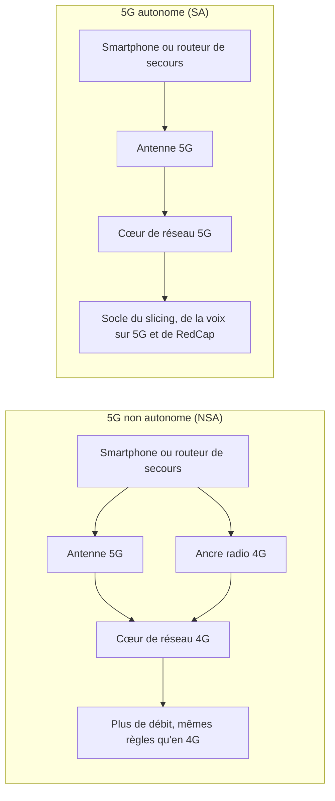
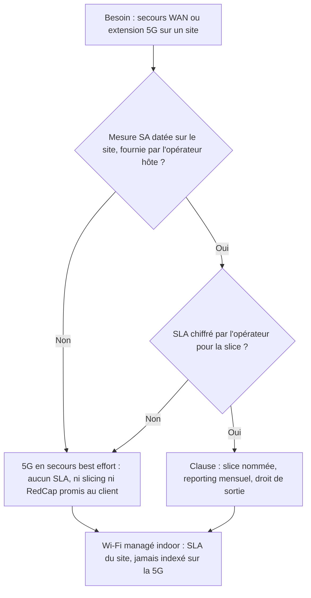

## Cinq barres, un logo, et aucune garantie

Dans le hall d'un hôtel de province, le responsable technique lève son téléphone : cinq barres, un logo « 5G+ », et la conviction rassurante que le lien de secours prévu au contrat prendra le relais le jour où une pelleteuse sectionnera la fibre. Cette conviction repose sur une icône. Pas sur une mesure.

Le bilan publié le 23 octobre par la GSA (Global mobile Suppliers Association, l'organisme qui recense les déploiements mobiles dans le monde) rappelle pourquoi la nuance compte. Plus de 390 opérateurs vendent de la 5G commerciale. Seuls 98 ont lancé sa version complète, dite Standalone ou SA, celle qui repose sur un cœur de réseau entièrement 5G. Les autres font tourner une radio 5G adossée à une infrastructure 4G.

Pourquoi en parler maintenant ? Parce que les arguments qui font vendre la 5G aux entreprises (des voies réservées dans le réseau, des objets connectés moins chers, des engagements de latence) dépendent largement de cette version complète. Hôtels, enseignes de retail, résidences étudiantes ou seniors, DSI multi-sites : tous ceux qui bouclent en ce moment leurs contrats 2027 avec une ligne « 5G de secours » achètent, souvent sans le savoir, une hypothèse.

Ma position tient en une phrase. La 5G n'entre dans un contrat de site qu'en secours ou en extension, et seulement si l'opérateur hôte prouve, sur place, qu'il tourne en SA. Tout le reste relève de la promesse de tiers.

## Deux 5G sous le même logo

Pour comprendre l'écart entre 390 et 98, il faut soulever le capot. Un réseau mobile tient sur deux étages. Il y a les antennes, que tout le monde voit sur les toits. Et il y a le cœur de réseau : des serveurs invisibles qui authentifient les abonnés, orientent le trafic et décident qui a droit à quoi.

La 5G dite non autonome (NSA, pour Non-Standalone), c'est une façade neuve posée sur un immeuble dont la plomberie date de la 4G. Depuis la rue, le bâtiment a l'air flambant neuf, et le débit grimpe réellement. Mais tout ce qui dépend des tuyaux attend que quelqu'un refasse la plomberie : découper le réseau en tranches réservées, garantir une latence et, pour une large part, accueillir des capteurs à bas coût. Ce chantier-là, c'est le cœur SA. Il coûte cher, il s'étale sur des années, et il n'apparaît sur aucune plaquette commerciale.

*Même logo sur l'écran, deux architectures derrière : seule la 5G autonome remplace le cœur de réseau, et avec lui le socle des services qui en dépendent.*

Ce que la GSA mesure, c'est le nombre d'opérateurs qui ont ouvert ce chantier commercialement. L'association en comptait 95 en avril, en hausse de 42 % depuis le premier trimestre 2025. Ils sont 98 aujourd'hui. Trois de plus en six mois : sur le papier, la courbe s'est aplatie. Lors de la mise à jour d'avril, un seul lancement SA avait d'ailleurs été enregistré depuis le début de 2026, celui de l'italien Wind Tre. Ericsson, dans son [Mobility Report de juin](https://www.ericsson.com/en/press-releases/2026/6/ericsson-mobility-report-5g-subscriptions-top-three-billion-as-uplink-gains-momentum), compte plus de 90 opérateurs ayant lancé la SA sur environ 390 opérateurs 5G. Les définitions diffèrent un peu. L'ordre de grandeur, lui, ne bouge pas.

Vaishali Purohit, de CCS Insight, qui travaille sur les données de la GSA, le dit sans détour dans [Light Reading](https://www.lightreading.com/5g/5g-sa-still-a-subset-of-5g-hampering-redcap-and-more-gsa) : la SA « remains a subset of the wider 5G market », elle reste un sous-ensemble du marché 5G, et « it is a transition that takes time ». Rien de scandaleux. Le problème commence quand un contrat traite ce sous-ensemble comme s'il était la norme.

Il faut aussi lire ce que le bilan ne dit pas. La note relayée par Light Reading compte des lancements. Elle ne chiffre ni la couverture SA, ni l'itinérance (roaming) en SA, ni les offres de découpage du réseau (slicing), ni la disponibilité des modules RedCap, sur lesquels je reviens, ni le prix des routeurs compatibles. Or, dans un décompte de lancements, un opérateur qui a allumé sa SA dans quelques métropoles pèse autant qu'un opérateur qui l'a généralisée. Pour un acheteur, c'est toute la différence entre « ça existe » et « ça existe chez moi ».

*Plus de 390 opérateurs vendent de la 5G, 98 ont lancé la version autonome : la 5G complète reste minoritaire (GSA, octobre 2026).*

## RedCap et slicing : la vitrine attend la fondation

Commençons par un paradoxe britannique. EE, l'opérateur mobile du groupe BT, a lancé sa 5G SA en septembre 2024 ; en février dernier, il couvrait en SA 69 % de la population. D'après les données de l'Ofcom (le régulateur britannique) citées par Light Reading, la SA représentait près d'un tiers du trafic 5G. Et pourtant, à la même date, [aucun des trois opérateurs britanniques](https://www.lightreading.com/5g/5g-network-slicing-not-ready-for-prime-time-in-uk) ne vendait d'offre commerciale de slicing.

Le slicing, c'est l'idée de découper un même réseau physique en tranches logiques, chacune avec ses garanties propres : une voie réservée aux terminaux de paiement, une autre à la vidéo d'un événement, une troisième pour le tout-venant. Techniquement, il réclame un cœur SA. Commercialement, il réclame autre chose : des clients prêts à payer. William Webb, cité dans le même article, résume : « the biggest challenge for slicing has always been the business case ». Ookla, spécialiste de la mesure des réseaux, décrit un marché britannique « still largely in pilots rather than productised offers », encore au stade des pilotes plutôt que des offres packagées.

La leçon dépasse le Royaume-Uni. La couverture SA est une condition nécessaire, pas suffisante. Il faut encore qu'un opérateur trouve un modèle économique pour vendre une tranche, et qu'il sache la garantir.

Au niveau mondial, le slicing progresse pourtant. L'Ericsson Mobility Report de juin recense 84 offres commerciales de *connectivité différenciée* fondées sur le slicing SA, contre 65 en novembre 2025, toutes régions confondues. Deux précautions avant de s'emballer. D'abord, une offre de connectivité différenciée n'est pas forcément une tranche dédiée, facturée et assortie d'un engagement chiffré. Ensuite, ce compteur mondial ne dit rien de ce qui est disponible en France, encore moins à une adresse donnée. Et le bilan GSA ne permet pas de compléter le tableau : il ne chiffre pas le slicing.

RedCap (pour Reduced Capability) est l'autre promesse liée au cœur. C'est une 5G allégée, pensée pour les objets connectés qui n'ont besoin ni du débit d'un smartphone ni de l'extrême frugalité des réseaux bas débit : caméras, terminaux de paiement, capteurs, montres. Selon la GSA, 17 opérateurs l'avaient lancée à fin septembre 2026, dont 4 cette année. En avril, l'association en comptait 14 et recensait [42 opérateurs investissant dans la technologie](https://gsacom.com/?p=20897) dans 27 pays, contre 30 dans 21 pays un an plus tôt. L'intérêt monte. Les lancements, eux, s'égrènent.

La GSA décrit la SA comme « a foundational requirement for RedCap », une exigence fondatrice. Prudence toutefois : l'association ne précise pas combien des 17 opérateurs RedCap s'appuient effectivement sur un cœur SA. Ce qu'on peut dire sans forcer le texte, c'est que RedCap se construit sur une fondation qui, elle, plafonne encore sous la barre des 100 réseaux.

Pourquoi la fondation avance-t-elle si lentement ? La prévision publiée par Dell'Oro en juillet, [relayée par IEEE ComSoc](https://techblog.comsoc.org/2026/07/30/delloro-telecom-carriers-are-on-a-5g-sa-spending-spree-with-more-to-come/), apporte deux éléments. Le premier : beaucoup d'opérateurs utilisent déjà leur SA pour des clients entreprises et pour l'accès fixe sans fil (FWA, Fixed Wireless Access), sans l'avoir ouverte à une large base d'abonnés. Le second : la croissance du marché du cœur 5G ralentit pendant deux ans, avant un retour attendu à une croissance à deux chiffres en 2028, et la flambée du prix de la mémoire pousse certains opérateurs à repousser leurs projets de transformation du cœur. J'avais évoqué ici en août le coût de ce chantier. La tendance se confirme : la plomberie se refait par lots, d'abord pour des clients choisis.

Un dernier chiffre de la note GSA mérite l'attention des acheteurs : 276 opérateurs proposent du FWA en 5G, dont 108 en Europe. Luke Pearce, cité par Light Reading, observe qu'une bonne partie de ce FWA dessert des zones rurales sans fibre, moins susceptibles d'être couvertes en SA. Traduction pour nos métiers : l'hôtel de campagne, le camping mal desservi, la résidence en bout de réseau sont exactement les sites où la 5G a le plus de valeur. Et ceux où la SA a le moins de chances d'être au rendez-vous.

*Le cœur 5G autonome est la fondation sur laquelle se construisent slicing et RedCap : une fondation encore réservée à moins de 100 opérateurs dans le monde.*

## France : Free creuse l'écart, l'icône ne prouve rien

En France, la photo est hétérogène, et le mot est faible. Free a fait de la SA le mode par défaut de ses abonnés dès septembre 2024. [Opensignal](https://insights.opensignal.com/2026/06/5g-standalone-in-europe-where-deployment-stands-and-what-it-means-for-users-june-2026/dt), spécialiste de la mesure de l'expérience mobile, le range parmi les opérateurs européens qui ont franchi ce pas, et indique que le déploiement SA à grande échelle en Europe se limite à 11 réseaux.

Pour les chiffres qui suivent, une précaution de méthode : ils proviennent d'Opensignal, tels que [relayés par DegroupTest](https://www.degrouptest.com/actualite/5g-standalone-france-free-loin-devant-opensignal) le 19 juin, et je n'ai pas pu les recouper dans l'étude primaire. Sur le premier trimestre 2026, Opensignal a mesuré la part du temps que les utilisateurs passent réellement connectés en SA. Free : 14,1 %. Bouygues Telecom : 0,7 %. SFR et Orange : 0,5 % chacun. Une demi-minute sur cent. La moyenne européenne s'établit à 1,8 %, et la France à 4,3 %, portée par Free seul.

Selon DegroupTest, les lancements grand public se sont échelonnés ainsi : Free en septembre 2024, Orange en mars 2025, Bouygues Telecom en juin 2025, SFR en octobre 2025. Les quatre avaient donc lancé avant la période de mesure. Lancer une offre et y faire basculer le trafic sont deux opérations différentes.

Les chiffres de l'Arcep (le régulateur des télécoms) au 30 juin 2026, [relayés par Ariase](https://www.ariase.com/mobile/actualite/orange-devant-sfr-en-sites-5g-mais-pas-partout-ce-que-revelent-les-chiffres-de-l-arcep), ajoutent un piège. On y compte environ 23 200 sites 5G chez Free, 18 700 chez Bouygues Telecom, 18 000 chez Orange et 16 800 chez SFR. Ce sont des sites 5G. Pas des sites SA. Un plan de couverture qui les présenterait comme tels mélangerait deux réalités.

Orange a pourtant [packagé la SA pour les entreprises](https://www.lightreading.com/5g/orange-dishes-up-slices-of-5g-standalone-to-biz-users) dès février 2025. Son offre pour PME et ETI combine bande passante dédiée, voix sur 5G (VoNR, Voice over New Radio) et slicing statique, pour 79 EUR par mois et 350 Go. Light Reading notait alors qu'aucun SLA (Service Level Agreement, engagement de niveau de service) n'était détaillé, et Orange présentait le slicing dynamique comme une étape à venir. C'est un vrai produit, avec un vrai prix. Ce n'est pas encore un engagement chiffré.

Et RedCap ? Je n'ai pas trouvé trace d'un lancement commercial en France à ce jour. Cela ne prouve pas qu'il n'en existe aucun. Cela suffit pour ne rien promettre.

Reste l'icône. Un « 5G+ » sur l'écran d'un téléphone est une étiquette commerciale. Elle ne constitue pas une preuve, opposable à l'opérateur, que le terminal est enregistré sur le cœur SA, à cette adresse, à cette heure. Opensignal mesure le temps réellement passé en SA ; un contrat devrait mesurer la même chose, au même endroit que le client.

*Une mesure faite sur place, datée et reproductible : la seule preuve de SA qui tienne dans un contrat de site.*

## Le Wi-Fi indoor, seule brique qui se signe site par site

Vendre à un client une tranche 5G qu'on ne maîtrise pas, c'est lui louer une chambre avec vue mer dans un hôtel dont on n'a ni la clé, ni le plan des étages, ni la liste des réservations du soir. On peut l'écrire dans la brochure. On ne peut pas l'honorer.

C'est ici que ma position se durcit. Un opérateur de Wi-Fi managé contrôle ce qu'il installe : les bornes, les contrôleurs, le câblage, la supervision, les règles de priorité du trafic. Quand un site décroche, nous savons pourquoi et nous savons quoi réparer. Un SLA Wi-Fi indoor se signe site par site parce qu'il se mesure et se corrige site par site.

Le lien 5G public, lui, dépend d'un cœur de réseau que nous ne voyons pas, d'une planification radio que nous ne pilotons pas, et de la charge d'une cellule que partagent, à 18 heures, les 400 congressistes qui sortent de la plénière. Aucun de ces paramètres n'est entre nos mains. Les promesses d'un tiers ne deviennent pas les nôtres parce qu'on les recopie dans une annexe.

D'où trois règles que j'applique sans état d'âme. Un : la 5G entre au contrat comme WAN de secours (le lien de sortie qui prend le relais quand la fibre tombe) ou comme extension ponctuelle, pour une terrasse, un chapiteau, un événement. Deux : le slicing et RedCap ne se vendent jamais au client final comme une promesse portée par un tiers. Trois : le SLA Wi-Fi n'est jamais indexé sur la disponibilité d'un lien 5G que nous ne maîtrisons pas. Le boîtier de secours lui-même, je l'ai traité début octobre ; la question, ici, c'est le réseau qui se trouve derrière.

## Avant de signer : ma checklist « preuve SA »

Ce qui suit est une recommandation personnelle. Ce n'est ni une norme, ni un fait sourcé : c'est la grille que j'appliquerais à tout contrat de site hôtelier, retail ou résidentiel qui mentionne la 5G. Sept points.

1. **Une preuve de SA mesurée sur site.** Pas une capture d'écran, pas une carte de couverture : une mesure terrain à l'adresse, montrant un terminal enregistré en SA, datée, reproductible, réalisée avec une SIM et un terminal de référence identifiés au contrat.
2. **Un engagement écrit d'activation SA, site par site, avec une date.** Et le repli explicite : si le site retombe en 4G ou en NSA, que devient le SLA ? La réponse doit être écrite, pas supposée.
3. **Une tranche nommée, ou rien.** Type de slice, débit garanti ou « best effort » (au mieux, sans garantie), latence visée, et un SLA chiffré par l'opérateur lui-même. Sans chiffre de l'opérateur, aucune promesse au client final. Orange a démarré par du slicing statique : demandez précisément ce que vous achetez, et quand le dynamique arrive.
4. **Une liste de compatibilité des terminaux et des CPE** (Customer Premises Equipment, le routeur installé sur site) : bandes supportées, VoNR, version de firmware. Pour RedCap, le module exact et les bandes, à confirmer avec l'opérateur. Le coût et la disponibilité des modules RedCap ne sont chiffrés dans aucune des sources publiques que j'ai consultées ; exigez-les par écrit.
5. **Un reporting mensuel de disponibilité SA sur le site**, assorti d'un droit de sortie ou de renégociation si la preuve n'est pas fournie dans un délai fixé. Trente jours me paraissent un bon point de départ.
6. **Un tarif séparé pour la SA et pour la NSA ou la 4G.** Ordre de grandeur côté Orange entreprise en 2025 : 79 EUR par mois pour 350 Go, sans SLA détaillé à l'annonce. Si la SA n'a pas de prix distinct, elle n'a probablement pas d'engagement distinct non plus.
7. **Une frontière nette entre Wi-Fi et 5G.** Le SLA Wi-Fi managé couvre le réseau indoor. Il ne dépend jamais de la disponibilité d'un lien 5G tiers.

Sous forme d'arbre de décision, la logique tient en quelques branches.

*Arbre de décision « preuve SA » : sans mesure sur site ni SLA chiffré par l'opérateur hôte, la 5G reste un secours sans promesse.*

## Ce qui me ferait changer d'avis

Une position qui ne dit pas ce qui la ferait bouger n'est qu'un réflexe. Voici les signaux que je surveille.

- **La part de temps en SA mesurée par Opensignal en France.** Si Orange, Bouygues Telecom ou SFR se rapprochent durablement du niveau de Free, la SA cesse d'être l'affaire d'un seul opérateur pour devenir une infrastructure. Mon seuil personnel : deux trimestres consécutifs au-dessus de 10 % pour au moins deux des trois.
- **Les prochaines mises à jour de la GSA.** Une reprise nette du nombre de réseaux SA, et surtout une ventilation des opérateurs RedCap par type de cœur, changeraient ma lecture.
- **Une première offre de slicing avec SLA chiffré chez un opérateur mobile français.** Pas un pilote, pas une démonstration de salon : un engagement écrit, avec pénalités.
- **Un premier lancement RedCap commercial en France**, avec des modules disponibles à un prix public.

En toile de fond, je garde un œil sur la reprise de la croissance du cœur 5G que Dell'Oro anticipe pour 2028. Si elle arrive plus tôt, mon calendrier se raccourcit d'autant.

## La 5G se signe en secours, le Wi-Fi se signe en SLA

La 5G SA n'est ni un mirage ni une évidence. C'est un chantier réel, mené à des vitesses très différentes selon les opérateurs, et le bilan GSA d'octobre dit surtout une chose : il est loin d'être terminé. Le slicing progresse dans les compteurs mondiaux d'Ericsson, RedCap gagne des opérateurs, la France a un leader net. Rien de tout cela ne s'écrit encore dans un contrat de site sans preuve à l'appui.

Pour un hôtel, une enseigne ou une résidence, la bonne architecture n'a pas changé. Un Wi-Fi indoor garanti, mesuré et piloté par celui qui l'opère. Une 5G en secours, best effort par défaut, promue au rang d'engagement seulement quand l'opérateur hôte apporte la preuve de sa SA sur le site et chiffre lui-même son SLA.

La preuve d'abord. La promesse ensuite.

_Vues personnelles, pas position Wifirst._

## Sources

1. Light Reading / GSA, « 5G SA still a subset of 5G, hampering RedCap and more », 23 octobre 2026 : https://www.lightreading.com/5g/5g-sa-still-a-subset-of-5g-hampering-redcap-and-more-gsa
2. GSA, Viewpoint 5G RedCap (State of the Market et RedCap Update), avril 2026 : https://gsacom.com/?p=20897
3. Ericsson, Mobility Report de juin 2026 (communiqué), 16 juin 2026 : https://www.ericsson.com/en/press-releases/2026/6/ericsson-mobility-report-5g-subscriptions-top-three-billion-as-uplink-gains-momentum
4. GSA, relais de l'Ericsson Mobility Report, 17 juin 2026 : https://gsacom.com/?p=20760
5. Dell'Oro, prévision cœur mobile de juillet 2026, relayée par IEEE ComSoc Techblog, 30 juillet 2026 : https://techblog.comsoc.org/2026/07/30/delloro-telecom-carriers-are-on-a-5g-sa-spending-spree-with-more-to-come/
6. Light Reading, « 5G network slicing not ready for prime time in UK », 10 février 2026 : https://www.lightreading.com/5g/5g-network-slicing-not-ready-for-prime-time-in-uk
7. Opensignal, 5G Standalone in Europe, juin 2026 : https://insights.opensignal.com/2026/06/5g-standalone-in-europe-where-deployment-stands-and-what-it-means-for-users-june-2026/dt
8. DegroupTest, relais des mesures Opensignal France du premier trimestre 2026, 19 juin 2026 : https://www.degrouptest.com/actualite/5g-standalone-france-free-loin-devant-opensignal
9. Ariase, chiffres Arcep des sites 5G au 30 juin 2026, 25 septembre 2026 : https://www.ariase.com/mobile/actualite/orange-devant-sfr-en-sites-5g-mais-pas-partout-ce-que-revelent-les-chiffres-de-l-arcep
10. Light Reading, offre 5G SA entreprise d'Orange, 11 février 2025 : https://www.lightreading.com/5g/orange-dishes-up-slices-of-5g-standalone-to-biz-users
