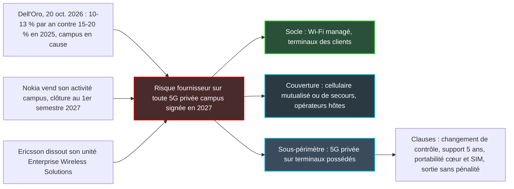

## Sept jours d'octobre

Environ neuf cents clients viennent d'apprendre que le fournisseur de leur réseau mobile privé va changer de mains. Le 13 octobre, Nokia a signé la vente de son activité de réseaux privés de campus à un fonds d'investissement. Deux jours plus tard, Ericsson dissolvait l'unité qui portait ses offres sans fil pour les entreprises. Le 20 octobre enfin, le cabinet d'analyse Dell'Oro Group abaissait de nouveau sa prévision pour les réseaux cellulaires privés, en désignant un coupable : le campus, c'est-à-dire le réseau cellulaire installé sur un site unique pour les besoins propres d'une entreprise.

Trois signaux en une semaine. Aucun ne dit que le cellulaire privé disparaît. Dell'Oro dit que le campus déçoit, et les deux équipementiers s'en détournent. Or la partie du marché qui ressemble le plus à un hôtel, une résidence ou un magasin, c'est le campus.

Le calendrier tombe mal pour les directions informatiques de l'hôtellerie, du retail et du résidentiel géré. Les budgets 2027 se bouclent maintenant. Ceux qui avaient inscrit une ligne « 5G privée » dans leur plan pluriannuel doivent décider, d'ici quelques semaines, s'ils la maintiennent, la réduisent ou la transforment. Ma position tient en une phrase : en 2027, un site multi-occupants garde le Wi-Fi managé comme socle, laisse entrer le cellulaire par la porte mutualisée, et n'achète de la 5G privée que sur des périmètres précis, avec des clauses qui le protègent du départ de son fournisseur.

## Quatre prévisions, un plafond qui s'effondre

Le diable est dans le périmètre, alors précisons ce que mesure Dell'Oro. Le cabinet suit les revenus du RAN privé (Radio Access Network, la partie radio d'un réseau mobile : antennes et stations de base). Le cœur de réseau, l'intégration, les services et le Wi-Fi sont hors champ. Et les communiqués publics ne donnent aucun montant absolu : on y lit des taux de croissance, jamais des volumes en dollars.

Dell'Oro sépare deux familles. Le **campus** désigne un site unique dont l'entreprise possède les terminaux. Le **wide-area** regroupe les réseaux étendus et souvent critiques : sécurité publique, énergie et eau, transport. Avec cette grille en tête, quatre communiqués publiés en dix-huit mois racontent une histoire d'une cohérence redoutable [1, 3, 5, 6].

| Communiqué | Croissance constatée | Prévision de croissance annuelle moyenne | Campus et wide-area |
|---|---|---|---|
| Avril 2025 | Plus de 40 % en 2024 | 15 à 20 % jusqu'en 2029, légèrement relevée | Wide-area plus rapide que le campus |
| Octobre 2025 | Premier semestre en accélération, environ 20 % attendus sur l'année | 15 à 20 % jusqu'en 2029 | Les deux tirent, wide-area en tête |
| Avril 2026 | +16 % en 2025, ralentissement « substantiel » au second semestre | 10 à 20 % jusqu'en 2030 | Campus abaissé, wide-area renforcé |
| Octobre 2026 | Premier semestre 2026 : « mid-single digits » | 10 à 13 % sur cinq ans, prévision « revised downward again » | Campus plus faible que prévu, wide-area amélioré |

Lisez la colonne des prévisions. Le plafond tient à 20 % pendant trois publications, puis s'effondre à 13 % en octobre. Le plancher, lui, avait déjà reculé de 15 à 10 % en avril 2026 et n'a plus bougé depuis. Dell'Oro a donc d'abord descendu le bas de sa fourchette, puis rayé le scénario optimiste. Un peu comme un promoteur qui retire d'abord un sous-sol, puis sept étages à son permis de construire.

Ce que pèsent ces sept points, un calcul simple le montre (c'est ma reconstruction, pas un chiffre Dell'Oro). Au milieu de la fourchette, 17,5 % par an pendant cinq ans multiplie les revenus par 2,2 environ. À 11,5 %, le multiple tombe vers 1,7. À l'arrivée, le marché serait près d'un quart plus petit que dans le scénario de 2025. L'ordre de grandeur reste indicatif : les horizons diffèrent (2029, puis 2030, puis cinq ans glissants) et le communiqué d'octobre ne rappelle pas l'ancienne fourchette.

Une précision de rigueur s'impose sur le mot « révision ». En avril, Dell'Oro avait recomposé sa prévision, campus abaissé et wide-area relevé, sans publier de révision chiffrée du total [4]. Octobre marque la première baisse explicite de la prévision globale. Le bilan exact : deux abaissements du campus en six mois, et un premier coup de rabot sur l'ensemble. Quant au premier semestre 2026, sa croissance « mid-single digits » signifie quelques points à peine, contre un rythme à deux chiffres en 2025.

Stefan Pongratz, vice-président chez Dell'Oro, résume sans dramatiser : « Private wireless continues to grow, but the market is developing more slowly than initially anticipated » [1]. Le cellulaire privé grandit encore, mais moins vite que prévu, et dans un marché RAN global que le cabinet juge « relativement plat ». Dans son communiqué d'avril, Dell'Oro estimait que le privé pesait 3 à 5 % du RAN total en 2025 et viserait 5 à 10 % en 2030 [3]. Une niche qui grossit, pas un raz-de-marée.

*Quatre prévisions Dell'Oro en dix-huit mois : le plafond reste à 20 % pendant trois publications puis tombe à 13 %, le plancher passe de 15 % à 10 % en avril 2026.*

## Deux marchés sous un même chiffre

Parler du « marché du cellulaire privé », c'est un peu comme parler du « marché des véhicules utilitaires » en additionnant camions de pompiers et fourgonnettes de livraison. Les premiers peuvent très bien se vendre pendant que les secondes stagnent. La moyenne reste positive. Elle ne vous apprend rien sur votre propre flotte.

C'est exactement ce que décrit Dell'Oro. Le communiqué d'octobre évoque une perspective wide-area « améliorée » et un campus « plus faible que prévu », avec un écart qui se creuse et une adoption par les entreprises qualifiée de graduelle [1, 2]. Attention à la nuance : « perspective améliorée » signifie que l'analyste a relevé ses attentes, pas qu'il publie un taux de croissance du wide-area. Le blog technique de l'IEEE ComSoc avance une croissance à deux chiffres de ce segment au premier semestre [7], mais ce chiffre ne figure pas dans le communiqué public. Je ne le tiens donc pas pour acquis.

La bifurcation n'est pas neuve. Le wide-area devançait déjà le campus en 2024 puis au premier semestre 2025 [5, 6]. Ce qui change, c'est que le campus décroche désormais par rapport aux attentes, et que Dell'Oro l'écrit deux fois de suite.

Pourquoi ce décrochage ? Le communiqué ne le dit pas. Les explications qui circulent (un Wi-Fi mature et moins cher, des coûts de déploiement élevés, l'accès au spectre, la rareté des terminaux industriels compatibles, le manque de compétences) viennent de commentateurs [7], pas du cabinet. Elles sont plausibles, j'en partage plusieurs, mais elles restent des hypothèses.

Un autre chiffre mérite qu'on s'y arrête : la concentration. Huawei, Nokia, Ericsson, ZTE et Samsung captent environ 95 % du RAN privé mondial au premier semestre 2026, Huawei en tête, Nokia et Ericsson devant hors de Chine [1, 2]. La Chine pesait à elle seule 40 à 50 % du revenu mondial en 2025, et hors de Chine, Nokia et Ericsson se partageaient environ 80 % du marché, selon le communiqué d'avril 2026 de Dell'Oro [3, 4]. Retenez ce dernier chiffre. Il explique pourquoi la suite compte autant pour un acheteur européen.

Je quitte maintenant les faits pour l'analyse. Dell'Oro ne ventile pas ses chiffres par secteur, et aucune source publique ne chiffre le cellulaire privé dans l'hôtellerie en 2026. Mais un hôtel, une résidence étudiante ou un magasin ressemble bien davantage au campus, un site unique, qu'au réseau étendu d'un distributeur d'électricité. Avec une différence aggravante, déjà discutée sur ce blog [fin septembre](https://wifirst-tech-blog.web.app/post?slug=5g-privee-2031-clients-porte-hotel-wifi-7) : les terminaux appartiennent aux clients, pas à l'exploitant. Le segment qui progresse ne concerne pas ces sites. Celui qui déçoit leur ressemble trait pour trait.

*Le cellulaire privé dont la perspective s'améliore couvre des postes électriques et des voies ferrées. Celui qui déçoit ressemble à un site unique.*

## Nokia vend, Ericsson range : le risque fournisseur prend un visage

Prenez une enseigne qui a déployé un réseau privé Nokia dans son entrepôt principal. Si la vente se clôture comme prévu, le fournisseur de ce réseau appartiendra en 2027 à Aurelius. Un fonds de private equity, pas un équipementier.

Les faits, d'abord [8, 9]. Le 13 octobre 2026, Nokia a signé la cession d'Enterprise Campus Edge (ECE), son activité de réseaux privés de campus, au fonds Aurelius. Clôture attendue au premier semestre 2027, prix non divulgué, environ 900 clients selon Nokia. Aurelius annonce pour cette activité plus de 170 M EUR de ventes annuelles et environ 1 000 salariés. Nokia conserve les réseaux privés liés au mission-critical et à la défense, et continue de vendre du RAN pour réseaux privés.

Le détail financier éclaire la décision. Les deux activités que Nokia classe comme abandonnées, l'ECE et ses équipements d'accès radio fixe (FWA CPE, les boîtiers installés chez l'abonné), ont réalisé ensemble 131 M EUR de revenu au premier semestre 2026. C'est environ un tiers de moins qu'un an plus tôt, pour une perte nette de 39 M EUR. L'analyste Dean Bubley pointe le risque suivant : « a PE firm will likely want an exit itself at some point » [8]. Un fonds achète, en général, pour revendre. Pour un client engagé sur cinq ans, un second changement de propriétaire n'a rien d'une hypothèse d'école.

Côté Ericsson, le mouvement est différent, mais il pointe dans la même direction [10, 11]. Le 15 octobre, avec ses résultats du troisième trimestre, le groupe a dissous son unité Enterprise Wireless Solutions. La 5G privée et le neutral host (l'hébergement mutualisé d'équipements cellulaires au service de plusieurs opérateurs) basculent dans Business Area Networks, la division qui sert les opérateurs mobiles. Cradlepoint, spécialiste du WAN sans fil racheté 1,1 Md USD en 2020, reste autonome sur la zone Amériques.

Les chiffres trimestriels expliquent l'impatience. Les ventes Enterprise ont progressé de 1 % en organique, contre 7 % pour le groupe, et reculé de 10 % en publié du fait de la cession d'iconectiv en août 2025. La marge brute ajustée ressort à 50 %. Mais l'EBITA ajusté (le résultat opérationnel avant amortissement des actifs incorporels) reste négatif d'environ un demi-milliard de couronnes suédoises. Le tout pour une activité qui ne pèse que 8 % du chiffre d'affaires du groupe [10, 11].

Faut-il y voir un abandon ? Les lectures divergent, et il faut les séparer des faits. RCR Wireless précise qu'il ne s'agit ni d'une vente ni d'une sortie, et le directeur financier d'Ericsson évoque un « good momentum » de la 5G privée auprès des clients campus [11]. Le groupe dit conserver son portefeuille. En face, Omdia titre sur un Ericsson qui « signale l'échec de la 5G privée de campus » [13], et son analyste Pablo Tomasi parle sur LinkedIn de « soft killing », une mise à mort en douceur [11]. C'est une opinion d'analyste, argumentée, mais une opinion.

Ma lecture tient en une image. Signer une 5G privée de campus en 2027 sans protection contractuelle, c'est acheter une voiture dont le constructeur vient de céder la marque à un fonds, ou de la ranger dans une autre division. La garantie court, mais qui livrera les pièces détachées en 2031 ? Ni Nokia ni Ericsson ne quittent le cellulaire privé. Tous deux se recentrent sur ce qui progresse : le mission-critical et la défense pour l'un, les opérateurs pour l'autre. Le campus, lui, perd ses deux parrains historiques hors de Chine.

## Le cellulaire entrera par la porte mutualisée

Le rangement du neutral host dans la division opérateurs d'Ericsson est, à mes yeux, le signal le plus utile de la semaine pour un site multi-occupants. Il dit qui achète le cellulaire indoor : l'opérateur mobile, pas l'hôtel.

Le modèle fonctionne comme une galerie marchande. Le propriétaire du centre commercial ne vend ni chaussures ni téléphones. Il loue des emplacements, entretient les allées, fournit l'électricité, et les enseignes s'installent. Transposé au bâtiment, le site apporte l'emplacement, la fibre et l'alimentation, tandis que plusieurs opérateurs mobiles partagent une même infrastructure radio. L'exploitant du réseau Wi-Fi peut s'y positionner comme hôte neutre ou comme intégrateur.

Ce marché existe et grandit. STL Partners note, en février 2026, que toutes les analyses quantitatives publiées sur le neutral host et la couverture indoor prévoient une croissance mondiale de 10 à 19 % par an sur cinq ans [15]. La définition retenue est étroite : une infrastructure partagée, offerte à plusieurs opérateurs mobiles par un tiers neutre. Et le résumé public ne dit rien de l'hôtellerie. Je présente donc ce chiffre comme une hypothèse de travail sérieuse, pas comme une certitude. Il ne se compare pas terme à terme aux 10 à 13 % de Dell'Oro, les périmètres n'ayant rien à voir. Mais il rappelle que le cellulaire indoor a d'autres portes d'entrée que le réseau privé.

Une deuxième porte, plus modeste, s'appelle le secours. Une liaison 5G opérateur qui prend le relais quand la fibre tombe ne demande ni fréquences propres ni cœur de réseau dédié. [Notre article du 25 octobre](https://wifirst-tech-blog.web.app/post?slug=gsa-5g-sa-98-sur-390-preuve-avant-promesse-redcap-slicing) sur la 5G autonome (SA, pour Standalone) des opérateurs a détaillé ce qu'elle prouve déjà, et ce qu'elle promet encore. Je n'y reviens pas.

Reste la voie privée, et en France elle bute sur un préalable : le spectre. En juillet 2025, l'Arcep (le régulateur des télécoms) recensait 175 autorisations délivrées depuis mars 2022 dans son guichet d'expérimentation 3,8-4,0 GHz, avec environ 90 expérimentations en cours à fin juin 2025 [16]. Le guichet a été étendu à 3,8-4,2 GHz. Le cadre d'attribution locale pérenne était alors « en préparation ». L'Arcep a depuis publié, le 9 décembre 2025, les modalités d'attribution de la bande 3,8-4,2 GHz pour les besoins professionnels, et son guichet est ouvert depuis décembre 2025, sans date de fin prévue à ce stade, sur l'ensemble de la France métropolitaine. Pour un hôtel qui voudrait son propre réseau, l'accès aux fréquences reste un facteur de délai : les autorisations sont délivrées sous réserve de contraintes de coexistence avec les usages existants, qui peuvent limiter la disponibilité. À vérifier auprès de l'Arcep avant toute promesse de calendrier.

*Un point d'accès Wi-Fi et une radio cellulaire mutualisée sur le même chemin de câbles : le site fournit l'emplacement, la fibre et l'énergie.*

## Arbitrage 2027 : trois couches, quatre clauses

Mettons bout à bout les signaux de la semaine. La chaîne est courte.

Ce qui suit est une recommandation d'auteur, pas un constat de marché.

**Le socle reste le Wi-Fi managé.** C'est le seul réseau que parlent nativement tous les terminaux des clients, et le seul dont le modèle ne dépend ni d'un spectre local ni d'une carte SIM distribuée à l'accueil. Le recul du campus cellulaire ne crée pas ce choix. Il le conforte.

**Le cellulaire entre comme couche de couverture, mutualisée ou de secours.** Le site héberge, les opérateurs exploitent. L'investissement radio se partage, et le risque fournisseur se reporte sur des acteurs dont c'est le cœur de métier.

**La 5G privée se réserve aux sous-périmètres à terminaux possédés.** L'entrepôt logistique d'une enseigne, des extérieurs étendus, une flotte de terminaux du personnel en mouvement. Là, l'entreprise maîtrise les appareils, et le cellulaire privé retrouve sa logique. Mais pas sans quatre protections, inscrites dans un contrat d'au moins cinq ans :

1. **Une clause de changement de contrôle.** Si l'activité du fournisseur est cédée, le client peut renégocier ou sortir.
2. **Un engagement de support et de correctifs de sécurité** sur toute la durée du contrat, opposable à un éventuel repreneur.
3. **La portabilité du cœur de réseau et des SIM ou eSIM**, pour migrer les abonnés vers une autre plateforme sans rééquiper chaque terminal.
4. **Un droit de sortie sans pénalité** si la gamme est arrêtée ou cesse d'évoluer.

Dernier piège budgétaire : croire que la 5G privée offrirait un refuge contre la hausse des prix. Le directeur général d'Ericsson l'a dit sans détour : « The RAN market is broadly flat and component costs are increasing in the wake of the AI boom ». Le groupe relève d'ailleurs ses prix [10]. Côté Wi-Fi, Dell'Oro prévoyait dès septembre des prix de vente moyens en hausse tout au long de l'année, tirés par le coût de la mémoire que la demande liée à l'IA pousse vers le haut, avec des clients qui avancent leurs achats [17]. Les deux technologies subissent la même inflation de composants. Aucune n'est une échappatoire.

À surveiller en 2027 : la mise à jour Dell'Oro d'avril 2027 (une troisième révision ?), la clôture de la vente de l'ECE au premier semestre, les effets concrets du passage de l'offre entreprise d'Ericsson dans sa division opérateurs, les prochaines éditions du GSA (l'association mondiale des fournisseurs de l'écosystème mobile), et l'éventuel cadre pérenne de l'Arcep.

## Le cellulaire privé a trouvé ses clients

Il serait commode de conclure à l'échec de la 5G privée. Ce serait faux. Le marché croît encore, la perspective du wide-area s'améliore, et les deux grands fournisseurs européens restent dans la course là où la demande existe : sécurité publique, énergie, transport, défense, opérateurs.

Mais le cellulaire privé a trouvé ses clients, et ce ne sont pas, pour l'essentiel, les hôtels, les résidences ou les magasins. Les réseaux dont la perspective s'améliore couvrent des voies ferrées et des postes électriques, avec des terminaux possédés et des exigences de disponibilité extrêmes. Le campus, qui ressemble à un hôtel bien plus qu'à un réseau ferré, voit son plafond de prévision raboté et ses deux parrains européens prendre leurs distances.

Pour 2027, la bonne question n'est donc plus « Wi-Fi ou 5G ? ». Elle est double : qui paie la radio cellulaire de mon bâtiment, et qui la supportera encore dans cinq ans ? Si la réponse à la première est « l'opérateur » et que la seconde a sa clause au contrat, le cellulaire a toute sa place. Sinon, le Wi-Fi managé fait le travail. Et il le fait déjà.

_Vues personnelles, pas position Wifirst._

## Sources

1. Dell'Oro Group, « Private Wireless RAN Growth Slows to Mid-Single Digits in 1H26 », 20 octobre 2026 — https://www.delloro.com/news/private-wireless-ran-growth-slows-to-mid-single-digits-in-first-half-of-2026/
2. Light Reading, « Private wireless RAN growth slows to mid-single digits in 1H26 », 20 octobre 2026 — https://www.lightreading.com/wireless/private-wireless-ran-growth-slows-to-mid-single-digits-in-1h26-dell-oro
3. Dell'Oro Group, « Private Wireless RAN Growth Slows to 16 Percent in 2025 », 15 avril 2026 — https://www.delloro.com/news/private-wireless-ran-growth-slows-to-16-percent-in-2025/
4. Light Reading, « Private wireless RAN growth slows to 16% in 2025 », 15 avril 2026 — https://www.lightreading.com/wireless/private-wireless-ran-growth-slows-to-16-in-2025-dell-oro
5. Dell'Oro Group, « Private Wireless Growth Continues in 1H25 », 13 octobre 2025 — https://www.delloro.com/news/private-wireless-growth-continues-in-1h25/
6. Dell'Oro Group, « Private Wireless Stronger than Expected in 2024 », 8 avril 2025 — https://www.delloro.com/news/private-wireless-stronger-than-expected-in-2024/
7. IEEE ComSoc Technology Blog, « Dell'Oro: Private Wireless Revenue Growth Prospects and Challenges », 24 octobre 2026 — https://techblog.comsoc.org/2026/10/24/delloro-private-wireless-revenue-growth-prospects-and-challenges/
8. Light Reading, « Nokia faces difficulty of selling unwanted businesses », 15 octobre 2026 — https://lightreading.com/private-networks/nokia-faces-difficulty-of-selling-unwanted-businesses
9. Light Reading Eurobites, « Nokia sells private wireless unit to Aurelius », 13 octobre 2026 — https://www.lightreading.com/private-networks/eurobites-nokia-sells-private-wireless-unit-to-aurelius
10. Light Reading, « Ericsson disbands wireless enterprise biz as higher component costs loom », 15 octobre 2026 — https://lightreading.com/finance/ericsson-disbands-wireless-enterprise-biz-as-higher-component-costs-loom
11. RCR Wireless, « Ericsson "dissolves" enterprise business, puts focus on indoor R&D "for satellite" », 15 octobre 2026 — https://rcrwireless.com/20261015/private-networks/ericsson-dissolves-private-5g-focus-on-indoor-rd-for-satellite
12. IEEE ComSoc Technology Blog, « Private 5G's Business Model Shifts: Ericsson's Move Signals a Market Reset », 15 octobre 2026 — https://techblog.comsoc.org/2026/10/15/private-5gs-business-model-shifts-ericssons-move-signals-a-market-reset/ (lecture complémentaire, non citée dans le texte)
13. Omdia, « Ericsson signals failure of private 5G campus with enterprise restructure », octobre 2026 — https://omdia.tech.informa.com/om148281/ericsson-signals-failure-of-private-5g-campus-with-enterprise-restructure
14. Omdia, « Nokia exits enterprise campus to double down on AI and mission-critical verticals », 14 octobre 2026 — https://omdia.tech.informa.com/om148274/nokia-exits-enterprise-campus-to-double-down-on-ai-and-mission-critical-verticals (lecture complémentaire, non citée dans le texte)
15. STL Partners, « Understanding the importance of neutral host networks », février 2026 — https://stlpartners.com/research/importance-of-neutral-host-networks/
16. Arcep, communiqué sur le guichet d'expérimentation 5G 3,8-4,2 GHz, 11 juillet 2025 — https://www.arcep.fr/actualites/actualites-et-communiques/detail/n/frequences-110725.html
17. Dell'Oro Group, « Wi-Fi 7 Surpasses 50 Percent of the Market with Wi-Fi 8 on the Horizon », 10 septembre 2026 — https://www.delloro.com/news/wi-fi-7-surpasses-50-percent-of-the-market-with-wi-fi-8-on-the-horizon/
