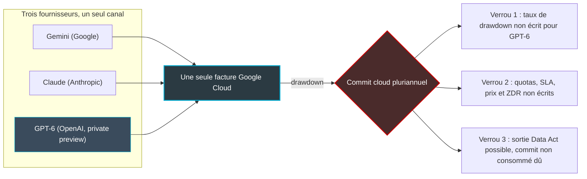

## Une facture pour trois cerveaux

Pour un directeur des achats, c'est probablement la meilleure nouvelle de l'automne. Depuis le 21 octobre, Google Cloud propose les modèles d'OpenAI à côté de ceux d'Anthropic et de ses propres Gemini : une seule facture, aucun contrat fournisseur séparé, et un paiement prélevé sur l'enveloppe que l'entreprise s'est déjà engagée à dépenser chez lui. Trois fournisseurs d'intelligence artificielle, un seul interlocuteur. Pas une ligne de négociation en plus.

Pour un directeur technique, la lecture est moins confortable. Cette enveloppe, c'est l'engagement de consommation pluriannuel que la plupart des grands comptes signent avec leur fournisseur cloud en échange de remises, le « commit » dans le jargon. Il existait déjà. Ce qui change, c'est qu'il devient le point de passage obligé de toute la consommation d'IA, quel que soit le modèle qui répond.

Les premiers concernés sont les DSI des organisations multisites : enseignes de retail, groupes hôteliers, réseaux d'agences, gestionnaires de résidences. Ce sont eux qui ont consolidé leurs dépenses cloud pour obtenir de meilleures conditions. Ce sont souvent eux, aussi, qui bouclent en ce moment leurs budgets 2027.

Ma thèse tient en trois phrases. Le modèle devient une ligne sur la facture ; le commit devient la seule chose qu'on ne peut plus quitter. Tant que prix, régions et garanties de confidentialité ne sont pas écrits, ce que Google vend est une préview imputable sur un engagement, pas un service qu'on met en production sous contrat. La parade tient en trois clauses à négocier avant d'y déplacer le moindre volume.

## Ce que Google a vraiment mis sur la table

Commençons par ce qui change concrètement. À terme, une entreprise cliente de Google Cloud pourra appeler GPT depuis la même console, avec les mêmes identités, les mêmes journaux d'audit et la même facture que ses appels à Gemini ou à Claude. Plus besoin d'ouvrir un compte chez OpenAI. Plus besoin de passer par Azure ou AWS.

« À terme », car rien n'est encore en production. Selon l'[annonce de Google](https://cloud.google.com/blog/products/ai-machine-learning/google-cloud-brings-openai-models-to-customers), trois modèles rejoignent Model Garden, le catalogue de Vertex AI (la plateforme d'IA de Google Cloud) : GPT-6 Astra, GPT-6.1 Sol et GPT-6 Luna. Ils sont en *private preview*, ouverts à des clients entreprise sélectionnés via un formulaire d'intérêt. OpenAI annonce la disponibilité générale pour les prochaines semaines, sans date. L'annonce ne mentionne ni prix, ni régions, ni calendrier pour les deux garanties de confidentialité qui comptent vraiment.

Le contexte explique l'empressement. L'exclusivité d'Azure sur les modèles d'OpenAI a pris fin fin avril 2026, avec un accord amendé annoncé le 27 avril ; Microsoft conserve une licence non exclusive et reste le partenaire cloud principal d'OpenAI. AWS a lancé les modèles OpenAI en préview limitée dès le lendemain, rapporte [The Decoder](https://the-decoder.com/openai-lands-on-aws-one-day-after-microsoft-deal-restructuring/). Selon l'analyse tierce de Digital Applied, AWS et Azure proposent depuis septembre quatre modèles GPT-6 en disponibilité générale.

Google arrive donc troisième, et revendique d'être le seul cloud à offrir Gemini, Claude et GPT. C'est exact en accès, puisque Gemini reste exclusif à Google Cloud. Ça ne l'est pas en production : chez Google, GPT-6 n'est pas encore ouvert à tous. Mike Leone, analyste chez Moor Insights & Strategy, résume l'enjeu, dans une citation relayée par The Next Web : Gemini doit désormais conquérir ses clients avec OpenAI installé juste à côté. C'est juste. Mais ce qui m'intéresse est ailleurs. Quel que soit le modèle qui gagne la requête, la dépense atterrit au même endroit.

Sur la sécurité, l'annonce coche les cases attendues. Prompts, contexte et réponses restent dans le périmètre de données désigné et ne servent jamais à l'entraînement. L'infrastructure est dédiée, les passerelles sont isolées, et l'accès s'appuie sur l'identité authentifiée, les VPC Service Controls (les périmètres réseau de Google Cloud) et des journaux d'audit unifiés.

Deux lignes portent pourtant la mention *coming soon*. La première est la ZDR (Zero Data Retention), l'engagement de ne conserver aucune requête. La seconde est le Confidential Compute, qui traite les données dans des enclaves matérielles chiffrées, inaccessibles même à l'exploitant du cloud. Ce sont précisément les deux garanties qui font passer un modèle du bac à sable à la production dès qu'on touche à des données sensibles.

Une préview sans prix, sans région et sans ces deux garanties n'est pas un service. C'est une option qu'on vous propose d'imputer sur votre commit.

## Le commit, nouveau centre de gravité

Le cœur de l'annonce n'est pas technique. Il est comptable. L'usage des modèles OpenAI passera par une transaction directe sur Google Cloud Marketplace, figurera sur la facture unique et viendra décrémenter les engagements cloud existants. Il sera aussi comptabilisé dans les Flexible Savings Plans (FSP), les plans d'engagement de Google, quel que soit le fournisseur du modèle. Google insiste : aucun contrat fournisseur séparé.

Pour mesurer ce que cela implique, prenons une scène que tout hôtelier connaît. Une entreprise réserve un séminaire avec un minimum de consommation garanti au bar et au restaurant. Tout ce que ses équipes commandent s'impute sur ce minimum ; ce qui n'est pas consommé est facturé quand même. Un matin, l'hôtel annonce qu'il servira désormais les cocktails du meilleur barman de la ville, et qu'ils compteront dans le forfait.

Excellente nouvelle. Sauf que le barman n'est pas encore arrivé. Ses cocktails n'ont pas de prix sur la carte. L'hôtel se réserve le droit de décider seul ce qui compte dans le forfait, et si le groupe part plus tôt, le minimum reste dû. Remplacez le barman par OpenAI, le forfait par votre commit, et vous avez l'annonce du 21 octobre. La carte des consommations éligibles, elle, appartient à l'hôtel.

*Un seul contrat, trois tuyaux : la simplicité de la facture unique a pour contrepartie un engagement qui concentre tout.*

Deux subtilités aggravent le tableau. D'abord, compter dans les FSP donne du crédit de consommation, pas un tarif réduit. Selon Digital Applied, qui cite la documentation FSP, les produits tiers ne bénéficient d'aucune remise du plan, un point à vérifier dans la documentation Google elle-même. Vous consommez votre enveloppe ; vous n'achetez pas moins cher.

Ensuite, la simplicité a un coût de gouvernance. Sans contrat direct avec OpenAI, vous perdez vos propres clauses sur la rétention, la sous-traitance et l'audit. Les conditions de sécurité deviennent celles de la Marketplace de Google. Une facture en moins, c'est aussi un levier de négociation en moins.

Pourquoi les clouds tiennent-ils tant à ce rôle de guichet unique ? [Reuters](https://www.khaleejtimes.com/anthropic-ipo-prospectus-lays-bare-deep-dependence-on-big-tech-partners) fournit un ordre de grandeur. D'après une copie du prospectus confidentiel d'introduction en Bourse d'Anthropic consultée par l'agence, 47 % du chiffre d'affaires 2025 de l'éditeur, soit environ 2,16 Md USD, serait passé par Amazon et Google, contre 11 % en 2023 et 32 % en 2024. Reuters estime les frais de distribution correspondants à environ 351 M USD, soit près de 16 cents par dollar.

Le document évoquerait aussi des conflits d'intérêts possibles avec ces partenaires. Il s'agit d'estimations de l'agence : Amazon a refusé de commenter, Anthropic et Alphabet n'ont pas répondu. La tendance, elle, ne fait guère de doute. Distribuer les modèles des autres est devenu un métier pour les clouds, et le commit en est la tuyauterie.

Le verrou ne se loge donc ni dans le code, ni dans le modèle. Il se loge dans le contrat, en trois points.

*Toute la consommation d'IA converge vers un seul engagement. Les trois verrous se négocient là, pas dans le code.*

## Clause 1 : un taux de drawdown écrit noir sur blanc

Imaginez le scénario. Votre équipe bascule une partie de ses usages d'IA vers GPT via Google, convaincue que chaque euro dépensé réduit d'autant le commit restant. À la revue annuelle, elle découvre que seule une fraction a compté. Le minimum n'est pas atteint, et l'écart se paie en fin d'exercice, sans contrepartie.

Ce scénario n'a rien de théorique. Le taux de drawdown, c'est-à-dire la part d'une dépense qui compte réellement contre l'engagement, change selon le document qu'on lit. La [documentation publique de Google](https://docs.cloud.google.com/marketplace/docs/commit-drawdown) indique que 100 % des dépenses sur les services de la Marketplace peuvent compter dans l'engagement minimum. Avec des exclusions : Maps, Ads, les services Marketplace qui ne tournent pas sur Google Cloud, les revendeurs dont l'éditeur n'a pas adhéré au programme de revente, les services du client ou de ses filiales, les prestations de Professional Services.

Surtout, cette liste peut changer à la seule discrétion de Google. Détail savoureux : la page a été mise à jour le 22 octobre, le lendemain de l'annonce.

Les contrats, eux, peuvent dire autre chose que la documentation. D'après un extrait d'un contrat public entre Google et l'administration britannique, publié sur Contracts Finder, le comptage Marketplace y serait plafonné à la moitié de l'engagement minimum, au taux en vigueur à la date d'achat ou de renouvellement. Une source secondaire relayée par ChannelE2E évoque un plafond de 25 % pour certains achats passant par des partenaires de distribution. Sur les modèles OpenAI en préview, rien de spécifique n'a été publié.

Le mécanisme n'est pas propre à Google. Chez AWS, des cabinets de conseil décrivent un plafond usuel de 25 % de l'EDP (Enterprise Discount Program, le commit maison) pour les achats Marketplace. Ce plafond serait négociable, avec une éligibilité restreinte depuis mai 2025 aux produits déployés sur AWS. Aucune source officielle d'Amazon ne le confirme. Mais la logique est la même partout : le cloud vous fait crédit de ce qui tourne chez lui, et il écrit seul les règles du crédit.

Ce qu'il faut obtenir par écrit, avant de déplacer un euro :

- **le taux exact par modèle**, en précisant si la consommation en préview compte ;
- **le plafond Marketplace de votre contrat**, pas celui de la documentation publique ;
- **un gel de ce taux** pour la durée de l'engagement, ou un droit de sortie s'il baisse ;
- **le sort du commit non consommé** : pénalité pour engagement non atteint (le *shortfall*), report sur l'exercice suivant ou régularisation de fin de période (le *true-up*).

Un taux de drawdown qui n'est pas dans votre contrat n'existe pas.

## Clause 2 : routage et quotas, ou qui est servi quand ça sature

Google vend une promesse séduisante : chaque charge de travail confiée au modèle le plus adapté. Prenons un opérateur de connectivité qui sert des hôtels, des enseignes et des résidences étudiantes, un métier que je connais bien. Ses besoins d'IA sont hétérogènes par nature. Un assistant de NOC (le centre de supervision réseau) qui résume des incidents à longueur de journée se contente d'un modèle léger et bon marché. L'analyse de télémétrie, le support client multilingue ou un agent de diagnostic exigent d'autres arbitrages entre coût, latence et qualité.

Sur le papier, c'est le cas d'usage idéal du bon modèle pour chaque tâche. Sur la facture, cela se traduit par une consommation répartie entre trois fournisseurs. Mais sur un seul commit, et sur une capacité dont vous ne maîtrisez pas l'allocation.

Or les inconnues s'empilent. Les identifiants de modèles, les quotas et les régions ne sont pas documentés : le 21 octobre, selon Digital Applied, la documentation partenaire de Google ne listait encore aucun modèle OpenAI. Personne ne sait qui sera servi en priorité si la capacité sature, du client Gemini ou du client GPT. Aucun engagement de niveau de service (SLA) n'est publié pour la préview. Et la parité de prix avec l'accès direct reste une inconnue totale.

Sur ce dernier point, un indice vient d'ailleurs. Toujours selon Digital Applied, dont les chiffres n'ont pas été recoupés avec les grilles officielles, restreindre le routage à une zone géographique coûterait environ 10 % de plus (surcoût Bedrock explicite, écart équivalent entre Global Standard et Data Zone US chez Azure). Rien ne permet de dire si Google fera mieux, pareil ou pire. Pour un acheteur européen, c'est pourtant la ligne qui compte.

*Router par tâche est une promesse. Savoir qui est servi quand la capacité sature en est une autre.*

Ma recommandation : gardez une passerelle d'abstraction sous votre contrôle, capable de router vers OpenAI en direct, Azure ou AWS si Google limite votre débit. Je ne parle pas ici d'élégance d'architecture. Je parle de crédibilité en négociation : une menace de sortie que vous ne pouvez pas exécuter en une semaine ne pèse rien autour de la table. Et faites écrire dans l'avenant deux choses simples : des quotas réservés par modèle, et le droit de router une partie du trafic ailleurs sans pénalité sur le commit.

Pour un opérateur réseau, il existe une ligne rouge supplémentaire. Les données qu'un assistant de supervision manipule contiennent des journaux de connexion : adresses MAC (l'identifiant matériel de chaque terminal), noms de réseaux Wi-Fi, identifiants d'accès invités. Tant que ZDR et Confidential Compute restent *coming soon*, ces données n'ont rien à faire en production sur ce canal. Le bac à sable, oui, avec des jeux anonymisés ou synthétiques. La production, non.

## Clause 3 : la sortie, là où le Data Act s'arrête

La bonne nouvelle d'abord. Depuis le 12 septembre 2025, le droit européen vous permet de quitter un fournisseur cloud dans des conditions encadrées. La mauvaise ensuite : il ne vous rembourse pas votre commit.

Le Data Act, règlement (UE) 2023/2854, couvre les services cloud au sens large, de l'infrastructure au logiciel en tant que service. Selon les analyses des cabinets Cooley, Travers Smith et DLA Piper, il s'applique aussi aux contrats déjà signés et aux fournisseurs établis hors de l'Union. Concrètement, il impose un préavis de deux mois au maximum et une période de transition de 30 jours au maximum pour porter les données exportables, prolongeable (jusqu'à sept mois) si le fournisseur démontre que c'est techniquement irréalisable. Les frais de changement de fournisseur sont limités aux coûts directs jusqu'au 12 janvier 2027, puis interdits.

Voilà pour la porte. Reste la chaîne. Les mêmes analyses rappellent que les frais de service standard et les pénalités de résiliation anticipée proportionnées ne sont pas des frais de changement au sens du règlement. En pratique, et sous réserve de l'avis de vos juristes, un commit non consommé reste exigible. Le Data Act garantit que vous pourrez emporter vos données ; il ne garantit pas que vous partirez sans payer ce que vous aviez promis de dépenser.

*Le Data Act ouvre la porte de sortie. Le commit non consommé, lui, reste attaché à la cheville.*

Dans le scénario multi-modèle, le problème s'aggrave mécaniquement. Plus vous imputez de GPT, de Claude et de Gemini sur le même engagement, plus le montant en jeu à la sortie grossit. Et plus votre liberté dépend de clauses que le règlement ne vous donne pas. Celles-ci, il faut les négocier :

- **un droit de substitution** : réaffecter une part du commit vers d'autres services si un modèle ne tient pas ses promesses ;
- **une résiliation partielle** si la ZDR et le Confidential Compute ne sont pas livrés dans un délai que vous fixez, et non la feuille de route du fournisseur ;
- **un droit de sortie** si le taux de drawdown baisse en cours de contrat ;
- **une réversibilité complète** : journaux d'audit, quotas, règles de routage et politiques d'accès, pas seulement les données.

## Signer après, pas avant

Je ne dis pas qu'il faut bouder l'offre. Réunir GPT, Claude et Gemini au même endroit est une vraie simplification, et la concurrence entre modèles sous un même toit peut jouer en faveur des acheteurs. Mais il faut renverser l'ordre habituel. D'ordinaire, on signe le commit, puis on découvre les services qui s'y imputent. Ici, c'est au service d'être écrit avant d'avoir le droit de toucher au commit.

Concrètement, je n'accepterais aucun avenant tant que cette grille n'est pas remplie :

| Condition | Statut public au 26 octobre | À exiger avant tout avenant |
|---|---|---|
| Prix par modèle | Non publié chez Google | Grille écrite, comparée à l'accès direct |
| Régions | Non publiées | Liste des régions européennes et surcoût éventuel |
| ZDR | *coming soon* | Date contractuelle, sinon résiliation partielle |
| Confidential Compute | *coming soon* | Date contractuelle, sinon résiliation partielle |
| Disponibilité générale | Annoncée sous quelques semaines, sans date | Date ferme, sinon rien en production |
| SLA | Aucun publié pour la préview | Engagement chiffré par modèle |
| Taux de drawdown | Doc générique, rien sur GPT-6 | Taux écrit et gelé sur la durée |
| Droits d'audit | Conditions Marketplace | Équivalent d'un contrat direct |

Ma position est donc nette. Testez la préview si vous y avez accès. Mais ne déplacez pas de volume de production, et surtout ne renégociez pas votre commit à la hausse sur la foi de cette annonce.

Pour une organisation comme la nôtre, les questions sont celles de n'importe quel DSI multisites. Quelle part de nos usages d'IA aurait vocation à passer par ce canal ? Sur quelles données, sachant que certaines ne quitteront pas le bac à sable avant la ZDR ? Que deviendrait cet engagement si nous devions rerouter demain ? Ces questions n'ont pas encore de réponse chiffrée, et c'est justement pour cela qu'elles doivent précéder la signature.

Google a fait un mouvement rationnel : chaque dollar dépensé en GPT chez lui reste dans son commit au lieu de partir chez Microsoft ou Amazon. Côté acheteur, l'échange est clair. Vous gagnez en simplicité ce que vous perdez en levier. C'est un bon échange, à condition d'en fixer le prix vous-même.

Le modèle, vous pourrez en changer à chaque appel d'API. Le commit, vous le paierez jusqu'au bout.

---

_Vues personnelles, pas position Wifirst._

## Sources

1. Google Cloud Blog, « Google Cloud brings OpenAI models to customers » (21/10/2026) : https://cloud.google.com/blog/products/ai-machine-learning/google-cloud-brings-openai-models-to-customers
2. Google Cloud Marketplace, documentation « Commitment drawdown rates » (mise à jour du 22/10/2026) : https://docs.cloud.google.com/marketplace/docs/commit-drawdown
3. The Next Web, OpenAI models and Codex on Google Cloud (21/10/2026) : https://thenextweb.com/news/openai-models-codex-google-cloud
4. Techzine, « OpenAI's models are finally fully supported on Google Cloud » (octobre 2026) : https://www.techzine.eu/news/applications/145174/openais-models-are-finally-fully-supported-on-google-cloud/
5. Digital Applied, « GPT, Claude, Gemini: which cloud sells which model » (22/10/2026, analyse tierce non recoupée avec les docs vendor) : https://www.digitalapplied.com/blog/gpt-claude-gemini-which-cloud-sells-which-model
6. Digital Applied, synthèse achats sur les modèles OpenAI dans Model Garden (21/10/2026, analyse tierce) : https://www.digitalapplied.com/blog/openai-models-google-cloud-model-garden-preview
7. The Decoder, « OpenAI lands on AWS one day after Microsoft deal restructuring » (29/04/2026) : https://the-decoder.com/openai-lands-on-aws-one-day-after-microsoft-deal-restructuring/
8. Reuters via Khaleej Times, prospectus IPO d'Anthropic et dépendance aux partenaires Big Tech (fin septembre 2026) : https://www.khaleejtimes.com/anthropic-ipo-prospectus-lays-bare-deep-dependence-on-big-tech-partners
9. Cooley, nouvelles règles de changement de fournisseur cloud dans l'UE (08/09/2025) : https://www.cooley.com/news/insight/2025/2025-09-08-paas-iaas-or-saas-be-aware-new-switching-rules-will-become-applicable-in-eu
10. Travers Smith, le Data Act et les contrats de services cloud : https://www.traverssmith.com/knowledge/knowledge-container/the-data-acts-changes-to-cloud-services-contracts-tipping-the-scales-on-switching/
11. DLA Piper, « Cloud exit under the EU Data Act » (2026) : https://www.dlapiper.com/en-at/insights/publications/law-in-tech/2026/cloud-exit-under-the-eu-data-act
12. Contracts Finder (UK), contrat public Google Cloud : https://www.contractsfinder.service.gov.uk/Notice/Attachment/bbe5a685-4a6e-4225-b73b-8019a130d6fa
13. ChannelE2E, nouveaux modèles de revenus et incitations de Google Cloud Marketplace : https://www.channele2e.com/news/google-cloud-marketplace-introduces-new-revenue-models-and-incentives-to-boost-partner-growth
14. Redress Compliance, AWS EDP et compensation des achats Marketplace (cabinet conseil) : https://redresscompliance.com/aws-edp-marketplace-isv-commitment-offset.html
