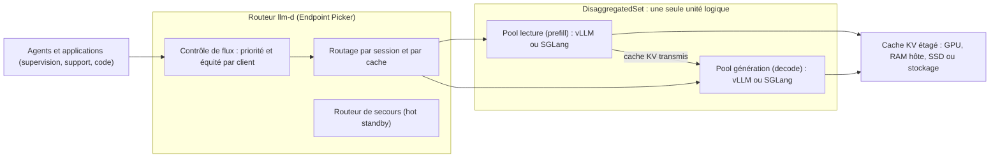
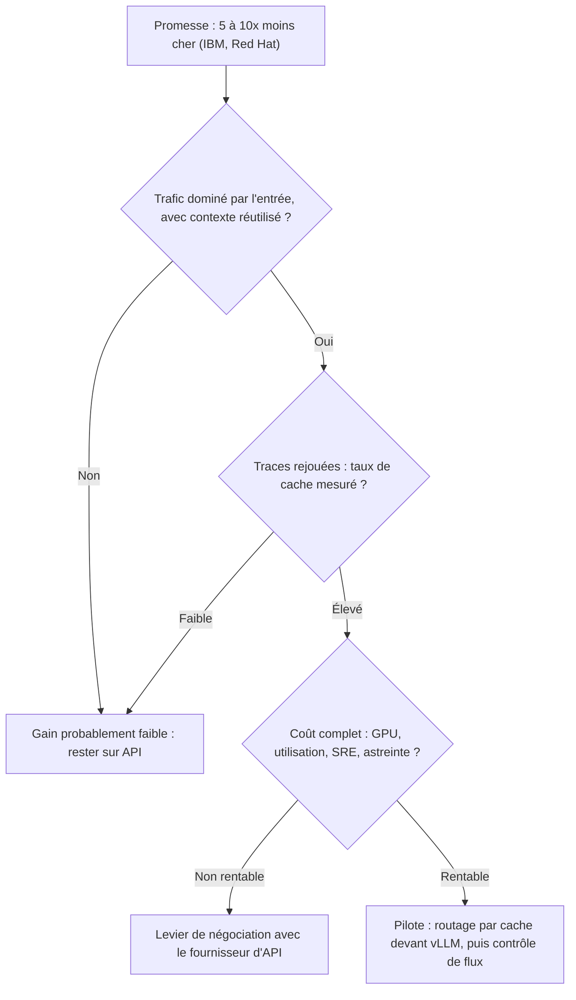

## 300 USD contre 26 USD : la facture des agents IA entre en négociation

300 USD d'un côté, 26 USD de l'autre, pour faire travailler des agents IA pendant vingt-quatre heures. C'est l'écart que revendique Ruchir Puri, chez IBM, cité par TechTarget, entre une configuration « tout propriétaire » et la même charge servie par un modèle ouvert (GLM, d'après TechTarget) sur un système exécutant llm-d. Le chiffre est spectaculaire. À notre connaissance, aucun tiers indépendant ne l'a encore reproduit.

Pourquoi s'y arrêter quand on n'est ni IBM ni Google ? Parce que la facture de l'IA change de nature dans toutes les entreprises qui passent du chatbot aux agents. Un agent de supervision réseau, de support client ou d'exploitation ne pose pas une question avant de repartir. Il relit l'historique du ticket, les journaux des équipements, la configuration du site, puis recommence au tour suivant. Chez un opérateur qui pilote un grand nombre de sites en hôtellerie, en retail ou en résidences étudiantes, ce volume de relecture peut vite devenir la première ligne du budget IA, loin devant le texte réellement produit.

Le 20 octobre, à la PyTorch Conference de San Jose, le projet open source llm-d est passé en version 1.0. IBM et Red Hat, deux de ses principaux contributeurs, annoncent une inférence (le fait de faire tourner un modèle en production) 5 à 10 fois moins chère que les API commerciales sur ce profil de charge. Ma position tient en une phrase : c'est le premier levier crédible pour rouvrir vos contrats d'API, à condition de ne jamais brandir un chiffre que vous n'avez pas rejoué sur votre propre trafic.

## Le technicien qui a déjà votre dossier ouvert

Commençons par ce que llm-d n'est pas : un moteur d'inférence de plus. Le calcul proprement dit reste confié à vLLM ou à SGLang, deux moteurs open source déjà très répandus pour servir des modèles ouverts. llm-d se place au-dessus. C'est la couche qui décide quelle requête part vers quelle machine, dans quel ordre, et avec quelle mémoire déjà chargée.

Prenez un centre de support téléphonique. Un client rappelle pour la troisième fois de la journée. Dans le mauvais scénario, il tombe sur un technicien au hasard, qui doit relire tout le dossier avant de dire un mot. Dans le bon, l'aiguillage l'envoie vers le collègue qui a encore son dossier ouvert à l'écran. Même compétence, même salaire. Mais cinq minutes de relecture économisées à chaque appel.

C'est exactement le principe du routage conscient du cache. Quand un grand modèle de langage (LLM) lit un contexte, il construit en mémoire GPU une représentation intermédiaire, le cache KV (pour *key-value*) : en somme, ses notes de lecture. Si le tour suivant de l'agent reprend le même début de contexte, la machine qui détient ces notes peut sauter la relecture. C'est le cas de la plupart des agents. Encore faut-il que la requête arrive sur la bonne machine, et un répartiteur de charge classique, qui envoie au hasard ou au serveur le moins occupé, n'en a aucune idée.

Seconde idée-force : la désagrégation. Servir un modèle, ce sont deux métiers distincts. La lecture du contexte (le *prefill*) est gourmande en calcul et se fait d'un bloc. La génération de la réponse (le *decode*), mot après mot, est limitée par la mémoire et s'étire dans le temps. Les faire tourner sur les mêmes GPU revient à faire partager un bureau au documentaliste et au rédacteur : chacun ralentit l'autre. llm-d les sépare en deux pools spécialisés, et c'est sur cette séparation que se joue une bonne part du rendement d'une flotte GPU agentique.

*Le moteur ne change pas. llm-d décide quelle requête va où, et garde le contexte au chaud.*

## Une 1.0 pensée pour le lundi matin, pas pour la keynote

Le billet de sortie l'assume dès son titre : « ready for Day 2 ». Dans le vocabulaire des équipes d'exploitation, le *Day 2* désigne tout ce qui suit la mise en service. Les mises à jour, les pannes, les clients qui se marchent dessus. Cette 1.0 n'invente donc aucune technique : le routage par cache, la désagrégation et le délestage du cache KV vers la RAM ou le stockage existaient déjà. Elle les rend exploitables par une équipe qui a autre chose à faire que lire le code source.

Trois ajouts méritent l'attention d'un CTO.

Le contrôle de flux multi-tenant, d'abord. Chaque requête porte une clé qui combine un identifiant d'équité (un client, une équipe, un produit) et une bande de priorité. En cas de saturation, l'admission devient probabiliste au lieu de laisser le plus bavard tout consommer. Le comportement par défaut reste « premier arrivé, premier servi », ce qui permet de l'activer sans rien casser. Quand un même parc GPU sert à la fois l'agent du NOC (le centre de supervision réseau) en pleine gestion d'incident et un traitement de nuit qui résume dix mille tickets, c'est la différence entre une plateforme et un champ de bataille.

Ensuite, le DisaggregatedSet. Les pools de lecture et de génération sont désormais déclarés comme une seule unité logique, et mis à jour ensemble. Ça paraît anodin. Ça ne l'est pas : une mise à jour qui laisse les deux moitiés sur des versions différentes, c'est l'incident qu'on découvre à trois heures du matin.

Enfin, tout ce qui touche à l'exploitation quotidienne : une API de configuration v1 désormais stable, un routeur doublé d'une instance de secours, un placement des charges qui tient compte de la topologie matérielle. Les agents ont aussi droit à leur lot. Routage par session, ordonnancement par priorité de tour, gestion native de l'état conversationnel de l'API Responses.

*Un seul aiguilleur, deux pools spécialisés : la lecture du contexte d'un côté, la génération de l'autre, et une mémoire partagée entre les deux.*

Le billet a l'honnêteté de lister ce qui manque. La haute disponibilité repose sur un *hot standby* : un routeur de secours qui attend son tour, pas deux routeurs actifs en parallèle. La reprise des requêtes en vol lors d'une bascule figure encore parmi les chantiers, tout comme une intégration GitOps plus poussée. Rien de rédhibitoire. Mais ce n'est pas encore le niveau de résilience qu'on exige d'un cœur de réseau.

Côté gouvernance, un point de vocabulaire s'impose. llm-d est un projet Sandbox de la CNCF (Cloud Native Computing Foundation, la fondation qui héberge Kubernetes), annoncé comme tel le 24 mars 2026. Sandbox, c'est le premier niveau de maturité de la fondation. Le « 1.0 » est un numéro de version logicielle, pas un label CNCF.

Le projet revendique plus de 500 contributeurs issus de plus de 25 organisations, un chiffre auto-déclaré qu'un analyste ramène plutôt à « plus de 200 ». Licence Apache 2.0, environ 5 000 étoiles sur GitHub. Lancé en mai 2025 par Red Hat, Google Cloud, IBM Research, CoreWeave et NVIDIA, il compte parmi ses utilisateurs déclarés AWS, DigitalOcean, Oracle Cloud, Tesla, Mistral AI ou JetBrains.

## Décortiquer le « 5 à 10x » : qui l'annonce, sur quel terrain

Trois mille agents de code qui travaillent en parallèle sans jamais être interrompus. Plus de 6,6 millions de tokens générés par minute au pic. Le tout sur 544 GPU NVIDIA H100. C'est la vitrine sur laquelle IBM Research et Red Hat appuient leur promesse d'un coût par token 5 à 10 fois inférieur à celui d'API commerciales « équivalentes », calculé au tarif actuel de location de GPU dans le cloud.

Le modèle testé, GLM-5.2, compte environ 753 milliards de paramètres, dont environ 39 milliards seulement travaillent à chaque token. Les auteurs présentent leur résultat comme un point de départ, pas un plafond, tout en notant que 3 000 agents, c'est déjà proche de la limite du système. Surtout, le billet d'IBM ne publie ni le tarif horaire des GPU retenus, ni le prix de l'API de référence, ni le taux d'utilisation, ni le coût des équipes. Autrement dit : un ordre de grandeur, pas un devis.

Pour voir d'où vient le multiplicateur, il faut remonter à un billet technique publié par le projet en juillet. Il détaille un déploiement de GLM-5.2 sur 64 GPU H200 loués chez CoreWeave à 2,71 USD l'heure, à pleine charge 24 heures sur 24. En reprenant ses données, on arrive à environ 0,08 USD par million de tokens en entrée et 1,92 USD en sortie. Le catalogue de Z.ai, l'éditeur du modèle, affiche de son côté 1,40 USD en entrée, 0,26 USD en entrée déjà en cache, et 4,40 USD en sortie.

Faites la division. L'auto-hébergement ressort environ 17 fois moins cher sur l'entrée facturée plein tarif. Un peu plus de 3 fois moins cher face au tarif d'entrée en cache. Et seulement 1,2 à 2,3 fois moins cher sur la sortie, selon la répartition entre pools de lecture et de génération. Or 98,6 % des tokens servis dans ce test sont des tokens d'entrée. Le « 5 à 10x » ne mesure donc pas un gain uniforme : il reflète la structure du trafic.

C'est la logique de l'abonnement de train face au taxi. Pour le pendulaire qui refait le même trajet chaque matin, l'abonnement écrase le compteur. Pour celui qui traverse la ville une fois par mois, il ne vaut rien. Vos agents sont-ils des pendulaires ? C'est la seule question qui compte, et IBM ne peut pas y répondre à votre place.

Le même billet liste d'ailleurs ce qu'il exclut : stockage, trafic réseau sortant, ingénierie, support, taxes. Il rappelle que le coût calculé ne vaut qu'à charge soutenue, et que le prix d'une API rémunère aussi l'exploitation et la marge du fournisseur. Pour fixer les idées, 64 H200 à 2,71 USD l'heure, c'est environ 4 160 USD par jour (calcul de notre part). Avant le premier salaire et avant la première nuit d'astreinte.

Reste la collection de chiffres qui circulent depuis le 20 octobre. Tous viennent des porteurs du projet ou de leurs clients. Le TTFT (*time to first token*) désigne le délai avant le premier mot de la réponse, la latence que l'utilisateur ressent.

| Chiffre annoncé | Qui l'annonce | Ce qu'il faut savoir |
|---|---|---|
| 5 à 10x moins cher par token | IBM Research, Red Hat | GLM-5.2 sur 544 H100, face à des API « équivalentes » ; gain maximal sur trafic dominé par l'entrée |
| 11,5x moins cher, 0,11 USD par million de tokens | IBM Research | Cas de correction d'erreurs quantiques ; méthode non détaillée ; SiliconANGLE rapporte 11,8x |
| Environ 98 % de succès du cache | IBM Research | Même cas ; définition et charge non publiées |
| Succès du cache doublé (de 35 à 70 %), TTFT réduit d'au moins 35 % | Google | Trafic de sa plateforme Gemini, via GKE Inference Gateway |
| TTFT médian réduit de 85 %, débit x2,4 | Google | Sur TPU Ironwood, face à un simple service Kubernetes |
| Environ 3x de débit, TTFT divisé par 2 | Tesla et Red Hat | Llama 3.1 70B sur AMD MI300X ; point de comparaison non précisé |
| Jusqu'à 70 % de débit en plus | AWS | Modèle et matériel non précisés |

Méfiez-vous en particulier des pourcentages de cache. Les 98 % du communiqué, les 97 % de réutilisation captée par le routeur dans un autre test d'IBM, les 85,2 % de tokens d'entrée servis depuis le cache sur les 544 H100, les 96 % de tours d'agent qui réutilisent au moins 90 % de leur entrée : quatre métriques différentes. Elles se ressemblent assez pour finir mélangées dans une slide de négociation. Ne laissez personne le faire, ni chez votre fournisseur, ni chez vous.

*D'un côté, un compteur qui tourne à chaque token. De l'autre, un parc qu'il faut régler, surveiller et payer même quand il dort.*

## Vous n'installerez pas llm-d, vous l'achèterez emballé

Soyons réalistes : 544 H100, ce n'est pas l'échelle à laquelle raisonnent la plupart des opérateurs ou des DSI. llm-d est conçu pour Kubernetes, et ses benchmarks tournent sur des H100, H200, B200, MI300X ou TPU. Il suppose un cluster bien opéré et une équipe SRE (Site Reliability Engineering) capable de le tenir la nuit. La plupart des entreprises le consommeront donc sous forme packagée.

Les emballages existent déjà. Google en fait le cœur de GKE Inference Gateway, qui n'est autre qu'un routeur llm-d managé. Red Hat l'intègre à Red Hat AI. DigitalOcean fait tourner un fork pour ses offres Managed Agents et Serverless Inference, qui auraient été, selon l'entreprise, « prohibitivement chères » sans lui.

Jason Andersen, analyste chez Moor Insights & Strategy, estime auprès de TechTarget que les entreprises obtiendront probablement llm-d par un cloud ou un éditeur. Il doute aussi que le soutien de CoreWeave et de NVIDIA suffise à en faire un standard. CoreWeave le propose en option, et NVIDIA pousse en parallèle Dynamo, qui recoupe une bonne part des mêmes fonctions. Son constat mériterait d'être affiché dans toutes les salles de comité d'achat : les fournisseurs disent surtout, selon lui, « si vous déployez chez nous, ça nous va ». « C'est tout ce qu'ils disent vraiment à ce stade ». Le soutien d'un fournisseur n'est pas un engagement.

Deux autres réserves. La portabilité d'une puce à l'autre, des GPU NVIDIA vers des TPU par exemple, est jugée peu réaliste aujourd'hui par DigitalOcean et IBM eux-mêmes. Et une partie des gains vantés par Google s'appuie sur des services propres à son cloud : routeur managé, bascule multi-cluster, filtrage Model Armor, stockage Managed Lustre.

D'où ma lecture. Le cœur de llm-d est ouvert, mais ce qui fait la différence en production se vend à l'étage du dessus : la haute disponibilité sérieuse, la bascule entre clusters, la sécurité. Le verrou ne disparaît pas. Il se déplace du modèle vers la couche d'orchestration.

Ce n'est pas une raison de fuir. C'est une raison de garder le cœur ouvert comme étalon : une référence publique, documentée, contre laquelle comparer chaque offre managée et chaque grille tarifaire d'API.

## La preuve avant la négociation, en quatre étapes

NAND Research résume la bonne posture : traiter le « 5 à 10x » comme une hypothèse à tester sur son propre trafic, pas comme un acquis. Le cabinet relève au passage que les documents de la 1.0 ne comparent pas llm-d à NVIDIA Dynamo. Concrètement, voici comment je m'y prendrais.

**1. Qualifier le profil de vos agents.** Mesurez la part de tokens d'entrée dans votre consommation actuelle, et la part de contexte reprise d'un tour à l'autre. Un agent de diagnostic qui relit les mêmes logs et la même topologie de site à chaque itération est un pendulaire. Un assistant de rédaction qui part d'une page blanche ne l'est pas.

**2. Rejouer vos traces.** Exportez une semaine de requêtes réelles, anonymisées, et rejouez-les sur quelques GPU loués à l'heure, avec vLLM et le routage conscient du cache devant. C'est d'ailleurs le chemin d'adoption que recommande Google : d'abord le routage par cache devant un vLLM existant, puis le contrôle de flux, puis le délestage du cache, et la désagrégation en dernier. Le projet publie des guides de déploiement balisés et des benchmarks de référence pour caler la méthode. Le chiffre à rapporter : votre taux de cache mesuré, pas celui d'IBM.

**3. Chiffrer le coût complet.** Heure GPU, taux d'utilisation réel, stockage, réseau, ingénierie, astreinte. Vos agents ne tournent pas à pleine charge 24 heures sur 24, et chaque heure creuse renchérit le token servi. Comparez ensuite au tarif d'API *avec* la remise sur l'entrée en cache, quand le fournisseur en propose une, comme Z.ai pour GLM-5.2. Le face-à-face honnête, c'est 0,08 contre 0,26 USD le million de tokens, pas 0,08 contre 1,40.

**4. Négocier avec votre chiffre, pas avec le communiqué.** Même si vous n'internalisez jamais rien, une alternative mesurée change la conversation avec votre fournisseur d'API : tarif d'entrée en cache, engagement de volume, plafond par tâche. On l'a écrit à propos de Haiku 5.5 : l'unité qui compte est le coût par tâche agentique, pas le prix affiché au token.

*Qui annonce quoi, quelle preuve exiger : la promesse d'un fournisseur n'entre en négociation qu'après être passée par vos propres mesures.*

*Une trace rejouée, un chronomètre, un registre de coûts : la seule preuve qui tienne face à un commercial.*

## Mon avis : un instrument de mesure avant d'être une plateforme

llm-d 1.0 est, à ce jour, la référence ouverte la plus sérieuse pour la couche qui pilote l'inférence agentique. Elle est portée par des acteurs qui l'exploitent eux-mêmes en production, abritée par une fondation neutre, et sa 1.0 s'attaque enfin aux problèmes d'exploitation plutôt qu'aux records de benchmark. C'est une bonne nouvelle pour tous ceux qui paient des API au token.

Mais le « 5 à 10x » reste une déclaration de membres du projet. Il a été mesuré sur un cas où presque tout le trafic est de la relecture de contexte, sur un parc que peu d'entreprises posséderont jamais. L'open source ne supprime ni les GPU, ni l'équipe qui les surveille la nuit. Et la partie la plus confortable de la pile se vend déjà, emballée, chez les grands clouds.

Pour la plupart des opérateurs et des DSI, la bonne séquence est donc l'inverse de celle qu'on entend en salon. D'abord mesurer. Ensuite négocier. Et seulement après, éventuellement, héberger. Utilisez llm-d comme un banc d'essai : rejouez vos traces, sortez votre propre multiplicateur, posez-le sur la table de votre fournisseur d'API. S'il est bon, vous aurez gagné une négociation. S'il est excellent, vous aurez peut-être trouvé une plateforme.

Le chiffre qui compte n'est pas celui d'IBM. C'est le vôtre.

_Vues personnelles, pas position Wifirst._

## Sources

1. llm-d.ai, « llm-d v1.0: State-of-the-art inference, ready for Day 2 », 20 octobre 2026 — https://llm-d.ai/blog/llm-d-v1.0-state-of-the-art-inference-ready-for-day-2
2. IBM Newsroom (PRNewswire), « llm-d 1.0 Advances Open, Cost-Efficient AI Inference for Production Scale », 20 octobre 2026 — https://newsroom.ibm.com/2026-10-20-llm-d-1-0-advances-open,-cost-efficient-ai-inference-for-production-scale
3. Google Cloud Blog (Lohmeyer, Horgan), « Announcing llm-d 1.0 », 20 octobre 2026 — https://cloud.google.com/blog/topics/ai-infrastructure/llm-d-1-0-an-open-source-stack-for-distributed-inference
4. IBM Research (Peter Hess), « llm-d 1.0 hardens open-source AI inference for production », 20 octobre 2026 — https://research.ibm.com/blog/llmd-1-0-is-ready-for-production-inference-serving
5. IBM Research (Peter Hess), « How llm-d makes the most of the hardware you already have », 8 septembre 2026 — https://research.ibm.com/blog/running-open-models-on-h100-gpus-with-llmd
6. llm-d.ai, « Serving GLM-5.2 for Agentic Workloads on llm-d », 22 juillet 2026 — https://llm-d.ai/blog/serving-glm-5-2-agentic-workloads-on-llm-d
7. CNCF Blog, « Welcome llm-d to the CNCF: Evolving Kubernetes into SOTA AI Infrastructure », 24 mars 2026 — https://www.cncf.io/blog/2026/03/24/welcome-llm-d-to-the-cncf-evolving-kubernetes-into-sota-ai-infrastructure/
8. Google Cloud Blog, « llm-d officially a CNCF Sandbox project », 24 mars 2026 — https://cloud.google.com/blog/products/containers-kubernetes/llm-d-officially-a-cncf-sandbox-project
9. GitHub, dépôt llm-d/llm-d (licence Apache-2.0), consulté le 27 octobre 2026 — https://github.com/llm-d/llm-d
10. TechTarget (Beth Pariseau), « CNCF's llm-d 1.0 tackles high AI inference costs », 20 octobre 2026 — https://www.techtarget.com/it-infrastructure/news/366652343/CNCFs-llm-d-10-tackles-high-AI-inference-costs
11. Techzine (Berry Zwets), « llm-d 1.0 makes distributed AI inference production-ready », 21 octobre 2026 — https://www.techzine.eu/news/infrastructure/145141/llm-d-1-0-makes-distributed-ai-inference-production-ready/
12. SiliconANGLE (Paul Gillin), « IBM-backed llm-d framework adds controls for running AI models in-house », 20 octobre 2026 — https://siliconangle.com/?p=851081
13. NAND Research (Steve McDowell), « llm-d 1.0 Open Distributed Inference for Production AI », 21 octobre 2026 — https://nand-research.com/?p=6067
14. Efficiently Connected (Paul Nashawaty), « llm-d 1.0: Open Source LLM Inference Scaling Hits Production Grade », octobre 2026 — https://www.efficientlyconnected.com/?p=9922
