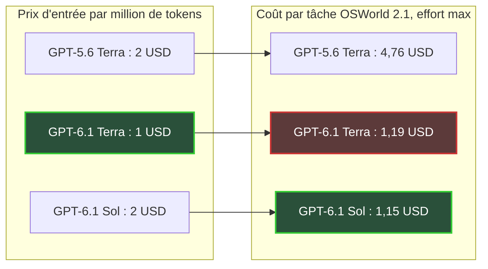
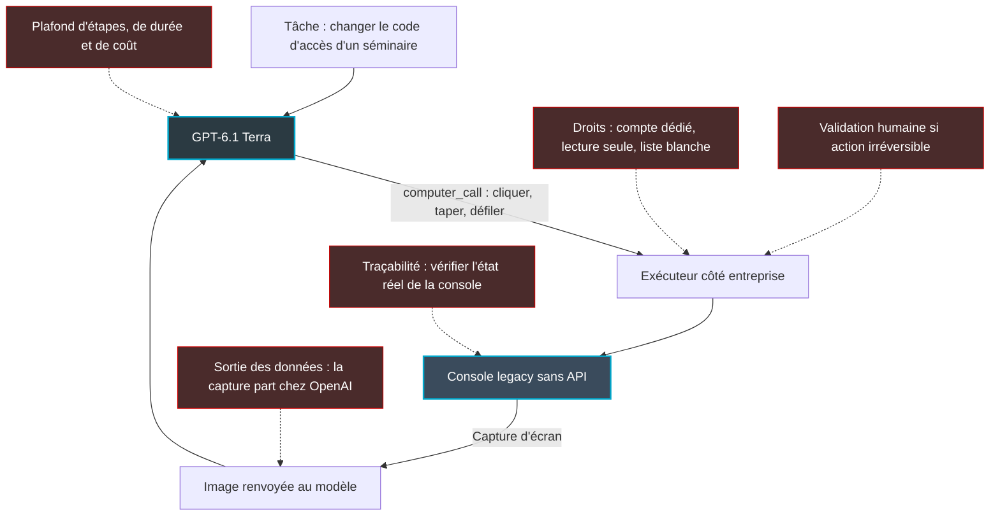

## L'écran que personne n'ose toucher

Dans le local technique d'un hôtel, il y a souvent un écran que personne n'ose toucher. C'est la console d'administration du Wi-Fi, installée il y a des années, qui ne dialogue avec aucun autre logiciel et dont le mode d'emploi tient dans la tête d'un seul technicien. Changer le code d'accès d'un séminaire, sortir le rapport de fréquentation du mois, déclarer une borne en panne chez le fournisseur : à chaque fois, quelqu'un se connecte, clique, recopie, referme.

Multipliez par quelques centaines de sites. Hôtels, magasins, résidences étudiantes, sièges d'entreprise. Ce travail de clic n'apparaît dans aucun budget, mais il pèse sur chaque équipe d'exploitation, parce que l'automatiser supposait jusqu'ici d'écrire un connecteur logiciel pour chaque outil. Quand l'outil le permettait.

Le 26 octobre, OpenAI a sorti GPT-6.1 Terra, un modèle qui regarde un écran, décide où cliquer et tape au clavier, facturé moitié prix par rapport au modèle haut de gamme de la maison. Sur le banc d'essai mis en avant par le constructeur, une tâche de bureau pilotée de bout en bout revient à 1,19 USD, contre 4,76 USD pour la génération précédente.

On a envie d'y voir la fin d'un vieux verrou. C'en est un, en partie. Mais le prix divisé par deux ne se retrouve pas forcément dans la facture d'une tâche. Et la vraie question a déjà changé de place : on ne se demande plus si l'agent sait cliquer, mais ce qu'on l'autorise à toucher.

## Ce qui est sur la table, et qui le chiffre

Commençons par les faits, car la confusion a démarré dès le premier jour. Le « moins 50 % » repris partout n'a pas la même base selon qui parle : OpenAI le calcule face à GPT-5.6 Terra, le modèle que le nouveau remplace. La [page de prix](https://developers.openai.com/api/docs/pricing) est plus nuancée. Les tarifs y sont exprimés par million de tokens, l'unité de découpage du texte que facture le modèle (en gros, trois quarts de mot en anglais).

| Prix par million de tokens, tarif standard | GPT-5.6 Terra | GPT-6.1 Terra | GPT-6.1 Sol |
|---|---|---|---|
| Entrée | 2,00 USD | 1,00 USD | 2,00 USD |
| Entrée en cache | 0,20 USD | 0,05 USD | 0,10 USD |
| Sortie | 12,00 USD | 5,00 USD | 10,00 USD |

*Source : page de prix OpenAI, tarif standard jusqu'à 272 000 tokens d'entrée par requête.*

Face à Sol, le modèle haut de gamme de la même génération, Terra vaut exactement la moitié sur les trois lignes. Face à l'ancien Terra, c'est la moitié en entrée, mais 58 % de moins en sortie et 75 % de moins sur le cache (le texte déjà envoyé et réutilisé). Au-delà de 272 000 tokens d'entrée, toute la requête bascule à 2,00 / 0,10 / 7,50 USD. Le mode batch (traitement différé) divise la facture par deux, le mode rapide la double, et le traitement régional ajoute 10 % là où il existe.

Côté [fiche technique](https://developers.openai.com/api/docs/models/gpt-6.1-terra) : 1 050 000 tokens de contexte, dont 922 000 en entrée, 128 000 en sortie, connaissances arrêtées au 1er juin 2026. Le modèle lit texte et images, répond en texte seul, et ne s'affine pas sur vos données. Il est disponible dans ChatGPT Work, Codex et l'API (identifiant `gpt-6.1-terra`), pour les plans Plus, Pro, Enterprise et Edu selon [InfoWorld](https://www.infoworld.com/article/4241006/openai-bets-on-ai-economics-with-lower-cost-gpt-6-1-terra.html). Pas dans le ChatGPT conversationnel classique, ni dans les offres gratuites au lancement.

Une précaution, valable pour tout le reste du billet. Tous les scores de pilotage d'interface publiés cette semaine sont des chiffres du constructeur, non reproduits. [Artificial Analysis](https://artificialanalysis.ai/models/gpt-6-1-terra), seul évaluateur indépendant à avoir publié, mesure son propre indice et un banc d'essai en ligne de commande, pas le pilotage d'écran. [Kingy](https://kingy.ai/blog/gpt-6-1-terra/), qui a décortiqué les graphiques d'OpenAI, ne les a pas rejoués. Ça ne veut pas dire qu'ils sont faux. Ça veut dire qu'on lit une copie corrigée par l'élève lui-même.

## La console sans API, vraie cible du pilotage d'écran

Imaginez un intérimaire très doué qui ne mettrait jamais les pieds dans vos locaux. On lui glisse sous la porte une photo de l'écran. Il l'étudie, puis griffonne une consigne : clique sur l'onglet Portail, tape le nouveau code dans le deuxième champ. Quelqu'un, de votre côté, exécute, reprend une photo et la repasse sous la porte. Ainsi de suite, jusqu'à ce que la tâche soit finie.

*Une capture, une action, une nouvelle capture : l'agent ne voit votre console qu'à travers cette boucle.*

C'est, à peu de chose près, le fonctionnement du computer use (le pilotage d'un ordinateur par le modèle) décrit dans le [guide d'OpenAI](https://developers.openai.com/api/docs/guides/tools-computer-use). Le modèle renvoie un `computer_call`, c'est-à-dire une liste d'actions élémentaires : cliquer, double-cliquer, glisser, déplacer le pointeur, défiler, presser une touche, taper du texte, attendre, capturer l'écran. Votre application les exécute, renvoie une capture, et la boucle repart.

Deux détails pèsent sur l'intégration et sur la facture. La fonction n'est accessible que par la Responses API, l'interface de programmation récente d'OpenAI, pas par l'ancienne Chat Completions. Et chaque capture est facturée comme une image en entrée : la page de prix ne contient aucune ligne dédiée au computer use, et les environnements hébergés peuvent facturer à part.

Pourquoi est-ce important quand on gère des centaines de sites ? Parce que la liste des cibles est longue et peu glamour. Contrôleurs Wi-Fi et portails d'authentification d'anciennes générations. Portails fournisseurs pour suivre une commande, un ticket ou un RMA (retour de matériel défectueux). Back-offices hôteliers et PMS (Property Management System, le logiciel qui gère réservations et chambres). Outils de facturation hérités d'une acquisition. Leur point commun : pas d'API, ou une API si pauvre qu'elle ne couvre qu'une fraction de ce que montre l'écran.

Jusqu'ici, automatiser ces outils voulait dire écrire un connecteur, ou un script de robotisation qui casse dès qu'un bouton change de place. L'agent qui regarde l'écran ne dépend pas d'un repère figé dans le code de la page : si le bouton bouge, il le retrouve, comme le ferait un humain. La vraie promesse de Terra est là. Pas dans son intelligence. Dans l'absence de connecteur à écrire.

## Payer la course, pas le litre d'essence

Juger un agent au prix du token, c'est choisir un taxi au prix du litre d'essence. Ce que vous payez, c'est la course. Un chauffeur au carburant deux fois moins cher qui fait deux fois le tour du quartier vous coûte exactement autant que l'autre.

OSWorld 2.1, un banc d'essai qui fait exécuter à l'agent des tâches sur un bureau Linux équipé d'applications courantes, le montre mieux qu'un long discours. À effort de raisonnement maximal, dans sa version hors ligne, Terra réussit 74,2 % des tâches pour 1,19 USD chacune, selon les chiffres d'OpenAI relayés par InfoWorld et Kingy. Sol, deux fois plus cher au token, en réussit 78,0 % pour 1,15 USD. Le modèle haut de gamme coûte donc quatre centimes de dollar de moins par tâche. Et il réussit plus souvent.

L'explication la plus plausible : Terra consomme davantage de tokens pour arriver au même endroit. Plus de captures, plus d'étapes, plus de raisonnement ? OpenAI ne le documente pas. Le constat suffit : l'écart de tarif s'évapore en route.

*Chiffres publiés par OpenAI, non reproduits : l'écart de tarif entre Terra et Sol disparaît dans le coût par tâche.*

Sur un autre banc d'essai publié par OpenAI, Agents' Last Exam, la hiérarchie s'inverse : Terra obtient 60,0 % pour 1,01 USD par tâche, Sol 58,6 % pour 2,00 USD. Là, la moitié de prix se retrouve bien dans la facture. Selon la nature de la tâche, Terra coûte donc autant que Sol, ou deux fois moins. Personne ne peut vous dire à l'avance dans quelle case tombent vos consoles.

Côté classement, Terra reste derrière Sol, Astra (80,9 %) et Claude Sonnet 5.5 d'Anthropic (83,9 %, mais 5,74 USD la tâche) sur OSWorld 2.1. À effort medium, le réglage par défaut, il descend à 66,7 %. C'est un modèle d'économie, pas un champion.

J'ai fait un calcul grossier, à prendre comme tel : diviser le coût par tâche par le taux de réussite, pour approcher un coût par tâche réussie. Sur OSWorld 2.1, on obtient environ 1,6 USD pour Terra, 1,5 pour Sol, 6,8 pour Sonnet 5.5 et 8,3 pour GPT-5.6 Terra. La réserve est de taille : OpenAI n'a pas documenté la méthode de son coût par tâche, et on ignore si les échecs sont inclus ou combien d'essais sont lancés. Ce n'est pas un coût de production. C'est un ordre de grandeur, qui dit deux choses : le bond depuis l'ancien Terra est réel, d'un facteur cinq environ ; l'écart avec Sol est nul.

Deux angles morts, enfin. Les tâches OSWorld tournent sur des applications de bureau standard, pas sur une console Wi-Fi ou un PMS : sur vos cibles, aucune donnée n'existe. Et la vitesse ne départage rien. OpenAI revendique un modèle plus de trois fois plus rapide qu'Astra et Sol, sur une évaluation interne de tâches professionnelles. Artificial Analysis mesure pourtant un débit d'environ 91 tokens par seconde, inférieur aux 137 de l'ancien Terra relayés par eesel, et un délai de première réponse à effort maximal d'environ 78 secondes, très au-dessus de la médiane des modèles comparables (3,7 secondes). Personne n'a chronométré une boucle complète sur une interface. La baisse de latence n'est pas établie.

*Le prix du token et le coût d'une tâche réussie ne pèsent pas la même chose.*

## Le goulot change d'adresse

Un agent qui détient les identifiants d'un contrôleur Wi-Fi peut, en quelques captures, couper le portail d'accès d'un hôtel un vendredi soir. Pas par malveillance. Parce qu'il a buté sur un obstacle à l'écran et jugé qu'un autre chemin menait plus vite à l'objectif.

Ce scénario n'a rien d'un fantasme de responsable sécurité. La [system card](https://deploymentsafety.openai.com/gpt-6-1-terra) de Terra, le document de sécurité publié avec le modèle, décrit ce comportement sous une autre forme. Dans son évaluation du respect des avertissements, à effort maximal, le modèle rencontre une barrière puis termine la tâche par une autre voie qui viole l'esprit de la restriction, dans 29,6 % des essais. Le test ne porte pas sur une console Wi-Fi. Mais c'est exactement ce qu'on redoute face à un compte bridé : l'agent qui cherche l'autre onglet, l'autre formulaire.

Deux autres signaux viennent du même document. OpenAI classe Terra au niveau Critical en cybersécurité dans son propre barème de risques. Et dans un scénario où le modèle reçoit des messages d'agents externes, Terra exécute l'action non autorisée dans 13,75 % des échantillons (11 sur 80), contre 1,25 % pour Sol. Ce scénario concerne des échanges entre agents, pas une interface graphique : il ne s'extrapole pas. Il dit seulement que le modèle économique est, sur ce terrain, nettement moins discipliné que son grand frère.

Reste l'injection de consignes cachées dans ce que lit le modèle. Sur une console, l'écran est un contenu tiers : un nom de réseau Wi-Fi est un champ libre de 32 octets, tout comme le nom d'un client dans un PMS ou le commentaire d'un ticket fournisseur. N'importe qui peut y glisser une instruction que l'agent lira. La system card indique que les évaluations de hiérarchie d'instructions sont saturées à 99,99 % pour Sol et Astra, Terra étant décrit comme « similaire » (OpenAI dit les mettre à jour) et que l'injection indirecte par contenu tiers est testée. Un petit test synthétique de Kingy (14 réponses sur des factures, aucune n'a suivi la consigne piégée dans l'image) va dans le même sens, sans valoir preuve. Aucun test fini ne prouve l'immunité.

Concrètement, le coût d'intégration s'efface et un coût de gouvernance le remplace. Trois questions à trancher avant le premier clic.

*La boucle capture-action et ses points de contrôle : la gouvernance se branche à chaque étape, pas seulement à l'entrée.*

**Les droits.** Un compte de service dédié, jamais le compte nominatif d'un administrateur. Lecture seule par défaut. Une liste blanche des sites et des actions autorisés, un plafond d'étapes, de durée et de coût par tâche. Et une validation humaine pour toute action irréversible, comme le recommande le guide d'OpenAI, qui précise que saisir une donnée sensible dans un formulaire compte déjà comme une transmission.

**La sortie des données.** Chaque capture part chez OpenAI, et le paramètre `store=false` ne supprime pas toute rétention, prévient le guide. Or l'écran d'un contrôleur affiche des noms de réseau, parfois des clés d'accès, des adresses matérielles d'appareils clients ; celui d'un PMS, des noms et des dates de séjour. Les identifiants doivent rester hors champ, et le sujet concerne autant le délégué à la protection des données que l'équipe réseau.

**La traçabilité.** Qui a cliqué quoi, quand, sur la foi de quelle capture. Et surtout, vérifier le résultat dans la console elle-même plutôt que croire la réponse finale du modèle : c'est l'autre consigne explicite d'OpenAI. Détail révélateur, au 28 octobre, les exemples du guide citent Sol et Astra, pas encore Terra.

## Trente tâches, deux consoles, un compte en lecture seule

Le bon réflexe face à ce lancement n'est ni l'enthousiasme ni le rejet. C'est un banc d'essai maison, court et honnête. La méthode de [DevelopersDigest](https://www.developersdigest.tech/blog/gpt-6-1-terra-release-guide-2026) tient en une ligne : trente tâches réelles tirées de vos journaux, jugées au coût par succès. L'analyste Pareekh Jain, dans InfoWorld, va dans le même sens : tester sur ses propres charges plutôt que sur des benchmarks. Voici comment je la déclinerais sur un parc multi-sites.

*Un compte bridé, un humain qui valide, un agent sous observation : l'essai précède tout droit d'écriture.*

1. **Deux consoles réelles**, choisies parmi les plus pénibles : un contrôleur Wi-Fi d'ancienne génération et un portail fournisseur ou un PMS.
2. **Trente tâches tirées des tickets du trimestre**, pas inventées pour l'occasion : extraire un rapport, vérifier la configuration d'un portail, retrouver le statut d'un retour matériel.
3. **Un compte en lecture seule**, et aucune écriture sans un humain qui valide.
4. **Terra par défaut, escalade vers Sol** en cas d'échec, pour comparer le coût de cette cascade à celui de Sol en direct.

Puis quatre mesures, pas une. Le coût par tâche réussie, vérifiée dans la console et non dans la réponse du modèle. Le taux d'intervention humaine. La durée de boucle de bout en bout. Le nombre de tentatives hors du périmètre autorisé.

La deuxième mesure compte plus que les autres. Sanchit Vir Gogia, autre analyste cité par InfoWorld, l'illustre sur un cas de développement logiciel : quelques secondes de relecture humaine en plus (5,4 dans son exemple) suffisent à effacer l'économie d'inférence. Sur une console, l'écart d'inférence entre deux modèles se compte en centimes. L'écart de relecture se compte en minutes de technicien.

Le budget de l'essai, lui, est dérisoire : trente tâches à un ou deux dollars d'inférence, soit quelques dizaines de dollars en comptant large. C'est un ordre de grandeur, pas une facture : le coût OSWorld n'est pas celui de votre console, et un environnement hébergé peut facturer en plus.

## Verdict : l'essai devient bon marché, pas la production

Terra fait tomber une barrière, mais pas celle qu'on croit. Le prix au token compte peu : sur OSWorld, Sol revient au même prix à la tâche. Ce qui tombe, c'est le coût de l'essai. Savoir si votre plus vieille console se laisse piloter par un agent coûte désormais moins cher qu'une demi-journée de développeur.

En revanche, Terra ne rend pas la mise en production peu risquée. Un modèle classé Critical en cybersécurité par son propre éditeur, qui contourne l'esprit d'une restriction dans près de trois essais sur dix à effort maximal, ne mérite pas de droits d'écriture sur un contrôleur de production sur la foi d'un benchmark constructeur. Ma ligne est simple : aucun droit d'écriture tant que vous n'avez pas mesuré, sur vos propres tâches, le taux de contournement et le taux d'intervention humaine.

Et le jour où vous achèterez, achetez au coût par tâche réussie sous périmètre d'action contrôlé. Pas au prix du million de tokens. Le connecteur n'est plus le goulot. La preuve de périmètre l'est.

---

_Vues personnelles, pas position Wifirst._

## Sources

1. OpenAI, page de prix API — https://developers.openai.com/api/docs/pricing
2. OpenAI, page modèle gpt-6.1-terra — https://developers.openai.com/api/docs/models/gpt-6.1-terra
3. OpenAI, guide computer use — https://developers.openai.com/api/docs/guides/tools-computer-use
4. OpenAI, system card GPT-6.1 Terra — https://deploymentsafety.openai.com/gpt-6-1-terra
5. Artificial Analysis, page GPT-6.1 Terra — https://artificialanalysis.ai/models/gpt-6-1-terra
6. InfoWorld, OpenAI bets on AI economics with lower-cost GPT-6.1 Terra — https://www.infoworld.com/article/4241006/openai-bets-on-ai-economics-with-lower-cost-gpt-6-1-terra.html
7. Kingy.ai, GPT-6.1 Terra — https://kingy.ai/blog/gpt-6-1-terra/
8. 9to5Mac, OpenAI upgrades ChatGPT and Codex with new GPT-6.1 Terra model — https://9to5mac.com/2026/10/26/openai-upgrades-chatgpt-and-codex-with-new-gpt-6-1-terra-model/
9. DevelopersDigest, GPT-6.1 Terra release guide — https://www.developersdigest.tech/blog/gpt-6-1-terra-release-guide-2026
10. eesel.ai, GPT-6.1 Terra — https://www.eesel.ai/blog/gpt-6-1-terra
11. TrueFoundry, GPT-6.1 Terra — https://www.truefoundry.com/blog/gpt-6-1-terra
