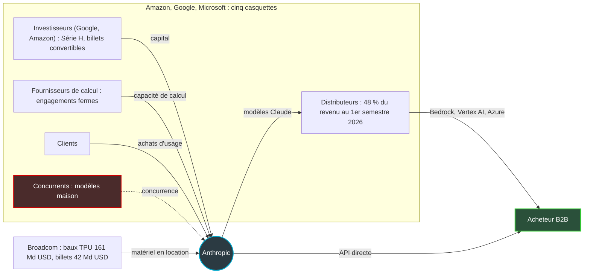
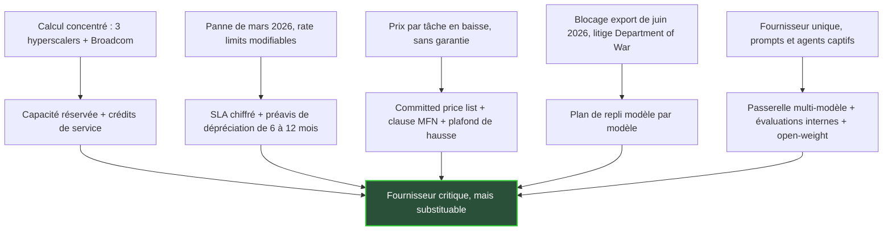

## Le jour où votre fournisseur d'IA a ouvert ses livres

Fin septembre 2025, un peu plus de 950 entreprises dépensaient plus de 100 000 dollars par an chez Anthropic. Un an plus tard, elles sont plus de 11 900, et plus de la moitié du Fortune 500 figure dans le lot. Claude n'est plus un outil qu'on teste dans un coin du service innovation. C'est une brique sur laquelle des directions informatiques, des enseignes de retail, des groupes hôteliers et des opérateurs réseau commencent à câbler leur support client, leur supervision et leurs outils internes.

Jusqu'ici, on achetait ce fournisseur à moitié à l'aveugle. On jugeait le modèle sur ses performances, rarement l'entreprise sur ses comptes. Lundi 26 octobre, cette époque s'est refermée. Anthropic a rendu public son prospectus d'introduction en Bourse, le formulaire S-1 que toute société doit déposer auprès du régulateur boursier américain avant de coter ses actions. Plus de trois cents pages de chiffres, de contrats et de facteurs de risque, dans un document qui engage la responsabilité de ses signataires.

Je l'ai lu avec la question d'un directeur des achats avant un contrat pluriannuel : ce fournisseur sera-t-il encore là dans trois ans, au même prix et avec la même qualité de service ?

La réponse est plus intéressante qu'un oui ou un non. Anthropic ne va pas faire faillite demain matin. Le vrai risque est ailleurs, et le prospectus le décrit lui-même avec une franchise rare.

## 80 milliards de perte, une exploitation presque à l'équilibre

Commençons par le chiffre qui a fait les titres : une perte nette de 80,7 Md USD sur le seul premier semestre 2026. Lu trop vite, il évoque une entreprise qui brûle sa trésorerie à un rythme intenable. Lu correctement, il dit presque l'inverse.

Sur ces 80,7 Md, 72,4 Md proviennent de la variation de juste valeur d'instruments financiers : billets convertibles, dérivés et SAFE, ces accords d'investissement convertibles en actions futures (S-1, p. 23). Le mécanisme est contre-intuitif. Quand la valorisation d'Anthropic grimpe, ce que la société doit à ces investisseurs grimpe aussi, et la comptabilité l'inscrit en charge. Les 8,8 Md d'autres charges nettes relèvent pour l'essentiel de la même logique. C'est le paradoxe du succès : plus l'action vaut cher, plus le compte de résultat saigne sur le papier.

L'exploitation raconte une autre histoire. La perte opérationnelle du semestre se limite à 693 M USD. Le deuxième trimestre affiche même le premier résultat d'exploitation positif des six trimestres présentés, à +974 M USD, malgré 1,26 Md de rémunération en actions. Les flux de trésorerie d'exploitation ressortent à +3,9 Md USD sur le semestre, contre −1,5 Md un an plus tôt (p. 169). Au 30 juin, la société disposait de 131,7 Md USD de trésorerie et de placements à court terme.

Ce redressement est porté par une croissance qui ressemble à une faute de frappe. Anthropic facturait 386 M USD sur toute l'année 2024, puis 4,6 Md en 2025. Le premier semestre 2026 atteint 16,3 Md, quatorze fois le premier semestre 2025, dont 11,6 Md sur le seul deuxième trimestre. Huit dollars sur dix viennent de la consommation à l'usage, facturée au token, l'unité de texte que traite le modèle (p. 139). Le revenu du troisième trimestre, lui, est laissé en blanc : les chiffres qui circulent dans la presse viennent de communications aux investisseurs, pas du prospectus.

Un indicateur mérite une lecture prudente : le taux de rétention nette du revenu (NRR, pour Net Revenue Retention), affiché autour de 900 % au 30 septembre. Concrètement, les clients présents il y a un an dépensent aujourd'hui, ensemble, neuf fois plus. Mais le S-1 retient comme client qualifié quiconque a généré au moins un dollar de revenu sur la période de référence, et exclut les abonnés individuels Pro et Max (p. 3). Avec un seuil aussi bas, en pleine explosion de l'usage, le chiffre est mécaniquement spectaculaire. Il n'a rien de comparable avec les 110 à 130 % dont s'enorgueillit un éditeur SaaS mature. Ce n'est pas un trucage. C'est une photo prise au décollage.

Premier verdict pour l'acheteur : le risque de défaillance à 12-24 mois est faible, et la qualité du revenu est réelle. Réelle ne veut pas dire durable.

*Deux colonnes, deux réalités : une exploitation qui s'équilibre, et des instruments financiers dont la revalorisation creuse la perte comptable.*

## Une compagnie aérienne qui commande ses avions avant de vendre les billets

Pour saisir le vrai profil de risque d'Anthropic, pensez à une compagnie aérienne. Elle commande ses avions des années avant de vendre le premier billet. Si la demande explose, elle surbooke, retarde, débarque des passagers. Si la demande fléchit, elle paie quand même les appareils, et les sièges vides deviennent des pertes.

Anthropic vit cette situation en accéléré. Le S-1 précise que la capacité de calcul est achetée « 12 to 18 months in advance » : les coûts sont largement fixes à court terme (p. 159). Au premier semestre 2026, la société a dépensé 8,9 Md USD en calcul et en infrastructure, davantage que sur toute l'année 2025. Le taux de remplissage, lui, s'est spectaculairement amélioré. Ces dépenses représentaient 251 % du revenu au premier trimestre 2025. Elles n'en pèsent plus que 48 % au deuxième trimestre 2026.

Le carnet de commandes d'avions, en revanche, a changé d'échelle. Au 30 juin 2026, les engagements de calcul fixes ou à minimum garanti atteignent environ 265,6 Md USD, sur des durées de 1 à 20 ans (note 13 des états financiers). Six mois plus tôt, ils étaient de 54,6 Md. S'y ajoutent des baux d'équipement signés avec Broadcom pour des TPU (Tensor Processing Units, les puces d'IA de Google), soit environ 161,2 Md USD de loyers hors intérêts sur cinq ans. Ces baux sont non résiliables hors défaut et garantis par la maison mère, avec des clauses de défaut croisé : un défaut ailleurs peut se propager à ces contrats.

Le détail par contrat, tiré du rapport de gestion (p. 171-172), montre que tout n'est pas verrouillé au même degré :

| Contrat | Montant (Md USD) | Horizon | Flexibilité |
|---|---|---|---|
| Google | ≈ 114,5 | avril 2026 → juillet 2033 | Dû quel que soit l'usage, régularisation si sous-consommation |
| Amazon | ≥ 110,0 | mai 2026 → avril 2036 | Dû quel que soit l'usage, régularisation si sous-consommation |
| Microsoft | ≥ 44,9 | nov. 2026 → mai 2033 | Dû quel que soit l'usage |
| SpaceXAI | jusqu'à 120,5 | jusqu'en 2029 | Résiliable sous 90 jours après des périodes initiales qui s'achèvent en janvier et mars 2027 |
| Nscale | ≈ 44,6 | jusqu'en 2033 | Facturé seulement à la livraison |
| Lambda | ≈ 41,3 | jusqu'en 2034 | Dont 34,9 résiliables si Lambda ne sécurise pas son bail |
| Broadcom (baux TPU) | ≈ 161,2 | 5 ans | Non résiliable hors défaut |

Pour les trois géants du cloud, que l'on appelle hyperscalers, le prospectus précise que les montants sont dus « regardless of actual usage ». Que les clients consomment ou non, la facture tombe.

Faut-il tout additionner ? La presse l'a fait. En sommant les six contrats nommés et les baux Broadcom, Yahoo Finance et The VC Corner arrivent à environ 637 Md USD. L'addition est juste, mais elle mélange du ferme, du résiliable et du payable à la livraison : c'est un plafond contractuel agrégé, pas une dette. Les 518 Md USD rapportés fin septembre par Reuters venaient, eux, du dossier confidentiel déposé avant le S-1, avec des montants différents contrat par contrat. Le prospectus public ne publie aucun total, et son tableau des obligations contractuelles est laissé en blanc (p. 170). Première leçon de due diligence : vérifier le périmètre d'un chiffre avant de le brandir.

Pour l'acheteur, les deux scénarios de la compagnie aérienne ont des conséquences directes. Si la demande accélère plus vite que la flotte, on surbooke. C'est ce qui s'est produit en mars 2026 : une interruption de service et des dégradations de performance que le S-1 attribue à une hausse rapide de la demande et à des contraintes de calcul, en prévenant que cela peut se reproduire (p. 82). Si la demande ralentit, ce que le prospectus juge possible, il faudra remplir des avions déjà payés. La guerre des prix qui s'ensuivrait arrangerait le client à court terme. Elle mettrait aussi la soutenabilité du fournisseur sous tension.

*Des centaines de milliards d'engagements de calcul, pour l'essentiel verrouillés : seuls quelques câbles peuvent encore être coupés.*

## Le centre commercial dont le propriétaire est aussi le concurrent

Deuxième image, pour la dépendance. Imaginez une boutique installée dans un centre commercial. Le propriétaire des murs lui loue ses mètres carrés, a pris une participation à son capital, encaisse une partie de ses ventes à ses propres caisses et exploite une enseigne concurrente deux allées plus loin. La boutique peut être florissante. Elle n'est pas maîtresse de son destin.

C'est, à peu de chose près, la relation d'Anthropic avec Amazon, Google et Microsoft. Les trois sont fournisseurs de calcul, avec les engagements décrits plus haut. Google et Amazon sont actionnaires, avec respectivement 10 et 5 Md USD apportés à la Série H de mai 2026. Des lignes de billets convertibles restent disponibles, sans aucun tirage à ce stade : jusqu'à 20 Md chez Google, 15 Md chez Amazon et 42 Md chez Broadcom, soit 77 Md USD (p. 166). Les hyperscalers sont aussi distributeurs. La part du revenu passant par leurs places de marché est passée de 11 % en 2023 à 48 % au premier semestre 2026, et ces canaux portent 58 % des créances clients. Ils sont enfin clients, et ils développent leurs propres modèles.

*Amazon, Google et Microsoft entourent Anthropic de plusieurs rôles à la fois. Que l'acheteur passe par une place de marché cloud ou par l'API directe, il repose sur le même socle de calcul.*

Le prospectus ne maquille pas cette ambiguïté. On y lit que ces relations « give them visibility into our pricing and commercial terms across the platforms they operate », et que prix, engagements de calcul et niveaux de service se renégocient à chaque renouvellement. Anthropic dit vouloir réduire cette dépendance grâce à des datacenters dédiés, tout en reconnaissant que « Migrating workloads to alternative providers would be costly, time-consuming, and operationally complex » (p. 74-75).

Relisez cette dernière citation à l'envers. Si Anthropic, avec plus de 130 Md USD en banque, juge coûteux et complexe de déplacer ses charges de calcul, que dire de l'entreprise cliente qui a branché ses agents, ses prompts et ses workflows sur Claude ?

Une idée reçue à corriger au passage. Acheter Claude via Amazon Bedrock, Google Vertex AI ou Microsoft Azure plutôt qu'en direct ne diversifie pas le risque. Le canal change la facturation, le support et la protection contractuelle. Il ne change pas la capacité de calcul sous-jacente, qui repose sur le même socle et les mêmes engagements. Diversifier, c'est changer de modèle, pas de guichet.

Côté clients, la concentration reste modérée : aucun ne dépasse 10 % du revenu sur les neuf premiers mois de 2026, et les cinq premiers en pèsent environ un quart. Le S-1 admet que beaucoup de grands comptes n'ont pas de contrat de long terme et peuvent réduire leurs dépenses à tout moment (p. 57). Le carnet de commandes contractuel ne dépasse d'ailleurs pas 10,8 Md USD au 30 juin. Personne n'est enfermé chez Anthropic par contrat. Fragilité pour le vendeur, liberté pour l'acheteur, à condition de ne pas la perdre dans le code.

## Le prospectus rédige votre liste de clauses

Le paradoxe de ce document, c'est qu'il écrit à votre place la liste des protections à exiger. Chaque risque qu'Anthropic doit déclarer à ses futurs actionnaires, vous le portez aussi, sans la protection d'un prospectus.

En juin 2026, deux modèles ont cessé d'être accessibles à tous les clients d'Anthropic, partout dans le monde. Ni bug ni faillite : le Department of Commerce américain venait d'imposer des restrictions mondiales à l'export sur Fable 5 et Mythos 5. Anthropic les a désactivés pour « all of our customers » jusqu'à la levée des restrictions, sans toucher aux autres modèles (p. 100). Le précédent est posé. Un interrupteur réglementaire existe, et il peut éteindre un modèle en production.

Le front politique est tout aussi concret. Le litige avec le Department of War remonte à février 2026 : un ordre présidentiel exige alors l'arrêt de l'utilisation de sa technologie, et Anthropic est désigné comme un risque pour la chaîne d'approvisionnement de la sécurité nationale. Un tribunal fédéral de Californie du Nord a largement donné raison à Anthropic le 27 août. Le 25 septembre, la cour d'appel du circuit de D.C. a pourtant validé la désignation, par deux voix contre une, et un réexamen en formation plénière est demandé (p. 72-73). Pour qui vend à l'administration américaine ou à sa chaîne de défense, c'est un sujet de conformité immédiat.

Côté exploitation, Anthropic indique avoir modifié, et pouvoir modifier encore, les limites d'usage, les rate limits (plafonds de requêtes par unité de temps) et les capacités de ses modèles. Une dépréciation forcée d'anciens modèles peut provoquer des litiges, et des considérations de sécurité peuvent à l'inverse retarder le retrait d'un modèle (p. 30). Votre feuille de route applicative dépend d'un calendrier que vous ne contrôlez pas.

Côté prix, la tendance joue pour l'acheteur. Avec Fable 5.1, lancé en septembre, le coût d'une charge de travail typique baisse d'environ 25 % par rapport à Fable 5, et jusqu'à 45 % sur le code et les tâches agentiques. Opus 5.5 coûte environ 40 % de moins par tâche qu'Opus 5 (p. 196). Mais aucune de ces baisses n'est garantie, et le S-1 cite lui-même la pression sur les prix parmi ses risques. Les clients engagés sur un minimum de dépense bénéficient, eux, d'une « committed price list » (p. 139).

Reste la confidentialité. Le prospectus mentionne une politique de « zero data retention », sans conservation des données, sur Fable 5 et 5.1 pour les clients éligibles. Il cite le RGPD, la directive NIS2 et l'AI Act européen parmi les cadres applicables (p. 204). Aucune garantie de résidence des données dans l'Union européenne n'apparaît à la lecture. Elle doit donc être demandée par écrit.

Mis bout à bout, ces aveux dessinent la liste des clauses à négocier avant le prochain renouvellement :

- **Disponibilité chiffrée et crédits de service.** Le S-1 ne publie aucun SLA (Service Level Agreement, l'engagement de niveau de service) : à vous de l'obtenir.
- **Capacité réservée.** Des quotas garantis, pour ne pas être le passager débarqué au prochain surbooking.
- **Préavis de dépréciation** d'au moins 6 à 12 mois avant le retrait d'un modèle utilisé en production.
- **Notification d'incident** dans des délais compatibles avec vos propres obligations NIS2 et RGPD.
- **Prix encadrés** : committed price list, clause du client le plus favorisé (MFN, pour most favoured nation) qui répercute automatiquement les baisses, plafond d'augmentation.
- **Résidence des données et sortie** : localisation contractuelle des traitements, clause de sortie, réversibilité.

*Cinq risques admis par le S-1, cinq parades contractuelles ou techniques. L'objectif n'est pas de quitter le fournisseur, mais de pouvoir le faire.*

Dernier avertissement, sur le pari inverse. Un engagement minimum de dépense, c'est le contrat de la compagnie aérienne vu du passager : vous payez des sièges que vous n'occuperez peut-être pas. Chez un fournisseur dont le catalogue change tous les trimestres, cet engagement doit rester court, révisable et indexé sur des usages que vous maîtrisez.

## Multi-modèle : la double adduction de l'IA

Tout opérateur réseau connaît la règle. On ne raccorde pas un site critique avec une seule fibre, non parce que le fournisseur est mauvais, mais parce qu'une pelleteuse finit toujours par passer. Personne ne qualifie la double adduction de surcoût : c'est le prix de la disponibilité.

L'IA en production mérite le même traitement, et le S-1 en fournit l'argument. Parlant de ses propres clients, Anthropic note que « customers who have integrated older models... may resist migration ». Le fournisseur le constate quand il veut faire monter ses clients de version. L'acheteur le vivra le jour où il voudra changer de fournisseur. Le verrou ne vient pas du contrat, il vient du code : prompts optimisés pour un modèle, agents qui dépendent de ses particularités, mémoire et outils stockés dans un format maison.

L'architecture que je recommande tient en six briques :

- **Une passerelle d'abstraction** : une API unique devant tous les modèles, qui route chaque requête et permet de basculer sans toucher aux applications.
- **Des prompts versionnés comme du code**, rejoués sur chaque modèle candidat à chaque modification.
- **Un jeu d'évaluations maison** construit sur des cas réels : tri des tickets de support, aide au diagnostic en centre de supervision réseau, rédaction de configurations d'équipements. C'est le seul moyen de savoir en quelques heures si un modèle de remplacement fait le travail.
- **Un second fournisseur qualifié**, exercé en production sur une fraction du trafic, pas seulement référencé dans un tableur.
- **Un modèle open-weight en dernier recours** (poids publiés, exécutable sur votre propre infrastructure) pour les fonctions vitales.
- **La réversibilité des agents** : journaux, mémoire et définitions d'outils dans des formats ouverts, exportables à tout moment.

Ce n'est pas gratuit. Une passerelle et un jeu d'évaluations, ce sont quelques semaines d'ingénierie puis un coût de maintenance permanent. Mais c'est aussi ce qui permet de capter la déflation. Quand un modèle devient 40 % moins cher par tâche, celui qui peut basculer en une journée encaisse la baisse. Celui qui doit réécrire ses agents attend le trimestre suivant.

*Une passerelle multi-modèle : quand un modèle s'éteint, un autre prend le relais sans que les applications s'en aperçoivent.*

## Ma position : solvable, critique, donc à rendre substituable

Reste la gouvernance, souvent traitée comme une curiosité juridique. Anthropic est une public benefit corporation, une société à mission de droit du Delaware. Une action unique de classe F, détenue par une structure regroupant les sept cofondateurs, porte 50,1 % des droits de vote sur les sujets généraux, sans aucun droit économique.

Le Long-Term Benefit Trust élit de son côté, via les actions de classe T, des administrateurs qui forment la majorité du conseil. Pour un acheteur, c'est un facteur de prévisibilité : la stratégie centrée sur la sécurité ne sera pas renversée par un trimestre boursier décevant. Ce n'est pas une garantie commerciale pour autant. Cette indépendance permet aussi de refuser certains usages, et elle expose la société à des chocs politiques comme celui de cette année.

Ma lecture du S-1 tient en trois constats. Anthropic est solvable à l'horizon de vos contrats actuels : 131,7 Md USD de liquidités et un flux de trésorerie d'exploitation positif écartent le scénario de la faillite à 12-24 mois. Sa soutenabilité au-delà dépend d'une demande qui doit continuer à croître très vite, de trois hyperscalers qui sont à la fois ses fournisseurs, ses distributeurs et ses concurrents, et d'un environnement réglementaire qui a déjà éteint des modèles en production. Enfin, son statut de standard de fait en entreprise ne dilue pas ce risque. Il le concentre sur tout le monde en même temps.

Ma recommandation est donc nette. Continuez d'acheter Claude si vos évaluations le justifient. Mais achetez-le comme on achète un lien de transit ou l'alimentation électrique d'un datacenter : avec un contrat qui chiffre la disponibilité, un second fournisseur câblé et testé, et une sortie de secours qu'on a déjà empruntée au moins une fois.

Le S-1 n'est pas un signal d'alarme. C'est un cahier des charges.

---

_Vues personnelles, pas position Wifirst._

## Sources

1. SEC EDGAR — Anthropic, PBC, Form S-1 (document principal), déposé le 26 octobre 2026 : https://www.sec.gov/Archives/edgar/data/2130357/000162828026067168/anthropicpbc-sx1.htm
2. SEC EDGAR — Index du dépôt, accession 0001628280-26-067168 : https://www.sec.gov/Archives/edgar/data/2130357/000162828026067168/0001628280-26-067168-index.htm
3. The VC Corner — Anthropic S-1: IPO Filing, ANT Ticker, Revenue and Losses : https://www.thevccorner.com/p/anthropic-s1-ipo-filing
4. Yahoo Finance (Daniel Howley) — Anthropic publicly files IPO prospectus, noting strong revenue growth and massive spending, 26 octobre 2026 : https://finance.yahoo.com/technology/article/anthropic-publicly-files-ipo-prospectus-noting-strong-revenue-growth-and-massive-spending-131807138.html
5. Reuters via The Star — Anthropic IPO prospectus lays bare deep dependence on Big Tech partners, 30 septembre 2026 (sur le dossier confidentiel) : https://www.thestar.com.my/tech/tech-news/2026/09/30/exclusive-anthropic-ipo-prospectus-lays-bare-deep-dependence-on-big-tech-partners
6. Reuters via DealStreetAsia — Anthropic's 518B USD AI buildout hinges largely on deals that cannot be cancelled, 29 septembre 2026 (sur le dossier confidentiel) : https://www.dealstreetasia.com/stories/anthropics-518b-ai-buildout-hinges-largely-on-deals-that-cannot-be-cancelled-496620
