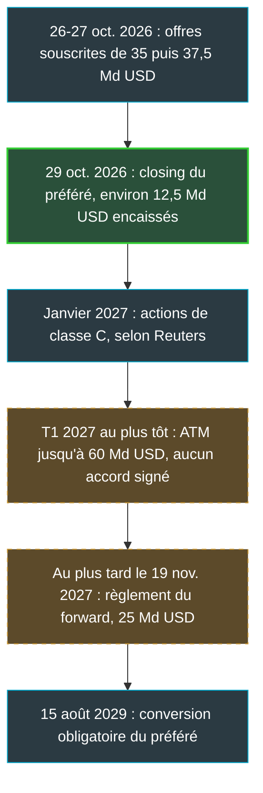
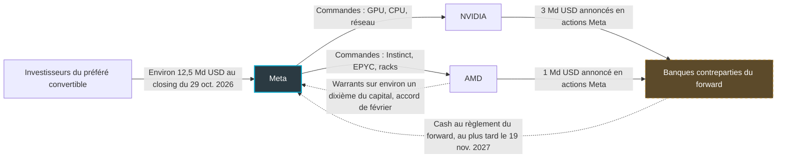
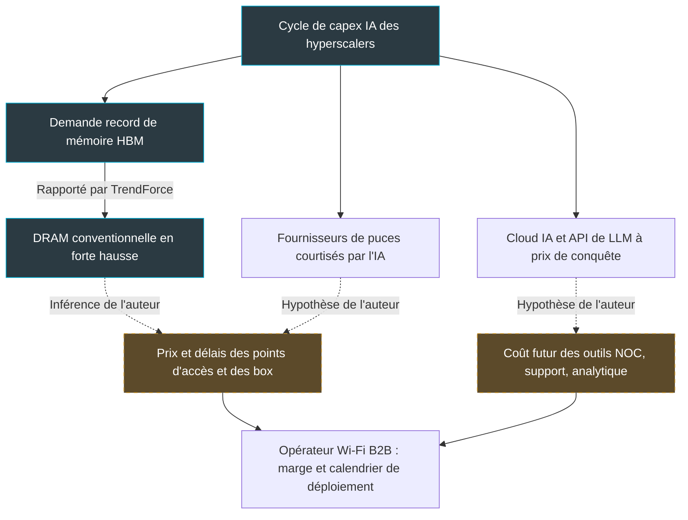

## Le jour où vos fournisseurs veulent aussi votre capital

Imaginez que votre principal fournisseur de serveurs vous appelle un lundi matin avec deux nouvelles. La première : vous allez lui commander davantage de matériel. La seconde : il compte acheter des actions de votre entreprise, au même prix que n'importe quel investisseur.

C'est, à quelques nuances près, ce qui s'est joué chez Meta les 26 et 27 octobre. Le groupe de Mark Zuckerberg a dévoilé un plan de financement par actions qui peut atteindre, après relèvement, 97,5 milliards de dollars. NVIDIA a annoncé qu'il y investirait 3 milliards, AMD 1 milliard. Les mêmes communiqués évoquent l'extension de leurs déploiements chez Meta.

Le contexte explique la manœuvre. Au troisième trimestre, le flux de trésorerie disponible de Meta est passé dans le rouge, à −2,12 milliards de dollars : une première depuis plus de dix ans, selon Reuters. Ses dépenses d'investissement (capex) pour 2026 sont attendues entre 135 et 145 Md USD. Et Meta n'est pas seul : Alphabet avait relevé ses propres offres d'actions à 84,75 milliards en juin.

Les titres ont parlé d'une levée de fonds de Meta avec NVIDIA et AMD. La formule est commode. Elle est fausse sur deux points : l'essentiel de l'argent n'est pas encaissé, et les fournisseurs ne prêtent rien. Ce qui se joue est plus subtil, et bien plus instructif pour un CTO qui achète du matériel, du cloud ou des API d'IA : une boucle où client, fournisseurs et cours de Bourse finissent par respirer au même rythme.

## Annoncé, signé, encaissé : trois mots à ne pas confondre

Un lecteur pressé retiendra que NVIDIA a fait un chèque de 3 Md USD à Meta. Aucun document public ne dit cela.

Trois niveaux d'information se superposent : ce que Meta a déposé auprès de la SEC (le gendarme boursier américain), ce que la presse a rapporté, et ce que personne n'a documenté.

La nuance décisive tient à un temps de conjugaison. NVIDIA et AMD écrivent au futur : ils investiront (« will invest ») respectivement 3 et 1 Md USD dans l'offre. Meta, lui, évoque des indications d'intérêt de NVIDIA, d'AMD et de Broadcom, pour un maximum cumulé de 5 Md USD. Ses documents d'offre précisent qu'il ne s'agit pas d'engagements fermes (« not binding agreements or commitments to purchase ») : chacun peut acheter plus, moins, ou rien du tout. Le formulaire 8-K signé le 29 octobre, qui documente les accords de l'opération, ne nomme aucun des trois.

Deuxième point, rarement relevé : aucune faveur tarifaire n'est documentée. Meta prévoit pour ces acheteurs le même prix et les mêmes conditions que pour tous les autres (« at the same price and on the same terms »). L'offre a été fixée à 625 USD par action, contre une clôture à 630,56 USD le lundi selon Reuters. La décote, inférieure à 1 % (calcul), est banale pour une offre souscrite.

Voici la grille que j'utilise pour ne pas mélanger les genres.

| Ce qu'on lit | Statut | Sources |
|---|---|---|
| 25 Md USD d'actions ordinaires à 625 USD, via des contrats de vente à terme | Confirmé | 3, 5, 6 |
| Environ 12,5 Md USD d'actions de préférence convertibles à 6,50 %, clôturées le 29 octobre | Confirmé (montant calculé : 250 M de titres à 50 USD) | 3, 5 |
| Programme de vente au fil de l'eau jusqu'à 60 Md USD, sans accord signé, pas avant le 1er trimestre 2027 | Confirmé | 3 |
| NVIDIA investira 3 Md USD, AMD 1 Md USD | Confirmé par les fournisseurs, au futur | 1, 2 |
| Intérêt non contraignant de NVIDIA, AMD et Broadcom, jusqu'à 5 Md USD cumulés | Confirmé par Meta | 3, 4 |
| Fonds destinés à l'infrastructure IA | Rapporté (Meta écrit « general corporate purposes ») | 3, 7 |
| Total de 97,5 Md USD | Calculé, rapporté par Reuters | 7 |
| Flux de trésorerie disponible négatif au 3e trimestre, capex 2026 de 135 à 145 Md USD | Rapporté | 7, 12 |
| Accord Meta-AMD de février : jusqu'à 6 GW et des warrants sur environ 10 % d'AMD | Rapporté | 10 |
| Total proche de 98 Md USD | Non vérifié | 9 |
| Montant effectivement acheté par NVIDIA et AMD | Non documenté publiquement | — |
| Participation réelle de Broadcom | Aucune annonce trouvée | — |

*Deux flux, une seule boucle : le client achète du silicium, ses fournisseurs annoncent acheter ses actions.*

## Un plan, pas un chèque

Le mot « levée » évoque un virement. La réalité ressemble davantage à un échéancier, en trois étages.

**Premier étage : 25 Md USD d'actions ordinaires, payables plus tard.** L'opération repose sur des contrats de vente à terme (forward sale agreements, d'où le raccourci « forward »). Les banques vendent dès maintenant aux investisseurs des actions Meta qu'elles ont empruntées. Meta leur livrera plus tard des actions nouvelles, et encaissera le prix à ce moment-là.

Pensez à un bon de commande signé dont vous choisiriez vous-même la date de livraison, donc la date de paiement. Meta peut régler ce contrat quand il le souhaite, au plus tard le 19 novembre 2027, à un prix initial d'environ 622,92 USD par action, ajusté au fil du temps. Le communiqué de lancement ne laisse aucune ambiguïté : Meta « does not expect to initially receive any proceeds ». Au 30 octobre 2026, ces 25 Md USD sont une rentrée future, pas du cash.

**Deuxième étage : environ 12,5 Md USD de cash, mais un cash qui coûte.** Ce sont des actions de préférence convertibles obligatoires, rémunérées 6,50 % par an et clôturées (closing) le 29 octobre. C'est le seul argent réellement en caisse aujourd'hui. Son coût annuel avoisine 0,81 Md USD de dividendes (calcul). Le 15 août 2029, chaque action de préférence (1 000 USD de valeur de liquidation, soit l'équivalent de vingt titres à 50 USD) se convertira en 1,3620 à 1,6000 action ordinaire. Les bornes tombent donc à 625 et environ 734 USD par action (calcul). Sous 625 USD, le prix de l'offre, Meta livre le maximum d'actions. Au-dessus de 734 USD, il livre le minimum. Plus le cours monte d'ici là, moins Meta dilue ses actionnaires.

**Troisième étage : 60 Md USD qui n'existent pas encore.** Il s'agit d'un programme dit at-the-market (ATM) : la faculté de vendre des actions au fil de l'eau, directement sur le marché. Meta indique n'avoir signé aucun accord à ce stade et ne prévoit pas de démarrage avant le premier trimestre 2027. Le programme est lié à la création d'actions de classe C, sans droit de vote. Selon Reuters, elles seront émises en janvier 2027, l'équivalent d'une division d'action à deux pour un.

*En vert, le seul cash encaissé ; en pointillés, ce qui reste promis ou hypothétique.*

Reste l'addition. 22,5 + 12,5 + 60 donnent les 95 Md USD annoncés le lundi. Le relèvement de la tranche ordinaire à 25 Md USD porte le total à 97,5 Md USD, le chiffre de Reuters. Le total de près de 98 Md USD aperçu ailleurs ne se reconstitue pas.

Le ratio qui compte tient en une ligne. Sur 97,5 Md USD affichés, environ 12,5 sont en caisse, soit à peine 13 % (calcul). Les 25 Md USD du forward sont signés mais pas encaissés. Et 61,5 % du total dépendent d'un programme sans accord, adossé à une fenêtre de marché qui n'est pas encore ouverte.

*Les premières marches sont solides, les suivantes se perdent dans le brouillard : l'essentiel du plan reste à encaisser.*

## Une cordée, pas une combine

Une cordée d'alpinistes est plus sûre qu'un grimpeur seul, tant que personne ne glisse. Le jour où l'un dévisse, la corde transmet la chute aux autres. C'est la bonne image pour le montage Meta-NVIDIA-AMD. Il n'y a ni triche ni subvention cachée. Il y a une corde.

Les faits plaident contre la lecture « subvention croisée ». Le prix est celui du marché. Les montants sont modestes : 3 + 1 = 4 Md USD, soit 16 % de la tranche d'actions ordinaires et 4,1 % du plan total (calcul). Sur le plafond de 5 Md USD mentionné par Meta, 1 Md USD n'est attribué publiquement à personne, et Broadcom n'a rien annoncé. Enfin, aucun document publié à ce jour, à ma connaissance, ne lie ces achats d'actions à un contrat de commandes.

Mais la boucle existe. Meta commande des GPU (processeurs graphiques) et des CPU (processeurs centraux), qui gonflent le chiffre d'affaires de NVIDIA et d'AMD. Ces derniers annoncent acheter des actions Meta, ce qui soutient le financement de Meta, lequel paie de nouvelles commandes. Un détail de tuyauterie mérite d'être noté. Si ces achats passent par la tranche à terme, leur cash va d'abord aux banques, et Meta ne le touchera qu'au règlement du forward. C'est ma lecture de la mécanique, pas une information publiée.

Le cas AMD tend la corde dans les deux sens. Selon The Daily Upside, les deux groupes avaient signé en février 2026 un accord portant sur jusqu'à 6 GW de capacité de calcul, mesurée en puissance électrique. Il était assorti de bons de souscription (warrants) donnant droit à environ 10 % du capital d'AMD, à un centime l'action. Leur acquisition complète supposait que le titre AMD atteigne 600 USD, contre 213 USD ce jour-là. La valeur totale de cet accord varie selon les sources : je ne la reprends pas. Retenez la structure : Meta pourrait devenir actionnaire de son fournisseur, qui annonce devenir actionnaire de Meta.

*Flux annoncés ou documentés. Le passage du cash de NVIDIA et d'AMD par les banques est une lecture de l'auteur ; les warrants relèvent de l'accord de février, rapporté par la presse.*

### Deux fournisseurs plutôt qu'un

The Daily Upside lisait déjà l'accord de février comme une couverture (hedge) de Mark Zuckerberg. Les communiqués d'octobre dessinent, à mon sens, une stratégie de double source assumée.

Côté NVIDIA, Meta « intends to expand » son parc, avec les futures plateformes Vera Rubin, et déploiera les commutateurs Ethernet Spectrum-X et les cartes réseau BlueField-4. Aucun volume, aucun calendrier, aucune valeur contractuelle ne sont publiés.

Côté AMD, des racks complets sont installés et en test chez Meta. Des millions de processeurs EPYC tournent déjà dans ses datacenters, des accélérateurs Instinct sont en production, et une version personnalisée est annoncée. Surtout, les modèles ouverts de la famille Muse de Meta sont supportés dès leur sortie sur matériel AMD.

La logique est celle de tout acheteur sérieux : ne jamais dépendre d'une seule source critique. Le paradoxe tient au tour de table. Cette diversification se déroule avec un ticket, symbolique mais public, des deux fournisseurs mis en concurrence. Chacun y trouve son compte. NVIDIA protège un client majeur, AMD consolide sa place de seconde source, Meta sécurise ses approvisionnements et un peu de capital.

Tout le monde gagne tant que la demande d'IA grimpe. Si elle ralentit, les trois glissent ensemble : moins de commandes, des participations qui se déprécient, une fenêtre de marché qui se ferme pour l'ATM. Meta n'est pas aux abois, avec 82,45 Md USD de trésorerie et placements au 30 septembre pour 80,92 Md USD de dette à long terme, selon Reuters. Mais l'agence évoque aussi environ 825 Md USD d'engagements futurs, sans en détailler le périmètre. Un analyste de William Blair, cité par Reuters, s'attend à ce que les investisseurs continuent d'interroger ce financement et la perspective de nouveaux appels au marché. Je partage ce doute.

## Le miroir, vu d'un couloir d'hôtel

Wifirst n'achète pas de Vera Rubin. Nos dépendances critiques s'appellent puces Wi-Fi, mémoire, firmware, contrôleurs cloud et, de plus en plus, API de grands modèles de langage (LLM). Ce dossier nous concerne pourtant, pour une raison simple : la vague de capex IA se propage le long des chaînes d'approvisionnement, jusqu'au point d'accès vissé au plafond d'un couloir d'hôtel.

**Premier canal, la mémoire.** Les accélérateurs IA consomment de la mémoire à haute bande passante (HBM) en quantités record, et les fabricants de mémoire arbitrent leurs lignes de production en sa faveur. Selon les estimations de TrendForce, les prix de la DRAM conventionnelle, la mémoire vive standard, ont bondi de 93 à 98 % d'un trimestre sur l'autre au premier trimestre 2026. TrendForce prévoyait ensuite 58 à 63 % au deuxième, puis 13 à 18 % au troisième (prévision de juillet, trimestre désormais clos). C'est ce type de mémoire qu'embarquent les points d'accès et les box.

Que ce surcoût remonte jusqu'au prix et aux délais d'un point d'accès Wi-Fi, c'est une inférence de ma part. Je n'ai trouvé aucune source publique qui le chiffre pour cette catégorie d'équipement. Je préfère pourtant le traiter comme un risque probable plutôt que de le découvrir sur une facture.

*Derrière chaque point d'accès au plafond, une chaîne de dépendances qui remonte jusqu'aux usines de mémoire et aux datacenters IA.*

**Deuxième canal, le silicium Wi-Fi.** Broadcom figure parmi les trois investisseurs pressentis de Meta. C'est aussi, de notoriété sectorielle, l'un des grands fournisseurs de puces pour points d'accès et box. Je n'affirme aucun lien de cause à effet, et Broadcom n'a rien annoncé. Ce qui suit est une réflexion personnelle, pas une information. Un fournisseur dont l'IA devient le relais de croissance arbitrera tôt ou tard ses ingénieurs, ses réservations chez les fondeurs et sa feuille de route entre les géants du cloud (hyperscalers) et ses clients réseau. Cette question a sa place dans nos revues fournisseurs.

**Troisième canal, le cloud et les LLM.** Meta étudierait la revente de sa capacité de calcul excédentaire, selon Techzine, et publie des modèles Muse ouverts supportés d'emblée sur accélérateurs AMD. Pour un opérateur qui injecte de l'IA dans son centre de supervision réseau (NOC), son support ou son analytique, c'est un levier. Des poids ouverts qui tournent sur plusieurs familles de puces offrent un argument de négociation et une porte de sortie. À l'inverse, une API vendue à prix de conquête par un acteur en croissance forcée affiche un prix qui peut se retourner avec le cycle.

*Grille de lecture de l'auteur : en traits pleins les faits rapportés, en pointillés les inférences et hypothèses, à confronter à vos propres contrats.*

**Le cycle, enfin.** Hypothèse, pas prévision : si la fenêtre de marché se refermait avant le premier trimestre 2027, l'ATM resterait lettre morte et les commandes des hyperscalers pourraient ralentir. Le retournement ne serait pas uniforme. La mémoire pourrait se détendre, tandis que les offres d'IA à prix de conquête seraient revues à la hausse et que les feuilles de route des fournisseurs les plus exposés seraient rabotées. Ceux qui auront pris les tarifs de l'euphorie pour une base durable paieront la correction.

## Six contrôles avant que le cycle ne tourne

Rien de tout cela n'appelle la panique. Cela appelle de l'hygiène. Voici les six contrôles que je considère comme le minimum, quelle que soit la taille de l'opérateur.

1. **Cartographier les dix dépendances critiques**, couche par couche : radio, mémoire, firmware, contrôleur cloud, transit, IA. Pour chacune, noter qui possède qui. Deux fournisseurs liés par le capital ne font pas deux sources indépendantes.
2. **Mesurer la part du premier fournisseur par couche.** Au-delà des deux tiers, je traite la couche comme mono-source de fait, quel que soit le nombre de références au catalogue.
3. **Relire les clauses de prix et d'indexation.** Qui porte une hausse de la mémoire ? Sur quel indice ? Avec quel préavis ?
4. **Qualifier une vraie double source.** Une seconde référence jamais testée en production n'est pas une double source. C'est une ligne dans un tableur.
5. **Documenter un plan de sortie** pour chaque couche critique : délai, coût, compétences. Pour l'IA, ajouter la capacité à faire tourner des poids ouverts sur un autre matériel.
6. **Suivre des indicateurs plutôt que des convictions** : délais et prix contractuels de la DRAM, nouvelles émissions d'actions ou de dette chez les fournisseurs, avertissements sur résultats.

Côté Meta, quatre échéances diront si la corde tient :

- **Janvier 2027** : émission des actions de classe C, annoncée par Reuters.
- **Premier trimestre 2027** : démarrage effectif, ou non, de l'ATM de 60 Md USD, et signature des accords bancaires qui lui manquent.
- **D'ici le 19 novembre 2027** : règlement du forward de 25 Md USD. Le moment choisi par Meta en dira long sur sa propre lecture du cours.
- **Les prochains rapports de NVIDIA et d'AMD** : ils permettront peut-être de savoir si les 4 Md USD annoncés ont été investis, et à quelles conditions.

## La bonne question n'est pas « bulle ou pas »

Je ne sais pas si l'IA est une bulle. Personne ne le sait, et ceux qui l'affirment dans un sens ou dans l'autre ont généralement quelque chose à vendre.

Ce que je sais, c'est que le montage de Meta est propre sur la forme et révélateur sur le fond. Propre, parce que le prix est celui du marché, les montants modestes et les documents publics. Révélateur, parce que l'un des plus gros acheteurs de puces IA de la planète se tourne vers le marché actions au moment où son capex dépasse sa génération de cash, avec ses fournisseurs annoncés au tour de table. Et l'essentiel de l'argent reste à venir.

Pour un CTO, la seule question utile est donc : quel est mon coefficient de corrélation fournisseurs ? Si mes puces, ma mémoire et mon cloud dépendent tous du même cycle, j'ai trois contrats et un seul risque. Je préfère le découvrir maintenant, en revue fournisseurs, plutôt qu'au moment où la corde se tend.

Revenez à l'appel du lundi matin. Le fournisseur qui veut entrer à votre capital n'est pas un problème en soi. Le problème, c'est de ne pas savoir à qui d'autre il est encordé.

---

_Vues personnelles, pas position Wifirst._

## Sources

1. NVIDIA Newsroom, « NVIDIA and Meta to Expand Collaboration on Muse and Muse Family of Models Amid Robust Growth », 26 octobre 2026 : https://nvidianews.nvidia.com/news/nvidia-and-meta-to-expand-collaboration-on-muse-and-muse-family-of-models-amid-robust-growth
2. AMD Investor Relations, « AMD and Meta Advance Strategic Partnership to Power Meta's Superintelligence Infrastructure », 27 octobre 2026 : https://ir.amd.com/news-events/press-releases/detail/1302/amd-and-meta-advance-strategic-partnership-to-power-meta-superintelligence-infrastructure
3. Meta Investor Relations, communiqué de lancement des offres (actions de préférence convertibles obligatoires et actions de classe A avec contrats de vente à terme), 26 octobre 2026 : https://investor.atmeta.com/investor-news/press-release-details/2026/Meta-Announces-Launch-of-Offering-of-Depositary-Shares-Representing-Series-A-Mandatory-Convertible-Preferred-Stock-and-Offering-of-Class-A-Common-Stock-in-Connection-with-Forward-Sale-Agreements/
4. SEC, Meta Platforms, Free Writing Prospectus (Rule 433), 26 octobre 2026 : https://www.sec.gov/Archives/edgar/data/0001326801/000119312526431036/d116268dfwp.htm
5. SEC, Meta Platforms, formulaire 8-K, signé le 29 octobre 2026 : https://www.sec.gov/Archives/edgar/data/0001326801/000119312526438017/d183592d8k.htm
6. Meta Investor Relations, communiqué de fixation du prix des offres, octobre 2026 : https://investor.atmeta.com/investor-news/press-release-details/2026/Meta-Announces-Pricing-of-Offering-of-Depositary-Shares-Representing-Series-A-Mandatory-Convertible-Preferred-Stock-and-Offering-of-Class-A-Common-Stock-in-Connection-with-Forward-Sale-Agreements/default.aspx
7. Reuters, republié par The Manila Times, 29 octobre 2026 : https://www.manilatimes.net/2026/10/29/business/foreign-business/meta-increases-equity-offerings-to-975-billion/2456518
8. Techzine (Erik van Klinken), 27 octobre 2026 : https://www.techzine.eu/news/applications/145303/nvidia-invests-3-billion-in-meta-deepens-muse-partnership/
9. Tech-Insider, 27 octobre 2026 : https://tech-insider.org/meta-97-5-billion-equity-raise-ai-infrastructure-2026/
10. The Daily Upside, 25 février 2026 : https://www.thedailyupside.com/technology/artificial-intelligence/amd-pops-on-meta-deal-that-squares-with-ai-sectors-circular-chumminess/
11. CNBC, 27 octobre 2026 : https://www.cnbc.com/2026/10/27/nvidia-invest-meta.html
12. Let's Data Science, résultats du troisième trimestre de Meta, octobre 2026 : https://letsdatascience.com/news/meta-narrows-2026-capital-spending-range-to-135-billion-145-46f12e07
13. TrendForce, communiqués du 1er juin 2026 (T1 réalisé, T2 prévu) et du 3 juillet 2026 (T3 prévu) : https://www.trendforce.com/presscenter/news/20260601-13070.html et https://www.trendforce.com/presscenter/news/20260703-13134.html
