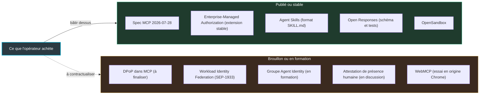
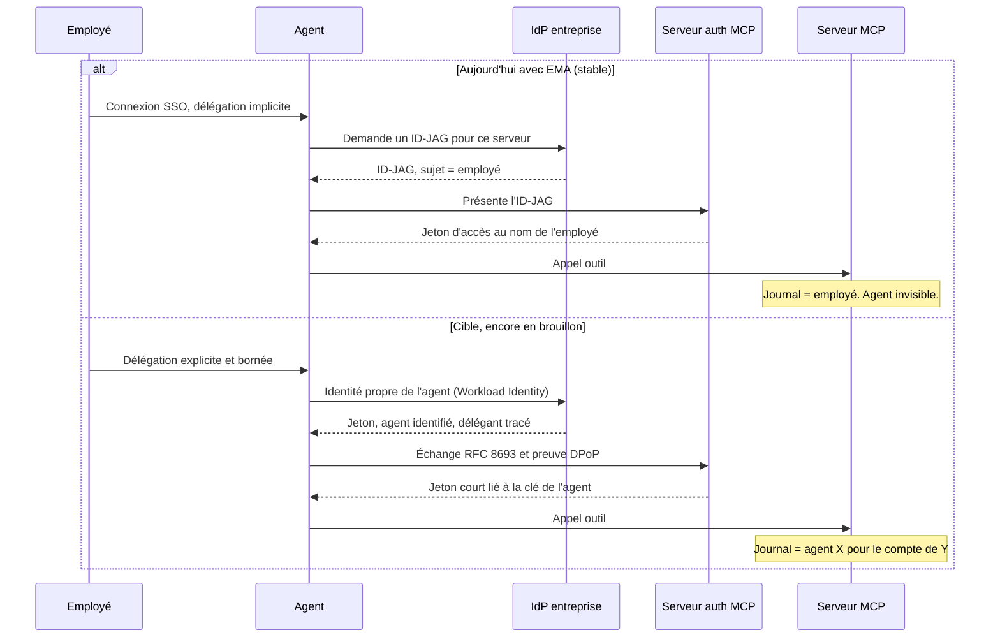
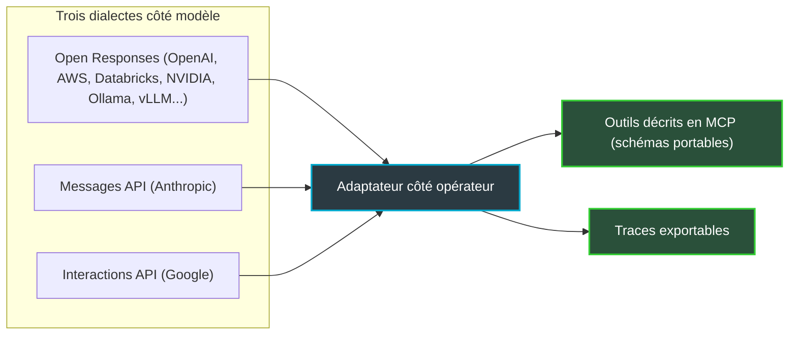

## Le journal d'incident ne connaît qu'un seul nom

Prenez un groupe hôtelier de quarante établissements. Un vendredi soir, son agent de support, une IA qui traite les tickets remontés par les réceptions, décide de réinitialiser le portail Wi-Fi d'un hôtel pour débloquer un client. Le portail redémarre. Deux cents chambres perdent la connexion pendant dix minutes, en plein pic d'arrivées. Le lendemain, l'exploitant ouvre le journal pour comprendre. Il y trouve un nom : pas celui de l'agent, mais celui de Julie, technicienne support, dont l'agent empruntait les droits depuis trois semaines.

Le scénario est fictif. Il n'a pourtant rien d'exotique : c'est ainsi que beaucoup d'agents se branchent aujourd'hui sur les outils d'une entreprise, avec les droits d'un humain prêtés à une machine. Pour qui exploite des milliers de sites en hôtellerie, en retail ou en résidence, c'est une affaire d'audit, de responsabilité contractuelle et, très vite, de conformité.

Pourquoi maintenant ? Les 22 et 23 octobre, à San Jose, les conférences AGNTCon et MCPCon ont servi de vitrine à l'Agentic AI Foundation (AAIF), la fondation adossée à la Linux Foundation qui accueille les standards agentiques. Quatre projets de plus ont reçu son tampon. Formats, schémas, bacs à sable : tout cela se fige vite. La couche qui dirait qui est l'agent, et ce qui prouve son droit d'agir, reste en brouillon. D'où ma règle : achetez ce qui est stable, contractualisez ce qui ne l'est pas.

## Ce que le tampon AAIF fige vraiment

Le 22 octobre, l'AAIF a annoncé quatre nouveaux projets. Agent Skills, apporté par Anthropic, décrit une compétence d'agent dans un simple fichier SKILL.md. Open Responses, apporté par OpenAI, spécifie une API pour dialoguer avec un modèle. OpenEnv, venu de Hugging Face, normalise les environnements d'entraînement des agents. OpenSandbox, venu d'Alibaba, encadre l'exécution isolée ; nous avons arpenté ce terrain le 17 octobre, je n'y reviens pas.

La fondation héberge désormais dix projets, contre trois à son lancement en décembre 2025. Les six autres : MCP (Model Context Protocol, qui relie un agent à ses outils), A2A (le dialogue entre agents), AGENTS.md, goose, agentgateway et Agent Router. Plus de 300 organisations ont adhéré. L'élan est réel.

Rangez les quatre nouveaux venus par couche : capacités (Agent Skills), interopérabilité avec le modèle (Open Responses), entraînement (OpenEnv), exécution sûre (OpenSandbox). Ils partagent un trait. Ce sont des objets qui se donnent proprement : un format, un schéma, une suite de tests, un environnement d'exécution. Pour Agent Skills, Anthropic transfère le nom, le logo, l'organisation GitHub `agentskills` et le domaine agentskills.io, avec cet engagement repris par Simon Willison : « committed to keeping Agent Skills open, community-driven, and vendor-neutral ». Les fichiers SKILL.md existants restent valides.

Une donation à une fondation fonctionne comme un acte notarié. Elle établit à qui appartient le bien et qui a le droit d'y toucher. Elle ne dit rien de l'état de la charpente. Le communiqué du 22 octobre l'illustre : il ne nomme aucun comité de gouvernance et ne précise ni licence ni calendrier de maturité. Le seul comité cité est celui d'OpenEnv, où siègent notamment Hugging Face, Microsoft, Meta-PyTorch et Modal.

The Register a résumé la semaine d'un titre acide : « Vendor-affiliated AI agent tech gets adopted by friendly, funded foundation ». Je n'irai pas aussi loin. Je retiens seulement que le tampon certifie une propriété partagée, pas une maturité. Le 14 octobre, je parlais de qui héberge l'état de vos agents ; la question du jour est de savoir qui ils sont.

*Ce qui franchit la porte de la fondation est fini et étiqueté ; ce qui reste derrière n'est encore qu'une esquisse.*

## La couche de confiance est encore sur l'établi

Le document le plus utile pour comprendre ce décalage n'est pas un communiqué. C'est la roadmap de MCP, mise à jour le 22 août. Sa priorité n° 3 sur cinq, « Agent Identity and Enterprise-Ready Security », portée par Paul Carleton et Den Delimarsky, pose le diagnostic sans fard : « MCP authorization assumes a person with a browser at consent time ». Traduction : le modèle d'autorisation suppose qu'un humain, devant un navigateur, clique sur « Autoriser ». Un agent qui tourne à trois heures du matin n'a personne pour cliquer.

Que font les serveurs en attendant ? La roadmap répond elle-même : ils « lean on pasted API keys and long-lived refresh tokens ». Des clés collées dans un fichier de configuration. Des jetons qui vivent des mois. C'est la Julie de notre introduction, industrialisée.

Les chantiers listés sont les bons. Le premier s'appelle DPoP (Demonstrating Proof-of-Possession) : il lie un jeton à une clé cryptographique détenue par le client, si bien qu'un jeton volé ne sert à rien sans elle. Le mécanisme existe déjà à l'IETF (RFC 9449). C'est son intégration dans MCP qui reste à finaliser.

Le deuxième est la fédération d'identité de charge de travail (Workload Identity Federation) : donner à l'agent une identité de machine, attestée par la plateforme qui l'exécute, plutôt qu'un secret partagé. La proposition correspondante, SEP-1933, ne renvoie encore qu'à une pull request. Vient ensuite l'échange de jetons de la RFC 8693, à coordonner avec les groupes de l'IETF consacrés à OAuth et à l'identité des charges de travail.

Restent les deux pièces les plus structurantes. Un groupe de travail Agent Identity est « forming during this roadmap period ». L'attestation de présence humaine, qui prouverait qu'une personne a réellement validé une action sensible, est seulement « under discussion ». La roadmap prévient d'ailleurs qu'elle « reflects current thinking rather than firm commitments ». Même le dépôt de conformité de MCP raconte cette histoire : l'extension `auth/dpop` y apparaît comme exemple d'échec non comptabilisé dans le score. La preuve de possession existe dans les tests, pas encore dans la note.

Faut-il y voir une manœuvre ? Je ne le crois pas. Le retard est assumé, pas caché : la roadmap l'écrit noir sur blanc, l'AAIF a un groupe de travail « identity and trust » depuis février, et l'extension Enterprise-Managed Authorization est publiée en stable. Ma lecture est plus prosaïque. L'ordre de livraison suit la facilité de donner, pas l'urgence de l'opérateur. Un schéma d'API se standardise entre quelques équipes. Une identité d'agent exige d'aligner fournisseurs d'identité, IETF, éditeurs de modèles et exploitants de serveurs. Entre les deux, le vide se remplit de clés collées et de jetons longue durée.

*Carte au 31 octobre 2026 : à gauche, ce sur quoi on peut bâtir ; à droite, ce qu'il faut encadrer par contrat.*

## Le passe-partout prêté

Dans un hôtel, personne ne confierait le passe-partout de la gouvernante à un prestataire extérieur sans lui éditer un badge à son nom. Le jour où une chambre est visitée, on veut savoir quel badge a ouvert la porte, et à quelle heure. Avec les agents, on fait l'inverse : on leur prête la clé d'un humain, et le registre des portes n'enregistre que l'humain.

*Une clé prêtée ouvre les mêmes portes qu'une clé nominative. Elle ne laisse simplement pas la même trace.*

L'extension Enterprise-Managed Authorization (EMA), publiée avec la révision stable de MCP du 28 juillet, corrige une partie du problème. Elle rend la main au fournisseur d'identité de l'entreprise (l'IdP, celui qui gère déjà l'authentification unique des salariés). C'est lui qui décide quels serveurs MCP un employé peut utiliser. La révocation devient centralisée : on coupe à un seul endroit, l'accès tombe partout.

Le mécanisme repose sur un ID-JAG (Identity Assertion JWT Authorization Grant), une assertion signée par l'IdP qui dit en substance : « cet employé a le droit d'accéder à ce serveur ». Première réserve : l'ID-JAG n'est encore qu'un brouillon à l'IETF, et les implémentations suivent des révisions différentes. Le tableau de support publié par MCP affiche des statuts très inégaux selon les produits, entre « Available », « Early access » et « Experimental ».

Seconde réserve, économique. Chez Okta, l'émission d'ID-JAG incluse dans l'offre d'authentification unique est plafonnée à 250 par utilisateur, par application ressource et par mois. Au-delà, il faut passer à l'offre Okta for AI Agents. Si chaque reconnexion passe par un nouvel ID-JAG, un agent qui renouvelle son accès dix fois par jour franchit ce plafond avant la fin du mois. Coût caché, à chiffrer avant de signer.

La révision du 28 juillet durcit aussi la tuyauterie. Le client doit valider l'émetteur du jeton (le paramètre `iss` de la RFC 9207) quand il est présent. L'enregistrement dynamique des clients est déprécié au profit des Client ID Metadata Documents, publiés à une URL qui sert elle-même d'identifiant. Le passage au mode sans état, lui, a été détaillé dans notre article du 30 septembre.

Reste la case vide. Avec EMA, le sujet du jeton reste l'employé : l'agent agit sous son identité, avec ses droits. Le journal du serveur voit l'employé et, au mieux, l'application cliente. Il ne voit ni l'agent précis, ni la chaîne de délégation. EMA répond à la question « qui a le droit d'utiliser ce serveur ? ». Elle ne répond pas à « qui, ou quoi, a appuyé sur le bouton ? ».

*Aujourd'hui, l'agent emprunte l'identité de l'employé. La cible, avec une identité propre à l'agent et un jeton lié à sa clé, reste en brouillon.*

## Annotations d'outils : l'étiquette n'est pas la garantie

MCP permet à un serveur de décrire chaque outil avec des annotations : lecture seule (`readOnlyHint`), destructif, ouvert sur le monde extérieur. Sur le papier, c'est exactement ce qu'il faut pour trier. « Lire l'état d'une borne Wi-Fi » d'un côté, « réinitialiser le portail captif » de l'autre.

La documentation d'OpenAI pour les serveurs MCP demande de régler ces annotations selon le comportement réel de l'outil, et de les vérifier avant soumission. Des guides tiers indiquent qu'elles sont exigées pour chaque outil. La spécification Tools de MCP fixe pourtant une règle de prudence côté client : « clients MUST consider tool annotations to be untrusted unless they come from trusted servers ». Elle n'oblige pas les serveurs à annoter, et ne place la validation humaine qu'au rang de recommandation (SHOULD).

Ce n'est pas une contradiction juridique. C'est une tension réelle. Une annotation `readOnlyHint`, c'est la pancarte « chien gentil » sur le portail : utile, mais écrite par le propriétaire du chien. Exiger sa présence n'est pas exiger sa véracité.

Le navigateur rejoue le même film. WebMCP permet à une page web d'exposer ses propres outils aux agents. Son essai en origine (origin trial), annoncé le 9 juin, est ouvert dès Chrome 149, sur la base d'une spec de brouillon du Web Machine Learning Community Group du W3C.

On y retrouve des indices comme `readOnlyHint` et `untrustedContentHint`. Chrome qualifie ses propres conseils de sécurité de « preliminary » et recommande de limiter `exposedTo` aux origines de confiance. Surtout, il écrit sans détour : « it's impossible to guarantee safety inside of a large language model ».

La conséquence pratique est simple. Une annotation est une donnée d'entrée pour votre politique, pas un contrôle. Le tri entre lecture et écriture, c'est vous qui le faites, sur votre propre classification. Et c'est le contrat qui sanctionne l'écart entre l'étiquette et le comportement.

## Open Responses : bon pari de client, mauvais critère d'achat

OpenAI a présenté Open Responses le 15 janvier, comme une spécification inspirée de son API Responses. Donné à l'AAIF le 22 octobre, le projet affiche une charte technique et des tests de conformité. Son site arbore les logos de NVIDIA, Vercel, OpenRouter, Hugging Face, LM Studio, Databricks, Red Hat, AWS, Ollama, vLLM et Llama Stack. Pour un développeur qui veut passer d'un modèle local à un modèle hébergé sans réécrire son client, c'est un vrai confort.

Pour un acheteur, le tableau change. Selon The New Stack, Anthropic ne figure pas parmi les soutiens et s'appuie sur sa propre Messages API. Google est cité avec son Interactions API, sans que l'article précise s'il soutient Open Responses. InfoQ relevait déjà en février l'absence des deux au lancement. Toujours selon The New Stack, le guide de contribution reconnaît que les fichiers de schéma de base sont copiés de l'API OpenAI.

Un standard dont le schéma de base vient d'un seul éditeur, et dont deux grands fournisseurs de modèles ne sont pas des soutiens affichés, n'est pas encore un critère de sélection. Ma position : utilisez Open Responses côté client s'il vous simplifie la vie, mais ne l'inscrivez pas comme condition dans un appel d'offres. Le point stable n'est pas l'API modèle. C'est la description des outils en MCP, et l'export des traces.

*Trois dialectes côté modèle, un seul point fixe côté outils : c'est là que se joue la portabilité.*

## Chiffres de scène : ce que je cite, ce que je laisse

Le compte rendu d'InfoQ rapporte plusieurs chiffres lancés sur scène à San Jose. Confrontés à ce qui est publié, ils ne pèsent pas tous le même poids.

- **Conformité.** Selon InfoQ, Den Delimarsky a indiqué sur scène qu'environ un tiers des 116 scénarios de conformité testent la sécurité. Le dépôt de conformité ne publie aucun total : déclaration de mainteneur, pas donnée vérifiable.
- **Gouvernance.** Trois nouveaux comités ont été annoncés sur scène par Mazin Gilbert, toujours selon InfoQ, sans détail public à ce jour, ni noms ni mandats. Or l'AAIF dispose depuis février d'un Technical Committee et de sept groupes de travail. Reconditionnement ou nouvelles instances ? Je ne tranche pas.
- **Adoption et vitesse.** Des volumes de téléchargement des SDK MCP et des gains de performance pour WebMCP ont été avancés, sans série ni benchmark publiés. Je ne les reprends pas.
- **Identité.** Block a présenté Buzz, avec une identité par agent et une attestation du propriétaire. Bonne direction, mais annonce de scène, à juger sur pièces. InfoQ relaie aussi un essai de Manik Surtani, CTO de l'AAIF, « Who Keeps It Open? », selon lequel une licence seule ne suffit pas à garder une infrastructure ouverte.

Ma règle ne change pas : la preuve écrite l'emporte sur la keynote. Une roadmap, un changelog, une extension marquée stable, cela s'annexe à un contrat. Un chiffre de scène, non.

## Cinq clauses pour le prochain appel d'offres

Tant que l'identité d'agent reste en brouillon, le contrat doit faire le travail que la spec ne fait pas encore. Voici ce que j'écrirais.

1. **Des annotations qui engagent.** Le fournisseur livre la liste des outils exposés avec leurs annotations (lecture seule, destructif, monde ouvert) et s'engage à ce qu'elles reflètent le comportement réel. Puisque la spec impose au client de les tenir pour non fiables par défaut, la clause porte sur l'audit et la sanction, pas sur la simple présence.
2. **Une identité par agent.** Chaque agent a une identité distincte de l'utilisateur, avec une délégation tracée. Le journal d'audit est exportable et sépare l'agent de l'humain délégant.
3. **Des jetons courts et un calendrier.** Jetons à durée de vie courte dès maintenant, calendrier de support de DPoP et de la fédération d'identité de charge de travail, clause de revue quand ces specs passent en stable. Tant qu'elles sont en brouillon, aucun engagement de prix ne repose dessus.
4. **La portabilité là où elle compte.** Pas d'exigence Open Responses. En revanche, des schémas d'outils portables en MCP et l'export des traces.
5. **La vraie carte d'EMA.** La liste des IdP supportés, côté fournisseur d'agent et côté serveur MCP, avec le statut réel de chacun. Et le chiffrage du plafond Okta si votre annuaire en dépend.

Ajoutez une ligne au planning. Roots, Sampling, Logging et le transport HTTP+SSE sont dépréciés depuis la révision du 28 juillet, avec une fenêtre minimale de douze mois : pas de retrait avant juillet 2027. C'est l'horizon de migration à exiger de vos fournisseurs.

*Plusieurs flux en entrée, un adaptateur neutre, des connecteurs standard en sortie : la portabilité se négocie côté outils.*

Sur le terrain, en hôtellerie, en retail ou en résidence, trois gestes n'attendent aucun standard. D'abord l'inventaire : quels outils sont exposés, à quels agents, avec quels droits. C'est à cette étape qu'on débusque les serveurs montés pour un pilote et jamais démontés.

Ensuite la séparation entre lecture et écriture. Diagnostiquer une borne ou lire l'état d'un portail, l'agent peut le faire seul. Réinitialiser le portail captif d'un hôtel de deux cents chambres passe par une validation humaine, quelle que soit l'annotation. Enfin, un jeton court par agent, adossé à un compte de service dédié, même si la spec ne l'impose pas encore. Julie récupère ses droits ; l'agent reçoit les siens, à son nom.

## Votre agent a-t-il un nom ?

L'équipe Chrome a écrit la phrase la plus lucide de l'année sur le sujet : impossible de garantir la sécurité à l'intérieur d'un grand modèle de langage. Si la confiance ne peut pas vivre dans le modèle, elle doit vivre ailleurs. Dans le jeton. Dans la clé qui prouve qu'on le détient. Dans le journal qui distingue la machine de l'humain. C'est aussi le fil que dégage le compte rendu d'InfoQ de la conférence : sortir la confiance du modèle pour la loger dans les protocoles, les passerelles et l'identité vérifiable.

Le sujet n'attendra pas les specs. Selon Axios, relayé par The Register, des banques américaines s'inquiètent déjà d'agents qui accèdent à des comptes clients sans l'autorisation de la banque. Les secteurs qui confient réseaux, portails et bornes à des agents suivront le même chemin.

Mon pari : l'an prochain, la première question d'un RSSI à un fournisseur d'agents ne portera ni sur le modèle, ni sur l'API qu'il parle. Elle tiendra en une ligne : votre agent a-t-il un nom, et qui le prouve ? Ceux qui répondront avec un jeton signé, une délégation tracée et un journal exportable auront un avantage commercial net. Les autres renverront à une roadmap. D'ici là, achetez ce qui est stable, et contractualisez le reste.

---

_Vues personnelles, pas position Wifirst._

## Sources

1. [Linux Foundation : Agentic AI Foundation announces four new projects (Agent Skills, Open Responses, OpenEnv, OpenSandbox)](https://www.linuxfoundation.org/press/agentic-ai-foundation-announces-four-new-projects-agent-skills-open-responses-openenv-and-opensandbox), 22 octobre 2026
2. [SD Times : AAIF announces four new projects](https://sdtimes.com/aaif/61588/), 22 octobre 2026
3. [AAIF : Agentic AI Foundation surpasses 300 members](https://aaif.io/news/agentic-ai-foundation-surpasses-300-members), 22 octobre 2026
4. [AAIF : first quarter success story, new members, technical wins and open governance](https://aaif.io/blog/aaifs-first-quarter-success-story-new-members-technical-wins-and-open-governance), 24 février 2026
5. [MCP : changelog de la spécification 2026-07-28](https://modelcontextprotocol.io/specification/2026-07-28/changelog), 28 juillet 2026
6. [MCP : spécification Tools 2026-07-28](https://modelcontextprotocol.io/specification/2026-07-28/server/tools), 28 juillet 2026
7. [MCP : roadmap](https://modelcontextprotocol.io/development/roadmap), mise à jour du 22 août 2026
8. [MCP : extension Enterprise-Managed Authorization](https://modelcontextprotocol.io/extensions/auth/enterprise-managed-authorization), consultée le 31 octobre 2026
9. [MCP : dépôt de conformité (GitHub)](https://github.com/modelcontextprotocol/conformance), consulté le 31 octobre 2026
10. [Open Responses : site officiel](https://www.openresponses.org/), consulté le 31 octobre 2026
11. [OpenAI Community : Open Responses for the open source community](https://community.openai.com/t/open-responses-for-the-open-source-community/1371770), 15 janvier 2026
12. [The New Stack : OpenAI donates Open Responses](https://thenewstack.io/openai-donates-open-responses/), 22 octobre 2026
13. [InfoQ : OpenAI Open Responses](https://www.infoq.com/news/2026/02/openai-open-responses/), 2 février 2026
14. [Gemini Interactions API explained (couverture secondaire)](https://mer.vin/2026/06/gemini-interactions-api-explained-googles-primary-interface-for-models-and-agents/), juin 2026
15. [Simon Willison : donating Agent Skills](https://simonwillison.net/2026/Oct/22/donating-agent-skills/), 22 octobre 2026
16. [Let's Data Science : Anthropic donates Agent Skills standard to Agentic AI Foundation](https://letsdatascience.com/news/anthropic-donates-agent-skills-standard-to-agentic-ai-founda-f70093cd), octobre 2026
17. [Chrome for Developers : WebMCP origin trial](https://developer.chrome.com/blog/ai-webmcp-origin-trial), 9 juin 2026
18. [Chrome for Developers : WebMCP secure tools](https://developer.chrome.com/docs/ai/webmcp/secure-tools), consulté le 31 octobre 2026
19. [The Register : Vendor-affiliated AI agent tech gets adopted by friendly, funded foundation](https://www.theregister.com/ai-and-ml/2026/10/23/vendor-affiliated-ai-agent-tech-gets-adopted-by-friendly-funded-foundation/5304912), 23 octobre 2026
20. [OpenAI : construire un serveur MCP pour les plugins](https://developers.openai.com/plugins/build/mcp-server), consulté le 31 octobre 2026
21. [InfoQ : AGNTCon + MCPCon 2026 (Andrew Hoblitzell)](https://www.infoq.com/news/2026/10/agntcon-mcpcon-2026/), 26 octobre 2026
