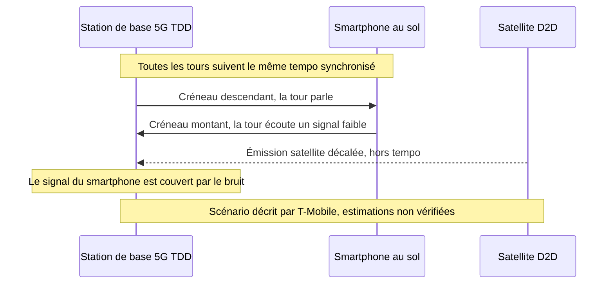
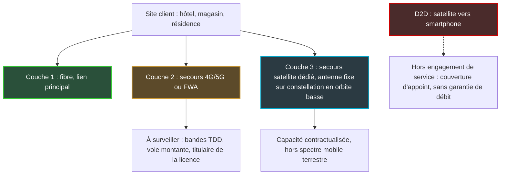

## Trois cents millions d'utilisateurs et un satellite de trop

Trois cents millions. C'est le nombre d'utilisateurs 5G qu'AT&T, Verizon et T-Mobile disent servir sur deux bandes de fréquences qu'ils veulent aujourd'hui fermer à un nouveau venu : le satellite capable de parler directement à un smartphone ordinaire. Le 20 octobre, les trois rivaux se sont retrouvés du même côté de la table, avec leur association professionnelle commune, face à des responsables de la Federal Communications Commission (FCC), le régulateur américain des télécoms. Leur message tenait en une phrase : sur ces fréquences-là, ça ne peut pas marcher.

Neuf jours plus tard, la FCC a voté. À l'unanimité, elle a ouvert une consultation sur l'extension du « direct-to-device » (D2D, la liaison directe entre un satellite et un téléphone du commerce). Le projet présenté début octobre proposait de passer de 5 à 13 bandes autorisées, soit 482 MHz supplémentaires. Sur les deux bandes contestées, le régulateur n'a, à ma connaissance, rien tranché publiquement.

Pourquoi suivre, depuis l'Europe, une querelle de fréquences à Washington ? D'abord parce que la question posée là-bas se pose déjà chez nous : peut-on prêter à un satellite une fréquence 5G réglée comme un métronome ? La conférence mondiale des radiocommunications de 2027 (point 1.13, bandes de 694 MHz à 2,7 GHz) devra en traiter une partie. Ensuite, plus terre à terre : les liens de secours 4G/5G qui maintiennent les caisses d'un magasin ou l'accueil d'un hôtel quand la fibre tombe s'appuient, pour leur capacité 5G, sur ce type de fréquences. Et le risque décrit par les opérateurs américains frappe d'abord la voie montante (du terminal vers l'antenne). Celle qui fait remonter les transactions et la voix de vos sites.

## Un pont à voie unique, et un camion venu du ciel

Imaginez un pont à voie unique. Pour que la circulation passe dans les deux sens, des feux alternent : quelques instants pour ceux qui partent, quelques instants pour ceux qui reviennent. Tant que tous les feux du réseau battent sur la même horloge, personne ne se percute. Faites maintenant arriver un camion qui ne voit pas les feux. Il ne vient pas de la route mais du ciel, et il s'engage quand bon lui semble.

C'est, en substance, l'argument des opérateurs américains.

Un téléphone et une antenne ont deux façons d'organiser leur conversation. Première option, le FDD (Frequency Division Duplex) : deux blocs de fréquences distincts, l'un pour la voie descendante (de l'antenne vers le téléphone), l'autre pour la voie montante. Une route à deux chaussées séparées. Seconde option, le TDD (Time Division Duplex) : un seul bloc, partagé dans le temps. La tour parle, puis écoute, puis parle à nouveau. C'est notre pont à voie unique. C'est aussi le mode de fonctionnement des bandes 5G de capacité au cœur de ce dossier : 2,5 GHz et 3,45 GHz aux États-Unis, 3,4–3,8 GHz en Europe.

*Le FDD sépare les deux sens de communication par la fréquence, le TDD par le temps : c'est cette seconde logique que le satellite vient bousculer.*

Le TDD a une exigence non négociable : la synchronisation. Toutes les stations de base d'une zone basculent entre émission et réception au même instant, calées sur une horloge commune. Sinon, une tour qui émet hurle au moment précis où sa voisine tend l'oreille vers des téléphones lointains. Un satellite en orbite basse, à plusieurs centaines de kilomètres d'altitude, ne vit pas au même rythme. Selon les opérateurs, le délai de propagation de son signal l'empêche de se caler sur ce tempo. D'où le risque central, tel que le formule T-Mobile : une émission satellite qui tombe sur une tour pendant ses créneaux d'écoute.

Ce n'est pas qu'un argument de lobbyiste. Le projet de texte que la FCC a fait circuler le 8 octobre le dit presque dans les mêmes termes. Parce que le TDD « uses time delay instead of spectral separation between uplink and downlink », écrit le régulateur, un opérateur satellite doit protéger à la fois les stations de base et les récepteurs terrestres « across the entire band ». Plus loin, la FCC demande s'il est seulement « technically possible » de synchroniser émissions satellites et réseaux TDD au sol. Elle note enfin que les normes actuelles du 3GPP (l'organisme qui écrit les standards mobiles) pour les réseaux non terrestres « focus mainly on FDD, rather than TDD ».

Dernier détail, qui n'en est pas un : les limites de puissance du projet ont été pensées pour protéger les terminaux, pas les stations de base. La FCC admet qu'il en faudrait peut-être d'autres pour protéger les stations TDD. La grille de calcul ne couvre donc pas encore le scénario que redoutent les opérateurs.

## 96 % : le chiffre de T-Mobile, et ce qu'il mesure vraiment

Un seul smartphone en mode satellite, près de la limite d'une zone de licence. À quelques kilomètres de là, une station de base 5G qui n'arrive plus à entendre les téléphones qu'elle dessert. C'est le scénario que T-Mobile a exposé au régulateur lors d'une réunion le 19 octobre, consignée dans un dépôt distinct de celui de ses concurrents. Selon l'opérateur, un seul appareil peut suffire à « noyer » un site situé à 1 à 3 miles (environ 1,5 à 5 km).

Les chiffres qui accompagnent ce scénario doivent être lus avec leur périmètre exact :

- **jusqu'à 96 %** de la zone de couverture montante d'un site cellulaire perdue, **là où la couverture satellite déborde sur ce site**. C'est un chiffre site par site, en zone de chevauchement, pas une estimation à l'échelle du réseau ;
- un débit montant en baisse de **88 % à 99 %** sur ces mêmes sites ;
- une voie montante amputée d'**environ 35 %** même à 15 miles (environ 24 km) de la limite du marché sous licence ;
- un signal satellite qui pourrait déborder **jusqu'à 35 miles** de sa zone cible.

Ce sont des estimations de T-Mobile, produites par T-Mobile, pour défendre son actif le plus stratégique : le 2,5 GHz, dont l'opérateur détient la majorité et que Light Reading décrit comme le socle de son offre 5G « Ultra Capacity ». Ces chiffres n'ont pas été vérifiés de façon indépendante. Je les cite tels que rapportés par Light Reading et Telesemana (Broadband Breakfast confirme les 35 miles). D'autres médias avancent un chiffre différent, environ 60 % de la voie montante à 6 miles de la zone sous licence : je n'ai pas pu le rapprocher du dépôt d'origine.

*Le mécanisme redouté : un signal satellite qui arrive hors tempo, pendant que la station de base écoute ses terminaux.*

Le dépôt collectif, porté par la CTIA (l'association professionnelle du mobile américain) avec AT&T, T-Mobile et Verizon, est plus sec : « Supplemental Coverage from Space is not technically feasible in TDD bands, and the Commission should remove the 2.5 GHz and 3.45 GHz bands from its proposal. » Le SCS, pour Supplemental Coverage from Space, est le nom réglementaire américain du D2D dans les bandes des opérateurs mobiles. Light Reading ne rapporte en revanche aucune déclaration individuelle d'AT&T, pourtant principal détenteur du 3,45 GHz, ni de Verizon.

La FCC connaît le terrain. En 2024, elle avait déjà écarté le 2,5 GHz du cadre D2D, « because of the number of users and licensing complexities ». T-Mobile ne s'est pas privé de le rappeler.

Mon avis : 96 % est un plafond de scénario, pas une prévision. Un opérateur qui défend sa bande la plus précieuse ne retient pas l'hypothèse la plus rassurante. Mais il serait tout aussi naïf de jeter la physique avec le lobbying. Le régulateur pose lui-même, noir sur blanc, les questions auxquelles T-Mobile répond par des chiffres.

## 29 octobre : un vote unanime qui ne tranche rien

Ce que la FCC a adopté le 29 octobre, par 3 voix contre 0 (le président Brendan Carr, Anna Gomez et Olivia Trusty), est une NPRM, pour notice of proposed rulemaking. En clair : un projet de règles soumis à commentaires. « Today's spectrum-related votes don't propose any specific new rules yet », résume Light Reading. Rien n'est encore applicable.

Le projet circulé le 8 octobre, versé aux dossiers GN 26-281 et GN 23-65, va pourtant loin. Il propose d'ajouter 482 MHz aux 344 MHz déjà ouverts au D2D et de passer de 5 à 13 bandes éligibles. Il propose aussi de remplacer l'obligation de bail entre opérateur mobile et opérateur satellite par des accords de coexistence. Il prévoit enfin des licences à zone sur mesure, des exigences de performance, et un plafond de « densité de flux de puissance » aux frontières de licence. Traduction : une limite à l'énergie radio qu'un satellite peut faire tomber au sol, au bord de la zone qu'il a le droit de couvrir.

Dans la liste des 13 bandes figuraient 2500–2690 MHz et 3450–3550 MHz, avec une proposition d'allocation au service mobile par satellite à titre « secondaire ». Dans le vocabulaire du spectre, secondaire veut dire : vous passez après le service principal, et vous ne devez pas le brouiller.

*Le nœud du dossier : là où un faisceau satellite déborde d'une frontière de licence, les stations de base voisines risquent, selon les opérateurs, de perdre une partie de leur voie montante.*

Que reste-t-il de ces deux bandes après le vote ? Côté FCC, Taubenblatt résume l'ajustement d'une phrase, citée par Broadband Breakfast : « We adjusted how we're seeking comment on bands that can be used for TDD. » Light Reading reste prudent : « It's unclear if the 2.5GHz and 3.45GHz bands will be part of a follow-on rulemaking. » Je n'ai pas pu consulter le texte adopté. À ma connaissance, aucune source publique ne dit que les deux bandes ont été retirées, ni qu'elles ont été maintenues telles quelles. La formulation honnête est donc celle-ci : la FCC a modifié sa manière de consulter sur les bandes TDD, et le sort du 2,5 GHz et du 3,45 GHz reste ouvert.

Le projet évoquait aussi une piste intermédiaire : limiter le satellite à un seul sens, montant ou descendant, dans les bandes non appariées comme le 2,5 et le 3,45 GHz. L'idée a sa logique. Mais les deux scénarios décrits par T-Mobile semblent toucher chacun un sens différent : un satellite qui émet pendant que la tour écoute, un téléphone qui émet vers le satellite près d'une frontière. Couper l'un ne règle pas l'autre.

Côté calendrier, le projet prévoyait 60 jours pour les commentaires et 90 jours pour les réponses, à compter de la publication au Federal Register, le journal officiel américain. Les dates réelles restent à fixer.

## Pour un site client, le D2D n'est pas un lien de secours

Commençons par dissiper une confusion que je vois venir dans les appels d'offres. Le D2D, c'est un smartphone qui accroche un satellite quand il n'y a plus d'antenne : précieux en zone blanche ou en situation d'urgence. Mais le cadre américain s'appelle lui-même « Supplemental Coverage from Space ». Une couverture d'appoint, sans garantie de débit, pensée pour des terminaux individuels. Rien dans les textes actuels n'en fait un lien de raccordement de site.

Le vrai sujet pour nous est ailleurs. Hôtel, magasin, résidence étudiante : les architectures de continuité sérieuses combinent un lien principal en fibre et un secours radio 4G/5G, parfois sous forme de FWA (Fixed Wireless Access, l'accès fixe par la radio mobile). Une bonne partie de la capacité 5G de ces secours vit dans des bandes TDD.

Si un jour ces bandes devaient être partagées avec du D2D, le scénario décrit par T-Mobile frapperait d'abord la voie montante. Je dis bien un scénario, pas une dégradation observée. Or, pour un site professionnel, la voie montante, c'est le flux des terminaux de paiement, la téléphonie sur IP, les badgeuses, la vidéosurveillance qui remonte vers le cloud, les sauvegardes nocturnes. Le client télécharge. Le métier, lui, envoie.

D'où une résilience pensée en trois couches distinctes, sans jamais compter le D2D dans aucune d'elles.

*Trois couches de résilience pour un site professionnel. Le D2D reste en dehors de l'engagement de service.*

Concrètement, trois réflexes à intégrer dès maintenant dans un cahier des charges :

1. **Demander sur quelles bandes repose le lien de secours, et qui en est titulaire.** Si le projet américain était adopté en l'état, la protection du réseau terrestre passerait par un accord de coexistence entre opérateur mobile et opérateur satellite. Un accord que vous ne signerez pas. Votre seule prise est contractuelle : quelle clause vous protège si la voie montante se dégrade ?
2. **Superviser la voie montante pour elle-même** : débit, latence et pertes en émission, pas seulement l'état « up/down » du lien.
3. **Diversifier les portefeuilles de spectre** : deux opérateurs aux bandes différentes, ou un secours satellite dédié à capacité contractualisée. Et ne jamais faire figurer le D2D dans un SLA (Service Level Agreement, l'engagement de niveau de service).

## L'Europe a posé la bonne question, pas encore la réponse

L'Europe n'a pas attendu Washington. Dans un avis relayé par l'ANFR (Agence nationale des fréquences) en juillet 2025, le RSPG, le groupe qui conseille la Commission européenne sur le spectre, distingue deux D2D. D'un côté celui qui opère dans les bandes des opérateurs mobiles, baptisé « D2D-IMT » (IMT étant le nom réglementaire des technologies mobiles). De l'autre celui qui opère dans les bandes satellites. Pour le premier, le défi est clairement nommé : protéger les réseaux mobiles, ainsi que les bandes adjacentes et les frontières.

Le modèle que privilégie le RSPG est intéressant. L'opérateur mobile « libère une partie de son spectre » pour le D2D : il devient partenaire volontaire plutôt que voisin qui subit. C'est, en creux, ce que la FCC tente avec ses accords de coexistence. Des conditions techniques harmonisées sont attendues pour 2027/28, un mandat devant être confié à la CEPT, l'organisation européenne des régulateurs des postes et télécoms.

Sur le terrain, la prudence domine. Lors d'un panel rapporté par RCR Wireless en octobre, un intervenant espagnol a décrit les essais D2D menés en 2,6 GHz par MasOrange et Starlink comme « contrôlés et localisés parce que la bande est problématique ». Selon le même panel, l'Ofcom autorise déjà le D2D dans le spectre mobile au Royaume-Uni.

Le vrai rendez-vous est la WRC-27, la conférence mondiale des radiocommunications, qui s'ouvrira le 18 octobre 2027 à Shanghai. Son point 1.13, consacré à la connexion directe entre satellites et terminaux mobiles, exige la protection des services existants, FDD comme TDD. Mais un passage du projet de la FCC devrait alerter les délégations européennes. Les études préparatoires de ce point supposent l'usage des terminaux mobiles existants, et donc un environnement de brouillage sur la voie montante qui « will not change ». Elles ne portent que sur la voie descendante, avec une conclusion attendue fin 2026. Or c'est précisément sur la voie montante que T-Mobile concentre ses alertes. Si j'avais un point à inscrire en tête de l'agenda européen, ce serait celui-là.

*Des deux côtés de l'Atlantique, les régulateurs avancent sur le satellite-vers-mobile. Les bandes TDD restent le point dur.*

Et la France ? L'Arcep, le régulateur français des télécoms, a ouvert en juillet une seconde consultation sur la bande L, un ensemble de fréquences satellites situées entre 1,5 et 2,5 GHz dont les autorisations expirent entre 2027 et 2030. Le D2D et l'Internet des objets y sont mentionnés. La Commission européenne a proposé en mai une sélection à l'échelle de l'Union des opérateurs satellites de la bande 2 GHz, jugée « idéale pour les services D2D ». Les deux chantiers portent sur des bandes satellites. Sur le D2D dans les bandes mobiles TDD, 3,4–3,8 GHz ou 2,6 GHz, je n'ai identifié aucune position publique de l'ANFR ni de l'Arcep.

L'avantage européen est réel : le modèle du RSPG part de l'accord de l'opérateur mobile, là où le projet américain part d'une liste de bandes. Mais la physique du TDD ne s'arrête pas à l'Atlantique.

## En second plan, le Wi-Fi regarde aussi vers le ciel

Un autre dossier américain, moins médiatisé, touche directement le Wi-Fi. Le 6 août, la FCC a adopté une consultation distincte (FCC 26-51, dossier ET 26-169) pour autoriser des appareils sans licence à communiquer avec des satellites, sur 2400–2483,5 MHz et 5725–5850 MHz. Autrement dit, le Wi-Fi 2,4 GHz et le haut de la bande 5 GHz.

Les garde-fous existent : plafonds de puissance inchangés (jusqu'à 4 watts rayonnés) et régime de non-interférence. La FCC dit vouloir « preserve the operational status quo ». Avant le vote, Broadcom, Intel et Cisco avaient pourtant demandé davantage d'assurances, selon Broadband Breakfast. Quant au seul précédent européen que cite la FCC, la décision ECC/DEC/(25)02 de la CEPT, il porte sur des objets basse puissance en 862–870 MHz. Pas sur les bandes Wi-Fi.

Point de vigilance plutôt qu'alerte. La question qui m'intéresse n'est pas la puissance, déjà plafonnée, mais le temps d'antenne. Dans une bande partagée, chaque milliseconde occupée par un objet qui parle à l'espace est une milliseconde de moins pour les clients d'un hôtel.

## Ma position : la charge de la preuve doit changer de camp

Je ne suis pas hostile au D2D. Couvrir les zones blanches, joindre les secours depuis une route de montagne : l'intérêt public est évident. Mais on ne fait pas entrer un émetteur non synchronisé dans une bande TDD en espérant qu'un accord de coexistence réglera la physique.

Je pense que les opérateurs américains ont raison sur le diagnostic, même si leurs chiffres relèvent du pire scénario. Et que la FCC a eu raison sur la méthode : en ajustant sa consultation plutôt qu'en gravant le projet en l'état, elle se donne le temps de trouver des réponses qu'elle n'a pas.

Ma ligne est simple. Dans une bande TDD massivement utilisée, c'est à l'entrant de prouver qu'il ne dégrade pas la voie montante, pas à l'occupant de prouver qu'il souffre. Trois conditions me semblent nécessaires avant toute ouverture : des normes 3GPP qui traitent vraiment le TDD pour les réseaux non terrestres, des études internationales qui incluent la voie montante, et des essais terrain dont les mesures sont publiques. Tant qu'elles ne sont pas réunies, le TDD doit rester hors du D2D bidirectionnel.

Ce qu'il faut surveiller dans les prochains mois :

- la publication du texte adopté au Federal Register, qui déclenchera les délais de commentaires (60 et 90 jours dans le projet, à confirmer) ;
- la fin des études préparatoires du point 1.13 de la WRC-27, attendue fin 2026 ;
- l'ouverture de la WRC-27, le 18 octobre 2027 à Shanghai ;
- les conditions techniques harmonisées européennes, attendues pour 2027/28.

Toute cette bataille tient, au fond, dans un verbe. Le projet de la FCC écrit que le D2D en bande TDD « could » créer des difficultés de coexistence. La CTIA demande qu'il écrive « would ». Dans un texte réglementaire, ce n'est pas de la grammaire : c'est la différence entre un risque à étudier et un obstacle acté. Entre les deux, il y a la voie montante de sites professionnels qui ne savent pas encore qu'ils sont concernés.

_Vues personnelles, pas position Wifirst._

## Sources

1. FCC — Fact sheet et projet de NPRM « Supplemental Coverage from Space » (GN Docket 26-281 / 23-65), projet circulé, 8 octobre 2026 — https://docs.fcc.gov/public/attachments/DOC-425711A1.pdf
2. FCC 26-51 — NPRM « Unleashing Unlicensed Spectrum for Direct-to-Device » (ET Docket 26-169), adopté le 6 août 2026, publié le 7 août 2026 — https://docs.fcc.gov/public/attachments/FCC-26-51A1.pdf
3. Light Reading — Big Three warn that running D2D in 5G bands will cripple network performance, 26 octobre 2026 — https://www.lightreading.com/satellite/big-three-warn-that-running-d2d-in-5g-bands-will-cripple-network-performance
4. Light Reading — FCC seeks feedback on carrier warnings about running D2D in 5G bands, 29 octobre 2026 — https://www.lightreading.com/satellite/fcc-seeks-feedback-on-carrier-warnings-about-running-d2d-in-5g-bands
5. Broadband Breakfast — Wireless carriers opposed to FCC plan for direct-to-device in 5G bands, 26 octobre 2026 — https://broadbandbreakfast.com/wireless-carriers-opposed-to-fcc-plan-for-direct-to-device-in-5g-bands/
6. Broadband Breakfast — FCC clears slate of spectrum items, including proposal to expand direct-to-device, 29 octobre 2026 — https://broadbandbreakfast.com/fcc-clears-slate-of-spectrum-items-including-proposal-to-expand-direct-to-device/
7. Telecompetitor — FCC begins clearing the way for increased D2D communications, 30 octobre 2026 — https://www.telecompetitor.com/fcc-begins-clearing-the-way-for-increased-d2d-communications/
8. Telesemana — AT&T, T-Mobile et Verizon demandent à la FCC d'exclure le 2,5 GHz et le 3,45 GHz du D2D, 27 octobre 2026 — https://www.telesemana.com/blog/2026/10/27/estados-unidos-att-t-mobile-y-verizon-piden-a-la-fcc-excluir-las-bandas-de-25-ghz-y-345-ghz-del-uso-satelital-d2d/
9. RCR Wireless — WRC-27 et spectre direct-to-device, 19 octobre 2026 — https://rcrwireless.com/20261019/networks/wrc-27-direct-to-device-spectrum
10. ANFR — Direct to Device, avis du RSPG, 23 juillet 2025 — https://www.anfr.fr/en/anfr/news/all-news/detail-of-the-news/direct-to-device-mobile-coverage-everywhere-coming-soon
11. Arcep — Consultation sur la bande L, 20 juillet 2026 — https://en.arcep.fr/news/press-releases/view/n/frequencies-200726.html
12. Commission européenne — Nouvelle autorisation des services mobiles par satellite (bande 2 GHz), 27 mai 2026 — https://digital-strategy.ec.europa.eu/fr/news/commission-proposes-new-authorisation-mobile-satellite-services-eus-resilience-and-competitiveness
13. Broadband Breakfast — SpaceX, unlicensed spectrum users want tweaks to FCC direct-to-device proposal, 5 août 2026 — https://broadbandbreakfast.com/spacex-unlicensed-spectrum-users-want-tweaks-to-fcc-direct-to-device-proposal/
14. CEPT — ECC/DEC/(25)02 et ECC Report 357, 27 juin 2025 — https://docdb.cept.org/document/28652
