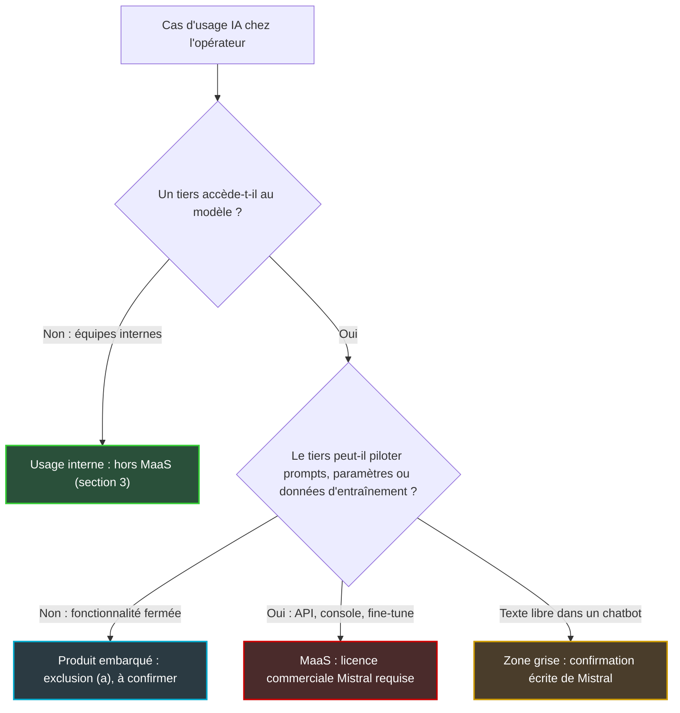
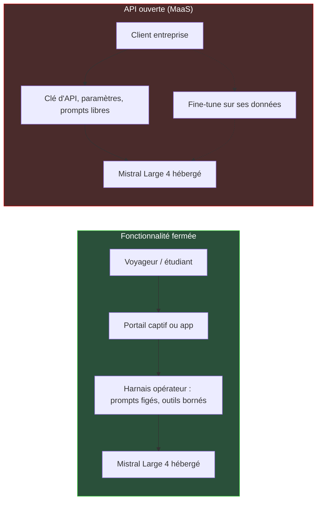

## Un téraoctet en libre accès, et une seule ligne qui compte

Un téraoctet de fichiers, sans formulaire ni liste d'attente. Depuis le jeudi 29 octobre, c'est ce que pèse sur Hugging Face, la plateforme où l'industrie publie ses modèles ouverts, le modèle phare de Mistral AI : Large 4, surnommé « Le Chonk ». N'importe quelle équipe peut le télécharger ce soir et le faire tourner sur ses propres serveurs.

Pour les opérateurs de services managés, les intégrateurs et les DSI du retail, de l'hôtellerie ou des résidences étudiantes, l'idée vient toute seule. Un modèle de pointe, européen, gratuit : pourquoi ne pas l'héberger et le proposer en option à nos clients, comme on leur vend déjà de la connectivité, de la sécurité ou un portail d'accueil ? Nous sommes en pleine saison des catalogues 2027. Cette idée aura sa diapositive dans plus d'un comité.

La licence dit oui à presque tout : utiliser, modifier, réentraîner, vendre. Elle dit non, sans contrat, à une seule chose. Précisément celle-là. Dès que vos clients peuvent piloter le modèle eux-mêmes, Mistral vous considère comme un fournisseur de « modèle en tant que service », et vous devez signer un accord commercial dont ni le prix ni les conditions ne sont publics.

Ma position tient en une phrase. On conçoit l'offre comme une fonctionnalité fermée, ou on signe avec Mistral avant de chiffrer quoi que ce soit.

## Ce que le 29 octobre a tranché

Le 6 octobre, quand Mistral a ouvert son modèle en préversion payante via son API, la seule attitude défendable était d'attendre. Ni poids, ni licence, ni besoins matériels documentés : on ne dimensionne pas une infrastructure sur une promesse. Trois semaines plus tard, la plupart des inconnues sont tombées.

Les poids sont publics et non restreints. Le dépôt Hugging Face, créé en privé le 30 septembre, a été ouvert le 29 octobre sans aucun formulaire d'accès. Deux formats officiels sont fournis : le FP8 (nombres codés sur 8 bits), qui pèse environ 1,06 To, et le NVFP4, le format 4 bits de NVIDIA, autour de 610 Go. Les 500 Go qui circulent sont une estimation d'auteur ; la mesure de Hugging Face peut, elle, inclure un léger surplus de stockage.

La fiche d'architecture est publiée. Environ 1 050 milliards de paramètres au total, organisés en mélange d'experts (MoE, pour Mixture of Experts). Le modèle compte 128 experts spécialisés plus un expert partagé, et seuls 4 d'entre eux travaillent à chaque token produit, le token étant l'unité de texte que le modèle lit ou écrit. Le débat entre 49 et 52 milliards de paramètres actifs est clos. La fiche compte 49 milliards hors couches d'entrée et de sortie, 52 avec : les deux chiffres sont justes, ils ne mesurent pas la même chose. Quant à la fenêtre de contexte d'un million de tokens, c'est bien la spécification. Sa qualité réelle à cette longueur n'a été mesurée par personne, et Artificial Analysis n'affichait que 524 000 tokens pour la préversion de l'API.

Côté performances, une première mesure tierce existe. L'Intelligence Index v5 d'Artificial Analysis lui attribue 26, le meilleur score des modèles ouverts occidentaux, derrière GLM-5.3 et DeepSeek V4.1 Flash, tous deux à 32 en mode « max ». La comparaison mêle des réglages « high » et « max » qui ne sont pas équivalents. Sur le coût moyen par tâche, Large 4 se place entre les deux : 2,06 USD, contre 5,01 USD pour GLM-5.3 et 0,60 USD pour DeepSeek V4.1 Flash.

Le reste vient de la page de Mistral, et de là seulement. On y lit 96,6 % de refus des requêtes cyber malveillantes en moyenne, 97,1 % au test B3 Agent Security, 41 % sur Terminal-Bench 4.0. Aucun tiers n'a encore évalué les poids téléchargeables, et le rapport technique est annoncé « coming soon ».

Le modèle est donc réel, documenté, téléchargeable. Reste à savoir ce qu'on a le droit d'en faire.

## Cuisiner, oui. Louer la cuisine, non.

La licence s'appelle Mistral Ecosystem Open-Weight License. Mistral la présente comme un « MIT modifié », en référence à la plus permissive des licences open source. Hugging Face la range pourtant dans la catégorie « other » : ce n'est pas une licence reconnue par l'OSI (Open Source Initiative), l'organisme qui fait référence en la matière.

L'octroi de départ est très large. Utiliser, copier, modifier, distribuer, sous-licencier, vendre, entraîner, « sans restriction », à condition de conserver la mention de copyright dans chaque copie. Puis vient la section 2. Si vous, ou une société affiliée, exploitez une activité de « Model as a Service » (MaaS), vous devez conclure une licence commerciale séparée avec Mistral, et ce avant tout usage commercial du modèle ou de ses dérivés.

Tout repose donc sur la définition. Relève du MaaS le fait de donner à un tiers accès au modèle ou à un dérivé, pour l'inférence ou le post-entraînement, d'une manière qui lui permet d'exercer un « meaningful control over the inputs, parameters, or training data ». Autrement dit, un contrôle significatif sur les entrées, les paramètres ou les données d'entraînement.

L'image la plus juste est celle d'une cuisine professionnelle. La licence vous laisse cuisiner avec ce four autant que vous voulez, servir vos plats à qui vous voulez et les facturer au prix qui vous plaît. Ce qu'elle interdit sans contrat, c'est de louer la cuisine. Laisser le client choisir ses ingrédients (les entrées), régler lui-même le four (les paramètres, que je lis comme les réglages d'inférence : température, prompt système) et repartir avec sa propre recette (les données d'entraînement, le modèle affiné).

Deux exclusions explicites confirment cette lecture. Ne sont pas des MaaS les produits destinés à l'utilisateur final dont les capacités du modèle sont « solely embedded within specific features or harnesses », c'est-à-dire intégrées uniquement dans des fonctionnalités ou des harnais précis. Le harnais, c'est l'enveloppe logicielle qui encadre le modèle : prompts, outils, interface. Ne l'est pas non plus le « mere relaying », le simple relais de requêtes vers un modèle hébergé par d'autres. La section 3 ajoute deux exemptions : l'usage interne, tant que ni le modèle ni ses dérivés ne sont mis à disposition de tiers, et tout usage passant par les produits officiels de Mistral.

Ce qui manque compte autant que ce qui est écrit. Aucun seuil de chiffre d'affaires, d'utilisateurs ou de volume : une start-up de dix personnes et un géant du cloud sont logés à la même enseigne dès qu'ils ouvrent un guichet. Aucun tarif pour la licence commerciale, seulement un formulaire de contact. Enfin, je n'ai relevé aucune clause de résiliation dans le texte, mais mon extraction était partielle : je ne l'écris pas comme un fait avant une relecture intégrale du fichier, et la question de la révocabilité de l'octroi reste ouverte.

*Une fonctionnalité sous vitrine d'un côté, un guichet qui distribue des clés de l'autre : la licence ne traite pas ces deux scènes de la même façon.*

## Sept cas d'usage passés au crible

Pour un opérateur réseau, la grille se résume à deux questions. Un tiers accède-t-il au modèle ? Si oui, peut-il le piloter ?

*Deux questions suffisent à qualifier la plupart des usages ; la branche du chatbot en texte libre est celle que la licence ne tranche pas.*

Appliquée aux usages qu'un opérateur Wi-Fi managé peut envisager, la grille donne la cartographie ci-dessous. Ce sont des cas que j'examine, pas des déploiements existants. Et c'est une lecture d'ingénieur, pas un avis juridique.

| Cas d'usage | Qualification probable | Fondement | Confiance |
|---|---|---|---|
| Agents du NOC (centre d'exploitation réseau), tri de tickets, analyse de logs, revue de configurations | Hors MaaS | Section 3 : usage interne | Haute |
| Concierge d'hôtel dans le portail captif, bot de support dans le portail client | Probablement hors MaaS | Exclusion (a) : fonctionnalité embarquée | Moyenne : « solely » et « harness » ne sont pas définis |
| Chatbot en texte libre ouvert aux résidents ou aux voyageurs | Zone grise | L'utilisateur contrôle la saisie : contrôle « significatif » ou non ? | Basse |
| API au format OpenAI, console ou clés remises à des entreprises clientes, qui choisissent température, prompt système et outils | MaaS | Cas visé par la définition | Haute |
| Fine-tune (réentraînement) par client, ou données d'entraînement apportées par le client | MaaS | « post-training », « training data », dérivés | Haute |
| Revente de l'API Mistral, relais vers Microsoft Foundry | Hors MaaS au sens de la licence | Exclusion (b) et produits officiels ; conditions propres de Mistral et du cloud | Moyenne |
| Une filiale du groupe vend de l'inférence, l'opérateur l'héberge | Risque de contamination | « the Licensee or any affiliate » | Moyenne |

Les deux extrémités sont nettes. D'un côté, tout ce que font les équipes internes échappe à la clause : un agent qui lit les journaux d'un contrôleur Wi-Fi ou trie des tickets en douze langues ne met rien à disposition de personne. De l'autre, remettre une clé d'API à un client, libre de régler la température et d'écrire son propre prompt système, c'est le cas d'école. Même verdict pour le réentraînement sur les données d'un client.

Le milieu est plus inconfortable. Revenons à la cuisine : un client qui commande à la carte contrôle-t-il la cuisine ? Un résident qui tape librement sa question dans un chatbot contrôle les entrées, au sens littéral. Est-ce un contrôle « significatif » ? La licence ne le dit pas, aucune FAQ officielle ne le précise, et aucune jurisprudence n'existe. Seul Mistral peut répondre. Ma règle : pour tout cas classé en zone grise, une confirmation écrite de Mistral avant la mise en production. Pas après.

Dernier piège, la clause des affiliés. La section 2 vise le licencié « ou un affilié ». Dans un groupe où une société sœur vendrait de l'inférence à des tiers, la question pourrait remonter jusqu'aux usages de toutes les entités. Cela se cartographie en amont, avec le juridique du groupe.

## Le harnais, argument juridique et rempart de sécurité

La conséquence d'architecture est plus intéressante qu'il n'y paraît. Ce qui vous place hors MaaS, c'est le harnais : prompts système figés, outils bornés, réglages d'inférence non exposés, aucune possibilité d'apporter ses propres données d'entraînement. Le client utilise une fonction. Il ne manipule pas un modèle.

*Même modèle, mêmes serveurs : à gauche, l'opérateur garde les commandes ; à droite, le client tient les réglages, et l'offre devient un MaaS.*

Or c'est exactement ce qu'un responsable sécurité exigerait de toute façon. Mistral indique ajuster encore ses garde-fous contre les usages cyber malveillants, et ces mises à jour, appliquées côté API, n'atteignent pas les copies auto-hébergées. Le jour où vous téléchargez les poids, vous héritez du modèle tel qu'il était ce jour-là. Les filtres, c'est vous.

Gardez aussi la tête froide sur les chiffres. Les 96,6 % de refus sont une moyenne sur des benchmarks, annoncée par Mistral : ce n'est pas une mesure de prévention d'attaques réelles. Et la variante cyber à modération réduite, réservée à des partenaires sous contrat, est distincte des poids publics.

Un harnais strict coche donc deux cases d'un coup. Il range l'usage dans l'exclusion (a), et il encadre un modèle dont vous portez désormais seul la modération. Une API ouverte, à l'inverse, cumule le contrat commercial et la responsabilité de filtrer tout ce que chaque client y injecte. Je ne vois pas de scénario où la seconde option est la plus simple.

Reste l'AI Act, le règlement européen sur l'IA. Prudence : ce qui suit est une lecture à faire valider par un juriste. Elle s'appuie sur un résumé tiers, daté de juillet 2025, des lignes directrices que la Commission venait alors de publier (version du 18 juillet 2025). Parmi les restrictions qui privent un modèle d'IA à usage général (GPAI) de l'exemption « open source », ce résumé cite la licence commerciale obligatoire pour certains usages, ainsi que la monétisation. La licence de Mistral ne serait donc sans doute pas « libre et open source » au sens du règlement.

L'exemption, de toute façon, ne couvre pas les modèles à risque systémique, présumés au-delà de 10²⁵ FLOP (opérations de calcul) d'entraînement. Mistral ne publie pas ce chiffre : impossible de dire de quel côté se trouve Large 4. Le point le plus concret pour un opérateur est ailleurs. Un acteur aval devient lui-même fournisseur s'il modifie le modèle avec plus d'un tiers du calcul d'origine (ou, à défaut de chiffre, d'un tiers de 10²³ FLOP, ou de 10²⁵ FLOP pour un modèle à risque systémique). Un fine-tune ciblé en est, selon toute vraisemblance, très loin.

## Le prix plancher s'appelle Mistral

L'autre nouvelle de fin octobre est passée plus inaperçue. Le tarif de l'API a été quasiment divisé par deux : 0,70 USD par million de tokens en entrée, 0,07 USD en cache, 2,10 USD en sortie, contre 1,36 et 4,18 USD pendant la préversion. Aucun communiqué que j'ai lu ne l'annonce. Datastudios écrit que la remise de lancement de 50 % est terminée ; or 0,70 USD, c'est presque exactement l'ancien prix remisé. Je le traite donc comme une baisse effective, de cause non documentée.

Cette baisse déplace tout le calcul d'hébergement. Mes hypothèses : trois tokens en entrée pour un en sortie, sans cache, soit 1,05 USD le million de tokens en moyenne. En face, un nœud de huit GPU NVIDIA B200 loué 24 h/24 à 5 USD le GPU-heure, ordre de grandeur relevé début octobre et non revérifié : 350 400 USD par an. Le point mort tombe vers 334 milliards de tokens par an, environ 914 millions par jour. Au tarif de préversion, le même calcul donnait quelque 466 millions. Le seuil a doublé.

Ce nœud doit encore tenir la charge, et personne n'a mesuré son débit. Les recettes vérifiées par SGLang, un moteur d'inférence open source, couvrent huit B300 en FP8 et quatre GB300 en NVFP4 ; les autres GPU sont « Not Verified ». Sur huit B300, il reste de la place pour environ 2,49 millions de tokens de cache KV, la mémoire de travail où le modèle garde la trace des conversations en cours.

Ailleurs, mes propres calculs appellent à la prudence. Huit H200 offrent 1 128 Go pour 1,06 To de poids FP8, soit 94 % de remplissage. Hugging Face sert bien le modèle sur cette configuration, mais il reste très peu de cache, donc peu de contextes longs et de sessions simultanées. Quatre B200 en NVFP4, configuration rapportée de seconde main, offrent 720 Go pour 610 Go de poids : ça tient à peine. Le calcul à quatre GPU (175 200 USD par an au tarif B200, point mort vers 457 millions de tokens par jour) suppose donc plutôt des B300 ou des GB300 à 288 Go chacun, dont je n'ai pas vérifié le prix de location.

Les versions communautaires compressées, au format GGUF (fichiers allégés pour exécution locale), descendent jusqu'à 233 Go en 1 bit. Un test d'auteur les fait tourner entre 3 et 15 tokens par seconde sur des stations de travail haut de gamme. Parfait pour le labo, pas pour la production.

*Huit accélérateurs, un téraoctet de poids : le modèle tient, c'est la mémoire de travail des conversations qui vient à manquer.*

Venons-en à la revente. Le prix plancher du marché, c'est le tarif de Mistral, avec un modèle dont la distribution est aussi annoncée chez OpenRouter, Microsoft Foundry et NVIDIA. Un opérateur qui hébergerait Large 4 pour ses clients devrait faire mieux que 0,70 et 2,10 USD, en payant ses GPU, son exploitation et, par-dessus, une licence commerciale au prix inconnu. Sur le token, il n'y a pas de marge.

La valeur d'une offre IA d'opérateur est ailleurs. Dans l'intégration au réseau et au portail, dans la gestion des identités, dans l'engagement de niveau de service (SLA), dans la résidence des données et la sécurité. Autrement dit, dans le harnais. La licence et l'économie arrivent à la même conclusion, chacune par son bout.

## Ma position : une fonctionnalité, pas un guichet

Je veux d'abord créditer Mistral. Les poids sont là, sans formulaire, avec des formats officiels, une fiche d'architecture et une licence lisible par un ingénieur sans traducteur juridique. Pour l'usage interne et les fonctionnalités embarquées, c'est une licence très généreuse. Et c'est un modèle européen, entraîné selon Mistral dans ses propres datacenters européens, ce qui pèse dans toute conversation sur la souveraineté.

Mais le mot « ouvert » prête à confusion. Large 4 n'est pas un catalogue d'IA hébergée en libre-service. Et un contrat dont on ne connaît ni le prix ni les seuils ne se met pas dans un business plan.

*D'un côté, le token au tarif de Mistral ; de l'autre, des serveurs à remplir et un contrat dont personne ne connaît le prix.*

Concrètement, voici les quatre décisions que je prendrais.

1. **Les usages internes sont libres.** Agents d'exploitation, tickets, logs, configurations : la question n'est plus juridique mais économique. Sous 900 millions de tokens par jour soutenus, l'API gagne, sauf contrainte de souveraineté qui impose d'héberger.
2. **Les offres clients se conçoivent comme des fonctionnalités fermées.** Prompts figés, outils bornés, réglages non exposés, pas de réentraînement par client. Et le harnais se documente, parce qu'il sera votre meilleur argument le jour où Mistral posera la question.
3. **Toute zone grise part chez Mistral**, à commencer par le chatbot en texte libre, pour une confirmation écrite avant la mise en production.
4. **Aucune API ouverte ne se chiffre avant d'avoir obtenu les conditions commerciales de Mistral.** La clause des affiliés se vérifie au passage, à l'échelle du groupe.

Un modèle gratuit à embarquer est une excellente nouvelle pour qui construit des produits. C'est une base très fragile pour qui rêvait de vendre des tokens.

_Vues personnelles, pas position Wifirst._

## Sources

1. Mistral AI — « Mistral Large 4 (Le Chonk) is now open weight » (sans date affichée, 2026-10-29 par recoupement) — https://mistral.ai/news/mistral-large-4-oss/
2. Hugging Face — fiche du modèle mistralai/Mistral-Large-4-1T-A52B (2026-10-29) — https://huggingface.co/mistralai/Mistral-Large-4-1T-A52B
3. Hugging Face — API, métadonnées du dépôt FP8 (2026-10-29) — https://huggingface.co/api/models/mistralai/Mistral-Large-4-1T-A52B
4. Hugging Face — fiche du modèle NVFP4 (2026-10-29) — https://huggingface.co/mistralai/Mistral-Large-4-1T-A52B-NVFP4
5. Hugging Face — API, métadonnées du dépôt NVFP4 (2026-10-29) — https://huggingface.co/api/models/mistralai/Mistral-Large-4-1T-A52B-NVFP4
6. Mistral Ecosystem Open-Weight License, texte du fichier LICENSE (2026-10-29) — https://huggingface.co/mistralai/Mistral-Large-4-1T-A52B/raw/main/LICENSE
7. G. Anhaia, dev.to — « Mistral Large 4's 1T weights are out… you need a license » (2026-10-29) — https://dev.to/gabrielanhaia/mistral-large-4s-1t-weights-are-out-serve-it-as-an-api-to-others-and-you-need-a-license-1pkc
8. M. Fluff, dev.to — « Mistral publishes Large 4 weights under a modified MIT license » (2026-10-29) — https://dev.to/mikefluff/mistral-publishes-large-4-weights-under-a-modified-mit-license-52kj
9. Unsloth — GGUF Mistral-Large-4-1T-A52B (2026-10) — https://huggingface.co/unsloth/Mistral-Large-4-1T-A52B-GGUF
10. SGLang — cookbook Mistral Large 4 (2026-10) — https://docs.sglang.io/cookbook/autoregressive/Mistral/Mistral-Large-4.md
11. Mistral docs — page modèle mistral-large-4-0, v26.10 — https://docs.mistral.ai/models/mistral-large-4-0
12. Datastudios — « Mistral Large 4 open weights: 1M context, modified MIT license » (prix vérifiés le 2026-10-30) — https://www.datastudios.org/post/mistral-large-4-open-weights-1m-context-modified-mit-license
13. XenoSpectrum — « Mistral Large 4 Open Weights Released… Gaps With Chinese Rivals Remain » (2026-10-29) — https://xenospectrum.com/en/mistral-large-four-open-weights/
14. Online Tech Tips — « Mistral releases Large 4 open-weight frontier AI model » (2026-10-29) — https://www.online-tech-tips.com/mistral-releases-large-4-open-weight-frontier-ai-model/
15. artificialintelligenceact.eu — « Overview of Guidelines for GPAI Models » (2025-07-30) — https://artificialintelligenceact.eu/gpai-guidelines-overview/
16. OfficeChai — Mistral Large 4 sur l'Intelligence Index d'Artificial Analysis, préversion (2026-10-06) — https://officechai.com/ai/mistral-large-4-le-chonk-becomes-top-non-chinese-open-model-on-artificial-analysis-intelligence-index/
