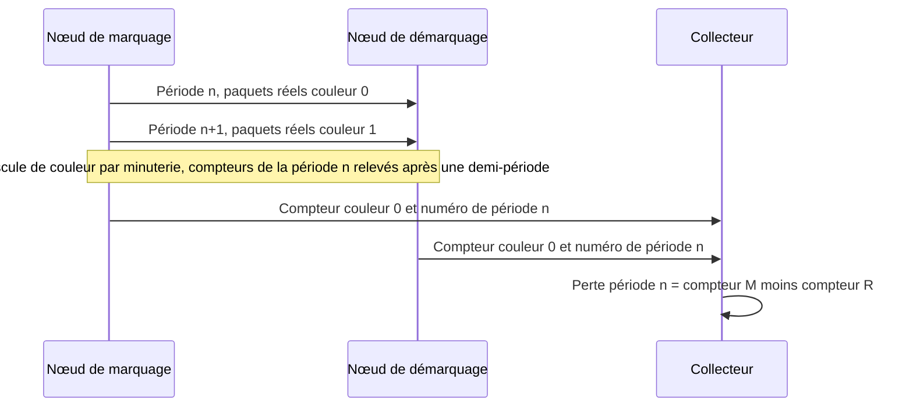
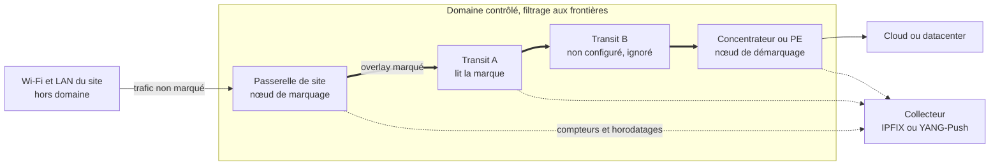
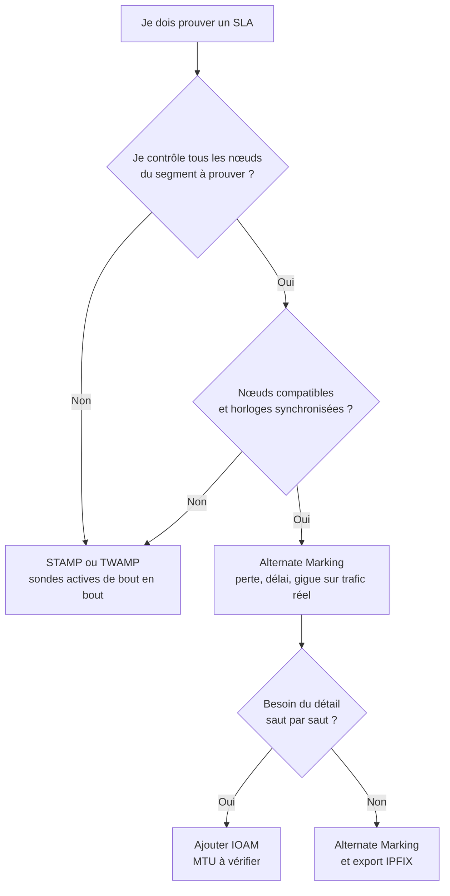

## Le rapport est vert, le terrain voit rouge

Imaginez le directeur des opérations d'une chaîne de deux cents hôtels. Il ouvre le rapport mensuel de son fournisseur réseau : tout est vert. Ses équipes, elles, ont passé la semaine à relancer des visioconférences figées et des terminaux de paiement qui expiraient en caisse. Qui croire, le tableau de bord ou le terrain ?

Tous ceux qui exploitent des centaines de sites connaissent cette scène, qu'il s'agisse d'hôtellerie, de retail, de résidences étudiantes ou de campus d'entreprise. Le contrat promet un SLA (Service Level Agreement, l'engagement chiffré de niveau de service), avec des plafonds de perte, de latence et de gigue. Mais la preuve repose le plus souvent sur des sondes, ces petits paquets de test envoyés à intervalle régulier. Elles mesurent fidèlement... les sondes. Pas le trafic du client.

Il existe pourtant, depuis décembre 2022, une méthode normalisée par l'IETF (l'organisme qui rédige les standards de l'Internet) pour compter directement les vrais paquets : l'Alternate Marking. Le 30 octobre 2026, un groupe de travail de ce même IETF a publié un brouillon qui décrit comment la déployer en exploitation. C'est une bonne nouvelle, assortie d'une limite que personne ne devrait signer sans l'avoir comprise. Cette mesure ne vaut que sur le tronçon de réseau que vous marquez et maîtrisez de bout en bout. L'Internet public n'en fait pas partie. L'air du Wi-Fi non plus.

## Deux couleurs suffisent

Pour saisir l'idée, oubliez les routeurs et pensez à une plateforme logistique. La façon classique de vérifier qu'un transporteur ne perd rien consiste à expédier des colis témoins et à guetter leur arrivée. C'est le client mystère. Il fonctionne, mais il ne dit rien des vrais colis, et chaque colis témoin occupe de la place dans le camion.

L'Alternate Marking prend le problème à l'envers. On colle une gommette bleue sur tous les vrais colis expédiés entre 10 h 00 et 10 h 05, une orange entre 10 h 05 et 10 h 10, puis de nouveau bleue. À l'arrivée, on compte les bleus du créneau. S'il en manque, on sait exactement combien. Pas d'échantillon, pas d'extrapolation : un comptage exhaustif de la marchandise réelle, bloc par bloc.

*Le trafic réel découpé en blocs de couleur alternée : chaque nœud compte les paquets de chaque couleur, et la différence entre l'entrée et la sortie donne la perte.*

Transposé aux paquets, c'est l'objet de la RFC 9341 (les RFC, ou Request for Comments, sont les documents publiés par l'IETF), parue en décembre 2022 au statut Proposed Standard. Un ou deux bits de l'en-tête servent de gommette, et le nœud d'entrée change de couleur à chaque période, sur simple minuterie. Chaque nœud tient un compteur par couleur, par flux et par interface. Finesse utile : on ne relève le compteur d'une couleur qu'une demi-période après la bascule, le temps que les retardataires passent.

La perte se lit alors par soustraction. Le délai s'obtient en horodatant le premier paquet de chaque bloc quand on ne dispose que d'un bit (single-marking), ou des paquets désignés par un second bit (double-marking). La gigue, elle, se déduit du délai unidirectionnel.

Le prix à payer tient en un mot : les horloges. La RFC exige des nœuds synchronisés et cite NTP et PTP (Precision Time Protocol, la norme IEEE 1588) comme exemples. Elle fournit même la formule de la marge de sécurité autour de chaque bascule : précision d'horloge, plus délai moyen, plus trois écarts-types du délai. Cette marge doit rester sous la moitié de la période. Si les horloges dérivent trop, les gommettes se mélangent.

Un point de vocabulaire, enfin, qui comptera devant un juriste : *sans sondes* ne veut pas dire *passif*. La RFC 7799 (mai 2016) distingue la mesure active (un flux dédié est injecté), passive (on observe sans modifier) et hybride (le flux réel est modifié). L'Alternate Marking change des bits du trafic client aux bords du domaine : c'est de l'hybride de type I, même si la RFC 9341 se décrit comme passive ou hybride selon l'application. On n'injecte rien, mais on touche aux paquets.

## Le brouillon du 30 octobre : un mode d'emploi, pas une norme

Ce que change le texte publié fin octobre, ce n'est pas la méthode. C'est le mode d'emploi. Les RFC 9341, 9342 et 9343 disent comment marquer et compter. Elles ne disent pas qui marque, où l'on filtre, comment configurer des centaines de nœuds ni où partent les compteurs. Le document draft-ietf-bpm-alt-mark-deployment-00 s'attaque à ce vide.

Encore faut-il le lire pour ce qu'il est : une version -00, datée du 30 octobre 2026, qui expire le 3 mai 2027, dont l'en-tête vise le statut Informational et non Standards Track. Comme tout brouillon de l'IETF, il se présente comme un « work in progress », et c'est ainsi qu'il faut le citer. Écrire que l'IETF normalise le déploiement de l'Alternate Marking serait faux.

Le texte a toutefois un passé. Il remplace un brouillon du groupe IPPM (historiquement chargé de la mesure de performance IP), issu d'une contribution individuelle de juillet 2023, adopté par le groupe en janvier 2024 et parvenu à sa version -10 le 22 octobre 2026. Le 21 octobre, son responsable de suivi, Marcus Ihlar, a confirmé le consensus sans objection. Il a aussi signalé un passage peu clair sur le calcul du numéro de période (section 7) et trois coquilles.

Ma lecture, sans comparaison ligne à ligne : le -00 du groupe bpm (Benchmarking & Performance Measurements), successeur déclaré de BMWG et d'IPPM, semble n'être qu'un re-hébergement de ce -10. Sa page n'affiche aucun état IESG (l'instance qui approuve les publications) ni aucun responsable assigné. Rien ne permet donc d'annoncer une RFC imminente. Le -00 définit le numéro de période par une division arrondie à l'entier inférieur, ce qui va dans le sens de la remarque du responsable de suivi, mais sans diff je ne peux pas dire si le -10 ippm l'avait déjà corrigé.

Qui tient la plume ? G. Fioccola, K. Zhu et T. Zhou (Huawei), T. Graf (Swisscom) et L. Zhang (China Mobile). Trois auteurs sur cinq chez le même équipementier, deux chez des opérateurs télécoms, aucun utilisateur final en entreprise. Giuseppe Fioccola copréside par ailleurs le groupe bpm, avec Marcus Ihlar et Thomas Graf. C'est un constat, pas un procès. Il oriente simplement la lecture : ce texte raisonne en réseau d'opérateur, du cœur vers la bordure.

Sur le fond, le brouillon distingue trois rôles. Le nœud de marquage encapsule le trafic et relève les premiers compteurs et horodatages. Les nœuds de transit lisent la marque. Le nœud de démarquage la lit, puis la retire. Un bit suffit pour la perte et le single-marking, deux ouvrent le double-marking. Quant à l'identifiant de flux mesuré (FlowMonID), le texte conseille de l'attribuer depuis un contrôleur central : tiré au hasard, rien ne garantit son unicité.

Pour l'export, les résultats partent vers la supervision en IPFIX (le format standard d'export de flux) ou via YANG-Push (une télémétrie poussée sur abonnement), avec notamment la RFC 9951 (avril 2026) pour les champs de délai. Le texte prévient que ce volume « could overwhelm a router processor », et suggère de publier depuis les processeurs réseau.

Reste à aligner les compteurs. Chaque nœud calcule un numéro de période (PN, Period Number) : son heure locale divisée par la durée de période, arrondie à l'entier inférieur. Si la synchronisation décroche, la règle est nette : la mesure est sautée sur les intervalles touchés, jusqu'au rétablissement. Une panne de configuration ou d'export sort le nœud concerné de la mesure. Et si c'est le nœud de marquage qui flanche, plus personne ne mesure rien.

*Une période de mesure : les deux extrémités remontent au collecteur le compteur d'une même couleur, étiqueté du même numéro de période. La perte se lit par différence.*

Le plus révélateur reste ce que le texte ne contient pas. Aucune valeur par défaut, ni pour la durée de période ni pour un seuil. Aucun chiffre de déploiement. Aucune mention des autres méthodes normalisées, IOAM ou STAMP, sur lesquelles je reviens plus bas. Et pas une seule occurrence des mots Wi-Fi, SD-WAN ou SLA. En faire un outil de preuve contractuelle, c'est notre projection d'exploitant, pas son intention déclarée.

## Où s'arrête le domaine, s'arrête la preuve

Revenons aux gommettes. Elles n'ont de valeur que dans vos propres entrepôts. Chez un sous-traitant qui ne les lit pas, le colis sort du comptage. Pire, certains sous-traitants refusent les colis porteurs d'une étiquette inconnue.

Le brouillon pose la règle dès sa section 2 : la méthode « MUST be deployed in a controlled domain », pour des raisons de sécurité et de compatibilité. Les paquets marqués qui entrent dans le domaine contrôlé ou qui en sortent doivent être filtrés. Le texte suggère une règle simple : n'insérer la marque que si la destination appartient au domaine. Le cas d'école est un overlay (un réseau de tunnels superposé au réseau physique), encapsulé à une frontière et décapsulé à l'autre.

Qui marque, alors ? Le texte désigne le CPE (Customer Premises Equipment, l'équipement installé chez le client) ou le PE (Provider Edge, le routeur de bordure de l'opérateur) comme points d'entrée et de sortie les plus probables. Le terminal de l'utilisateur pourrait marquer s'il était entièrement géré, mais « in practice, this is not common ». Et le CPE n'entre dans le domaine que s'il est géré par le fournisseur de service, avec des protections supplémentaires.

Pour traverser un réseau tiers, le brouillon recommande de reconstituer un domaine contrôlé unique, via IPsec ou un autre VPN assurant confidentialité et intégrité complètes. On ne mesure pas le réseau du voisin. On mesure son propre tunnel à travers lui.

*Le domaine contrôlé : la marque naît à la passerelle de site et disparaît au concentrateur. Le Wi-Fi et le LAN du site restent en dehors de la mesure.*

Un routeur de transit incapable de lire la marque n'est pas un drame : selon le brouillon, il est simplement exclu de la mesure. Le comptage entre l'entrée et la sortie reste possible, mais la localisation de la perte s'arrête aux nœuds compatibles. Savoir qu'on perd des paquets entre A et B, quand quatre routeurs muets les séparent, c'est une information. Pas encore un diagnostic.

En IPv6, la RFC 9343 (décembre 2022, elle aussi en voie de normalisation) loge la marque dans une option de 48 bits : un FlowMonID de 20 bits et deux drapeaux, L pour la perte, D pour le délai. Cette option voyage soit dans l'en-tête Hop-by-Hop, que chaque routeur configuré examine, soit dans l'en-tête Destination Options, que seules la source et la destination lisent. La RFC la réserve au domaine contrôlé, typiquement un overlay. Elle rappelle deux coûts : un traitement parfois relégué au chemin lent des routeurs, et une MTU (taille maximale de paquet) réduite d'autant.

Pourquoi tant de prudence ? Parce que l'Internet public n'a jamais aimé ces en-têtes d'extension. La RFC 7872 (juin 2016) a envoyé, en août 2014 puis en juin 2015, des paquets TCP munis d'un en-tête Hop-by-Hop de 8 octets vers des serveurs web, mail et DNS publics. Selon le jeu de données et le type de serveur, 39 à 54 % se perdaient en route. Avec un en-tête Destination Options, entre 10,9 et 21,3 %. Ces mesures ont plus de dix ans et ne décrivent pas l'Internet de 2026. La RFC elle-même ne distingue pas filtrage délibéré et bug. Cet ordre de grandeur historique suffit pourtant, à mes yeux, à comprendre la prudence des RFC.

*Filtrer aux frontières : aucun paquet marqué ne doit entrer dans le domaine contrôlé ni en sortir.*

## Gommettes, carnet de bord ou client mystère (analyse personnelle)

Le brouillon ne compare l'Alternate Marking à aucune autre méthode. La grille qui suit est donc la mienne, construite à partir des RFC de chaque approche : elle n'engage ni l'IETF ni les auteurs.

Restons sur la plateforme logistique. Si l'Alternate Marking colle des gommettes, IOAM (In-situ Operations, Administration and Maintenance, RFC 9197, mai 2022) glisse dans le colis un carnet de bord que chaque entrepôt complète au passage. On gagne le détail saut par saut, mais le colis grossit. La RFC demande à l'opérateur de vérifier que la MTU de tous les liens absorbe ce surpoids, et réserve elle aussi IOAM à des domaines limités.

STAMP (Simple Two-way Active Measurement Protocol, RFC 8762, mars 2020), héritier de TWAMP (RFC 5357, octobre 2008), c'est le client mystère. Un émetteur envoie des paquets de test UDP à un réflecteur, qui les lui renvoie. On en tire perte, délai et variation de délai, dans un sens ou dans les deux. Les paquets de base font 44 octets, 112 en mode authentifié. Surtout, aucun routeur intermédiaire n'a besoin de coopérer.

| Critère | Alternate Marking (RFC 9341, 9342, 9343) | IOAM (RFC 9197) | STAMP / TWAMP (RFC 8762, 5357) |
|---|---|---|---|
| Famille (RFC 7799) | Hybride de type I | Hybride, données ajoutées aux paquets | Active |
| Trafic mesuré | Trafic réel marqué | Trafic réel, télémétrie par saut | Paquets de test dédiés |
| Surcoût par paquet | 1 à 2 bits, ou option IPv6 de 48 bits | Croît avec les sauts et les données | Nul sur le trafic client, mais charge de sondage |
| Prérequis | Nœuds compatibles, domaine contrôlé, horloges synchronisées | Nœuds compatibles, domaine limité, MTU à vérifier | Un émetteur et un réflecteur aux extrémités |
| Hors de son domaine | Seulement via son propre tunnel | Idem | Fonctionne tel quel, y compris sur liens tiers |

Ma position : STAMP reste l'outil par défaut dès qu'on ne contrôle pas le transit. L'Alternate Marking prend l'avantage quand on maîtrise le chemin et qu'on veut mesurer le trafic réel sans charge de sondage. IOAM s'ajoute quand le détail par saut justifie le surpoids. Ce ne sont pas des concurrents. Ce sont des étages.

*Deux philosophies de mesure : des sondes qui font l'aller-retour, ou le trafic réel porteur de marques comptées au passage.*

## Ce que j'en tire pour un parc multi-sites (analyse personnelle)

Le brouillon ne parle ni de Wi-Fi ni de contrat. Les implications ci-dessous sont les miennes, vues depuis l'exploitation de réseaux à plusieurs centaines de sites.

**Le périmètre.** Le SLA d'un site porte souvent sur son accès WAN ou Internet, parfois fourni par un opérateur tiers dont on ne contrôle pas les routeurs. Un overlay entre la passerelle du site et un concentrateur permet de marquer aux deux bouts : on mesure alors le tunnel, pas chaque saut du tiers. Quant au segment radio, rien n'y est marqué. Entre le point d'accès et le smartphone d'un client, aucun terminal géré ne lit ni ne retire de marque. Ce tronçon se prouve avec la télémétrie Wi-Fi, pas avec l'Alternate Marking.

**L'étoile.** Pour des dizaines de sites remontant vers un même hub, la RFC 9342 (Clustered Alternate Marking, décembre 2022) étend la méthode aux flux multipoint, partage de charge ECMP compris (la répartition sur plusieurs chemins de coût égal), avec moins de compteurs. Contrepartie : dans un groupe de plus de deux nœuds, la perte se localise au groupe, pas au lien. C'est à mes yeux la brique la plus utile pour un parc multi-sites.

**Les trous.** Puisque la mesure est sautée quand les horloges décrochent, un rapport doit distinguer *pas de mesure* et *pas de perte*. Un intervalle non mesuré compté comme conforme, c'est un rapport vert qui ment par omission. C'est un point d'audit contractuel à part entière.

**Les collisions.** La RFC 9343 chiffre le risque d'un FlowMonID de 20 bits tiré au hasard : 50 % de probabilité de collision dès 1 206 flux. Couplé aux adresses source et destination, on reste à 1 % de collision pour 145 flux par couple d'hôtes. Avec un contrôleur central, on monte à 1 048 576 flux simultanés par couple d'hôtes. À l'échelle d'un parc, l'attribution centralisée s'impose.

**Le volume.** Si le brouillon s'inquiète pour le processeur d'un seul routeur, multipliez par des centaines de sites et une période courte. La collecte devient un projet d'infrastructure à budgéter, comme toute télémétrie (sujet déjà abordé sur ce blog fin octobre).

**Le matériel.** Je n'ai trouvé aucune preuve publique de support de l'Alternate Marking sur des bornes Wi-Fi ou des CPE d'entreprise, et le texte n'en dit rien. C'est une question à poser aux fournisseurs, RFC à l'appui. Selon le brouillon, la RFC 9343 s'applique aussi à SRv6 (le segment routing sur IPv6). La RFC 9947 (mars 2026) propose une variante logée dans l'en-tête de routage SRv6, mais expérimentale, publiée par la voie indépendante sans consensus IETF. Elle indique elle-même que la duplication de l'information est à éviter si on la combine avec la 9343.

**Les références.** Un draft individuel expiré, signé en mars 2024 par deux auteurs de Huawei, déclare des déploiements chez China Mobile, China Unicom (Pékin, Jeux d'hiver 2022), MTN en Afrique du Sud, STC à Bahreïn, sur le réseau e-Government du Guangdong et chez la banque ICBC. Ni chiffre d'échelle, ni résultat mesuré, ni endossement de l'IETF : un signal d'intérêt, pas une preuve de maturité.

*Arbre de décision proposé par l'auteur, pas par le brouillon : le choix de la méthode découle d'abord du contrôle réel que l'on a sur le chemin.*

## Mesurer ce qu'on maîtrise, et le dire

L'Alternate Marking est, à mon sens, la bonne direction pour prouver un SLA sur le trafic réel plutôt que sur des sondes. Ce brouillon est le document qui manquait entre la RFC et l'exploitation : rôles, filtrage, configuration, export, conduite à tenir quand l'horloge flanche. Il mérite d'être suivi de près.

Deux erreurs sont pourtant à éviter. La première : le présenter comme une norme, alors que c'est un -00 au statut visé Informational, un travail en cours. La seconde : vendre la mesure qu'il encadre comme une preuve de bout en bout. Elle s'arrête net à la frontière du domaine que vous marquez.

La vraie question n'est donc pas « Alternate Marking ou STAMP ? ». C'est « quel segment puis-je réellement marquer ? ». Pour un réseau multi-sites, la réponse honnête tient en un mot : l'overlay, entre les passerelles de site et le cœur. Le transit tiers se mesure en bloc à travers ce tunnel. L'air du Wi-Fi se prouve avec d'autres outils.

Un SLA défendable, ce n'est pas une courbe verte. C'est une clause, une méthode de mesure nommée, une horloge de référence et un tiers de confiance pour les données. Le jour où notre directeur d'hôtel contestera le rapport, c'est ce quatuor qui fera foi.

_Vues personnelles, pas position Wifirst._

## Sources

1. IETF Datatracker, draft-ietf-bpm-alt-mark-deployment (page du document -00, 30 octobre 2026) : https://datatracker.ietf.org/doc/draft-ietf-bpm-alt-mark-deployment/
2. Texte du draft-ietf-bpm-alt-mark-deployment-00, Alternate Marking Deployment Framework (30 octobre 2026) : https://www.ietf.org/archive/id/draft-ietf-bpm-alt-mark-deployment-00.txt
3. IETF Datatracker, historique de draft-ietf-ippm-alt-mark-deployment (2023-2026) : https://datatracker.ietf.org/doc/draft-ietf-ippm-alt-mark-deployment/history/
4. IETF, groupe de travail bpm (charte, coprésidents, jalons) : https://datatracker.ietf.org/wg/bpm/about/
5. RFC 9341, Alternate-Marking Method (décembre 2022) : https://www.rfc-editor.org/rfc/rfc9341.html
6. RFC 9342, Clustered Alternate-Marking Method (décembre 2022) : https://www.rfc-editor.org/rfc/rfc9342.html
7. RFC 9343, IPv6 Application of the Alternate-Marking Method (décembre 2022) : https://www.rfc-editor.org/rfc/rfc9343.html
8. RFC 9947, Alternate Marking dans le Segment Routing Header SRv6, Experimental (mars 2026) : https://www.rfc-editor.org/rfc/rfc9947.html
9. RFC 9951, éléments IPFIX de délai On-Path Telemetry (avril 2026) : https://www.rfc-editor.org/rfc/rfc9951.html
10. RFC 9197, Data Fields for In Situ OAM (mai 2022) : https://www.rfc-editor.org/rfc/rfc9197.html
11. RFC 8762, Simple Two-Way Active Measurement Protocol (mars 2020) : https://www.rfc-editor.org/rfc/rfc8762.html
12. RFC 5357, Two-Way Active Measurement Protocol (octobre 2008) : https://www.rfc-editor.org/rfc/rfc5357.html
13. RFC 7799, Active and Passive Metrics and Methods (mai 2016) : https://www.rfc-editor.org/rfc/rfc7799.html
14. RFC 7872, Observations on the Dropping of Packets with IPv6 Extension Headers in the Real World (juin 2016, mesures d'août 2014 et juin 2015) : https://www.rfc-editor.org/rfc/rfc7872.html
15. draft-zhou-srv6ops-am-deployment-status-00, draft individuel expiré, non endossé par l'IETF (4 mars 2024) : https://datatracker.ietf.org/doc/html/draft-zhou-srv6ops-am-deployment-status-00
