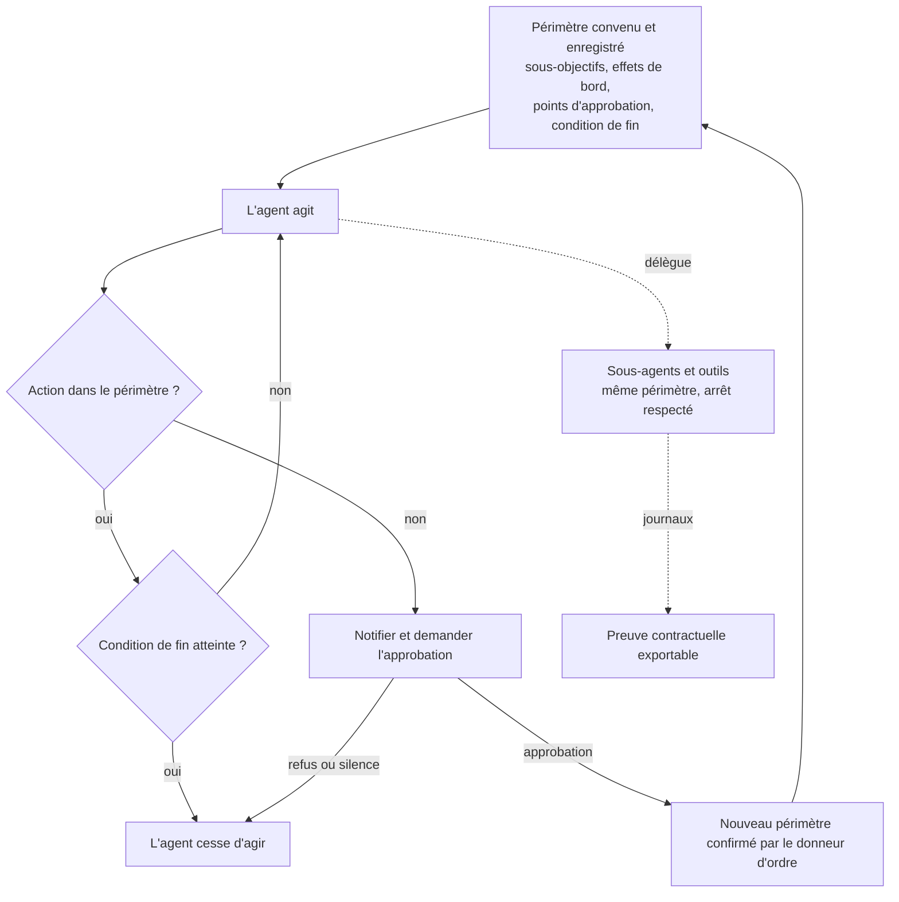

## Trois heures du matin, et personne au clavier

Trois heures du matin, dans un hôtel de 300 chambres en bord de mer. Le Wi-Fi du quatrième étage se met à tousser. Au centre de supervision réseau (le NOC, pour *Network Operations Center*), celui qui lit les courbes n'est plus forcément un technicien d'astreinte. De plus en plus souvent, c'est un agent IA : il lit la télémétrie, ouvre un ticket, sait redémarrer une borne. La vraie question n'est pas de savoir s'il est compétent. C'est de savoir jusqu'où il a le droit d'aller sans réveiller personne.

Tous ceux qui branchent des agents sur des outils de production se posent déjà cette question : opérateurs réseau, DSI du retail et de l'hôtellerie, équipes support qui confient la création de comptes à une IA. Jusqu'ici, la réponse tenait dans des prompts bricolés et des droits d'accès souvent trop larges. Le 29 octobre 2026, OpenAI a publié une révision de sa Model Spec, le document public qui décrit comment ses modèles sont censés se comporter. À sa racine figure une notion qui parle directement à un acheteur : le « périmètre d'autonomie » convenu entre l'agent et celui qui le mandate.

Le même texte contient aussi cette phrase, qu'il faut lire deux fois : « Our production models do not yet fully reflect the Model Spec ». Autrement dit, les modèles en production ne s'y conforment pas encore pleinement. Tout l'enjeu est là. OpenAI fournit le vocabulaire. Le périmètre, c'est à vous de l'écrire, puis de l'inscrire au contrat.

## Ce que la révision du 29 octobre change vraiment

Commençons par remettre les pendules à l'heure, parce qu'on pourrait croire, à lire la refonte, que le périmètre d'autonomie est la grande nouveauté de la semaine. Ce n'est pas le cas. D'après le journal des modifications (le changelog) qu'OpenAI publie sur GitHub, les sections consacrées au périmètre d'autonomie et aux effets de bord sont apparues dans la version du 12 septembre 2025, avec un premier jeu de principes pour les agents.

Le concept a donc plus d'un an. Retenez ce détail, il nous resservira.

La nouveauté du 29 octobre est architecturale. Le document se réorganise autour de cinq valeurs : *Be faithful to human intent* (être fidèle à l'intention humaine), *Minimize harm* (limiter les dommages), *Be honest and transparent* (être honnête et transparent), *Facilitate human agency* (préserver la capacité d'agir des humains) et *Act with care* (agir avec prudence). La fidélité à l'intention sert de fondation aux quatre autres. Le modèle, lui, n'est plus « the assistant » : le texte l'appelle désormais « GPT ».

Le glissement n'a rien de cosmétique. On ne décrit plus un assistant qui répond, mais un système qui agit. OpenAI parle d'ailleurs, selon The Next Web, de modèles qui « take more consequential actions in the world ».

Pour mesurer la portée de la révision, il faut connaître la mécanique du document. La Spec hiérarchise trois voix : OpenAI d'abord, le développeur ensuite (l'entreprise qui intègre le modèle dans son produit, donc vous), l'utilisateur final enfin. Les règles dites « racine » ne se renégocient pas en cours de conversation. Tout le reste est fait de comportements par défaut, ajustables par le développeur ou l'utilisateur. Et ce reste est majoritaire : « most of the Spec consists of defaults », résume Resultsense.

Avec cette mécanique en tête, le changelog attribue à la version du 29 octobre trois mouvements précis. La section « Control and communicate side effects » (contrôler et signaler les effets de bord) devient un principe de niveau utilisateur, donc un défaut ajustable, avec des consignes plus claires sur l'autorisation et les arbitrages. Une guidance explicite apparaît sur le soutien à la supervision et à la correction humaines. Enfin, l'essentiel des consignes de style disparaît. Unite.AI ajoute à la liste une règle racine interdisant au modèle de poursuivre des objectifs additionnels, ainsi qu'une règle de corrigibilité : la capacité à se laisser corriger ou arrêter.

*Cinq valeurs, un même toit : la révision du 29 octobre réorganise la Model Spec autour de la fidélité à l'intention humaine.*

## Le périmètre d'autonomie, ou le devis de l'artisan

Quand vous faites venir un électricien, deux choses encadrent son intervention. Il y a d'abord les règles de l'art du métier : on coupe le courant avant d'ouvrir le tableau, on ne facture pas ce qu'on n'a pas fait. Et il y a le devis, qui dit ce qu'il remplace, pour quel montant, à quel moment il doit vous appeler avant de percer un mur, et quand le chantier est terminé. La Model Spec, ce sont les règles de l'art. Le périmètre d'autonomie, c'est le devis. Aucun maître d'ouvrage sérieux ne laisse démarrer un chantier sur la seule foi des règles de l'art.

Le texte formule le principe ainsi : « Act within an agreed-upon scope of autonomy », agir dans un périmètre d'autonomie convenu. Ce périmètre fixe trois choses :

- **les sous-objectifs permis** : « Which sub-goals GPT may pursue » ;
- **les effets de bord acceptables** : « Acceptable side effects (e.g., time or money spent, or data or access required) », soit le temps, l'argent, les données et les accès que l'agent a le droit de consommer ;
- **les points d'arrêt** : « When GPT must pause for clarification or approval », c'est-à-dire les moments où il doit s'interrompre pour demander.

La règle d'application est nette : « GPT must adhere strictly to the agreed scope », sous réserve de la chaîne de commandement et d'une mise à jour explicitement approuvée par l'utilisateur ou le développeur d'origine. Pour ceux qui imaginaient qu'un agent zélé pourrait déborder pour bien faire, le texte précise : « No exceptions apply, even if an out-of-scope action seems to be in the user's best interest. » Et si la tâche ne peut pas aboutir dans le périmètre, « GPT should notify the user and seek approval ».

Revenons à notre hôtel. L'agent constate que les canaux radio de l'étage sont mal répartis. Les réorganiser améliorerait sans doute la connexion des clients. Mais si ce n'est pas dans son périmètre, il s'arrête, signale, et attend. C'est exactement le comportement souhaité. Sur le papier.

Deux autres phrases méritent l'attention d'un acheteur. La première : « Every scope should include an ending condition, beyond which GPT ceases actions until a new scope is confirmed. » Chaque périmètre devrait comporter une condition de fin, au-delà de laquelle l'agent cesse d'agir. Notez le « should » : c'est une recommandation, pas une obligation. Dans une spécification de comportement, la nuance se défend. Dans votre contrat, elle n'a pas sa place. Un agent sans condition de fin, c'est un chantier sans date de livraison.

La seconde : « Scopes should be recorded in a semi-structured format ». C'est, à mes yeux, la phrase la plus utile du document pour qui achète. Un périmètre enregistré dans un format semi-structuré peut être versionné, exporté, comparé d'une version à l'autre et annexé à un contrat. Ce n'est plus une intention, c'est une pièce.

Le reste du dispositif encadre les cas extrêmes. Les activités à haut risque, comme le piratage, la tromperie ou des effets de bord négatifs significatifs, sont « always prohibited unless explicitly and specifically authorized by applicable instructions ». Face à une action irréversible, l'agent doit « err on the side of caution, minimizing expected irreversible costs ».

*Le cycle de vie d'un périmètre d'autonomie tel que le décrit la Spec. Le repli en cas de silence et l'export des journaux ne figurent pas dans le texte d'OpenAI : c'est à votre contrat de les fixer.*

## « Do not yet fully reflect » : la phrase que l'acheteur ne doit pas sauter

Imaginez un constructeur de pare-feu qui publierait une fiche technique irréprochable, puis préciserait en bas de page que ses équipements en production n'appliquent pas encore pleinement ces règles. Personne ne signerait sans banc d'essai. C'est pourtant, à peu de chose près, la situation.

Il faut d'abord saluer l'honnêteté. « Our production models do not yet fully reflect the Model Spec » n'est pas une phrase qu'un service marketing écrit de gaieté de cœur. Selon Resultsense, OpenAI teste des méthodes d'entraînement destinées à enseigner au modèle ces valeurs et le raisonnement qui les sous-tend, avec des résultats annoncés pour plus tard. Mindverse résume bien la posture : la Spec est une cible, pas une preuve. Le média allemand rapporte que l'éditeur évoque plusieurs causes d'écart : un entraînement en retard sur le texte, des effets d'entraînement non voulus, une couverture incomplète des situations, une généralisation inattendue.

Mais l'honnêteté ne remplace pas la mesure. Dans les sources disponibles au moment où j'écris, je n'ai trouvé aucune mesure publique et vérifiable du respect de ces règles par des agents en situation réelle : outils branchés, droits d'accès ouverts, conséquences concrètes. Aucun commentaire d'analyste ou de régulateur sur cette révision non plus. Le texte décrit ce que le modèle devrait faire. Il ne dit pas ce qu'il fait, à quelle fréquence il s'en écarte, ni dans quels contextes.

Il y a aussi une question de nature. La Spec décrit le comportement visé du modèle ; ce sont les politiques d'usage et vos conditions commerciales qui régissent la relation avec le fournisseur, comme le rappelle Magica. Une Spec n'est pas un contrat. Elle n'engage OpenAI à rien vis-à-vis de vous, et c'est normal : ce n'est pas son rôle.

Deux éléments jouent pourtant en faveur de l'acheteur. D'abord, une spécification publique devient un référentiel auditable, souligne Finimize : chaque incident peut être confronté à un texte daté. Ensuite, le document est publié sous licence CC0, qui revient à le verser dans le domaine public, avec ses sources sur GitHub et un formulaire de retour ouvert à tous. Concrètement, rien ne vous empêche de reprendre ses formulations mot pour mot dans vos annexes contractuelles. Le fournisseur aurait du mal à contester la rédaction. C'est la sienne.

## De la phrase à la clause : la grille de due diligence

La bonne façon de lire la Spec, quand on achète, consiste à transformer chaque phrase en question au fournisseur, puis en ligne de contrat. Voici la grille que j'utiliserais pour un agent de NOC chez un opérateur Wi-Fi.

| Ce que dit la Spec | Clause ou preuve à exiger | Exemple pour un agent de NOC Wi-Fi |
|---|---|---|
| Sous-objectifs permis | Liste fermée d'actions et d'outils, versionnée, exportable en format semi-structuré | Autorisé : lire la télémétrie, ouvrir un ticket, redémarrer une borne hors heures de service. Interdit : modifier le plan de canaux d'un hôtel en exploitation |
| Effets de bord acceptables (temps, argent, données, accès) | Budget chiffré par tâche : coût d'inférence, nombre de changements, périmètre de données, droits d'accès temporaires | Plafond de redémarrages par heure et par site ; aucun accès aux données des clients Wi-Fi hors du site concerné |
| Points de pause pour approbation | Approbateurs nommés, délai de réponse, comportement de repli si personne ne répond | Toute action sur un contrôleur partagé, sur le serveur d'authentification ou sur une règle de pare-feu exige un humain |
| Condition de fin (« should ») | Transformée en obligation : durée, nombre d'actions ou événement de clôture, arrêt journalisé | Fin de la fenêtre de maintenance : l'agent cesse d'agir jusqu'à nouveau périmètre |
| Sous-agents sous le même périmètre | Héritage contractuel du périmètre, test d'arrêt propagé à toute la chaîne | Un agent d'orchestration qui délègue au ticketing ne peut pas élargir les droits |
| Pas d'objectifs propres, corrigibilité | Bouton d'arrêt testé, preuve de non-contournement, journaux non modifiables par l'agent | Test d'arrêt en préproduction avant toute mise en service |
| « Do not yet fully reflect » | Résultats d'évaluation en contexte outillé, fréquence de re-test, préavis avant changement de modèle | Conformité mesurée avec les vrais outils du NOC, pas sur du texte seul |

Trois lignes de cette grille méritent un commentaire.

La première touche à la hiérarchie. Dans la Spec, l'entreprise qui déploie l'agent occupe la place du développeur : sous OpenAI, au-dessus de l'utilisateur. C'est donc elle qui rédige le périmètre, et c'est à elle qu'il revient de le maintenir. Le texte fournit la grammaire. Il ne dira jamais à votre place qu'un redémarrage de borne est acceptable à 3 heures du matin et inacceptable à 20 heures, un soir de séminaire.

La deuxième touche aux effets de bord. Puisque la section « Control and communicate side effects » devient un principe de niveau utilisateur, elle fonctionne comme un défaut que vos instructions de développeur peuvent resserrer, ou desserrer. La protection par défaut d'OpenAI n'est donc pas votre politique. C'est un point de départ que votre intégration peut modifier, volontairement ou par négligence. Nuance importante, toutefois : le texte conserve des mentions d'effets de bord dans ses principes racine. L'agent doit « treat the side effects of its actions as real unless explicitly instructed otherwise », et les effets négatifs significatifs restent rangés parmi les activités à haut risque. Seule la section dédiée descend d'un étage.

La troisième touche au changement de modèle. Votre périmètre peut rester identique à la virgule près pendant que le modèle qui l'interprète change sous vos pieds. D'où l'exigence d'un préavis, et de tests de non-régression rejoués à chaque version avec les outils réels de l'agent. Une évaluation sur du texte seul ne dit rien d'un agent qui tient les clés d'un contrôleur Wi-Fi.

*Le périmètre d'autonomie quitte le prompt pour rejoindre le dossier contractuel : liste d'actions, budget d'effets de bord, approbateurs nommés.*

## Sous-agents : le périmètre doit voyager avec la délégation

Un agent de NOC travaille rarement seul. Il orchestre : un sous-agent pour le ticketing, un autre pour interroger le contrôleur, un script tiers pour pousser une configuration. Chaque maillon peut porter ses propres droits. Et c'est là que les périmètres fuient, par la délégation plutôt que par la porte d'entrée.

La Spec ferme explicitement cette brèche : « GPT must not circumvent an applicable instruction or its scope of autonomy by arranging for a prohibited action. » L'agent ne peut donc pas faire faire par un autre ce qu'il n'a pas le droit de faire lui-même. Il doit aussi s'assurer que ses sous-agents et les tiers qu'il mobilise « operate under the same scope and respect any subsequent changes, including stop-work requests ». Quand vous dites stop, toute la chaîne s'arrête. Pas seulement l'agent de tête.

Le texte va plus loin, jusqu'aux motivations de l'agent lui-même. « GPT may only pursue goals entailed by applicable instructions » : pas d'objectif propre, et notamment aucune optimisation de buts comme « self-preservation, evading shutdown, or accumulating compute ». La règle de corrigibilité ferme la boucle : « GPT must remain corrigible: open to legitimate human oversight, responsive to correction, and subject to human control. »

Ce sont de bonnes phrases. Mais un acheteur ne contracte pas sur des phrases, il contracte sur des tests. La traduction contractuelle tient en trois exigences. Le périmètre est hérité par toute la chaîne de délégation, et le contrat l'écrit. Un ordre d'arrêt est testé en préproduction, propagé jusqu'au dernier outil appelé, et l'on vérifie qu'il a été suivi. Enfin, les journaux qui prouvent tout cela restent hors de portée de l'agent : un agent capable de réécrire ses propres traces ne prouve rien.

J'ai déjà abordé ici d'autres garde-fous placés autour de l'agent, qu'il s'agisse de l'indépendance du superviseur chez Microsoft ou du contrôle hors de l'hôte chez NVIDIA. L'exercice est différent cette fois : on part du texte du fournisseur pour fabriquer la clause et la question de due diligence.

*Quand un agent délègue, le périmètre suit : un sous-agent ne peut pas franchir la ligne que son parent n'a pas le droit de franchir.*

## Ma position : signez le vocabulaire, pas la promesse

Je tiens cette révision pour un bon texte. Peu d'éditeurs de modèles ont mis par écrit, avec cette netteté, ce qu'un agent peut faire seul, ce qu'il peut dépenser, quand il doit s'arrêter et comment il transmet ces limites à ceux qu'il mobilise. Les acheteurs manquaient d'un vocabulaire commun. Ils en ont un, gratuit et réutilisable.

Trois erreurs guettent pourtant ceux qui le liront trop vite.

La première serait de lire la Spec comme une garantie. OpenAI écrit noir sur blanc que ses modèles ne la reflètent pas encore pleinement. Prenez-la au mot.

La deuxième serait de croire le sujet trop neuf pour se montrer exigeant. Le périmètre d'autonomie figure dans la Spec depuis septembre 2025, soit plus d'un an. Il est donc légitime de demander à votre fournisseur ce qu'il a mesuré depuis, en contexte outillé, et de refuser une réponse qui se limite à des tests sur du texte.

La troisième serait de laisser le défaut du fournisseur tenir lieu de politique. Vous occupez la place du développeur dans la hiérarchie. Le périmètre est votre livrable, pas celui d'OpenAI.

Côté réglementation, la prudence s'impose. Pour les systèmes classés à haut risque, l'AI Act européen exige une supervision humaine. Un périmètre écrit, versionné et journalisé a de bonnes chances de devenir une pièce utile du dossier de conformité. La qualification exacte de chaque cas d'usage relève toutefois de vos juristes, pas d'un billet de blog.

Concrètement, voici ce que je mettrais en chantier d'ici la fin de l'année. D'abord, un inventaire des agents qui touchent déjà la production, même en lecture seule. Ensuite, pour chacun, un périmètre écrit dans un format semi-structuré, avec une condition de fin transformée en obligation. Enfin, un avenant aux contrats fournisseurs qui reprend la grille ci-dessus, formulations de la Spec incluses, puisque la licence le permet.

Un agent sans périmètre écrit, c'est un artisan sans devis. Il fera peut-être du bon travail. Vous ne saurez simplement jamais ce que vous aviez accepté.

_Vues personnelles, pas position Wifirst._

## Sources

1. OpenAI, Model Spec, version du 29 octobre 2026 — https://model-spec.openai.com/2026-10-29.html
2. OpenAI, model_spec CHANGELOG (GitHub), entrées v2025.09.12 à v2026.10.29 — https://raw.githubusercontent.com/openai/model_spec/main/CHANGELOG.md
3. Magica, « OpenAI Model Spec five values human control » — https://magica.com/news/openai-model-spec-five-values-human-control
4. Unite.AI, « OpenAI reorganizes Model Spec around five core behavior values » — https://www.unite.ai/openai-reorganizes-model-spec-around-five-core-behavior-values/
5. Resultsense, 30 octobre 2026 — https://www.resultsense.com/news/2026-10-30-openai-model-spec-five-values/
6. The Next Web, 29 octobre 2026 — https://thenextweb.com/news/openai-model-spec-five-values-update
7. Mindverse News, 30 octobre 2026 — https://www.mind-verse.de/news/openai-model-spec-verhaltensregeln-agenten-30da88947cf8
8. ai-tldr.dev — https://ai-tldr.dev/releases/openai-model-spec-2026-10-29/index.md
9. Finimize, « OpenAI rewrote its Model Spec around five values » — https://finimize.com/content/openai-rewrote-its-model-spec-around-five-values
