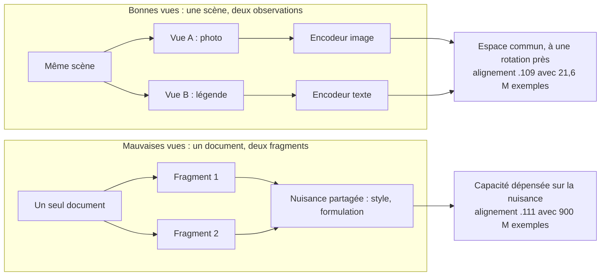
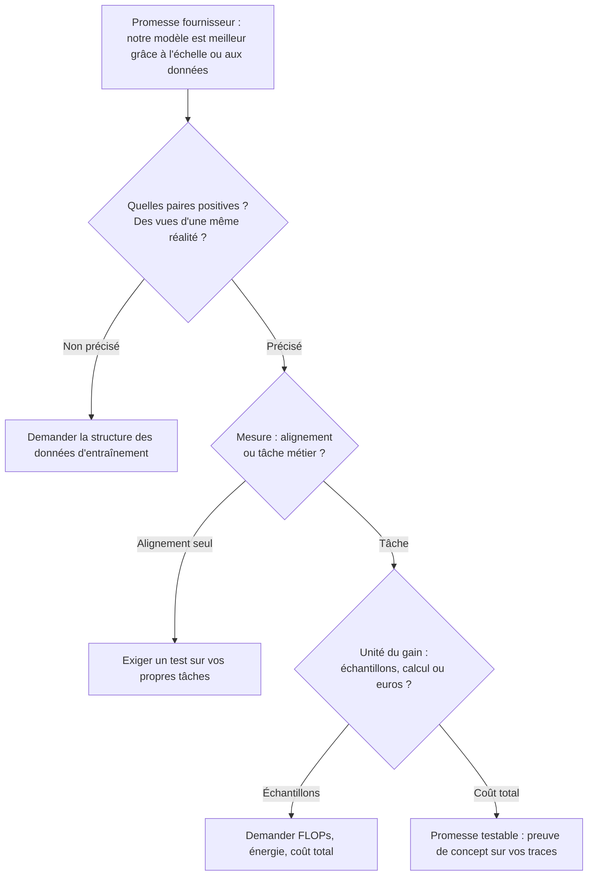

## Le nombre de paramètres, cette boussole trompeuse

Depuis trois ans, la première ligne d'une fiche produit IA est presque toujours la même : un nombre de paramètres. Sept milliards, soixante-dix milliards, quatre cents milliards. Ce chiffre sert de raccourci pour tout le reste (qualité, robustesse, prix) et finit par piloter des décisions très concrètes : quel modèle acheter, combien de GPU réserver, quel fournisseur retenir pour l'assistant de support ou l'outil d'analyse d'incidents qu'on déploiera ensuite sur des centaines de sites.

Le 29 octobre 2026, Randall Balestriero et Yann LeCun ont publié un papier qui écorne ce raccourci. Un petit encodeur de texte de 109 millions de paramètres y fait mieux qu'un modèle de 72 milliards, plus de 600 fois plus gros. Mieux sur une seule mesure, très précise : la façon dont ses représentations internes s'alignent avec celles d'un modèle de vision. Pas en génération de texte. Pas sur une tâche métier. Pas sur la facture.

C'est cette nuance qui m'intéresse. Le résultat est sérieux : un théorème, des expériences, du code publié. Il sera aussi, je le parie, résumé d'ici Noël en « LeCun prouve que la taille ne compte pas ». DSI, acheteurs de compute, équipes qui évaluent des offres IA : vous avez intérêt à lire ce papier pour ce qu'il démontre. Et à repérer ce qu'il ne démontre pas, avant qu'un argumentaire commercial ne le fasse à votre place.

## Deux témoins valent mieux qu'un seul qui se répète

Le point de départ porte un nom ambitieux : la *Platonic Representation Hypothesis* (PRH). Formulée en mai 2024 par Huh, Cheung, Wang et Isola [4], elle constate que des modèles entraînés sur des données très différentes, images d'un côté, texte de l'autre, organisent le monde de façon de plus en plus semblable à mesure qu'ils grossissent. Les prisonniers de la caverne voient des ombres différentes ; l'objet, lui, est le même. C'était une observation empirique, indexée sur l'échelle : plus gros, plus convergent.

Balestriero et LeCun en proposent une démonstration [1], mais ils déplacent le levier. Pour saisir leur argument, imaginez deux témoins d'un même accident. L'un était au coin de la rue, l'autre à un balcon. Leurs récits diffèrent par des détails parasites : l'angle de vue, le vocabulaire, le camion qui masquait une partie de la scène. Ce qu'ils ont en commun, c'est l'accident. Prenez maintenant un seul témoin à qui l'on fait répéter sa déposition. Les deux versions partagent ses tics, ses approximations, ses angles morts. Les recouper ne vous apprend presque rien.

C'est exactement la distinction que fait le papier entre « bonnes » et « mauvaises » vues. Une bonne paire, ce sont deux observations d'états liés du monde dont les nuisances sont indépendantes : une photo et sa légende. Une mauvaise paire, ce sont deux corruptions d'une même observation, qui partagent leurs défauts. Le théorème 3 du papier se résume en une phrase qu'on devrait afficher dans toutes les équipes data : la nuisance que l'encodeur dépense à modéliser, c'est de l'alignement perdu.

L'architecture étudiée s'appelle JEPA (*Joint-Embedding Predictive Architecture*). Au lieu de prédire des pixels ou des mots, le modèle apprend à prédire la représentation abstraite d'une vue à partir d'une autre. Le théorème central dit ceci : si plusieurs modalités observent un même monde et partagent la même distribution de paires positives, et si l'optimum d'entraînement est unique, alors chaque encodeur apprend la même carte du monde. À une rotation près.

Cette rotation mérite une image. Deux plans de Paris, l'un orienté nord en haut, l'autre tourné de quarante degrés : même géométrie, mêmes distances, orientation différente. Le papier montre qu'on ne retrouve pas cet angle avec des statistiques simples (moyennes, covariances) calculées séparément sur chaque modalité. Il faut des points de repère communs, de l'ordre de k paires appariées pour un espace de dimension k, pour recaler les deux plans. Retenez ce détail : la promesse « sans paires » a une limite, on y reviendra.

Dernier apport, le plus provocateur. Les auteurs proposent de lire la prédiction du mot suivant, la méthode d'entraînement des grands modèles de langage (LLM), comme un JEPA à mauvaises vues : deux fragments d'un même document partagent le style, la formulation, l'auteur. C'est une explication avancée par les auteurs, pas un théorème démontré sur les LLM du marché. Elle offre pourtant une piste pour comprendre pourquoi cette voie réclame autant d'échelle avant d'atteindre l'alignement.

*Le cœur du papier : des vues indépendantes d'une même scène mènent à un espace commun ; deux fragments d'un même document traînent leurs parasites et réclament environ 42 fois plus d'exemples pour un alignement équivalent (mutual 10-NN, benchmark WIT).*

## Les chiffres, remis à leur juste échelle

Commençons par le résultat qui fera les titres. Avec 21,6 millions d'exemples d'entraînement, un JEPA nourri de bonnes vues atteint le même niveau d'alignement avec un modèle de vision qu'un modèle de prédiction du mot suivant qui en a consommé 900 millions. Quarante-deux fois moins d'exemples pour arriver au même endroit.

La mesure utilisée s'appelle *mutual 10-NN* (« dix plus proches voisins mutuels »). Le principe est simple. Pour chaque élément d'un jeu d'images légendées, on regarde ses dix plus proches voisins dans l'espace du modèle de texte et dans celui du modèle d'image, puis on compte la part de voisins communs. Le hasard donne environ .01. Sur WIT, le benchmark de référence de la PRH, jamais utilisé à l'entraînement, le JEPA atteint .109 et la prédiction du mot suivant .111. Le papier cite aussi 14 fois moins de tokens de texte et 435 fois moins d'images uniques.

Maintenant, ce que ce 42× n'est pas. C'est un ratio d'échantillons. Pas de calcul, pas d'énergie, pas de coût. Les taux d'apprentissage et les tailles de lot diffèrent selon l'échelle (section 4.2 du papier [1]). Mindverse [8] rappelle de son côté que ce ratio ne dit rien du temps d'entraînement, de l'énergie ni du coût total. Surtout, le papier ne publie aucun budget de calcul total. On sait seulement que chaque run tourne sur un GPU, jusqu'à 8 à 16 GPU pour les plus gros, pendant 200 passes sur les données. Impossible d'en déduire une économie en euros. Quiconque vous vend « 42 fois moins cher » sur la foi de ce papier extrapole.

*Deux chemins vers le même espace : des vues indépendantes d'une scène convergent vite, deux fragments d'un même texte restent englués dans leurs parasites communs.*

Deuxième chiffre, celui du titre. Aligné avec DINOv2, un encodeur d'images de référence, toujours sur WIT, le JEPA texte de 109 millions de paramètres obtient .184. Qwen2.5-72B, le plus gros modèle de langage de la comparaison, obtient .154. Le papier donne .151 pour Llama-3-70B (Table 3 [1]). L'écart est réel. Il reste modeste en absolu, sur une échelle où le hasard vaut .01. Et surtout, le 109M est un encodeur : il ne rédige rien, ne répond à rien, ne résume aucun ticket. Il ne remplace pas un 72B. Il le devance sur une propriété géométrique.

Troisième chiffre : 64,4 %. C'est le score du JEPA en classification d'images *zero-shot* (sans exemple étiqueté de la tâche), mesuré en top-5 (la bonne classe figure parmi les cinq propositions) sur ImageNet-100, un sous-ensemble de 100 classes. Pas du top-1, pas ImageNet-1k. Dans ce cadre, l'écart est net. À taille égale, la prédiction du mot suivant tombe à 20,3 %, un JEPA à mauvaises vues à 46,7 %, Qwen3-8B réévalué par les auteurs à 47,6 %, soit environ 17 points derrière. Même la version à 33 millions de paramètres atteint 57,9 %, au-dessus des 56 % du meilleur résultat de Schnaus et al., cité en comparaison.

Mais la comparaison qui compte est ailleurs. CLIP B/32, un modèle entraîné sur 400 millions de paires image-texte, atteint 68,7 % sur le même test. Le JEPA est derrière. Le « 64 % » qui circule dans les résumés est donc un top-5, sur 100 classes, sous le score de la référence du domaine.

Quatrième chiffre, le plus facile à mal lire : CIDEr 0,838 sur COCO. CIDEr est une métrique qui note des légendes générées en les comparant à des légendes humaines. Le papier l'exprime sur une échelle de 0 à 1, soit 83,8 dans la convention habituelle multipliée par 100 : à ne pas comparer naïvement à la littérature. Le montage est élégant. Un décodeur de texte (Qwen2.5-1.5B, affiné uniquement sur du texte) et des encodeurs d'images gelés (DINOv2 et DINOv3) sont reliés par une seule application linéaire à lignes orthonormales. Autrement dit, à peu de chose près, une rotation. On échantillonne 32 légendes et on retient le consensus.

Sauf que cette rotation est apprise sur environ 30 000 paires image-légende de Flickr30k. Le papier précise aussi que les paires positives de la méthode « sans paires » sont en partie écrites par un modèle vision-langage, et que les légendes produites manquent ce que décrivent souvent les légendes humaines. La démo s'appelle « Captions Without Pairs ». La rigueur impose de traduire par « avec très peu de paires ».

| Chiffre | Ce qu'il mesure | Ce qu'il ne mesure pas |
|---|---|---|
| 42× | Échantillons pour un alignement équivalent (.109 contre .111, mutual 10-NN, WIT) | Calcul, énergie, coût |
| .184 contre .154 | Alignement d'un encodeur texte 109M avec DINOv2, face à Qwen2.5-72B (hasard ≈ .01) | Génération, tâche métier |
| 64,4 % | Top-5 zero-shot sur ImageNet-100 | Top-1, ImageNet-1k ; reste sous CLIP (68,7 %) |
| CIDEr 0,838 | Légendes COCO, échelle 0-1, rotation apprise sur environ 30 000 paires | Un légendage « sans aucune paire » |

Deux points au crédit des auteurs. Leur loi d'échelle de l'alignement prédit des runs non vus « within seed noise ». Le papier reconnaît pourtant qu'il s'agit du résumé empirique d'une recette, aux exposants mal identifiés, sans terme pour les données répétées. L'écart-type entre graines aléatoires cité sur un run est de .0068. Et certains runs, entraînés sans écrêtage des gradients (une protection classique contre l'instabilité), s'effondrent. Ils ont aussi cherché la fuite de données : au moins 43 légendes du benchmark WIT figurent dans le corpus d'entraînement Recap-DataComp. Les retirer change le résultat de moins de .002. C'est le genre d'honnêteté qu'on aimerait lire dans toutes les fiches produit.

*Un encodeur de 109 millions de paramètres peut l'emporter sur un géant pour une mesure de similarité. La tâche et la facture se jouent sur d'autres balances.*

## Ce que le théorème suppose, et ce qui manque encore

Un théorème vaut ce que valent ses hypothèses. Celles-ci sont fortes, et les auteurs les déclarent. Un monde fini. Des « rendus » injectifs, c'est-à-dire que chaque observation détermine sans ambiguïté l'état du monde. Des optima atteints sur la population entière, comme avec des données infinies. Des représentations normalisées (*whitened*). Un prédicteur réduit à l'identité.

L'unicité de l'optimum est démontrée pour une famille de JEPA dits spectraux. Pour SIGReg, le régulariseur de LeJEPA [5] que les mêmes auteurs ont publié en novembre 2025, elle reste une hypothèse. Et les JEPA « world models », ceux qui apprennent un vrai prédicteur, ne sont pas couverts du tout.

L'injectivité, elle, est fausse en pratique, et le papier le reconnaît : une légende ne détermine pas l'état du monde. « Un chien sur une plage » correspond à des millions de photos possibles. Cet écart entre cadre idéal et expériences réelles n'invalide pas les résultats empiriques. Il signifie que le théorème explique une tendance ; il ne la garantit pas sur vos données.

Côté reproductibilité, le bilan est meilleur que ce qu'on lit parfois. Le code est publié sous licence MIT dans le dépôt galilai-group/prh-proof [2] : scripts d'entraînement, d'évaluation, de légendage, et tests de la théorie, que le papier cite explicitement comme « the released tests ». Une démo tourne sur Hugging Face [3]. Les poids du JEPA de 109 millions de paramètres, en revanche, n'ont pas été trouvés : le dépôt écrit ses checkpoints en local, le module de légendage se génère par une commande utilisateur, et DINOv3 est en accès restreint. Reproduire, c'est réentraîner.

Autre réalité : à J+5, aucune réplication indépendante. La couverture disponible est secondaire [7] [8] et aucun analyste ne s'est prononcé. C'est normal, c'est trop tôt. Ce n'est pas une raison pour agir comme si c'était fait.

Le contrepoint scientifique, lui, existe déjà. En février 2026, Gröger, Wen et Brbić ont publié une relecture de la PRH, retenue à ICML 2026 [6]. Leur constat : les métriques globales de similarité sont biaisées par la taille des réseaux. Une fois calibrées par permutation, la convergence spectrale globale disparaît en grande partie. Ce qui résiste, c'est l'accord des voisinages locaux, d'où leur « Aristotelian Representation Hypothesis ».

Ce qui suit est mon rapprochement, pas celui des auteurs. La métrique phare du nouveau papier, mutual 10-NN, est justement une mesure de voisinage local. Ses résultats empiriques sont donc cohérents avec la lecture aristotélicienne. Ils n'établissent pas, à eux seuls, une structure globale unique au sens des métriques spectrales non calibrées.

Dernier élément de contexte, à signaler sans procès d'intention. Yann LeCun a quitté Meta en novembre 2025 pour fonder AMI Labs, qui a levé 1,03 milliard USD en amorçage (seed) le 9 mars 2026, sur une valorisation pré-money de 3,5 milliards USD, avec NVIDIA, Samsung et Toyota Ventures parmi les investisseurs, selon StartupHub [9]. Cibles affichées : industrie, robotique, santé. Les auteurs portent donc un agenda commercial autour des JEPA. Un théorème se moque de qui le signe ; la lecture des benchmarks, elle, mérite toujours un regard extérieur.

## Trois questions avant de signer

À partir d'ici, je quitte le papier. Ce qui suit est une grille de lecture d'auteur, construite à partir du résultat. Ce n'est pas un résultat.

Ma position tient en deux phrases. Le papier établit, sous hypothèses idéalisées, que la structure des paires positives détermine l'alignement des représentations : l'échelle n'est donc pas la seule variable. Mais personne n'a encore démontré que cela change la facture. Entre ces deux phrases tient toute la discipline d'achat qu'il faut garder.

Face à une promesse fournisseur, que ce soit un LLM généraliste ou un outil d'AIOps (exploitation IT assistée par IA), trois questions suffisent à trier.

**1. Sur quelles vues ce modèle a-t-il appris ?** « Des milliards de tokens » n'est pas une réponse. Ce qu'il faut savoir : quelles paires positives, quelles sources indépendantes d'une même réalité, quelles nuisances partagées. Un fournisseur incapable de décrire la structure de ses données vous vend du volume.

**2. Mesure-t-on l'alignement ou la tâche ?** Une belle similarité entre représentations ne dit rien de la précision sur vos tickets ou vos incidents. Le papier lui-même illustre l'écart : un encodeur qui devance un 72B en alignement reste derrière CLIP en classification zero-shot. Exigez un test sur vos tâches, avec vos données.

**3. Quelle est l'unité du gain ?** Échantillons, FLOPs (opérations de calcul), énergie, euros : ce ne sont pas des synonymes. « 42 fois moins d'échantillons » ne se traduit pas en « 42 fois moins de GPU-heures » tant que personne n'a publié le compte.

*Grille de lecture d'auteur, pas issue du papier : trois questions pour ramener une promesse IA à quelque chose de testable.*

## Hypothèse de l'auteur, hors du papier : la télémétrie comme jeu de vues

Soyons clairs : rien dans ce papier ne parle de réseau, de Wi-Fi ou d'edge. Il ne dit rien de la mémoire embarquée ni de la taille des modèles en périphérie, et je ne le lui ferai pas dire. Ce qui suit est un pari.

Un incident sur un site client, un hôtel, un magasin, une résidence étudiante, produit plusieurs observations. Les logs du contrôleur Wi-Fi. Les échecs d'authentification RADIUS (le protocole qui valide l'identité des utilisateurs sur le réseau). Le ticket du client, rédigé avec ses mots : « ça rame au troisième étage ». Le plan du site, avec ses bornes. Chacune serait une vue d'un même événement, avec des nuisances largement indépendantes : le vocabulaire du client, le format du constructeur, l'obsolescence du plan. Dans le langage du papier, de bonnes vues. À l'inverse, deux lignes d'un même log partagent leur format et leur horloge : de mauvaises vues.

Si l'hypothèse tient, la valeur d'un projet d'analyse d'incidents serait moins dans la taille du modèle que dans le travail ingrat d'appariement. Relier un ticket, une rafale d'échecs d'authentification et une borne précise au même incident, à la bonne minute. C'est de la plomberie de données, pas de l'achat de GPU. Et c'est précisément le poste que les projets IA ont tendance à sous-financer.

Les limites de ce pari sont évidentes. Notre « monde » n'est pas fini. L'injectivité y est encore plus fausse qu'entre une photo et sa légende : « ça rame » ne détermine aucun état du réseau. Aucun théorème ne couvre ce cas. C'est une piste de preuve de concept (POC), pas une conviction.

*Logs, tickets, plans de site : plusieurs vues d'un même incident. Les apparier vaut peut-être mieux que grossir le modèle. Hypothèse d'auteur, pas résultat du papier.*

## Ce que je ferais dans les quatre-vingt-dix jours

Rien sur le budget GPU. Ce papier ne justifie ni d'en retirer, ni d'en rajouter. Il ne chiffre pas le calcul, donc aucune décision de capacité ne peut s'appuyer dessus.

Trois signaux à surveiller : une réplication indépendante, la publication des poids du JEPA de 109 millions de paramètres, et des évaluations sur des tâches réelles plutôt que sur l'alignement seul. Le premier qui arrive change le niveau de confiance. L'absence des trois d'ici le printemps en dira long, elle aussi.

Et un petit chantier interne, peu coûteux. Prendre trois sources de télémétrie sur un échantillon de sites, construire des paires par incident, entraîner un petit encodeur avec le code MIT publié, puis le confronter à la solution en place sur une tâche qui compte : regroupement d'incidents ou routage de tickets. Mesurer la tâche, pas seulement l'alignement. Compter les GPU-heures, pas seulement les échantillons. Si les vues appariées ne battent pas la référence sur nos propres données, l'hypothèse tombe, et elle aura coûté peu.

Ce papier ne tue pas l'échelle. Il lui retire son monopole d'explication. Pour un acheteur, c'est déjà beaucoup : la prochaine fois qu'une fiche produit s'ouvre sur un nombre de paramètres, la bonne réaction n'est plus d'être impressionné. C'est de demander sur quelles vues ce nombre a été appris.

_Vues personnelles, pas position Wifirst._

## Sources

1. Balestriero, LeCun, « Proving and Improving the Platonic Representation Hypothesis with JEPAs », arXiv:2610.39302 v1, 29 octobre 2026 : https://arxiv.org/abs/2610.39302 (version HTML : https://arxiv.org/html/2610.39302v1)
2. Dépôt GitHub galilai-group/prh-proof, licence MIT : https://github.com/galilai-group/prh-proof
3. Hugging Face Space « Captions Without Pairs » : https://huggingface.co/spaces/galilai-group/prh_demo
4. Huh, Cheung, Wang, Isola, « The Platonic Representation Hypothesis », arXiv:2405.07987, mai 2024 : https://arxiv.org/abs/2405.07987
5. Balestriero, LeCun, LeJEPA, arXiv:2511.08544, 11 novembre 2025 : https://arxiv.org/abs/2511.08544
6. Gröger, Wen, Brbić, « Revisiting the PRH: An Aristotelian View », arXiv:2602.14486, février 2026 (v2 juin 2026, ICML 2026) : https://arxiv.org/abs/2602.14486
7. AI Weekly, blog éditorial, fin octobre 2026 : https://aiweekly.co/editors-blog/found-first-lecun-proves-platonic-representation-hypothesis-good-views-need-42x
8. Mindverse News, 30 octobre 2026 : https://www.mind-verse.de/news/jepas-platonische-repraesentationen-c85576997a5d
9. StartupHub.ai, 4 août 2026 : https://www.startuphub.ai/news/figure-yann-lecun-jepa-formal-proof-world-models-2026-08-04
