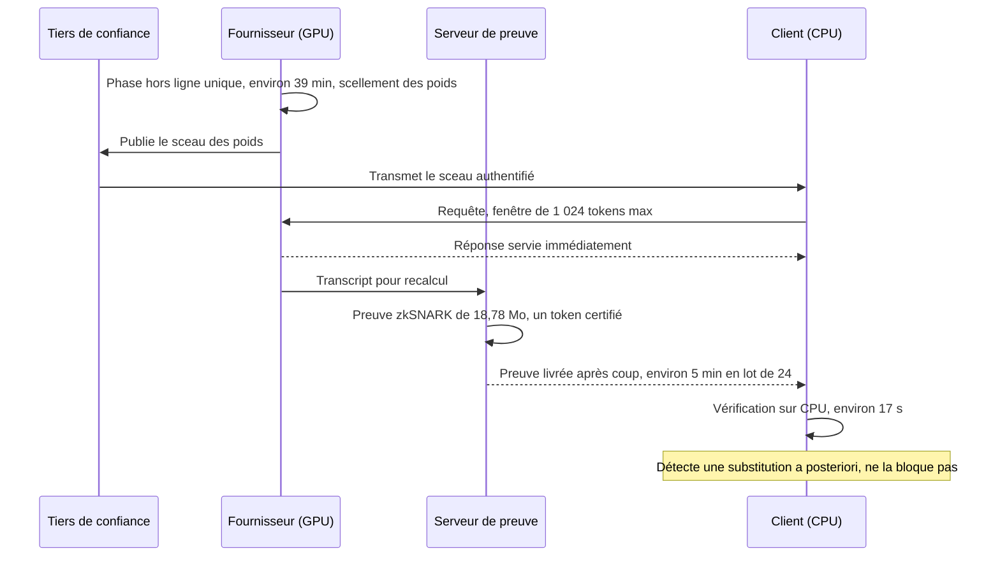
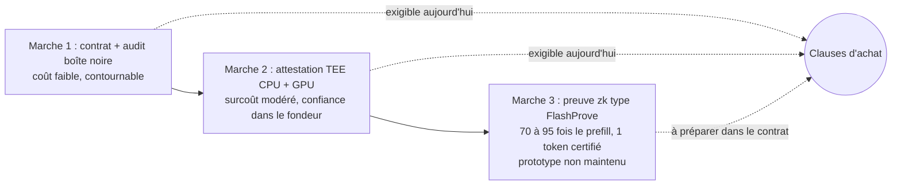

## Vous payez un modèle, vous recevez des mots

Un directeur informatique qui signe pour un grand modèle de langage haut de gamme ne reçoit jamais le modèle. Il reçoit des mots, facturés à l'unité, produits par une machine qu'il ne verra jamais.

Le concierge virtuel d'une chaîne hôtelière, l'assistant qui guide les vendeurs d'un réseau de magasins, le bot qui répond à deux heures du matin aux étudiants d'une résidence : tous reposent sur une promesse que personne ne contrôle. Celle que le fournisseur sert bien le modèle commandé, dans la version et la précision annoncées.

Que cette promesse glisse, et rien ne bouge sur la facture. Un modèle plus petit aux heures de pointe. Une version plus compressée pour tenir les marges. Un routeur qui bascule en silence vers un prestataire moins cher. Le client ne voit qu'une qualité qui s'effrite, sans pouvoir dire pourquoi. Sur un contrat d'inférence, c'est un angle mort béant.

Le 2 novembre, l'équipe Frontier Red Team d'Anthropic a publié FlashProve, un prototype open source qui prouve mathématiquement, après coup, qu'un fragment de réponse provient bien d'un modèle précis. Pas d'une copie au rabais, pas d'un cousin plus léger. Il est loin d'être utilisable en production, et son dépôt de code se présente lui-même comme un prototype de recherche. Mais il fixe dès aujourd'hui le vocabulaire que tout acheteur d'IA devrait écrire dans ses contrats. C'est là que se joue l'enjeu, bien plus que dans la cryptographie.

## Le grand cru servi en carafe

Une image aide à saisir le problème. Vous commandez un grand cru au restaurant. Le sommelier l'apporte déjà décanté, en carafe, sans la bouteille. Vous goûtez : c'est bon, ou du moins pas mauvais. Avez-vous bu le millésime payé, ou le vin de la maison ? Sans étiquette, seul un palais expert pourrait trancher, après beaucoup de dégustations, et encore.

C'est exactement la position du client d'une API d'inférence, le service qui exécute un modèle à la demande et renvoie sa réponse. Pas de bouteille. Seulement le vin.

Des chercheurs de UC Berkeley ont formalisé ce risque dans un papier présenté à NeurIPS 2025. Ils distinguent plusieurs formes de substitution. La première consiste à servir une version quantifiée du modèle, c'est-à-dire compressée : chaque paramètre est stocké sur moins de bits, ce qui économise du matériel au prix d'une précision moindre. La deuxième mélange au hasard le modèle promis et un modèle moins coûteux. La troisième, la plus retorse, est l'évasion d'audit : servir le vrai modèle uniquement quand on soupçonne un contrôle.

Leur conclusion est sévère pour les méthodes logicielles en boîte noire. Les tests statistiques réclament énormément de requêtes pour conclure. Les probabilités que certaines API renvoient pour chaque token (les *log-probs*) sont brouillées par le non-déterminisme du calcul sur GPU. Deux exécutions honnêtes ne donnent pas toujours exactement le même résultat, si bien que le bruit d'un fournisseur honnête ressemble furieusement à celui d'un tricheur. Les auteurs se tournent donc vers le matériel de confiance, sur lequel je reviendrai.

Le problème n'a rien de théorique. Moonshot AI, l'éditeur du modèle ouvert Kimi, a publié en open source un Kimi Vendor Verifier pour contrôler les fournisseurs tiers qui hébergent son modèle K2.6. L'outil traque les paramètres d'échantillonnage non respectés, les bugs de cache, la dégradation due à la quantification et les appels d'outils défaillants. Quand un éditeur doit outiller la surveillance de ses propres hébergeurs, c'est que le risque d'écart est jugé assez réel pour justifier l'effort.

Un point mérite d'être souligné. Pour le client final, la différence entre fraude et bug d'implémentation est académique : dans les deux cas, la qualité promise n'est pas livrée. Or les contrats d'inférence s'engagent d'ordinaire, à ma connaissance, sur la disponibilité et la latence, rarement sur l'identité exacte de ce qui calcule. Le SLA (l'accord de niveau de service) garantit que la machine répond vite. Il ne dit rien de qui répond.

## FlashProve : sceller les poids, prouver la sortie

Changez de point de vue. Imaginez pouvoir vérifier, depuis un serveur banal sans GPU et en une vingtaine de secondes, qu'un token produit par un modèle de 400 milliards de paramètres vient bien de ce modèle-là. Sans jamais voir ses poids, ces milliards de coefficients qui constituent le modèle et que le fournisseur peut garder secrets. C'est ce que FlashProve démontre, en laboratoire.

Le prototype est cosigné par des chercheurs d'Anthropic, de l'EPFL, du MIT, de StarkWare et de Succinct, dont le cryptographe Alessandro Chiesa. Il repose sur un principe en deux temps, baptisé *commit-and-prove* : s'engager, puis prouver.

*Des centaines de gigaoctets de poids scellés dans une empreinte courte : la phase d'engagement, préalable à toute preuve.*

Premier temps, hors ligne : le fournisseur scelle ses poids. Il calcule une empreinte courte qui ne révèle rien de leur contenu, mais qu'il ne pourra plus renier. Pensez à une enveloppe cachetée déposée chez un notaire. Sur le modèle testé, cette étape prend environ 39 minutes, une seule fois par modèle, et laisse environ 2,15 Go de fichiers côté fournisseur.

Second temps, à chaque requête : le fournisseur génère un zkSNARK. Derrière l'acronyme se cache une preuve *à divulgation nulle de connaissance* (zero-knowledge) : compacte, rapide à vérifier, elle convainc sans rien révéler des données qui ont servi à la construire. L'énoncé prouvé tient en une phrase : « le modèle (engagé), étant donné les tokens d'entrée, produit les tokens de sortie annoncés ».

Côté client, la vérification tourne sur un simple processeur, sans GPU ni accès aux poids. Comptez 17 secondes sur 24 threads, 21 secondes sur un seul, contrôles de la phase hors ligne inclus. Il faut télécharger une fois 6,24 Mo (l'engagement et ses pièces justificatives), puis une preuve de 18,78 Mo par requête.

Le socle cryptographique est volontairement minimal : une seule fonction de hachage, BLAKE2, traitée comme un *oracle aléatoire* idéal. Pas de matériel de confiance, pas de clé détenue par un fondeur, et une sécurité jugée plausiblement résistante aux futurs ordinateurs quantiques. Les auteurs rappellent, honnêtement, que ce modèle idéalisé n'offre plus de garantie formelle une fois remplacé par une fonction de hachage réelle.

Les propriétés clés (complétude, robustesse face à un tricheur, divulgation nulle) sont formalisées dans Lean 4, un assistant de preuve mathématique. Selon les auteurs (rapport et README), la probabilité qu'un tricheur échappe à la détection est négligeable, sous les hypothèses du modèle de l'oracle aléatoire.

Reste un détail qui n'en est pas un. Le dépôt précise que l'identifiant d'engagement doit provenir d'une partie de confiance, jamais du serveur que l'on cherche à vérifier. Logique : si le tricheur fournit lui-même le sceau, il scelle ce qu'il veut. Les sources publiées ne décrivent pas qui joue ce rôle de notaire, ni comment on relie un sceau à un modèle nommé. C'est ma lecture, mais elle compte : sans cette gouvernance, une preuve parfaite atteste seulement la cohérence avec des poids que personne n'a identifiés.

*Qui fait confiance à qui : le client ne croit ni le fournisseur ni son matériel, seulement le sceau transmis par un tiers et la preuve.*

## 110 tokens par seconde, un chiffre à lire deux fois

Le banc d'essai est sérieux : Llama 4 Maverick, un modèle de 400 milliards de paramètres de type MoE (*mixture of experts*, où chaque token n'active qu'une partie des 128 sous-réseaux spécialisés). Ses poids publics en 4 bits ont été convertis en nombres entiers. Le tout tourne sur un seul GPU NVIDIA H100 épaulé par 24 cœurs CPU, les 232 Go de poids étant stockés en mémoire vive et transférés au fil de l'eau vers le GPU. Chaque requête est limitée à une fenêtre de 1 024 tokens.

Le chiffre phare est 110 tokens par seconde. Lu comme une vitesse de génération, il est trompeur : le rapport précise qu'ici un token est n'importe lequel des 1 024 tokens de la requête, puisque le prouveur les traite tous, alors que chaque preuve n'en vérifie qu'un seul, celui qui suit le prompt (le choix le plus probable du modèle engagé). Les auteurs ont aussi essayé de vérifier tous les tokens de la réponse, sans écart de vitesse mesurable ; en ne comptant que les tokens vérifiés, ils donnent 39,1 tokens par seconde (formulation ambiguë, que je lis comme se rapportant à cette variante). Dans la configuration à un token par preuve, le débit en tokens vérifiés serait donc de l'ordre d'un dixième de token par seconde.

La latence suit. Un lot de 24 requêtes se prouve en environ 223 secondes. Côté client, une requête prise dans un lot attend près de 5 minutes avant que sa preuve soit disponible. Prouvée seule, elle sort en 58 secondes, mais le débit chute alors à 17,6 tokens par seconde.

Reste le surcoût. Ramené à un GPU, prouver un lot de 24 requêtes prend environ 72 fois plus de temps (de 66 à 77 fois selon les essais) que leur simple *prefill*, la phase où le modèle lit le prompt avant de répondre. À la charge maximale testée, l'écart monte à 94 fois.

Attention à la référence, toutefois. Le prefill de comparaison tourne sur vLLM, un moteur de service de modèles open source, en FP8 (nombres à virgule sur 8 bits) et sur 8 H100. Ni la même quantification, ni le même périmètre. C'est un ordre de grandeur, pas un benchmark à conditions égales. Le rapport rappelle d'ailleurs que les meilleurs prouveurs sont typiquement plus de 200 fois plus lents que le calcul qu'ils prouvent.

## Ce que la preuve ne dit pas

La preuve est post-hoc. La réponse est servie immédiatement au client, et la preuve est calculée ensuite, sur des serveurs séparés, en refaisant le calcul. Anthropic l'assume : FlashProve ne prévient pas une réponse falsifiée, il la détecte a posteriori. Le rapport note même qu'un adversaire ayant compromis le serveur pourrait altérer les journaux. C'est un détecteur de fumée, pas un extincteur.

Deuxième nuance, plus subtile. La preuve porte sur une version entière des poids, avec un décodage qui choisit toujours le token le plus probable. Si le fournisseur sert le modèle en virgule flottante, ou avec un tirage aléatoire des tokens, sa réponse peut diverger du modèle prouvé sans la moindre triche. Pour séparer bruit numérique et falsification, le rapport renvoie à des travaux statistiques externes.

Les limites déclarées sont nettes. Seuls les modèles MoE sont couverts, avec un contexte de 1 024 tokens et un prouveur sur un unique GPU. Les canaux auxiliaires, comme le temps de génération des preuves, sont hors périmètre. Et la preuve ne démontre pas l'absence d'un entraînement mené en parallèle sur le même matériel.

Vient enfin le statut d'assurance, et ici Anthropic mérite un crédit d'honnêteté. Selon le rapport, la description détaillée du protocole dans le dépôt a été générée par IA et n'a pas été relue en détail par les auteurs. Le code GPU du prouveur et le code CPU du vérificateur ont été générés par IA à partir de la spécification Lean, sans preuve d'équivalence. La divulgation nulle n'est démontrée formellement que pour des requêtes prouvées une par une, pas en lot. Le vérificateur rapide en C++ n'a aucune garantie formelle ; il s'accorde simplement avec le vérificateur Lean sur les tests.

Résumons sans détour. Les garanties Lean portent sur le protocole abstrait, pas sur le binaire qui tourne.

Le dépôt, en version 0.16.0 sous licence Apache 2.0, se présente comme « research prototype ... Not maintained » et n'accepte pas de contributions. Un article relu par les pairs est annoncé pour plus tard. Deux jours après la publication, aucune reproduction ni analyse indépendante n'était encore visible.

Faut-il pour autant ranger FlashProve parmi les curiosités de laboratoire ? Non, parce que c'est la pente qui compte. En 2024, zkLLM (Université de Waterloo, CCS 2024) revendiquait la première preuve à divulgation nulle spécialisée pour les grands modèles de langage, sur des modèles bien plus petits. Fin 2025, le preprint ZK-DeepSeek visait les 671 milliards de paramètres de DeepSeek-V3. Il ne mesurait pourtant que des composants isolés, avec jusqu'à 57 heures environ pour une seule multiplication de matrices.

Le dépôt indépendant et non audité VerInf revendique une preuve sur Maverick complet, avec une garantie d'une autre nature, mais sa preuve pèse 93,6 Go et se vérifie en 17,7 heures. FlashProve tient en 18,78 Mo par preuve, vérifiée en 17 secondes. Les périmètres diffèrent, l'écart d'ordre de grandeur saute aux yeux. Rien ne garantit que la courbe continue. Elle existe, en tout cas.

## En attendant la preuve : enclaves et coups de sonde

Si la preuve cryptographique est pour demain, que peut exiger un acheteur aujourd'hui ? Deux familles d'outils existent, chacune avec son prix.

Commençons par le maillon qui me semble le plus exposé : la couche de routage. Un routeur qui répartit les requêtes entre plusieurs fournisseurs promet de la résilience. Configuré en *best effort*, il peut aussi, quand le fournisseur principal sature, envoyer la requête vers un autre hébergeur ou un autre modèle sans prévenir l'application cliente. Pas forcément de la fraude. Pour le client, une substitution quand même.

*Un flux qui bifurque discrètement vers une machine plus modeste : la substitution silencieuse peut se loger dans la couche de routage.*

Première famille d'outils : le matériel de confiance. Un TEE (environnement d'exécution de confiance) est une zone isolée et chiffrée du processeur, dont le contenu échappe même à l'administrateur de la machine. Surtout, il sait produire une attestation, c'est-à-dire un rapport signé décrivant ce qu'il exécute. Les GPU H100 disposent d'un mode confidentiel, que l'on combine avec un TEE côté processeur central, comme Intel TDX.

Le coût en performance semble modeste, selon les mesures disponibles. Un papier d'auteurs liés à Phala Network, acteur de l'écosystème TEE, annonce sur H100 un surcoût « sous 7 % pour la majorité des requêtes typiques ». Prudence : auteurs parties prenantes, trois modèles testés, incohérences entre texte et tableaux. De son côté, OpenPcc (Ohio State, juin 2026) combine Intel TDX et H100 confidentiel. Le délai avant le premier token y augmente de 6,7 % en médiane, et jusqu'à 28,9 % dans le pire cas. Le tout sur une seule machine et un modèle de 8 milliards de paramètres.

Le vrai sujet n'est pas la performance, c'est la confiance. Avec un TEE, elle reste ancrée chez les fondeurs et dans leur chaîne d'attestation. NVIDIA présente son attestation GPU comme la preuve cryptographique que la puce est authentique et exécute un firmware NVIDIA authentique. Prouver que la puce est la bonne ne prouve pas que le modèle l'est. Il faut, à mon sens, composer toute la chaîne (processeur, GPU, logiciel de service), comme OpenPcc le fait via un vérificateur tiers, Intel Trust Authority.

Et cette chaîne a des failles physiques. Fin octobre 2025, The Hacker News a rapporté les travaux TEE.fail de chercheurs de Georgia Tech, de Purdue et de Synkhronix. Un petit montage glissé entre le processeur et la mémoire, pour moins de 1 000 USD, permettrait d'extraire des clés d'attestation sur les enclaves d'Intel et d'AMD (TDX, SGX, SEV-SNP). Selon les chercheurs, il permettrait même de se faire passer pour un GPU NVIDIA attesté.

Les réserves sont nombreuses. L'attaque exige un accès physique, Intel et AMD la jugent hors de leur périmètre, et aucune exploitation réelle n'a été rapportée. L'article ne cite aucune réponse de NVIDIA, et le volet GPU n'est confirmé par aucune source primaire. Une seule source presse, donc.

Retenez pourtant la logique. Dans un scénario de substitution, l'adversaire n'est pas un pirate venu de l'extérieur. C'est l'opérateur qui héberge la machine, celui-là même qui y a un accès physique : exactement le profil que les modèles de menace des TEE laissent de côté. La preuve à divulgation nulle n'a pas cette dépendance matérielle, et le rapport précise que seule la robustesse du vérificateur compte : une erreur dans le code du prouveur ne peut pas la compromettre.

Seconde famille d'outils : l'audit par échantillonnage. Le principe est celui du contrôle fiscal. On ne vérifie pas toutes les déclarations, mais le risque d'être contrôlé suffit à dissuader. IMMACULATE (NUS, NTU, UC Berkeley, février 2026) applique cette logique avec du calcul vérifiable, sans matériel de confiance côté serveur. La perte de débit en usage normal reste faible, de 0,3 à 1,0 %. En revanche, vérifier une requête auditée est 400 à 900 fois plus lent que l'inférence sur GPU.

La détection a ses angles morts. Par requête auditée, une substitution de modèle est repérée dans 40 % des cas ou plus, une quantification FP8 dans seulement 1,3 à 10,3 % des cas. Le système suppose un serveur qui triche sur au moins 10 % des requêtes, et la substitution n'a pas été testée sur des modèles MoE. Autrement dit, la triche la plus tentante, compresser un peu le modèle, est aussi la plus difficile à attraper.

L'échantillonnage change aussi l'équation de FlashProve. Voici un calcul de coin de table, le mien et non celui du rapport : prouver une requête sur cent, à 72 fois le prefill, coûterait environ 0,7 fois le temps GPU de prefill de l'ensemble du trafic. Cela ne vaut que pour le prefill et n'a rien d'un coût de production. Mais cela montre qu'un surcoût rédhibitoire en continu devient pilotable en contrôle aléatoire.

## Trois marches, un seul contrat

*L'escalier de la confiance : le contrat, l'attestation matérielle, puis la preuve cryptographique.*

L'assurance contre la substitution se gravit comme un escalier. Première marche : le contrat et l'audit en boîte noire, peu coûteux mais contournables. Deuxième marche : l'attestation matérielle, au surcoût modéré mais dont la confiance est déléguée aux fondeurs. Troisième marche : la preuve cryptographique, affranchie du matériel, mais encore au stade du prototype.

Voici ce que je mettrais aujourd'hui dans un contrat d'inférence ou de routage. C'est une analyse personnelle, pas une recommandation sourcée. Elle vaut pour tous les secteurs qui embarquent de l'IA dans un service client : hôtellerie, retail, résidences étudiantes, grands comptes.

- **Non-substitution explicite.** Identifiant précis du modèle et de sa version, niveau de quantification déclaré (FP16, FP8, INT4), paramètres de décodage. Aucun basculement silencieux. Pour un routeur : épinglage du fournisseur et du modèle, pas de *best effort* sans notification.
- **Droit d'audit.** Le client, ou un tiers mandaté, peut soumettre des requêtes de contrôle et faire tourner des batteries de tests régulières, dans l'esprit du Kimi Vendor Verifier : cache, quantification, appels d'outils.
- **Attestations vérifiables.** Rapports d'attestation TEE, côté processeur et côté GPU, vérifiés par un tiers, conservés et renouvelés. Avec leurs limites écrites noir sur blanc : confiance dans le fondeur, exposition aux attaques physiques.
- **Clause « prête pour la preuve ».** Le fournisseur s'engage à adopter un mécanisme d'engagement sur les poids et de preuve vérifiable, zk ou équivalent, dès qu'il sera praticable. L'identifiant d'engagement est délivré par un tiers de confiance, jamais par le fournisseur seul.
- **Pénalités liées à la substitution.** Crédits de service, droit de résiliation, journalisation immuable, notification préalable de tout changement de modèle.
- **Données.** La preuve ne couvre pas les fuites. Chiffrement, minimisation et isolation des données clients restent indispensables.

*Les deux premières marches s'exigent dès maintenant ; la troisième s'anticipe par écrit.*

Soyons lucides sur ce qu'aucune marche ne couvre. Une preuve établit la cohérence avec des poids engagés, pas la qualité du modèle ni l'absence de biais. Elle ne s'applique pas, en l'état, aux modèles denses, ni aux API fermées d'un tiers qui n'adopterait pas le protocole.

On peut enfin lire FlashProve comme un coup d'image autant que comme une avancée : un fournisseur de modèles qui publie l'outil pour vérifier les fournisseurs de modèles. C'est possible. Mais le code est ouvert, sous Apache 2.0, et cosigné par des chercheurs en cryptographie reconnus. Cela ne vaut pas validation indépendante. Cela donne du poids.

## Écrire les clauses, pas déployer la crypto

Personne ne devrait déployer FlashProve en production. Cinq minutes d'attente par preuve en lot, un seul token certifié, un surcoût de l'ordre de 70 à 95 fois le prefill, un code généré par IA et non maintenu : le verdict est sans appel.

Ce prototype a pourtant fait quelque chose de plus durable qu'un benchmark. Il a donné une forme précise à une exigence floue. La vague envie d'être sûr qu'on vous sert le bon modèle devient trois exigences testables : un engagement public sur des poids, un identifiant tenu par un tiers, une preuve vérifiable par le client sans faire confiance au fournisseur. Ce vocabulaire-là s'écrit dans un contrat dès lundi.

Le chiffrement des sites web a longtemps été une option réservée aux pages de paiement, avant de devenir la norme. Si la vérification passe un jour de 17 secondes à une fraction de seconde, et le surcoût de 70 fois à quelque chose comme 2 fois, la preuve d'inférence pourrait suivre le même chemin. Rien ne garantit ce calendrier, ni même cette issue. Mais ce jour-là, le contrat qui n'exigeait pas de preuve sera celui qui n'avait rien anticipé.

Ma position est simple. Aujourd'hui, on écrit les clauses, on ne déploie pas la crypto. Et on traite l'identité du modèle comme on traite déjà la disponibilité : un engagement mesurable, auditable, pénalisable.

---

_Vues personnelles, pas position Wifirst._

## Sources

1. Anthropic, « Progress on provable inference for LLMs », 2 novembre 2026 : https://www.anthropic.com/research/provable-inference
2. Anthropic, FlashProve, rapport technique, novembre 2026 : https://www.anthropic.com/document/flashprove-technical-report
3. GitHub, anthropics/FlashProve (dépôt et README) : https://github.com/anthropics/FlashProve
4. Sun, Li, Zhang, zkLLM, arXiv:2404.16109, CCS 2024 : https://arxiv.org/abs/2404.16109
5. Wang, ZK-DeepSeek, arXiv:2511.19902, preprint, novembre 2025 : https://arxiv.org/html/2511.19902
6. VerInf (JamesPetrie), dépôt tiers non audité : https://github.com/JamesPetrie/VerInf
7. Guo et al., IMMACULATE, arXiv:2602.22700, février 2026 : https://arxiv.org/html/2602.22700
8. Cai, Shi, Zhao, Song, Auditing Model Substitution in LLM APIs, arXiv:2504.04715, NeurIPS 2025 : https://arxiv.org/abs/2504.04715
9. Zhu et al., Confidential Computing on NVIDIA Hopper GPUs, arXiv:2409.03992v4 : https://arxiv.org/html/2409.03992v4
10. Zhou et al., OpenPcc, arXiv:2606.11145, juin 2026 : https://arxiv.org/html/2606.11145v1
11. The Hacker News, TEE.fail, 28 octobre 2025 : https://thehackernews.com/2025/10/new-teefail-side-channel-attack.html
12. NVIDIA Attestation Suite, documentation : https://docs.nvidia.com/attestation/index.html
13. Moonshot AI, Kimi Vendor Verifier : https://www.kimi.com/en/blog/kimi-vendor-verifier
