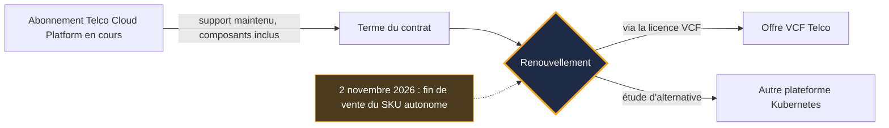
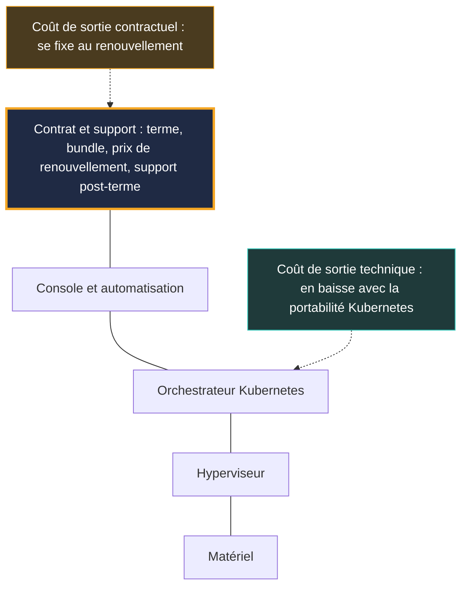

## Une ligne de catalogue, et tout un rapport de force

Le 2 novembre 2026, une référence a quitté le catalogue de Broadcom. Pas de faille critique, pas de panne mondiale, pas de grand-messe sur scène. Juste une offre qui ne sera plus vendue : la licence autonome de VMware Telco Cloud Platform, le socle logiciel sur lequel des opérateurs mobiles font tourner une partie de leur cœur de réseau 4G et 5G.

Pour les clients concernés, rien ne bouge demain matin. Les abonnements en cours restent supportés jusqu'à leur terme, et Broadcom précise qu'aucune action immédiate n'est requise. C'est au renouvellement que tout se joue : la route passe alors par VMware Cloud Foundation (VCF), la suite intégrée de l'éditeur, déclinée dans une nouvelle offre baptisée VCF Telco.

On pourrait ranger l'affaire au rayon « ajustement de packaging ». Ce serait passer à côté. Depuis que VMware est passé sous pavillon Broadcom, AT&T et T-Mobile US ont porté leurs différends avec l'éditeur devant les juges. Ces litiges concernaient des licences perpétuelles, pas ce produit. Mais leur point de friction n'a jamais été technique : c'était le support, sa durée, son prix.

Ma lecture : le verrou VMware a changé d'adresse. Il ne se loge plus seulement dans l'hyperviseur, il se loge dans le contrat. La question utile pour un CTO n'est plus « quelle plateforme ? », mais « quelles clauses signe-t-on avant la prochaine échéance ? ».

## Ce qui s'arrête le 2 novembre, ce qui continue

Commençons par les faits, parce que la rumeur va toujours plus vite que le catalogue.

Dans un [billet publié le 2 novembre 2026](https://blogs.vmware.com/cloud-foundation/2026/11/02/introducing-vmware-cloud-foundation-telco/) et signé Anupama Mahabhashyam et Odded Solomon, Broadcom annonce la fin de commercialisation (EOA, pour *End of Availability*) des références de licence autonomes de Telco Cloud Platform, les SKU dans le jargon des catalogues. La plateforme est désormais fournie à travers la licence et la référence VCF. Broadcom ajoute qu'elle n'est plus développée comme un produit autonome.

Ce qui continue compte autant. Les abonnements existants restent supportés, composants compris, pendant la transition. Au renouvellement, un représentant de Broadcom accompagne le client pour aligner ses besoins sur VCF. [SDxCentral](https://www.sdxcentral.com/news/broadcom-kills-vmware-telco-cloud-platform-standalone-license-option/), qui a couvert l'annonce le 3 novembre, décrit la même mécanique : support maintenu sous les contrats d'origine, passage à la nouvelle offre à la fin du terme. L'article ne donne aucun prix.

En clair : Broadcom ferme l'option autonome, il ne coupe pas le courant. Tant que votre contrat court, votre plateforme vit. C'est le jour du renouvellement qui devient le moment de vérité.

*Le cycle de vie d'un abonnement après l'annonce : rien ne change avant le terme, tout se décide au renouvellement.*

Le mouvement ne sort pas de nulle part. Dès mars 2025, le cabinet [Omdia](https://omdia.tech.informa.com/om128647/vmware-by-broadcom-moves-to-horizontal-cloud-approach-for-telcos-spanning-it-and-network-functions) décrivait un Broadcom qui simplifiait sa route vers le marché en regroupant VCF et Telco Cloud Automation, son outil d'orchestration des fonctions réseau, dans un bundle unique vendu sous la marque Telco Cloud Platform. L'EOA de novembre 2026 prolonge cette trajectoire. Moins de références, des paquets plus gros, une seule porte d'entrée.

## VCF Telco : on ne loue plus la pièce, on loue l'étage

Imaginez un propriétaire de bureaux qui cesse de louer des pièces à l'unité. Les locataires en place gardent leur bail jusqu'au terme. Ensuite, la seule offre au catalogue, c'est l'étage entier : salle de réunion, cafétéria et gardiennage compris. L'étage est peut-être mieux équipé. Il est peut-être même plus rentable à l'usage. Mais on ne négocie plus du tout la même chose, et le loyer n'est affiché nulle part.

C'est, à peu de chose près, la situation d'un opérateur face à VCF Telco. Selon la liste publiée par Broadcom, qu'aucun tiers n'a encore auditée, l'offre regroupe :

- une fiabilité dite *carrier-grade* : haute disponibilité, tolérance de panne, sauvegarde et restauration, plan de reprise d'activité ;
- une gestion de flotte avec cycle de vie *zero-touch* et une observabilité partagée via VCF Operations ;
- des services d'IA privée (Private AI Services), y compris en déploiement totalement isolé d'internet (*air-gapped*) ;
- le support des fonctions réseau virtualisées et conteneurisées (VNF et CNF), avec isolation entre clients (multi-tenant) ;
- le NVMe memory tiering, qui étend la mémoire vive sur des disques rapides, et des clés de chiffrement contrôlées par le client ;
- un alignement revendiqué sur les référentiels du NIST américain et sur le UK Telecommunications Security Act ;
- en option, la micro-segmentation vDefend.

Un point mérite qu'on s'y arrête : le support long terme de Kubernetes (LTS, pour *Long-Term Support*). Broadcom annonce deux ans de LTS pour chaque version mineure de Kubernetes, un support qu'il qualifie de *flexible*.

Pour mesurer ce que cela représente, il faut le comparer à l'amont. Le projet Kubernetes supporte chaque version mineure environ 14 mois : 12 mois de période standard, puis 2 mois de maintenance. La [page officielle des versions](https://kubernetes.io/releases/patch-releases/), consultée le 4 novembre 2026, en donne un exemple : la 1.37 entre en maintenance le 28 août 2027 et atteint sa fin de vie le 28 octobre 2027. Vingt-quatre mois contre quatorze : environ dix mois de répit supplémentaire.

Pour un opérateur, dix mois, c'est beaucoup. Monter de version un cœur de réseau mobile, c'est une fenêtre de maintenance, des tests de non-régression avec chaque éditeur de fonctions réseau, un risque direct sur le service. Moins de montées de version subies, c'est moins d'occasions de casser la production.

Deux réserves, toutefois. D'abord, c'est un engagement de l'éditeur, pas de la communauté : au-delà de la fenêtre amont, les correctifs sont produits par Broadcom, à son rythme. Ensuite, le billet ne détaille pas les conditions. Correctifs de sécurité seuls, ou aussi fonctionnels ? Quelles versions exactement ? Que recouvre l'adjectif *flexible* ? Tant que ces réponses ne figurent pas dans un contrat, ce LTS reste une promesse, pas une garantie.

*Plus la pile est intégrée, plus le contrat qui l'enveloppe pèse dans la décision.*

## Le prix, case vide du dossier

Voici la partie inconfortable : personne ne sait publiquement ce que coûte VCF Telco. Ni le billet de Broadcom ni la presse spécialisée ne publient de grille. Aucun pourcentage de hausse ne peut être attribué à ce changement précis.

Ce qu'on a, ce sont des bornes d'alerte. Toutes datées, toutes à manier avec des pincettes.

Côté analystes, [ABI Research](https://www.abiresearch.com/market-research/insight/7785446-vmware-exodus-has-begun-creating-major-opp) estimait en décembre 2024 qu'un opérateur ne licenciant que la couche conteneurs de Telco Cloud (le CaaS, pour *containers-as-a-service*) pourrait voir ses coûts de licence multipliés par 10, voire par 100, en passant à VCF. Le périmètre est étroit. Une estimation d'analyste vieille de près de deux ans, sur le seul cas de la licence CaaS, jamais mesurée sur VCF Telco. Ce n'est pas une prévision de facture : c'est l'ordre de grandeur de ce que peut coûter un changement de périmètre quand on n'utilisait qu'une brique.

ABI ajoutait que la plupart des opérateurs télécom se situent hors du top 2 000 des clients de Broadcom, et que l'éditeur pourrait à terme réduire son développement logiciel télécom. C'est une hypothèse d'analyste. À court terme, les faits disent plutôt l'inverse : une nouvelle version majeure en 2026, puis une offre dédiée en novembre.

Côté éditeur, le discours est opposé. Au Mobile World Congress 2026, Broadcom a présenté Telco Cloud Platform 9, bâtie sur VCF 9. Les chiffres rapportés par [SDxCentral](https://www.sdxcentral.com/news/broadcom-bets-vmware-telco-clouds-future-on-ai-and-sovereign-services/) le 2 mars 2026 sont flatteurs : 40 % d'économies cumulées sur cinq ans en coût total de possession (TCO) face à des architectures cloisonnées, et 38 % de baisse des coûts mémoire, serveur et stockage. Ce sont des revendications de l'éditeur, jamais vérifiées de façon indépendante.

Entre un analyste qui évoque un facteur 10 à 100 et un éditeur qui annonce 40 % d'économies, la vérité dépend d'une seule variable : votre contrat actuel. Si vous utilisiez déjà l'essentiel de la pile, le bundle peut ne rien changer, voire simplifier. Si vous n'utilisiez qu'une brique, l'équation peut être tout autre. Personne ne fera ce calcul à votre place, et surtout pas le représentant qui vous accompagnera au renouvellement.

## Les précédents : un faisceau de signaux, pas une preuve

Avant de signer, regardez comment se sont déroulées les négociations des autres. Avec une règle stricte : aucun des dossiers qui suivent n'est une conséquence de l'annonce du 2 novembre. Ce sont des précédents de comportement contractuel, rien de plus.

**Boost Mobile, l'ex-client vitrine.** SDxCentral rappelait en mars 2026 que Boost avait été le client phare de Telco Cloud Platform. L'opérateur a remplacé sa couche CaaS VMware par Wind River Studio Operator. Selon [SDxCentral](https://www.sdxcentral.com/news/broadcom-kills-vmware-telco-cloud-platform-standalone-license-option/) (3 novembre 2026), son CTO a justifié ce départ par des pratiques tarifaires jugées abusives. ABI Research rapporte une autre version : le CTO d'EchoStar attribue le choix à la valeur technique de Wind River, tout en mentionnant une rumeur de motif tarifaire. Deux précisions comptent. Le remplacement ne porte que sur la couche CaaS. Et il a été annoncé en décembre 2024 : ce n'est pas une réaction à l'EOA de 2026.

**AT&T, l'échelle du problème.** Dans ses dépôts et témoignages devant la Cour suprême de l'État de New York en 2024, AT&T évoquait environ 8 600 serveurs et 75 000 machines virtuelles VMware, et une hausse annuelle proposée de 1 050 %, soit plus de dix fois la facture, selon [CIO Dive](https://www.ciodive.com/news/att-broadcom-vmware-price-hikes-court-battle/728603/). Ce sont les allégations d'une partie. Broadcom les contestait et reprochait à AT&T, selon [TechTarget](https://www.techtarget.com/it-infrastructure/news/366612033/Broadcom-ATT-is-trying-to-rewind-the-clock-on-VMware), de vouloir revenir à un modèle de licence abandonné. Le litige portait sur le support de licences perpétuelles. Il s'est réglé de façon confidentielle, selon The Register et SDxCentral en juillet 2026.

**T-Mobile US, le feuilleton du support.** Un accord d'août 2023 prévoyait des licences perpétuelles, deux ans de support et une année optionnelle. En 2024, Broadcom a fait savoir qu'il ne renouvellerait pas. Un juge a ordonné le maintien du support au-delà d'août 2025, T-Mobile versant 5,28 M USD et déposant 500 000 USD de garantie. D'après les pièces de procédure rapportées le 1er juillet 2026 par [SDxCentral](https://www.sdxcentral.com/news/t-mobile-us-also-has-broadcom-beef-over-vmware-changes-report/) et [The Register](https://www.theregister.com/a/5264750), le dépôt de Broadcom recense plus de 303 000 cœurs CPU. T-Mobile proposait 20 M USD pour deux ans de support ; Broadcom a ensuite avancé 24 M USD pour six produits. Selon The Register, le VP technologie de l'opérateur expliquait vouloir achever sa transition hors de VMware à un rythme plus mesuré. Le média juge cette migration apparente, sans qu'elle soit confirmée. L'injonction expirait le 3 août 2026 ; je n'ai pas trouvé d'issue publique depuis. Là encore : licences perpétuelles, pas Telco Cloud Platform.

**DoCoMo et Telia, l'autre face.** Tout le monde ne part pas. Selon [SDxCentral](https://www.sdxcentral.com/news/broadcom-and-ntt-docomo-sign-decade-long-vmware-deal/) (20 octobre 2026), NTT DoCoMo a signé avec Broadcom un accord de dix ans couvrant licences, maintenance et assistance technique pour des produits VMware, dont VCF. C'est une première pour Broadcom au Japon, et aucun montant n'a été publié. Attention au périmètre : VCF et produits VMware en général, pas Telco Cloud Platform. En novembre 2024, Telia élargissait de son côté son partenariat sur Telco Cloud Platform et VCF, par un accord pluriannuel sans durée précisée ([Capacity](http://capacityglobal.com/article/telia-modernises-network-infrastructure-in-expanded-broadcom-vmware-deal)).

Mis bout à bout, ces dossiers dessinent un motif. Le point de friction n'est jamais la qualité de l'hyperviseur. C'est la durée du support, son prix, le périmètre de ce qu'on achète, et ce qui se passe le jour où le contrat arrive à terme. Ceux qui restent signent long. Ceux qui s'en vont se battent pour gagner du temps.

## Le verrou a changé d'adresse

*Lecture éditoriale, hors périmètre des sources.*

Longtemps, le verrou VMware a été technique. Il tenait aux formats de machines virtuelles, aux outils d'administration, aux compétences des équipes, à l'écosystème d'éditeurs certifiés. Sortir, c'était tout réécrire, tout recertifier, tout réapprendre.

Ce verrou-là s'érode. Le passage aux fonctions réseau conteneurisées a déplacé une bonne partie de la portabilité vers Kubernetes. Côté éditeurs, le multi-plateforme n'est d'ailleurs pas nouveau : dès 2022, Ericsson validait son cœur de réseau cloud-native sur VMware en avril, puis sur Red Hat OpenShift en juin ([SDxCentral](https://www.sdxcentral.com/news/ericsson-cloud-native-5g-core-rides-red-hat-openshift/)). Nokia illustre la même ambivalence, selon SDxCentral en mars 2026. L'équipementier a apporté une citation de soutien au lancement de Telco Cloud Platform 9, tout en déplaçant son développement cloud principal vers Red Hat et en continuant de valider ses fonctions réseau sur VMware.

Ce qui ne s'érode pas, c'est le verrou contractuel : le terme, la règle de comptage des cœurs, le périmètre du bundle, le prix de renouvellement, la durée du support après terme. La serrure s'est assouplie. C'est désormais le bail qui fixe le prix de la sortie.

*Où se loge le verrou : la portabilité Kubernetes allège la sortie technique, le contrat concentre désormais le coût de sortie.*

La conséquence est contre-intuitive. Plus votre architecture s'ouvre, plus le contrat devient le vrai point de levier, pour vous comme pour l'éditeur. L'annonce du 2 novembre ne change pas ce rapport de force sur le fond. Elle le rend simplement visible, en concentrant toute la décision sur une seule date : celle du renouvellement.

## Les alternatives existent, sans conte de fées

Partir n'est jamais gratuit, et toutes les alternatives ne sont pas au même stade de maturité. Deux repères concrets.

Le premier vient d'HPE. Le 2 novembre 2026, jour même de l'EOA, [SDxCentral](https://www.sdxcentral.com/news/hpe-releases-ericsson-5g-core-model-for-telecom-evolution/) rapportait la publication d'un modèle de déploiement validé du cœur 5G dual-mode d'Ericsson (qui combine un cœur 4G EPC et un cœur 5G, et sert la 4G comme la 5G, en NSA et en SA) sur Red Hat OpenShift. Le tout repose sur des serveurs ProLiant Gen12, avec Juniper Apstra côté réseau, et entre au catalogue HPE Telco Cloud Suite. La coïncidence de date est tentante. Elle ne prouve rien : l'article ne cite aucun opérateur, ne dit pas si le modèle tourne en production et ne mentionne ni VMware ni Broadcom. C'est une alternative qui existe et qui se packagera, pas la preuve d'un exode.

Le second, c'est le chemin pris par Boost : un CaaS spécialisé télécom, Wind River Studio Operator, à la place de la couche conteneurs de VMware. Il montre qu'un remplacement peut se faire couche par couche, plutôt qu'en big-bang.

Trois voies se dessinent donc :

- **la pile intégrée VCF Telco**, avec son LTS de 24 mois annoncé et un interlocuteur unique ;
- **une plateforme Kubernetes ouverte** de type OpenShift, sur le modèle validé par HPE et Ericsson ;
- **un CaaS spécialisé**, à la manière de Wind River chez Boost.

*Trois socles différents pour la même couche cloud : le choix se joue sur le coût de sortie, pas sur le prix d'entrée.*

Le critère de choix ne devrait pas être le prix facial. C'est le coût de sortie total, technique et contractuel, sur la durée de vie de la plateforme. Une offre moins chère qui vous lie sur un long terme sans plafond de renouvellement peut, au final, coûter plus qu'une offre plus chère que vous pouvez quitter proprement.

## Six clauses à relire avant le renouvellement

*Lecture éditoriale, hors périmètre des sources.* Voici la liste de travail que je poserais sur la table avant toute signature, que la pile s'appelle VCF Telco ou autrement.

1. **Le périmètre exact du bundle.** Qu'achète-t-on réellement, et peut-on dé-bundler ce qu'on n'utilise pas ? C'est là que se joue l'écart entre le scénario d'ABI et celui de l'éditeur.
2. **Le plafond de hausse au renouvellement.** Un pourcentage maximal écrit noir sur blanc, pour le prochain terme et le suivant. Sans plafond, chaque échéance repart de zéro.
3. **Le support après terme.** Durée, prix, droit à une extension. C'est précisément ce point qui a fini devant les juges chez AT&T et T-Mobile.
4. **L'engagement écrit sur le LTS.** Versions couvertes, nature des correctifs, délais de publication, niveau de service contractuel (SLA). Une promesse de blog n'est pas une clause.
5. **La réversibilité.** Assistance à la migration, export des configurations, période de recouvrement entre l'ancienne et la nouvelle plateforme.
6. **L'audit et le comptage.** Qui compte les cœurs, selon quelle règle, à quelle fréquence. Quand une procédure judiciaire décrit un parc de plus de 303 000 cœurs, la règle de comptage n'a rien d'un détail.

*Vingt-quatre mois de support annoncés : la durée ne vaut que par les conditions écrites au contrat.*

Et pour ceux qui n'exploitent pas de cœur 5G ? Telco Cloud Platform vise les opérateurs télécom. Les opérateurs de services managés, Wi-Fi ou réseau d'entreprise, ne sont pas la cible du produit. Mais la mécanique se retrouve dès qu'on empile un hyperviseur, un orchestrateur Kubernetes et un support éditeur. Les questions sont les mêmes. Où se situe le verrou dans notre pile : hyperviseur, orchestrateur, console, support ? La sortie technique est-elle plus simple que la sortie contractuelle ? Si oui, c'est le contrat qu'il faut travailler en priorité, pas l'architecture.

## Ma position : chiffrer la sortie avant l'entrée

L'annonce du 2 novembre n'est ni un coup de force ni un non-événement. C'est la suite logique d'une consolidation déjà visible en 2025, et elle ne change rien pour un client tant que son contrat court.

Mais elle fait du renouvellement le seul moment où l'opérateur a vraiment la main. Avant cette date, il peut chiffrer, comparer, tester une alternative en laboratoire, négocier des clauses. Après, il a signé pour un terme.

Mon conseil tient en une phrase : chiffrez votre coût de sortie avant de chiffrer votre coût d'entrée. Ce n'est pas un appel à quitter VMware. DoCoMo a signé pour dix ans, Telia a élargi son accord : rester peut être un excellent choix, à condition que ce soit un choix négocié. Le vrai risque, c'est d'arriver au renouvellement sans alternative crédible, sans grille de clauses, avec un LTS dont personne n'a lu les conditions.

Kubernetes a fait sa part du travail : les fonctions réseau n'ont jamais été aussi portables. Le reste se joue dans un document que les ingénieurs lisent rarement. Il est temps qu'ils le lisent.

_Vues personnelles, pas position Wifirst._

## Sources

1. Broadcom / VMware (Anupama Mahabhashyam, Odded Solomon), « Introducing VMware Cloud Foundation Telco », 2026-11-02 — https://blogs.vmware.com/cloud-foundation/2026/11/02/introducing-vmware-cloud-foundation-telco/
2. SDxCentral (Dan Meyer), fin de la licence autonome VMware Telco Cloud Platform, 2026-11-03 — https://www.sdxcentral.com/news/broadcom-kills-vmware-telco-cloud-platform-standalone-license-option/
3. SDxCentral (Wodecki), Broadcom mise l'avenir du cloud télécom VMware sur l'IA et les services souverains, 2026-03-02 — https://www.sdxcentral.com/news/broadcom-bets-vmware-telco-clouds-future-on-ai-and-sovereign-services/
4. ABI Research (Mavrakis), « VMware exodus has begun », 2024-12-23 — https://www.abiresearch.com/market-research/insight/7785446-vmware-exodus-has-begun-creating-major-opp
5. Omdia (Inderpreet Kaur), approche cloud horizontale de VMware by Broadcom pour les opérateurs télécom, mars 2025 — https://omdia.tech.informa.com/om128647/vmware-by-broadcom-moves-to-horizontal-cloud-approach-for-telcos-spanning-it-and-network-functions
6. SDxCentral (Jack Lee), litige T-Mobile US / Broadcom, 2026-07-01 — https://www.sdxcentral.com/news/t-mobile-us-also-has-broadcom-beef-over-vmware-changes-report/
7. The Register (Sharwood), T-Mobile contre Broadcom, 2026-07-01 — https://www.theregister.com/a/5264750
8. CIO Dive (Ashare), AT&T contre Broadcom sur les hausses VMware, 2024-10-01 — https://www.ciodive.com/news/att-broadcom-vmware-price-hikes-court-battle/728603/
9. TechTarget (Laskowski), la réponse de Broadcom à AT&T, 2024-09-25 — https://www.techtarget.com/it-infrastructure/news/366612033/Broadcom-ATT-is-trying-to-rewind-the-clock-on-VMware
10. SDxCentral (Jack Lee), accord de dix ans Broadcom / NTT DoCoMo, 2026-10-20 — https://www.sdxcentral.com/news/broadcom-and-ntt-docomo-sign-decade-long-vmware-deal/
11. SDxCentral (Jack Lee), HPE publie un modèle de cœur 5G Ericsson, 2026-11-02 — https://www.sdxcentral.com/news/hpe-releases-ericsson-5g-core-model-for-telecom-evolution/
12. Kubernetes.io, Patch Releases (page consultée le 2026-11-04) — https://kubernetes.io/releases/patch-releases/
13. Capacity, Telia élargit son accord avec Broadcom VMware, 2024-11-06 — http://capacityglobal.com/article/telia-modernises-network-infrastructure-in-expanded-broadcom-vmware-deal
14. SDxCentral, le cœur 5G cloud-native d'Ericsson sur Red Hat OpenShift, 2022-06-23 — https://www.sdxcentral.com/news/ericsson-cloud-native-5g-core-rides-red-hat-openshift/
