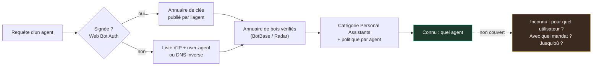
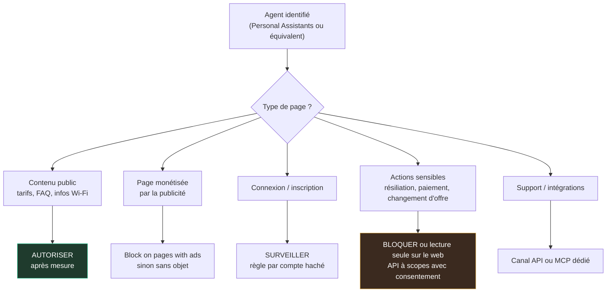

## Le client qui ne verra jamais votre page d'accueil

Un soir de novembre, une étudiante cherche un logement pour le second semestre. Elle n'ouvre pas votre site. Elle demande à son assistant IA de comparer trois résidences proches de son école, de vérifier que le Wi-Fi est compris dans le loyer, puis de remplir le dossier d'inscription à sa place. Votre serveur reçoit bien la visite. Il ne verra jamais l'étudiante.

Ce scénario concerne tous ceux qui vivent de pages web ouvertes au public : chaînes hôtelières, enseignes, gestionnaires de résidences, et les DSI qui opèrent des espaces clients. Jusqu'ici, ces visiteurs automatisés se noyaient dans une catégorie fourre-tout, « les bots », que l'on bloquait ou tolérait en bloc. Sans savoir si l'on refoulait un pilleur de contenu ou un client pressé.

Le 4 novembre, Cloudflare a sorti ces visiteurs de l'anonymat. Son tableau de bord isole désormais les assistants personnels, agent par agent, et propose pour chacun un interrupteur à trois positions. C'est utile. C'est aussi, de l'aveu même de l'éditeur, incomplet : savoir quel agent frappe à la porte ne dit ni pour qui il agit, ni ce que cette personne l'a autorisé à faire.

Ma position tient en une phrase. Le pare-feu applicatif peut nommer l'agent ; seul le site peut dire ce que cet agent a le droit de faire, et pour qui. Ceux qui attendront que l'identité d'agent soit garantie de bout en bout pour écrire leur politique la découvriront au premier incident.

## Un compteur et un interrupteur, agent par agent

Commençons par ce que voit désormais celui qui surveille son trafic. L'écran Security Analytics de Cloudflare rangeait jusqu'ici les requêtes en quatre familles : robots vérifiés, humains probables, automates probables, automates avérés. Une cinquième apparaît, « Personal Assistants », pour les agents qui naviguent en temps réel au nom d'une personne. Un encart liste chacun d'eux avec son volume de requêtes ; filtrer sur l'un recalcule les chemins visités, les codes de statut et les réseaux d'origine [1][13].

Deuxième brique, la politique d'accès. L'écran « Configure AI bot policies » devient « AI Crawler and Agent access policies » [2][3]. À côté de la règle globale applicable aux agents, chaque assistant personnel pris en charge reçoit son propre réglage : laisser passer (Allow), bloquer seulement sur les pages qui affichent de la publicité (Block on pages with ads), ou bloquer. Les réglages pour l'indexation (Search) et l'entraînement de modèles (Training) ne bougent pas.

Par défaut, chaque assistant hérite de la règle globale, et Cloudflare recommande de le laisser passer. L'assistant de configuration demande si le site monétise des pages par la publicité et ajuste ses conseils en conséquence [1][3]. L'éditeur assume l'argument commercial : « Blocking agents altogether can feel like the safest choice, but it can mean losing customers » [1]. Tout bloquer rassure. Ça peut aussi coûter des clients.

Troisième brique, plus discrète et plus intéressante : Account Abuse Protection (AAP), le module de protection des comptes. Ses journaux de connexion et d'inscription signalent désormais si la requête vient d'un assistant personnel, et lequel ; on peut compter les comptes qui utilisent chaque agent [1][7]. Surtout, on peut écrire une règle sur le Hashed User ID, un identifiant haché propre à chaque domaine, dérivé de l'e-mail, du pseudo ou du téléphone de connexion [7]. Un compte compromis se neutralise alors sans couper l'agent à tous les autres utilisateurs.

Le tout prolonge le virage du 1er juillet : trois usages distincts (Search, Agent, Training), réglables sur toutes les offres, gratuite comprise, et un statut « vérifié » qui ne vaut plus autorisation par défaut [6].

Voilà pour la déclaration du fournisseur. Car c'en est une. Le billet ne nomme aucun des agents couverts. Il ne dit pas comment une page « avec publicité » est détectée. Le changelog ne précise pas les offres concernées ; AAP, lui, reste en accès anticipé, sur demande, pour les clients Bot Management Enterprise [7]. Sur le réglage par défaut des nouveaux domaines, le billet de juillet et la documentation actuelle se contredisent [3][6] : vérifiez dans votre console. Aucun volume, aucun taux d'erreur n'est publié. Enfin, à l'heure où j'écris, aucun analyste indépendant ni régulateur européen n'a commenté l'annonce. La seule reprise de presse détaillée que j'ai trouvée est elle-même rédigée par un agent de recherche IA, relu par la rédaction [13]. On ne saurait mieux illustrer le sujet.

*Requête signée, annuaire de clés, registre d'agents vérifiés, politique à trois positions : la chaîne tourne. Il manque une pièce, le mandat de l'utilisateur.*

## L'uniforme du coursier n'est pas une procuration

Imaginez le concierge d'un grand hôtel. Un coursier se présente au comptoir, uniforme d'une société de livraison connue, badge à jour. Le concierge sait qui l'emploie. Il ne sait pas quel client l'envoie, ni si ce client l'a chargé de récupérer la valise de la chambre 214 ou seulement de déposer un pli. Identifier un agent IA, aujourd'hui, c'est exactement cela : on authentifie l'employeur, pas le mandant.

Comment Cloudflare reconnaît-il l'uniforme ? Le billet du 4 novembre renvoie seulement à son annuaire de bots vérifiés [1]. La documentation, elle, décrit trois façons d'y entrer : une signature cryptographique selon le protocole Web Bot Auth, une liste d'adresses IP publiée avec un user-agent stable, ou une résolution DNS inverse. Condition supplémentaire : ne pas contourner les préférences du site [5].

Point de rigueur, car la confusion circule déjà : rien dans l'annonce ne dit que la catégorie « Personal Assistants » repose sur des signatures. Web Bot Auth est l'une des voies de vérification de l'annuaire, pas forcément celle de chaque assistant. Tant que Cloudflare ne publie pas la liste des agents et leur méthode, affirmer l'inverse relève de l'inférence.

La documentation contient d'ailleurs l'aveu le plus éclairant. Depuis le 1er juillet, chaque fiche de l'annuaire BotBase précise si l'accès est « Direct » (un opérateur unique, au périmètre étroit) ou « Intermediary » (un service agentique utilisé par de nombreux utilisateurs finaux) [5]. Cloudflare y explique, en substance, qu'on peut faire confiance à l'opérateur sans faire confiance à chacun de ses utilisateurs. C'est, trait pour trait, le problème du concierge.

### Ce qu'une signature prouve, et ce qu'elle tait

Le principe de Web Bot Auth tient en trois gestes. L'agent signe chaque requête avec sa clé privée. Il indique où trouver sa clé publique. Le site, ou le CDN (réseau de diffusion de contenu) placé devant lui, récupère la clé et vérifie.

Techniquement, c'est un profil de la RFC 9421, le standard de signature des messages HTTP. Un en-tête porte l'étiquette web-bot-auth, l'empreinte de la clé et une date d'expiration ; un autre, Signature-Agent, pointe vers l'annuaire de clés que l'agent publie à une adresse normalisée [4][9].

Progrès depuis notre papier du 10 octobre : le texte est désormais un document adopté par le groupe de travail de l'IETF, l'organisme qui normalise les protocoles d'Internet. Cosigné par Thibault Meunier (Cloudflare) et Sandor Major (Google), le draft-ietf-webbotauth-httpsig-protocol-01 date du 29 octobre et expire le 2 mai 2027 [9]. C'est un brouillon, pas une RFC. Les CDN déploient donc un texte qui peut encore bouger.

Ce brouillon est d'une honnêteté rare sur ses propres limites [9]. Une signature prouve qu'un détenteur de la clé publiée à telle adresse a signé. Rien de plus : ni l'honnêteté de l'opérateur, ni l'autorisation de la requête. Une signature qui ne couvre que le nom du site visé peut être rejouée jusqu'à expiration, d'où une validité recommandée de 24 heures au plus. Aucune révocation n'est prévue : une clé compromise reste acceptée tant que les caches ne l'ont pas oubliée. Et la même clé, présentée partout, permet par construction de suivre un agent d'un site à l'autre.

La documentation Cloudflare ajoute ses propres réserves [4]. Pas de contrôle de nonce (valeur à usage unique) ni de base anti-rejeu : tout repose sur des expirations courtes. Surtout, un risque d'interopérabilité. Le brouillon -01 impose aux signataires une forme « dictionnaire » de l'en-tête Signature-Agent, que la documentation Cloudflare consultée le 5 novembre rejette au profit d'une simple chaîne entre guillemets. Soit la doc retarde sur le brouillon, soit un agent strictement conforme échoue chez Cloudflare. Je ne tranche pas : c'est à vérifier avant toute intégration.

Restent les agents qui ne signent rien. Pour eux, Cloudflare mise sur Precursor, annoncé le 13 juillet pour les clients Enterprise Bot Management. C'est un script injecté en bordure qui agrège sur la session des signaux d'interaction : pointeur, clavier, focus, visibilité de la page [8]. Ces signaux restent internes et ne sont liés à aucune identité. Aucun taux de précision ni de faux positifs n'a été publié.

*Les voies de vérification documentées convergent vers l'annuaire, puis vers la politique par agent. La voie réellement empruntée par chaque assistant personnel n'est pas publiée, et aucun maillon ne porte le mandat de l'utilisateur.*

Ma lecture de ce schéma : le 10 octobre, je faisais d'un pont entre jetons DPoP (preuve de possession d'une clé, côté OAuth) et signatures de requête la condition pour passer de la veille à l'implémentation. Le côté site n'a pas attendu ce pont. Ce que les CDN et pare-feux consomment aujourd'hui, c'est la signature de requête. Le mandat, lui, n'est lu à ma connaissance par aucun pare-feu applicatif.

## Voir n'est pas autoriser : trois aveux et un juge

Que la visibilité ne vaille pas autorisation, ce n'est pas seulement mon opinion. Les acteurs eux-mêmes l'écrivent.

**Cloudflare, d'abord.** Le billet du 4 novembre le reconnaît : identifier l'agent ne dit pas si la personne derrière est déjà cliente, ce qu'elle a autorisé, ni quelles protections s'appliquent [1]. Conserver ce contexte (statut client, périmètre d'autorisation, abonnements) est présenté comme un objectif, pas comme une fonction. L'éditeur évoque des approches respectueuses de la vie privée, de la réputation, de la responsabilité. Et promet d'en dire plus. Plus tard.

**L'IETF, ensuite.** La charte du groupe Web Bot Auth exclut explicitement l'authentification de l'utilisateur final, les API, les échanges d'agent à agent, tout vocabulaire d'intention et la réputation des bots [10]. Le trou que Cloudflare nomme, celui de l'utilisateur représenté, est donc hors du mandat de la seule instance qui normalise le sujet. Ses jalons d'avril et d'août 2026 pour soumettre le texte à validation sont d'ailleurs dépassés.

**La concurrence, enfin.** DataDome documente cinq méthodes d'authentification des bots, dont Web Bot Auth et le DNS inverse, bloque par défaut le trafic automatisé non authentifié et exige un user-agent dédié [11]. Une note de son changelog, que je n'ai pu consulter qu'à travers un résumé, irait plus loin : un agent vérifié pourrait quand même accaparer un stock, d'où le maintien d'un score comportemental. Je le rapporte au conditionnel. L'idée tient sans la source : une identité cryptographique ne dit rien de l'intention.

Une phrase du billet Cloudflare semble pourtant contredire le premier aveu : AAP montrerait quel utilisateur chaque agent représente [1]. Ma lecture, et ce n'est qu'une lecture : AAP rattache l'agent à un compte parce que l'agent se connecte avec les identifiants de cet utilisateur. On observe un compte piloté par un agent. On ne lit ni procuration, ni périmètre accordé, ni date de fin. C'est de la surveillance de comptes, pas de la délégation. Précieux contre le rejeu massif d'identifiants volés (credential stuffing) déguisé en assistant. Muet sur la seule question qui compte en cas de litige : l'abonné a-t-il vraiment demandé cette résiliation ?

Le droit ajoute une couche, et pas en faveur des sites. Selon TNW (5 août 2026), la cour d'appel fédérale du neuvième circuit a levé l'injonction obtenue par Amazon contre Comet, l'agent de navigation de Perplexity [12]. Raisonnement rapporté : l'agent n'agissant que sur instruction de l'utilisateur, c'est l'utilisateur qui accède aux serveurs d'Amazon au sens du CFAA, la loi fédérale américaine contre les intrusions informatiques. Un outil qui exécute la volonté de son utilisateur ne commet pas d'accès non autorisé.

Précautions d'usage : une seule source de presse, un arrêt dont je n'ai pas lu le texte, un stade d'injonction préliminaire, un fond qui reste à juger, des recours possibles. Aucun effet en France. Je le prends comme symptôme, pas comme règle.

Mais le symptôme parle. Le site veut pouvoir bloquer l'agent ; le juge voit dans l'agent la main prolongée de l'utilisateur. Aucune règle de pare-feu ne réconciliera ces deux logiques. Mon analyse : seule une autorisation explicite, écrite côté site, déplace la question de « qui accède ? » vers « qui a autorisé quoi, et jusqu'où ? ». C'est sur ce terrain qu'une politique d'accès se défend.

*Un même coursier devant quatre portes : hall ouvert, porte à péage, accès par badge, coffre. La décision dépend de la pièce autant que du visiteur.*

## La matrice, page par page

Rappel de cadrage, posé le 10 octobre : un agent qui tourne dans le cloud ne traverse pas le portail captif du Wi-Fi. Le sujet n'est pas le réseau d'accès, ce sont les sites et les API. Chez un opérateur comme Wifirst : l'espace client des résidents, le support, les pages d'inscription, les API d'intégration avec les CRM et les logiciels de gestion hôtelière (PMS). Chez ses clients : les sites des hôtels, des enseignes, des résidences. La grille qui suit est ma recommandation, valable quel que soit le CDN ou le pare-feu. Elle ne décrit aucune fonction Cloudflare.

*Grille de décision par type de page : recommandation personnelle, indépendante de l'outillage. Le pare-feu trie, l'application tranche.*

**Contenu public sans compte : autoriser.** Tarifs, FAQ, conditions d'accès au Wi-Fi, fiches d'établissement. L'assistant qui demande si le Wi-Fi est gratuit dans une résidence travaille pour un client. Le bloquer, c'est laisser un concurrent répondre à votre place. Mesurez d'abord (agents, chemins, codes de statut) pendant quelques semaines, puis fixez la règle.

**Pages monétisées : la seule nuance native.** « Block on pages with ads » est l'unique option de l'annonce liée aux revenus. Pertinente pour un contenu éditorial ou affilié, elle est sans objet pour un site d'hôtel sans publicité. Et son mode de détection n'est documenté nulle part.

**Connexion et inscription : surveiller sans bannir.** C'est là que se cachent les attaques par identifiants volés maquillées en assistant. La bonne granularité est le compte, pas l'agent : une règle sur l'identifiant haché isole le compte suspect sans couper l'agent aux autres abonnés.

**Actions sensibles : bloquer sur le web.** Résiliation, paiement, changement d'offre, modification de coordonnées. Un agent identifié n'a pas de mandat prouvé. Tant que l'autorisation n'est pas portée par un jeton à périmètre limité (voir nos articles du 10 octobre sur la procuration d'agent et du 31 octobre sur l'identité d'agent), la règle par défaut est le blocage ou la lecture seule. Cette décision vit dans le système d'autorisation de l'application, seul à connaître le contrat, l'abonné et ses droits. Pas dans une règle de pare-feu.

**Support et intégrations : un canal dédié.** Plutôt que de laisser un agent naviguer dans l'espace client, ouvrez une API ou un serveur MCP (Model Context Protocol, le protocole qui branche les agents sur des outils) protégé par OAuth et des scopes explicites. Le web devient la voie de repli, pas la voie normale.

**Facturer : pas encore.** L'annonce n'introduit aucun tarif par agent. La facturation reste contractuelle (accès API, licences). Le marché Pay-per-Crawl de Cloudflare, cité dans le billet de juillet, sort du périmètre de cette annonce, et je n'ai pas vérifié son statut actuel.

**Journaliser : toujours.** Agent, méthode d'identification (signature, IP, DNS inverse), chemin, statut, compte haché. Le jour où un abonné contestera une résiliation passée par son assistant, ce journal sera votre seule preuve de quel agent a fait quoi, pour quel compte.

## Six questions avant de cocher « Allow »

Avant de basculer un seul interrupteur, quel que soit votre fournisseur de CDN ou de pare-feu, posez-lui six questions :

1. Quels agents personnels prenez-vous en charge, et comment chacun est-il identifié : signature, liste d'IP, DNS inverse ?
2. Quelle est la politique par défaut sur mon domaine, aujourd'hui ?
3. Puis-je exporter les journaux avec la méthode de vérification de chaque requête ?
4. Sous quel délai l'annuaire est-il mis à jour quand un agent change de clé ou d'adresses ?
5. Que se passe-t-il face à une signature expirée, une clé inconnue, un en-tête au format du brouillon -01 ?
6. Puis-je écrire une règle par compte, et pas seulement par agent ?

*Chaque crochet porte sa clé, mais certaines n'ont pas d'étiquette. Un agent identifié sans mandat ouvre quand même la porte.*

Cloudflare a fait la partie utile du travail : cesser de traiter les agents comme une masse indistincte. Je conseille de s'en servir dès que c'est disponible chez vous, ne serait-ce que pour mesurer. Mais un tableau de bord n'est pas une gouvernance. L'identité d'agent n'existe aujourd'hui que par morceaux : la signature identifie l'opérateur de l'agent, le compte identifie l'abonné, et rien ne relie les deux par un mandat lisible.

N'attendez pas le standard qui fermera la boucle. Écrivez votre matrice maintenant, calibrée sur vos propres journaux. N'ouvrez pas tout : un agent sans mandat n'a rien à faire sur une page de résiliation. Ne fermez pas tout non plus : l'assistant qui demande vos tarifs est votre prochain client. Le jour où un mandat signé deviendra lisible en bordure, les sites dotés d'une matrice n'auront qu'à brancher le jeton. Les autres découvriront leur politique au milieu d'un litige.

Le pare-feu trie. Le site décide.

---

_Vues personnelles, pas position Wifirst._

## Sources

1. [Cloudflare Blog — See the agents, set the terms (2026-11-04)](https://blog.cloudflare.com/personal-agents-visibility-control/)
2. [Cloudflare Changelog — Granular access controls for the top Personal Agents (2026-11-04)](https://developers.cloudflare.com/changelog/post/2026-11-04-personal-agent-policies/)
3. [Cloudflare Docs — AI Crawler and Agent access policies (consultée le 2026-11-05)](https://developers.cloudflare.com/bots/additional-configurations/block-ai-bots/)
4. [Cloudflare Docs — Web Bot Auth (consultée le 2026-11-05)](https://developers.cloudflare.com/bots/concepts/bot/verified-bots/web-bot-auth/)
5. [Cloudflare Docs — Verified bots, BotBase, accès Direct et Intermediary (consultée le 2026-11-05)](https://developers.cloudflare.com/bots/concepts/bot/signed-agents/)
6. [Cloudflare Blog — Content Independence Day, nouvelles options de gestion du trafic IA (2026-07-01)](https://blog.cloudflare.com/content-independence-day-ai-options)
7. [Cloudflare Blog — Account Abuse Protection dashboard (2026-10-02)](https://blog.cloudflare.com/account-abuse-protection-dashboard/)
8. [Cloudflare Blog — Introducing Precursor (2026-07-13)](https://blog.cloudflare.com/introducing-precursor)
9. [IETF — draft-ietf-webbotauth-httpsig-protocol-01, HTTP Message Signatures for automated traffic (2026-10-29)](https://datatracker.ietf.org/doc/html/draft-ietf-webbotauth-httpsig-protocol)
10. [IETF — Charte du groupe de travail Web Bot Auth (consultée le 2026-11-05)](https://datatracker.ietf.org/group/webbotauth/about/)
11. [DataDome — Bot Authentication, documentation (consultée le 2026-11-05)](https://docs.datadome.co/docs/bot-authentication) ; note de changelog connue uniquement par résumé : [DataDome — Web Bot Auth, verifying user identity, ensuring agent trust](https://datadome.co/changelog/web-bot-auth-verifying-user-identity-ensuring-agent-trust/)
12. [TNW — Court lets Perplexity's AI agent shop on Amazon, overturning a ban (2026-08-05)](https://thenextweb.com/news/amazon-loses-perplexity-comet-ai-shopping-ruling)
13. [Unite.ai — Cloudflare Adds Personal Agent Analytics and Per-Agent Access Controls (2026-11-04), article rédigé par un agent de recherche IA, utilisé uniquement pour recouper les faits Cloudflare](https://www.unite.ai/cloudflare-adds-personal-agent-analytics-and-per-agent-access-controls)
