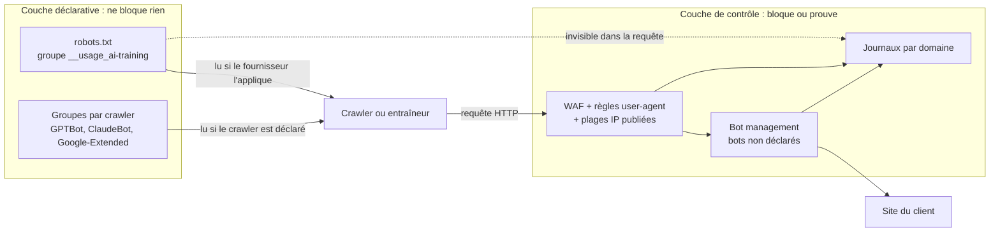
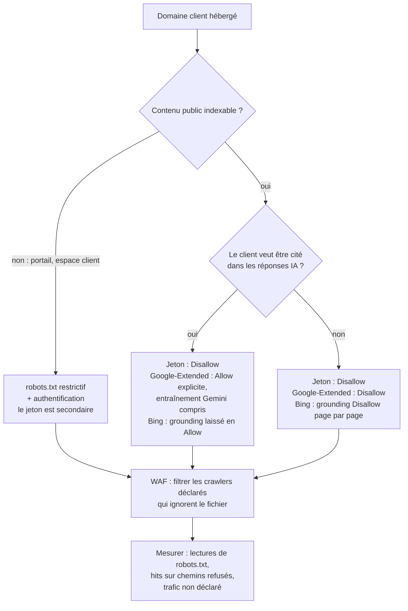

## La question qui tombe en comité de direction

Imaginez le comité de direction d'un groupe hôtelier qui exploite plusieurs dizaines d'établissements. Entre deux points sur le taux d'occupation, la directrice générale pose une question lue le matin même dans la presse : avons-nous interdit aux intelligences artificielles d'apprendre sur nos sites ? Descriptifs de chambres, photos, guides de quartier : des années de travail marketing.

La question tombe maintenant pour une raison précise. Le 30 octobre 2026, un nouveau mécanisme a été proposé à l'IETF, l'organisme qui normalise les protocoles d'Internet : un mot-clé à glisser dans robots.txt, ce petit fichier texte que chaque site publie pour guider les robots qui le parcourent. Le même jour, Google, Microsoft et Anthropic ont annoncé qu'ils le prendraient en charge, chacun à son rythme. La presse spécialisée a rapporté une annonce comparable d'OpenAI.

La réponse honnête est inconfortable. On peut le *dire*, en deux lignes de texte. On ne peut pas l'*imposer*.

Le sujet concerne tous ceux qui exposent des sites pour le compte d'autres : hôtels, résidences étudiantes, enseignes, et l'opérateur qui gère leur réseau, parfois leurs pages web. Ma position est nette. Ce mot-clé est une étiquette sur la porte, pas un verrou. Il faut le publier partout et vite, parce qu'il ne coûte presque rien. Il faut aussi continuer à filtrer et à mesurer ce qui frappe réellement aux serveurs, parce que lui ne filtre rien.

## La pancarte sur la poignée de porte

Tout le monde connaît la pancarte *Ne pas déranger* accrochée à la poignée d'une chambre d'hôtel. Le personnel la respecte, par courtoisie et parce que la procédure le prévoit. Mais elle ne verrouille rien. Le verrou, c'est la carte magnétique, et quelqu'un de pressé ou de mal intentionné peut parfaitement ignorer le carton.

Le jeton `__usage_ai-training` fonctionne exactement ainsi. Il s'écrit dans robots.txt, et l'exemple donné par son auteur tient en trois lignes :

```
User-Agent: __usage_ai-training
Disallow: /
Allow: /press-kit/
```

Traduction : je préfère que mon contenu ne serve pas à entraîner des modèles d'IA générative, sauf mon kit presse. Le `Disallow` n'interdit ici aucune visite. Il exprime une préférence contre l'entraînement, et le `Allow` une préférence pour.

### Une grammaire minimale, quatre pièges

Le texte, intitulé *Machine-Readable Training Preference Signal*, est un Internet-Draft, c'est-à-dire un document de travail soumis à l'IETF. Il n'invente aucune syntaxe. Il réutilise la notion de *product token* de la RFC 9309, la norme qui encadre robots.txt depuis septembre 2022, et le jeton se compare sans tenir compte des majuscules. Le reste demande plus d'attention.

- **Le joker ne couvre pas le jeton.** Un `User-Agent: *` suivi de `Disallow: /` n'exprime aucune préférence d'entraînement. Le draft l'exclut en toutes lettres (MUST NOT).
- **Le silence ne vaut pas accord.** Sans groupe dédié au jeton, aucune préférence n'a été exprimée, ni pour ni contre.
- **Rien n'est rétroactif.** Seul compte le fichier en vigueur au moment où le contenu a été récupéré. Ce qui a été aspiré en 2024 reste aspiré.
- **Le contrat passe avant le fichier.** « Private agreements MAY override preferences expressed via this mechanism. » Un accord de licence signé avec un fournisseur d'IA l'emporte donc sur robots.txt. Et une règle spécifique devrait primer sur la règle générale : Anthropic précise que les règles qui nomment `ClaudeBot` l'emportent sur le signal.

Le périmètre, enfin, est emprunté au vocabulaire du groupe de travail AIPREF (AI Preferences) de l'IETF : il s'agit de modifier les paramètres appris d'un modèle d'IA générative. L'entraînement d'un modèle purement non génératif reste hors champ.


*Le jeton ajoute une ligne au fichier : une déclaration lisible par les machines, qui ne ferme aucune porte.*

## Un auteur, quatre calendriers

Les titres de presse ont présenté l'épisode comme un soutien unanime de quatre géants à un même mécanisme. Le document raconte une histoire plus modeste.

Le draft `draft-kelley-aipref-training-preference-signal-00` a un seul auteur : Kevin Kelley, d'Anthropic. C'est une soumission individuelle, non endossée par l'IETF. Sur le datatracker, l'outil de suivi des documents de l'IETF, il n'est rattaché à aucun groupe de travail et son état se limite à I-D Exists, le statut par défaut d'un draft publié. Sans renouvellement, il expire le 3 mai 2027.

Google, Microsoft et OpenAI n'y figurent que dans les remerciements. J'y ai compté 46 noms : quatre de Google, quatre de Microsoft, deux d'OpenAI, un d'Anthropic en plus de l'auteur. On y croise aussi Cloudflare, Meta, Common Crawl, la BBC, le Financial Times ou Creative Commons. Le texte précise que les affiliations ne sont mentionnées qu'à titre d'identification. Remercier quelqu'un ne revient pas à obtenir sa signature.

Le 30 octobre a surtout produit des annonces unilatérales de calendrier, publiées le jour même du draft. Sur la liste de diffusion du groupe AIPREF, plusieurs participants ont tiqué. Nate Hake, fondateur du site Travel Lemming, l'a écrit le 3 novembre : « Then a draft was proposed to this list, and almost immediately four tech companies simultaneously announced public support for it. » Laurent Le Meur, d'EDRLab, y voit un fait accompli. Alissa Cooper, du Knight-Georgetown Institute, note l'absence de registre pour d'autres jetons et s'étonne d'un manque : « I do wonder why a policy token was not defined for the search category ». Ce sont des positions individuelles, pas celle du groupe. Elles visent la méthode plus que le principe.

Ce qui est réellement promis, avec le niveau de chaque source :

| Fournisseur | Ce qui est annoncé | Échéance | Niveau de source |
|---|---|---|---|
| Anthropic | Prise en charge commencée, étendue progressivement à tous les services ; les règles qui nomment ClaudeBot priment sur le signal général | Aucune date | Primaire : message de Kevin Kelley à la liste IETF, page d'aide ClaudeBot |
| Google | Prise en charge visée ; un refus via le jeton, sans mention de Google-Extended, sera lu comme un refus de Google-Extended | Début 2027 | Primaire : blog Search Central, documentation des crawlers |
| Microsoft | Préférence d'entraînement via le même jeton ; préférence de grounding (citation dans les réponses) séparée, page par page | 15/12/2026 : préférences de transition dans Bing Webmaster Tools ; 1/02/2027 : préférences honorées au fil du crawl ; 30/09/2027 : fin des préférences temporaires | Primaire : blog Bing |
| OpenAI | Prise en charge dans les mois à venir, sans remplacer les contrôles GPTBot et OAI-SearchBot | Aucune date | Secondaire uniquement : page officielle non consultable par nos outils |

Kevin Kelley prévient lui-même : « It'll take us some time to add support across our services ». Côté Google, John Mueller s'engage sur l'année sans fixer de jour : « We aim to support this new control along with other AI providers in 2027, and will provide updates on our progress. » La documentation des crawlers, mise à jour le même jour, précise début 2027.

Microsoft est le plus précis, et le plus clair sur la nature du dispositif : « These settings govern use of content, not crawl access. » Bing traite aussi à part le *grounding*, ce moment où un assistant va chercher des pages pour étayer et citer sa réponse. Et seulement page par page : « There is no site-wide robots.txt grounding preference. » À partir du 1er mars 2027, les balises NoArchive et NoCache ne vaudront plus préférence chez Microsoft.

Côté OpenAI, prudence. Tout ce que nous savons de l'annonce vient de la presse spécialisée. Une seule source avance un périmètre limité à l'entraînement des modèles de fondation, donc plus étroit que la définition IETF : à confirmer sur le texte d'origine.

Bilan au 5 novembre : rien n'est en service chez Google ni chez Microsoft, et Anthropic dit avoir commencé sans date d'achèvement. Aucun chiffre d'adoption n'existe. Le jeton a six jours.

## Préférence n'est pas contrôle

Un robot qui veut ignorer le fichier n'a rien à contourner. Il lui suffit de ne pas le lire.

Ce n'est pas une faille, c'est le dessin d'origine. La RFC 9309 le pose dès son introduction : « These rules are not a form of access authorization. » Le draft de Kelley va plus loin : « This policy token is not a directive for crawling behavior. » Le jeton parle de l'usage du contenu, pas de la visite. Un fournisseur peut s'abstenir de télécharger ce qu'il ne pourra pas utiliser, mais rien ne l'y oblige. Pour limiter la collecte elle-même, il faut viser chaque robot par son nom. Quant à la charte du groupe AIPREF, elle range l'application technique des préférences hors de son périmètre, d'après sa page de présentation.

Le contournement n'a rien de théorique. En août 2025, Cloudflare a documenté le cas de Perplexity : 20 à 25 millions de requêtes quotidiennes via son robot déclaré, et 3 à 6 millions via un robot non déclaré qui se présentait comme un navigateur ordinaire, sur des dizaines de milliers de domaines. Cloudflare l'a retiré de sa liste de robots vérifiés. C'est une illustration, pas une statistique générale. Elle suffit à montrer qu'une préférence se contourne en changeant de nom.

Le second angle mort est plus subtil. Le jeton n'apparaît dans aucune requête HTTP : aucun robot ne s'annonce comme `__usage_ai-training`. Google-Extended, le contrôle existant de Google pour Gemini, n'a pas non plus de user-agent propre, c'est-à-dire de nom envoyé avec chaque requête. Google collecte avec ses robots habituels. Résultat : dans vos journaux, vous voyez qui visite. Vous ne verrez jamais ce qu'il fait du contenu ensuite.

L'enjeu, lui, est massif. Selon Cloudflare, l'entraînement représentait environ 79 % du trafic des robots d'IA observé sur son réseau en juillet 2025, contre 72 % un an plus tôt. La donnée a plus d'un an, mais l'ordre de grandeur parle : le signal vise l'usage principal de la collecte, sans avoir la moindre prise sur elle.


*Le jeton vit dans la couche du haut. Seule la couche du bas peut refuser une requête ou laisser une trace exploitable.*

## Une norme encore en chantier

Même comme simple préférence, le jeton repose sur des fondations qui bougent encore.

Sa définition de l'entraînement vient du vocabulaire du groupe, `draft-ietf-aipref-vocab-08`, publié mi-septembre 2026. Ce texte porte un avertissement sans ambiguïté : « Its contents DO NOT REFLECT CONSENSUS of the Working Group either in whole or part. » La section qui définit l'entraînement est elle-même signalée comme sans consensus. La charte prévoyait pourtant de transmettre ce vocabulaire et sa méthode d'attachement à l'IESG, le comité qui valide les normes de l'IETF, avant le 31 août 2026. Au 5 novembre, rien n'indique que ce soit fait, et je n'ai pas trouvé trace d'un report officiel.

Deux syntaxes se disputent ensuite robots.txt. Le draft d'attachement (`draft-ietf-aipref-attach-05`, août 2026), signé par des ingénieurs de Google et de Mozilla, passe par un en-tête HTTP du type `Content-Usage: train-ai=n` ou par une règle `Content-Usage: /ai-ok/ train-ai=y`. Kelley crée à la place un groupe User-Agent dédié, et les noms divergent : `train-ai` d'un côté, `__usage_ai-training` de l'autre. Il présente d'ailleurs son texte comme une contribution aux travaux sur l'attachement. Fusion, remplacement, abandon : tout reste possible. Cloudflare publie même, depuis septembre 2025, sa propre ligne `Content-Signal` dans le robots.txt géré qu'il propose à ses clients : une troisième grammaire, sans lien avec le jeton IETF.

Prochain rendez-vous : les deux séances AIPREF de la réunion IETF 127, les 16 et 19 novembre 2026 (UTC). Pour qui gère des centaines de domaines, la conséquence est immédiate. On n'édite jamais robots.txt à la main, site par site. On le génère depuis un gabarit central, pour changer de syntaxe en une journée le jour où le groupe tranchera.

Reste le droit. Le code de bonnes pratiques européen pour les modèles d'IA à usage général (GPAI, General-Purpose AI), publié le 10 juillet 2025, engage ses signataires à employer des robots qui suivent robots.txt selon la RFC 9309, « and any subsequent version of this Protocol for which the IETF demonstrates that it is technically feasible and implementable ». Un draft individuel en version -00 n'est pas cette version. Google juge sa démarche compatible avec le code. Alissa Cooper, dans une tribune pour Tech Policy Press, conteste qu'elle y soit déjà couverte. Je n'ai trouvé aucune décision de justice ni de l'AI Office européen sur la valeur du jeton comme réservation de droits au sens de l'article 4(3) de la directive 2019/790, qui encadre la fouille de textes et de données. Question ouverte, donc. Personne ne devrait la présenter à un client comme réglée.


*Deux couches qui ne se touchent pas : les panneaux de la préférence au-dessus, les barrières du contrôle en dessous.*

## Déclarer, filtrer, détecter, prouver

Ce qui suit relève de mon analyse d'opérateur, pas d'une lecture des textes.

D'abord, le périmètre. Mon hypothèse, à valider client par client : un portail captif, cette page d'accueil Wi-Fi où l'on accepte les conditions d'usage, n'est normalement pas un contenu indexé. L'exposition se situe ailleurs. Elle concerne les sites publics des clients que l'opérateur héberge ou exploite (hôtels, résidences, enseignes), les espaces clients, les pages d'inscription et les centres d'aide.

Sur ce périmètre, je raisonne en quatre couches. La première parle. Les trois autres agissent ou laissent une trace.

**1. Déclarer.** Ajouter le groupe `__usage_ai-training` et conserver les groupes existants (`GPTBot`, `ClaudeBot`, `Google-Extended`). Google et Anthropic écrivent que leurs contrôles actuels restent valables, OpenAI aussi selon la presse, et Anthropic fait primer les règles qui nomment `ClaudeBot`. Prévoir un fichier par origine : la RFC 9309 attache robots.txt au triplet schéma, hôte et port, donc chaque sous-domaine et chaque portail a le sien. Le servir en code 200 et en texte brut, car un code 5xx est lu comme une interdiction totale et un code 4xx comme une permission totale. Compter jusqu'à 24 heures de cache. Enfin, ajouter un contrôle de syntaxe automatique dans la chaîne de déploiement : `__usage_ai_training`, avec un tiret bas à la place du tiret, reste un nom valide, donc ignoré en silence. Un contributeur de la liste IETF l'a d'ailleurs orthographié ainsi dans son propre message.

**2. Filtrer.** C'est la couche qui empêche. Un pare-feu applicatif web (WAF, Web Application Firewall) applique des règles par user-agent déclaré, couplées aux plages IP publiées par les fournisseurs : le fichier `gptbot.json` d'OpenAI, ou la liste donnée par Anthropic sur sa page d'aide. Sans ce couplage, n'importe qui emprunte le nom d'un robot. On ajoute de la limitation de débit, et une authentification pour tout ce qui n'a pas vocation à être public. Piège inverse : ne pas bloquer par IP les robots dont on veut qu'ils lisent robots.txt, ce qu'Anthropic déconseille explicitement.

**3. Détecter.** Contre les robots qui se déguisent en navigateur, il faut un score de détection comportementale, le *bot management*. La vérification cryptographique de l'identité des agents est un autre chantier, traité dans notre article sur Web Bot Auth.

**4. Prouver.** Conserver, pour chaque requête de robot : user-agent, adresse IP, ASN (le numéro du réseau d'origine), méthode de vérification, chemin, code de réponse, domaine et client concerné.


*Arbre de décision par domaine client : la préférence se choisit au cas par cas, le filtrage s'applique dans tous les cas.*

### Être appris ou être cité

Premier arbitrage, et le plus délicat. Chez Google, un refus exprimé par le jeton vaudra refus de Google-Extended, lequel couvre à la fois l'entraînement des futurs Gemini et le grounding dans les applications Gemini. Google précise que les sites qui autorisent explicitement Google-Extended sont éligibles à apparaître dans ces réponses. Ma lecture, qui combine le blog et la documentation sans reposer sur une phrase unique : chez Google, être cité sans nourrir l'entraînement est aujourd'hui difficile à obtenir.

Chez Microsoft, les deux se règlent séparément : l'entraînement par robots.txt, ajustable page par page, le grounding uniquement page par page. Bing prévient d'ailleurs : « Neither choice guarantees inclusion, traffic, or payment. » Un hôtel qui veut figurer dans les réponses des assistants doit donc trancher, fournisseur par fournisseur, en connaissance de cause.

Deuxième question : qui décide ? Le jeton exprime la préférence de celui qui publie le service. Pour un site hébergé par l'opérateur, le choix par défaut doit être contractuel, documenté, et chaque changement journalisé. L'opérateur ne tranche pas en silence à la place de son client.

Troisième contrainte : le temps. Microsoft ne découvre une préférence qu'en repassant sur la page. IndexNow, le protocole qui signale les mises à jour aux moteurs, accélère sans rien garantir. Pour être lu dès le premier jour, mieux vaut publier avant le 1er février 2027.

### Ce qu'on peut mesurer, ce qu'on ne verra jamais

Quatre indicateurs sont à portée de journal. D'abord, la fréquence et les codes de réponse des lectures de `/robots.txt`, robot par robot : un robot qui ne lit jamais le fichier ne peut pas le suivre. Ensuite, les requêtes d'un robot déclaré vers des chemins que son propre groupe lui refuse, soit une infraction observable. Puis la part du trafic d'IA déclaré, domaine par domaine. Enfin, le trafic de type navigateur venant de réseaux de centres de données, bon indicateur d'évasion.

Trois choses resteront invisibles. L'usage réel du contenu pour l'entraînement. Les données collectées avant la publication du fichier. Et l'effet sur un modèle déjà entraîné, puisque la préférence n'est pas rétroactive.


*Ce que les journaux montrent : qui lit robots.txt, qui frappe les chemins refusés, qui se déguise en navigateur.*

## Publier ce soir, ne rien promettre

Sur le fond, le jeton est bien conçu : minimal, sans grammaire nouvelle, lisible par un stagiaire. Sur la forme, les critiques de la liste ont raison de tiquer. Un standard qui naît d'annonces simultanées de fournisseurs ressemble davantage à un accord de branche qu'à un consensus. Les deux constats ne s'excluent pas.

Ma ligne, pour un opérateur qui héberge des sites clients, tient en quatre gestes. Publier maintenant, sur chaque origine, depuis un gabarit central : le coût est quasi nul. Ne jamais employer le mot protégé dans un rapport ou un contrat client. Écrire la politique client par client, en séparant entraînement et visibilité dans les réponses d'IA, fournisseur par fournisseur. Revoir le tout après les séances IETF des 16 et 19 novembre, puis début 2027, quand Google et Microsoft ont prévu de basculer.

Et garder en tête la pancarte d'hôtel. Elle protège la tranquillité des clients parce que le personnel joue le jeu, pas parce qu'elle est solide. Le jour où quelqu'un ne joue pas le jeu, c'est la serrure qui compte.

Le jeton demande poliment. Le WAF, lui, ne demande rien.

_Vues personnelles, pas position Wifirst._

## Sources

1. [Kevin Kelley, draft-kelley-aipref-training-preference-signal-00, Machine-Readable Training Preference Signal, IETF, 30/10/2026](https://www.ietf.org/archive/id/draft-kelley-aipref-training-preference-signal-00.txt)
2. [Datatracker IETF, fiche du draft Kelley](https://datatracker.ietf.org/doc/draft-kelley-aipref-training-preference-signal/)
3. [Datatracker IETF, documents du groupe de travail AIPREF](https://datatracker.ietf.org/wg/aipref/documents/)
4. [draft-ietf-aipref-vocab-08, septembre 2026](https://datatracker.ietf.org/doc/html/draft-ietf-aipref-vocab) (texte brut : [vocab-08](https://www.ietf.org/archive/id/draft-ietf-aipref-vocab-08.txt))
5. [draft-ietf-aipref-attach-05, août 2026](https://datatracker.ietf.org/doc/html/draft-ietf-aipref-attach)
6. [Charte et jalons du groupe AIPREF](https://datatracker.ietf.org/group/aipref/about/)
7. [RFC 9309, Robots Exclusion Protocol, septembre 2022](https://www.rfc-editor.org/rfc/rfc9309)
8. Liste de diffusion ai-control : [archives](https://mailarchive.ietf.org/arch/browse/ai-control/) ; [Kevin Kelley, 30/10/2026](https://mailarchive.ietf.org/arch/msg/ai-control/mddjatOxSR0h6GmLRBWlc839c7w/) ; [Nate Hake, 3/11/2026](https://mailarchive.ietf.org/arch/msg/ai-control/A2LWviXagqaze8qg4rPvM_v5Akk/) ; [Alissa Cooper, 4/11/2026](https://mailarchive.ietf.org/arch/msg/ai-control/qhIHBiSQsFOKcKS8Yq56Dl2nhZU/)
9. [Google Search Central Blog, John Mueller, Supporting a shared AI training control for websites, 30/10/2026](https://developers.google.com/search/blog/2026/10/ai-training-control)
10. [Google, documentation des crawlers courants et de Google-Extended, mise à jour du 30/10/2026](https://developers.google.com/search/docs/crawling-indexing/google-common-crawlers)
11. [Bing Blog, Krishna Madhavan, Your content, your choice…, 30/10/2026](https://blogs.bing.com/search/2026/10/your-content-your-choice-clearer-preferences-for-training-and-grounding/)
12. [Anthropic, page d'aide ClaudeBot](https://support.claude.com/en/articles/8896518-claudebot)
13. [OpenAI, Making it easier for websites to express AI training preferences (non consultée directement)](https://openai.com/index/helping-websites-express-ai-training-preferences/)
14. [OpenAI, documentation des bots](https://developers.openai.com/api/docs/bots)
15. [Alissa Cooper, Tech Policy Press, 4/11/2026](https://www.techpolicy.press/what-the-new-ai-training-optout-really-means/)
16. [PPC Land, Google, Microsoft, OpenAI and Anthropic back one AI training opt-out, 31/10/2026](https://ppc.land/google-microsoft-openai-and-anthropic-back-one-ai-training-opt-out/)
17. [Search Engine Roundtable, 30/10/2026](https://www.seroundtable.com/google-ai-training-control-42430.html)
18. [Cloudflare, Content Signals Policy, 24/09/2025](https://blog.cloudflare.com/content-signals-policy/)
19. [Cloudflare, données sur l'écart crawl-to-click des robots d'IA, 29/08/2025](https://blog.cloudflare.com/crawlers-click-ai-bots-training/)
20. [Cloudflare, Perplexity et crawlers non déclarés, 4/08/2025](https://blog.cloudflare.com/perplexity-is-using-stealth-undeclared-crawlers-to-evade-website-no-crawl-directives/)
21. [Commission européenne, Code de bonnes pratiques GPAI, chapitre droit d'auteur, mesure 1.3, 10/07/2025](https://ec.europa.eu/newsroom/dae/redirection/document/118115) ; [page de présentation du Code](https://digital-strategy.ec.europa.eu/en/policies/contents-code-gpai)
22. [IETF 127, séances AIPREF](https://datatracker.ietf.org/meeting/127/session/aipref)
