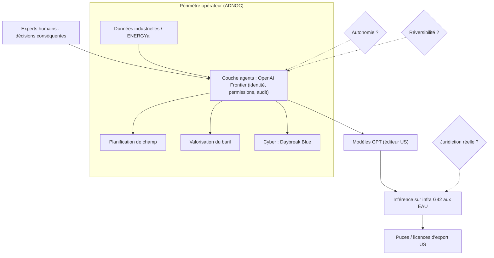
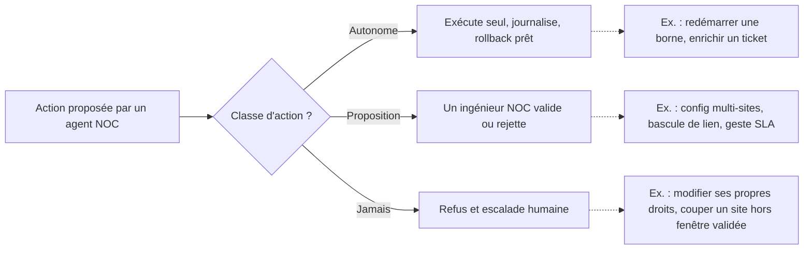

## Des mois de planification, quelques heures de calcul

Des milliers de puits. Des réservoirs empilés les uns sur les autres, à des profondeurs différentes. Des centaines d'installations de surface, chacune avec ses contraintes. Bâtir le plan de développement complet d'un champ pétrolier occupe d'ordinaire des équipes d'ingénieurs pendant des mois. Le 2 novembre, au grand salon de l'énergie d'Abou Dabi, la compagnie nationale ADNOC (Abu Dhabi National Oil Company) a affirmé pouvoir le faire en quelques heures.

Le véhicule : un accord pluriannuel avec OpenAI et G42, le groupe technologique émirien, pour déployer des agents IA sur toute sa chaîne de valeur, du puits jusqu'à la salle de trading. ADNOC devient le premier énergéticien à adopter Frontier, la plateforme d'OpenAI qui sert à construire et piloter ces agents.

On peut lire l'annonce comme une énième démonstration de vitesse. Ce serait passer à côté. Le vrai signal, c'est le schéma de gouvernance qu'elle dessine : des agents dotés d'une identité propre, des modèles servis sur place, un humain qui garde la main sur les décisions lourdes. Et, plus encore, ce que le contrat ne dit pas publiquement.

Ce schéma, quiconque exploite des réseaux sur des centaines de sites (chaînes hôtelières, enseignes de retail, résidences étudiantes) va devoir le négocier, et plus tôt qu'il ne le pense. Autant savoir quelles questions poser avant de signer.

## Ce qu'ADNOC a vraiment signé, et ce qu'on n'en sait pas

Commençons par trier le vérifié et l'annoncé. L'essentiel des détails opérationnels vient d'une seule voix : le communiqué d'ADNOC, relayé par [Energy Connects](https://www.energyconnects.com/opinion/features/2026/november/adnoc-signs-landmark-partnership-agreement-with-openai-and-g42-becoming-first-energy-company-to-deploy-openai-frontier-technology/) et [Hydrocarbon Processing](https://hydrocarbonprocessing.com/news/2026/11/adnoc-to-deploy-openai-frontier-agents-across-processing-refining-and-trading-decisions/). [The National](https://thenationalnews.com/business/energy/2026/11/02/adnoc-signs-agreement-with-openai-and-g42-to-deploy-frontier-ai), quotidien d'Abou Dabi, en publie une version nettement plus sobre. Tout ce qui suit sur les cas d'usage se lit donc avec une précaution : selon ADNOC.

La structure de l'accord, elle, est solide. Il a été signé lors du salon ADIPEC, en présence du prince héritier d'Abou Dabi, Khaled bin Mohamed. G42 y intervient via sa filiale Inception42. Le socle technique est Frontier, lancée par OpenAI le 5 février pour construire, déployer et gérer des agents en entreprise. HP, Intuit, Oracle, State Farm, Thermo Fisher et Uber figuraient parmi ses premiers clients.

Le rôle assigné à Frontier compte plus que son nom. Selon ADNOC, la plateforme devient une couche de liaison entre les outils IA existants du groupe, dont ENERGYai, consacré à l'analyse du sous-sol. L'objectif affiché : que les décisions opérationnelles, d'investissement et commerciales se prennent ensemble, plutôt qu'en séquence, chacune attendant la précédente. La chaîne visée couvre la production, le traitement, le raffinage, la logistique, les ventes et le trading.

Deux cas d'usage ouvrent le bal. D'abord ces plans de champ complets, qui fusionnent géologie, installations et économie. Ensuite, une prévision de l'offre, de la demande, des prix et des marges pour « valoriser chaque baril ». Un volet cyber complète le tout. Daybreak Blue, le palier défensif lancé par OpenAI le 10 août (réponse à incident, analyse de logiciels malveillants, validation de correctifs), doit aider les équipes sécurité d'ADNOC à protéger une infrastructure énergétique critique. Selon [TechCrunch](https://techcrunch.com/2026/08/10/as-ai-led-attacks-multiply-openai-launches-a-new-cyber-model/), ce palier est réservé à des clients approuvés. Les modèles cyber les plus puissants, comme GPT-5.6 Cyber, restent cantonnés au palier Red.

Passons à ce qui manque. Ni la valeur du contrat, ni sa durée exacte, ni le calendrier de mise en production ne sont publics. Quant aux « quelques heures au lieu de plusieurs mois », c'est une affirmation d'ADNOC, sans validation indépendante. Rien sur la qualité des plans produits. Rien sur le taux de révision par les ingénieurs. Rien qui précise s'il s'agit d'un plan candidat ou d'un plan validé, prêt à déclencher des forages. Cette nuance n'est pas un détail : c'est tout le sujet.

Un dernier chiffre remet l'annonce à l'échelle. ADNOC revendique déjà plus de 40 000 salariés sur ChatGPT Enterprise, avec un taux d'adoption supérieur à 97 %, ainsi que plus de 200 applications IA et 70 cas d'usage robotiques déployés ou en développement, selon [The Next Web](https://thenextweb.com/news/adnoc-openai-g42-frontier-ai-deal). Les agents n'arrivent pas sur un terrain vierge. Ils arrivent une fois la dette d'adoption remboursée.

## Le vrai produit : un interne avec un badge

Pour comprendre ce qu'ADNOC achète, il faut ouvrir le capot de Frontier. Et pour ça, le plus simple est de penser à un interne en médecine.

L'interne examine les patients, rédige les prescriptions courantes, propose un diagnostic. Il travaille vite et beaucoup. Mais il porte un badge à son nom, chaque acte est consigné au dossier, et c'est le chef de service qui signe avant le bloc opératoire. L'hôpital ne lui fait pas une confiance aveugle : il a écrit noir sur blanc ce que l'interne peut faire seul.

Frontier transpose ce modèle aux agents. D'après l'analyse de [The Decoder](https://the-decoder.com/openais-frontier-gives-ai-agents-employee-like-identities-shared-context-and-enterprise-permissions/), chaque agent possède sa propre identité et des permissions gérées par l'IAM de l'entreprise (Identity and Access Management, le système qui attribue les droits d'accès), exactement comme un salarié. Les agents partagent aussi un contexte métier commun, une « couche sémantique » qui leur fait parler le vocabulaire de la maison.

Le reste de l'outillage suit la même logique. Chaque agent dispose d'un environnement d'exécution (code, fichiers, outils), d'une mémoire et d'une évaluation intégrée. Chacune de ses actions alimente des journaux d'audit complets. La plateforme affiche les certifications SOC 2 Type II et ISO, mais ni prix ni date de disponibilité générale.

Sur cette mécanique, ADNOC pose une règle : « Human experts will keep oversight of consequential decisions. » Les experts humains supervisent les décisions conséquentes, et toutes les solutions tournent sous le contrôle d'ADNOC pour protéger données propriétaires et infrastructures critiques. Le même jour, le volet gouvernemental des accords Abou Dabi-OpenAI reprenait cette logique : chaque évaluation y est traçable jusqu'à la règle appliquée, et ce sont les fonctionnaires qui tranchent.

*Qui contrôle quoi : les trois losanges en pointillés sont les questions que le contrat ne tranche pas publiquement.*

Voilà le problème. À l'hôpital, la frontière entre ce que l'interne fait seul et ce qui exige la signature du senior est écrite, opposable, connue de tous. Chez ADNOC, aucun document public ne définit ce qu'est une décision « conséquente », ni quel seuil déclenche la validation humaine. Le principe est affiché. Le seuil reste invisible.

Les réserves d'analystes vont dans le même sens. [Futurum](https://futurumgroup.com/insights/openai-frontier-close-the-enterprise-ai-opportunity-gap-or-widen-it/) juge la documentation sécurité de Frontier mince sur ce qui est propre aux agents. Le cabinet note aussi l'absence de grille tarifaire et de modèle de déploiement reproductible sans les ingénieurs qu'OpenAI détache chez le client. Surtout, il pose le bon critère : chaque action d'agent doit être « observable, attributable, and reversible ». Observable et attribuable, l'identité et les journaux y répondent sur le papier. Réversible, rien de public ne le garantit. Précision utile : Futurum entretient des relations commerciales avec de nombreux éditeurs du secteur.

## « Souverain » : un mot, quatre couches

*Données, orchestration, modèles, calcul : chaque couche de la pile peut appartenir à un acteur, et à une juridiction, différents.*

Deuxième pilier de l'annonce : l'hébergement. Selon le communiqué d'ADNOC, la capacité d'aide à la décision tourne sur l'infrastructure IA « souveraine » de G42 aux Émirats arabes unis (EAU). The National se montre plus prudent. Le quotidien parle d'une inférence des modèles GPT sur une infrastructure basée aux EAU, sans citer G42 pour ADNOC. Qui héberge, qui opère, sur quel site : le montage exact n'est pas public.

Le contexte éclaire pourtant la stratégie. Le 2 novembre, Abou Dabi et OpenAI ont signé [quatre accords](https://thenextweb.com/news/openai-abu-dhabi-deals-machine-readable-government-mubadala) : avec le gouvernement (le programme « Machine-Readable Government »), avec le fonds Mubadala, un accord quinquennal entre Inception42 et OpenAI, et enfin celui d'ADNOC. Inception42 est partie à trois des quatre. De fait, G42 devient la couche de distribution et d'intégration d'OpenAI dans le pays.

Il faut alors décomposer le mot « souverain », couche par couche. Les modèles sont ceux d'OpenAI, éditeur américain. La plateforme Frontier aussi. Les puces relèvent en général du régime américain de licences d'export, même si rien de public ne documente ce point pour ce projet. Restent l'hébergement et l'exploitation, eux bien locaux. Ici, « souverain » veut dire localisation et contrôle opérationnel. Pas indépendance technologique.

Le reste du tableau n'est guère plus net. Dès novembre 2025, OpenAI proposait aux EAU une résidence des données pour ChatGPT Enterprise, Edu et son API, sur des datacenters Microsoft Azure locaux. Il s'agissait toutefois d'une résidence « au repos » : la localisation de l'inférence n'était pas confirmée à l'époque, selon une newsletter régionale qu'il faut recouper. Quant à Stargate UAE, le campus de 1 GW porté par G42 et Khazna, dont 200 MW étaient attendus en 2026, je n'ai trouvé aucune confirmation publique de sa mise en service. Une tribune publiée par The National en décembre 2025 le résumait d'ailleurs dans son titre : la souveraineté IA reste un objectif qui se dérobe.

Reste la question que personne ne pose publiquement. Le CLOUD Act (loi américaine de 2018 qui permet aux autorités des États-Unis d'exiger des données détenues par des fournisseurs américains, même stockées à l'étranger) s'applique-t-il à cet arrangement ? Je n'ai trouvé aucune analyse sérieuse du cas ADNOC. Je ne l'affirme donc pas. Je pose la question, parce que c'est exactement celle qu'un acheteur doit faire trancher par écrit.

Pour un exploitant européen, la transposition est encore moins directe. Les données de connexion d'un Wi-Fi d'hôtel ou de résidence étudiante relèvent du RGPD et du contrôle de la CNIL. Un « souverain » à l'émirienne, avec un modèle américain servi sur sol local, ne règle pas mécaniquement ces exigences. Chez nous, l'hébergement dans l'UE ou en local reste une condition d'entrée, pas une option.

## Du champ pétrolier au NOC : même architecture, mêmes angles morts

*Entre l'agent et l'équipement critique, une porte de validation humaine. Encore faut-il avoir écrit quand elle se ferme.*

Remplacez les puits par des bornes Wi-Fi, les réservoirs par des sites clients, ENERGYai par votre outil de supervision. Le schéma est identique. Un NOC (Network Operations Center, le centre de supervision réseau) relie déjà la supervision, le ticketing, les contrôleurs Wi-Fi et le CRM clients. Un orchestrateur d'agents s'y brancherait exactement comme Frontier se branche sur les outils d'ADNOC.

Les cas d'usage se répondent aussi. Les « centaines d'installations de surface » d'ADNOC, hétérogènes et dispersées, ont un équivalent direct : un parc de centaines d'hôtels, de magasins ou de résidences, chacun avec son câblage, ses générations d'équipements, ses contraintes. La corrélation d'incidents entre sites, la planification de capacité multi-sites et la gestion des changements sont nos plans de champ. Et la valeur, comme chez ADNOC, naît de décisions prises ensemble plutôt qu'en silo.

Les décisions conséquentes ont, elles aussi, leur équivalent. Une configuration poussée sur des dizaines de sites, une coupure planifiée, une bascule de lien, un remboursement de pénalité SLA (engagement de niveau de service) : ce sont exactement les gestes qu'un agent ne doit pas faire seul. Encore faut-il l'écrire. Voici comment je découperais le périmètre.

*Trois classes d'actions, des exemples concrets : c'est ce tableau, et non un adjectif comme « conséquent », qui doit figurer au contrat.*

C'est là qu'interviennent les trois clauses qu'ADNOC n'a pas rendues publiques. Tout exploitant devrait les exiger avant de déléguer quoi que ce soit à un agent.

### Clause 1 : le périmètre d'autonomie

Une liste explicite de ce que l'agent exécute seul, de ce qu'il propose et de ce qu'il ne fait jamais. Avec des seuils chiffrés. Dans un contrat, « décision conséquente » ne veut rien dire. « Toute modification touchant plus de N sites ou plus de X utilisateurs simultanés », si. Un fournisseur incapable de remplir ce tableau ne sait pas vraiment ce que fait son agent.

### Clause 2 : la réversibilité, à deux étages

Premier étage, l'action. Chaque geste d'agent doit avoir son retour arrière, documenté et testé : le critère « observable, attributable, reversible » de Futurum, pris au pied de la lettre. Second étage, le fournisseur. Avec une plateforme comme Frontier, le verrouillage change de place. Il ne loge plus dans le modèle, qui finira par devenir interchangeable, mais dans la plateforme : le contexte accumulé, la mémoire des agents, la couche sémantique patiemment construite. Exigez leur export dans un format exploitable. Sinon, changer de fournisseur reviendra à congédier toute une équipe en brûlant ses carnets.

### Clause 3 : la souveraineté réelle

Trois questions, pas une. Où tournent l'inférence, les journaux et la mémoire des agents ? Qui opère l'infrastructure au quotidien ? Quelle juridiction peut contraindre le fournisseur à livrer quoi que ce soit ? « Hébergé localement » ne répond qu'à la première.

Le volet cyber mérite le même examen. Un palier comme Daybreak Blue, réservé à des défenseurs approuvés et centré sur la réponse à incident et la validation de correctifs, colle bien aux besoins d'une équipe d'exploitation ou de sécurité. Mais il place une capacité défensive critique sous le contrôle d'un seul fournisseur. C'est lui qui décide qui est « approuvé ». Cela aussi se négocie.

## Les agents arrivent en dernier

*Autonomie, réversibilité, juridiction : trois clés à détenir avant de confier la moindre action à un agent.*

Ma position tient en trois temps. Le chiffre des « quelques heures » est l'accroche, pas le sujet : tant qu'on ignore s'il désigne un plan candidat ou un plan validé, il ne prouve rien. Le patron de gouvernance, lui, est le vrai livrable. Identité d'agent, permissions IAM, journaux d'audit, humain sur les décisions lourdes : c'est la bonne architecture, et je la recommande sans réserve. Enfin, ce qui manque à l'annonce (seuil d'autonomie, réversibilité, juridiction réelle) est précisément ce qui sépare un déploiement maîtrisé d'un pari.

Reste la leçon la plus sous-estimée. ADNOC n'a pas commencé par les agents. Elle a commencé par plus de 40 000 utilisateurs et plus de 200 applications. Les agents orchestrés arrivent après la dette d'adoption, quand les usages existent et que les données sont propres. Un NOC qui sauterait cette étape pour brancher des agents sur des inventaires approximatifs et des tickets mal qualifiés obtiendrait des décisions rapides. Fausses, mais rapides.

L'interne en médecine n'est pas dangereux parce qu'il débute. Il le devient quand personne n'a écrit ce qu'il a le droit de faire seul. Avant de recruter votre premier agent, rédigez sa fiche de poste.

_Vues personnelles, pas position Wifirst._

## Sources

1. Energy Connects, communiqué ADNOC relayé (novembre 2026) : https://www.energyconnects.com/opinion/features/2026/november/adnoc-signs-landmark-partnership-agreement-with-openai-and-g42-becoming-first-energy-company-to-deploy-openai-frontier-technology/
2. The Next Web, accord ADNOC / OpenAI / G42 (2 novembre 2026) : https://thenextweb.com/news/adnoc-openai-g42-frontier-ai-deal
3. The National, ADNOC signe avec OpenAI et G42 (2 novembre 2026) : https://thenationalnews.com/business/energy/2026/11/02/adnoc-signs-agreement-with-openai-and-g42-to-deploy-frontier-ai
4. Hydrocarbon Processing, agents Frontier sur le traitement, le raffinage et le trading (novembre 2026) : https://hydrocarbonprocessing.com/news/2026/11/adnoc-to-deploy-openai-frontier-agents-across-processing-refining-and-trading-decisions/
5. The Next Web, les quatre accords Abou Dabi / OpenAI (2 novembre 2026) : https://thenextweb.com/news/openai-abu-dhabi-deals-machine-readable-government-mubadala
6. The Decoder, identités, contexte partagé et permissions des agents Frontier (février 2026) : https://the-decoder.com/openais-frontier-gives-ai-agents-employee-like-identities-shared-context-and-enterprise-permissions/
7. Futurum, analyse d'OpenAI Frontier (février 2026) : https://futurumgroup.com/insights/openai-frontier-close-the-enterprise-ai-opportunity-gap-or-widen-it/
8. TechCrunch, Daybreak Blue et Red (10 août 2026) : https://techcrunch.com/2026/08/10/as-ai-led-attacks-multiply-openai-launches-a-new-cyber-model/
9. Middle East AI News, résidence des données OpenAI aux EAU (25 novembre 2025) : https://www.middleeastainews.com/p/openai-offers-uae-data-residency
10. The National, tribune sur la souveraineté IA (4 décembre 2025) : https://www.thenationalnews.com/opinion/comment/2025/12/04/why-the-push-for-ai-sovereignty-still-remains-so-elusive
11. The National, première phase de Stargate UAE (5 décembre 2025) : https://www.thenationalnews.com/business/2025/12/05/stargate-uaes-first-phase-to-be-completed-in-third-quarter-of-2026
