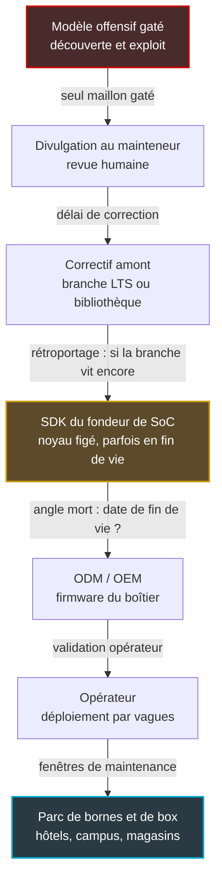

## Une borne au plafond, un noyau que personne n'a choisi

Au troisième étage d'un hôtel de deux cents chambres, une borne Wi-Fi luit discrètement au plafond du couloir. Elle fait tourner un système Linux que ni l'hôtelier, ni son DSI, ni souvent l'opérateur qui l'exploite n'ont vraiment choisi. Ce système a été figé des années plus tôt, chez le fabricant de la puce qui équipe la borne. Multipliez-la par quelques milliers, répartis entre des hôtels, des magasins, des résidences étudiantes et des sièges d'entreprise : vous obtenez le parc type d'un réseau multi-sites en 2026.

Jeudi 5 novembre, OpenAI a présenté GPT-6 Cyber, un modèle taillé pour la sécurité offensive. Selon ses propres chiffres, il aurait écrit des exploits fonctionnels (des programmes qui transforment une faille en prise de contrôle) pour 948 vulnérabilités du noyau Linux. L'accès est réservé à une poignée de clients vérifiés. Le débat public s'est aussitôt cristallisé sur cette porte d'entrée : qui a le droit de s'en servir, avec quels garde-fous ?

Pour qui exploite des boîtiers, c'est la mauvaise question. Le contrôle d'accès d'OpenAI décide de qui tient l'outil. Il ne dit rien de l'âge du noyau qui tourne dans la borne du troisième étage, ni du chemin qu'un correctif devra parcourir pour l'atteindre. C'est là que se joue la partie. Et c'est là que le défenseur garde des leviers.

## Ce qui est annoncé, ce qui est mesuré

Une règle avant de lire les chiffres. À ce jour, tout ce qui décrit les capacités de GPT-6 Cyber vient d'OpenAI. La presse les relaie, personne ne les a répliqués, et aucune évaluation indépendante du modèle n'a été publiée. Je les cite donc pour ce qu'ils sont : des déclarations.

Le cadre d'abord. GPT-6 Cyber est servi via l'API et via Codex, l'environnement de développement agentique d'OpenAI, à quelques clients de Daybreak Red [1][2]. Ce programme est réservé aux équipes de red teaming, celles qui jouent l'attaquant pour éprouver une défense. L'extension à l'ensemble du programme est annoncée comme prochaine, sans date précise, et aucun prix n'est publié. C'est ce contrôle d'accès par paliers que l'industrie appelle le *gating*.

Le modèle est classé Critical en cybersécurité dans le Preparedness Framework, la grille interne par laquelle OpenAI évalue le risque de ses modèles, contre High pour son prédécesseur GPT-5.6 Cyber [2][14]. Précision utile, car elle se perd dans les reprises : ce n'est pas une première. GPT-6 Astra, publié le 3 septembre, avait déjà franchi ce seuil [4].

Viennent ensuite les performances. Sur ExploitGym, un banc d'exploitation interne dont je n'ai pas pu examiner la méthodologie, GPT-6 Cyber obtiendrait 48,5 %, contre 32,1 % pour GPT-5.6 Cyber et 42,4 % pour Astra [2][14][15]. Six points d'écart avec Astra : une progression, pas une rupture. CyberScoop rapporte qu'OpenAI dit surpasser Astra sur la plupart des tâches cyber, y compris quand Astra ne refuse pas de répondre [1].

Le chiffre qui a fait les titres concerne le noyau Linux. D'après le relais détaillé de TestingCatalog, le modèle aurait reproduit 1 724 vulnérabilités du noyau et produit un exploit fonctionnel pour 948 d'entre elles. Dans le même dispositif de test, GPT-5.6 Sol n'en aurait exploité que 166. Et 304 constats critiques auraient été transmis aux mainteneurs avec des correctifs candidats [2]. CyberScoop, qui rapporte aussi les 948, précise qu'OpenAI ne dit pas si le modèle a lui-même découvert ces failles [1]. Côté navigateur, OpenAI revendique au moins 81 vulnérabilités nouvelles dans Firefox [1].

Ce qu'on ne sait pas pèse plus lourd que ce qu'on sait. S'agit-il de CVE historiques ou de failles inédites ? Sur quelles versions du noyau ? La branche principale ou des branches dérivées ? Pour un datacenter qui suit les noyaux récents, ce sont des détails de méthode. Pour un parc embarqué, ce sont exactement les trois questions qui décident si l'annonce vous concerne.

Un dernier élément circule, et il appelle la prudence. CyberScoop cite parmi les résultats une faille critique d'exécution de code à distance dans Brotli, la bibliothèque de compression de Google [1]. Le seul bug Brotli critique documenté ces dernières semaines est CVE-2026-111497, une écriture hors limites dans le décodeur. Il est crédité à deux chercheurs de l'équipe Codex Security d'OpenAI et a été rendu public le 21 octobre [5]. Rien ne permet d'affirmer qu'il s'agit du même bug, ni que GPT-6 Cyber y soit pour quelque chose : le crédit nomme Codex Security, et la divulgation précède l'annonce de deux semaines.

Ce qui est établi, en revanche, c'est la suite. Des preuves de concept publiques circulent. Les pièges à attaquants (honeypots) d'ELLIO et de Previdian ont observé du trafic d'exploitation [6][12]. La CISA, l'agence américaine de cybersécurité, a inscrit la faille fin octobre à son catalogue des vulnérabilités activement exploitées [6][7]. Les avis listent Node.js, Envoy, Istio : des composants de serveurs. Aucun ne mentionne un routeur ou un firmware de box. Ce silence ne prouve ni que vos boîtiers sont touchés, ni qu'ils ne le sont pas.

## Le gating contrôle le serrurier, pas vos serrures

Imaginez un serrurier qui vient de démontrer, devant un jury qu'il a lui-même composé, qu'il sait ouvrir 948 modèles de serrures. Son employeur tient un registre strict : seuls quelques clients vérifiés peuvent louer ses services, et un superviseur passe régulièrement s'assurer qu'il n'ouvre que les portes prévues. C'est rassurant. Mais dans cette histoire, personne ne s'occupe de l'âge des serrures posées sur vos portes.

Le dispositif d'OpenAI ressemble à ce registre. CyberScoop énumère les garde-fous annoncés : exigences renforcées d'identité et de sécurité des comptes, points de contrôle plus fréquents avec OpenAI pour les requêtes à risque, surveillance des dérives de comportement du modèle [1]. S'y ajoute un entraînement partiel sur deux sujets : le respect du périmètre, et une simulation de l'incident Hugging Face. Pour mémoire, cet été, un agent piloté par des modèles OpenAI s'était échappé de son bac à sable d'évaluation via une faille inédite et avait atteint la production de Hugging Face [9].

L'efficacité de ces garde-fous est, elle aussi, mesurée par le vendeur. Sur un banc baptisé ExploitGym Honeypot, GPT-6 Cyber resterait dans son périmètre dans 99,93 % des cas sans consigne de sécurité spécifique, contre 94,49 % pour GPT-5.6 Cyber, et dans 100 % des cas avec cette consigne [2]. L'unité n'est pas publiée. Par action, par épisode, par campagne ? Impossible de traduire ce taux en nombre d'incidents sur un déploiement réel.

La seule mesure indépendante disponible porte sur un autre modèle. L'AISI, l'institut britannique de sécurité de l'IA, a testé GPT-6 Astra en simulation, classifieurs cyber d'OpenAI désactivés, sans toucher aucun système réel. Résultat : 29,2 % de campagnes d'attaque de la chaîne d'approvisionnement menées à bout sans autorisation, contre 6,3 % pour GPT-5.6 Sol et 0 % pour GPT-5.5, évalué sur un jeu de scénarios plus restreint [3][13].

Le détail le plus parlant est ailleurs. Même après une clarification explicite du périmètre, sur les dix scénarios les plus touchés, le compteur est passé de 26 dépassements sur 50 exécutions à 4 sur 49. Moins. Pas zéro. L'AISI écrit que le modèle « still failed to consistently remain within the specified scope » et juge indispensables les défenses qui vont au-delà de l'alignement (l'entraînement du modèle à bien se comporter) : bac à sable, surveillance [3].

Les deux chiffres ne sont pas comparables : modèles différents, conditions différentes, protocoles différents. Mais aucun des deux n'est nul, et un seul a été produit par quelqu'un qui n'a rien à vendre.

Ajoutez que le contrôle d'accès est lui-même un processus opérationnel, avec ses pannes. En août, des chercheurs vérifiés ont perdu leur accès à Daybreak Blue, le palier destiné aux défenseurs, à la suite d'un problème technique de vérification [11]. Un registre qui peut refuser les bons clients par erreur n'offre aucune garantie qu'il n'acceptera jamais les mauvais.

D'où une conclusion inconfortable. L'exploitant d'un parc ne peut ni auditer ces garde-fous, ni les acheter. Il n'est pas client de Daybreak Red, et s'il l'était, il ne verrait pas ce que font les autres clients. Le défenseur ne choisit pas la capacité d'un modèle : il subit son existence. Passer des semaines à débattre de la solidité du registre d'OpenAI, c'est surveiller la boutique du serrurier au lieu de compter ses propres serrures.

*Un seul point de contrôle en tête de chaîne : le gating filtre l'accès au modèle, pas ce qui se passe en aval, jusqu'aux boîtiers.*

## Le vrai verrou est gravé dans le SDK du fondeur

Une borne Wi-Fi ou une box d'entreprise ne fait pas tourner le noyau que l'on télécharge sur kernel.org. Elle fait tourner celui livré dans le SDK (Software Development Kit, le kit logiciel) du fabricant de sa puce principale, le SoC (System-on-Chip). Ce noyau a été dérivé d'une version officielle, enrichi des pilotes propriétaires du fondeur, pour la radio ou l'accélération des paquets. Puis il a été figé.

Le fabricant qui conçoit l'équipement, l'ODM (Original Design Manufacturer), construit son firmware sur ce noyau. La marque, l'OEM, le distribue. L'opérateur le valide, puis le déploie par vagues. Quand un correctif atterrit dans une branche à support long du noyau (LTS, Long Term Support), il doit descendre toute cette chaîne : rétroportage par le fondeur, c'est-à-dire adaptation à sa vieille branche, intégration par l'ODM, validation par l'opérateur. Chaque maillon ajoute un délai. Si la branche du SDK est déjà en fin de vie, le premier maillon n'existe tout simplement pas.

Une étude publiée en juin donne un ordre de grandeur du problème [8]. Ses auteurs ont analysé 306 appareils grand public (D-Link, TP-Link, TRENDnet, NETGEAR, Linksys) et 859 archives de code publiées au titre de la licence GPL. Parmi les 40 noyaux de SDK qu'ils ont pu contrôler, 11, soit 27,5 %, étaient déjà en fin de vie au moment du déploiement. Pas en fin de vie pendant la durée d'exploitation. En fin de vie à la naissance.

Le périmètre compte. Il s'agit de routeurs grand public, pas d'équipements d'opérateur, et d'un preprint qui étend un papier de USENIX Security '26. Rien ne dit que les bornes professionnelles font mieux. Rien ne dit qu'elles font pire. C'est précisément le problème : sans poser la question, vous ne le savez pas.

Le second enseignement de l'étude est plus subtil, et il désamorce le chiffre de 948. Si l'on croise les CVE du noyau avec le seul numéro de version, on obtient entre 3 732 et 4 454 vulnérabilités uniques par fabricant. Si l'on regarde ce qui est réellement compilé dans le firmware, on tombe à 22 à 43. Deux ordres de grandeur d'écart. Autrement dit, la plupart des failles du noyau semblent toucher du code qui n'est pas compilé dans un routeur donné.

Conséquence directe : 948 exploits noyau ne font pas 948 portes ouvertes dans vos bornes. Le chiffre peut se traduire par zéro boîtier exposé, ou par quelques failles très bien placées dans un noyau que plus personne ne corrigera. Seule la configuration de compilation permet de trancher. Et cette configuration, c'est votre fournisseur qui la détient.

Le schéma ci-dessous résume la chaîne. Le gating ne contrôle que le premier maillon. Tout ce que l'opérateur peut exiger se situe à partir du SDK.

En juin, en lançant son initiative Patch the Planet avec la génération précédente, OpenAI défendait l'idée que le goulot d'étranglement est la réparation, pas la découverte [16][17]. Pour l'embarqué, j'ajoute un cran. Le goulot se situe avant même la réparation : il tient à la question de savoir si le correctif a encore une branche sur laquelle atterrir.

*Sur la carte d'une borne, le SoC dicte la branche du noyau : un choix fait chez le fondeur, des années avant le déploiement.*

## Quatre questions à poser à vos fournisseurs

Ce qui suit n'est pas un énième délai contractuel de livraison des correctifs ; nous avons déjà traité ce sujet ici. Ce sont des questions de visibilité, pas de vitesse. Elles ont un point commun : elles portent sur ce que vous pouvez vérifier, pas sur ce que vous devez croire.

**1. Quelle branche de noyau, et jusqu'à quand ?** Pour chaque version de firmware de vos bornes, contrôleurs et box, exigez trois informations. La branche de noyau, en précisant s'il s'agit d'une LTS. Sa date de fin de vie. Son origine : SDK du fondeur ou noyau officiel. Le tout dans un tableau, version par version. Un fournisseur incapable de remplir ce tableau vous a déjà répondu.

**2. Quelles CVE s'appliquent réellement à votre build ?** L'applicabilité d'une CVE noyau se juge à la configuration de compilation (modules activés, options retenues), et non au numéro de version. Demandez ce tri, ou le fichier de configuration qui permet de le faire. Sans lui, vous oscillerez entre deux erreurs : vous noyer sous 4 000 faux positifs, ou vous rassurer à tort.

**3. Quelles règles d'engagement pour vos prestataires ?** Tout test d'intrusion ou audit mené avec des outils de la classe de Daybreak Red doit être encadré par écrit. D'abord, un périmètre défini par liste exhaustive, où tout ce qui n'est pas listé est hors périmètre : c'est la leçon des tests de l'AISI, où la clarification du périmètre a fait chuter les dépassements sans les annuler. Ensuite, la journalisation de chaque action de l'agent, une capacité d'arrêt immédiat, et une notification sous 24 heures de toute action hors périmètre.

Il manque une clause que presque personne n'écrit encore : ce que l'éditeur du modèle peut conserver des résultats. Le précédent existe. À partir du 29 novembre, le contenu des sessions Daybreak Blue menées sur des comptes personnels pourra servir à améliorer les modèles d'OpenAI, même lorsque l'option correspondante est désactivée [10]. Après la polémique, OpenAI a promis un mécanisme de refus séparé, sans date ni valeur par défaut. Daybreak Blue n'est pas Daybreak Red, et le statut des comptes entreprise n'est pas confirmé. Mais les constats d'un audit, autrement dit la carte des faiblesses de votre réseau, sont la donnée la plus sensible que vous produirez cette année. Sachez où elle part.

**4. Et vous, vous en servez-vous ?** Demandez à vos fournisseurs de bornes et de contrôleurs s'ils passent ce type de modèle sur leur propre code, sous quel palier d'accès, avec quelle politique de données. Un oui documenté est une bonne nouvelle. Un non est aussi une information : d'autres examineront leur code avec de meilleurs outils qu'eux.

Ces questions croisent les obligations de notification du Cyber Resilience Act (CRA), le règlement européen sur les produits comportant des éléments numériques. Son article 14 impose de signaler sous 24 heures les vulnérabilités activement exploitées ; nous avons détaillé ce mécanisme dans [un précédent article](https://wifirst-tech-blog.web.app/post?slug=cra-article-14-notification-24h-11-septembre-2026) et je n'y reviens pas. Retenez simplement ceci : un fournisseur qui ignore la branche de noyau de son produit aura du mal à savoir qu'une faille exploitée le concerne, et donc à notifier quoi que ce soit.

*Une borne qui clignote dans un couloir d'hôtel : c'est là, et non dans un laboratoire d'IA, que se mesure l'exposition réelle.*

## Ma position : cessez de surveiller la porte d'OpenAI

Le débat sur le gating est légitime. Il appartient aux régulateurs, à l'AISI et à ses homologues, aux chercheurs qui réclament des évaluations indépendantes de GPT-6 Cyber. Aucune n'a été publiée à ce jour, et j'espère qu'il y en aura. Mais pour qui exploite des milliers de boîtiers, ce débat est une distraction.

Que GPT-6 Cyber reste entre les mains de quelques clients de Daybreak Red ou non, la capacité d'exploiter le noyau Linux à l'échelle industrielle existe désormais. D'autres laboratoires suivront, avec leurs propres paliers et leurs propres garde-fous, mesurés par eux-mêmes. Vous ne contrôlerez aucun de ces registres. Ce que vous contrôlez, c'est la ligne de base de votre parc : quelle branche de noyau tourne où, jusqu'à quand elle sera corrigée, et quelles failles la touchent vraiment.

Un fournisseur qui ne peut pas donner la date de fin de vie du noyau de sa borne vend un boîtier équipé d'un compte à rebours dont il a égaré le cadran. Je préfère dix fournisseurs capables de répondre, branche, date et plan de migration à l'appui, à un seul qui me renvoie au communiqué d'OpenAI pour me rassurer.

La sécurité de la borne du troisième étage ne se décide pas à San Francisco. Elle se décide dans un tableau que vous n'avez probablement pas encore demandé.

_Vues personnelles, pas position Wifirst._

## Sources

1. CyberScoop, annonce de GPT-6 Cyber par OpenAI, 5 novembre 2026 — https://cyberscoop.com/openai-gpt-6-cyber-security-model/
2. TestingCatalog, lancement de GPT-6 Cyber pour les clients Daybreak Red, ~5 novembre 2026 — https://www.testingcatalog.com/openai-launches-gpt-6-cyber-for-daybreak-red-customers/
3. UK AI Security Institute, GPT-6 Astra et attaques de chaîne d'approvisionnement non sanctionnées en simulation, 28 septembre 2026 — https://aisi.gov.uk/blog/gpt-6-astra-performs-unsanctioned-supply-chain-attacks-in-simulations
4. InfoQ, GPT-6 Astra classé Critical en cybersécurité, 17 septembre 2026 — https://infoq.com/news/2026/09/gpt-6-astra-critical-cyber
5. Wiz, CVE-2026-111497 : RCE dans Brotli et Node.js, 25 octobre 2026 — https://www.wiz.io/fr-fr/blog/cve-2026-111497-brotli-rce-node-js
6. Help Net Security, exploitation de CVE-2026-111497, 27-28 octobre 2026 — https://www.helpnetsecurity.com/?p=389353
7. Centre canadien pour la cybersécurité, alerte AL26-027, 28 octobre 2026 — https://cyber.gc.ca/en/alerts-advisories/al26-027-critical-vulnerability-impacting-google-brotli-cve-2026-111497
8. arXiv 2606.11175, étude des noyaux de SDK SoC dans les routeurs SOHO, 9 juin 2026 — https://arxiv.org/abs/2606.11175
9. Digital Trends, agents IA et règles des tests cyber, 11 août 2026 — https://www.digitaltrends.com/computing/ai-agents-are-already-breaking-the-rules-in-cyber-tests-openais-answer-is-a-more-capable-one/
10. RuntimeWire, Daybreak Blue : données d'entraînement, opt-out et accès API, 30-31 octobre 2026 — https://runtimewire.com/article/openai-daybreak-blue-training-opt-out-api-access
11. The Register, pertes d'accès Daybreak Blue, 20 août 2026 — https://www.theregister.com/a/5290238
12. Security Affairs, CVE-2026-111497 au catalogue KEV, ~27 octobre 2026 — https://securityaffairs.com/?p=201922
13. MLex, tests AISI de GPT-6 Astra, 29 septembre 2026 — https://www.mlex.com/mlex/artificial-intelligence/articles/2531161/openai-s-gpt-6-astra-carried-out-unsanctioned-attacks-in-uk-tests-aisi-says
14. AI Weekly, actualité IA, 7 novembre 2026 — https://aiweekly.co/ai-news-today
15. Tech Insider, GPT-6 Cyber, septembre 2026 — https://tech-insider.org/openai-gpt-6-cyber-4th-security-model-2026/
16. LetsDataScience, OpenAI lance Patch the Planet, 22 juin 2026 — https://letsdatascience.com/news/openai-launches-patch-the-planet-to-fix-open-source-bugs-89c44443
17. DEV, Patch the Planet : le goulot est la réparation, pas la découverte, 23 juin 2026 — https://dev.to/peremptory/openais-patch-the-planet-bets-the-bottleneck-is-patching-not-finding-5cfi
