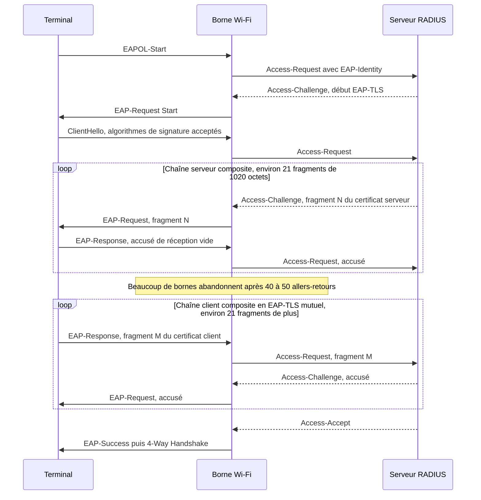
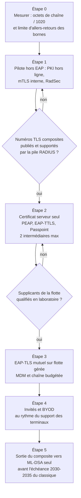

## Un passeport numérique qui va prendre du poids

Chaque matin, dans des milliers d'hôtels, de magasins et de résidences étudiantes, des ordinateurs portables, des terminaux de caisse et des tablettes de service rejoignent le Wi-Fi de l'entreprise en présentant une pièce d'identité numérique : un certificat. La borne ne le lit pas. Elle le découpe en petits morceaux et le relaie, un par un, jusqu'à un serveur qui dit oui ou non. Le tout tient en quelques kilo-octets et dure une fraction de seconde. Personne n'y pense.

Ce passeport va grossir, et pas qu'un peu. En novembre 2026, les instances qui normalisent Internet ont publié un nouveau standard, la RFC 10073. Il fixe le format d'un certificat dit « composite » : une clé classique et une clé conçue pour résister à l'ordinateur quantique, soudées dans un seul objet. C'est la pièce qui manquait aux autorités de certification pour suivre la voie hybride que recommandent les agences de cybersécurité française et allemande.

Pour qui exploite du Wi-Fi d'entreprise sur des centaines de sites, de l'hôtellerie au retail, c'est une bonne nouvelle assortie d'un piège. Le piège n'est pas cryptographique. Il est arithmétique. Beaucoup de bornes abandonnent une authentification qui n'a pas abouti en 40 à 50 allers-retours, et une chaîne de certificats composites peut, à elle seule, consommer l'essentiel de ce budget.

Ma position : cette RFC règle la moitié « certificat » du problème, pas la moitié « réseau ». Il faut budgéter ses chaînes dès maintenant, et piloter là où l'on tient les deux bouts du câble plutôt que sur les terminaux des clients.

## Un coffre à deux serrures

Imaginez un coffre de banque qui ne s'ouvre qu'avec deux clés tournées en même temps : celle du client et celle du banquier. Un voleur qui n'en possède qu'une repart bredouille. C'est exactement la promesse du certificat composite.

Aujourd'hui, le certificat d'un serveur d'authentification Wi-Fi repose sur un seul algorithme de signature classique : RSA, ou ECDSA, son cousin à courbes elliptiques. Tous deux tomberont le jour où un ordinateur quantique suffisamment puissant existera. Personne ne sait dire quand. Chacun sait, en revanche, qu'une infrastructure de certificats met des années à migrer.

La RFC 10073 adjoint à cette signature classique ML-DSA (Module-Lattice-Based Digital Signature Algorithm), l'algorithme post-quantique que le NIST américain a normalisé en 2024 dans le standard FIPS 204. L'astuce tient dans l'emballage. Les deux clés publiques sont présentées comme une seule, les deux signatures comme une seule, et le tout porte un identifiant d'algorithme unique (un OID, l'étiquette qui indique au logiciel comment vérifier). Pour les formats de certificats et les protocoles d'enrôlement existants, c'est simplement un algorithme de plus.

Quatre propriétés comptent pour qui exploite un réseau.

**C'est un ET, jamais un OU.** La signature n'est valide que si ses deux moitiés le sont. Aucun mode ne permet à un vieux terminal de vérifier la seule partie classique en ignorant le reste. La RFC l'écrit sans détour : elle n'offre pas de compatibilité applicative. Un logiciel qui ne connaît pas les nouveaux identifiants rejette le certificat, point final.

**Ce n'est pas du ML-DSA seul.** Le ML-DSA « pur » dans les certificats relève d'une autre norme, la RFC 9881 (octobre 2025), dont le composite hérite toutes les considérations de sécurité. La RFC 10073 enregistre 18 combinaisons, sans en rendre aucune obligatoire. Elle en recommande une par défaut, `id-MLDSA65-ECDSA-P256-SHA512` : ML-DSA de niveau intermédiaire, couplé à ECDSA sur la courbe P-256. Si RSA est imposé, ce sera `id-MLDSA65-RSA3072-PSS-SHA512`. Si la bande passante prime, `id-MLDSA44-ECDSA-P256-SHA256` ou `id-MLDSA44-Ed25519-SHA512`.

**On ne recycle pas ses clés.** Impossible de reprendre la clé ECDSA du serveur RADIUS en production (le serveur qui valide chaque connexion) et de lui greffer une moitié post-quantique. Les deux clés doivent être générées pour l'occasion et ne jamais servir seules. La RFC invite aussi les autorités de certification à contrôler la révocation de chaque composante, pas seulement celle de l'ensemble. Le BSI, l'agence fédérale allemande de cybersécurité, recommande la même discipline de clés dédiées dans sa directive technique TR-02102-1.

**La garantie est suffisante, pas absolue.** Pour un certificat, la traduction est simple : un attaquant classique devrait casser les deux algorithmes, un attaquant quantique devrait casser ML-DSA. La RFC reconnaît toutefois que, face à un adversaire quantique, le composite n'atteint pas la forme la plus stricte d'infalsifiabilité (dite SUF-CMA). Elle en déconseille donc l'usage là où la forme standard (EUF-CMA) n'a pas été jugée suffisante.

Pourquoi ce montage plutôt que ML-DSA seul, plus léger ? Parce que l'Europe le demande. Dans la version de janvier 2026 de sa TR-02102-1, le BSI ne recommande les signatures post-quantiques qu'« en combinaison » avec une signature classique, les signatures à base de hachage mises à part. L'ANSSI, son homologue française, dans sa fiche technique FT-115 de février 2026 consacrée à TLS 1.3, recommande l'hybridation pendant la transition, signatures comprises. Elle constatait alors qu'il n'existait « pour l'instant » aucun standard d'authentification hybride. Côté certificats, la RFC 10073 comble ce vide.

Le second motif est plus prosaïque. Le composite facilite la recertification FIPS (le référentiel américain de validation des modules cryptographiques) d'un équipement déjà validé : on y ajoute la brique post-quantique sans remettre en cause la partie classique déjà certifiée.

*Une clé publique ECDSA P-256 tient en 65 octets, une clé composite MLDSA65-ECDSA-P256 en 2 017 : l'essentiel du poids vient de la moitié post-quantique.*

## Un passeport, mais pas encore de douane pour le lire

Un standard de certificat, c'est un format de passeport. Encore faut-il qu'un poste-frontière sache le lire. Or le Wi-Fi d'entreprise repose sur la norme 802.1X, qui conditionne l'accès au réseau à une authentification, et cette authentification empile trois couches. Une seule est finalisée.

La première est le certificat lui-même, au format X.509. C'est le périmètre exact de la RFC 10073 : elle cite TLS 1.3, IKEv2 (les VPN IPsec) ou la signature de code comme terrains de migration, mais ne dit pas un mot d'EAP-TLS.

La deuxième est la poignée de main TLS 1.3, ce moment où le serveur prouve qu'il détient bien la clé privée de son certificat. Pour qu'une signature composite y circule, chaque combinaison doit recevoir un numéro de l'IANA, le registre central des paramètres d'Internet. Le brouillon `draft-ietf-tls-composite-mldsa-00`, devenu document du groupe de travail TLS de l'IETF (l'organisme de normalisation d'Internet) dans une version datée du 20 octobre 2026, nomme déjà les combinaisons, par exemple `mldsa65_ecdsa_secp256r1_sha512`. Leurs numéros, eux, sont toujours marqués « TBD ». Sans ces numéros, pas d'interopérabilité entre le serveur d'un éditeur et le terminal d'un autre.

La troisième est EAP (Extensible Authentication Protocol), l'enveloppe qui transporte cette poignée de main entre le terminal, la borne et le serveur RADIUS. Le brouillon `draft-ietf-emu-pqc-eap-tls-02`, signé T. Reddy (Nokia) et daté du 23 septembre 2026, prépare le terrain. Il pose d'abord une contrainte lourde : toute la chaîne, jusqu'à l'autorité racine, doit être post-quantique ou hybride. Un certificat final composite signé par une autorité classique ne suffit pas.

Il avance aussi une piste : laisser le terminal récupérer les certificats intermédiaires via EST (Enrollment over Secure Transport, un protocole d'enrôlement), plutôt que de les recevoir pendant l'authentification. Il juge en revanche « limité » l'apport de la compression de certificats (RFC 8879) face à des clés de cette taille. Et il ne donne ni tableau d'octets ni nombre d'allers-retours. Ce calcul, il faudra le faire soi-même.

Côté implémentations, le paysage reste clairsemé. Keyfactor émet des certificats composites depuis EJBCA 9.5 (février 2026), mais sur la base du brouillon 13 de la spécification. L'éditeur dit s'attendre à être conforme à la RFC finale, issue du brouillon 19. C'est plausible. C'est surtout à vérifier, certificat par certificat, avant tout déploiement. OpenSSL implémente ML-DSA depuis sa version 3.5, mais je n'ai trouvé aucune trace publique d'un support du composite.

Reste l'inconnue majeure : les terminaux. Je n'ai trouvé aucune preuve publique, ni dans un sens ni dans l'autre, d'un support de ML-DSA ou du composite pour EAP-TLS dans les logiciels clients d'authentification, les « supplicants ». Ni chez Windows, ni chez Apple, ni chez Android, ni dans wpa_supplicant côté Linux. Pas davantage de programme de test de la Wi-Fi Alliance. Ce n'est pas un « non ». C'est un « personne ne sait », et cela se traite en laboratoire, pas en comité de pilotage.

Windows a d'ailleurs ses propres limites. Selon la documentation Microsoft (page mise à jour en septembre 2025, à recontrôler), son serveur d'authentification NPS (Network Policy Server) ne gère pas TLS 1.3 « at this time ». Et les clients Windows refont toujours une authentification complète, sans reprise de session. Retenez ce détail : il va compter.

*Dans un couloir d'hôtel, chaque borne relaie la chaîne de certificats maillon par maillon : c'est la longueur totale de la chaîne qui décide si la session aboutit.*

## Le vrai mur : cinquante allers-retours

Pensez à un guichet qui n'accepte un dossier que feuille par feuille, glissées sous une vitre, en tamponnant chacune avant de prendre la suivante. Au cinquantième aller-retour, l'employé ferme le guichet, dossier complet ou non. C'est, à peu de chose près, la vie d'une authentification EAP-TLS.

EAP ne fragmente pas lui-même : c'est à la méthode EAP-TLS de découper ses messages. Le protocole suppose une taille minimale de paquet (MTU) de 1 020 octets, selon la RFC 3748, et un paquet RADIUS plafonne à 4 096 octets (RFC 2865). La RFC 9191, publiée en février 2022 précisément sur les grands certificats, en tire une règle de poche. Additionnez la taille des certificats du client et du serveur, divisez par 1 020. Au-delà de 50, attendez-vous à des échecs, car « beaucoup de points d'accès abandonnent les sessions EAP qui ne se terminent pas en 40-50 allers-retours ». Le même texte déconseille plus de quatre intermédiaires, et demande aux constructeurs de nouvelles bornes d'autoriser 100 allers-retours.

Maintenant, les tailles. Une signature ECDSA P-256 pèse au plus 72 octets. Une signature composite MLDSA65-ECDSA-P256, le défaut de la RFC, monte jusqu'à 3 381 octets : près de 47 fois plus. La clé publique passe de 65 à 2 017 octets. Or chaque certificat de la chaîne transporte une clé et une signature, et le serveur ajoute une signature de plus pour prouver qu'il détient sa clé privée. En 2022, la RFC 9191 tablait sur des clés post-quantiques d'environ 1 000 octets et des signatures d'environ 2 000. ML-DSA-65 seul en est à 1 952 et 3 309.

Un point contre-intuitif : l'hybridation elle-même coûte peu. Face à ML-DSA seul, le composite avec ECDSA P-256 n'ajoute que 65 octets de clé et 72 octets de signature au maximum (différence calculée à partir des tables de la RFC). Avec RSA-3072, l'écart grimpe à environ 400 octets par clé et par signature. Le poids vient du niveau de ML-DSA retenu et du nombre d'autorités dans la chaîne, pas du principe hybride.

Pour fixer les idées, voici un ordre de grandeur. Ce n'est pas une mesure, c'est un modèle, calculé à partir des tailles maximales publiées dans la RFC 10073. Hypothèses : environ 600 octets d'en-têtes et d'extensions pour le certificat final, 450 par autorité intermédiaire, racine non transmise, une signature de preuve de possession en plus, et la règle des fragments de 1 020 octets. « Mutuel » signifie que le terminal présente lui aussi une chaîne de même taille.

| Algorithme de toute la chaîne | Serveur seul, 2 intermédiaires | Mutuel, 2 intermédiaires | Mutuel, 4 intermédiaires |
|---|---|---|---|
| ECDSA P-256 (classique) | ≈ 2,0 Ko, 2 fragments | ≈ 4,0 Ko, 4 fragments | ≈ 6,3 Ko, 7 fragments |
| MLDSA44-ECDSA-P256 | ≈ 15,6 Ko, 16 | ≈ 31,2 Ko, 31 | ≈ 48,5 Ko, 48 |
| ML-DSA-65 seul | ≈ 20,6 Ko, 21 | ≈ 41,2 Ko, 41 | ≈ 64,0 Ko, 63 |
| **MLDSA65-ECDSA-P256 (défaut RFC)** | **≈ 21,1 Ko, 21** | **≈ 42,2 Ko, 42** | **≈ 65,5 Ko, 65** |
| MLDSA65-RSA3072-PSS | ≈ 23,3 Ko, 23 | ≈ 46,6 Ko, 46 | ≈ 72,6 Ko, 72 |
| MLDSA87-ECDSA-P384 | ≈ 28,5 Ko, 28 | ≈ 57,0 Ko, 56 | ≈ 88,5 Ko, 87 |

*Estimation, pas mesure : à recalculer avec vos propres certificats, car noms, extensions et profondeur de chaîne changent le résultat.*

Trois lectures s'imposent. Quand seul le serveur présente un certificat, comme en PEAP, en EAP-TTLS ou en Passpoint (le programme d'itinérance automatique de la Wi-Fi Alliance) sans certificat client, le budget reste confortable : 16 à 28 fragments. C'est le cas typique de l'accueil des clients d'un hôtel. En EAP-TLS mutuel avec deux intermédiaires de chaque côté, l'algorithme par défaut atterrit autour de 42 fragments, en pleine zone grise des 40 à 50. Avec quatre intermédiaires, le maximum conseillé par la RFC 9191, il dépasse 60 : attendez-vous à des échecs.

Une étude publiée en janvier 2026 montre que ce mur est réel, et qu'il est logiciel avant d'être cryptographique. Des chercheurs (Köder et al.) ont monté un banc WPA-Enterprise avec deux briques open source, le serveur FreeRADIUS et le logiciel de point d'accès hostapd. Pour faire passer leurs certificats post-quantiques, ils ont dû patcher les deux : relever la limite d'allers-retours EAP de 50 à 500, et supprimer une limite de longueur TLS. Une fois débridé, le banc authentifiait en quelques dixièmes de seconde, « plus lent que RSA-2048 mais bien dans les bornes acceptables ». C'était nettement plus rapide en 5 GHz qu'en 2,4 GHz à débit minimal. La reprise de session atténuait largement le surcoût. Sauf que les clients Windows, on l'a vu, n'en font pas.

Attention à ne pas surinterpréter. Ce banc testait notamment ML-DSA seul et un hybride qui n'est pas celui de la RFC 10073 : il ne dit rien du temps que coûtera le composite. Il prouve autre chose, de plus utile. Avec leurs limites par défaut, les piles d'aujourd'hui bloquent avant même que la cryptographie ne coûte quoi que ce soit.

*Séquence EAP-TLS simplifiée avec une chaîne MLDSA65-ECDSA-P256 à deux intermédiaires : environ 21 fragments par côté selon le modèle ci-dessus, une estimation et non une mesure.*

Les leviers existent. Dans l'ordre où je les actionnerais :

1. **Une moitié classique en courbes elliptiques plutôt qu'en RSA** : environ 400 octets économisés par clé et par signature.
2. **Deux intermédiaires au maximum.** La RFC 9191 en tolère quatre ; en composite, c'est déjà trop pour une authentification mutuelle.
3. **Des certificats sobres** : noms alternatifs (SAN) courts, extensions réduites au strict nécessaire.
4. **TLS 1.3 partout**, condition pour pouvoir omettre les intermédiaires, en gardant un œil sur la piste EST du brouillon EAP.
5. **Un inventaire des limites d'allers-retours** par modèle de borne et de contrôleur, avec l'objectif de 100 posé par la RFC 9191.
6. **Un débit minimal relevé** : l'étude montre l'écart entre le 2,4 GHz à 1 Mbit/s et le 5 GHz à 6 Mbit/s.

Ce que je ne ferais pas, en revanche : descendre à ML-DSA-44 pour gagner de la place. La RFC le propose aux usages sensibles à la bande passante, et le tableau rend l'idée tentante. Mais le BSI ne retient que ML-DSA-65 et ML-DSA-87 dans ses recommandations, et les auteurs de l'étude conseillent eux aussi les niveaux de sécurité 3 ou 5. Les octets se gagnent sur la profondeur de chaîne, pas sur la marge de sécurité.

## Piloter là où l'on tient les deux bouts du câble

L'erreur serait de commencer par le Wi-Fi des clients. C'est là que s'accumulent toutes les inconnues : numéros TLS absents, supplicants non qualifiés, bornes plafonnées. Je propose l'ordre inverse, par risque croissant.

**D'abord, l'infrastructure à clés publiques (PKI) hors ligne.** Les racines et les autorités internes ne dépendent d'aucun protocole réseau. On peut dès aujourd'hui générer des clés composites fraîches, vérifier que les HSM (les boîtiers matériels qui protègent les clés) suivent, et tester l'émission. La RFC aide : l'empreinte du message peut être calculée hors du HSM, qui n'a plus qu'à signer. Et une racine est faite pour durer bien plus longtemps qu'une session : c'est elle qu'il faut préparer le plus tôt.

**Ensuite, le TLS mutuel interne et RadSec.** Le TLS mutuel (mTLS) entre vos propres serveurs, où chaque partie présente un certificat, est le terrain le plus simple. RadSec (RFC 6614, statut « Experimental » depuis 2012) transporte RADIUS dans TLS, entre bornes ou contrôleurs et serveurs d'authentification, ou au sein d'une fédération d'itinérance comme OpenRoaming. Ici, pas de fragmentation EAP, et vous tenez les deux bouts du tuyau. Vous pouvez tester les implémentations du brouillon TLS composite en laboratoire, sans attendre que l'écosystème des terminaux suive.

**Puis, l'authentification par certificat serveur seul** : PEAP, EAP-TTLS, Passpoint. De 16 à 28 fragments dans le modèle, donc de la marge. Mais pas avant que les numéros TLS soient publiés et supportés par la pile RADIUS.

**Après quoi, l'EAP-TLS mutuel sur flotte gérée.** Quand les terminaux sont administrés par un MDM (outil de gestion de flotte mobile), on choisit le supplicant, on le qualifie, on maîtrise la chaîne côté client.

**Enfin, les invités et le BYOD** (les équipements personnels). Terminaux inconnus, systèmes hétérogènes, aucun levier de configuration : c'est le dernier wagon, et il n'y a aucune honte à le laisser à quai le temps qu'il faudra.

*Feuille de route à portes de décision : on n'avance d'une étape que lorsque la précédente est qualifiée, et le composite reste un passage vers ML-DSA seul.*

## Un pont, pas une destination

Le composite porte sa date de péremption dans sa propre moitié classique.

Le NIST a publié le 27 octobre 2026 la version finale de son rapport IR 8547 sur la transition post-quantique. Le calendrier est net : ECDSA, EdDSA et RSA y sont « dépréciés après 2030 » et « interdits après 2035 ». Pour les systèmes fédéraux américains à fort impact, les signatures post-quantiques sont exigées au 31 décembre 2031. Et le NIST ne cache pas sa réserve envers l'hybride : ces solutions ajoutent de la complexité et sont, selon lui, généralement appelées à rester des mesures temporaires menant à une seconde transition.

Le BSI, de son côté, recommande les signatures classiques jusqu'à fin 2035 et vise fin 2030 pour la migration des échanges de clés. La RFC 10073 anticipe elle-même la friction : une clé composite peut associer un algorithme déprécié et un autre qui ne l'est pas. Les inventaires cryptographiques (CBOM, la nomenclature des algorithmes en service) devront savoir le représenter.

Deux écoles, donc. L'ANSSI et le BSI poussent l'hybride. Le NIST le tolère, indique qu'il acceptera les doubles signatures dans ses validations FIPS 140, mais le juge transitoire. Les sources ne divergent pas sur les faits, seulement sur l'intérêt du détour. Pour un acteur européen, l'arbitrage me paraît clair. Le composite est la voie alignée sur les recommandations françaises et allemandes, et c'est un pont : on le franchit en sachant qu'il faudra changer d'algorithme une seconde fois, avant que sa moitié classique n'arrive à échéance.

*Le composite est un pont : il permet de traverser la transition en restant aligné sur les recommandations européennes, mais il faudra en descendre avant l'échéance de sa moitié classique.*

La conséquence pratique est d'architecture. Il faut concevoir la PKI pour que la seconde migration soit une réémission, pas une refonte : enrôlement automatisé, durées de vie maîtrisées, inventaire à jour. Si changer d'algorithme exige une intervention manuelle sur chaque site, la première migration aura raté sa cible.

Dernier rappel de priorité, que je partage avec l'ANSSI : la confidentialité passe avant l'authentification. Un attaquant peut enregistrer aujourd'hui un trafic chiffré pour le déchiffrer dans dix ans. Casser demain une signature d'authentification déjà vérifiée ne compromet pas, en revanche, la session d'hier. Pour un réseau Wi-Fi d'entreprise, l'urgence reste donc l'échange de clés hybride, traité ici même en octobre. Le 802.1X composite peut attendre ses standards. Votre budget de chaîne, lui, n'attendra pas.

## Six chantiers à ouvrir sans attendre l'IETF

Rien de ce qui suit n'exige d'attendre les numéros TLS.

1. **Mesurer.** Pour chaque réseau 802.1X, additionner les octets des chaînes serveur et client, diviser par 1 020, comparer à 50. Puis refaire le calcul avec les tailles composites. Ce chiffre décide de tout le reste.
2. **Inventorier les bornes.** Quel seuil d'allers-retours EAP chaque modèle de borne et de contrôleur applique-t-il, et est-il configurable ? Exiger 100 dans les prochains appels d'offres.
3. **Bâtir une matrice de tests des supplicants.** Windows, macOS et iOS, Android, Linux, mais aussi terminaux de paiement et objets connectés. Faute de preuve publique, la case « composite » reste vide partout.
4. **Exiger la RFC finale.** Demander aux fournisseurs de PKI une conformité attestée à la RFC 10073, issue du brouillon 19, et non à une version antérieure.
5. **Interdire la réutilisation de clés.** Des paires générées pour l'occasion, dans des HSM capables de les porter, jamais un recyclage de l'existant.
6. **Préparer inventaire et révocation.** Inscrire chaque composante dans le CBOM, et vérifier que la révocation traite chaque moitié.

La RFC 10073 est une bonne norme. Elle fixe un format unique, interdit les raccourcis dangereux et colle aux recommandations des régulateurs européens. Mais elle arrive avant le protocole qui la transportera, dans un parc de bornes qui comptent leurs allers-retours. Le premier incident post-quantique d'un réseau Wi-Fi d'entreprise ne sera pas une signature forgée par un ordinateur quantique. Ce sera un portable bloqué sur « Connexion en cours », parce que sa chaîne de certificats ne tenait pas en cinquante allers-retours. Ce risque-là se chiffre dès aujourd'hui, avec une simple division.

_Vues personnelles, pas position Wifirst._

## Sources

1. RFC 10073, « Composite Module-Lattice-Based Digital Signature Algorithm (ML-DSA) for Use in X.509 Public Key Infrastructure », IETF, Proposed Standard, novembre 2026 : https://www.rfc-editor.org/info/rfc10073 (texte intégral : https://www.rfc-editor.org/rfc/rfc10073.txt)
2. IETF Datatracker, fiche RFC 10073 (ancien draft-ietf-lamps-pq-composite-sigs-19) : https://datatracker.ietf.org/doc/rfc10073/
3. NIST FIPS 204, Module-Lattice-Based Digital Signature Standard, août 2024 : https://csrc.nist.gov/pubs/fips/204/final (PDF : https://nvlpubs.nist.gov/nistpubs/FIPS/NIST.FIPS.204.pdf)
4. RFC 9881, ML-DSA dans les certificats X.509, octobre 2025 : https://www.rfc-editor.org/info/rfc9881
5. RFC 9794, terminologie des schémas hybrides post-quantiques/traditionnels, juin 2025 : https://www.rfc-editor.org/info/rfc9794
6. RFC 9955, Hybrid Signature Spectrums, et RFC 9958, Post-Quantum Cryptography for Engineers : https://www.rfc-editor.org/info/rfc9955 et https://www.rfc-editor.org/info/rfc9958
7. RFC 9190 (EAP-TLS 1.3) et RFC 5216 (EAP-TLS) : https://www.rfc-editor.org/info/rfc9190 et https://www.rfc-editor.org/info/rfc5216
8. RFC 3748 (EAP) et RFC 2865 (RADIUS) : https://www.rfc-editor.org/info/rfc3748 et https://www.rfc-editor.org/info/rfc2865
9. RFC 9191, Handling Large Certificates and Long Certificate Chains in TLS-Based EAP Methods, février 2022 : https://www.rfc-editor.org/info/rfc9191
10. RFC 8879, TLS Certificate Compression, décembre 2020 : https://www.rfc-editor.org/info/rfc8879
11. draft-ietf-emu-pqc-eap-tls-02 (T. Reddy, Nokia), septembre 2026 : https://www.ietf.org/archive/id/draft-ietf-emu-pqc-eap-tls-02.html
12. draft-ietf-tls-composite-mldsa-00, octobre 2026 : https://datatracker.ietf.org/doc/draft-ietf-tls-composite-mldsa/ (prédécesseur : https://datatracker.ietf.org/doc/draft-reddy-tls-composite-mldsa/)
13. Köder et al., « Assessing the Real-World Impact of Post-Quantum Cryptography on WPA-Enterprise Networks », arXiv 2601.22892, janvier 2026 : https://arxiv.org/abs/2601.22892
14. ANSSI, fiche technique FT-115 « Transition post-quantique de TLS 1.3 », février 2026 : https://messervices.cyber.gouv.fr/documents-guides/transition_post_quantique_tls_1_3.pdf
15. BSI TR-02102-1, « Cryptographic Mechanisms: Recommendations and Key Lengths », version 2026-01 : https://www.bsi.bund.de/SharedDocs/Downloads/EN/BSI/Publications/TechGuidelines/TG02102/BSI-TR-02102-1.pdf
16. NIST IR 8547 (final), « Transition to Post-Quantum Cryptography Standards », octobre 2026 : https://csrc.nist.gov/pubs/ir/8547/final (PDF : https://nvlpubs.nist.gov/nistpubs/ir/2026/NIST.IR.8547.pdf)
17. Keyfactor, notes de version EJBCA 9.5 et documentation des certificats composites : https://docs.keyfactor.com/ejbca/latest/ejbca-9-5-release-notes et https://docs.keyfactor.com/ejbca/latest/composite-certificates
18. Microsoft Learn, « EAP - What's changed in Windows 11 » : https://learn.microsoft.com/en-us/windows-server/networking/technologies/extensible-authentication-protocol/windows-11-changes
19. RFC 6614, TLS Encryption for RADIUS (RadSec), Experimental, mai 2012 : https://www.rfc-editor.org/info/rfc6614
