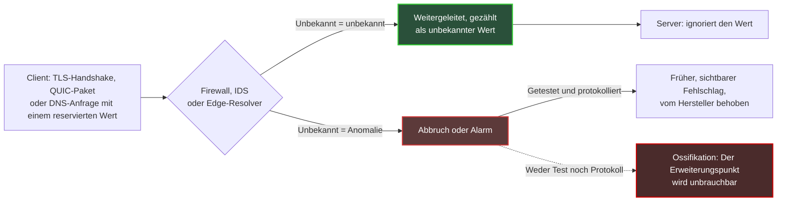
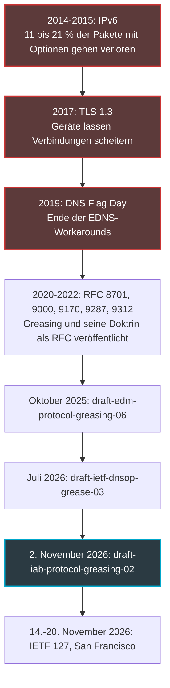
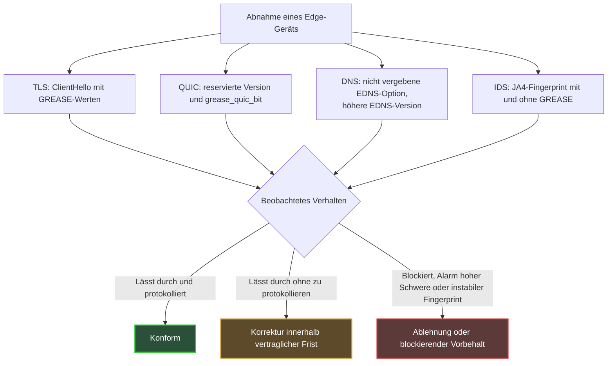

## Wenn eine Appliance entscheidet, was aus dem Internet werden darf

Im Februar 2017 begannen Chrome und Firefox, für einen Teil ihrer Nutzer eine neue Version der Web-Verschlüsselung zu aktivieren. Verbindungen brachen unterwegs ab. Weder der Browser noch der Server waren schuld: Der Übeltäter saß dazwischen, als Firewall, Proxy oder Sicherheitssonde, die dieses Format noch nie gesehen hatte und lieber die Verbindung kappte.

Diese Szene betrifft jeden, der Netze am Rand betreibt: Hotels, Handelsketten, Studierendenwohnheime, Multi-Site-IT-Abteilungen. Diese Orte beherbergen täglich Endgeräte, die niemand kontrolliert. Dahinter stehen einige wenige Gerätemodelle (Firewalls, Intrusion-Detection-Sonden, DNS-Resolver), die identisch auf Dutzenden oder Hunderten Standorten ausgerollt sind. Wenn eines dieser Modelle ablehnt, was es nicht kennt, ist der Fehler nicht lokal. Er wird mit der Größe des Bestands multipliziert.

Warum jetzt? Am 2. November 2026 hat ein Internet-Draft aus dem IAB-Stream (Internet Architecture Board, das Gremium, das über die Architektur des Internets wacht) eine Technik mit kuriosem Namen wieder auf den Tisch gebracht: Greasing. Das Prinzip passt in einen Satz. Man schleust absichtlich absurde Werte in den Datenverkehr ein, um zu prüfen, ob sich niemand daran verschluckt.

Meine Position ist einfach: Die Geräte, die sich verschlucken, sind die, die wir kaufen. Die Ossifikation von Protokollen ist kein Thema für Standardisierungsgremien. Sie ist ein Beschaffungsrisiko, das sich in der Abnahme testen und im Vertrag absichern lässt.

## Der Türsteher, der die Mode vom letzten Jahr auswendig kennt

Jedes ernsthafte Protokoll bereitet seine Zukunft vor. Es sieht Erweiterungspunkte vor: Versionsfelder, Optionslisten, Codes, die für Verwendungen reserviert sind, die es noch nicht gibt. Das ist das Versprechen, dass man es morgen erweitern kann, ohne alles zu zerbrechen.

Nur: Ein Erweiterungspunkt, den niemand benutzt, rostet irgendwann fest.

Stellen Sie sich einen Türsteher vor, der, statt den Dresscode anzuwenden, die Outfits des letzten Jahres auswendig gelernt hat. Alles, was nicht in seinem Gedächtnis steht, wird abgewiesen, selbst wenn es vollkommen regelkonform ist. Genau so verhalten sich Geräte auf dem Weg der Pakete: Sie lernen, was üblicherweise durchkommt, und behandeln den Rest als verdächtig.

Das IAB hat diese Entwicklung zweimal dokumentiert. RFC 8546 (2019) formuliert fast ein physikalisches Gesetz: Alles, was im Wire Image eines Protokolls beobachtbar ist, wird irgendwann von Zwischensystemen ausgenutzt. RFC 9170 (2021) stellt fest, dass manche Installationen, insbesondere Firewalls, unbekannte Fähigkeiten gezielt blockieren. Die Lehre daraus lässt sich in vier Wörtern sagen: *use it or lose it*.

Greasing ist die Gegenmaßnahme. Der Begriff stammt von GREASE, *Generate Random Extensions And Sustain Extensibility*: Man injiziert regelmäßig sinnlose, reservierte Werte in den echten Datenverkehr, die der Empfänger schlicht ignorieren muss. Um im Bild zu bleiben: Man schickt dem Türsteher von Zeit zu Zeit einen Gast in unwahrscheinlichem, aber regelkonformem Outfit. Weist er ihn ab, weiß man es sofort und kann ihn zurechtweisen, bevor die echte neue Mode kommt.

Der Lehrbuchfall ist TLS (Transport Layer Security, das Protokoll, das das Web verschlüsselt). RFC 8701, im Januar 2020 von einem Google-Ingenieur veröffentlicht, reserviert dort 16 Werte, von 0x0A0A bis 0xFAFA, verteilt auf Cipher Suites, Anwendungsprotokoll-Kennungen, Extensions, Gruppen, Signaturalgorithmen und Versionen. Der Text greift selbst das Bild vom festgerosteten Scharnier auf, das blockiert, weil es nie benutzt wurde. Seine Regeln sind nüchtern. Ein Server darf einen GREASE-Wert nicht anders behandeln als jeden anderen unbekannten Wert und ihn auch nicht aushandeln. Und eine Implementierung sollte nach einem Fehlschlag nicht ohne GREASE neu versuchen: Sonst müsste ein Angreifer nur den Fehlschlag provozieren, um den Mechanismus auszuhebeln.

*Ein Scharnier, das man nie bewegt, rostet irgendwann fest: Das ist der ganze Gedanke hinter der Protokoll-Ossifikation.*

Das folgende Schema fasst die zwei möglichen Schicksale eines Grease-Werts zusammen, der auf ein Edge-Gerät trifft.

Das Wesentliche steht unten im Schema. Ein sichtbarer, protokollierter Fehlschlag ist ein guter Fehlschlag: Er landet beim Hersteller, der ihn behebt. Ein stiller Fehlschlag dagegen erzeugt Rost.

## 2014, 2017, 2019: Die Ossifikation hat längst eine Akte

Nichts davon ist theoretisch. Drei gemessene Fälle zeigen, was passiert, wenn Zwischengeräte im Alleingang entscheiden, was akzeptabel ist.

**TLS 1.3, 2017.** Zurück zur Eingangsszene. Laut dem Erfahrungsbericht von Nick Sullivan (Cloudflare) vom Dezember 2017 gelangen mit Draft 18 von TLS 1.3 92,3 % der Verbindungen zwischen Chrome und Gmail zustande, gegenüber 98,3 % mit TLS 1.2. Zwischen Firefox und Cloudflare lag der Abstand bei 96,1 % gegenüber 97,8 %. Sechs verlorene Punkte auf Chrome-Seite sind im Maßstab des Webs enorm. Die Antwort bestand nicht darin, die Geräte zu reparieren. Sie bestand darin, den neuen Handshake dem alten ähnlicher zu machen: Versionsnummer in eine eigene Extension verschoben, eine Session-ID wieder eingeführt, ein leeres Kompressionsfeld, die von TLS 1.2 geerbte ChangeCipherSpec-Nachricht kehrte zurück. Mit Draft 22 zeigte Chrome 98,8 % Erfolg bei TLS 1.3, gegenüber 98,6 % bei TLS 1.2. Das Protokoll hat sich den Geräten gebeugt, nicht umgekehrt.

**DNS Flag Day, 2019.** Am 1. Februar 2019 entfernten die wichtigsten Resolver-Implementierungen (BIND 9.14, Knot Resolver 3.3.0, Unbound 1.9.0, PowerDNS Recursor 4.2.0) die Workarounds, die sie für die Kommunikation mit Servern pflegten, die EDNS schlecht handhabten. EDNS (Extension Mechanisms for DNS) ist genau der Mechanismus, der es erlaubt, dem DNS Optionen hinzuzufügen. Wenige Tage zuvor hatte die Afnic die wahrscheinlichen Auswirkungen auf .fr gemessen. Im strikten Modus stieg die Zahl der toten Zonen von 103.047 (3,17 %) auf 113.316 (3,49 %), also um etwa 10.000 Zonen. Zu den damals genannten Ursachen gehörten falsch konfigurierte Firewalls, die Pakete mit EDNS-Optionen blockierten.

**IPv6, 2014-2015.** Das dritte Beispiel nennt der IAB-Draft selbst. RFC 7872 hat den Verlust von IPv6-Paketen mit Extension Headers gemessen. Mit einem Destination-Options-Header von 8 Bytes gingen je nach Datensatz zwischen 10,91 % und 21,33 % der Pakete verloren, der schlimmste Fall betraf die Nameserver der Alexa Top 1M. Mit einem Hop-by-Hop-Header gleicher Größe stieg der Verlust auf bis zu 54,12 %. Diese Messungen stammen von August 2014 und Juni 2015, und der RFC warnt, dass aktuelle Raten abweichen können. Die Größenordnung genügt dennoch: Ein von der Spezifikation vorgesehener Mechanismus war auf einem erheblichen Teil des Internets unbrauchbar.

Aus diesen drei Fällen ziehe ich eine gemeinsame Lehre. Jedes Mal haben diejenigen die Kosten der Ossifikation getragen, die Netze und Dienste betreiben: Workarounds, Tickets, Dienstausfälle. Der Hersteller des fehlerhaften Geräts hat kaum dafür bezahlt.

## Was der IAB-Draft sagt – und was nicht

Der Text vom 2. November heißt `draft-iab-protocol-greasing-02`, und sein Status verdient eine Klarstellung. Es ist ein Internet-Draft aus dem IAB-Stream, der den Status Informational anstrebt. Er ist weder ein RFC noch ein Standard. Das Banner des Datatrackers, des Portals zur Verfolgung der IETF-Dokumente (der Organisation, die die Standards des Internets erarbeitet), weist übrigens darauf hin, dass ein Internet-Draft keinerlei formalen Wert hat. Er wurde von Pardue (Cloudflare), Pauly (Apple) und Thaler (Armidale Consulting) mitunterzeichnet und läuft am 6. Mai 2027 ab. Er ersetzt `draft-edm-protocol-greasing`, dessen Version -06 vom 19. Oktober 2025 stammte, und versteht sich als Synthese der Diskussionen des EDM-Programms des IAB (Evolvability, Deployability & Maintainability).

Den Kern des Dokuments bildet eine Doktrin, die ich in sieben Punkten zusammenfasse:

- Grease-Werte pro Algorithmus reservieren, mit einem einzigen Eintrag im IANA-Register (der Organisation, die die Nummernregister des Internets führt);
- unvorhersehbare Werte wählen und sie auf unvorhersehbare Weise senden;
- Grease nicht als Sonderfall behandeln: bekannte ungültige Werte explizit prüfen, alles andere ignorieren;
- unbekannte und Grease-Werte protokollieren, um einen Fehlschlag nicht zu verdecken oder falsch zuzuordnen;
- Greasing früh im Leben eines Protokolls einführen;
- erwägen, es nach wiederholten Fehlschlägen zu deaktivieren;
- Ossifikation melden, statt Sender, die kein Greasing betreiben, hart zu bestrafen.

Der Draft fügt einen weniger bekannten Begriff hinzu, die Variabilität: die Art, wie bestimmte Protokollelemente verwendet werden, bewusst zu verändern, damit sich Beobachter auf keine Erwartung festlegen. Seine Beispiele reichen von QUIC-Frames über IPv6 bis zu Post-Quanten-TLS. Er räumt in seinen Sicherheitsüberlegungen auch ein, dass Sicherheitsgeräte Grease für einen Angriff halten können: In diesem Fall scheitert das Greasing, und die Sender laufen Gefahr, darauf zu verzichten. Genau das ist unser Thema.

Was der Draft nicht tut: Geräte bewerten. Er definiert weder eine Güteklasse noch einen Konformitätstest für Firewalls oder IDS (Intrusion-Detection-Systeme). Man muss auch ehrlich bleiben, was die Grenzen des Werkzeugs angeht. RFC 9170 räumt ein, dass Grease nur einen kleinen Teil der realen Nutzung von Extensions abdeckt, dass seine generelle Wirksamkeit nicht belegt ist und dass man dafür ein Interoperabilitätsrisiko in Kauf nehmen muss. Greasing ist ein Rauchmelder, kein Feuerlöscher.

### QUIC und DNS: zwei Baustellen in sehr unterschiedlichem Stadium

QUIC, das Transportprotokoll über UDP, das HTTP/3 trägt, hat Greasing von Anfang an in sein Design aufgenommen. RFC 9000 (Mai 2021) reserviert Versionsnummern der Form 0x?a?a?a?a und Kennungen für Transportparameter der Form 31 × N + 27. Ein Endpunkt kann sogar ein Paket mit reservierter Version senden, um zu prüfen, ob sein Gegenüber es korrekt zurückweist. RFC 9287 (August 2022) ergänzt den Parameter `grease_quic_bit`, der erlaubt, ein bis dahin festes Header-Bit variieren zu lassen. Seine Sicherheitsüberlegungen sagen es unumwunden: QUIC wird schwerer zu identifizieren, was mit Betreibern kollidieren kann, die den Datenverkehr klassifizieren.

Beim DNS ist die Baustelle deutlich weniger weit. `draft-ietf-dnsop-grease-03`, datiert auf den 6. Juli 2026 und unterzeichnet von Shumon Huque (Salesforce) und Mark Andrews (ISC, dem Herausgeber von BIND), ist ein Arbeitsgruppendokument, dessen Header den Status Informational anstrebt. Es schlägt vor, die nicht vergebenen Erweiterungspunkte des DNS mit Grease zu versehen (*to grease*), von Header-Flags bis zu Record-Typen. Das größte Reservoir sind die EDNS-Optionscodes, von denen etwa 65.000 frei sind. Auf Resolver-Seite erwähnt der Text das periodische Senden nicht vergebener Werte, mit einer Größenordnung von einer Anfrage auf 1.000, gefolgt von einem Fragezeichen, das alles sagt. Auf Seiten autoritativer Server wäre Greasing standardmäßig deaktiviert.

Vor allem hat die Arbeitsgruppe keinen Konsens über die Reservierung von Bereichen erzielt, und mehrere Abschnitte sind noch in Arbeit. Ohne neue Version läuft der Text am 7. Januar 2027 ab. Er erinnert nebenbei an eine bittere Tatsache: EDNS, 1999 spezifiziert, ist bis heute nicht universell ausgerollt. Der IAB-Draft weist schließlich auf eine DNS-spezifische Falle hin. Resolver neigen dazu, bei einer fehlgeschlagenen Anfrage ohne Optionen neu zu versuchen, was sich schlecht mit Grease verträgt.

*Verschlüsseltes Web, UDP-Transport, Namensauflösung: drei Schichten, ein Prinzip. Ein unbekannter Wert muss den Kontrollpunkt passieren, ohne einen Abbruch auszulösen.*

## Hotel, Campus: Der Verdächtige schläft im Netzwerkschrank

Was folgt, ist die Analyse des Autors, keine Zusammenfassung der Drafts.

Ein Betreiber von Managed WLAN in Hotellerie, Handel oder Studierendenwohnheimen lebt mit einem Bestand an Endgeräten, die er nicht auswählt: Smartphones, Computer, Konsolen, Fernseher, vernetzte Objekte. GREASE in TLS wurde so spezifiziert, dass sowohl Clients als auch Server es senden. Sobald ein Gastgerät welches sendet, entdeckt man eine intolerante Firewall nicht mehr im Labor. Man entdeckt sie an der Rezeption, auf dem Telefon eines Gasts, der nicht versteht, warum eine App nicht laden will.

Zweiter Faktor: die Vervielfältigung. Multi-Site-Firewall, Captive-Portal-Gateway, DNS-Relay, IDS-Sonde: Diese Geräte werden identisch über einen ganzen Bestand ausgerollt und nur langsam aktualisiert, weil jedes Update standortweise geplant wird. Eine Intoleranz in einem Parser ist dann kein Bug mehr. Sie wird zu einem Fehler, multipliziert mit der Zahl der Standorte. RFC 9170 beschreibt genau diesen Verschleißmechanismus. RFC 9413 vertritt, ohne je von Greasing zu sprechen, dieselbe Philosophie: Protokolle aktiv pflegen, statt alles unbegrenzt zu tolerieren.

Die IDS verdienen einen eigenen Absatz. Die TLS-Fingerprinting-Methoden JA3 und JA4, die eine Client-Software an der Form ihres Handshakes identifizieren, haben die Frage entschieden. JA3, 2017 bei Salesforce entstanden, ignoriert GREASE-Werte, damit dasselbe Programm einen einzigen Fingerprint behält. Die JA4-Spezifikation schreibt vor, GREASE überall zu verwerfen, wo es auftaucht, und sortiert dann die Extensions. Ein IDS, das Grease vor der Berechnung seiner Fingerprints nicht entfernt, erzeugt also instabile Signaturen für ein und denselben Browser. Regeln, die nicht mehr greifen, False Positives, Analysten, die das Vertrauen verlieren: Der Schaden ist real, auch ohne den geringsten Verbindungsabbruch.

Jetzt muss ich eine Lücke offenlegen. Ich habe keine aktuelle öffentliche Messung gefunden, wie sich die am Markt verfügbaren Firewalls und IDS gegenüber GREASE oder unbekannten EDNS-Optionen verhalten. Ich habe auch nichts dazu gefunden, wie Suricata oder Zeek, zwei verbreitete Open-Source-Detection-Engines, diese Werte behandeln. Mein Argument stützt sich also nicht auf einen Benchmark, sondern auf gemessene Präzedenzfälle: TLS 1.3 im Jahr 2017, der Flag Day 2019, IPv6 in den Jahren 2014-2015. Ich sage nicht, dass Ihre Hersteller durchfallen. Ich sage, dass es niemand weiß, und genau das muss sich ändern.

Bleibt die heikelste Spannung: die Sichtbarkeit. Ein Betreiber will den Datenverkehr klassifizieren, für Sicherheit, Quality of Service oder Compliance. RFC 9287 erkennt diesen Konflikt an. RFC 9312, der QUIC-Manageability-Leitfaden für Betreiber, leitet daraus klare Vorgaben ab: Das Fixed Bit ist kein verlässlicher Identifikator, die Zulassung eines Flows darf nicht von der QUIC-Version abhängen, und der Zustand einer Session muss auf zustandsbehafteten Geräten mindestens zwei Minuten gehalten werden. Er fügt hinzu, dass QUIC-Connection-IDs keine verlässlichen Schlüssel für die Adressübersetzung (NAT) sind.

Meine Position: auf stabilen, dokumentierten Merkmalen klassifizieren, niemals auf zufälligen Invarianten. Der angefragte Servername (SNI, Server Name Indication), das angekündigte Anwendungsprotokoll (ALPN, Application-Layer Protocol Negotiation), Ports und das Verhalten des Flows sind legitime Anhaltspunkte. Ein Bit, das heute zufällig fest ist, ist es morgen nicht mehr. QUIC zu blockieren, um die Sichtbarkeit zu behalten, bleibt eine vertretbare Entscheidung, sofern man sie als bewusste, dokumentierte Architekturentscheidung trifft und nicht als Standardeinstellung. Und wenn man blockiert, empfiehlt RFC 9312, schon bei den ersten Paketen zu kappen, damit der Client sauber auf TCP zurückfällt, statt die Verbindung starten und dann scheitern zu lassen.

*Dutzende Access Points, einige wenige Edge-Geräte: Eine Parser-Intoleranz repliziert sich über den gesamten Bestand.*

## Acht Klauseln für die nächste Ausschreibung

Hier will ich hin. Ausdrücklicher Hinweis: Das folgende Raster ist eine redaktionelle Extrapolation von mir, aufgebaut auf den zitierten Quellen. Es ist keine Anforderung des IAB-Drafts, der keinerlei Gerätetest definiert.

1. **Die Regel des Unbekannten.** Eine unbekannte TLS-Extension, ALPN-Kennung, QUIC-Version, ein unbekannter Transportparameter oder EDNS-Optionscode wird standardmäßig weitergeleitet oder allenfalls wie jeder andere unbekannte Wert behandelt. Niemals blockiert, niemals als Angriff eingestuft. Das ist die direkte Übertragung von RFC 8701 und RFC 9170.
2. **Testfälle in der Abnahme.** Ein ClientHello (die erste Nachricht des TLS-Handshakes) mit GREASE-Werten, ein QUIC-Paket mit reservierter Version und `grease_quic_bit`, DNS-Anfragen mit einer nicht vergebenen EDNS-Option und einer höheren EDNS-Version. Abnahmekriterium: legitimer Datenverkehr unverändert, kein Abbruch, kein Alarm hoher Schwere.
3. **Protokollieren, ohne zu verdecken.** Ein eigener Zähler für unbekannte Werte, getrennt von den Sicherheitsalarmen: die Protokollierungsempfehlung des Drafts, angewandt auf das Gerät.
4. **Saubere Fingerprints.** GREASE wird vor jeder Berechnung von JA3- oder JA4-Fingerprints entfernt, und TLS- und QUIC-Parser tolerieren unbekannte Extensions, per Test verifiziert und nicht auf Zusicherung.
5. **Eine explizite QUIC-Policy.** Zulassung unabhängig von Version und Fixed Bit, State-Timeouts von mindestens zwei Minuten, eine etwaige Blockade als Architekturentscheidung dokumentiert.
6. **Konforme Edge-Resolver.** EDNS-Konformität im Sinne des Flag Day 2019 und kein stiller, nicht protokollierter Fallback auf Anfragen ohne EDNS: dnsop-grease-03 vermerkt, dass ein solcher Fallback es einem Angreifer ermöglichen kann, eine Sicherheitsfunktion abzuschalten. Hinzu kommen die Möglichkeit, jedes vom Resolver ausgehende Greasing abzuschalten, und, falls aktiviert, echte Zufälligkeit der Werte, um Fingerprinting zu vermeiden.
7. **Eine Korrekturfrequenz.** Vertragliche Frist zur Behebung eines Intoleranz-Bugs, Release Notes, die jede Verhaltensänderung gegenüber unbekannten Extensions anzeigen. Der Bezug zu den Wartungspflichten des Cyber Resilience Act (CRA), der europäischen Verordnung über Produkte mit digitalen Elementen, ist direkt.
8. **Eine einklagbare Testklausel.** Das Recht, diese Testfälle bei der Abnahme und bei jedem größeren Update auszuführen, mit einem Ergebnis, das den Hersteller bindet.

Nichts an diesem Raster ist exotisch. Die Testwerte sind öffentlich, beschrieben in RFCs, die seit 2020 für TLS und seit 2021 für QUIC verfügbar sind. Sie erneut abzuspielen ist Teil einer gewöhnlichen Abnahmekampagne, kein Forschungsprogramm. Ein Hersteller, der sich dem verweigert, sendet bereits ein Signal.

## Lieber früh scheitern als spät leiden

Die IETF 127 beginnt am 14. November in San Francisco, in sechs Tagen, und dauert bis zum 20. Das ist der Kalendertermin, mehr nicht: Die offizielle Seite des Treffens sagt nicht, ob diese Drafts dort diskutiert werden. Der DNS-Text wiederum läuft am 7. Januar 2027 ab, wenn er nicht aktualisiert wird. Die Standardisierung wird in ihrem eigenen Tempo vorankommen, mit ihren berechtigten Debatten über reservierte Bereiche und über die Sichtbarkeit für Betreiber. Unsere Kaufentscheidungen fallen dagegen jetzt.

Der nächste Praxistest zeichnet sich schon ab. Der Post-Quanten-Übergang macht TLS-Handshakes schwerer und lässt neue Werte in Feldern auftauchen, die die Geräte zu kennen glauben; der IAB-Draft zählt Post-Quanten-TLS übrigens zu seinen Beispielen. Die Geräte, die TLS 1.3 im Jahr 2017 haben scheitern lassen, haben Nachfahren in den Netzwerkschränken von heute. Zu wetten, dass alle ihre Lektion gelernt haben, wäre naiv.

Die Philosophie des Greasings passt in einen Gedanken: Lieber ein früher, sichtbarer, zurechenbarer Fehlschlag als ein später, diffuser, rätselhafter Ausfall. Das ist genau die Logik einer Beschaffungsabnahme. Mir ist lieber, dass eine Firewall an einem Dienstagmorgen auf einem Prüfstand scheitert als an einem Freitagabend zum Check-in, vor einem Gast, der sich nur eines merkt: Das WLAN funktioniert nicht.

Greasing ist nicht nur ein Thema für die IETF. Es ist eine Zeile im Lastenheft. Nehmen Sie sie auf, bevor die nächste Extension die Tür verrostet vorfindet.

_Persönliche Ansichten, keine Position von Wifirst._

## Quellen

1. IAB, `draft-iab-protocol-greasing-02` (2 novembre 2026) — https://www.ietf.org/archive/id/draft-iab-protocol-greasing-02.html
2. Datatracker, `draft-iab-protocol-greasing` (statut, flux IAB, filiation) — https://datatracker.ietf.org/doc/draft-iab-protocol-greasing/
3. IETF DNSOP, `draft-ietf-dnsop-grease-03` (6 juillet 2026) — https://www.ietf.org/archive/id/draft-ietf-dnsop-grease-03.html
4. Datatracker, `draft-ietf-dnsop-grease` — https://datatracker.ietf.org/doc/draft-ietf-dnsop-grease/
5. RFC 8701, Applying GREASE to TLS Extensibility (janvier 2020) — https://www.rfc-editor.org/rfc/rfc8701.html
6. RFC 9170, Long-Term Viability of Protocol Extension Mechanisms (décembre 2021) — https://www.rfc-editor.org/rfc/rfc9170.html
7. RFC 9287, Greasing the QUIC Bit (août 2022) — https://www.rfc-editor.org/rfc/rfc9287.html
8. RFC 9312, Manageability of the QUIC Transport Protocol (septembre 2022) — https://www.rfc-editor.org/rfc/rfc9312.html
9. RFC 8546, The Wire Image of a Network Protocol (avril 2019) — https://www.rfc-editor.org/rfc/rfc8546.html
10. RFC 7872, mesures de perte des en-têtes d'extension IPv6 (juin 2016) — https://www.rfc-editor.org/rfc/rfc7872.html
11. RFC 9000, QUIC (mai 2021) — https://www.rfc-editor.org/rfc/rfc9000.html
12. Cloudflare, Why TLS 1.3 isn't in browsers yet (26 décembre 2017) — https://blog.cloudflare.com/why-tls-1-3-isnt-in-browsers-yet/
13. Afnic, February 1, 2019: is the DNS going to shake? (24 janvier 2019) — https://www.afnic.fr/en/observatory-and-resources/expert-papers/february-1-2019-is-the-dns-going-to-shake/
14. ISC, Infoblox et MS-ISAC sur le DNS Flag Day (2019) — https://victor.isc.org/blogs/dns-flag-day/ ; https://www.infoblox.com/blog/community/dns-flag-day/ ; https://www.cisecurity.org/ms-isac/cyber-alert-dns-flag-day
15. FoxIO, spécification JA4 — https://github.com/FoxIO-LLC/ja4/blob/main/technical_details/JA4.md
16. Salesforce Engineering, TLS Fingerprinting with JA3 and JA3S — https://engineering.salesforce.com/tls-fingerprinting-with-ja3-and-ja3s/
17. IETF 127, San Francisco (14-20 novembre 2026) — https://www.ietf.org/meeting/127/
18. Datatracker, programme IAB EDM — https://datatracker.ietf.org/program/edm/documents/ ; https://datatracker.ietf.org/program/edm/about/
19. RFC 9413, Maintaining Robust Protocols (juin 2023) — https://www.rfc-editor.org/rfc/rfc9413.html
