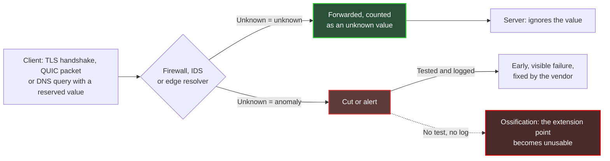
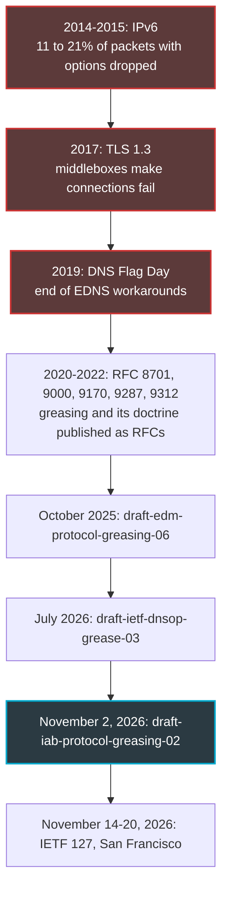
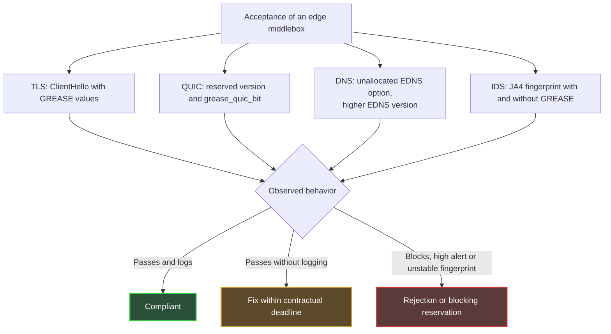

## When a Middlebox Decides What the Internet Is Allowed to Become

In February 2017, Chrome and Firefox began enabling a new version of web encryption for a share of their users. Connections died along the way. Neither the browser nor the server was at fault: the culprit sat between the two, in the form of a firewall, a proxy or a security probe that had never seen this format and chose to cut the connection.

This scene concerns anyone who runs edge networks: hotels, retail chains, student residences, multi-site IT departments. These places welcome devices that nobody controls, every single day. Behind them, a handful of middlebox models (firewalls, intrusion detection probes, DNS resolvers) are duplicated identically across dozens or hundreds of sites. When one of those models rejects what it doesn't recognize, the flaw is not local. It is multiplied by the size of the fleet.

Why now? On November 2, 2026, an Internet-Draft from the IAB stream (Internet Architecture Board, the body responsible for overseeing the architecture of the Internet) put a technique with an odd name back on the table: greasing. The principle fits in one sentence. You deliberately slip absurd values into traffic to check that nobody chokes on them.

My position is simple: the boxes that choke are the ones we buy. Protocol ossification is not a topic for standards committees. It is a procurement risk, one that gets tested at acceptance and locked down in a contract.

## The Bouncer Who Memorized Last Year's Fashion

Every serious protocol prepares for its future. It builds in extension points: version fields, option lists, codes reserved for uses that don't exist yet. That is the promise that it can be enriched tomorrow without breaking everything.

Except that an extension point nobody uses ends up seizing.

Picture a nightclub bouncer who, instead of enforcing the dress code, has memorized last year's outfits. Anything outside his memory gets turned away, even when it is perfectly within the rules. The devices sitting in the path of packets behave exactly this way: they learn what usually gets through, then treat everything else as suspect.

The IAB has documented this drift twice. RFC 8546 (2019) states something close to a law of physics: anything observable in a protocol's wire image will eventually be exploited by intermediary devices. RFC 9170 (2021) notes that some deployments, firewalls in particular, deliberately block unknown capabilities. Its lesson fits in four words: *use it or lose it*.

Greasing is the countermeasure. The term comes from GREASE, for *Generate Random Extensions And Sustain Extensibility*: you regularly inject reserved, meaningless values into real traffic, which the recipient must simply ignore. To stay with the image, every now and then you send the bouncer a client in an improbable but compliant outfit. If he turns the client away, you know immediately, and you set him straight before the real new fashion arrives.

The textbook case is TLS (Transport Layer Security, the protocol that encrypts the web). RFC 8701, published in January 2020 by a Google engineer, reserves 16 values there, from 0x0A0A to 0xFAFA, spread across cipher suites, application protocol identifiers, extensions, groups, signature algorithms and versions. The text itself runs with the metaphor of the rusty joint, seized from lack of use. Its rules are blunt. A server must not treat a GREASE value any differently from any other unknown value, nor negotiate it. And an implementation should not retry without GREASE after a failure: otherwise, an attacker would only have to trigger the failure to neutralize the mechanism.

*A hinge that is never moved ends up seizing: that is the whole idea of protocol ossification.*

The diagram below sums up the two possible fates of a grease value that crosses an edge middlebox.

The key point is at the bottom of the diagram. A visible, logged failure is a good failure: it goes back to the vendor, who fixes it. A silent failure, on the other hand, manufactures rust.

## 2014, 2017, 2019: Ossification Already Has a Record

None of this is theoretical. Three measured episodes show what happens when intermediary middleboxes decide on their own what is acceptable.

**TLS 1.3, 2017.** Back to the opening scene. According to the field report published by Nick Sullivan (Cloudflare) in December 2017, the Draft 18 version of TLS 1.3 succeeded on 92.3% of connections between Chrome and Gmail, against 98.3% for TLS 1.2. Between Firefox and Cloudflare, the gap was 96.1% against 97.8%. Six points lost on the Chrome side, at the scale of the web, is considerable. The fix was not to repair the middleboxes. It was to make the new handshake look more like the old one: version number moved into a dedicated extension, session ID reintroduced, empty compression field, the ChangeCipherSpec message inherited from TLS 1.2 brought back. With Draft 22, Chrome showed a 98.8% success rate on TLS 1.3, against 98.6% on TLS 1.2. The protocol bent to the middleboxes, not the other way around.

**DNS Flag Day, 2019.** On February 1, 2019, the main resolver software (BIND 9.14, Knot Resolver 3.3.0, Unbound 1.9.0, PowerDNS Recursor 4.2.0) removed the workarounds they had maintained to talk to servers that handled EDNS poorly. EDNS (Extension Mechanisms for DNS) is precisely the mechanism that allows options to be added to DNS. A few days earlier, Afnic had measured the probable impact on .fr. In strict mode, the number of dead zones went from 103,047 (3.17%) to 113,316 (3.49%), roughly 10,000 more zones. Among the causes cited at the time were misconfigured firewalls that blocked packets carrying EDNS options.

**IPv6, 2014-2015.** The third example is cited by the IAB draft itself. RFC 7872 measured the loss of IPv6 packets carrying extension headers. With an 8-byte Destination Options header, between 10.91% and 21.33% of packets were dropped depending on the datasets, the worst case involving the Alexa Top 1M name servers. With a Hop-by-Hop header of the same size, loss rose as high as 54.12%. These measurements date from August 2014 and June 2015, and the RFC warns that current rates may differ. The order of magnitude is enough, though: a mechanism provided for by the specification was unusable across a significant share of the Internet.

I draw one common lesson from these three episodes. Each time, the cost of ossification was borne by the people who run the networks and services: workarounds, tickets, outages. The vendor of the faulty middlebox, for its part, hardly paid anything.

## What the IAB Draft Says, and What It Doesn't

The November 2 text is called `draft-iab-protocol-greasing-02`, and its status deserves a clarification. It is an Internet-Draft from the IAB stream, aiming for Informational status. It is neither an RFC nor a standard. The banner on the datatracker, the IETF's document tracking portal (the body that develops Internet standards), reminds readers, incidentally, that an Internet-Draft has no formal standing. Co-authored by Pardue (Cloudflare), Pauly (Apple) and Thaler (Armidale Consulting), it expires on May 6, 2027. It replaces `draft-edm-protocol-greasing`, whose -06 version dated from October 19, 2025, and presents itself as a synthesis of the discussions of the IAB's EDM program (Evolvability, Deployability & Maintainability).

The core of the document is a doctrine, which I summarize in seven points:

- reserve grease values per algorithm, with a single entry in the IANA registry (the body that maintains Internet number registries);
- choose unpredictable values, and emit them unpredictably;
- do not treat grease as a special case: explicitly check for known invalid values, and ignore everything else;
- log unknown and grease values, so as not to mask or misattribute a failure;
- introduce greasing early in a protocol's life;
- consider disabling it after repeated failures;
- report ossification rather than heavily penalize senders that don't grease.

The draft adds a lesser-known notion, variability: deliberately changing how certain protocol elements are used, so that observers don't settle on any expectation. Its examples range from QUIC frames to IPv6, including post-quantum TLS. It also acknowledges, in its security considerations, that security devices may mistake grease for an attack: in that case greasing fails and senders risk giving it up. That is exactly our topic.

What the draft does not do is grade devices. It defines neither a grade nor a conformance test for firewalls or IDS (intrusion detection systems). We also need to be honest about the limits of the tool. RFC 9170 admits that grease exercises only a small part of the real-world use of extensions, that its general effectiveness is not demonstrated, and that it requires accepting an interoperability risk. Greasing is a smoke detector, not a fire extinguisher.

### QUIC and DNS, Two Workstreams at Very Different Stages

QUIC, the UDP-based transport protocol that carries HTTP/3, built in greasing from the start. RFC 9000 (May 2021) reserves version numbers of the form 0x?a?a?a?a and transport parameter identifiers of the form 31 × N + 27. An endpoint can even send a packet with a reserved version to check that its peer rejects it correctly. RFC 9287 (August 2022) adds the `grease_quic_bit` parameter, which allows a previously fixed header bit to vary. Its security considerations put it bluntly: QUIC becomes harder to identify, which may conflict with operators who classify traffic.

On the DNS side, the work is far less mature. `draft-ietf-dnsop-grease-03`, dated July 6, 2026 and signed by Shumon Huque (Salesforce) and Mark Andrews (ISC, the publisher of BIND), is a working group document whose header aims for Informational status. It proposes to *grease* DNS's unallocated extension points, from header flags to record types. The largest pool is EDNS option codes, of which about 65,000 remain free. On the resolver side, the text mentions periodically sending unallocated values, with an order of magnitude of one query in 1,000, followed by a question mark that says it all. On the authoritative server side, greasing would be disabled by default.

Above all, the working group has not reached consensus on reserving ranges, and several sections remain a work in progress. Without a new version, the text expires on January 7, 2027. It also recalls a cruel fact: EDNS, specified in 1999, is still not universally deployed. Finally, the IAB draft points to a pitfall specific to DNS. Resolvers are used to retrying without options when a query fails, which sits poorly with grease.

*Encrypted web, UDP transport, name resolution: three layers, one principle. An unknown value must get through the checkpoint without causing a cut.*

## On the Hotel Side, on the Campus Side: The Suspect Sleeps in the Network Closet

What follows is the author's analysis, not a synthesis of the drafts.

A managed Wi-Fi operator in hospitality, retail or student residences lives with a fleet of devices it doesn't choose: smartphones, computers, consoles, TVs, connected objects. TLS GREASE was specified to be emitted by clients as well as servers. As soon as a guest device sends it, an intolerant firewall is no longer discovered in the lab. It is discovered at the front desk, on the phone of a customer who doesn't understand why an app refuses to load.

Second factor, duplication. Multi-site firewalls, captive portal gateways, DNS relays, IDS probes: this equipment is deployed identically across an entire fleet and updated slowly, because each update has to be planned site by site. An intolerance in a parser then stops being a bug. It becomes a defect multiplied by the number of sites. RFC 9170 describes this wear mechanism precisely. RFC 9413, without ever mentioning greasing, defends the same philosophy: actively maintaining protocols rather than tolerating everything indefinitely.

IDS deserve a paragraph of their own. The JA3 and JA4 TLS fingerprinting methods, which identify client software by the shape of its handshake, have settled the question. JA3, created at Salesforce in 2017, ignores GREASE values so that a given program keeps a single fingerprint. The JA4 specification requires discarding GREASE wherever it appears, then sorts the extensions. An IDS that doesn't strip grease before computing its fingerprints therefore produces unstable signatures for a single browser. Rules that no longer match, false positives, analysts who lose confidence: the cost is real, even without a single cut.

I now need to be transparent about a gap. I found no recent public measurement of how the market's firewalls and IDS behave when faced with GREASE or unknown EDNS options. I found nothing either on how Suricata or Zeek, two common open source detection engines, handle these values. My argument therefore does not rest on a benchmark, but on measured precedents: TLS 1.3 in 2017, the Flag Day in 2019, IPv6 in 2014-2015. I am not saying your vendors fail. I am saying nobody knows, and that is exactly what has to change.

That leaves the most delicate tension: visibility. An operator wants to classify traffic, for security, quality of service or compliance. RFC 9287 acknowledges this conflict. RFC 9312, the QUIC management guide aimed at operators, draws clear guidance from it: the fixed bit is not a reliable identifier, admitting a flow must not depend on the QUIC version, and session state must be kept for at least two minutes on stateful devices. It adds that QUIC connection IDs are not reliable keys for network address translation (NAT).

My position: classify on stable, documented elements, never on accidental invariants. The requested server name (SNI, Server Name Indication), the announced application protocol (ALPN, Application-Layer Protocol Negotiation), ports and flow behavior are legitimate anchors. A bit that happens to be fixed today is not. Blocking QUIC to keep visibility remains a defensible choice, provided it is made a deliberate, documented architecture decision, not a default setting. And if you do block, RFC 9312 recommends cutting from the very first packets, so that the client falls back cleanly to TCP, rather than letting the connection start and then fail.

*Dozens of access points, a few edge middleboxes: a parser intolerance replicates across the whole fleet.*

## Eight Clauses for Your Next RFP

Here is where I'm headed. An explicit warning: the grid that follows is an editorial extrapolation on my part, built from the sources cited. It is not a requirement of the IAB draft, which defines no device test.

1. **The unknown-value rule.** An unknown TLS extension, ALPN identifier, QUIC version, transport parameter or EDNS option code is forwarded by default, or at worst treated like any other unknown value. Never blocked, never classified as an attack. This is the direct transposition of RFC 8701 and RFC 9170.
2. **Test cases at acceptance.** A ClientHello (the first message of the TLS handshake) carrying GREASE values, a QUIC packet with a reserved version and `grease_quic_bit`, DNS queries with an unallocated EDNS option and a higher EDNS version. Acceptance criterion: legitimate traffic unchanged, no cuts, no high-severity alerts.
3. **Log without masking.** A dedicated counter for unknown values, separate from security alerts: the draft's logging recommendation, applied to the middlebox.
4. **Clean fingerprints.** GREASE stripped before any JA3 or JA4 fingerprint computation, and TLS and QUIC parsers tolerant of unknown extensions, verified by testing and not on declaration.
5. **An explicit QUIC policy.** Admission independent of the version and the fixed bit, state timeouts of at least two minutes, any blocking documented as an architecture decision.
6. **Compliant edge resolvers.** EDNS compliance in the sense of Flag Day 2019, and no silent, unlogged fallback to queries without EDNS: dnsop-grease-03 notes that such a fallback can let an adversary disable a security feature. On top of that come the ability to turn off any greasing emitted by the resolver and, if enabled, real randomness in the values to avoid fingerprinting.
7. **A fix cadence.** A contractual deadline for fixing an intolerance bug, and release notes that flag any change in behavior toward unknown extensions. The link with the maintenance obligations of the Cyber Resilience Act (CRA), the European regulation on products with digital elements, is direct.
8. **An enforceable test clause.** The right to run these test cases at acceptance and at every major update, with a result that binds the vendor.

Nothing in this grid is exotic. The test values are public, described in RFCs available since 2020 for TLS and 2021 for QUIC. Replaying them is part of an ordinary acceptance campaign, not a research program. A vendor that refuses to submit to them is already sending a signal.

## Fail Early Rather Than Suffer Late

IETF 127 opens on November 14 in San Francisco, in six days, and runs through the 20th. That is the calendar deadline, nothing more: the official meeting page doesn't say whether these drafts will be discussed there. The DNS text, for its part, will expire on January 7, 2027 if it is not updated. Standardization will move at its own pace, with its legitimate debates over reserved ranges and operator visibility. Our purchasing decisions, meanwhile, are made now.

The next full-scale test is already looming. The post-quantum transition makes TLS handshakes heavier and brings new values into fields that middleboxes believe they know; the IAB draft, incidentally, lists post-quantum TLS among its examples. The middleboxes that made TLS 1.3 fail in 2017 have descendants in today's network closets. Betting that they have all learned the lesson would be naive.

The philosophy of greasing comes down to one idea: better an early, visible, attributable failure than a late, diffuse, mysterious outage. That is exactly the logic of acceptance testing for purchases. I would rather see a firewall fail on a Tuesday morning on a test bench than on a Friday evening at check-in, in front of a customer who will remember only one thing: the Wi-Fi doesn't work.

Greasing is not just an IETF topic. It is a line in your requirements spec. Add it before the next extension finds the door rusted shut.

_Personal views, not Wifirst's position._

## Sources

1. IAB, `draft-iab-protocol-greasing-02` (November 2, 2026) — https://www.ietf.org/archive/id/draft-iab-protocol-greasing-02.html
2. Datatracker, `draft-iab-protocol-greasing` (status, IAB stream, lineage) — https://datatracker.ietf.org/doc/draft-iab-protocol-greasing/
3. IETF DNSOP, `draft-ietf-dnsop-grease-03` (July 6, 2026) — https://www.ietf.org/archive/id/draft-ietf-dnsop-grease-03.html
4. Datatracker, `draft-ietf-dnsop-grease` — https://datatracker.ietf.org/doc/draft-ietf-dnsop-grease/
5. RFC 8701, Applying GREASE to TLS Extensibility (January 2020) — https://www.rfc-editor.org/rfc/rfc8701.html
6. RFC 9170, Long-Term Viability of Protocol Extension Mechanisms (December 2021) — https://www.rfc-editor.org/rfc/rfc9170.html
7. RFC 9287, Greasing the QUIC Bit (August 2022) — https://www.rfc-editor.org/rfc/rfc9287.html
8. RFC 9312, Manageability of the QUIC Transport Protocol (September 2022) — https://www.rfc-editor.org/rfc/rfc9312.html
9. RFC 8546, The Wire Image of a Network Protocol (April 2019) — https://www.rfc-editor.org/rfc/rfc8546.html
10. RFC 7872, IPv6 extension header drop measurements (June 2016) — https://www.rfc-editor.org/rfc/rfc7872.html
11. RFC 9000, QUIC (May 2021) — https://www.rfc-editor.org/rfc/rfc9000.html
12. Cloudflare, Why TLS 1.3 isn't in browsers yet (December 26, 2017) — https://blog.cloudflare.com/why-tls-1-3-isnt-in-browsers-yet/
13. Afnic, February 1, 2019: is the DNS going to shake? (January 24, 2019) — https://www.afnic.fr/en/observatory-and-resources/expert-papers/february-1-2019-is-the-dns-going-to-shake/
14. ISC, Infoblox and MS-ISAC on DNS Flag Day (2019) — https://victor.isc.org/blogs/dns-flag-day/ ; https://www.infoblox.com/blog/community/dns-flag-day/ ; https://www.cisecurity.org/ms-isac/cyber-alert-dns-flag-day
15. FoxIO, JA4 specification — https://github.com/FoxIO-LLC/ja4/blob/main/technical_details/JA4.md
16. Salesforce Engineering, TLS Fingerprinting with JA3 and JA3S — https://engineering.salesforce.com/tls-fingerprinting-with-ja3-and-ja3s/
17. IETF 127, San Francisco (November 14-20, 2026) — https://www.ietf.org/meeting/127/
18. Datatracker, IAB EDM program — https://datatracker.ietf.org/program/edm/documents/ ; https://datatracker.ietf.org/program/edm/about/
19. RFC 9413, Maintaining Robust Protocols (June 2023) — https://www.rfc-editor.org/rfc/rfc9413.html
