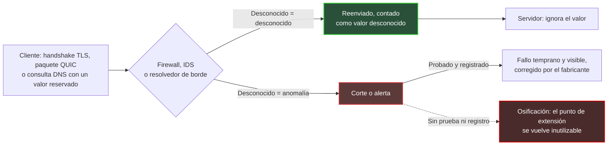
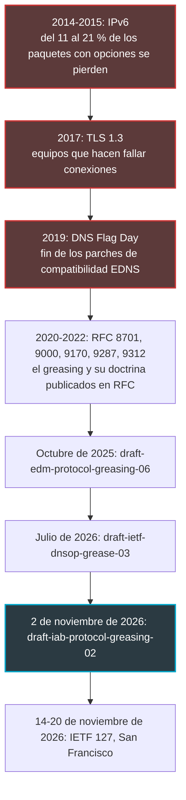
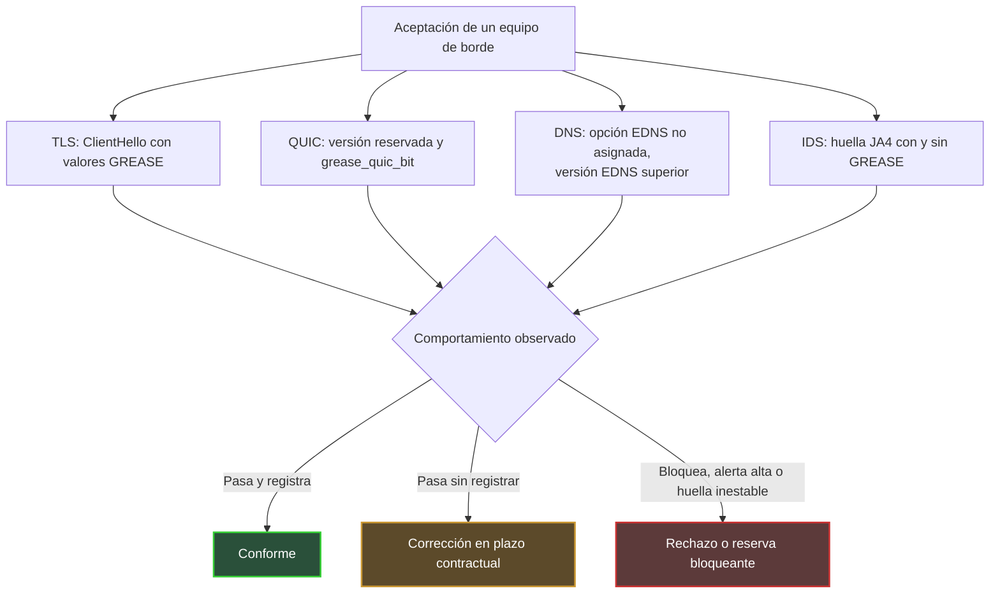

## Cuando una caja decide en qué puede convertirse Internet

En febrero de 2017, Chrome y Firefox empezaron a activar una nueva versión del cifrado web para una parte de sus usuarios. Algunas conexiones murieron por el camino. Ni el navegador ni el servidor tenían la culpa: el culpable estaba plantado entre ambos, en forma de firewall, proxy o sonda de seguridad que nunca había visto pasar ese formato y prefirió cortar.

Esta escena afecta a cualquiera que opere redes de borde: hoteles, cadenas de retail, residencias de estudiantes, departamentos de TI multisede. Esos lugares reciben cada día terminales que nadie controla. Detrás, unos pocos modelos de equipos (firewalls, sondas de detección de intrusiones, resolvedores DNS) se duplican de forma idéntica en decenas o cientos de sedes. Cuando uno de esos modelos rechaza lo que no conoce, el defecto no es local. Se multiplica por el tamaño del parque.

¿Por qué ahora? El 2 de noviembre de 2026, un Internet-Draft del flujo IAB (Internet Architecture Board, el órgano encargado de velar por la arquitectura de Internet) volvió a poner sobre la mesa una técnica de nombre curioso: el greasing. El principio cabe en una frase. Se cuelan voluntariamente valores absurdos en el tráfico para comprobar que a nadie se le atraganta.

Mi posición es simple: los equipos que se atragantan son los que compramos nosotros. La osificación de los protocolos no es un tema para comités de normalización. Es un riesgo de compra, que se prueba en la aceptación y se blinda en el contrato.

## El portero que se sabe de memoria la moda del año pasado

Todo protocolo serio prepara su futuro. Prevé puntos de extensión: campos de versión, listas de opciones, códigos reservados para usos que todavía no existen. Es la promesa de que mañana podrá enriquecerse sin romper todo.

Salvo que un punto de extensión que nadie usa acaba por gripar.

Imagine un portero de discoteca que, en lugar de aplicar el código de vestimenta, ha memorizado los atuendos del año pasado. Todo lo que se sale de su memoria se rechaza, incluso cuando es perfectamente reglamentario. Los equipos situados en el camino de los paquetes se comportan exactamente así: aprenden lo que suele pasar y luego tratan el resto como sospechoso.

El IAB ha documentado este deslizamiento en dos ocasiones. La RFC 8546 (2019) enuncia casi una ley física: todo lo que es observable en la imagen de un protocolo en el cable acabará siendo explotado por equipos intermedios. La RFC 9170 (2021) constata que ciertos despliegues, en particular los firewalls, bloquean deliberadamente las capacidades desconocidas. Su lección cabe en una frase: *use it or lose it*.

El greasing es la contramedida. El término viene de GREASE, por *Generate Random Extensions And Sustain Extensibility*: se inyectan con regularidad en el tráfico real valores reservados, desprovistos de significado, que el destinatario debe limitarse a ignorar. Para seguir con la imagen, de vez en cuando se le manda al portero un cliente con un atuendo improbable pero conforme. Si lo rechaza, se sabe de inmediato y se le corrige antes de que llegue la nueva moda de verdad.

El caso de manual es TLS (Transport Layer Security, el protocolo que cifra la web). La RFC 8701, publicada en enero de 2020 por un ingeniero de Google, reserva 16 valores, de 0x0A0A a 0xFAFA, repartidos entre suites de cifrado, identificadores de protocolo de aplicación, extensiones, grupos, algoritmos de firma y versiones. El propio texto remata la metáfora de la articulación oxidada, atascada por falta de uso. Sus reglas son secas. Un servidor no debe tratar un valor GREASE de forma distinta a cualquier otro valor desconocido, ni negociarlo. Y una implementación no debería reintentar sin GREASE tras un fallo: de lo contrario, a un atacante le bastaría con provocar el fallo para neutralizar el mecanismo.

*Una bisagra que nunca se mueve acaba por gripar: esa es toda la idea de la osificación de protocolos.*

El esquema siguiente resume los dos destinos posibles de un valor grease que se cruza con un equipo de borde.

Lo esencial se lee en la parte inferior del esquema. Un fallo visible y registrado es un buen fallo: llega hasta el fabricante, que lo corrige. Un fallo silencioso, en cambio, fabrica óxido.

## 2014, 2017, 2019: la osificación ya tiene antecedentes

Nada de esto es teórico. Tres episodios medidos muestran lo que ocurre cuando equipos intermedios deciden por su cuenta qué es aceptable.

**TLS 1.3, 2017.** Volvamos a la escena inicial. Según el informe de experiencia publicado por Nick Sullivan (Cloudflare) en diciembre de 2017, la versión Draft 18 de TLS 1.3 lograba el 92,3 % de las conexiones entre Chrome y Gmail, frente al 98,3 % de TLS 1.2. Entre Firefox y Cloudflare, la diferencia era del 96,1 % frente al 97,8 %. Seis puntos perdidos en Chrome, a la escala de la web, es una barbaridad. La solución no consistió en corregir los equipos. Consistió en hacer que el nuevo handshake se pareciera más al antiguo: número de versión trasladado a una extensión dedicada, reintroducción de un identificador de sesión, campo de compresión vacío, regreso del mensaje ChangeCipherSpec heredado de TLS 1.2. En Draft 22, Chrome mostraba un 98,8 % de éxito en TLS 1.3, frente al 98,6 % en TLS 1.2. El protocolo se plegó a los equipos, y no al revés.

**DNS Flag Day, 2019.** El 1 de febrero de 2019, los principales programas resolvedores (BIND 9.14, Knot Resolver 3.3.0, Unbound 1.9.0, PowerDNS Recursor 4.2.0) retiraron los parches de compatibilidad que mantenían para dialogar con servidores que gestionaban mal EDNS. EDNS (Extension Mechanisms for DNS) es precisamente el mecanismo que permite añadir opciones al DNS. Unos días antes, Afnic había medido el impacto probable sobre .fr. En modo estricto, el número de zonas caídas pasaba de 103.047 (3,17 %) a 113.316 (3,49 %), es decir, unas 10.000 zonas más. Entre las causas citadas entonces figuraban firewalls mal configurados, que bloqueaban los paquetes con opciones EDNS.

**IPv6, 2014-2015.** El tercer ejemplo lo cita el propio draft del IAB. La RFC 7872 midió la pérdida de paquetes IPv6 con cabeceras de extensión. Con una cabecera Destination Options de 8 octetos, entre el 10,91 % y el 21,33 % de los paquetes se perdían según los conjuntos de datos, y el peor caso correspondía a los servidores de nombres del Alexa Top 1M. Con una cabecera Hop-by-Hop del mismo tamaño, la pérdida llegaba hasta el 54,12 %. Estas mediciones datan de agosto de 2014 y junio de 2015, y la RFC advierte de que las tasas actuales pueden diferir. Aun así, el orden de magnitud basta: un mecanismo previsto por la especificación era inutilizable en una parte notable de Internet.

De estos tres episodios saco una lección común. Cada vez, el coste de la osificación lo asumieron quienes operan las redes y los servicios: parches de compatibilidad, tickets, pérdidas de servicio. El fabricante del equipo defectuoso, por su parte, apenas pagó nada.

## Lo que dice el draft del IAB, y lo que no dice

El texto del 2 de noviembre se llama `draft-iab-protocol-greasing-02`, y su estatus merece una precisión. Es un Internet-Draft del flujo IAB, que aspira al estatus Informational. No es una RFC ni una norma. El banner del datatracker, el portal de seguimiento de documentos del IETF (el organismo que elabora los estándares de Internet), recuerda además que un Internet-Draft carece de todo valor formal. Cofirmado por Pardue (Cloudflare), Pauly (Apple) y Thaler (Armidale Consulting), caduca el 6 de mayo de 2027. Sustituye a `draft-edm-protocol-greasing`, cuya versión -06 databa del 19 de octubre de 2025, y se presenta como una síntesis de los debates del programa EDM del IAB (Evolvability, Deployability & Maintainability).

El núcleo del documento es una doctrina, que resumo en siete puntos:

- reservar los valores grease por algoritmo, con una sola entrada en el registro de la IANA (el organismo que lleva los registros de números de Internet);
- elegir valores impredecibles y emitirlos de forma impredecible;
- no tratar el grease como un caso especial: verificar explícitamente los valores inválidos conocidos e ignorar todo lo demás;
- registrar los valores desconocidos y grease, para no enmascarar ni atribuir mal un fallo;
- introducir el greasing pronto en la vida de un protocolo;
- considerar desactivarlo tras fallos repetidos;
- señalar la osificación en lugar de penalizar duramente a los emisores que no aplican greasing.

El draft añade una noción menos conocida, la variabilidad: modificar deliberadamente la forma de usar ciertos elementos del protocolo, para que los observadores no se fijen en ninguna expectativa. Sus ejemplos van desde las tramas QUIC hasta IPv6, pasando por TLS poscuántico. Reconoce también, en sus consideraciones de seguridad, que los equipos de seguridad pueden tomar el grease por un ataque: en ese caso el greasing fracasa y los emisores corren el riesgo de renunciar a él. Es exactamente nuestro tema.

Lo que el draft no hace es puntuar equipos. No define ningún grado ni prueba de conformidad para firewalls o IDS (sistemas de detección de intrusiones). Conviene también ser honestos sobre los límites de la herramienta. La RFC 9170 admite que el grease solo ejercita una pequeña parte del uso real de las extensiones, que su eficacia general no está demostrada y que supone aceptar un riesgo de interoperabilidad. El greasing es un detector de humo, no un extintor.

### QUIC y DNS, dos frentes en etapas muy distintas

QUIC, el protocolo de transporte sobre UDP que lleva HTTP/3, integró el greasing desde su diseño. La RFC 9000 (mayo de 2021) reserva números de versión de la forma 0x?a?a?a?a e identificadores de parámetros de transporte de la forma 31 × N + 27. Un extremo puede incluso enviar un paquete con versión reservada para comprobar que su par lo rechaza correctamente. La RFC 9287 (agosto de 2022) añade el parámetro `grease_quic_bit`, que permite variar un bit de cabecera hasta entonces fijo. Sus consideraciones de seguridad lo dicen sin rodeos: QUIC se vuelve más difícil de identificar, lo que puede entrar en conflicto con los operadores que clasifican el tráfico.

En DNS, el frente está bastante menos maduro. `draft-ietf-dnsop-grease-03`, fechado el 6 de julio de 2026 y firmado por Shumon Huque (Salesforce) y Mark Andrews (ISC, el editor de BIND), es un documento de grupo de trabajo cuya cabecera apunta al estatus Informational. Propone *engrasar* los puntos de extensión no asignados del DNS, desde los flags de cabecera hasta los tipos de registro. El mayor yacimiento son los códigos de opción EDNS, de los que quedan libres unos 65.000. Del lado del resolvedor, el texto evoca el envío periódico de valores no asignados, con un orden de magnitud de una consulta de cada 1.000, seguido de un signo de interrogación que lo dice todo. Del lado del servidor autoritativo, el greasing estaría desactivado por defecto.

Sobre todo, el grupo de trabajo no ha alcanzado consenso sobre la reserva de rangos, y varias secciones siguen en obras. Sin nueva versión, el texto caduca el 7 de enero de 2027. De paso recuerda un hecho cruel: EDNS, especificado en 1999, sigue sin estar desplegado universalmente. Por último, el draft del IAB señala una trampa propia del DNS. Los resolvedores tienen la costumbre de reintentar sin opciones cuando una consulta falla, lo que casa mal con el grease.

*Web cifrada, transporte UDP, resolución de nombres: tres capas, un mismo principio. Un valor desconocido debe cruzar el punto de control sin provocar cortes.*

## En el hotel, en el campus: el sospechoso duerme en el armario de red

Lo que sigue es análisis del autor, no síntesis de los drafts.

Un operador de Wi-Fi gestionado en hostelería, retail o residencias de estudiantes convive con un parque de terminales que no elige: smartphones, ordenadores, consolas, televisores, objetos conectados. El GREASE de TLS se especificó para que lo emitan tanto clientes como servidores. En cuanto un terminal de invitado lo envía, un firewall intolerante deja de descubrirse en el laboratorio. Se descubre en recepción, en el teléfono de un cliente que no entiende por qué una aplicación se niega a cargar.

Segundo factor, la duplicación. Firewalls multisede, pasarelas de portal cautivo, relays DNS, sondas IDS: estos equipos se despliegan de forma idéntica en todo un parque y se actualizan despacio, porque cada actualización se planifica sede por sede. Una intolerancia en un parser deja entonces de ser un bug. Se convierte en un defecto multiplicado por el número de sedes. La RFC 9170 describe con precisión este mecanismo de desgaste. La RFC 9413, sin hablar nunca de greasing, defiende la misma filosofía: mantener activamente los protocolos en lugar de tolerarlo todo indefinidamente.

Los IDS merecen un párrafo aparte. Los métodos de huella TLS JA3 y JA4, que identifican un software cliente por la forma de su handshake, han zanjado la cuestión. JA3, creado en Salesforce en 2017, ignora los valores GREASE para que un mismo programa conserve una huella única. La especificación JA4 impone descartar el GREASE allí donde aparezca y luego ordena las extensiones. Un IDS que no elimina el grease antes de calcular sus huellas fabrica, por tanto, firmas inestables para un mismo navegador. Reglas que ya no coinciden, falsos positivos, analistas que pierden la confianza: el coste es real, incluso sin un solo corte.

Ahora toca ser transparente sobre una laguna. No he encontrado ninguna medición pública reciente del comportamiento de los firewalls e IDS del mercado frente al GREASE o a las opciones EDNS desconocidas. Tampoco he encontrado nada sobre cómo tratan estos valores Suricata o Zeek, dos motores de detección de código abierto muy habituales. Mi argumento no se apoya, pues, en un banco de pruebas, sino en precedentes medidos: TLS 1.3 en 2017, el Flag Day en 2019, IPv6 en 2014-2015. No digo que sus fabricantes fallen. Digo que nadie lo sabe, y que eso es exactamente lo que debe cambiar.

Queda la tensión más delicada: la visibilidad. Un operador quiere clasificar el tráfico, por seguridad, calidad de servicio o cumplimiento normativo. La RFC 9287 reconoce este conflicto. La RFC 9312, la guía de gestión de QUIC destinada a operadores, extrae de ello consignas claras: el bit fijo no es un identificador fiable, la admisión de un flujo no debe depender de la versión de QUIC, y el estado de una sesión debe conservarse al menos dos minutos en los equipos con estado. Añade que los identificadores de conexión QUIC no son claves fiables para la traducción de direcciones (NAT).

Mi posición: clasificar sobre elementos estables y documentados, nunca sobre invariantes accidentales. El nombre de servidor solicitado (SNI, Server Name Indication), el protocolo de aplicación anunciado (ALPN, Application-Layer Protocol Negotiation), los puertos y el comportamiento del flujo son apoyos legítimos. Un bit que hoy resulta ser fijo no lo es. Bloquear QUIC para conservar la visibilidad sigue siendo una elección defendible, siempre que sea una decisión de arquitectura asumida y documentada, y no un ajuste por defecto. Y si se bloquea, la RFC 9312 recomienda cortar desde los primeros paquetes, para que el cliente recurra limpiamente a TCP, en lugar de dejar que la conexión arranque y luego falle.

*Decenas de puntos de acceso, unos pocos equipos de borde: una intolerancia de parser se replica a la escala de todo el parque.*

## Ocho cláusulas para la próxima licitación

Aquí es adonde quiero llegar. Advertencia explícita: la tabla de requisitos que sigue es una extrapolación editorial mía, construida a partir de las fuentes citadas. No es una exigencia del draft del IAB, que no define ninguna prueba de equipos.

1. **La regla de lo desconocido.** Una extensión TLS, un identificador ALPN, una versión QUIC, un parámetro de transporte o un código de opción EDNS desconocidos se reenvían por defecto o, como mucho, se tratan como cualquier otro valor desconocido. Nunca se bloquean, nunca se clasifican como ataque. Es la transposición directa de la RFC 8701 y la RFC 9170.
2. **Juegos de prueba en la aceptación.** Un ClientHello (el primer mensaje del handshake TLS) con valores GREASE, un paquete QUIC con versión reservada y `grease_quic_bit`, consultas DNS con una opción EDNS no asignada y una versión EDNS superior. Criterio de aceptación: tráfico legítimo sin cambios, ningún corte, ninguna alerta de severidad alta.
3. **Registrar sin enmascarar.** Un contador dedicado a los valores desconocidos, distinto de las alertas de seguridad: la recomendación de registro del draft, aplicada al equipo.
4. **Huellas limpias.** Eliminación del GREASE antes de cualquier cálculo de huella JA3 o JA4, y parsers TLS y QUIC tolerantes a las extensiones desconocidas, verificados con pruebas y no por declaración.
5. **Una política QUIC explícita.** Admisión independiente de la versión y del bit fijo, timeouts de estado de al menos dos minutos, bloqueo eventual documentado como decisión de arquitectura.
6. **Resolvedores de borde conformes.** Conformidad EDNS en el sentido del Flag Day 2019, y ningún retroceso silencioso y sin registro hacia consultas sin EDNS: dnsop-grease-03 señala que un retroceso así puede permitir a un adversario desactivar una función de seguridad. A ello se suman la posibilidad de cortar todo greasing emitido por el resolvedor y, si está activado, una aleatoriedad real de los valores para evitar la huella.
7. **Una cadencia de corrección.** Plazo contractual de corrección de un bug de intolerancia, notas de versión que señalen cualquier cambio de comportamiento ante extensiones desconocidas. El vínculo con las obligaciones de mantenimiento del Cyber Resilience Act (CRA), el reglamento europeo sobre productos con elementos digitales, es directo.
8. **Una cláusula de prueba oponible.** El derecho a ejecutar estos juegos de prueba en la aceptación y en cada actualización mayor, con un resultado que comprometa al fabricante.

Nada en esta tabla es exótico. Los valores de prueba son públicos, descritos en RFC disponibles desde 2020 para TLS y 2021 para QUIC. Reproducirlos es una campaña de aceptación ordinaria, no un programa de investigación. Un fabricante que se niega a someterse a ellas ya está enviando una señal.

## Fallar pronto en lugar de sufrirlo tarde

El IETF 127 arranca el 14 de noviembre en San Francisco, dentro de seis días, y se celebra hasta el 20. Es la fecha del calendario, nada más: la página oficial de la reunión no dice si estos drafts se debatirán allí. El texto DNS, por su parte, caducará el 7 de enero de 2027 si no se actualiza. La normalización avanzará a su ritmo, con sus debates legítimos sobre los rangos reservados y sobre la visibilidad de los operadores. Nuestras decisiones de compra, en cambio, se toman ahora.

La próxima prueba a escala real ya asoma. La transición poscuántica engorda los handshakes TLS y hace aparecer nuevos valores en campos que los equipos creen conocer; el draft del IAB incluye, de hecho, TLS poscuántico entre sus ejemplos. Los equipos que hicieron fallar TLS 1.3 en 2017 tienen descendientes en los armarios de red de hoy. Apostar a que todos han aprendido la lección sería ingenuo.

La filosofía del greasing se resume en una idea: más vale un fallo temprano, visible y atribuible que una avería tardía, difusa y misteriosa. Es exactamente la lógica de una aceptación de compra. Prefiero que un firewall falle un martes por la mañana en un banco de pruebas que un viernes por la noche de check-in, delante de un cliente que solo recordará una cosa: el Wi-Fi no funciona.

El greasing no es solo un tema del IETF. Es una línea del pliego de condiciones. Añádala antes de que la próxima extensión encuentre la puerta oxidada.

_Opiniones personales, no la posición de Wifirst._

## Fuentes

1. IAB, `draft-iab-protocol-greasing-02` (2 novembre 2026) — https://www.ietf.org/archive/id/draft-iab-protocol-greasing-02.html
2. Datatracker, `draft-iab-protocol-greasing` (statut, flux IAB, filiation) — https://datatracker.ietf.org/doc/draft-iab-protocol-greasing/
3. IETF DNSOP, `draft-ietf-dnsop-grease-03` (6 juillet 2026) — https://www.ietf.org/archive/id/draft-ietf-dnsop-grease-03.html
4. Datatracker, `draft-ietf-dnsop-grease` — https://datatracker.ietf.org/doc/draft-ietf-dnsop-grease/
5. RFC 8701, Applying GREASE to TLS Extensibility (janvier 2020) — https://www.rfc-editor.org/rfc/rfc8701.html
6. RFC 9170, Long-Term Viability of Protocol Extension Mechanisms (décembre 2021) — https://www.rfc-editor.org/rfc/rfc9170.html
7. RFC 9287, Greasing the QUIC Bit (août 2022) — https://www.rfc-editor.org/rfc/rfc9287.html
8. RFC 9312, Manageability of the QUIC Transport Protocol (septembre 2022) — https://www.rfc-editor.org/rfc/rfc9312.html
9. RFC 8546, The Wire Image of a Network Protocol (avril 2019) — https://www.rfc-editor.org/rfc/rfc8546.html
10. RFC 7872, mesures de perte des en-têtes d'extension IPv6 (juin 2016) — https://www.rfc-editor.org/rfc/rfc7872.html
11. RFC 9000, QUIC (mai 2021) — https://www.rfc-editor.org/rfc/rfc9000.html
12. Cloudflare, Why TLS 1.3 isn't in browsers yet (26 décembre 2017) — https://blog.cloudflare.com/why-tls-1-3-isnt-in-browsers-yet/
13. Afnic, February 1, 2019: is the DNS going to shake? (24 janvier 2019) — https://www.afnic.fr/en/observatory-and-resources/expert-papers/february-1-2019-is-the-dns-going-to-shake/
14. ISC, Infoblox et MS-ISAC sur le DNS Flag Day (2019) — https://victor.isc.org/blogs/dns-flag-day/ ; https://www.infoblox.com/blog/community/dns-flag-day/ ; https://www.cisecurity.org/ms-isac/cyber-alert-dns-flag-day
15. FoxIO, spécification JA4 — https://github.com/FoxIO-LLC/ja4/blob/main/technical_details/JA4.md
16. Salesforce Engineering, TLS Fingerprinting with JA3 and JA3S — https://engineering.salesforce.com/tls-fingerprinting-with-ja3-and-ja3s/
17. IETF 127, San Francisco (14-20 novembre 2026) — https://www.ietf.org/meeting/127/
18. Datatracker, programme IAB EDM — https://datatracker.ietf.org/program/edm/documents/ ; https://datatracker.ietf.org/program/edm/about/
19. RFC 9413, Maintaining Robust Protocols (juin 2023) — https://www.rfc-editor.org/rfc/rfc9413.html
